# 【多伦多大学】强化学习 2025 ｜ Uoft   Reinforcement Learning   Fall 2025 p09 P09_讲座_8_井字棋游戏 -BV1D3F2zhEry_p9-

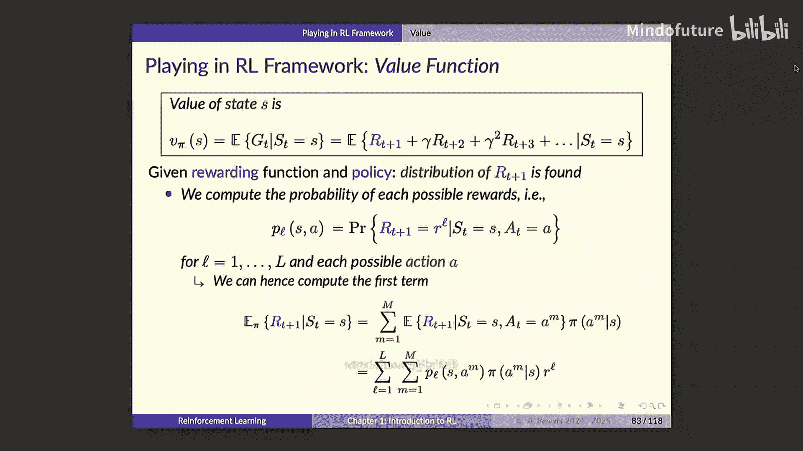

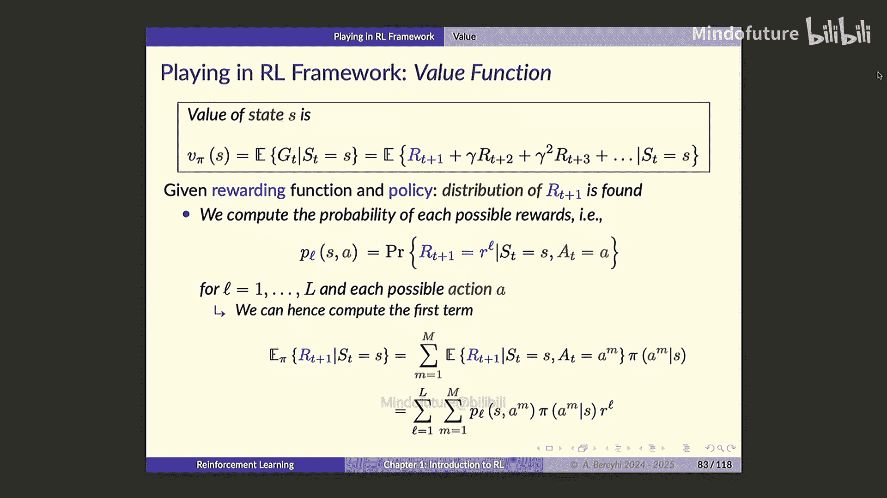

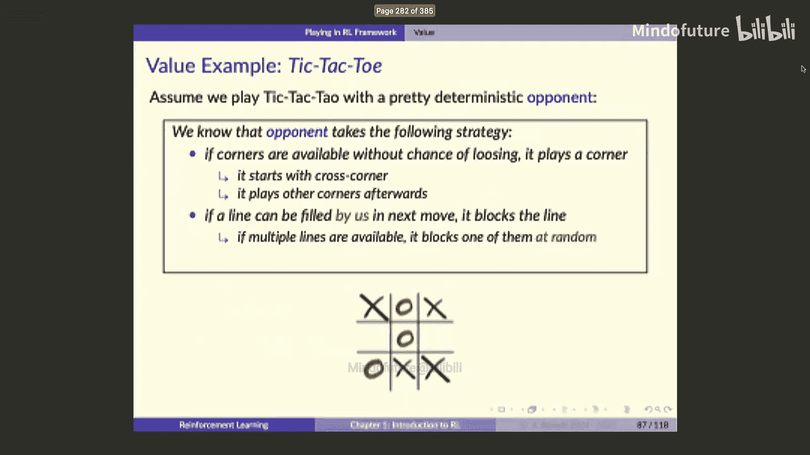

不行。好。Okay， shall we go on？So， now let。啊。Look at this policy and value function when we have this particular Titile game。

 Okay， so this is the game。 And we have just let's describe one Dmmi game。 So the Dmy game is。

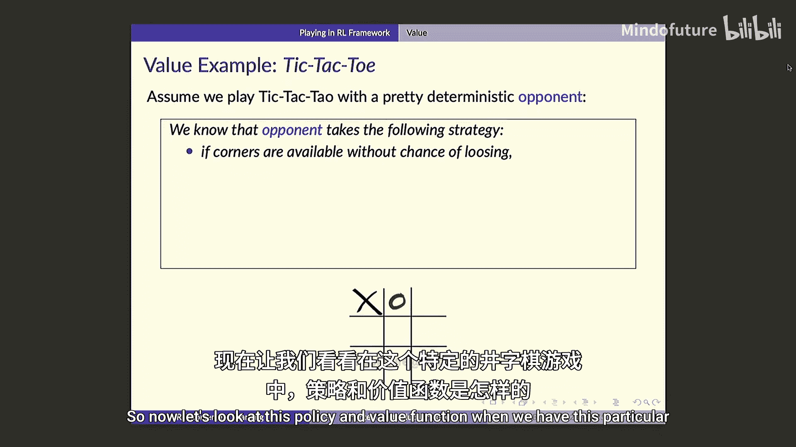

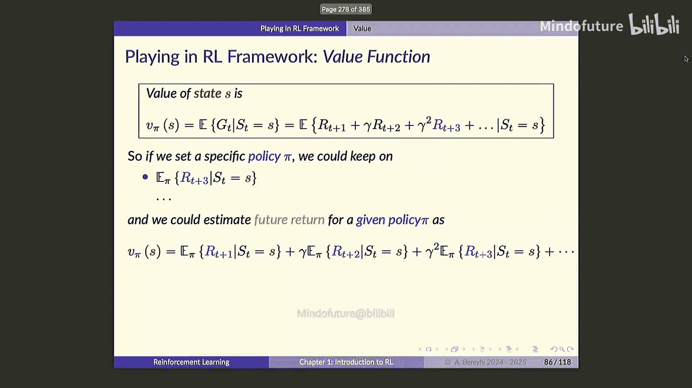

As follows。 So you have one opponent， and this has very specific a strategy。

 Like you played infinite number of times with， with the other side。 and you got this understanding。

 and the others that the other side is going to play following this strategy， so。

If it finds any corner available， right， it's going to play the corner。 Okay， so if on the board。

 the corner is available。 It starts playing the corner， right。And with respect to corner。

 it starts to first play the main corner， and then if they are filled。

 then it's going to play the other corners， right？So this is first like this is one of the strategies they kind of follow the next thing that if it finds out that there is one line that we can feel like it' the opponent's term and it is that there is one line which we can potentially feel like in this case we can just fill the off diagonal so if the other side is not play here in self 2。

 then we are going to play it right and win so its gonna to block this right。

So if it finds one complete line， yes， how can if the state is being represented just by the build cells。

 how at any point it are。Which ones are it and which ones are the upon？Oh， oh， you know this。 I mean。

 yeah， I know。 I think this was also asked by one of your friends the other time。

 So it's true for for sake of compactness， I'm showing it by a cell。 Al right。

 but assume that you see the board。 I mean， that doesn't make sense。 Yeah， I get your point。 Now。

 you do know which cell is played。 Oh， which cell played X， right， Yeah， this is important。 Yeah。

 you have full information， You don't lose any information， right。Now。

 so if you see that as such a thing， then you're going to play the other side is going to complete it。

 right？Everybody's clear。 So it's going to， sorry， block it。 Now， you might have multiple choices。

 like there is one setting where there are multiple lines you can feel， right， And in that case。

 the opponent is going to take one of those lines at random and block it， right。Okay， now that's it。

 And then if it finds any chance to win something like here， then it's gonna to play it and win。

 right， So this is this writing that your opponent is playing， right。

Now you do know that so this means that you have a good understanding of the transition system right So if you just do one action。

 then you would say， okay， this is going to be the new state of the or the new configuration。

 and I do know what's gonna be the move of the the opponent right， everybody's cool。

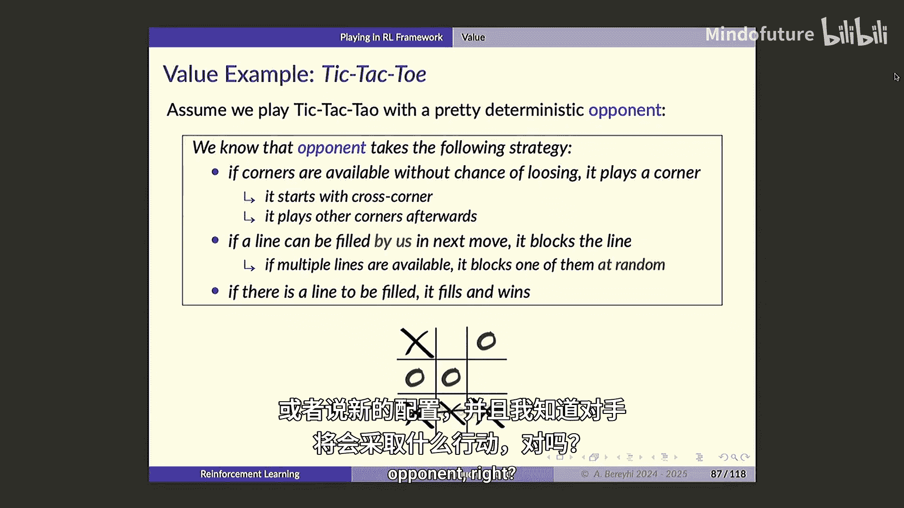

Okay。Cool， so。Now we want to play this， let's say that we have this policy。

 I'm going to call it policy1。 What is the policy？We would say that， okay。

 since we are always the second person who is playing cell， we say that， okay。

 if there is no chance of losing， we are going to play the cell next to the cell that was played by the opponent。

 right， now， if the cell in the row is available， we are going to play that。

 If this is not available， we're gonna play the one under it。 If this is not available。

 we're gonna play some other cell at random。 Okay， this is the strategy that we have。 We can look at。

The board see the last cell played by the opponent if the next one。

In the row or below is is available。 We play it。 If not， we just play one random cell， okay。Now。

 this is or one of the the one of the one part of the policy。

 The other thing is that same as the opponent。 So if we see that。

There is one line which can be filled by the opponent， we're going to block it with multiple case。

 we just block one of them at random， and if we can't win， we just play to win， okay。

Everybody's cool。So this is my policy pi1。 This is going to describe that pi function。

 The other thing for the opponent is going to describe the environment， right。

 How does the state change from one to another， right， Now， given these two， let's start playing。

 say we want to play。 So at the very beginning， the opponent is going to play that， right。

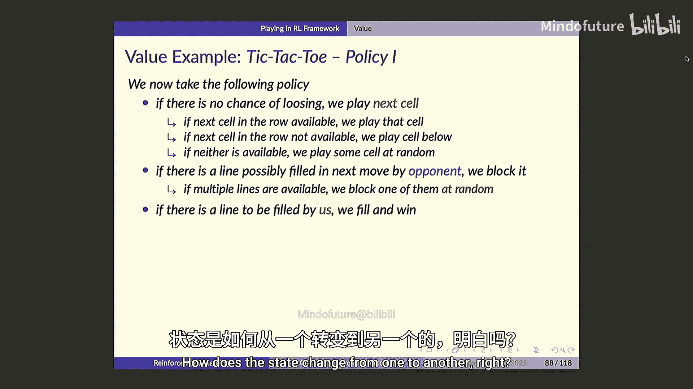

Because the audience is available right now if you play this one。

 this is cell zero and then what I want to know， I want to know what is the value of this particular state。

 this means that what is the value of this configuration。

 given that I am playing with the policy I just described。Okay。Now。In this case。

 if that is the first move of the opponent， what' going to be or move？😡，What does the policy say？

It're gonna to be the guy next to it， right， It's available based on the policy。

 I'm going to do that action with Provol to 1， Any other action with Provol to 0， right。

 So I do know that the next action is going to be this one， right， My very first action， sorry。Okay。

 we？Question。I do know here， and then the next thing is that， okay。

 what going to be the transition now， how does the state look like？Right。

 what it's gonna do it's gonna play the other corner right。

 So the first corner has been already played。 It's gonna to play the other corner it gonna be the move that the opponent would have so it's gonna to be the change in the state。

 So I really don't need to wait for playing because I do know the transition。 I know the other side。

 How does it play right because I know that I can write them given that I know my policy and that transition。

 I can keep on describing the whole trajectory right You see it right。Okay。

 so this is going to be the next。Oponent and what is our move？That's fine。 I mean。

 let's just the move。Why do you move in that the center one， right， you don't want to lose， right？

So based on the policy， there is one line can be filled that can be filled。

 so you are going to block it， right？Now this is the case， what does the opponent do？It can。

 again fill this one。 I mean， it must feel this one unless it it gonna lose， right。

 So it's going to just。This is going to be the next step。And then now or turn again。

 this is the line so we're gonna to play that one because we don't want the other side to win。

 now is the opponent。 okay， this point because it's going to win we are going to win if it does not play it so so you see that I can explain just given that I know my policy and I know that how the other side is playing I can keep on writing it down right so I can fill out this this board without playing right So in this case or move is going to be played this one because eventually this is the line that it can't fill and then finally the other side is going to play that one right now if that is the case。

 now what is the value of this state zero given or policy pi1。What is this value。

 we're going to end up with the value zero， right？😡，Correct。

 because after that there is nothing to play anymore， right？So every single action that we do。

 we are going to get reward0 so to words very end， we are always collecting zero。

 some of them is going to be zero right so what I can say I can say that if I play with policy pi 1。

 given that again I indicate on this point， given that I know the other side is definitely playing with that a strategy。

 then。The value of my policy is going to be zero right at this estate right Now you can keep doing it for every single state that you have here right so you can think that what if the other side start with the other corner for example。

 right and you again keep on playing with your own policy considering the strategy of the other side。

 the transition function right and then out of there you can end up what is the value of that cell that estate right。

And you can keep on going for all the possible states， right？Any questions？Yes。

We know the environments， right？Why。Is that we don't know the environment。Yes， right now。

 showed you a deterministic environment， right？ But the point is that the environment could get random。

 like I might know。The thing I told here is making sense。

 but you always give this chance that the other side is not seeing like the line is failing。

 for example， right Yeah， so in practice， you have randomness here。

 I didn't put the randomness yet here because I don't want to complicate the story but then we are going to add it just for this example。

 I didn't do。 But the point is that you might always say that okay， when I am example。

 at this point right So I told you that the guy is going to definitely play this one right but you might in practice。

 say that well， with high probability voltage，80% of the time is going to play that one。

20% is going miss that right。Plays another one， right？

That's like a few depths from my policy because we are also assuming that。No， no。

 this is the other size of policy。The transition could be random right So now I am assuming that in this configuration。

 the other side is playing that one right？ but this could be random as well。 Like in general。

 I could say the opponent could play any of these three guys right is going to play this one with chain 0。

9， for example， and this one these two with chain 0。

1 in total right And then in that case then the reward that I'm gonna get is not necessarily 0 anymore right So with some chance I'm gonna get one and with some chance I'm gonna get0 right and then the average of these two values is going to be the value that I'm gonna get right。

So now this is the question about if I know exactly what the other side is going to do by the。

like general question is that what how do you expect that I know even statistically how the other side is going to play？

 Well， in practice， we don't know， but we can think such a distribution exists right when we think that。

 then we describe everything with respect to that distribution that at some point in the course we say。

 okay we don't know that distribution。 This is when we start with a model free approach。 and we say。

 okay， we try to estimate it right， So very dummy illustration。

 maybe I keep on playing without sign multiple times。

 and I see 90% of the time you're gonna follow that rule 10% gonna do mistake right and then I write it down on a paper。

 I take that estimation as the transition right I can do it。 So this is a part of this story。

 which we kind explain lecture， but for the mathematical purpose right now we can assume that there is always one transition that maybe we don't know but it exists right。

Yeah。Oh， the reward， I mean， in every single action that we had， every single move。

 we got reward zero because the game was not over。If we， if the game ends drought。

 then you're gonna keep getting0。 if the ends and you win it gonna be one， lose -1。 That's okay。

 yeah。Yeah， here is the policy pi1。 I can change my policy。 I'm going to do it in the next slide。

 And then you're going to see what's going to happen。O。So actually， this is the purpose。

 I want to show you how changing the policy is going to change the value you're going get。Questions。

Everybody's clear， so I got zero because I followed my policy， right？

Now I can change my policy as well， right， So now let's just play with another policy。

 So the value in this case was 0。We end up drown。

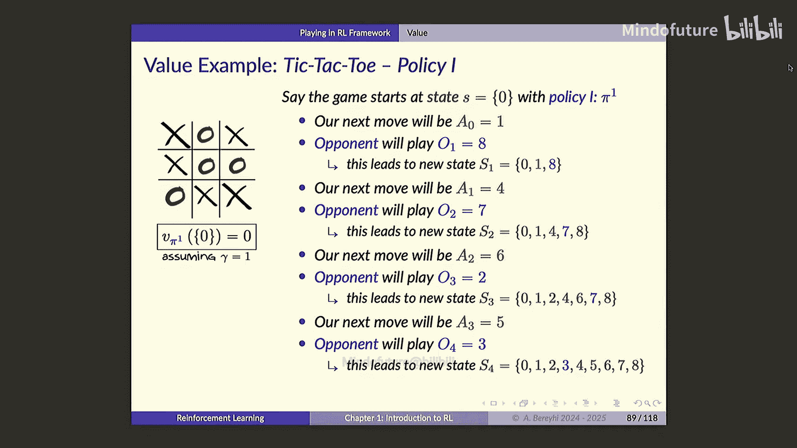

But。Maybe I just changed my policy policy， too。 So what is the policy， Everything is as before。

 So I am going to， I mean， every other step is as before。

 But the only difference is that when I if I want to play， and I find some corner available。

And I know that if I play that corner in the immediate next action。

 sorry in the immediate next move of the opponent， I am not going to lose。If this is the case。

 then I am going to play the corner。😡，So in the policy 1， I was playing the next cell， right？ No。

 I am playing the corner， right， This is the only difference。

 So if I see that playing corner is not making me to lose。

 I'm gonna play the corner against same order。 If I find it available in the row。

 I play it if I find it available in this column only I play there。 If not， I play something random。

 right， So the only difference is that instead of playing this， I'm now playing this one， right。

 Theres the only difference in my policy， right， And the rest of it is as before， right。

 if I see the。Winning。Block the the。The line。 And if there are multiple of them， I do it It random。

 And if I can win， I just play to win。

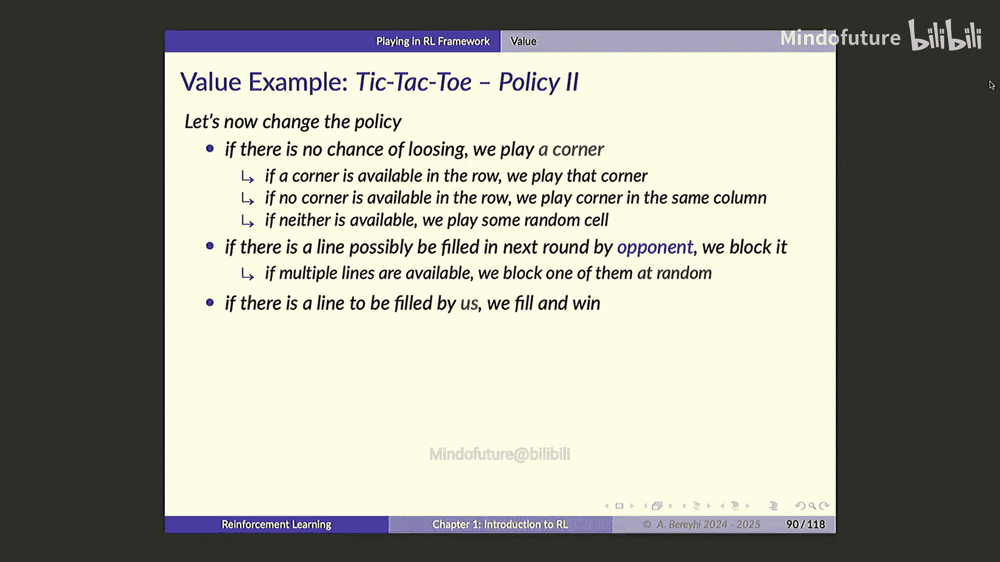

Okay。Everybody's clear。 Okay， So this is my next policy。 And now I'm going to call it pi 2。 So， oh。

 this should be policy 2。 Oh，typo here。So this is playing with policy 2。

 Yeah So now say that I play with this policy 2。 What' gonna happen。 Well。

 this is going to be the story of the game。 And then the thing that I'm gonna do。

 I'm going to play the corner， right， Because policy tells me just play corner， right。

 cornerner is available。 You're not going to lose。 So my next action， my action。

 the first action is going to be a play2， right？ And given this action， what does the other side do。

It's going to play the other corner right， because the other corner is available its not going to lose based on the transition is going to be the next move of the opponent。

 Then given this， now I need to play this guy right to avoid losing。 okay。

 this is my next action now I have the chance to win So the opponent is going to play to avoid losing right and now right now what' gonna be my next move。

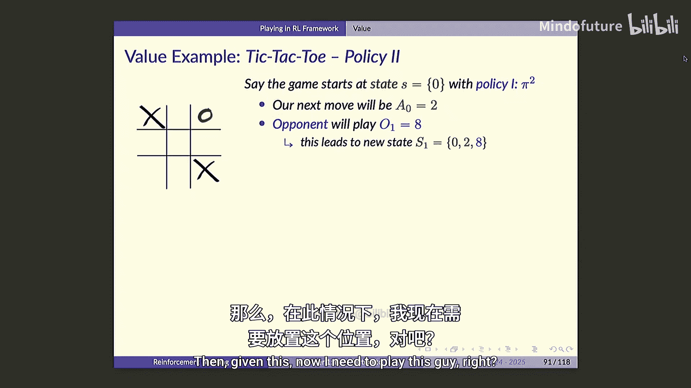

It should be random， right， because there are two lines that can be filled， right。

 and I can play any of them at random， right。Everybody's clear。Yeah。

 so say that I just play this one then definitely the guy is going to win right and I'm gonna lose so I'm going to get reward minus-1 right。

 The other case is that I go ahead and play that one Well。

 again the other side is going to win and again I'm going to get minus-1 right So now what is the value of this particular state。

 the starting state0 when I follow policy2。What is the value？-1。 And as you can see here。

 that value minus-1， it doesn't mean that there is one trajectory towardss end right。

 I could play this at the very end， I could play that right。

 Both of them are going to me with -1 and then the average of these minus- ones is going to be -1 right。

😡。

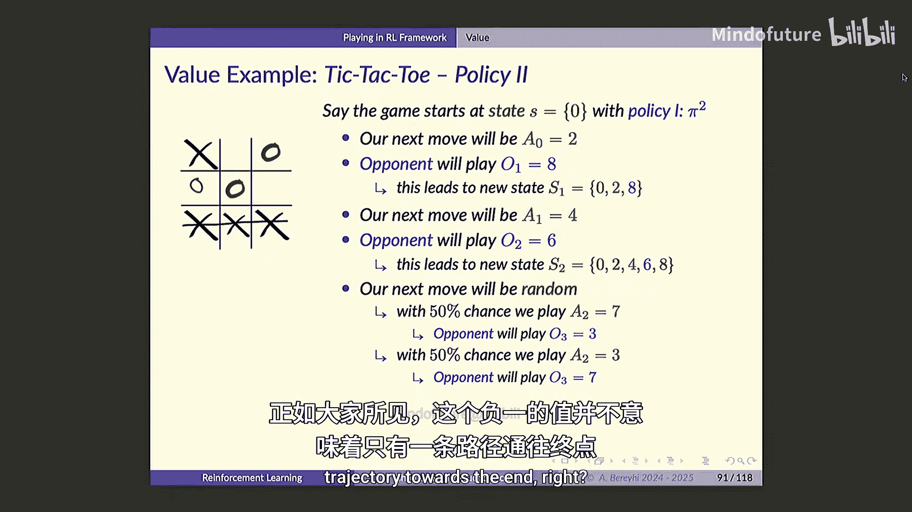

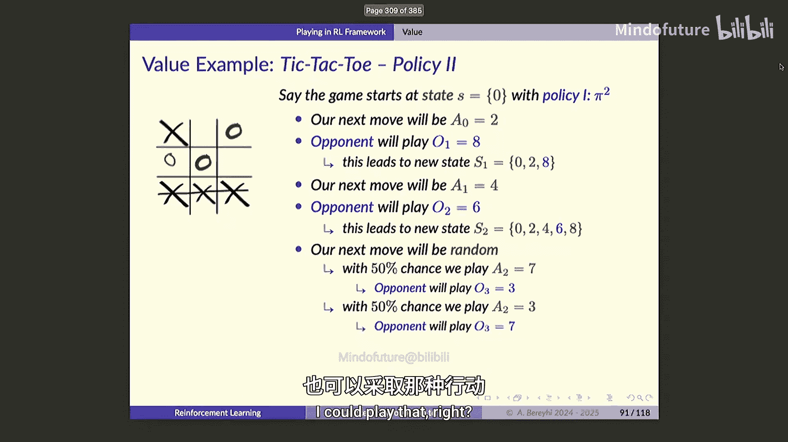

So that means that the value of the policy pi2 at this state0 is minus1。

 this is different from policy pi 1， right？So my policy is going to change the value of the state。

 right？Everybody's clear。Crystal clear， if you don't get it。

 it's going to be a hard time and I should hang myself here because I spend lots of time here。

 just explain it。Everybody's cool with the concept value right so the value it doesn't say that there is one specific trajectory towards the end。

 I mean you can just go over different trajectories right but the key point is they're going to say at the end in average you're going to get this value right and this totally depends on the policy that you are playing right cool。

😊。

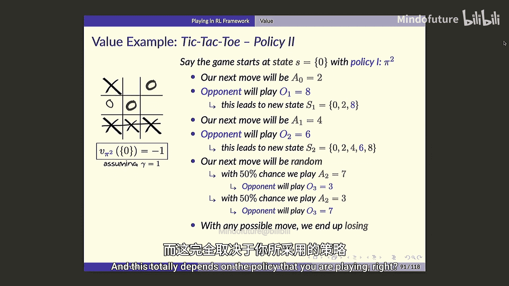

Okay so now you might say that why we define this concept of value function for a policy because this is going to help us compare two policies if you want to play between policy pi1 and pi2 which one you choose pi1 because pi1 is going to end you up winning right and sorry drowning right but the other one is going to end you up losing right so this is going to help you to just compare the two values right。

So， sorry， two different policies。 And we're going to do it immediately。 But before going there。

 let me define。other form of the value function， which we call it the action value。

 So right now what I told you was that you're in one particular state。

 then you are going to think about the you know policy that you have you're going to describe the whole trajectory after that and out of this you are going to compute the expected return that you're going to get this is the value Well you don't need necessarily you just think about only state you might think about state and action together so you might say that okay I'm in one particular state S and then I say I do one particular action a and then the question is that if I do this action A right now and after that I keep on playing with with the policy pi what going to happen towards the end right you compute the reward。

 the expected reward that you're going collect up to that point and that one is。

What we call it the action value。 So one thing some people call the previous one state value。

 this one action value， I don't like that if you call that one a state value。

 then I would call it action state value I don't like this long term so I call it action value I call that one value simply okay this state is oitted from both of them okay just I think certain call it state action value。

 but anyways just as a terminology point， but this guy is again the same thing as the value right。

And one question， do you see whether this guy is related to the。Value function or not。

You're going to see it in the first assignment， A， you're going to show it。

But do you see that this is depending on that？If I average it over my policy， what' going to happen？

If I average it over my policy， it's gonna be the value function itself， right。

 because I'm gonna say the state yes， the policy gonna say this action， that action， this action。

 right and gives the probability of each of them。 So if I use that one to average this guy。

 then we're gonna end up with the exact definition of the value function。 But no worries。

 you're gonna see it in the first assignment， you're gonna show it， then we're gonna use it a lot。

 right， Okay， so but for the moment。This is the action value that you have。

 and the action value Q function is again going to depend on your policy， of course。

 because it's true that for your immediate action， you are just fixing it。

 So you would say I do this action。 But from then on you keep playing with your policy right if you don't know the policy you cannot describe the next moves right So well you can do it again as before。

 So if you know the rewarding system， then you can explain what is your immediate reward because you do know your state。

 you do know your action right， then you can say what is the chance of every single reward that I could get given that is state in action。

 and if you use that on average， your reward， then you're gonna get the average of the immediate reward and you can do again as before right so you can go for the next time interval。

 you would say， okay I know the policy since I know the policy first of all。

 I know the transition you gonna explain me what is the。

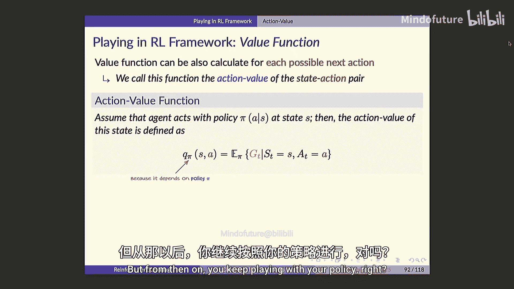

Nextex state since I know the policy out of that state I can say what is my next action and then out of that I could say what is the reward that I'm going get after doing that action I can now compute the average of that second next reward right and I can keep on doing it towards the very end。

 everybody here is going to depend on pi because I need to know the policy right this immediate reward here。

 it doesn't depend on pi anymore because I'm fixing it right So this is the only difference rest of it is exactly as the value function and as I said you're gonna practice it a lot that it' gonna get super obvious for you how they are related。

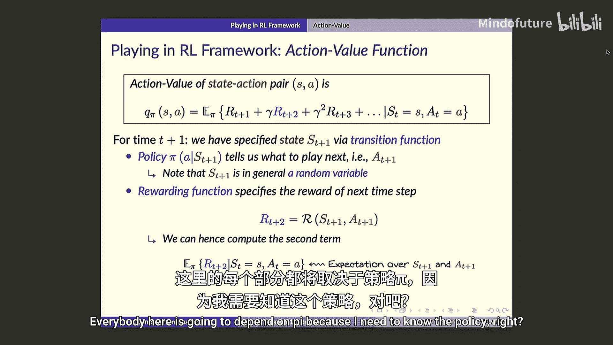

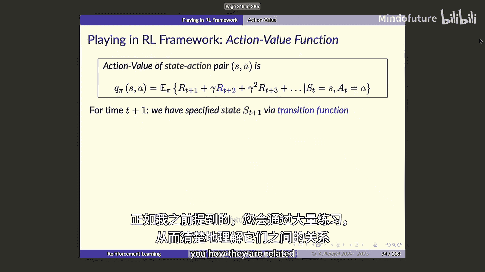

So any questions？Now question。Everybody's cool。Okay， great。 So now。As I told you。

 the main reason that we are defining value function is because it's going to help us compare two different policies right And now one thing that I want to show here is that I have two different policy we have policy pi 1 and pi2 right and now we can actually mix these policies again and if we mix that as long as we know what is the value of one policy and the value of the other policy。

 then we can somehow say what is the value of the mixed policy as well。 So for instance。

 say I am doing this hybrid approach and this hybrid approach is that 50% of the time， I am going to。

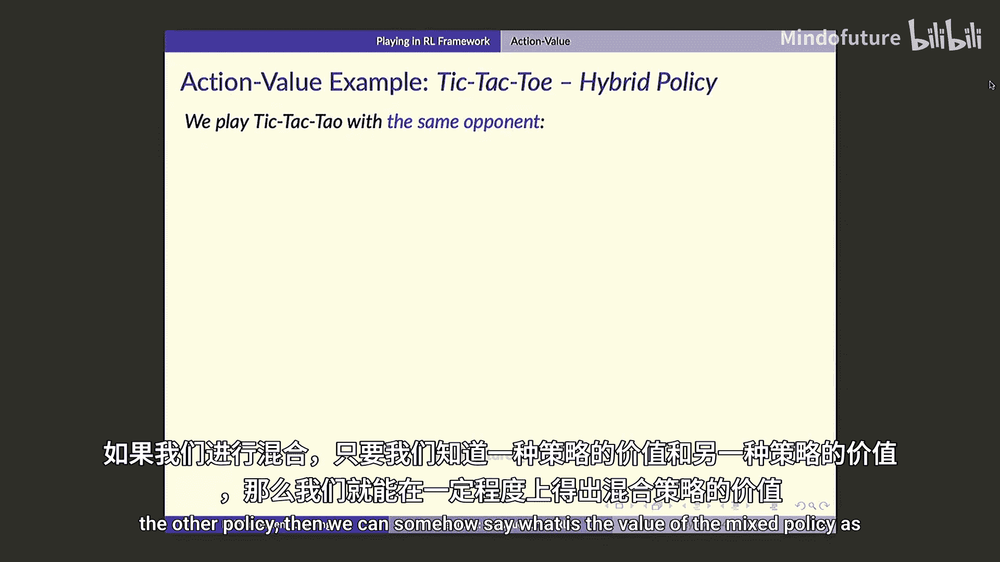

Right， and the policy pi1 is simply going to play the next guy， right， That was the first policy。

 right， ending up with just reward 0 value 0， right， If we play that。 And then 50% of the time。

 I also play with policy pi to， It means that I'm going go for the corners。 And we talked about this。

 The value is going to be -1， right。Clear， okay， now the point now I'm going to show it by pi bar。

 this is the， you know， mix policy， the hybrid policy。

 And now I want to know that what is the value of this hybrid policy at this particular state 0。

 Do you have any idea what is the value here。

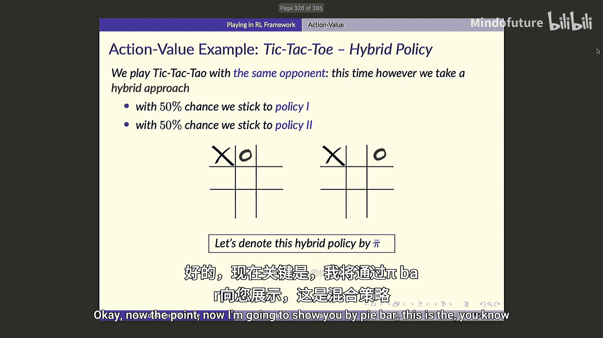

Any expectation， Any guess？inus half， exactly because half of the time I'm going to end up with value 0。

 half of the time I'm going to end up with value minus-1。 then if I combine them。

 I'm going to end up with value half right So you can do it simply。

 So if you decide to play policy pi 1， then this is your next move and you end up Dr if you play policy pi2。

 then this is going to be to be your next move and you end up losing So you're gonna to be -1 at the end of the day。

 you're gonna have this hybrid policy right and this hybrid policy。

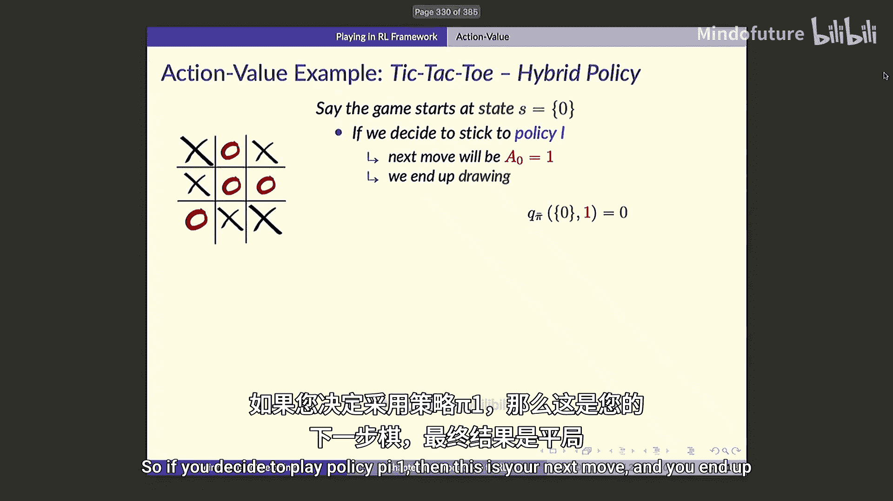

Is this hybrid the value of this hybrid policy is going to be the value of your state and the fact that you are doing action 1。

 this action1 is when you use policy pi1， right？And this guy is eventually the action value for this new policy。

 right？Because I would say this new policy pi bar， Well， as the first action， I have two choices。

 I might play this one， or I might play the one next to it， right， Now what if I play policy 1。

 then I would just end up playing one， the first cell here right。

 and then the action value function for this hybrid policy is going to be exactly the value that I'm going to end up when I am playing policy pi1。

 right。And then。Half of the other time， I'm going to play this other action。

 This is the one which I get out of the policy pi 2。

 And then this is the action value for policy pi bar when you do action 2 and you're in that particular state。

 Then if you average them out， this is going to be minus half。

 this is exactly the value that you're gonna get。 Okay so this is just to give you a bit of feeling about this action value So you're gonna play with it in the first assignment a bit more。

 But the key point that I told you before。 you can see it here， right。

 So the value of your policy at the particular state is the action value at that estate， right。

With average over different actions， right， So half of the time you do action 1。

 half of the time you do action 2。 So you just average it with your policy， right， half half。

 and then you're going to end up having your value。 So action value is eventually。

 if you take the expectation with respect with policy， you can the value function。

 and you're gonna see it more clearly later。 Okay， questions， yes。

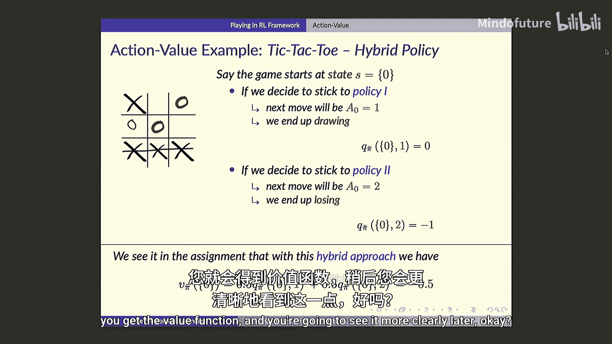