# 【多伦多大学】强化学习 2025 ｜ Uoft   Reinforcement Learning   Fall 2025 p10 P10_讲座_9_最优策略与强化学习方法综述 -BV1D3F2zhEry_p10-

Then yeah let me just define the optimal policy so once you have the value function。

 that value function is going to enable you to compare two different policies and you're going to always take the policy which is giving you a better value right because if one policy you expect playing good you are going to win。

 you're going to stick to that one right。

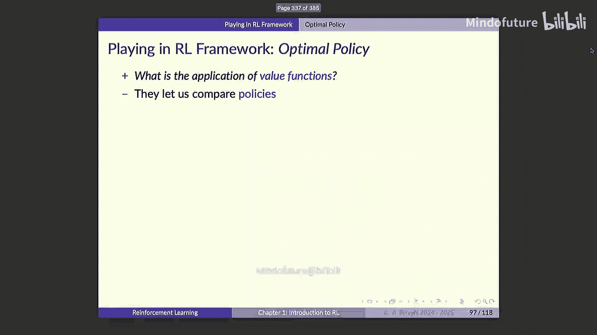

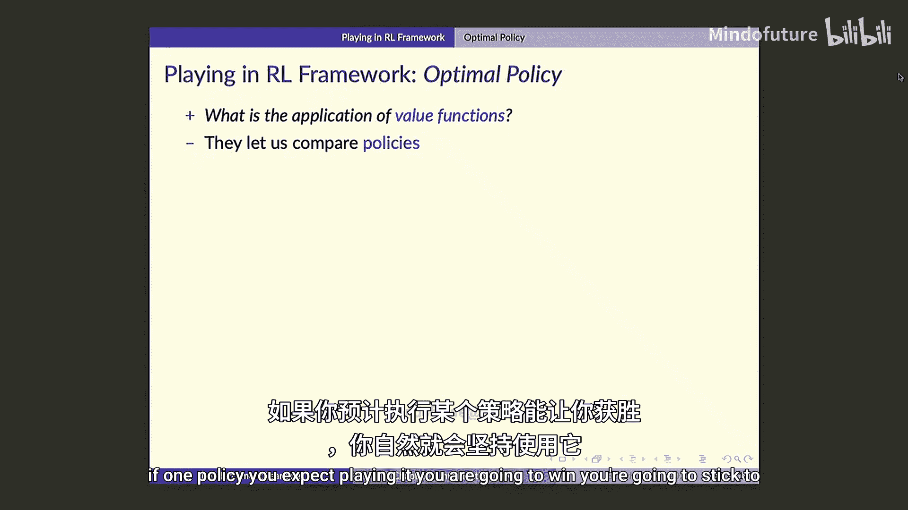

This is how we can define the notion of having a better policy。 So let's say policy。

Is said to be better than。pi 2， you can show it in this form。

 You can say that pi 1 is more than or equal by pi 2， and you can read it。

 P 1 is better than or equal by pi 2。 Okay， and what does that mean is that if you go ahead and compute value function for pi 1。

 this is going to be more than the value function for pi 2， okay。At every single state。

 very important， right， You pay attention to that。 This value function is a function of state， right？

 So this means that when you play policy pi1， you should always get better value。

 regardless of what a state you are in。 If one policy is giving you a good。Value in one state。

 But when you change your state， you're going to end up with worse value。

 then this is not better value than the other one， right。

 If one policy gonna win you when you start at one cell。

 but it gonna make you lose if you start in another cell。

 there is no reason that this guy is better than another policy， which wins you in the second cell。

 but it makes you lose in the first cell， right， so it doesn't matter right if you have one policy。

 which is always winning you or winning you or making you draw at any cell starting right。

 and one policy that lose you in one particular case， then in that case。

 you're gonna say that policy is better right So this is very important。

 This should be for all possible states。 this condition。Everybody's clear， yes。Or then we have like1。

Like eight times。Yeah， but but the question is in that two possible case。

 you say you have 1 states right and in eight states you win in two states you lose when you use policy pi 1 right then with policy pi2。

 if you you should if you say that。Pi 1 is better than pi 2。

 You should definitely lose by pi 2 in those two estates， right？

And maybe there are more states that you lose right。

 but if you win in at least one of them or draw in at least one of them。

 then you cannot say pi1 is better than pi2 right because in that particular state。

 if you play with pi 1， you're going to lose， but if you play with pi 2， you're not going to lose。

 so there's no reason that this policy is better right。😡，Questions？

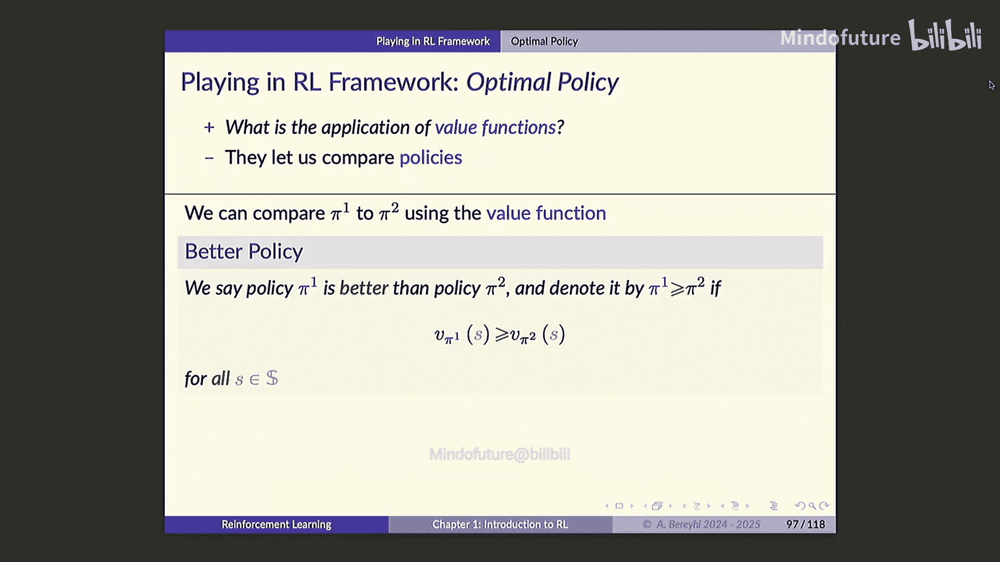

Okay， so if you got another question， this is going to help help us define what we call it the optimal policy。

 So what is the optimal policy， Well， the policy， which is better than any policy。

 is the optimal policy， right。So the policy， which is going to end you with the best value。

 best result you can think of， regardless of what state you are at okay so。So as I as I told， yeah。

 this is， again， the， I think， yeah， this is the indicate the。

 the point that I just tried to indicate in the previous slide。

 So it should happen for every single state。 And then if you have one policy。

 which is better than any other policy， than we call it the optimal policy， right？

 So policy pi R is called to be the optimal policy。 If you。Any policy that you suggest。

 instead of pi star， when you just compare the value function。

 pi star are going to give you higher value for all the states， right。

 Then this is the optimal policy。 Everybody is clear。Question。No question。

So what is the whole purpose in reinforcement learning？To find pi star， right。

 you want to know what is the best policy， right？That's the whole story， right。

 What is the best policy， Because this is going to give me the best expected reward that I expect to collect all over the game。

That's the best thing to do， right， So the whole problem is to find pi star。For a given environment。

 right？ So somebody gives you an environment。 can You have some access to。

State and the transition and the rewarding system of that environment。

 And now you want to find out what is the best policy that you can play， right。

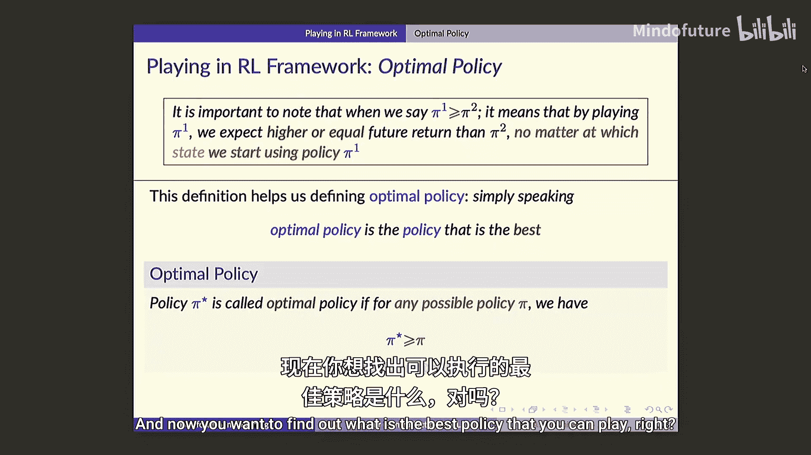

Okay， so now people might define it in this alternative form。 This is eventually the same thing。

 just to see the notation。 you might say that the policy， the optimal policy is the policy。

 which is going to maximize the value function。 But the key point here is that this value function is not defined one single state is defined an all states。

 right？ So this value function， you can think of it as a table， right， table of value。

 and this is for state1 state 2 a state 3， so on， right。

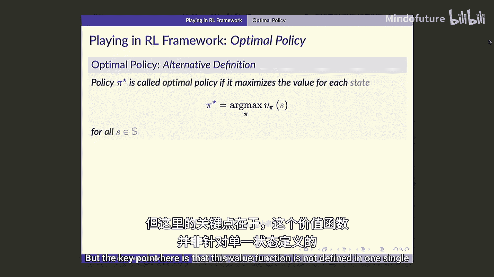

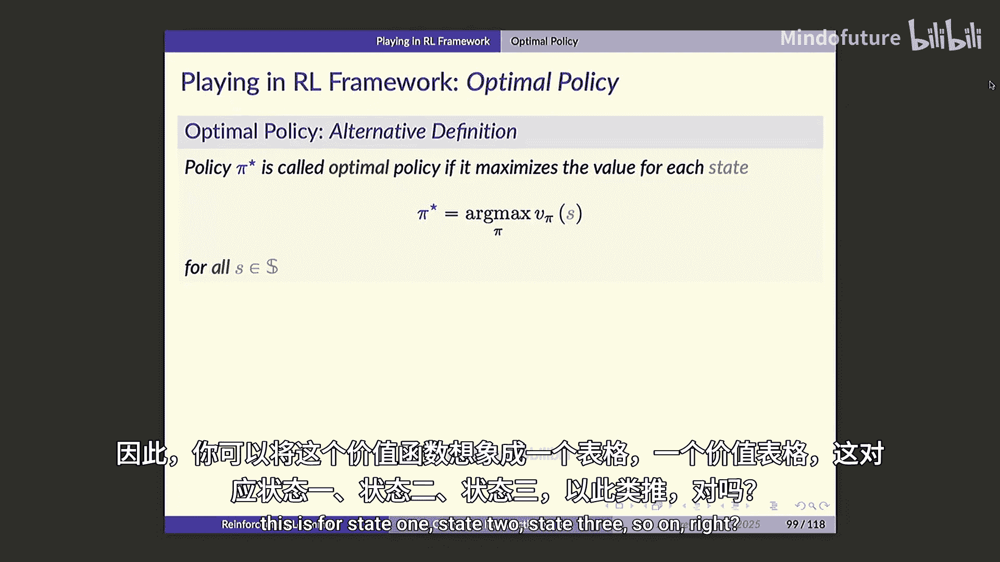

OK。Now。One question that you might ask is that， is there the optimal policy for any environment。

 Well， if we think that the environment has a well transition， not that we know it， but that exists。

The transition function exists。 The rewarding system is consistent。 If such a thing exists。

 then you could say yes， there is optimal policy。 But whether we cant access it or not， Well。

 this is another question， right， So That is a hard question to answer the whole oral literature is about that。

 But does it exist。 Yes， that exists。 And the other point is that why we define it using the value。

 why we think only about the state， didnt we also define the action value。

 like we we say that if we are in one particular state， and we do one particular action。

 what gonna be the collected reward， right， that is the action value， the Q function， right， Well。

 you can define it as well， It's gonna be equivalent to this one， so。

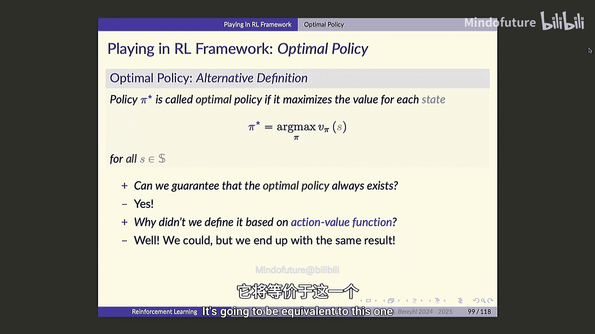

When you find it in this way， I told you that when you have the optimal value function。

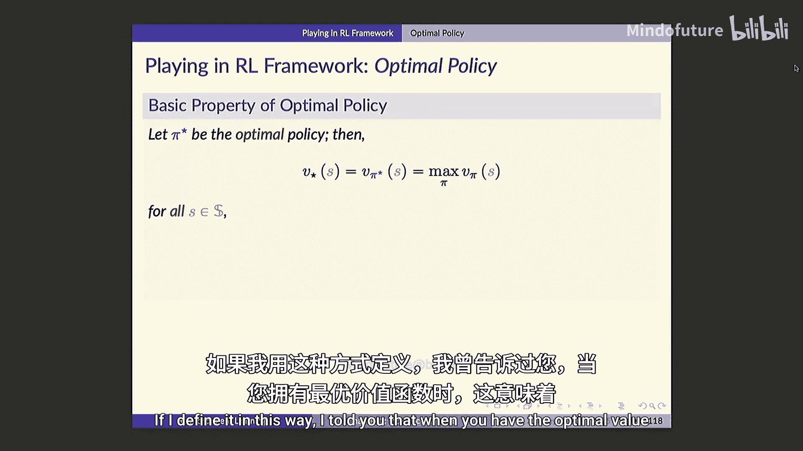

This means that you play with the optimal policy。 then this value function is going to be the function。

 which is the maximum giving you the maximum value among all possible policies， right。

 you can write the same way for the Q function， right So if you know the optimal policy。

 then the Q function that you're gonna get out of that optimal policy is going to be again。

 the maximum Q function。 Like if you play with any other policy you're gonna get a smaller action value right now。

It might be a bit。😡，Surprising right now， but once you do a assignment1。

 you're gonna to see immediately right because the only difference action value has to a value is that you are not averaging the first action。

 you're averaging anything else right And then as long as everything after that is optimal。

 This is the only things that depend on your policy right then your action value is optimal as well。

 But no worries， as I told you， we're gonna to play a lot with this stuff。

 This is only just to define it for you。 We're gonna to play a lot with this stuff and gonna get very clear。

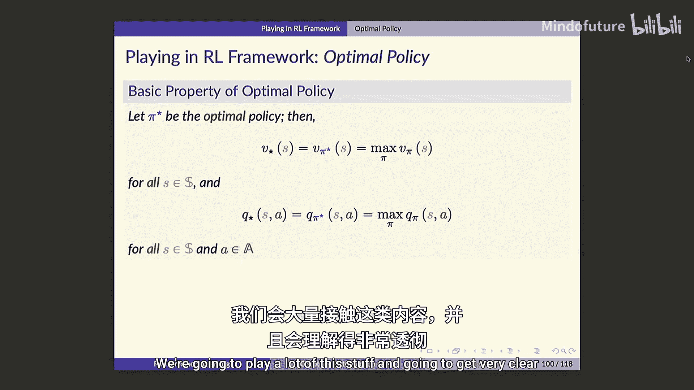

Questions？那。この。It exists。 Yes， you can find it right if you know that this environment can be described right。

 So， for example， in the trading environment， I cannot really say what is the state and how is the transition right。

 So I cannot even think about this it's a very hard thing right but if you can think about that。

 if you can model that if that is there is a consistent way of defining the environment is not going to change totally like like you cannot play optimal with me if I am a totallyil logical person right So if I just want to offend you right。

 you say I play this， okay， you are going to get battery war， why no reason。

 this person is just changing decision， right， the environment is changing right。

 that thing you cannot play optimal right But if the environment has as a consistent rule right。

 even if that's random， but this is。

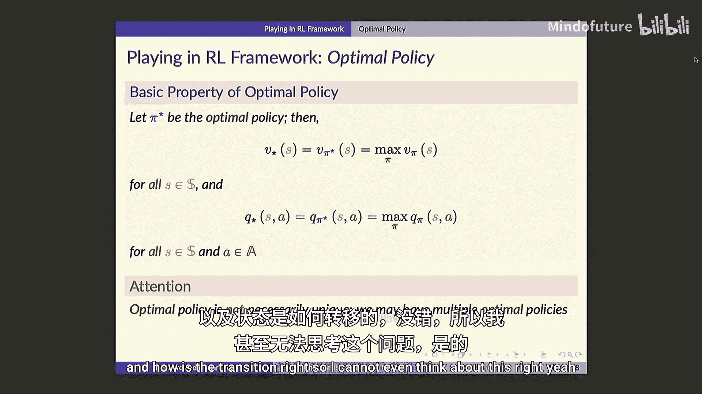

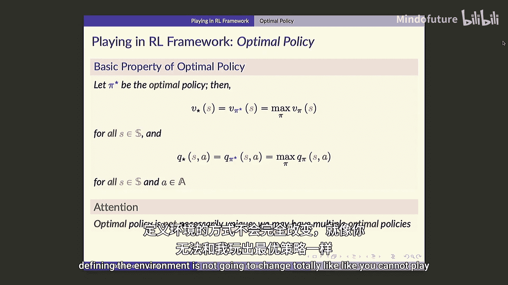

Randomly happening， right， is's always consistent。 You don't change。

 Like I have a bunch of rules in my mind。 Maybe those rules have random component in them as well。

 but I have them in my mind。 And then I keep playing with you in that way。

 Then there is definitely one optimal policy to play that。

 This could be as dumy as playing random because the environment is totally random， right。

 But there is one way that is the best way of playing it。Yes。Additional。

Now hopefully I'm going to break it shortly today， but the main idea is that like in both cases you are doing the same thing so you can formulate the optimal policy。

 the issue is that you need to know the environment to be able to determine it and then in practice you don't know the environment you don't know those rules。

 so the thing is that you start to estimate it right when the problem is a small in dimension。

 you can do the estimate simply by building a table right this is tableau oral but if the problem is huge in dimension。

 then you cannot do it， then you use reinforce deep learning so you would put one network to approximate this value and action value functions for you and then you use that approximated function to again find the optimal policy by the end of the day you're solving the same problem with different computational tools。

N。Questions？No question。 Okay， so if you got no question， one single one important notice here。

 there is no there is no reason that your optimal policy is unit， right。

 It might be that playing one game， you have multiple。Policies that end you up with the same result。

 right， But they are all ending you up with the same value， right。

 So it's not like a better optimal policy。 All optimal policies are giving you the best value。

 and all the values are exactly the same， right， But there's no reason that there is one policy。

 It could be multiple policies， okay。

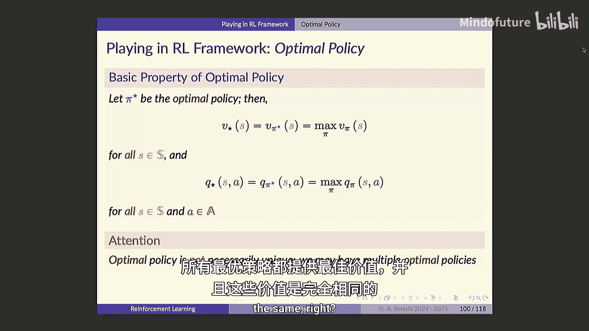

So yeah， so the ultimate goal in the reinforcement learning， as I told you。

 is to just find the optimal polish。And then how we can do this。

 there are a bunch of challenges here， the first thing， so as I explained it briefly right now。

 so when you know the environment， if you have a consistent environment。

 it means that the environment is not changing its nature by any reason。

 so it's not like like the earth physical rules and immediately out of sudden it' going to become mar and then immediately become mercury and not such a thing you are playing on earth with the physical rules of earth right。

 then this means there is a consistent in this environment， it's not going to change。

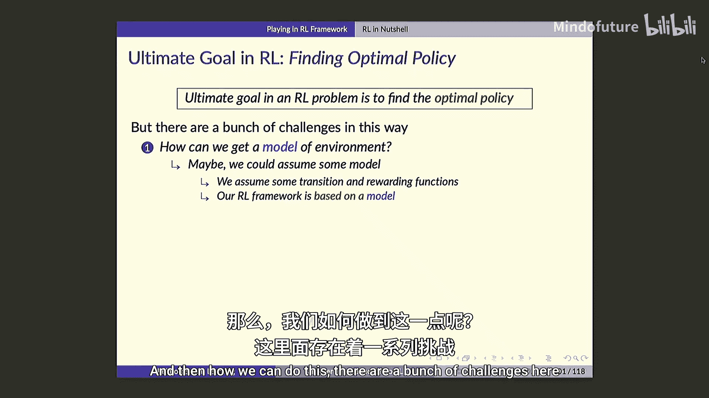

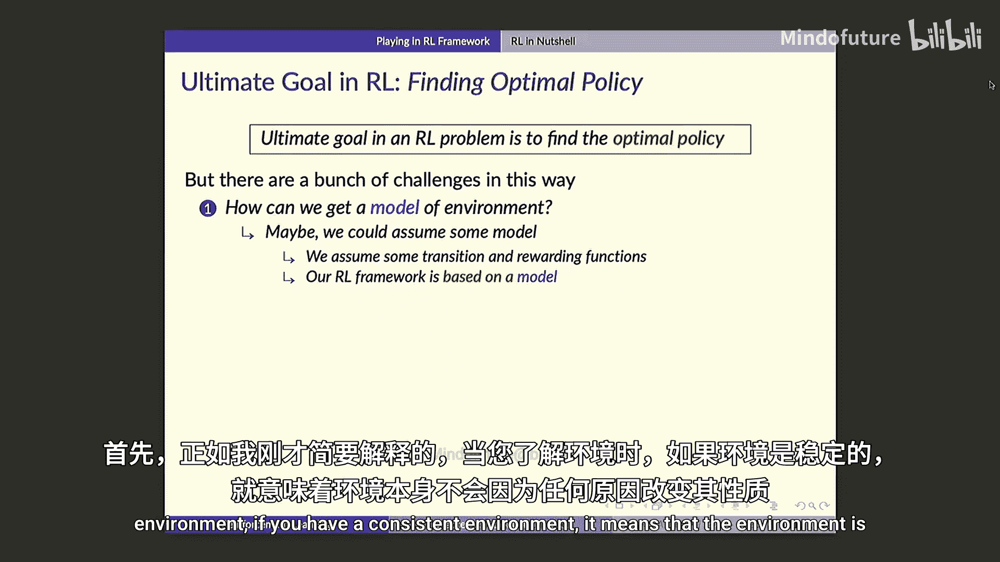

Unnoticly the behavior right， and in that case， the optimal policy exists。

YeahAnd the whole question is how I can find it now to find it。

 I need to have a model of the environment right I do need to know the dynamics of the environment or I should be able to describe that behavior of the environment by some random process right so the first one is quite hard in practice。

 some people do it on basic control systems they used to do it。

 but typically we just describe it why some stochastic model right like we say we play opponent with some chance do this with some chance do that right so if I have the model then I need to have the model if I have the model that I can just formulate whatever we did today。

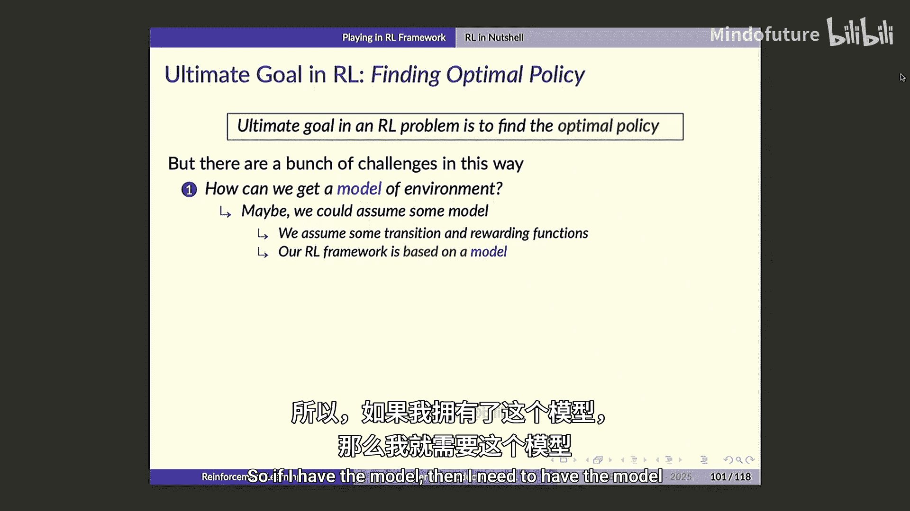

All towards like， I can efficiently formulate everything， and I can。Efficiently。

 find out what is the optimal policy， right， This is what we call it model based reinforcement learning。

 This means that I do know， or I can describe how does the environment behave。 And because of that。

 I can， I can find out what is the optimal policy， okay。

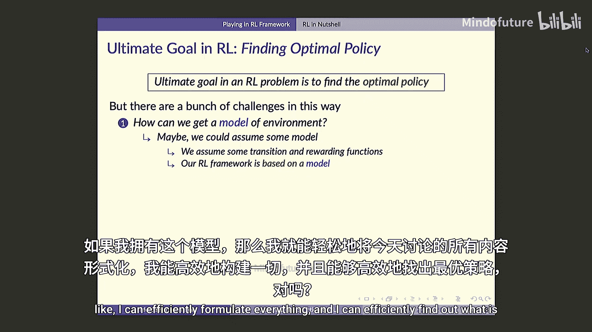

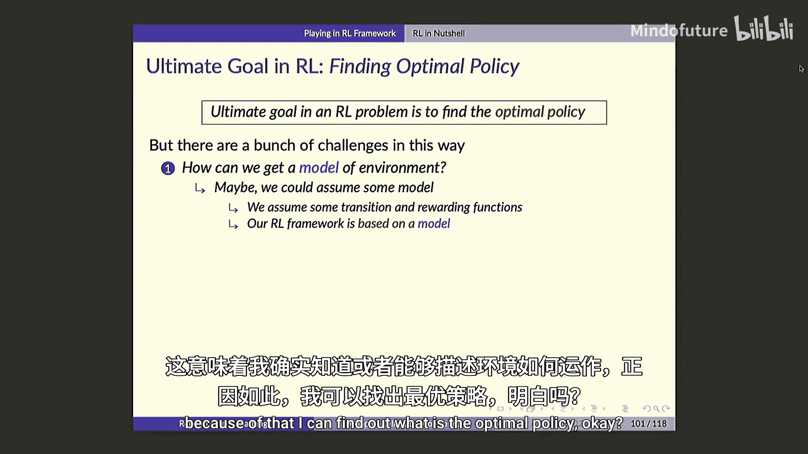

But the other case is that maybe I don't know， and I do know。Level of stochasticity。

 level of randomness inside。I cannot describe it right， then what I can do。 Well。

 this is where the statistical techniques come into account。

We can just try to use a statistical technique， things like Monte Carlo approach。

 temporal difference approaches like that in order to get an estimate of what we need。 For instance。

 say I want to just find out what is the。

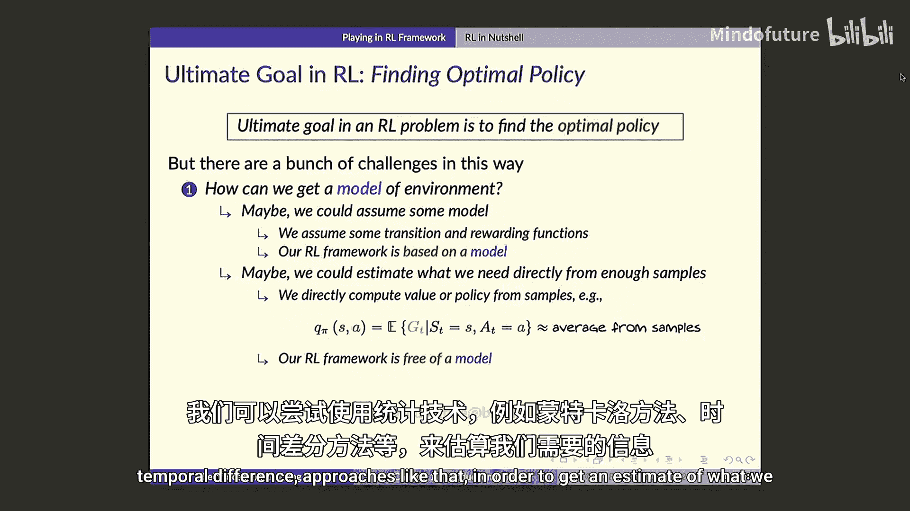

Action value at one particular state S， when the action A has been done right Well。

 if I know the statistical behavior of the system， I can describe the next state and so on right but if I don't know that distribution。

 What can I do。 Well， I can get to that estate exactly action for 1000 times right and I let it go forever right and then I see what is the reward that I get。

 I average all of those rewards。 this is supposedly， yes。

 this is supposedly the expected value of the return you're going to get right So you can average it by some statistical approaches like Monte Carlo This is what call it model free reinforcement learning。

 We don't have any model of the environment。 We don't know how does it change from one estate to another。

 and we think this is random with some distribution， which we do not have access to。

Then we use a approach like statistical techniques to compute whatever expectation we need to calculate right so these are the two main classes of reinforcement learning and this does not matter whether you are doing classical tableular reinforcement learning or you are doing deep reinforcement learning you always are doing one of them If you have the model you're the kingk you can do whatever you want right you have the perfect solution in that case you can describe the conditions on the optimal policy which is the Belman equation and out of that you can end up with the。

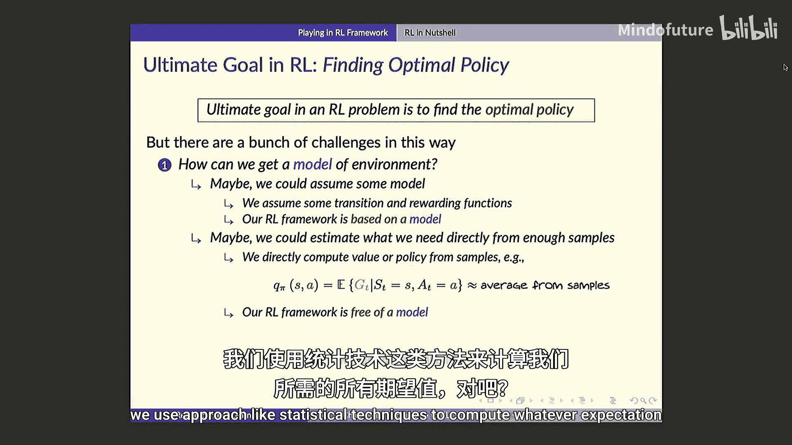

policy or value iteration algorithm， but in the in the case that you don't have a model now you only can use the statistical approach to compute whatever you want and then there are two different techniques there you can either play on policy like you just。

Consider one policy， you play with it， you get the behavior out of the environment。

 then you change your policy again， you play with it。

 you get the behavior from the environment and so on。 Or you might go for off policy methods。

 It means that I play with one policy， But at the same time。

 I get an estimate of the other policies as well。 Can I do that， Yes， we can do it。

 This is the important sampling idea。 Like if I know this policy。

 And I know that how does the other policy behave as compared to my policy。

 then I can get a rough idea about how I'm gonna end up when I play the other policy right This is what we call it of policy。

 And then here， for example， here as I told you， you end up with a value and policy ittion。

 This is the best you can do。If you are here， then you need to do more statistical approaches。

 like you need to use Monte Carlo approach。 You need to use temporal difference， things like this。

 We're gonna get in， into all of them in this course。 and then。

You end up with algorithms like Soa or maybe Q learning in the off policy case where you can somehow approximately find the optimal policy。

Everybody's clear。Questions？So main objective find the optimal policy。 if you know the environment。

 you' are in the model based， if you don't know the environment， you are in the model free。Okay。

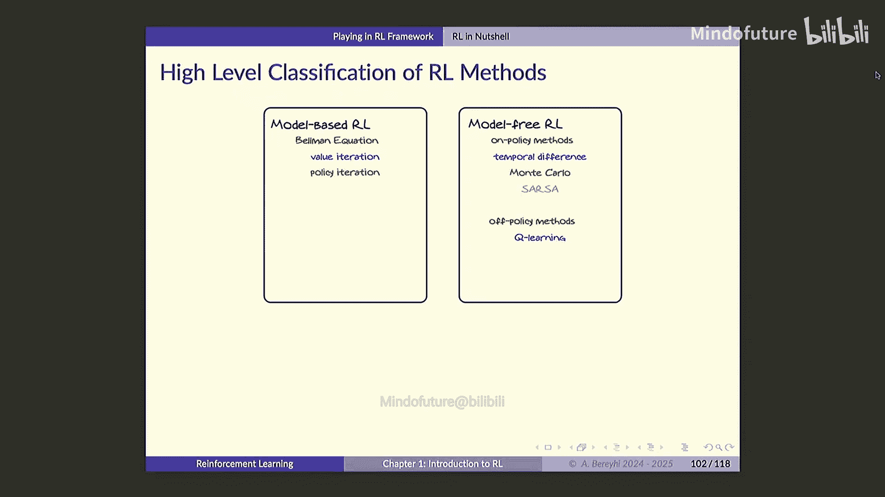

Great， now one next thing is that。Well， maybe I go for， for。

I don't know a model based or model for any of them。

 and I started doing whatever I told you in the previous slide。Now。

 the point is that we are going at the end of the day， work with value function， for example。

 right and this value function depends on this state right Now if I have 10 possible state 100，1000。

 Well， this is one finite table right so I can say this is the first value a second value till value 1000。

 and then I can use one technique to approximate it or evaluate exactly right。

 But what if the number of a state that I have is crazy large。

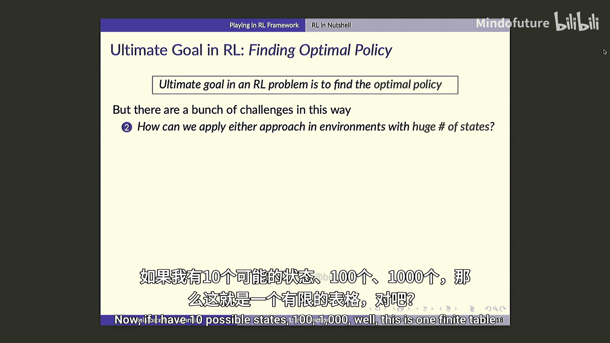

Is there any example like that？Chess， right？The number of cases is tend0 to power 40。

 something or even more even。 I mean， there are papers on that to approximate the number of possible ways you can play chess。

 right。And none of them is finite to or computation power， right？ So if you just do。

 I'm gonna do that in the second part。 But you can see that if you just do every single case。

 if you investigate every single case of playing chess in less than a pickcosecond then if。

 I don't know，10 to power 10 times you you have a time10 to power 100 times more than the time。

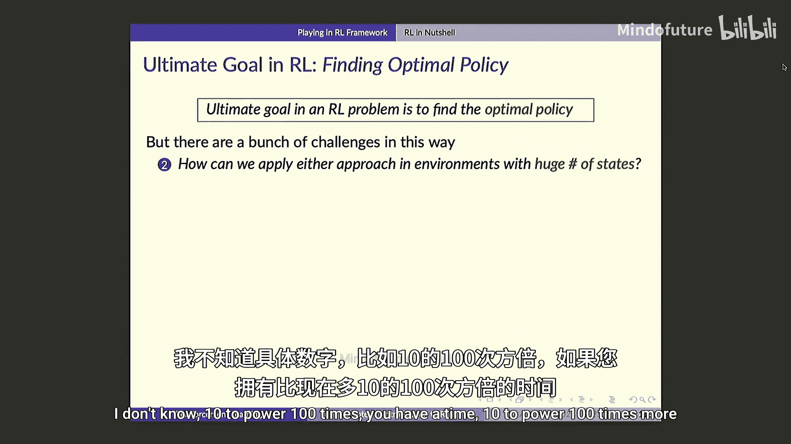

Starting from big bang， you're not going to end up investigating all the cases。 Okay。

 just to give you。The idea how big that could be。 Then the question is that how many entries is that table going to have。

 right， You can never end up estimating all of them， right or evaluating all of them， right。

So that is the problem。 What if you have in insane large number of states， right。

 how you can then solve this problem， This is where the， the deep learning come in， right？

 So what we do in deep learning， we would say that okay。

In deep learning or machine learning in general， we have a function， which we don't know。

 but we have a few points of it， right， This is our data。 Then we get that data。

 We just fit it into a model。 like we get a neural network。

 we try to make the neural network to give us exactly the value of those points， right？

 And then we say， okay， if we have done fine。 if we have not got too much overfitting and things like that。

 When you give me a new sample。This neural network is is going to predict the output of the function properly。

 right？ This is exactly what we are going to do。 So we're gonna to say， okay。

 I cannot compute the value function on every single state because the number of state is insane。

 but I need this value function that whenever I see a state I put it inside this guy and it gives me the value right。

 So what I can do maybe I can train a neural network on a bunch of possible state。

 I just candidate a few states。 I compute their value。

 then I give it as a sample to my neural network。 I train my neural network。 Now。

 when I have a newest state， I just say， okay， just let's use that value network to give me an approximate of the value。

 I it exact。 no， but what can I do right So this is where the deep reinforcement learning get。

Started。 So you might say that， okay， this one is very simple extension that one。 Yeah。

 immediately initially， you think like that。 But as we go inside。

 you see that the idea of building that neural network and training it is more complicated as you can think。

 And this is why all of those approaches。 like the policy networks value we're gonna come in。

 and then we're gonna have the。Actoc approaches， which we have both the networks interacting with each other and things like that。

 So the point that I wanted to make here is that the。

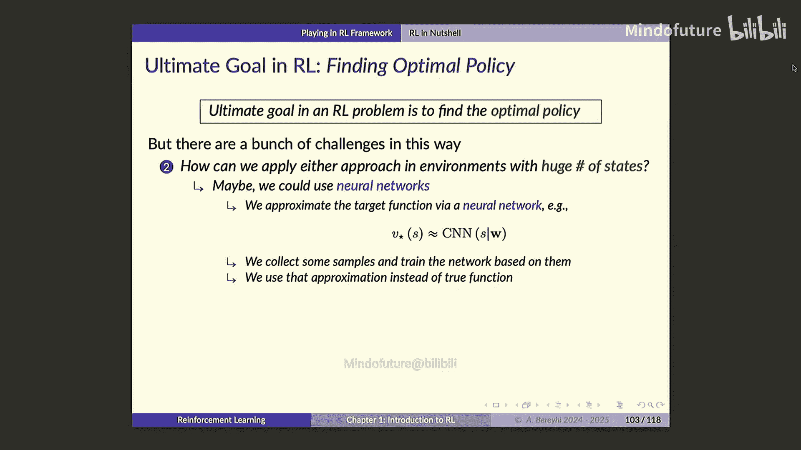

Model free and model based reinforcement learning are。

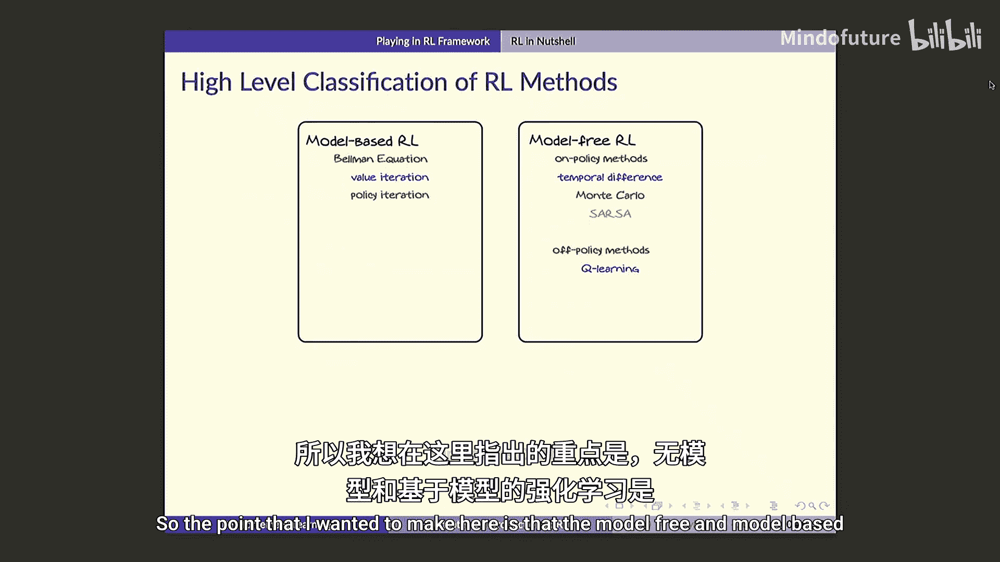