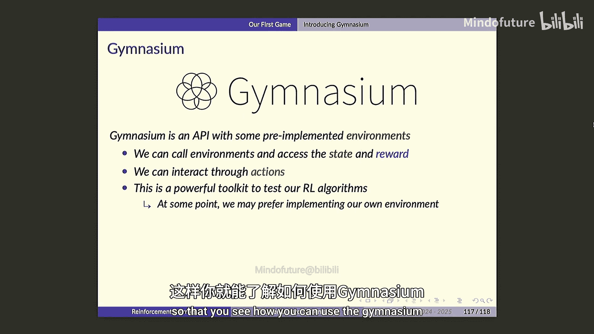
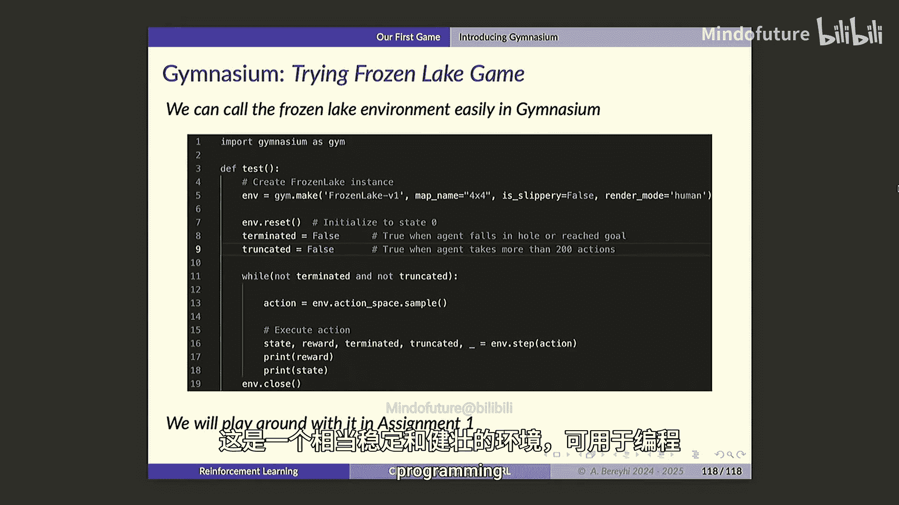

# 【多伦多大学】强化学习 2025 ｜ Uoft   Reinforcement Learning   Fall 2025 p11 P11_讲座_10_冰湖示例——终止状态与回合 -BV1D3F2zhEry_p11-

Just to recap what we have done last time。 So let's just take a look at this frozen leg game。

 So this is a famous one， which you have in。Play with this guy a couple of times in the assignment。

Let's take a look at this and see how we can define those components here， so。

Play F game Lake here in this game。 you have one player。 So this is your agent。 and there is a 4 by8。

 What you want to do。 you want to get to the end point， right， you want to get the price。

And this is quite simple。 Of course， I mean， you can just move towards that。

 But the point here is that。Each time that you decide to move。 So for instance。

 if you if the agent wants to go decides to go to right， there is a chance。 I mean。

 with provolty 1 minus P， this is going to go to the intended direction。

 but there is a tiny provol P。 and with that one， it could just slide to another direction So。

 for instance， when you are here if you just press right with provol。

 I don't know say P is 10% that with provol0。9， you are going to get to the next cell with provol。0。

1， you might either stay here or just sleep down， right。

So stay here when you is like moving to towards up， right。 And then since there' is nothing up。

 then you stay here。Same thing gonna happen like here， right， So if you are here in this cell。

 then eventually if you just press right with provolty0。9， you're going to go right with Provolty 0。

1， you might go any other direction， right。So this is the game。 And obviously。

 you can see that there is no guarantee that you are going to definitely win。

 But you can guess that when P is very small， then when you play it by simply going towards the price。

 you are going to。When most of the times， right。这样。If you keep on going and you get to the price。

 you're gonna get a reward if you get if you get to any of these shallow cells where there is a whole then you're gonna lose right。

 So you're gonna get a negative reward right and then you want to formulate this guy reinforcement learning problem。

 then first of all， you need to specify the state action and reward。So what is this state。

 Any guess about this state。How should I define this state？Yeah， go ahead。Yes。

 the cell that youre playing in right？ So the cell that you' are in is going to be your stay。

 So you have stay 0，1 till stay 15。 You have 16 different stays， depending on which state you are in。

 then you just need to know the action， right？ You know the action。

 Then you can describe what's gonna be the next action and what's gonna be your reward right。

 because。The game is going to explain you how this is happening for the next state。

 So this is your state。 Your state is basically the cell that your you are in。 What is the action。

 What kind of actions you can do。Is any of the direction that you can move， right？ So in general。

 you have four actions， wherever you are， right？ So I'm going show them in this form。

 So I'm gonna say if you want to go left。3， okay， so is contraclockwise。 Yeah， ahead。

The is a part of environment。 It's a part of environment。 It's a part of rewarding system。No。

 but you are thinking about the end of the game， right， when you lose， for instance。

The information that you need in order to explain your next state and reward。

 right the thing that you are thinking about is like you fall in the shallow sale， right， or you。

 you get the price。 then gonna be described by the reward and the change to the next state。

 And I'm gonna explain it。 actually， I purposefully， I put this example here， yes。Yeah。

 this is the one that I told you。 So you could formulate it differently。

 You can say that when you are here， you have only two actions， either go right or down。

 This is one way of thinking about it。嗯。Here you have all the actions。

 but do the action above say that right now， you don't have any sleeping。 Okay。

 so you just press and it goes when you push up then。You're not going to move。

 So your state is not going to change， right， So the transition from state 0。

When you act here up is 3， when you act 3 is going to remain 0， right， So you can that way。

 this is a more concrete way of explaining， right， because playing with working with the action which is。

 which is changing。Depending on state， it' is harder， right。Questions。No question。 Okay。

 so this of action finally， is reward， right， So if you fall into any of the holes， then you。1。

In the cell， the game is ongoing， so。The reward is simply 0， right。

 So you can formulate it in this form。 So you would say my reward is coming again from a discreteces。

 So I have three。Your words， -1， when I lose。0， when the games。Plus1 I win。 and then。Again。

Given the cell， you can say what is the reward， right， So if you know the， the cell that you are in。

 if you know the action that you want to do， you can explain whats gonna be the reward after doing that action。

Everybody's clear。Okay， so now。The rewarding system here is simple to describe。

 It simply explains how you're gonna get your next reward。 So if， for example， you're in cell S。

 this is your stay。 and you do action A， you just decide one direction to go。

 then you might go in the intended direction right So you press right。

 you go right right the chance of going right is going to be1 minus B right So the chance of getting the intended reward。

 the reward that you expect it to get when you move this is going to be 1 minus B。

 the chance of getting another reward。0 P， sorry， Yes。 So this is the direction that you are going。

So with 0。9， you're gonna get the reward that is there。 So if there is a， there is a frozen cell。

 then gonna be 0。 if there is a hole， it gonna be -1 and with probability 0。1。

 you can get any of the other rewards， right。OK。This is the rewarding system。 The transition system。

 you can again explain it the same way。 So you can say when I am in particular cell as。

 if I decide for action A， then with provolty 1 minus P， I'm going to get into the new cell。

 which is again describing this the next state， or I can slip to another state， which are around it。

 and then the chance of getting there is again P right So you see here that both transition and rewarding system。

 both of them are random right， And this is simply because of the environment because the environment is behaving random。

Okay， so。That's it。Here is one particular example， for instance。

 say I we are in this particular cell。 So this is a stage 4 because 1，0， we start from 0， right，0。

1 to 3。 Now it's 4， right， And here in state 4， if I want to just move in direction， right。

 So the action right， I'm presenting it by 2。 So I'm gonna say that with probability t 1 minus P I am going to be at this cell。

5， right， the next cell with probabilityty P， I'm going to be either at 0 or 8， right。

Same thing you can do here。 So for the reward， you could say with pervol1 minus P。

 the reward gonna be -1 because I'm gonna fall in this hole or the reward gonna remain 0 with pervol P if it just slips to any other direction。

 right。Okay， so。One thing that your friend also mentioned。

 So what if we get here right So when we started with modelling。

 I told you that you think that you are going to play this game forever right when it stars it never ends T goes forever right and then then this one when you play at the end of the day when you get here。

 you lose and the game is over right Now the question is that how we can impose this condition on the problem since we have a state。

 we can use the notion of terminal state。 that is gonna make story much easier So we can define what we call a terminal state。

 What is the terminal state， it means that when you got there。

 then it doesn't matter what action you do， you're gonna remain there forever and it doesn't matter what your action is。

 you're gonna always get reward empty0 right Nothing gonna change。 you do any action after that。

 Nothing changes right。So， for instance， what I can say， I can say when。If the game is over。

 so after getting5 doesn't matter if I just press any direction。

 I'm not going get out of it right so I'm going remain in cell 5 forever right So this is the terminal stay right and the reward is the same thing right The reward gonna remain 0 so I can play the game I'm going to get probably 0。

00， then I get the reward minus1 I lose and after that I'm going to again collect 0，0，0。

0 forever right which is okay right It doesn't change anything。But this。

Makes us get rid of the notion of time， right， the time now， like terminal time。

 The time is going forever now， right， because you might play the game and it ends after two step。

 You might play this game。 It ends after 10 steps， right。

 should So you don't want to get into that trouble。

 This terminal estate is going to resolve the issue。 Everybody's cool。

So the terminal state is essentially the state that when you got into that estate。

 regardless of the action that you are doing， youre gonna always transit to the same state。

 So it's a kind of state just remaining in itself。 And the reward that you're gonna get is going to be zero afterwards。

 right， So you collect it up to that point。 You don't collect anything。You start playing this game。

So you start with some cell， you play， and then you end up with a terminal cell， right。

 And then when you get into that terminal state， then the game is over， right。 now， if you want to。

Continue playing。 You need to start again from scratch， right， So this。Trajectory。

 from various star to the。Terminnal state。 This is what call it。 Yeah， we call an episode。

 I thought I have it here。 Oh， I don't have it here。 right， Okay， I'm I have it in this slide。 sorry。

 but the。Trajectory that you start and you end at the terminal stay is what we call it episode。

 right， And then when we go further， you're gonna collect so many episodes because you want them as samples to start learning what is the value function。

 What is the policy function。 Okay， now one key factor here about the terminals。

Is that if you get here in the terminal state， what going to be the rewards that you collect afterward？

Its got to be 0， right， So what is the value of this state。It's going to be0， right。

 and it doesn't matter what your policy is， right？ So whatever the policy you play with。

 once you get into the terminal state， the game is over。Whatever you do after that。

 you always collect 0。 So the value is 0。 So this is a natural property of the terminal state that it always has a zero value。

 You can simply see it by writing down the formulation。 So you would say， okay。

 I want to calculate the value。Given the policy that I have in this state S。

 this state is a terminal state， right So I'm going to say that this is going to be the expected return that I'm going to get。

 given that I am in this terminal state and the the future return， I can write it down in this form。

 right。Immediate reward， second next reward and so on， right？Now。The immediate reward is。0。

The next one is0。 Anybody after that is 0。 So all of them add up to 0。

This future return gonna remain 0。 and the expectation of 0 is always 0。

 And it doesn't matter what is your policy， right， So this is a kind of natural property of your terminal state。

 when you， the game is over， you're not going to collect anything anymore， right。Everybody's cool。有。

that me。こ youた。Sorry。Oh， now， in this notation that I have， that one was R T。都5。Yes， yes， exam。

 So you get into this estate。 Then you do an action。 you collect a reward， right。

 When you got into the terminal state， that value that you are talking is the value of the previous estate before you get into this estate。

 right。Or are all zero。 You got into the the game is finished， right， that after that。

 whatever you press， nothing gonna happen， right， So you're gonna collect always0， right。

 and you remain in the same stage， right。没。啊。Yes， yes。In this example， yes， yeah。For this setting。

 exactly。先。No question。 Okay， great。 So yeah， here is episode。

 So episode is the trajectory that you from your starting point towards the terminal state， right。

 then if you play the game multiple times， essentially， you collect multiple episodes。 And later on。

 we use it to learn what the value is and what is the optimal policy。Okay。

 so now for this particular game， the frozen lake， the policy is essentially。

 you think of that pi a given s。It's essentially the direction that youre going to play at every cell。

 right， So， for instance， you would say， okay， if I am here at this particular cell。

 I'm gonna move here， then you could say that pi。Of the direction that you do。

 given the state0 is going to be only left sorry， on the right right。

 So on the right happens with provol 1， anything else is happening with pro voltage0。

 So here as you see， you can have a sort of randomized policy because here at this point at this particular cell that you see two arrows。

 one of them write， one of them down。 So this guy， I am saying that with some chances that I go down with some chance that I go right So it's a probability voltage distribution。

 I say when you are at this cell S equal to the cell。

 The action of right happens maybe with pro voltage half the action of down happens with pro voltage half。

 but I would never go left or up right。Avice clear。O。So this is the policy that you have。

 for instance， for this。Action 2， which is right。 Then it gonna happen with probabilityvol 1。 action。

 any other action happens with probabilityvol 0。 But then for that particular cell 9。

 you could have two different actions， right， You could either go right or down， right。

 And they happen each of them with one probabilityvol， right。So now here。

 if you are talking about the value of every single self。 So you got。

 you should look at this point and see that when you play with this policy。

What is the average Like you play with this policy thousands of times each time you are going to collect one return。

 And then the average， the expectation of those returns is going to be your value for every single cell right？

 So， for instance。Say I have p equal by0。 Okay， when p equal by0， it means that there is no slip。

 Okay， wherever you want to go is is going to go， right， now， if that is the case。

 then if you play with this policy， you always going win right because when at any cell。

 you are just moving toward your prize right， and there is no chance of slip。

 So this is essentially the optimal policy， right， And then when you play with this optimal policy。

 you always， no matter which sale you are in， you're going to end up collecting reward one， right。

 know if you think of discount factor to be simply one， then wherever。We're going to collect 0，0，001。

 the game is over right again here it's gonna be I don't know0，0 either here or here0。

01 and the game is over right So at any state that you are if this is not a terminal state you are going to end up with one if this is a terminal state you're gonna end up with zero obviously and then this gonna be your value function when the probability of sleeping is simply zero right you can。

G might close by one， yeah。Everybody's clear。So value of every single cell for this part。

 But if I play with another policy， So if I play with。Policy that when I'm here。

 I decide to go right。 then at this particular cell。 whenever I get here， I end up losing。

 and then the reward always for that particular cell is going be -1。

 So the value of that cell is going to be -1。 given the policy that I'm playing right now the policy that is going to maximize this value set。

 this value function is going to be your optimal policy。 And obviously。

 this guy with no probability of sleeping is going to be optimal policy right because you you're going to always win and this is the best thing you can collect in this game right So if you have p equal by 0。

 this guy is going to be your optimal policy right okay。Cool questions。Yes。我 don't。You can do it。

 but then。The issue is with the notion of time， I guess。Because， well， I mean， even in that case。

 you can say that， I mean， depend your policy is then not a kind of constant on any stage， right。

 So it also depends on time。 You mean like8， this is going to be pi of a S and T。 you can play that。

 but the point is that what is the benefit out of it。No， there is no benefit， I guess out of it。

 right， because if you want to change it's I it's only possible there is only possible benefits when you do know that your environment is also going to change through time。

 right， but that is not the framework that we are right now working with right So these are two different things。

 You sometimes have adaptive system， right， like some physical rules are valid when the system is the in the stationary status。

 when it's in the transition status。The dynamics change， right， and then if this is the case。

 then your system is essentially described with two different set of equations， right。

And then your environment is changing。 Of course， your policy should change as well。

 But in these settings that we are talking at least right now about is that your your environment is fixed through time。

 It's not changing right， And any of those weird behaviors。

 we are somehow incorporating it inside the randomness of the environment， right， So in that sense。

 anything that you are thinking about somehow lies within the randomness of your policy。Right。Yes。

Do the holes。Your question。Okay。Yes， it got to change it because if this is0， for instance。

 the reward is going to be the same as the case where the game is ongoing， right。

And then there is no intention for your agent not to lose， right。Like here， for instance， right， if。

 if your agent would go right because it doesn't want to go down and lose， right。

Because when it goes down， it're gonna get reward -1。 But if it's going down and getting reward 0。

Then what is the intention for your， your agent， You only mean that your agent might be interested to just keep on going to get plus one。

 You keep the plus one， the。Yes， but you're gonna make your agent less sensitive， right。

If you make it a minus locally， it's going to always avoid it， right？If it's only looking。

 but long term， yes， I mean， theoretically， the algorithm is con， if it converges for this one。

 it should converge for the as well， that's correct， yes。呃。 obviously， but for a general case。

 I mean， obviously， as long as the behavior of the were。Is not changing。

 It should be the same policy。 That's right。 But in your case， you're just somehow。

You use it like youre doing it on a border line because you would say， I do have the。No。

I guess it shouldn't change in general。 That's right。 Yes， Yeah， you had the question。

Ting to get one， right。Yeah， yes。 that that's right。 This is why I said like the， if you。Go。

ymnaium is quite well known API that people use to implement an environment。 So you can simply。

Install it and use it in Python。 so you can just import it。

 and then you can either define your own environment so you can build a custom environment there where you just describe the rewarding and transition system inside the environment。

 And there are a bunch of wellknow environments， like， for example， the quapool， the frozen lake。

 the mountain core， These things that we use in the assignments。 And we also use them in。

In the some of you might use them even in the project， so you can use them already available。

 So you don't need to implement it from from scratch。 So next Tuesday is the first tutorial。

 and Ean is going to just。Overview on this gymnasium。

 he tries to just do one custom environment and also use one available environment there so that you see how you can use gymnasium。

 So this is one screenshot， for example， of a very basic one， the frozen lake。 So what you can do。

 you can essentially import the gymnasium。 And once you import it。

 then you can just use all of the functional operation that already defined there。 for example， here。

 you make the environment first， So the frozen lake is already available there。

 and then you just first reset your environment。 So you start from the state0。

 and then you can just put different Boolean parameters there to just control the environment But the key point here is that you do your action right So you just sample one action from the environment action space。

 It means like 0，1，2，3 right in your case。 and you just sample one action。

 One of the action coming out。 This is just randomly sample。

Because we are just playing random here and then what you're going to do。

 you're going to just give that action to the environment。Enment to just want a step， right。

 and then you're gonna change the the next state is' gonna return to a reward， right。

 and you can keep on playing like this， right， So it' gonna make life much easier。

 like exactly what we are talking about in this course。

 You can just do it with with a few lines of codes there。 And it's a quiet， you know。

 solid and robust environment that you can use for programming， okay。

