# 【多伦多大学】强化学习 2025 ｜ Uoft   Reinforcement Learning   Fall 2025 p12 P12_讲座_11_马尔可夫决策过程 -BV1D3F2zhEry_p12-

Quickly into the model based environment。 So sorry， model enforcement learning。

 So first thing that we are going to do is to just study。

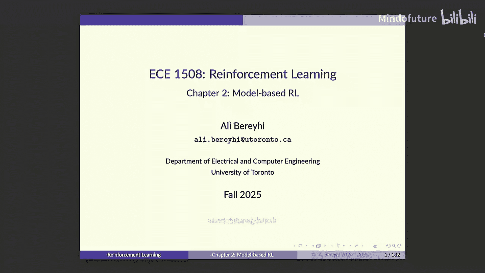

Model based。 And as I told you， we are going。Recap here。

 So the ultimate goal that we have is to just find the optimal policy right So you want to know upon seeing one particular state。

 what is the optimal strategy that you should do。 and we talked about it that we have two major issues here。

 the first one is that if you want to compute that value function。

 What is the optimal policy is the one which maximizes the value function right and how I can compute value function。

 Well， I essentially need to know at each state， how I'm gonna transit to the next state and how I'm going get a reward right And this means that I need to be able to describe the environment right So this is the first challenge that we have how we describe environment And second one is that what if the state space is huge。

 So the second one， you forget about it right now in this chapter and the next chapter two and3。

 we just talk about tablear where we think that this state of space is not too large or is still we are able to handle。

Then we're going to see how we can handle the second issue in chapter in the second part of the course when we start with the deeper reinforcement learning。

 but at this point， what we want to do， we want to start with the first question。

 we want to find some tricks that we can evaluate one policy， for instance， in one environment。

As I told you， there are two different approaches。 One of them are model based。

 This means that we either impose one statistical model for the environment or we know it based on the nature of the environment。

 For example， in this frozen like example， you can describe it， right。

 It was a very simple categorical distribution， right， that is not a hard thing。

 But if you have a real robot， this is then a bit of challenge， right。

So this is what we're going to do in this chapter。 Next chapter。

 we're going to start with a model free where we。Accept this fact that we don't have access to that model in general。

 And now we want to just come up with approach to estimate， so。

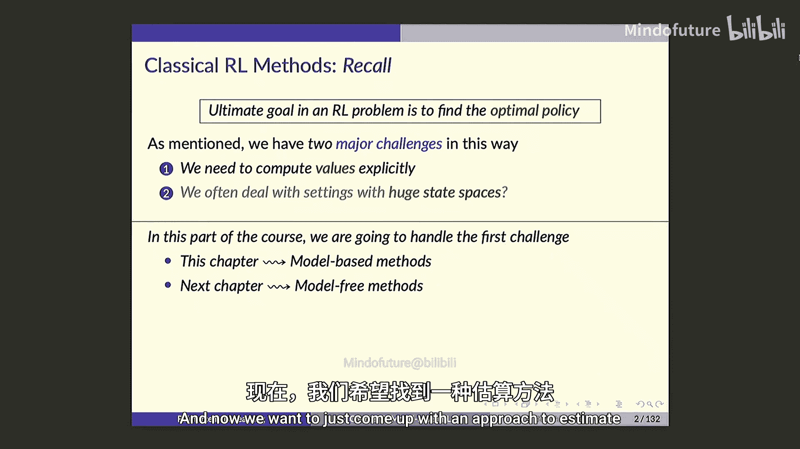

When we talk about model based， as I told you， we either we assume that we can describe behavior。

 So we either know it because of the nature or we we are able to just we just imposed on the model。

 So this were this was the economy that I told you last time。

 So this other great part of the table is going to be chapter 3。 But I know what we want to do。

 want to talk about the model base。 And in particular， we understand。

If we have this power to describe the the environment very concretely。

 what would be the optimal policy， right， What is that。

 So we're gonna to see that there is one specific optimalology constraint known as Belman optimality。

 which comes directly out of thecursive property of this value function。

 And then based on that you can guarantee that you always in such situation， have an optimal policy。

 and you can eventually compute it in most of the cases。 Okay so this is what we want to do。

 And then we're gonna to see how we can practically compute it when we know them。

 which is basically the true value and policy iteration algorithm so。

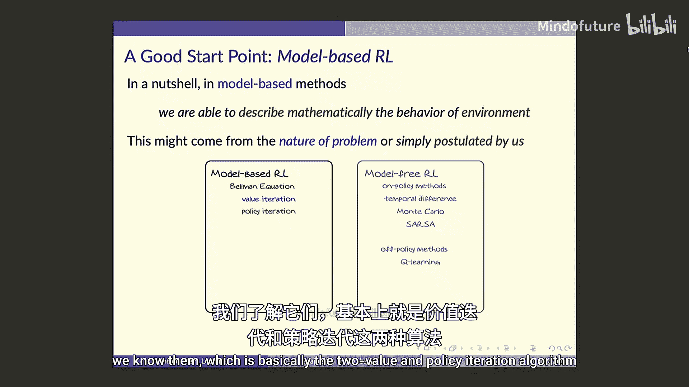

Now， yeah， let's start with the model model based approaches。

 And the key factor in the model based approaches is that we assume that this markov chain that is describing the transition from one state to another。

 We do know it。 like we have access to it。 We can literally write it down。 so。Quick recap。 we。

 we talk about the Markov process and we say that the states are describing a markov process， right。

 This means that when you start from state1， then a time1。

 then you're gonna change to another state and you keep on going like this， right。

 But every time that you want to know what is the chance of going from this state to the next state。

 as long as you know what state you are in， you don't really need to know the previous states。

 right that doesn't mean that the previous estate are independent of the next state。

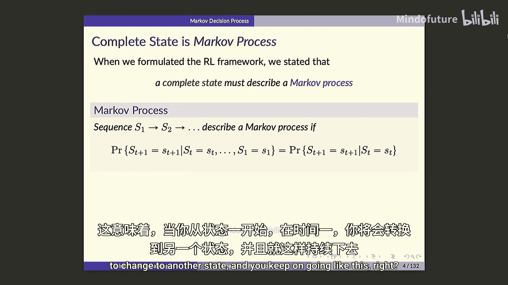

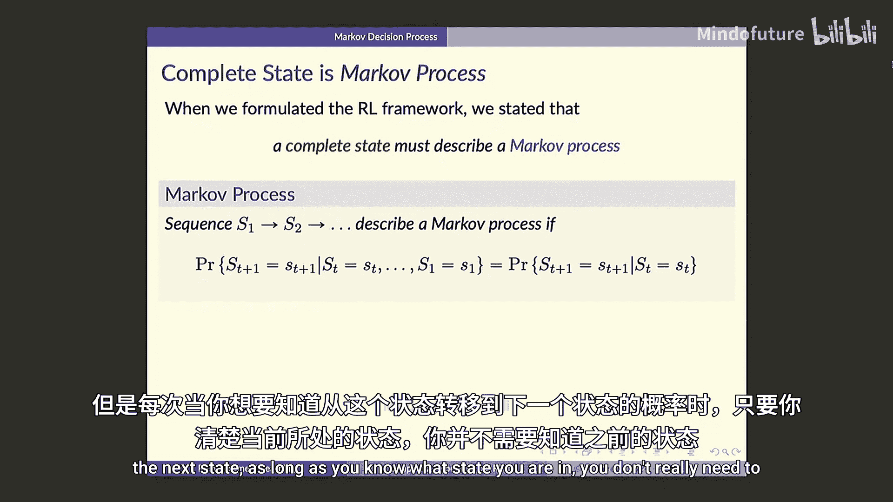

Given that you know the current state， you don't need them right all the information are carried inside state S T right。

 So you start from one state S1， you just change to S to S3 and so on。

 then you get to a state S T right When you are here。

 you don't really need to care about before you just look at the current state and you would say。

 okay， this is the chance of going to the next state the possible case right so。

And if you consider this fact， then you can simply write down the rewarding and transition function in the form of avol conditional probabilityvol distribution。

 So what was the transition function was a random function。

 which is start from the state that you are in the state S T and the action A T。

 the action that you are in right now， So you have a pair of state in action。

 it's going to tell you what is the next state right。

 you're going give you a random transition to the next state。

 same thing is for the rewarding function。 So it're going to look at your current state and current action I'm going to explain you what is the reward right what is the chance of every single reward that you could get and you can。

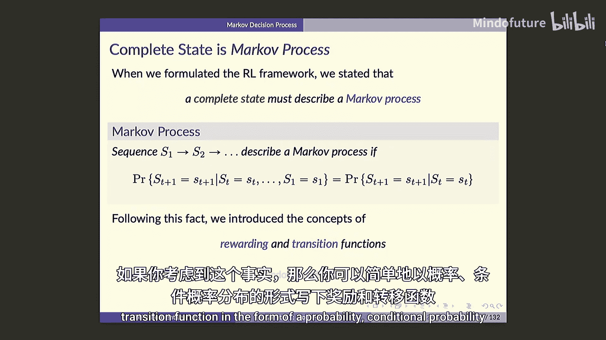

Just use these represent these two random mappings using a conditional distribution， right。

 So how you can， how you can do it， you could say that， well。

 say that I am particular say as 0 at the beginning。 and I do action a 0， right， then。

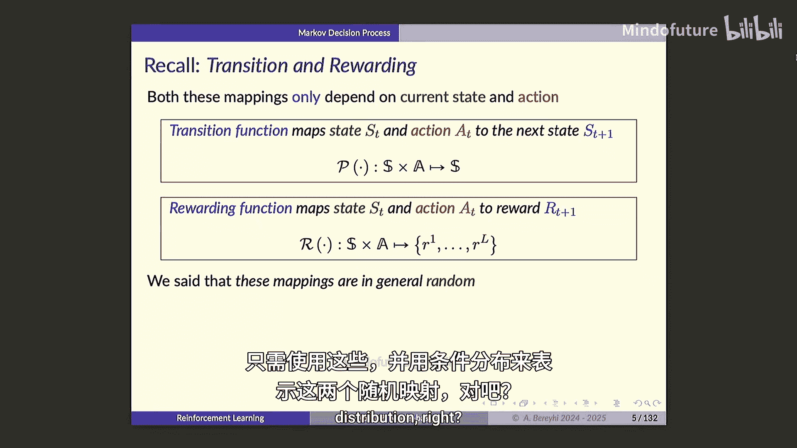

Up on doing action a 0， I'm going to jump。AH right， it's going to be S1 and R1， right。And then again。

 I need， I do one， for example， I do a 1， and then I go to the next estate and reward， right。

 And I keep on going like this。 Now， if I want to describe the。

Re rewardward and instead at particular time T。What do I need to write down， How does it look like。

Its gonna be the probability of this beer， given。The last state that I was in and the last action that I have done。

 right？ So in particular， if I am in particular state， T。I do action A T。

 And then I'm going to jump into the next reward and the next estate， right。

 And then I can simply define this。TheStarting from here to where。I can just define it with this。

Pro all to distribute condition to distribute。喂。Everybody agrees。Questions。

So what is this transition that tell me that， say I am at one particular state S， right， right now。

And I do a particular action， A， small A here。Now， right。

 then what is the chance that I get into a new estate S four， right？ So from one estate。

 I'm jumping to a newest estate。 Now， one question， this colorpo。

 can this be same as this small green S。 Can it be the same thing。Yes， it can be。 Okay， great。

 So you're seeing it。And it also gives me a promoting distribution on。

I do know that the notation might get a bit confusing， but no on， whenever I feel that it's okay。

 I'm going to just compact write it down in this form。 But no worries， since Im a super ob person。

 I am usually explaining things in detail。 So it's not going to be that confusing。

 but whenever you felt confused just。Ask me。 but， I， I mean。

 if I want to use this not for the rest of this chapter， you're gonna just。You're gonna to just。

Be super unhappy。 So now。Thinkh now I am at this particular time T。 Now， if I go one time back。

 right， I want to know， for instance， what probability of previous time。In the previous time step。

 what is the probability of getting particular reward R and transiting to particular state S bar。

 given that two times ago， I was at S and I did action A， How does it look like。

It' gonna to be exactly like as what we had on the first line， right？

 So say I start in the terminal state， right， and I do one particular action， right？

 I'm going to get back to this terminal state， right。If I again do the same action。

 I'm going to get back to this estate， right， and I'm going to keep there， right。Now。

 if I am in another state and I do one action。And then， I get into。

Should I keep on going till I get to the same state that I started with right So I just loop all the way to get back there right if I do the same action as I did at the beginning。

 the next estate and action distribution is going to be the same again right So the thing that I want to indicate here is that this time index is no more that important。

 I mean， the order is important， of course， the next estate is described by the previous estate。

 but if the next state is S T， then you just need as the previous estate S minus-1 right as long as you put the same small letters here or S for S and a nothing is going to change right So if I keep on going down iss going to be always the same expression because this is a markov process right。

So it doesn't matter if this is the time index1 or time index 100 that I am in this estate。

 As long as I am in this estate S， and I do action A， the probability of the next estate。And the。

 the reward that I I'm gonna get is going to be unchanged。 You going to be the same thing， right。

Everybody's cool。Questions。Yes。The fact that I'm like here is P of R S4 given S and a， right。

 And I don't care that this S， the green S was happening at time A and action was a time A right。

 If I am at times sorry， time 0。 If I am at time 0。

 then this R and S4 is going to be the pi at time 1， right， If I am a time T-1。

 This is the pair at time T， right， and so on。 So it doesn't matter which time you're in。

That makes sense，Yes。Or and。As sp are not independent of each other， necessarily。It could be， yes。

 typically is the case that the reward only depends。 I mean in many many environment。

 reward only depends on actually S T plus one， like R T plus one only depends on R T S T plus one。

 But in this formulation， no they are not independent， actually， But， I mean。

 typically it's the case that they are like。When you know this green guy， you can just sorry。

 yellow guy， you can just throw away everybody else。Typically， not all the time。Question。No question。

 O。This guy that you see here is what we call it a Markov decision process。 Yeah Why it is Markov。

 Because every single time it only depends on the previous one， right， not everybody else like。

It's important to pay attention to this like S T plus one。 of course， it depends on S0 as well。

 But as long as you have S T， you don't care about S0 anymore， right。

 So the information is just carried out is a state dependent system， right。

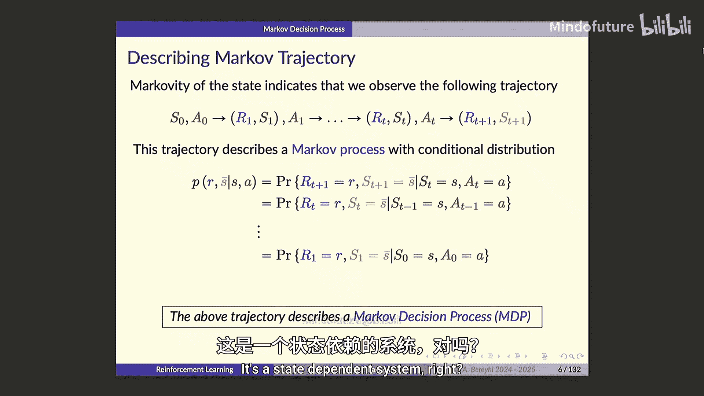

Okay。Now， what we consider here in this chapter is that we work with a finite SD MDP。 Now。

 can we work with infinite MP， We can do it。 But eventually。

 this chapter is only to give you the background。 So I don't want to just dig too much deep into this one。

 because at the end of the day， like model based approaches are not that much sophisticated。

 like you。Hardly get any model based environment with the model now。

 So we're going to stick to the finite MP。 And why the finite MP。

 I simply mean the the assumption that we started with， so。

The rewards are coming from a set of set of few options， right。

 So now if you have a continuous estate， one way to do it。

 you can approximate it by just quantizing it， right。This is one way。

 if you want to stick to this one。 But those guys have their own framework as well。

 which we're not going to really waste time on that， okay。Now有。Now。

 the the key factor about the MDP is that your MDP is going to be described by this pair of by this conditional distribution。

 This means that the only thing that the environment。

 So you throw away the environment and the only thing that is remain from the environment is this probabilityty distribution。

 Now， one thing that you might ask me is that when you define the。

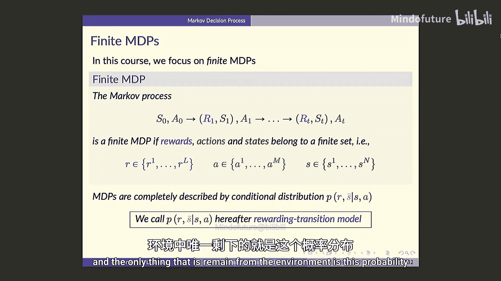

For this the R L framework， you said that we have a rewarding system， and we have a。

Transition system， right， But now you're representing things with one joint conditional distribution。

 right， So you're talking about or and S for the next reward and the next state。

 given the carrying in the state and A， But we expected to have one separate transition for state。

 one separate transition for reward。 I guess this is quite obvious for you what you you need to do in order to get there。

 right。What you you need to do to do if you want to just know the transition。

 you don't care about the reward。What should we do？

Say I only want to know the distribution of the reward。 I want to describe the rewarding system。

 I don't care about the next estate。 What should I do to this guy。Not average， but。

Some were all the next states， right？ So what you're gonna do， you're going to margin。TheSt， right。

 You see it。Yes， does that make sense you。Everybody's clear。 So this guy is。

 the point that I want to tell you here is that this guy is giving you much more sophisticated。

Description as what we had in the original formulation。 So in the original formulation。

 I told you there is one rewarding system， right， And this is going to tell you。

 what is the reward given every state and action period that you have right Now。

 if you want to get there， you can simply just marginalize marginalize this one over all this data。

 you would say， okay， the。When I am at this estate and do this action is going to be， I mean。

 the distribution of the war is going to be this。 if I consider the next estate to be state1 is going to be that if I consider the the next estate to be as state 2 and so on。

 So you just add them up is going to marginal everything。 This is going to be your rewarding system。

 right， So the rewarding system is immediately coming out of the。Distribution。

 everybody's seeing it because I， I don't know。 Maybe I am too tired， and I started to be a。喂。

This that you are not asking any question， and this would be weird。Every's cool。 Yeah， just go ahead。

We're gonna see it。 We're gonna see。 Sometimes you want to， for example。

 take expectation of your reward。 like what is the expectation of the immediate reward。

You don't need to know the next state， right。But就这样我。

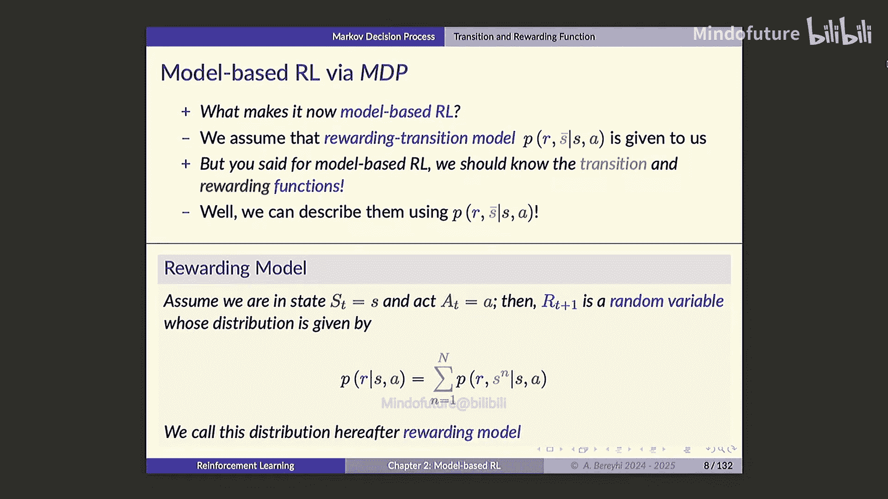

Explain the model， right you can always if I sum it up over all possible rewards。

 then I'm going to get out of get rid of the reward and then you're going to be on the next estate right。

 So you're going have the probabilityty of the next estate given the currency state in action yes。

Sorry。Questions。Yes。This one。那是。What is the， sorry。Yeah。

 it it's gonna tell you what is the chance of every single next state right？ So I am in state one。

 right， the first cell。 then I decide to do action right， right。

 Then I'm gonna change this state right It gonna tell me， okay。

 the chance of any of the possible state is like this when you do action one at state 1， right。

I'm going to give you an example。 Then you're gonna to get it clear， right。

 But this is actually the only thing that I need in order to describe my environment。If I know this。

 then。That's it， right， This is the whole thing about the environment。

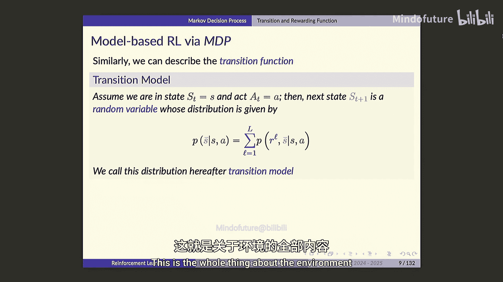

Questions。No question， yes。O。

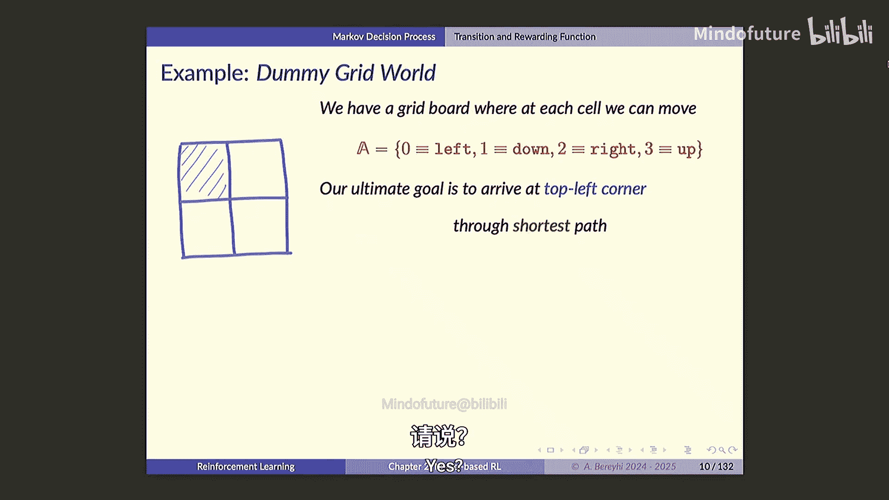

The reward is here random in general， right， because like， like in the frozen lake， right。

 in general， is a random， what we are doing here， this guy raise the。

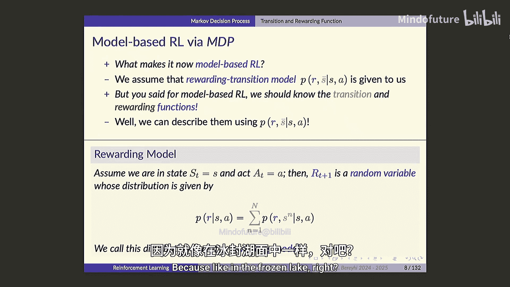

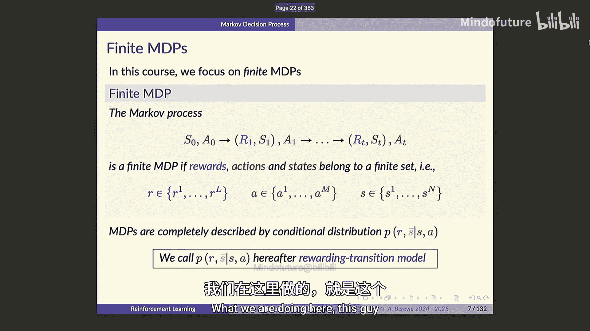

继需。The distribution that you have here is going to tell you。

 like this R that you see is the reward that you are getting in the next time step， right。

 and it could be from。Possible cases， right， it're gonna tell you what is the chance of every single case and what is the chance of your next state being any possible state。

 given that youre in the particular state S and you do the action right So here this R R T plus1。

 the one which I show with capital letter that one is a random variable because like in the in the frozen game frozen lakes sorry when you want to just move right。

 you might sleep right and then you might get another reward。

 So you can think of the reward to be something random So it happens with some probabilityvolty to be0 with some probabilityvol to be -1 right。

呃，sorry。

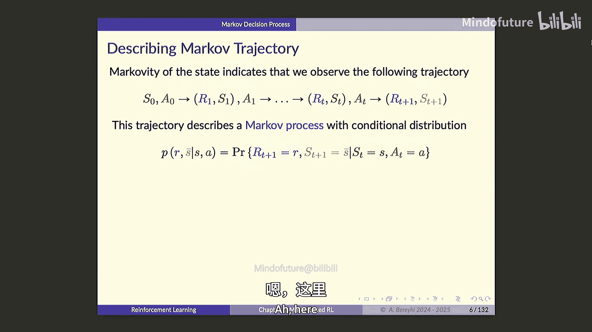

That's some。Here， yes， yes。 that's gonna be。 Now， here what I'm doing here is like you would say。

 okay， I'm this estate in this cell。 and I do this action。 I don't care about the next estate， right。

 I just want to know what is the distribution of the reward that I'm gonna get after doing and that action。

 right？ So if you just compute this marginalization。 It' gonna give you a distribution， right。

 And this is only distribution on R right？ So like in the。Example of frozen leg。

 It gonna be my the possible cases for R is going to be -1，0，1， right。

 And then this distribution is a。Categoorical distribution with three entries， right。华清。No question。

Yes， good ahead。O。

啊，对呀。So， yeah， let's just do this example。 I'm gonna keep this example for the rest of this chapter because this is dum example。

 we can solve。 So if I want to do more than that， then I'm going get into trouble。 But here。

 this is like a super dummy one and the。Game， I just called it Domic Read world。

 So what is the story， The story is that you want to just start your at any cell。

 You want to get into this top left cell with the shortest path possible， right。

And you might think of it super stupid， but there are still， very stupid policies， right。

 sayy I am here。 I can go down， then left， then up， right， Then this is not a good thing， right。

 So you're gonna just， you want to just go left directly to get to the destination， right。

 So anywhere on this grid world that you are。 You just look for the shortest path towards the。你啊呃。

Fororner， okay， now here this， if you want to just write down this R frame setting in。

 in the form of formulating in in the R framework。You need this state。

 This state is simply like the frozen like， right， It's gonna be the cell index。 So for example。

 this guy is  zero。 So it gonna be 0，1，2，3。 It's one of the。Possible states， right。

 And what are the actions， The action are the direction that you are going to move。

 I'm gonna keep the same notation so you can just move left down right up。

 And then I just index them from 0 to 3， So these are any action that I do。

 And then what is the rewarding system here。 So if I move。To another cell。

 So if I am at this cell and I do any action that it just moves me to to another cell。

 the thing that is going to happen is that I'm gonna collect reward-1， right。

And then it makes sense because I'm looking for the shortest path， right？ So if I am here， top right。

And then I want to find the shortest path。 Then I just move one step， right， and it's gonna be -1。

 Reward-1 is definitely larger than going down left up， right， because it's gonna be -1-2-3， right。

Everybody's clear。Now， this is one thing。 But if you just you are here and then you hit the the wall。

 Okay， then you're gonna collect I and half。When you are in any cell and you move to the direction which you cannot go to another cell。

 you're gonna get minus half。 And you might tell me why you don't put it 0。 if I put it 0。

 it's gonna remain there forever。 I don't want that right because if the agent is here。

 And each time it hits the wall， it's gonna get zero。

 then you're gonna keep hitting the wall for forever， right。

 because hitting the wall forever is more worthy of just moving one step， right。是。

That is that environment makes sense to you， right。

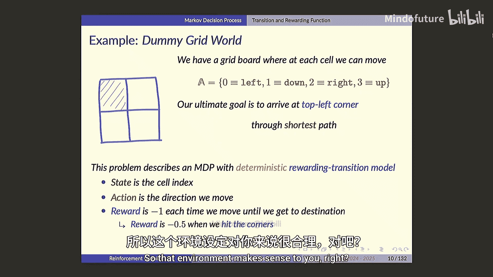

So now looking at this one， now， I want to just explain or describe this rewarding transition model that we have。

 So the thing that I want to do， I want to know， for example。

 what is the probabilityty of the reward and the next state， given that。3， so look at。

Maybe be the next。One， right， what going to be reward。-1。 is there any randomness here happening？No。

 so I can describe the distribution like this， right。是啊。Or N S1， the reward that I get， it's -1。

 nextus state is going to be1。 This happens with。You think of is going to happen forvolti0， right。

All right。Yes， does that make sense？OK now。What if Im at particular state  zero。 So here。

 and then I do any sort of action。What going to happen。This guy is terminal state， right？

 So this guy is the one where the game is over。 So when the game is over when I get into data estate。

 I'm going to remain in that estate， right。And the reward that I'm going get Col like is always going to be 0。

 right， So now when I am at the terminal state， no matter what the action is。

 the next estate is going to main the terminal stay。Som collecting is going to be 0。

 This happens with provolti 1。 Anyone else happens with provolti0。Everybody's cool。Good， so now。

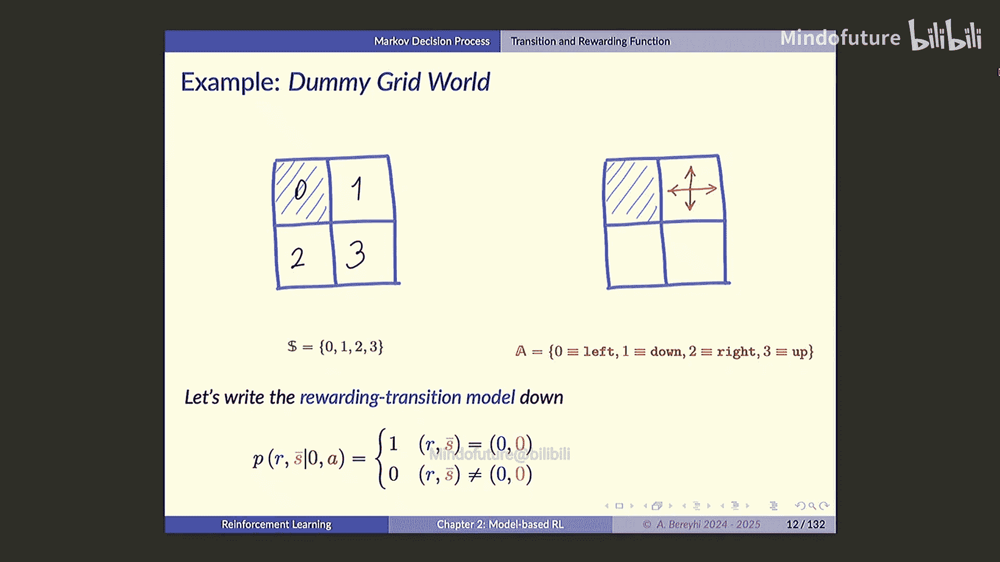

Yeah， S is as equal by 0 is the terminal state here now。One cool thing about this way of。Thinking。

Is that we can actually show everything in the form of a transition diagram because when we have finite number of sets。

 we can think of different sets。 And then depending on the action that we are going to do。

 we might stay in one cell or we might we might jump to another cell right to another state Now is it okay that I keep on with this one just extra five minutes and then give the break Yeah and just rush up to just get here。

This is what we call a transition diagram。 This is sometimes much easier for you to just represent everything in this form。

 say， for instance， I have three different possible estate。 So a state 1 state 2 state3 sorry。

 four different state this three estate and this state S。

 And when I am in this particular estate depending on the kind of action that I'm doing I do action one。

 then I'm gonna change this state from this one to another right I am not showing the complete diagram because this guy has also his own directions right maybe from this one you get into this estate and so on right but every direction that you show is going to。

Essentially， present the kind of transition you can have from one state to another。 Now。

 let me do this for this particular example。 Im in great world。

 and then it' gonna get much easier for you to understand it。 So we had four different cells， right。

0，1，2，3。

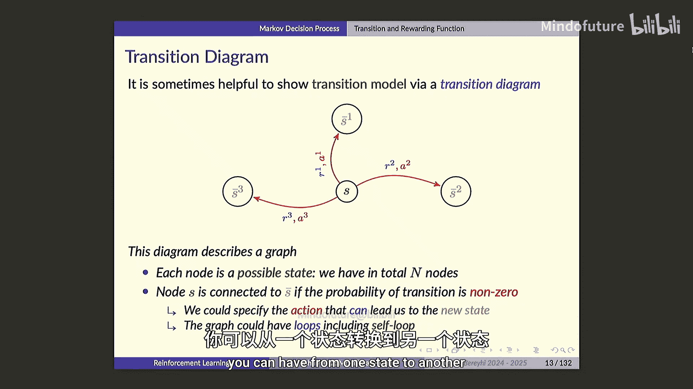

Right， and now if you think you are in any particular state。Any of the cells。

 depending on the action that you do， you can change your state， right。Clear。

You can change your cell， and then you can describe it by using only these four different states。

 for example。If I am at stage 0。No matter what I'm gonna do， I'm gonna always return to state 0。

 right， iss the terminal state。 So it's gonna be a loop here。 And then I get the reward 0， right。

What if I am as state 1， What gonna to happen。When I'm in state 1。

 I can jump from 1 to0 if I just do action 0， and I collect reward -1。And step。啊。😮，-1， right。

And then one thing goes， oh， I didn't haven't it， but we we should also have a kind of inner inner loop as well。

 because when I am in one， if I do any other action。

 I hit the wall and then I get minus half and I get back to my own cell， right。

 so I can just show it with an inner loop。 I have missed it。 So maybe I put it here。

 but I don't know why I haven't shown it here。Now， another thing that for， for example， cell2。

 stay 2， when I am here， when I do action 3， I go up， I get reward -1。 When I do action 2。

 I go to right， and then I collect reward -1 and again in inner loop， right。

 And you can do the same thing for for stay 3， right， so。Now。

 what you all have as the mark of decision process is the proities of all of these errors that you see。

 right， So you have different states。 and then it's going to tell you what is the chance of you move you moving on this error。

 What is the chance of you moving on another error and so on， right。Everybody's clear。

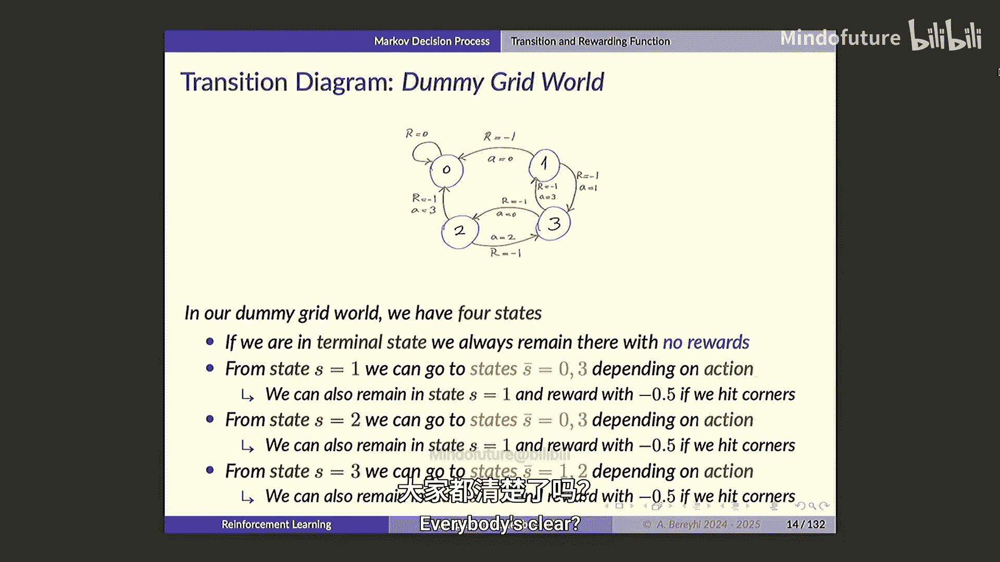

Questions。