# 【多伦多大学】强化学习 2025 ｜ Uoft   Reinforcement Learning   Fall 2025 p13 P13_讲座_12_通过MDP计算价值函数——朴素方法 -BV1D3F2zhEry_p13-

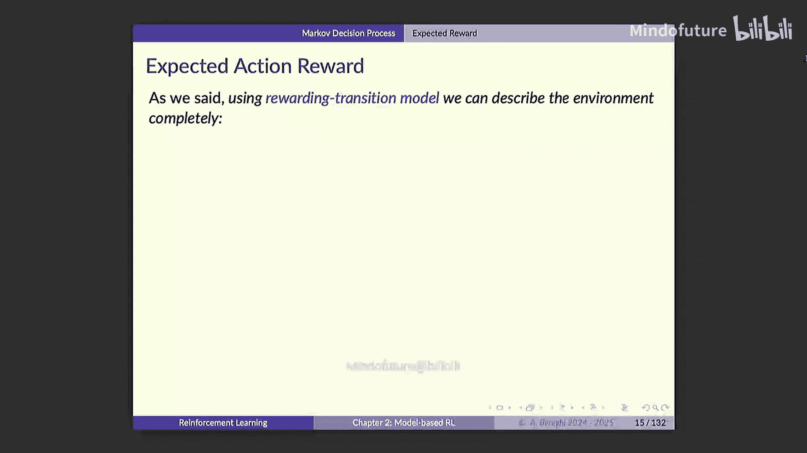

action reward。 So now， as I told you， when you have this reward transition model。

 So if you know the distribution， the board that you are going to collect on the next next estate。

Able to pretty much compute anything that you want， Okay， so。For instance。

 say that I do know that that that model， that particular distribution。

 And what I'm looking for is to see that I am in one particular state S， and I do one particular。

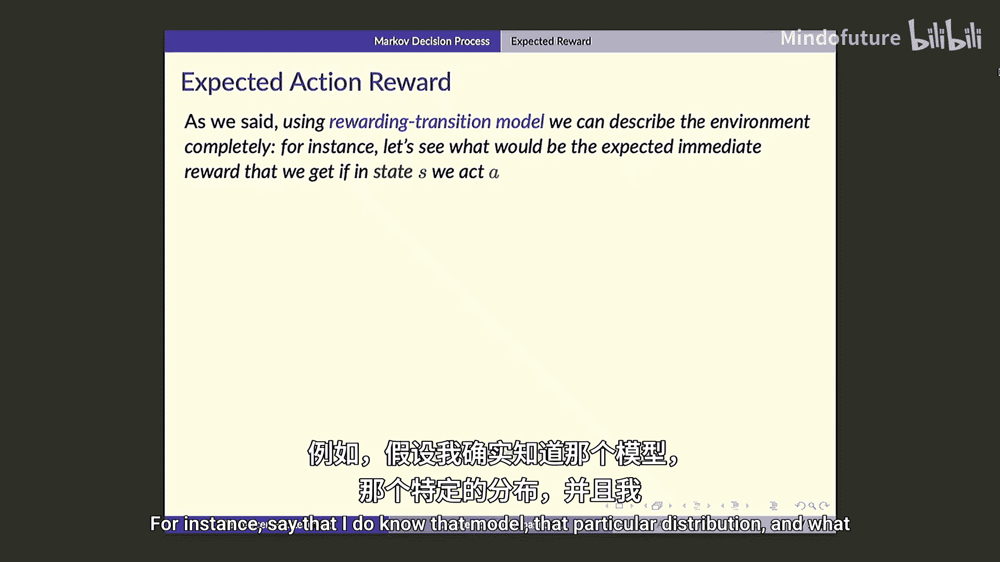

Immediate reward that I'm gonna collect。That is quite easy， right。 what I'm gonna say， I'm gonna say。

 okay， the next reward that I get， given that I am in this particular state and this particular action I do this particular action。

 then iss going to be this expectation， right， And can I compute this expectation with the environment。

开了。I know that distribution。Yes， I can do it， right， So I can write it down in this form。

 So I would say。Any reward， R L is happening with the probability of R L given S N A。

 So I'm going to put it inside the sum， and I compute the average immediate that I'm And of course。

 as I told you before， if you don't see this distribution immediately。

 since you have this other distribution， you can simply first marginal wise。

 And then after marginals， you can do the averaging。

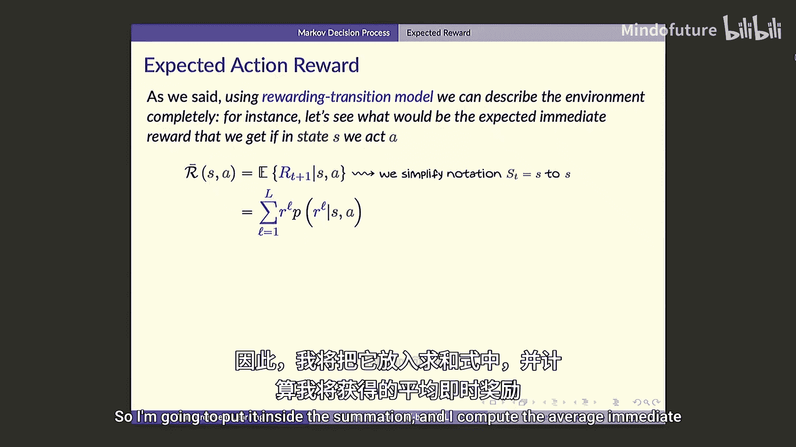

Everybody's cool， right。Questions。So immediate reward， you can compute it。Now， the question is。Yeah。

 that is the rewarding transition model， os now。

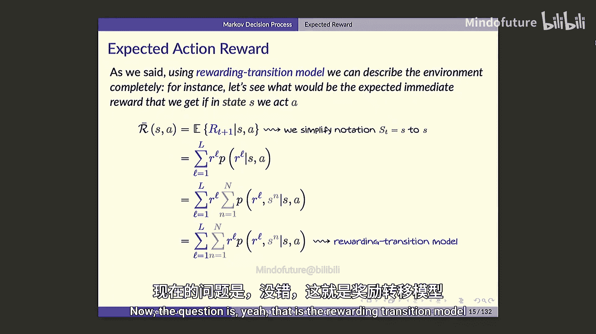

This guy that we computed right now， this one， this average year is going to tell you whats the immediate reward。

 right， But at the end of the day， what you want to have， you want to have the， you know。

 rewards toward the end， the average return that you are going to collect， right。

 And if you want to do that， then's going to be a big。

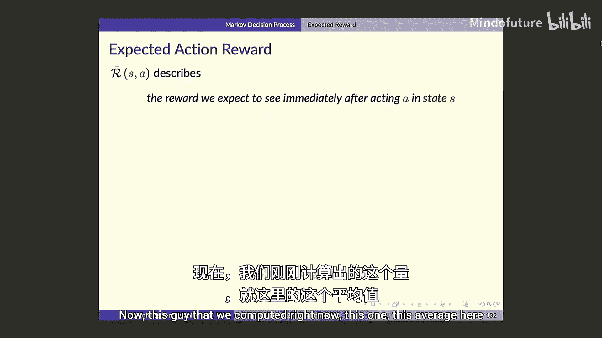

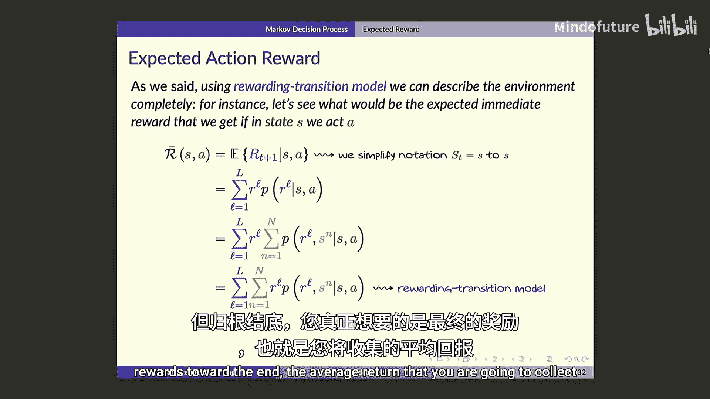

Now， let me first give name。 Okay， so this guy， this is what we call it the immediate reward。

 and this immediate reward is of this form。 So whenever from now on。

 I'm gonna tell you average immediate reward， I am simply talking about the average next reward that you're gonna get given that transition that you have inside the system。

 right now。

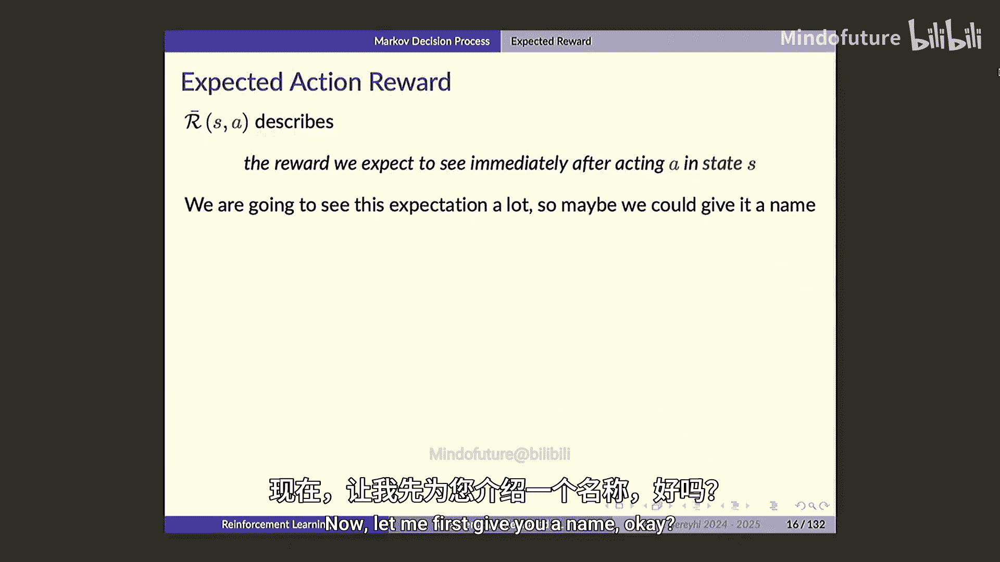

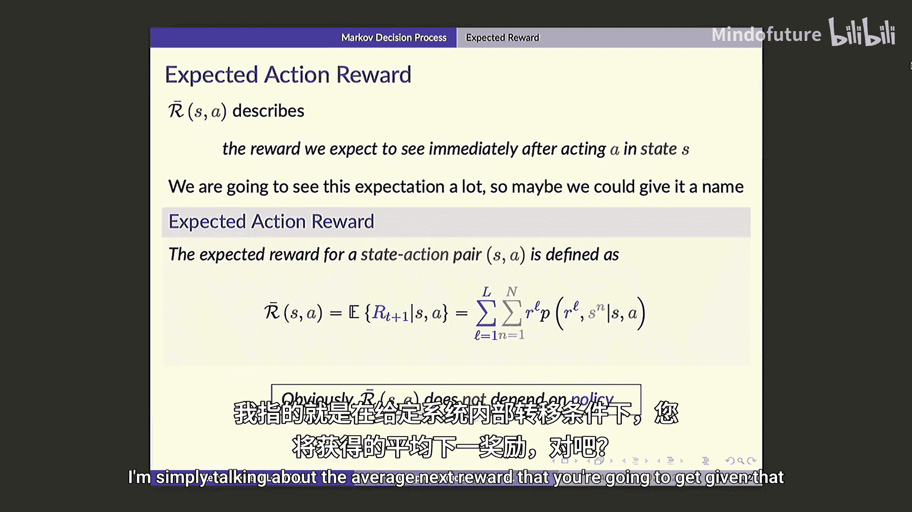

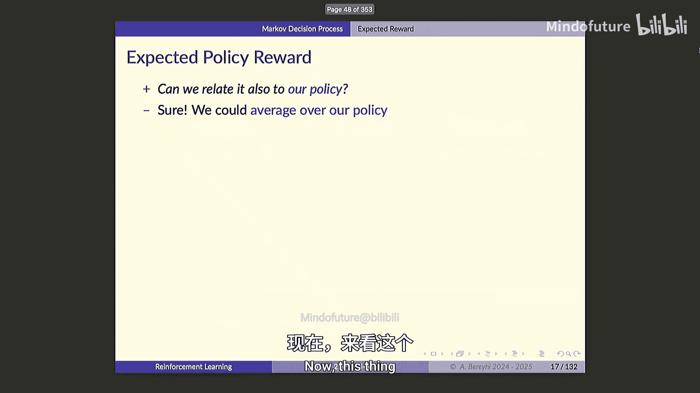

谁？啊。Can we somehow relate this guy to our policy or in other words。

 can are we able to compute the value function？ So， yes。

 we can actually do this guy by averaging it over the policy， right， for instance， say I have。

 I have this particular policy pi， Okay， and now I want to know what is the average next reward that I'm going collect。

 given that I am playing with this policy pi， right。

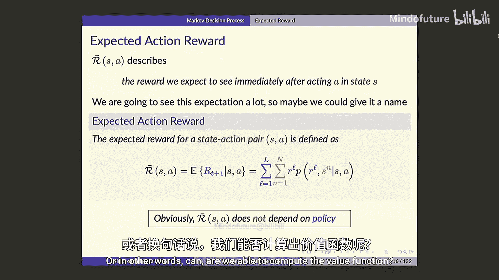

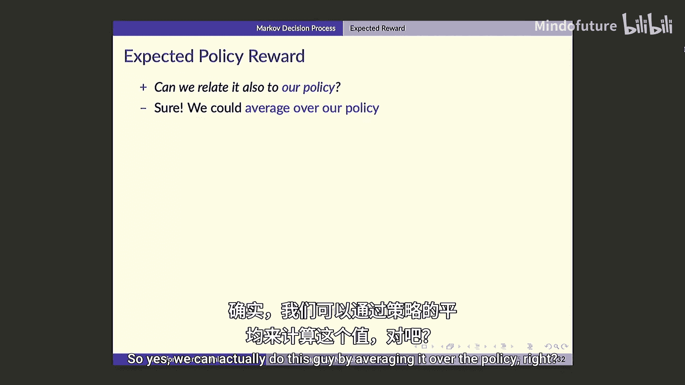

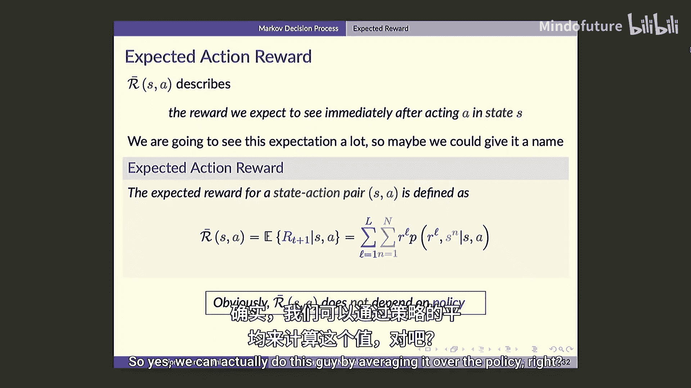

I want to find that out。 How can I do this。Well， I could say that if I am playing with S and some particular A。

 I can compute it exactly like the previous slide， right。And now， if I just know my policy。

 then I can get the chance of every single action， given my policy。 and then I average over that one。

 right， So that is going to be the average immediateatory word。

 Then I'm gonna get if I play with policy pi， right？

 So I can say that what if I do as the next action A M。 So this particular action。 Well。

 this one is easy， right， This one is exactly this guy， right。

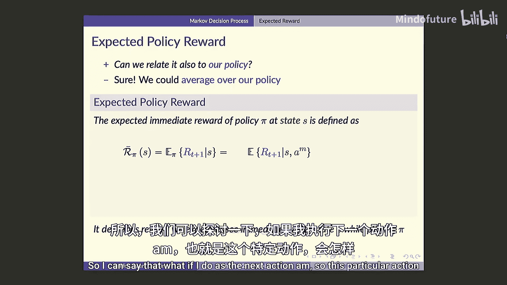

We can compute it given the， the transition and rewarding system that we have。 If we have that guy。

 So I have this guy。 I just multiply it to the policy。 So the chance of doing a M。

 And then I average it over all of them， right， This is going to give me the average。

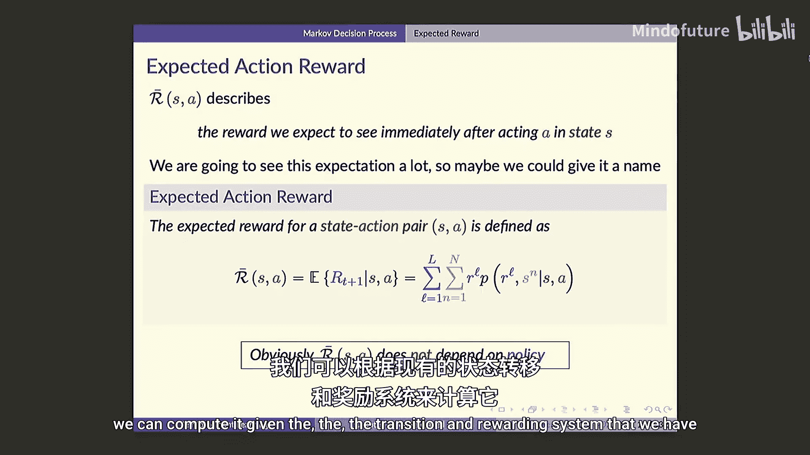

嗯。Immediate reward that I'm going collect at a particular state asked if I play with policy pi right。

 So I hope that you feel comfortable with these notations。

 I do know that it is too much of like indices and too much of summations。

 but you don't really need to focus on details just get the big picture。

 right So the environment is actually explaining what's gonna happen next。

 And then you can just use that one statistically to just compute the average reward。

It's just the first， first term， right， It's not the value function。 This is the immediate reward。

 We have not yet computed that one。 We're gonna compute that one， as well。Questions。So， yeah。In。Upon。

 you can assume upon making an action。要。Yeah， oh， let me think。 No。

 I would say upon entering the next estate。Yes， because， yeah， because。I， you don't really need to。

You don't really need to think。Too much about that。 But just since you ask。

 So you're talking about reward and state next stage。

 given the Karen state and the action that you do， right。And then you， I mean。

 it depends how you interpret it。 But if you write down the chain rule。

 the more natural one is that you say that。The party of the next estate。

 given the current state and the action that you' are doing， right。

 times the proty of the reward that you're collecting， right， given the next state。

 current state and the action， right， This is the chain rule。

And then you could say that next estate is somehow， I mean， you do first the action。

 and then you're in one particular state。 then you're gonna get to the next right。

 once you got to that next estate， then given that what was your previous estate and the action。

 you're gonna get the reward， right， you can think about it like this。 But mathematically。

 you can also write it down as or here。As far here。哦 right。And then in that case。

 you get the reward up on doing the action。 and then you move to this stage， right。

It's just how you think about it。 It doesn't impact the formulation。Questions。No question。 Okay。

 cool， So yeah。Guy here。 So as I said， this is the immediate reward that you're going to get when you play with your policy and you're in a status and you can simply compute it。

 I do know this is too much of summations here， but at the end of the day。

 this is possible for you to compute because you have this P， this distribution。 you have pi。

 This is your particular policy that you are playing with and then you can simply compute these marginalizations okay。

Cool so let's。

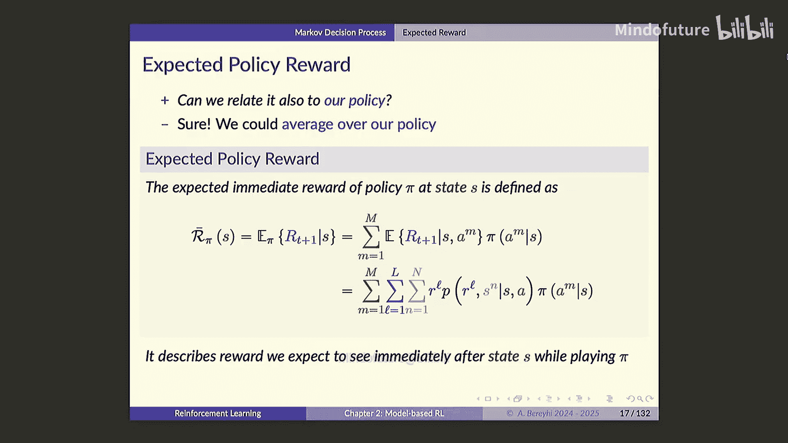

I mean， read world and see， for example， how does the immediate reward look like here。 say。

 for instance， that， yeah， I am in one particular state。 the state is a state1。

 And now the actions that I can do。 I mean， all of the four actions that you can think of。

 So if I do action 0， I would definitely go to this。 So I mean。

 if I do any action 0 or if I go left or down， I'm gonna end up。Taking one1 step。

 which is going to be -1。 If I do action 2 or3， like right or up。

 I'm going to just hit the wall right then I'm going collect each time reward minus half right。

 And then I could say that the average reward that I'm going to collect is going to be exactly these ones because the transition is happening determinist right There is no randomness here。

 right。

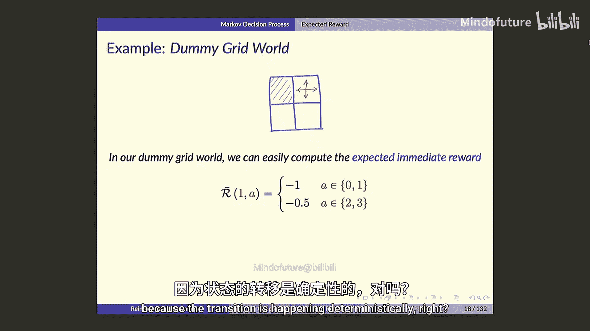

Now， you can actually， or， for instance， yeah， if you're in the terminal state， you do any action。

 you always end up having  zero。 This is something obvious we said before。

 but you can also compute the average。

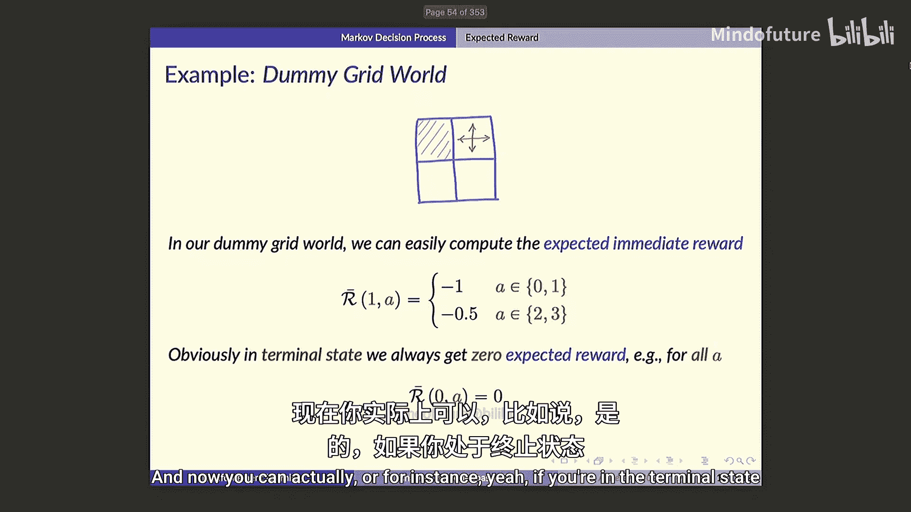

Immediate reward when you are here， regardless of your action， given your policy。

 So you forget about the particular action， you would simply say。

 say I'm playing with one particular policy。 then what is the average reward。

 right that I'm going to collect immediately。

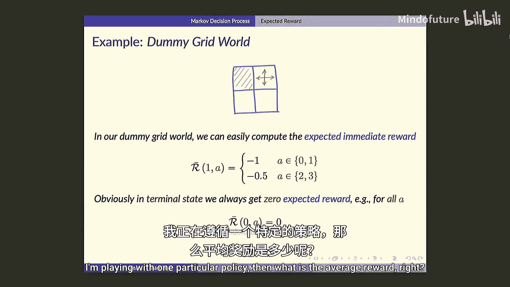

For instance， say I am playing with a。I mean one is instead， I simply choose one direction。

 and then I move。

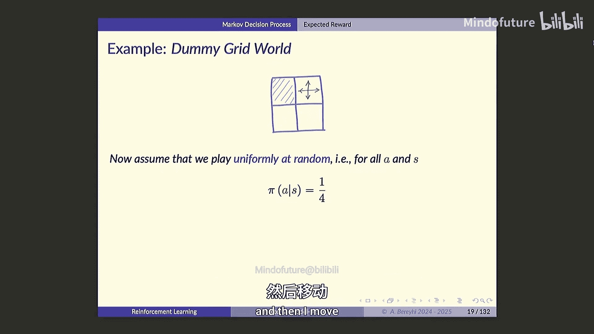

Okay。If I do that， this particular example that we have here。

 this one when I am in this particular cell。 If I play with that random policy。

 what's gonna be the average immediate reward that I'm going to get。What is it。Please。

It's gonna be minus。0ero point。75， right， So you're gonna be the average of these two because two times you're gonna get -1。

 two times you're gonna get- half。 The average of them is going to be70。75。

 So this is basically the one we showed in the previous slide。

 the immediate reward that you're gonna get in one particular state， given all the actions。

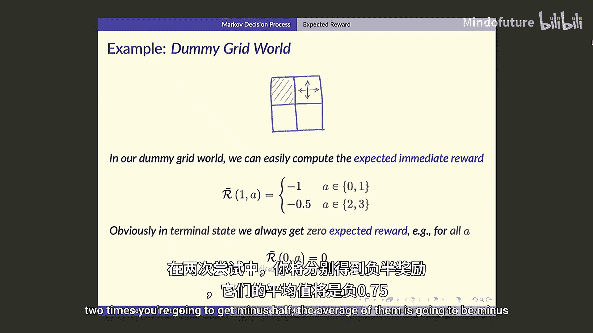

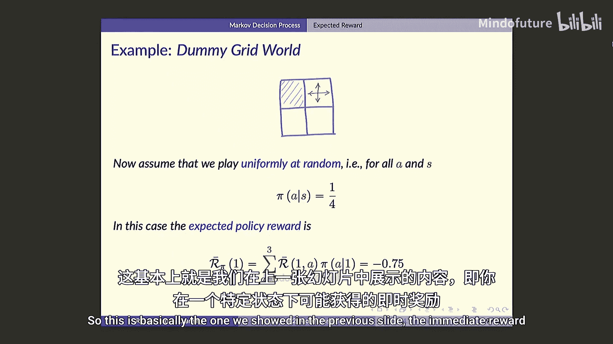

Multiply with your policy， and then you sum it up over all possible actions， right。Everybodys cool。

不是。go， great。Now， if you do a policy， for instance， you are here at this particle you always go left。

 This is the somehow the optimal policy， right， So if you do that。

 then pi in this case is going to be0 everywhere。

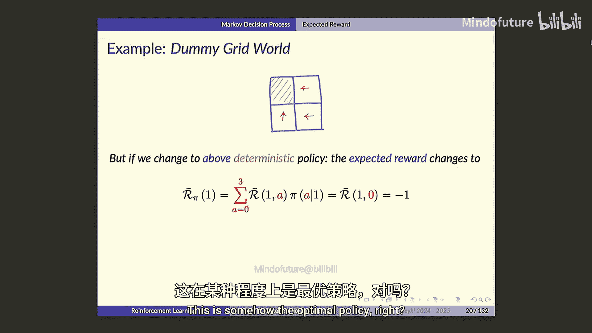

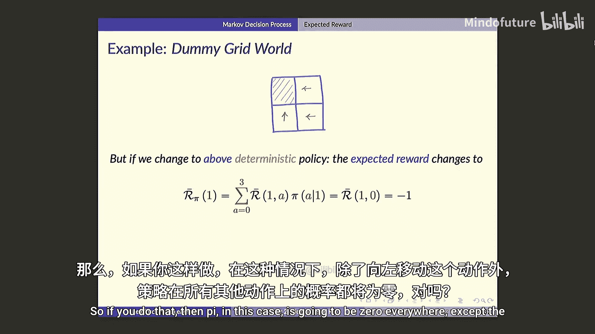

Except the action of going left， right。And then the reward that you are going to collect。

 the average immediate reward is going to be -1， right。Everybody is cool。我还是。Now question。

And you can go ahead and compute for this particular policy that we have here。 The other guys， sorry。

 the other average value at other cells。 and you're gonna see all。

You was just going to a neighboring cell， yes。No， no， we have two-1s to7。 because when you are here。

 if you go left or down， both of them， your immediate action， you're gonna collect just -1。Yes。

 if you go here， you， you just get -1。 and after that is always 0， right。If you get here。

 then you' gonna be -1， for example， then-2-3， then 0， right。

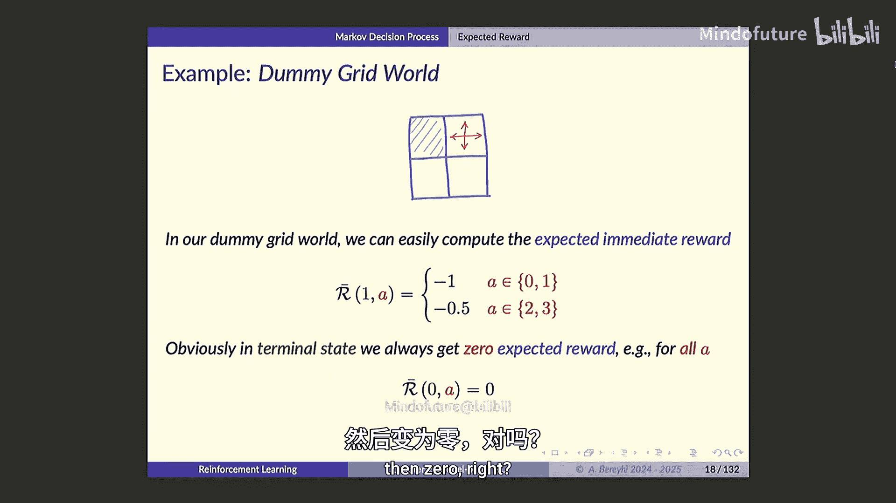

Questions。No question。Now， one thing here， everybody pays attention to this one。

 I put this numbers here， I mean， on purpose， because of one thing。

 like this policy here that you have the policy of。Moving in these directions。

 these determine as they want。 This is obviously the optimal policy， right。

Or a optimal policy is not D。 It is not the only one， but it's one of the optimal policies， right。

Because at every cell you are taking the shortest path， right？ But now at the one that you are。

 what is the average you were that you' are collecting。us1， right？ What about this policy here。

 What is the average immediate that you' are collecting。This is-0。75， right。

 This is more than the other one， right。But the key point is that this is only for one for state1。

 right， It's not towards the end。 It' just for the immediate action that you do， right。

 So if you are very greedy， you're gonna say that this guy is giving me immediately more reward。

 right？ Why should I do the other policy。 Why should I just move towards the end， right。

 But the key point is that when you do this in those occasions where you just hit the wall。

 you keep on hitting the wall， right， you are collecting more negative。Negative rewards， right。So。

 this。

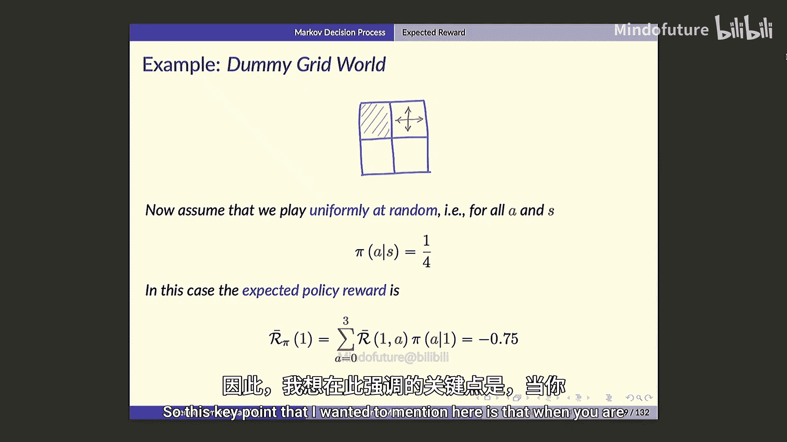

That I wanted to mention here is that when you are。Looking at one policy， one particular policy pi。

 this is not important for you that what' going to happen immediately next， right？

 And this was the main reason that we define。And also the value function to be the expectation of that future return。

 right， because if you think only about the immediate reward that you are getting。

 sometimes policies are going to give you better immediate reward， right， when you're playing chess。

 sometimes like you take your， I don't know。 Bishop and you just hit the queen， right， Yeah， wow。

 I got like a huge mark right， But youre over probably after a few moves， right？

 So this is the key point that you should pay attention to。 So not。

Immedia immediatemedia reward is not the one which you are looking for， right。

 And this is why we define the whole value function。Everybody's cool。关系。

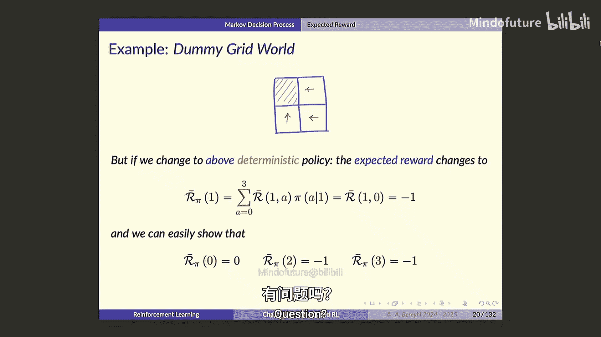

One question to the serious job。 And that is to just compute the value function。

 It means that if I want to play with one particular policy， what gonna be the expectation of the。

 you know， future return that I'm gonna to collect towards the very end， right and。

Since I do know the environment， then I can eventually describe or evaluate this value function。

Like theoretically， I can do it right， but it might be a bit complicated in terms of computation。

 like I need to do lots of computations。 Now， what I'm gonna do first。

 I'm gonna call it naive approach。 I want to just do it naive approach。

 like the one which we started to think of in chapter 1。 And once we we just do it。

 we see that we can do it。 but it seems like something very exhausting。

 And then this gonna motivate you why we need to just use a recursive property of the return and then we end up with the beman equation。

 Okay so let's start with this naive approach。 what I want to do。

 I want to just calculate the value function。 So I assume that I'm playing with policy pi。

 I am in one particular state S。 and then this is the definition of the value the average future return that I'm going to collect。

 given that I am that state and I'm playing with the policy pi right。

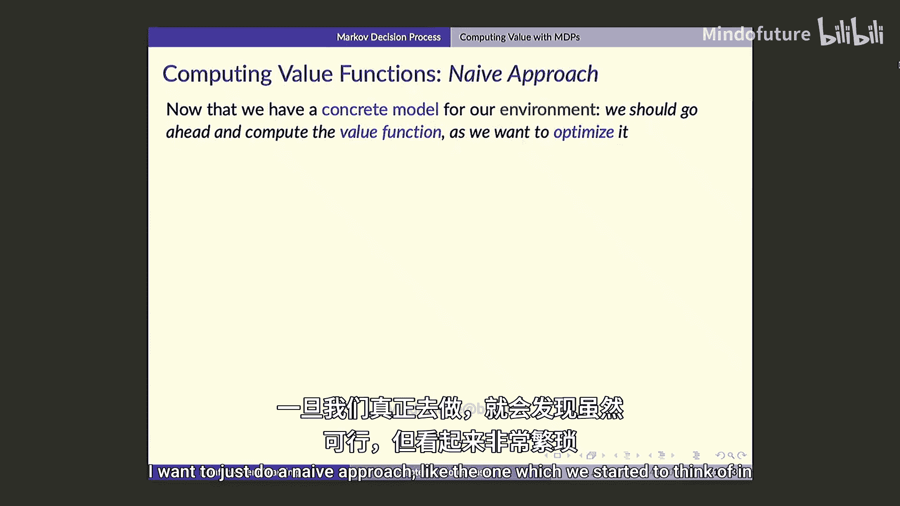

I can open it up。 done this last time， and then I can just write。

For so I just expand the expectation， right， So it's gonna be the expectation of the immediate reward。

 is the expectation of the second immediate reward and so on towards the very end， right now。

The is okay， yeah。So， that was the。Immediate reward you get at the particular stay state。

I going to replace it。 The things remain are these guys， right， So I need to compute those ones。

 and now。Well， let's start with the first one， right， Let's see， for example。

 what's gonna happen to this first term。 Since I do know the transition and rewarding。

 I can explain what's gonna be the second next reward。

 or I can explain the distribution of the second next reward。 given my current state and action。

 I can describe it。 And when I describe it， I can average over it to find out what is the expected second reward。

 right， So let's do it together。

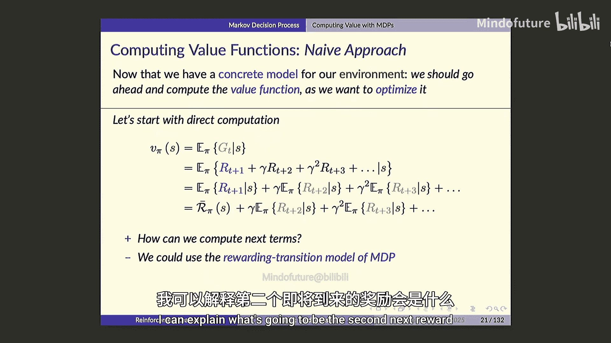

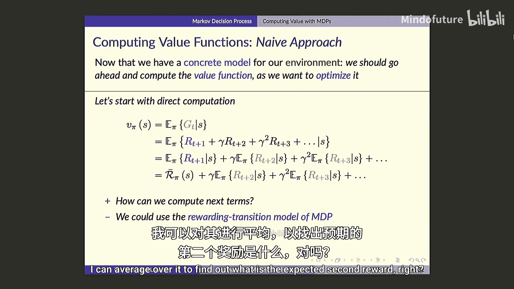

对。No， again， this is a bit confusing， but I used lots of colors to just make it。Clear for you。

 So what I want to do。

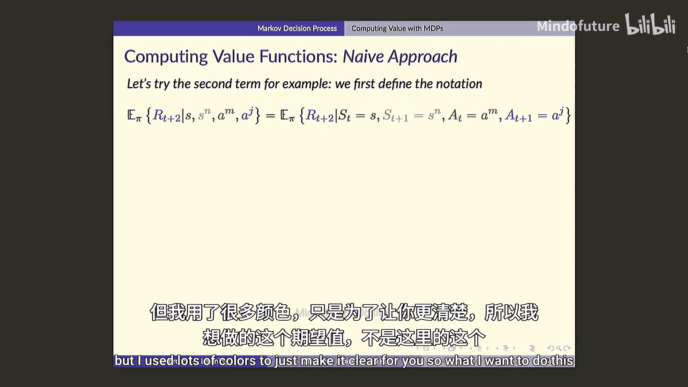

This expectation is not the one which I have here。 This is not that one。 This is a new expectation。

 And this expectation， I assume that I am carrying in a state S。

 the green guy is my current state that after。

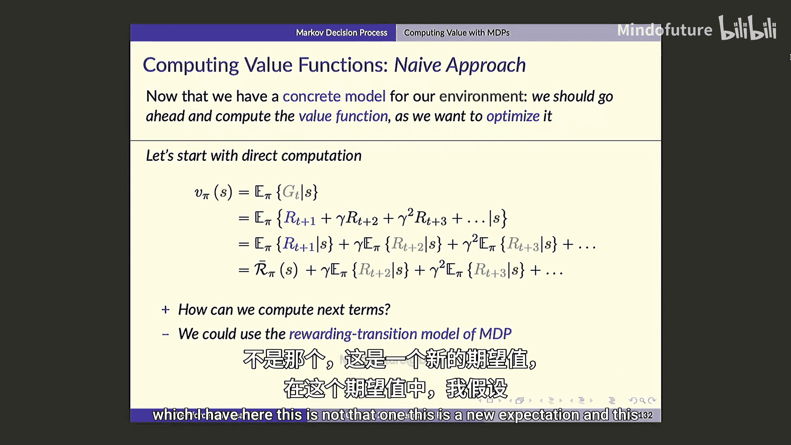

First action that I do。 So I do the action A T， this red variable here， A M， I do one action， A T。

 And then I'm going to change to another state， right。

 So assume that the next state is going to be as the green。 sorry， the yellow state， okay。

And say that after getting into this estate， I do the action， blue action 80 plus 1。 Okay。

 so I was in one。Green estate。 I did a red action。 I went to a yellow state。 I do a blue action。

 okay。

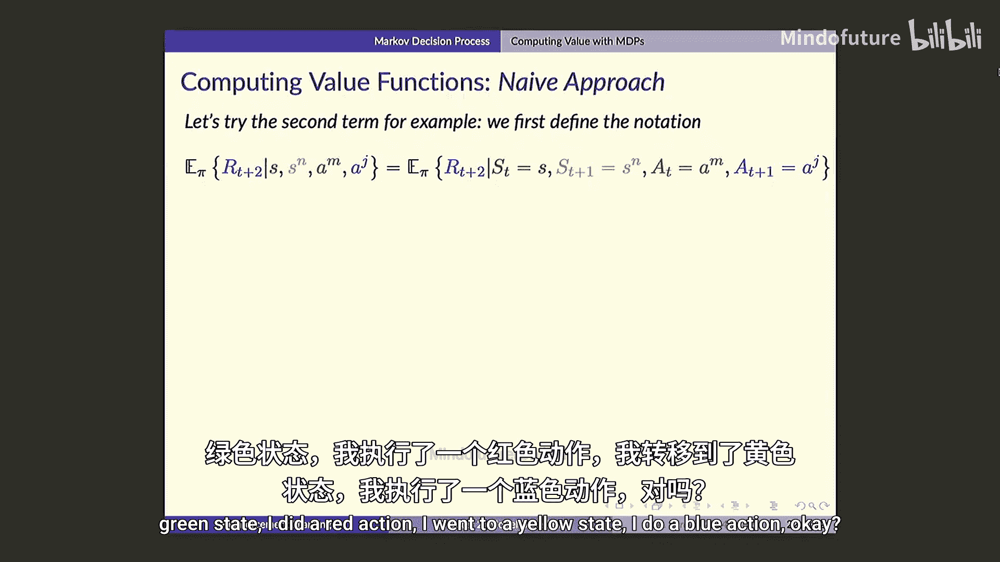

Now， I want to know what is the expectation of my。Second next reward， R2 plus1。Now。

 if you're looking at this one。If I want to just write this guy down， Okay， what should I do。

 I would say， okay， I want to know the expectation of the second reward， the expectation of this guy。

 given all of the next payers， so。The pair at time T， the pair at time T plus one， right， so。

 and I can write it down in this form。 But one question， given that we have a mark of the process。

 if I do know the state in action at time T plus 1。

 do I need to care about state in action at time T。No， yeah， I can throw this guy， right。

Everybodys cool， right？ So I can just throw away the state at time T and the action at time T。

 So the green and red guys are going to vanish。 And the reason is because since I do know what is this state at time T plus one and the action at time T plus 1。

😊，I don't care about the previous ones， right， If I didn't know them I needed that。

 But since I do know them， I really don't need the previous state in action， right。

So this is going to be the next like expectation。 But here what you see is the expectation given not only the Karen in the state。

 the second state and not only the care action， but also the next action， right。

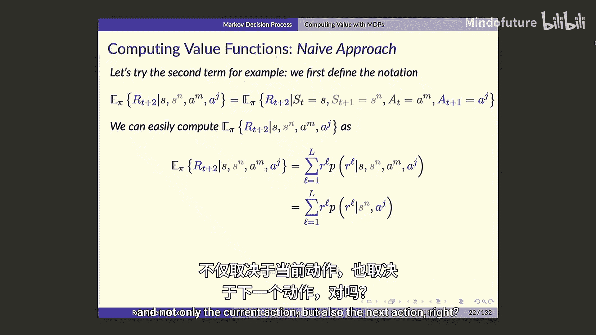

So that is okay。 But now the question here is that what if I want， I wanted to just compute this guy。

 right， I want to take the expectation with respect to only S right， sorry， given only S。

 And if I want to do that， what should I do to this expectation in order to get rid of all terms except the green S。

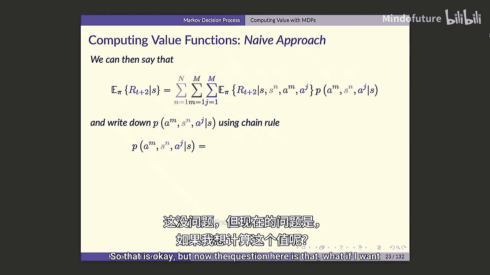

Yes。嗯。of。To multiply with their distribution， then I do the sum， right， So important。

 pay attention to this one。 Just look at it here。啊。They， I have。Expectation。啊。X， given Y and Z。 Okay。

 for instance。And I want to get from this guy to the expectation of x， given y。What should I do here？

😡，Chain rule， you can do it， but I don't want to open， open up the chain rule。

 I just wanted to do it intuitively。 Let's say Z could be bunch of cases， right？

 So I'm gonna say that what is， for example， Z， say Z， I， right。Or anything， right？

Then I need to know what is the probability of the ZI？If y is at particular value， y。

And I'm talking about why here。 Just I need to know what is the parole of Z I。

 given that particular Y， right。I'm going to say that when y is y and z is Z I。

I'm going to have this expectation， right。This is going to happen with this party， right？Where。

Like when y is y， what is the chance of Z Z being Z I， right。

 So you multiply it and you go for the next Z， next， next in and then you average over all of them。

 right。So you're gonna average over all of them。 And then you are going to get your。

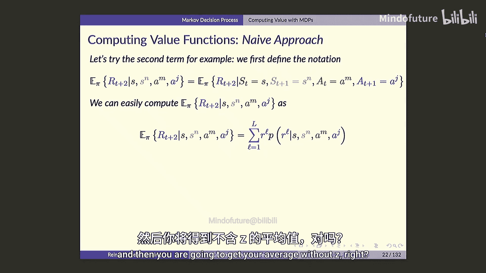

Average without Z， right。 So if Z is this side， you first need to multiply with the corresponding probability。

 and then you do the averaging， right， Everybody is clear， right。O可。Questions。No question。Sure。OK so。

Now， if I want to do the same thing here， So I want to get rid of everybody here。

 all the other colors， right， So I'm going to put the provolty of all the other colors given as。

 right。I have the feeling it's not clear。If it's not clear， just tell me。Its that clear？是啊。

So what is the problem with this guy？嗯有。Okay， lets do it another way。Say， I have。Pro all the act。

Given why。When you have， sorry， expectation of x given y， when you have expectation of x given y。

Definitely， you're gonna to put something here， right， So y equal by something， right。For instance。

 you would say y equals by， I don't know。 Say y is a binary case。 It gonna be 0 or one。

You would say if y is 0， then the expectation of x is something， right， If y is one。

 then the expectation of x is going to be something else， right。Now。

 if you want to know only the expectation of x， what are you going to do with that？Exactly。

 so you would say that。Once y is 0。And once I compute the expectation of x when y is1， right。

And then。I need to add them up， but I don't add them up just simply， right， I'm going to say， Y is 0。

 What is the chance of y being 0， right。And multiply it to that， right。Plus。

The expectation of x and y is one times the probabilityvol of y being one， right。国。Now。

 if you do that， then this is going to be the expectation of x， correct。Now。

 what if now I have another extra arrival here。 So it's not only y equal equal by 0。But I have。

 for example， Z first equal by some other Z。 So say Z equals by。2。And。Y equal by 0。Okay， and again。

 here I have。Z equal by 2。And then I put y equal by one。 Okay， now。

 if I want to compute the expectation of x。Given that。Z equals by 2。What should I do。I would say。

 okay， expectation of x when z equals by 2， that 1 I have it already， right。And first case。

 y equal by 0， right。Again， expectation of x， given that equals by 2 and y equals by  one， right。

 the other case。 But when I want to multiply it with one distribution。

 what should be that distribution。Is it simply distribution of y equals by 0？Given that's equals to2。

 right， So I would say。Given that z equals by 2， what is the chance of y being 0， right？

Everybody's clear now。 So I'm going to put here。Given that z equals by 2。Again。

 you're given that Z equals by2， right。I'm going to do that。Now it's clear。Yeah， so if it's clear。

 then you would see this one here。 I want to compute。 I know this is too much of notation。

 but you just look at the expectation。 you want to compute the expectation of this R T plus 2。

 given that you have S。 your current state is a particular state S。 So you're gonna keep this state。

And then， you got an average。Proometers， right。Does that make sense？是啊。

All of these other colors are essentially Y for us。 and that green S is essentially。

And then you sum up over possible cases for these parameters， right。You see it。Yes。Yes， fear or。

Because I have the feeling I I lost my time anyway， So just。O。So。要。So basically what I want。 I mean。

 this guy。

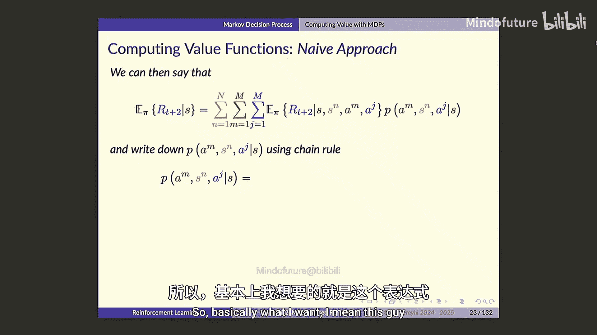

Because this， the rewarding transition model that we have is going to give us explicitly what this distribution is。

 right， that one we can。

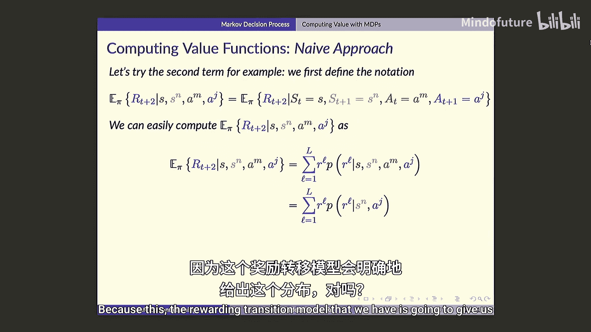

There the summation。 we have no problem with computing that。

The problem that we have is that what is this provol distribution， right， So what is this guy。

 This is the provol distribution， This is the provolty of your current action being AM M。

Your next estate being S， N。Your next action being。A J， given that your current state is S。Now。

 how can I open this up， so。Let's just write down the chain rule。 I write down the first term。 You。

 you told me the other things。 So the first term that I'm gonna do。

 I'm gonna write it down P of my current action A M， given the current state， right。Now。

 what is the next term。Exactly， P of the next state， given the care in the state And the action。

 right， what gonna be the next term。P off the next action， given the current state。

 the current action， the next state， right， This is going to be the next one， right。Everybodys cool。

 Now， do I have this stuff。I have all of them。How what is the first one。

 What is the party of your care action given the Karen in state。Is the policy， right， So this guys。

Right。我的。😡，This model environment itself is， I mean， the mark of process is describing it， right。

 What is the probability of the next action， given your current state current action。Right。

 so this is going be the policy of the next the policy of the particular action。

 given your next stage， right。Now， you can compute this。 You can put this here。

 And then this one also is computable so you can compute this guy， right。

And I don't expect you to just see it immediately。 The whole point here is that you see that every single component inside this expectation is available。

Right。Questions。I have a question， do I see you on Tuesday here？Because you look like super math。

Yeah， I mean， if you don't follow the details， it's okay， we're not going。

 this is what I call the naive approach。 We're gonna do Bellllman later， right。

 but hopefully you are motivated that this is not a good approach， right。O， cool。 so I am。

What you can see here is that eventually this second expectation that you're computing is a sort of。

 you know， super nestted summation， but you can compute it right。For T plus3。

 if you want to do T plus 3， then I get。I condition it to the current state care in state next action next second next state right。

 and second next action。 And then you start doing the same thing as I did here， right。

 the expectation is possible to be written。 and then the pro distribution you open by chain rule and' gonna be a bunch of policy values multiplied with the mark of chain sorry。

 the mark of process values computed at a particular actions in states right So you can always do this for any T towards the end。

 And this is the way that you can eventually think of computing the expected。Future return， right。

 But the key point here is that if you keep doing this， this is going to be a nightmare， right。

 So you can you do， we did it just for second next time， you saw that this is a quiet。

M messy expectation。 you can think if you want to do it for a general， say， T。

 then it's going to be a kind of nontractable summation， right。

 And this is why this is not a very good approach。 This is why I'm gonna Im calling it naive approach。

O。

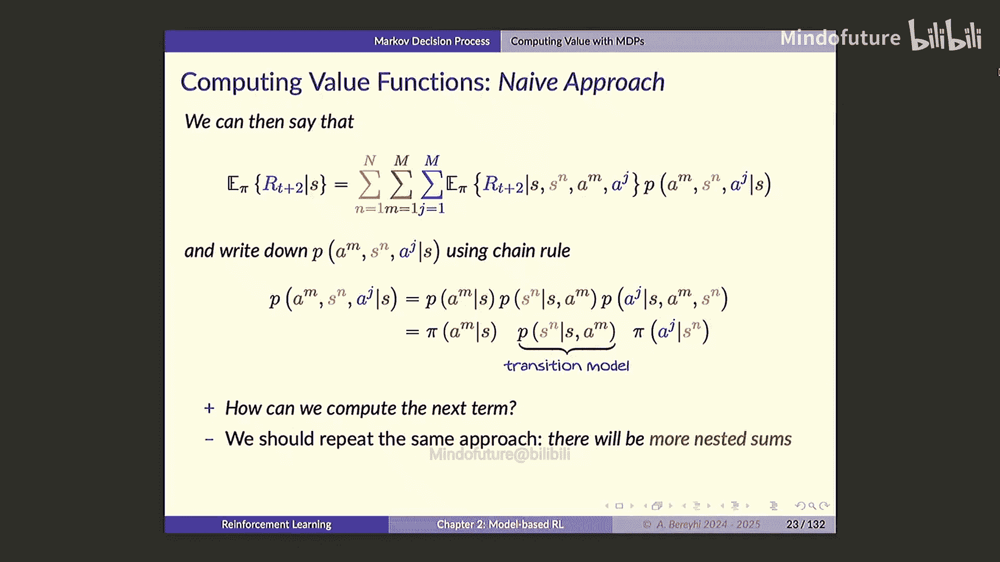

OK是。Before I finish with this na approach， let's try to just look at this damnmmy grid world and let's try to see what we saw there with like too much complication here。

 which is quite simple to。

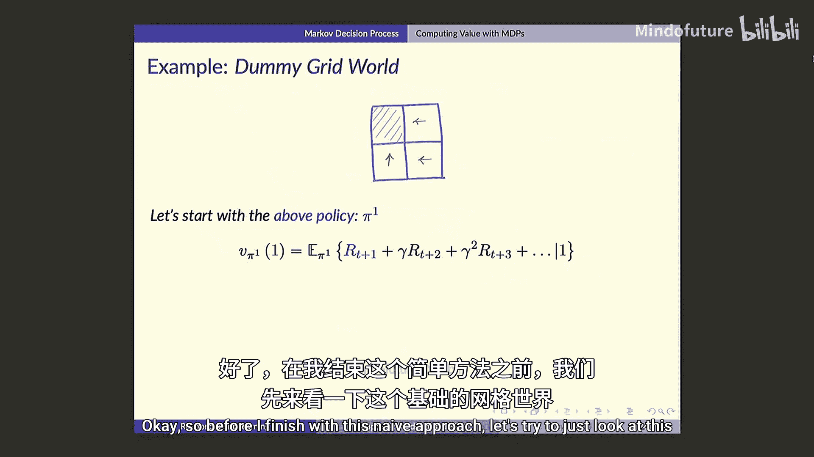

So I want to just compute the value of my policy pi 1 and the policy pi1 is the one which I'm showing here。

 Okay， at every cell， I'm just moving in the direction that is indicating。

 And if I want to compute the value of the。先。Arc of chain is known to me。 I can simply explain it。

What is the average immediate reward water that I'm gonna to get with this policy。

 I'm gonna always move left， right。And then I'm gonna always collect -1， right？

 So this guy is going to be always -1。1， once I do -1。

 anything else is going to be 0 because I'm gonna end up with a terminal state， right。So those。

 you know， massive information that I showed you， all of them end up being zero in this particular environment。

 right， because all of those transitions and P of R， given that all of them are going to be 0， okay。

And because of end up with your， with your。Value being your immediate reward， which is -1， right。嗯。

YouDo the same thing for every of the cell。 So you can， for example， go for zero。

 This is a terminal cell。 So you don't need to calculate anything。 The value is 0 for 2 and 3。

 You can do the same， right， You just follow policy。 You can do it。Okay。And那后。What about this policy。

 Well， eventually， this is the same policy。 You can do the same thing。

 And then you're gonna end up with the same values here， you're gonna be -1，-1， and then -2， right。

And one key point that you see here again is that policy 1 and policy 2。

 both of them are showing the same value， right， So here we have the same value，-1，0-1-1-2。

 And here we have。

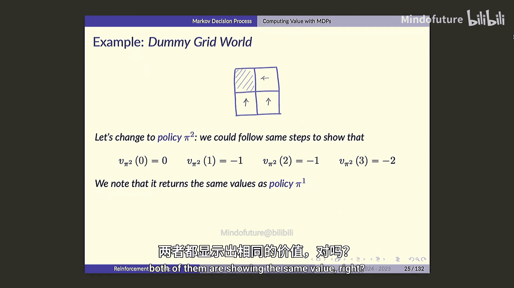

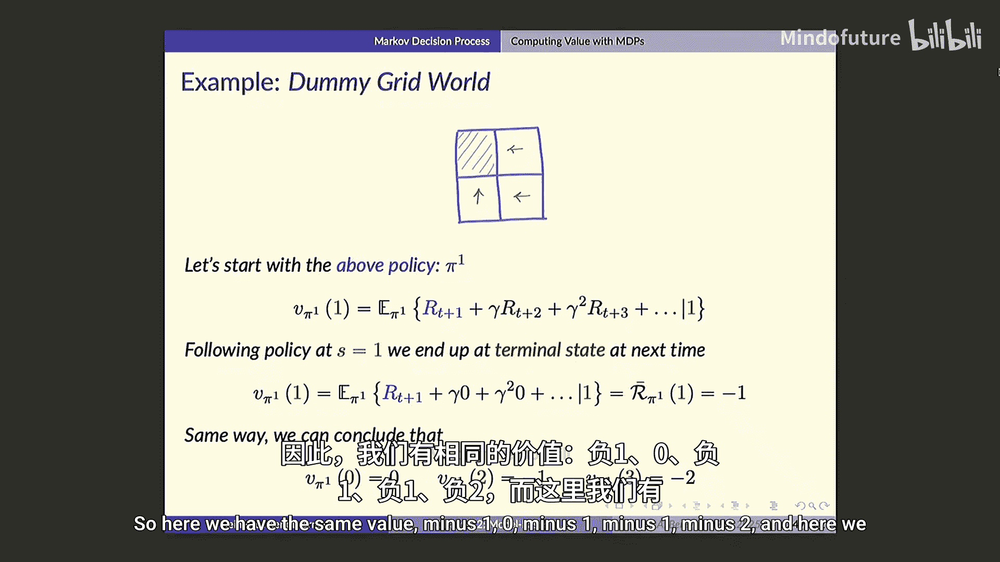

And both of them are often。But if you think about this policy， then eventually。

 this one is more interesting because if you just write it down for this particular cell。

 the cell down right， then you're not actually going to do it。 Oh， no， not this one。嗯嗯。Oh。

 sorry for this top， top right one。 If you write it down for this one， this is going to take longer。

 right， because the first time you're gonna come here。

 then the mark of process is going to tell you what can happen。

 And then you again come here and then you end up， right。And here。果然。

And then this guy is not an optimal policy， right？ So obviously， both of。Optimal policy。

 and they are better than this one， because in one particular cell 1， they are doing much better。

Questions。

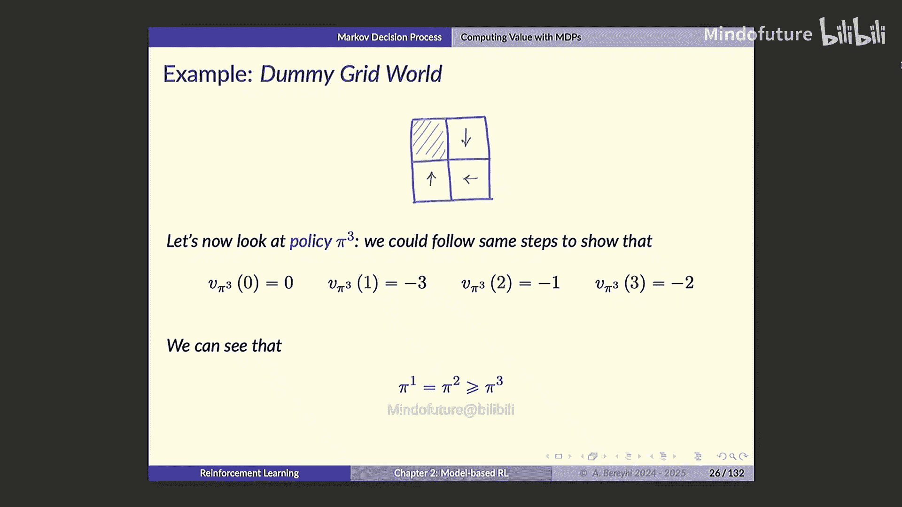

No question。Okay， so if you got another question just to wrap it up， if you do know the environment。

 if you do know the MDP， which is describing your environment。

 you're always capable of describing what's gonna be the next estate the next reward。

 right And because of that， you can always calculate the expected reward at any time in the future。

 right it might be super messy， but you can do with right， This is possible。

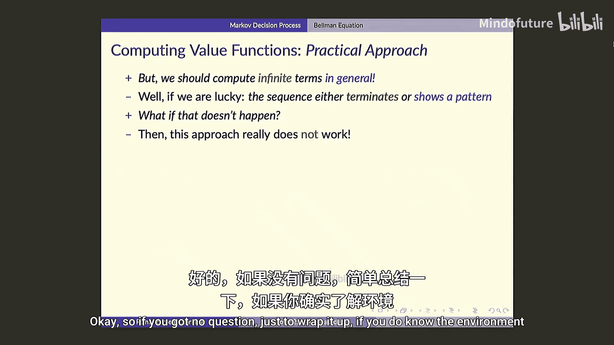

And because of that， youre eventually able to describe the value of every single state that you have。

 right。 But the only key issue here that you might see is。Well。

 if we are dealing with a practical environment， then this kind of messy calculation that we have done here is not going to work。

 right。How can I say that， okay， say that I computed the immediate reward。

 and I computed the second immediate reward。 How can I compute a general， I don't know。

 L next reward， How can I compute the expectation of that one。And if you want to do that。

 if you want to stick to this na approach， the only way that you can do it is that you compute it by hand。

 and then you look at the rewards that you are getting and you see whether you see a kind of pattern between them so that you can sum them up given that pattern right。

 But that is probably not a feasible approach in most environment。

 So the better approach that you can do is to use what we call it Belman equation。

 and what is Belman equation is simply comes from the fact that the reward that you are collecting in future is showing a sort of recursive behavior。

So this is the bellman equation。 What does it say， It says that， like。

 let me just show it here for you when you have this。

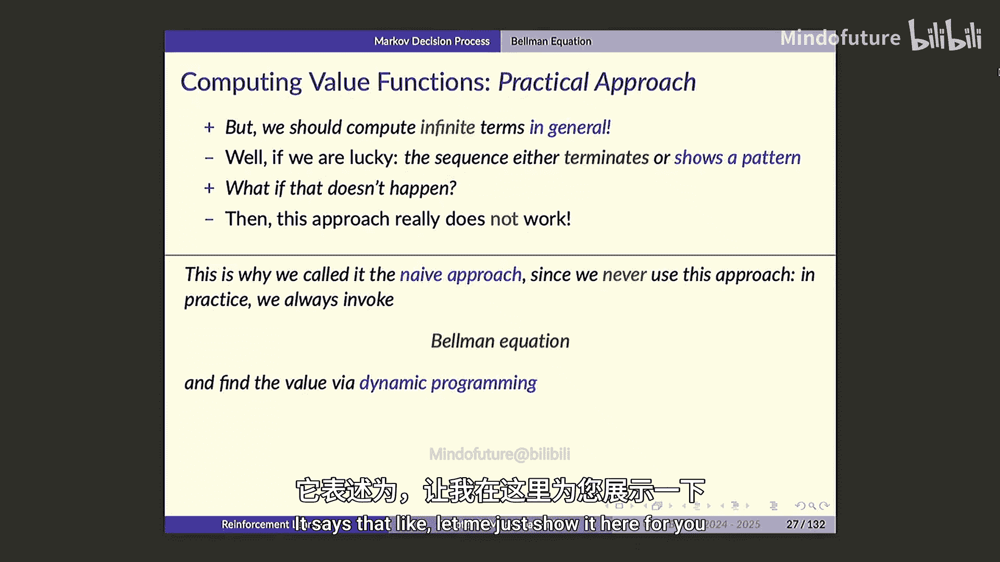

Future return that you collect。 if you open it up in this form。

 and if you just factor out this discount factor here， right。

 the blue term that you see here is again， the future return， right， But for time T plus one。

 correct， So you could say that your current and future return is your immediate reward plus。

The next future return， right。Cl， so what is the future return that I'm going to do if I do know what。

Future event that I collect in the next time， right。I only need to know what is my next word right？

 And then I up to that future return， it's gonna be my future return in time， right？

 So if I do know what is happening in future， then I can just recursively go back in time， right。Now。

 if we write it down， if we do a tiny bit of messy calculations like the other one we did today。

 then we're going end up with the Belman equation， which is going to give you this property。

 The value of any cell is depending on the value of everybody else for any policy。

 And now this cell depends on everybody with some equation。

 This cell depends on everybody with some equation and so on towards the n。

 you have n cells and equations， right。So you check the value of the N cells。

 You put them inside those n equation。 You solve the system of equations。

 You end up with the value of all the cells， right， This is what we call it Belelman equation。Okay。

 so eventually， you don't need to do what I did today。 So good news。

 please come come over on Tuesday。 You don't need to do that one。

 But I hope that that messy calculation motivated you why this spellman equation is important one。😊。

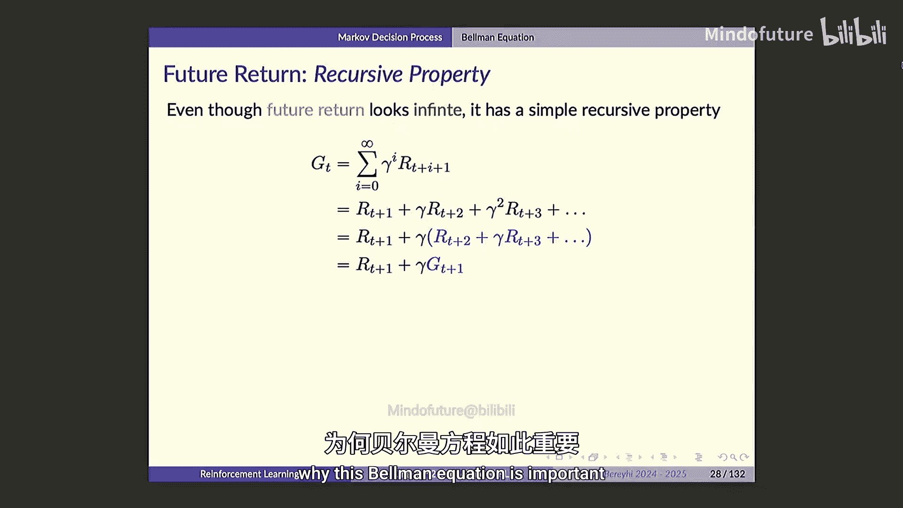