# 【多伦多大学】强化学习 2025 ｜ Uoft   Reinforcement Learning   Fall 2025 p14 P14_讲座_14_动作价值的贝尔曼方程与回溯图 -BV1D3F2zhEry_p14-

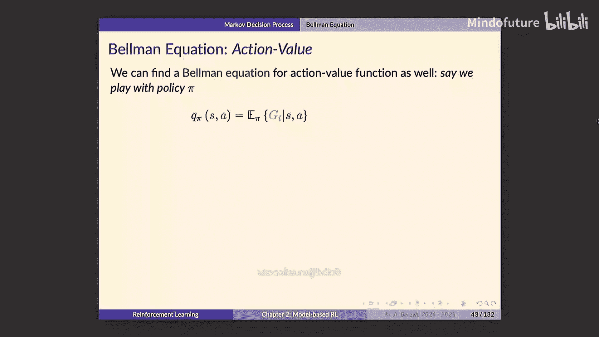

This idea that we had， we can again expand it to the case where we have action value instead of the value function。

 And you might tell me why we need the action value here。

 you're gonna see that you really need to know action value if you want to the optimal policy。

 So what is the action value we talked about this。 The action value is eventually the same thing as the value function。

 The only difference is that you're not averaging anymore with respect to your immediate action。

 you do know your immediate action as well， right， So you would say I'm in state S。 I do action A。

 Now I want to see if I keep on playing with my policy。 What going。

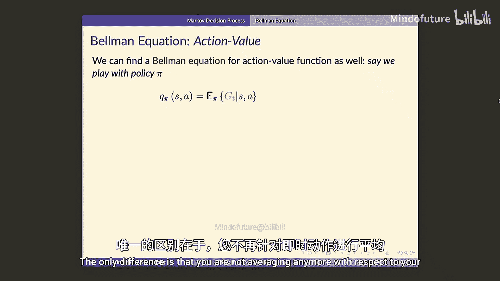

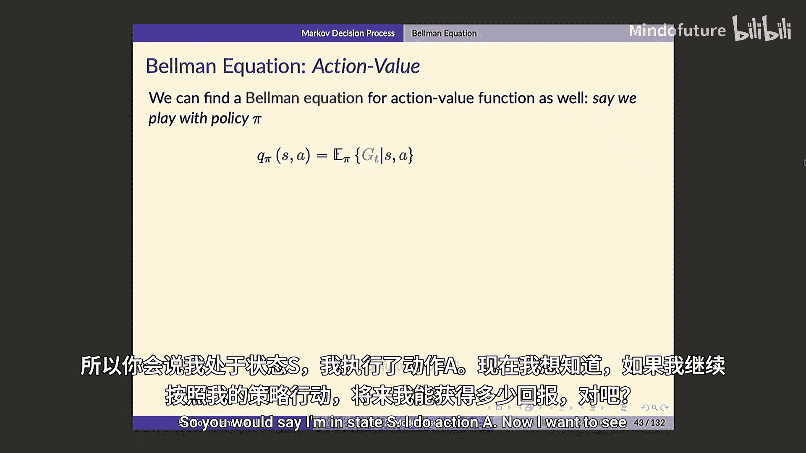

Future return that I'm gonna collect， right， And this is the definition， right， And again。

 I can start writing down the recursive equation for this one。

 So I can just replace this G T to be the next immediate reward plus gamma times the next return。

 And then I can just open up the expectation， right， And now what is the first term。😊。

This is the immediate reward that you get， right， the immediate reward that you get。

 given that you are in one particular state and you do one action， does it depend on your policy。

Does it depend on your policy， be careful。If I' am in one particular。And I know that。 I have。

Particular action。What does？Or how does the next reward get。Explained。What do I need to know。

Is only the MDP， right， The MDP tells me if you're in this estate and you do this action。

 This is the distribution of your next reward， right。Of course， after that， I need to know my policy。

 but immediately after I doing the action， I don't need to know the policy， right。

 Everybody is clear。 So I don't need to put pi anymore here。 When we started， we didn't put pi here。

 and I hope this is clear for you。 We are going to solve the example once again， you're gonna see it。

 Okay， But when you are in one state and you do one action。

 there is no reason that you care about your policy。 If you only care about the immediate reward。

 right， the reward that youre gonna collect immediately because the MP is going to tell you what is the distribution。

 right。Okay， so that guy gonna stay here without any pi。

 And this is the term that's gonna remain again。 You cannot write down this one as the Q function。

 the action value at a state as an action A， right。

 And you see it because there is a one time step skipped here， right？ So same thing as before。

 you need to compute this guy。 And if you want to compute this guy again。

 you go through the same line of derivation， right， So I'm gonna take the the derivation。

 I just try to present it shortly。😊。

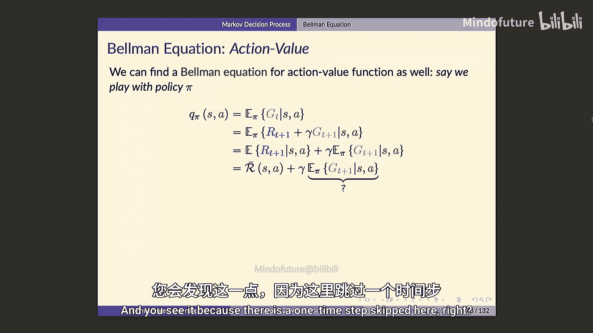

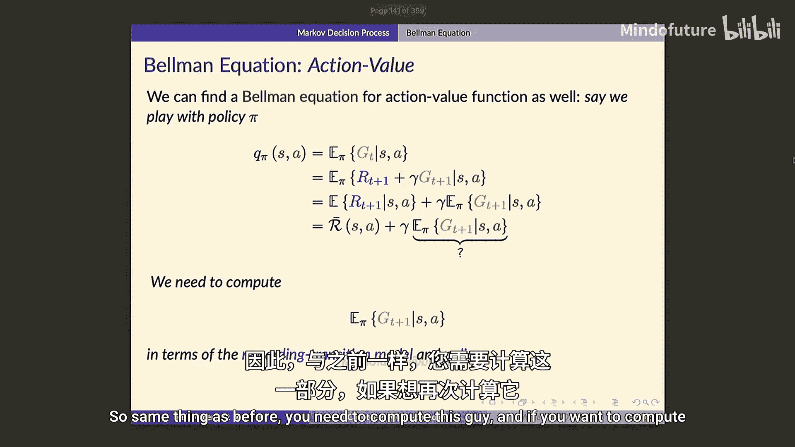

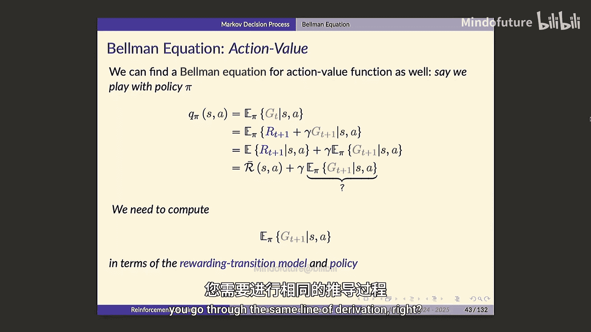

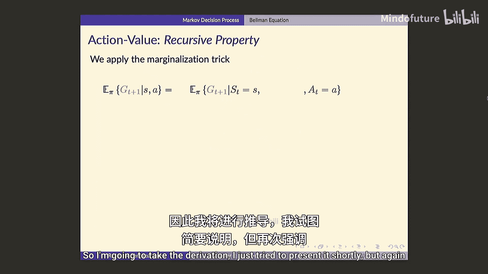

But again， if that is a bit， I mean， it's a good idea。 if you just pay attention to this one。

 if the previous one was less clear clear， maybe this one gets more clear。 What should I keep here。

 What， What should I add here if I want to just。Write down finally， this termerm as something no。

Next state， right？ So I'm in this estate。 I do one action。 I need to know the next state， right。

 So I'm gonna to put the next estate， right， And then I average over the distribution of the next state。

 right。

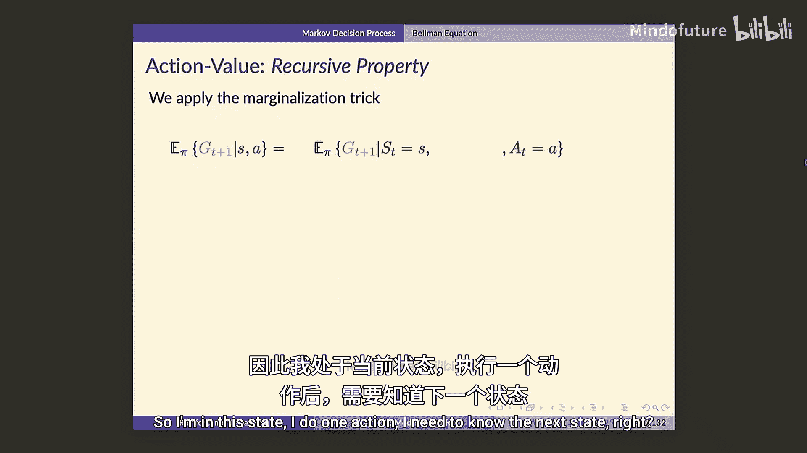

Everybody's cool， right， okay now。What about this guy， this expression， look at it。

I am talking about the future return at time T plus one， given that my state at time T is S。

 my state as T plus at T plus1 is S。 and my action at T is a。

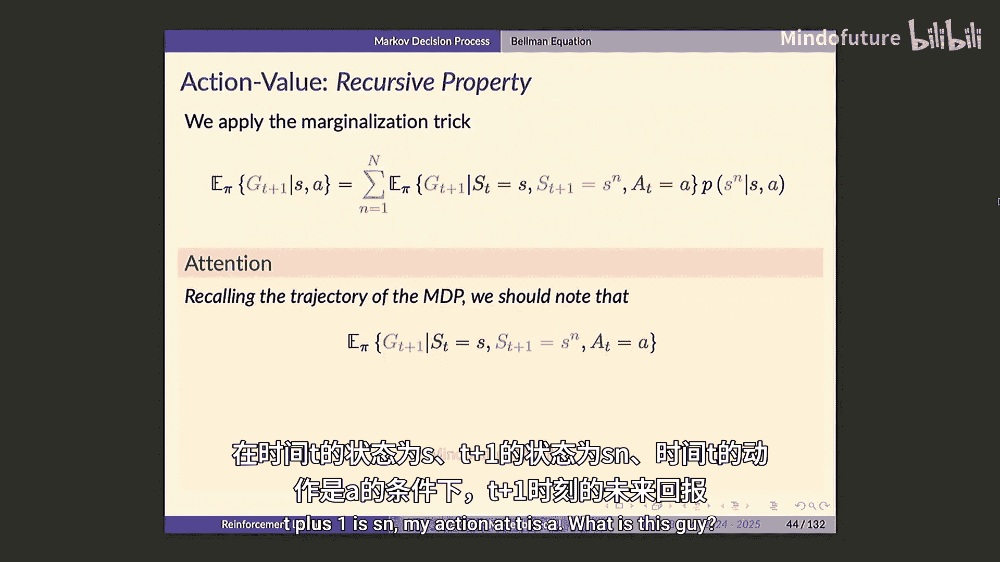

What is this guy， I mean， definitely， this guy is not the Q function at S， N N A。 This is not， right？

 Do you see it。If I wanted to have this guy， what should I do to this one？

G at T plus one given state at T plus one and act and at。

T plus1 is the action in this expression at T plus1。 No， right， So that one is not the action value。

 right， but what is it。Actually， it's not action value。 It's something else。It's a value， right。

 value of function at which state。SN right so when I know the next stay do I chair what was in previous action and previous stay。

 No， I do say right now right， if I knew the new action。

 I would add it right if I don't know the new action。

 this is simply the value function again right So the green guy， the red guy， I can simply。

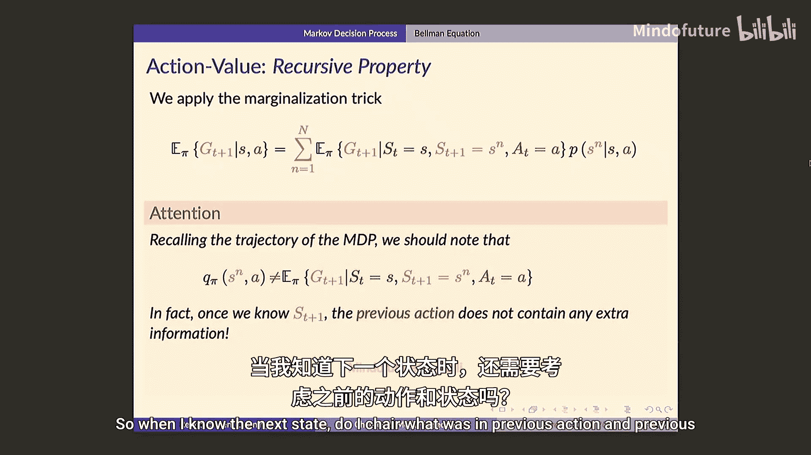

Because they are about the previous time。 I'm talking about the camera time， which is t plus one。

 right？ So this guy is eventually the value function at state as N again， right？

 So it's not action value。 It's simply value function at that point， right。😊。

I do know this S T plus one， the previous action and previous state do not give me any extra information。

 right， The only thing that the previous action could do to me was to tell me what would be the next state。

 right， but I I already know it， right？ So I don't need to know that。

 I I don't need to use that action anymore。

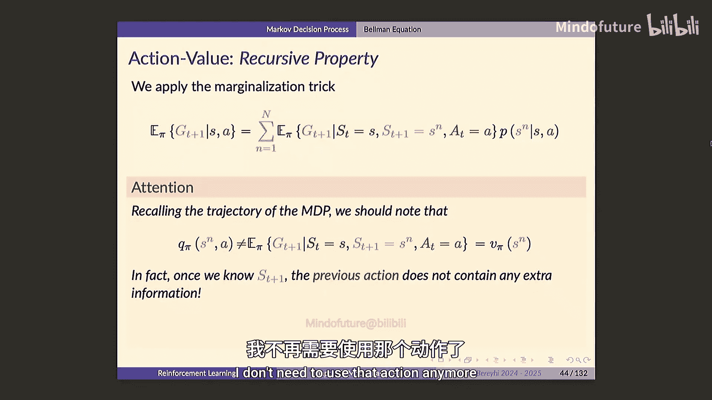

Everybody's clear。So this guy is going to be the next value value at the next stay。

 and then one thing that you should pay attention， as I said。

 if you wanted to have the Q function at S and and A。

 then your next action should be a right not your action at time T at your action at time t plus1 right because you're talking about Gt plus1。

 then your estate and your action should be also at time t plus1 right when when you have anything about t plus1。

 you can throw away time t completely right。

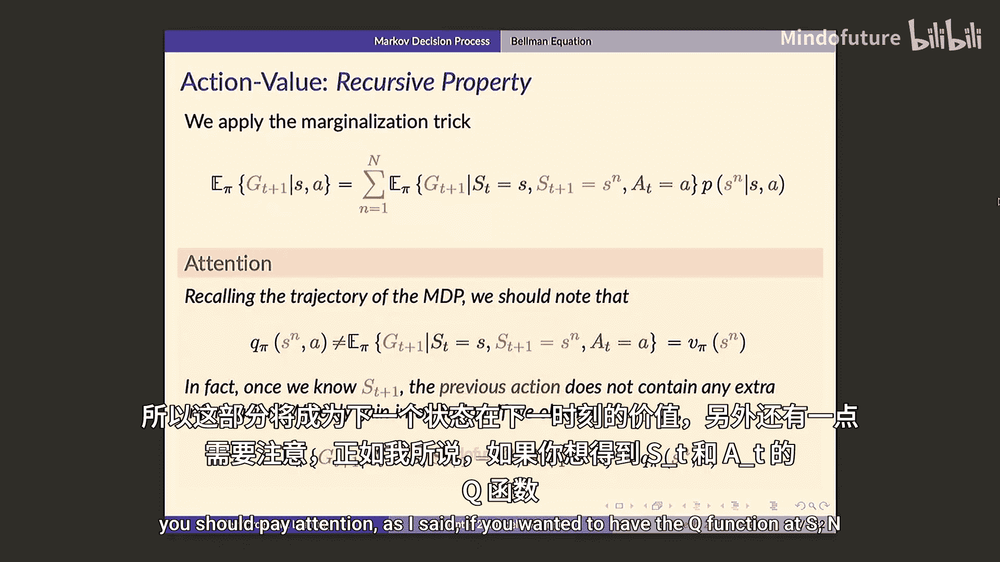

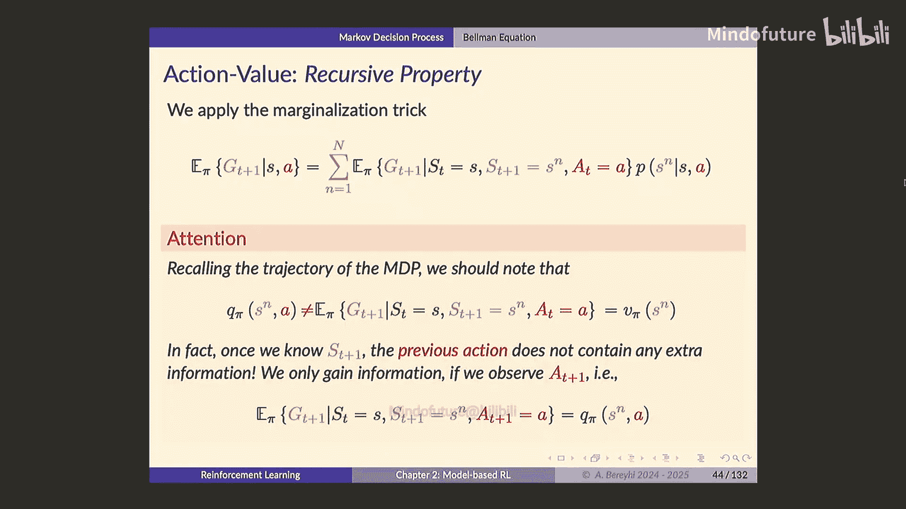

Okay， so that being said， then I can replace this guy with a value function here， right。

 and this guy， what about this guy， the pro of the next estate， given the current state and action。

 That is the MP， right？ MP is going to tell me what is the chance of next state。

 when I am in one state and I do know what is my action， right。

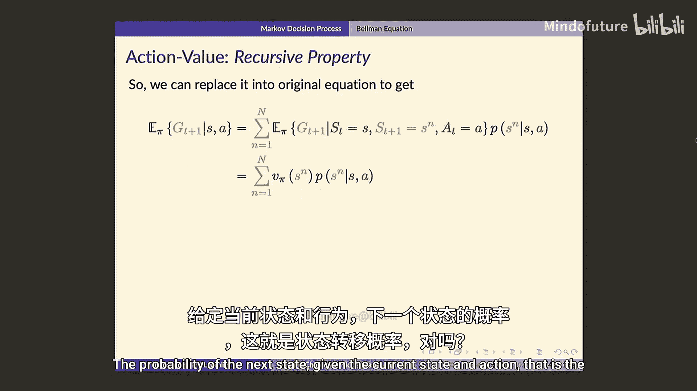

Everybody's clear。Okay， so I put this term here， and then I now replace it into the expression that we had。

 So we had this immediate reward。Add this state as an action A。

 And now I'm going replace this guy here right， So it's gonna be v pi exactly this term multiplly with the probabilityvolty added up right。

 And I can again look at this summation here as an expectation right？ So it's going to be again。

 the value of the next state， given that I know my current in state and my current action right what does it say。

😊，You are in one part。Right and you do know your action。 So you say that I want to move left。

 I don't care about my policy。 I want to move left， right？ Now， when you move left。

 you know what is your next estate， Maybe you know it for sure， maybe you know it statistically。

 meaning that even the environment， you might go to sell 0， you might go to cell 3， right。

 then you're gonna say， okay， let's see what is the chance of going to sell 0。

 If I know the value at cell 0， then the action value for my action。

 when I end up cell 0 is that value， right， plus the reward that I get again， if I go to cell 3。

 then the。As I know the value of cell 3， then I add up that value to my reward， right。

 And now if I don't know whether I go to cell 0 or cell 3， I'm going to average it， right？

 So this means that you're in one particular state。What is statistically。

 what going to be your next state， okay， so you would say， okay。

NowWhat is the value at that is stay iss okay Im。I add up the immediate reward to it。

 Everybody's clear。Again， if this guy is， I mean， the derivation was a bit unclear。

 you can take your time。 Just take this one at my side from me as the other version of the Belllman equation。

Okay。

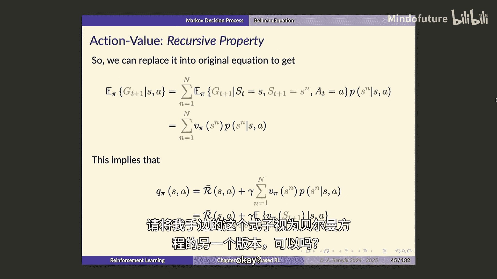

Okay， so that was the that is the next version of the development equation。

 which is given for the action value。 Now， one key point here that I want you to check to to see is that if I do know the value function for one particular policy。

 can I compute the action value for it。Can I。If I know V pi。

 the value of every single state in my environment， and I know my MP， the environment itself。

 can I compute the action value function。

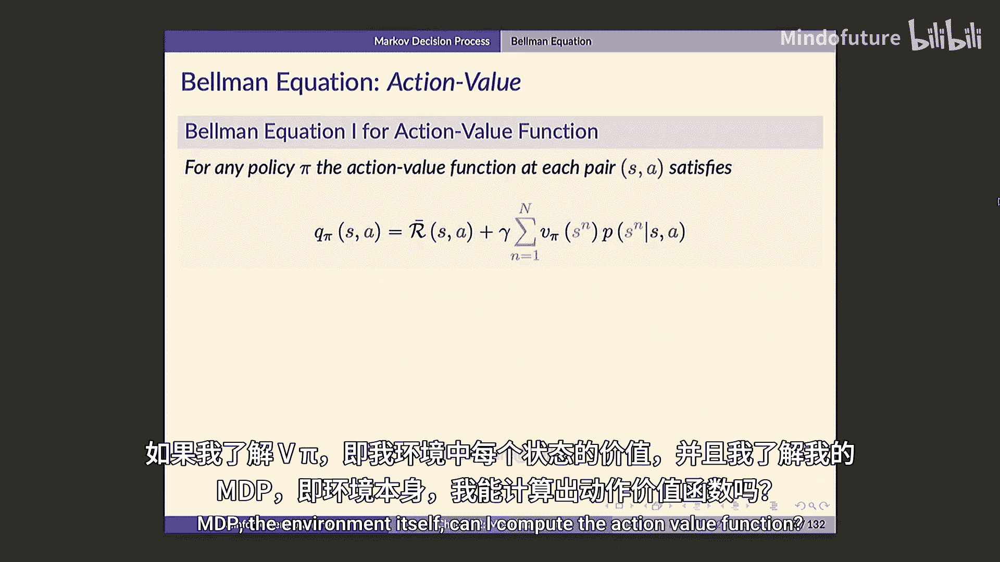

Yes or no。 Go ahead， just say。I know。 I definitely I have policy。 Yes， yes， right。 If I know that。

 if I know my V pi， right， I can put it inside this expression， This is given by my environment。

 right， and I can compute this Q function， right。😊，Everybody's clear。So。

You find the action value or you find your value， it's the same。

 doesn't matter in this kind of environment， because you know the MDP， you can relate them together。

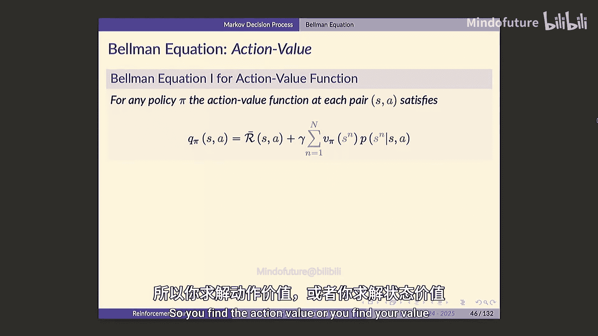

Everybody is clear。Now， one other question， you might have seen it already if you have check assignment 1。

 If you know the action value function， that Q function here， can you get to the value function V。

Yes or no。So say that I do know Q pi at a state S and any action A， okay？Now。

 I want to know the value function， the value at a state S， and I don't care about the action。

If I know that I am playing with policy pi， how can I get from this guy to this guy？

What is the probability that I play action at one if I am playing with policy pi？Please。That is。牌。A1。

 given what？At least three people just say hand。What is here？Where is this day。S， right。

I am in state S。 I want to know what is the probability of playing a1。 This is pi of A 1 given S。

 right？ Now， if Im thinking about general action A M， it's gonna be pi of A M given S， right。Right。

Now， if I add up over ms， M from one to M。This is to be。The value function， right。

 you're gonna show it exactly the way that I did it with a few extra lines in your assignment1。 Okay。

 so if you know the action value， you're gonna get the value function， right。

 If you know the value function， you're gonna get the action value function by Billman， right。

Stories， this is clear for you now that the action value and value function are the same thing in such environment。

 right？Okay。This is first thing and now this equations that I've put you on the board， you can again。

S expand this equation， right， instead of V pi， if you want to only work with the action value function。

 you can replace the value function here with the action value， right。

 So I kept the same equation as before。 I didn't write V Pi。 And what I'm gonna do。

 I'm gonna take this equation on the board and put it inside that， right。😊。

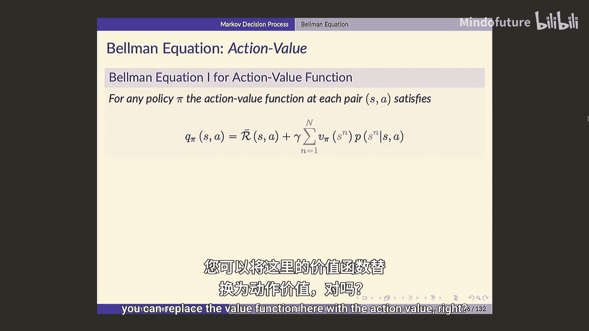

That's still okay， right， I haven't done anything， right， So this is going to be the case。

If you just replace that equation， right， now， do you see that this is again， a recursive equation。

 a fixed point equation， right？ So you have your action value function at one state and one action。

 and it's related to the action values at different states and actions， right？ So again。

 have a bunch of unknowns。 a bunch of equations。 The number of equations and number of unknowns are the same。

 you can solve that system of equations to find your action value function。Everybody's cool。Yes。

 so this is the bellman equation for action value function。

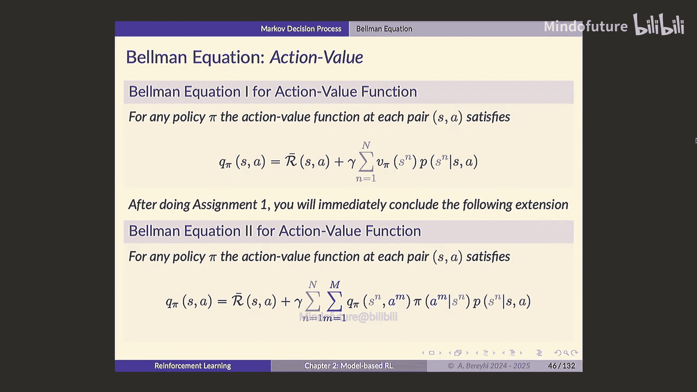

Yeah， here， look at this guy。 I mean， this is the expression that I showed you。

 How many unknowns do you have？I have N different states， M different actions。

 How many unknowns do I have。For every pair， the action value is unknown， right。

 You have in total n times M different pairs。 So it's gonna be n times M different unknowns， right。

 How many of these equations you can write。Again， n times M right because you can change this green and red terms in the left hand side of the equation for every single state in action。

 right， So you have n times n different unknowns。 at the same time。

 you have n times M different equations， right And then when you solve that system of equation for the unknowns。

 you're gonna end up knowing the action values right， you can either do it directly like this。

 if you don't like it solve the beman equation for the n unknowns of this states and put it in the other equation to get the action value。

 all of them Rqval and don't get don't panic， don't get confused。

 you can use any of them in the particular case that you' are dealing with。

 we're gonna see it in the risk of this chapter for different cases。

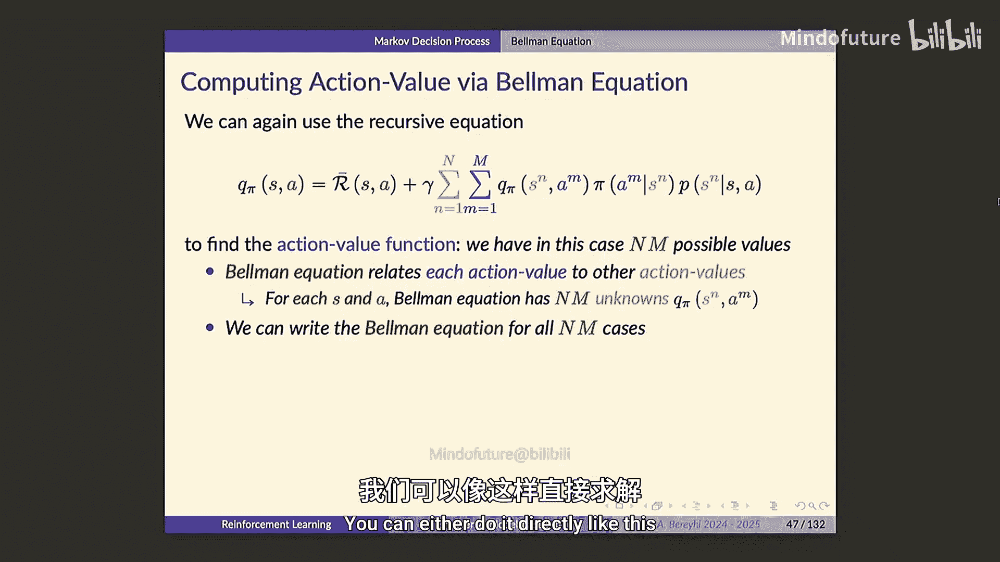

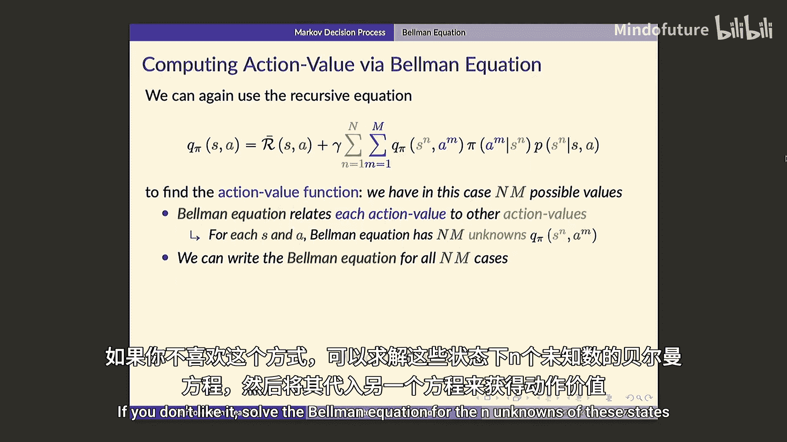

Everybody' is clear。Yeah。Any question on that。

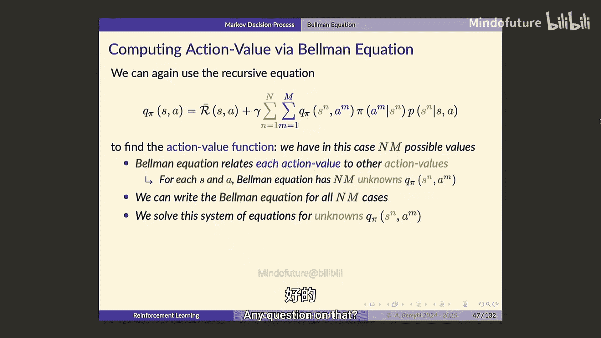

O。If you got a question now， this Belman equation is going to give us a nice graphic interpretation。

 And this graphic interpretation is going to help us a lot when we are going in future to use the temporal difference。

😊。

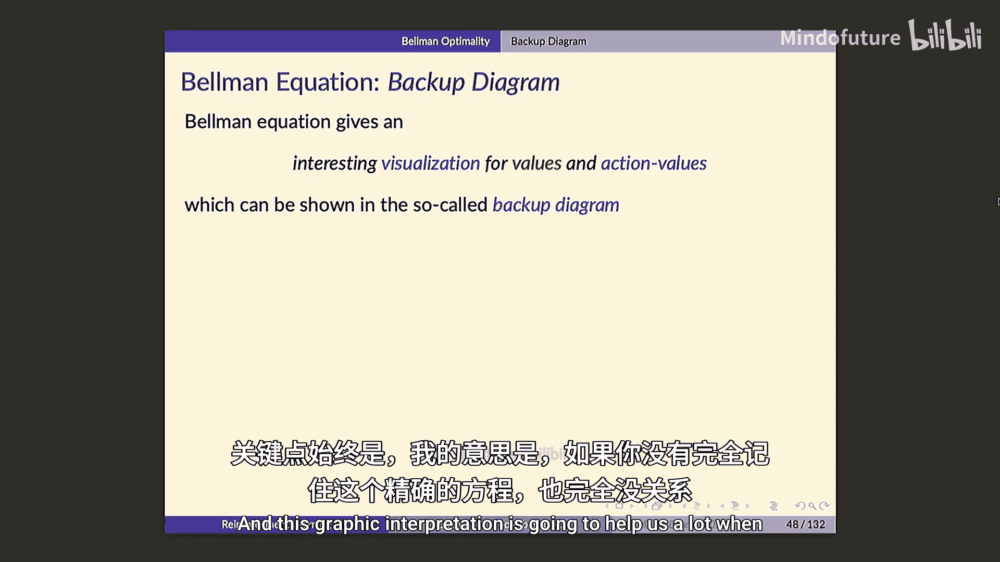

The key point is always， I mean， if you just do not have exact equation in mind， it's totally fine。

Also， I think during winter semester， I don't have it right in mind。 Maybe it depends how long it。

Good right but the key point is that you always say that wherever I am right now。

 as long as I know what's going to happen in the next time step。

 I can explain what is going to happen in this time， right？

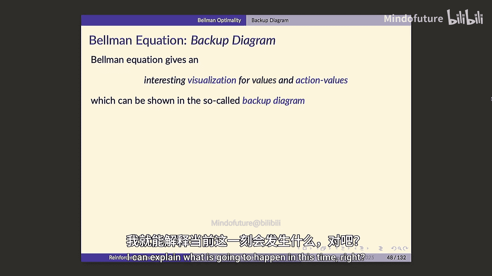

Clear。Right， so this is going to give us a nice thing， which usually people call it backup diagram。

 So now I want to show you the backup diagram。 and it's gonna make everything hopefully much easier。

 And to show that I'm gonna do some simplifications。 first of all。

 I am considering the discount factor to be one。 So forget about discount non1。 Okay。

 you are just adding up the rewards completely。 Now， I'm gonna have two different types of nodes。

 One of the nodes is a state， one of the node is action。 Now， if you have one state node。

 it's gonna be a circle， if you have an action， it's gonna be square。 Okay。

 and when you connect one action to。😊。

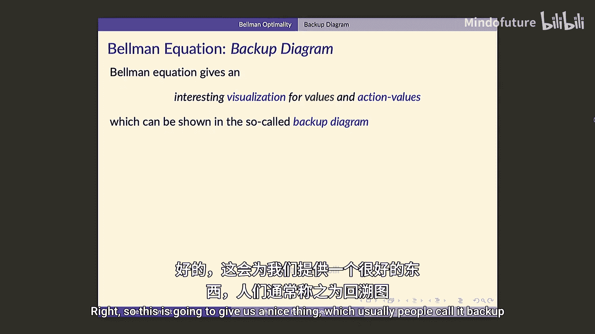

You are in this state you are doing this action。 Okay now once you connect these two。

 the edge that is connecting them is going to explain you the probability of transiting from one e one node to another okay and using that。

 you can actually see the beman equations by moving from leaves to the root。

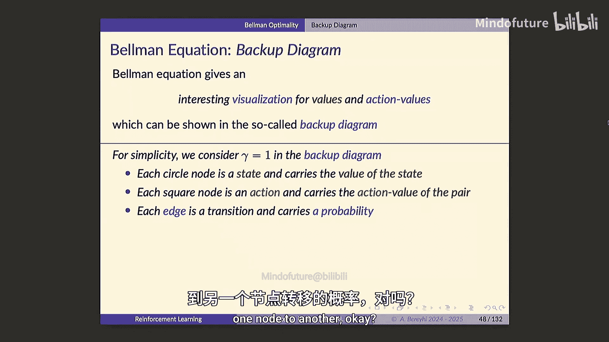

Like， if you know the future， then you just multiply everything with pro， add them up。

 You're gonna get to the root。 And this is going to give you the value at that。 no， Okay。

 let me give you the diagram and it's gonna make make everything easier。

 So say Im in this particular。 I am in one estate。 Okay， out of n possible state that I have。

 I'm in one of them。

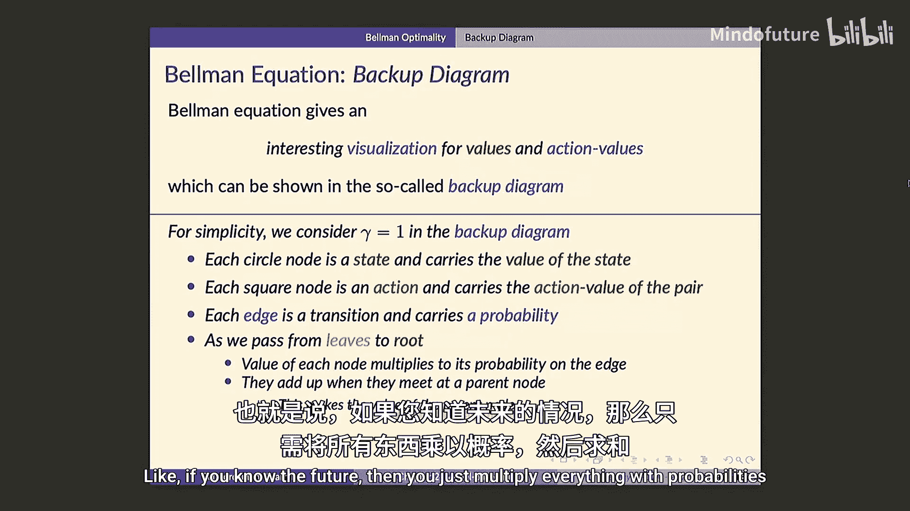

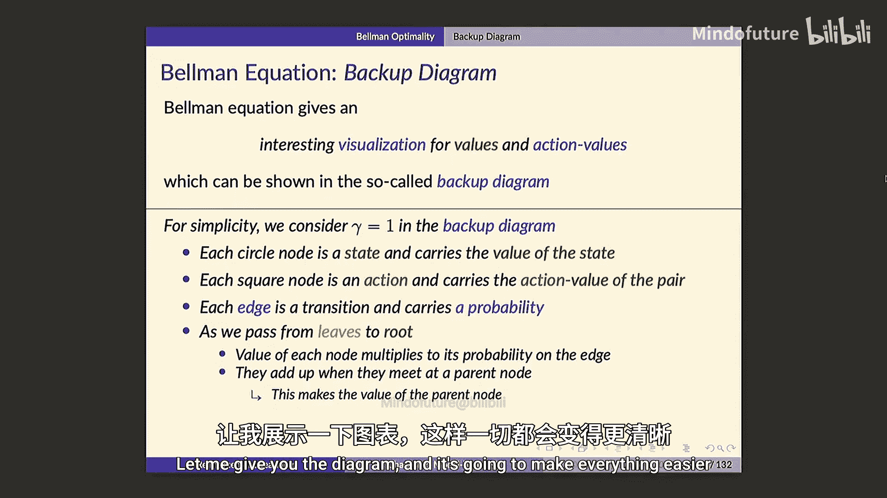

What kind of actions I can do？What are the possible actions in general？I have M different actions。

 right， in total， right， in the dummy example we have at every single cell， you can move left， right。

 down up， right？ So in general， you have M different actions。 What I'm gonna do。

 I'm gonna connect this estate to the M different actions that I have， right。Everybody's cool。

Everybody's clear。Now， what is the chance that I am in this estate and I do this action A1。

It's going to be the policy pi computed at a1， right， P pi of a1 given state， right。Everybodys go？

For second one， the same till the last one， right， now。

 if I think that I do know what is the action value of action A1 and state S here。

Okay so what is the action value of this greenest estate S and action A1 when I am at this node。

 okay？

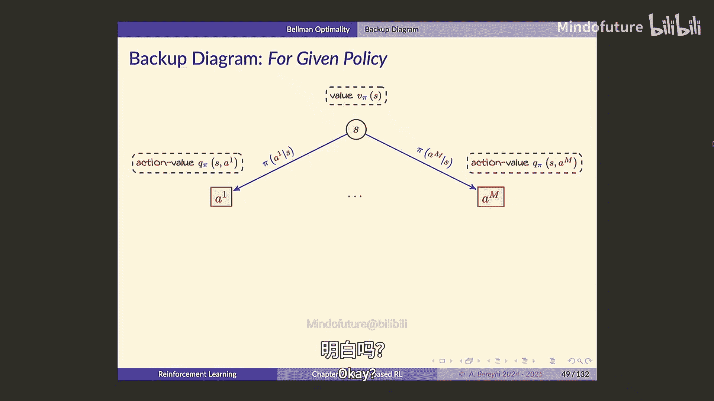

If I do know this action value for every single action that I have in the leaves。

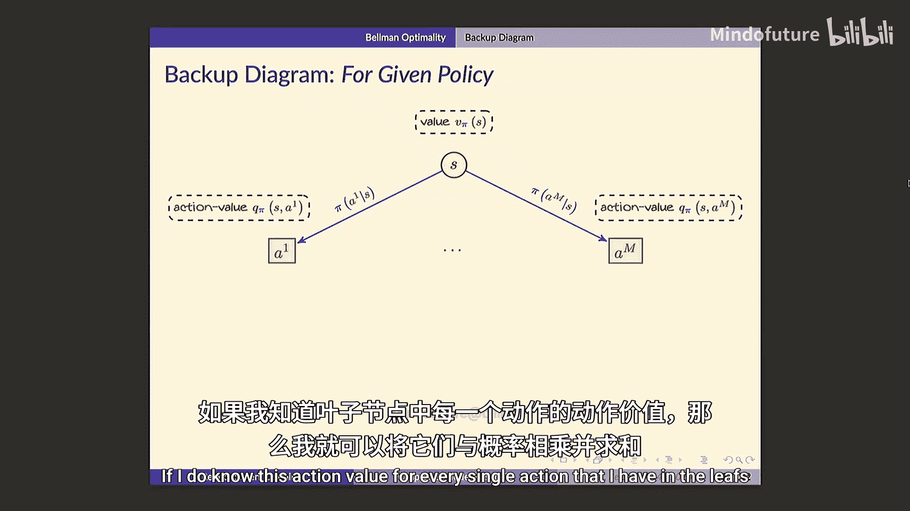

O。😊，And I go and multiply them with the。Add them up， I'm going up with the value of that state。

 right， This is the equation on the board， right。Action value at every single action and a state S。

 when I average it with respect to policy pi is going to be the value at that stage， right？

You see it？Every value on the leaves gets multiplied with the probability on the edges， add up。

 and they're going to give me the value on the root， right？Everybody's clear now。

 once you are at this action， say you do action a1， okay？

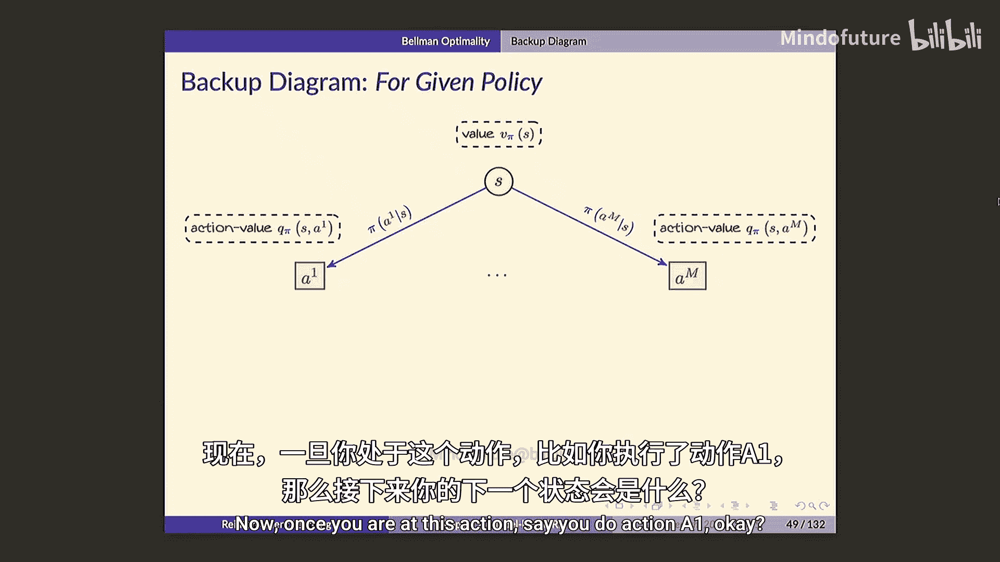

If you do action A1， what would be your next estate？😡，It could be any state， right？

 What is going to explain that estate。Your MDP， right？ so I can draw it like this。

 I can say that in state S I did action a1 right， And at this point， after doing a1。

 I could go to any other state。 I may remain in my own state。

 I go to state left right to up down any of them right， So I have in total n different states。

 I can change from that state that I was into one them， right。Any of them。

And the probability of going after doing action A1 to any of these estate is exactly given by your。

What is the probability of the next state， given that you are in this estate S and you are doing particular action。

 everybody' is clear。Yes。肯定加。Yes。The states that it would go into would either be this like if it hits a wall and stays in the same state where it goes forward with you。

どないても。Yeah。I mean， you can give the probabilityal to be0， right？Yeah， I mean。

 this could be that for example， if S n is never going to happen， then this par voltage is 0， right。

Yeah， okay。Questions？Now， again， if you look at this guy right and you write down the same thing as I told you before。

 like every single state here has its own value， so it's going to be value of S1 value of S2 till value of SN right that v pi S1 to v pi SN and you multiply them with the proties that you have。

 you go up when you add them， you're gonna to get the action value。

 you don't believe me check the beman equation number two。Let's do it together。

 So one thing you need to have the immediate reward as well。 sorry。

 but I'm gonna show it in the next slide。 So let's say you are here， right。

 So I am in the state S1 till S N， every single of them has a value right Now。

 if I get these values and I multiply them with their provo is。

 the provolty that I get after action A to these estate， right， these are the provolities。

 If you add multiply them to the corresponding values and you add them up。

 then you add up this is going to be this term right。

 So the value of every single state possible times the provolty that I go to that estate after being given state S and doing action A right。

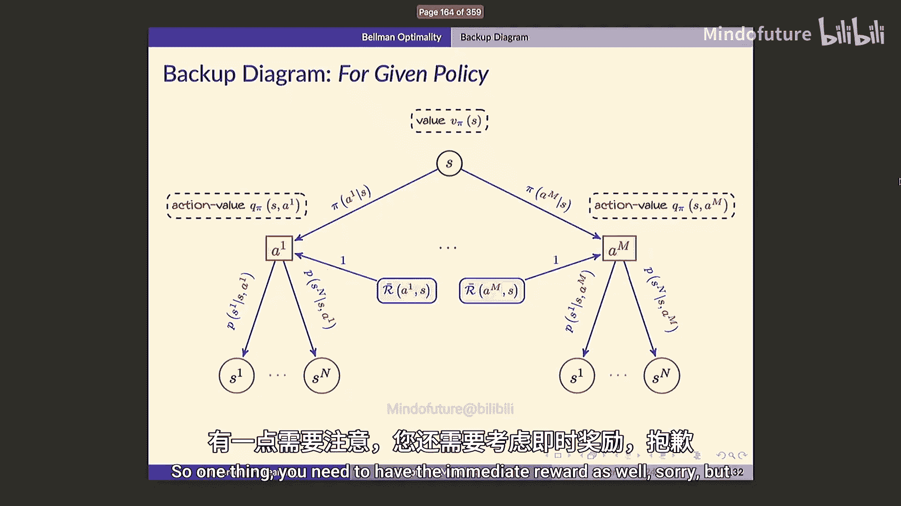

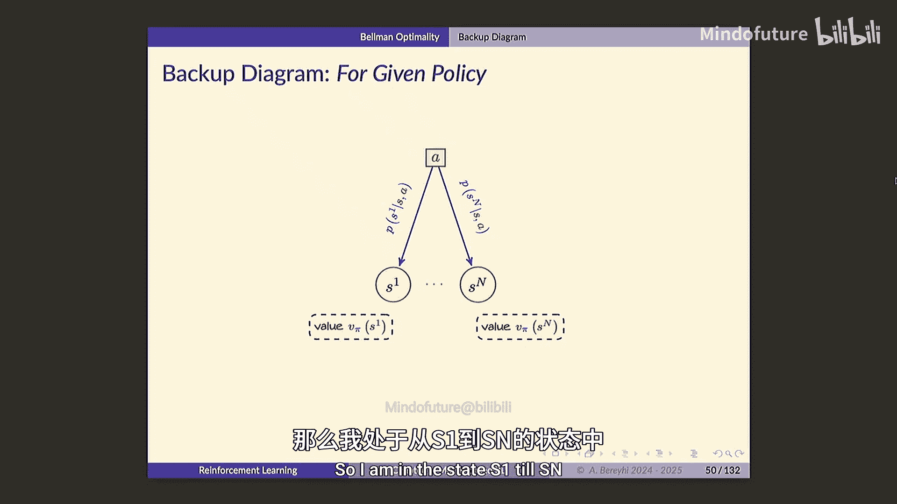

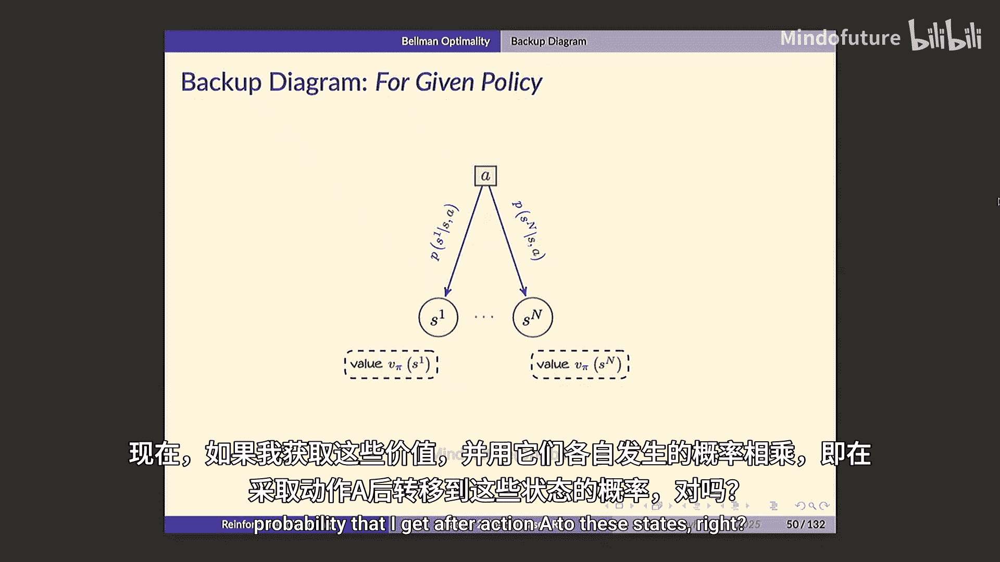

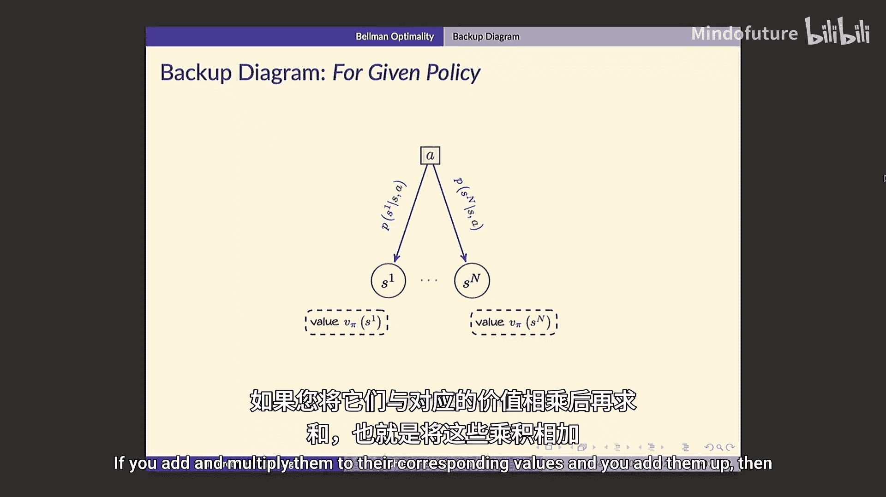

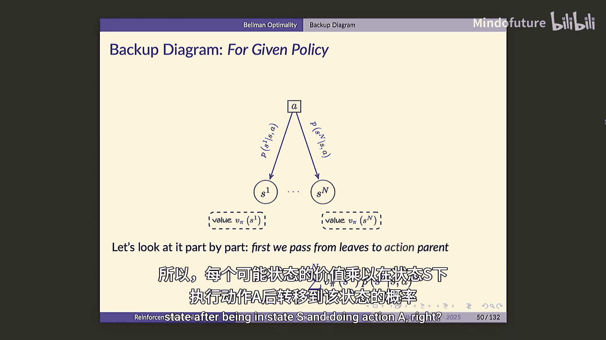

If you're adding on that。And you add out that the average immediatete reward。

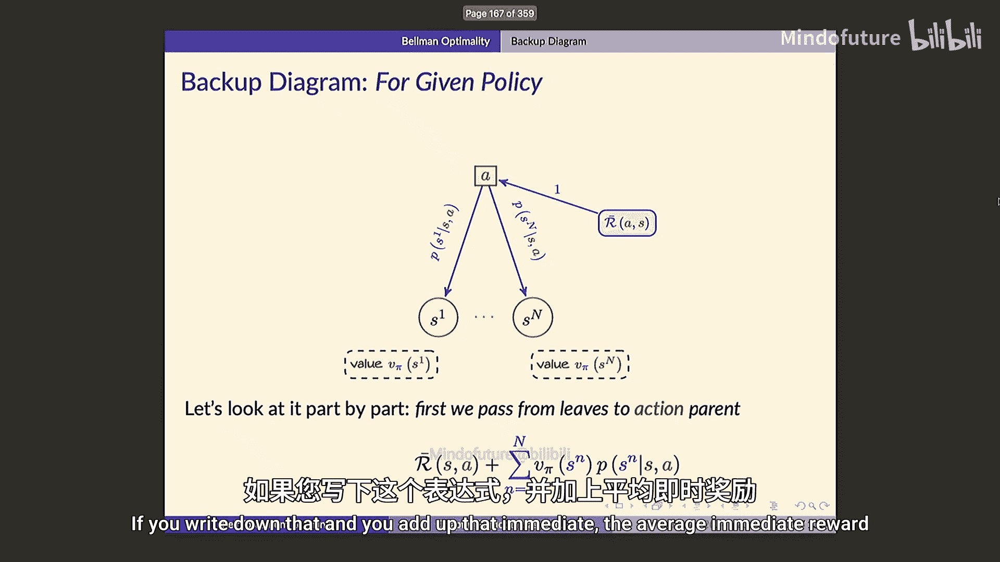

You add up this single term， right， Then the thing that you are going to get is going to be the action value of that action。

 and that is state。 the parent state， right。Everybody sees that。Do you see the equation here？

 So what does Billman equation say， it says that you are in this estate。There is a tree down there。

 right？You just choose one of the actions， you get this action value， right？Theyre right。

And this depends on the MTP sending you were right when you get to out state。

 you see the same tree again right， you arrive in another state and again for the out state。

 you can just play with your policy， go to one of the actions and you transit to another state and you go down right So this tree is somehow going to infinite right。

Everybody sees that yeah， this is important to see it because later on when we want to do temporal difference。

 we are going to cut this tree at some point and use estimates down there。

 and then we use everything right the equations for the above part of the tree。So one estate。

 you can do any action， right， then you go to a new estate， right after that action。

 you're going to transit to a new estate and you can keep on going， right。

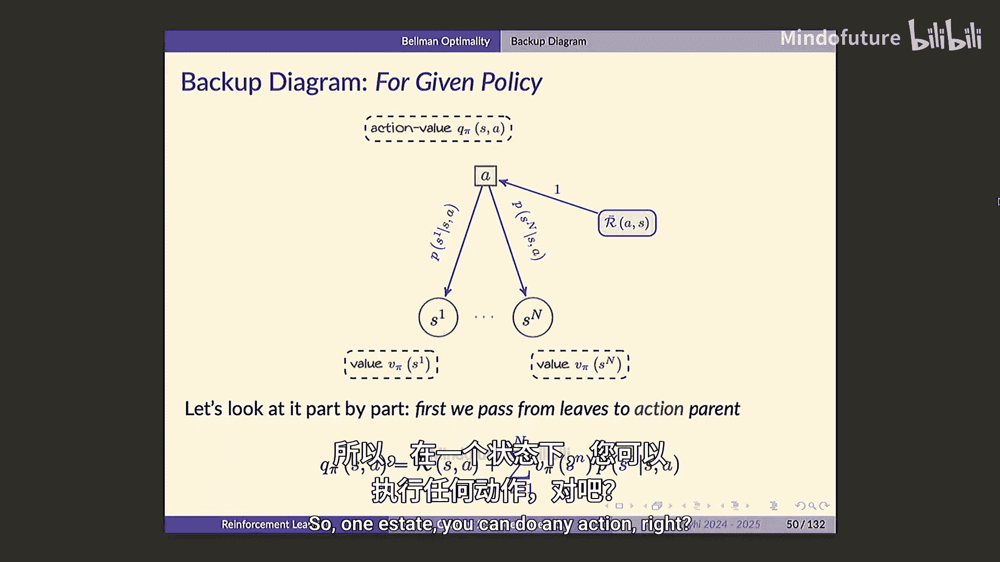

Questions。Okay， so。Sometimes if you want， I mean， first of all。

 this is the one which I told you initially。 So if you think about the upper part of the tree。

 so you have here your different actions， every single action is having its own action value。

 right so it。What is the action value for this policy pi， given that you are doing action A1 till AM。

 and then if you just get those action values， you multiply them with the corresponding policies。

 you add them up， you're going to end up with the value of the parent， right。You have action values。

 you just go walk through the parent。

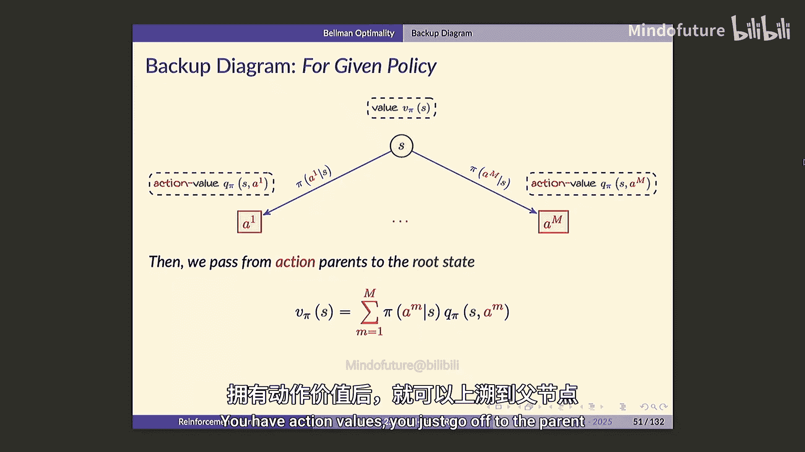

So you can do this as well。 And sometimes what you can do， you can actually compact that tree。

We do it less， but if we need it， that is not a complicated thing。

 So let me get back to the original tree here right so I told you I am in this state。

 I can do this action and then I get to any of the next states right I can do another action and I end up at any other state right everybody's clear now what I can say I can say that okay。

 regardless of what the action is， I am going at the end of the day getting to one of these states right so what I can think of I can think that okay I'm in this particular state right'm in this particular state and then I can after doing my action based on my policy。

 my MDDP is going to take me to a new state so it could be S1 S2 till S n right。

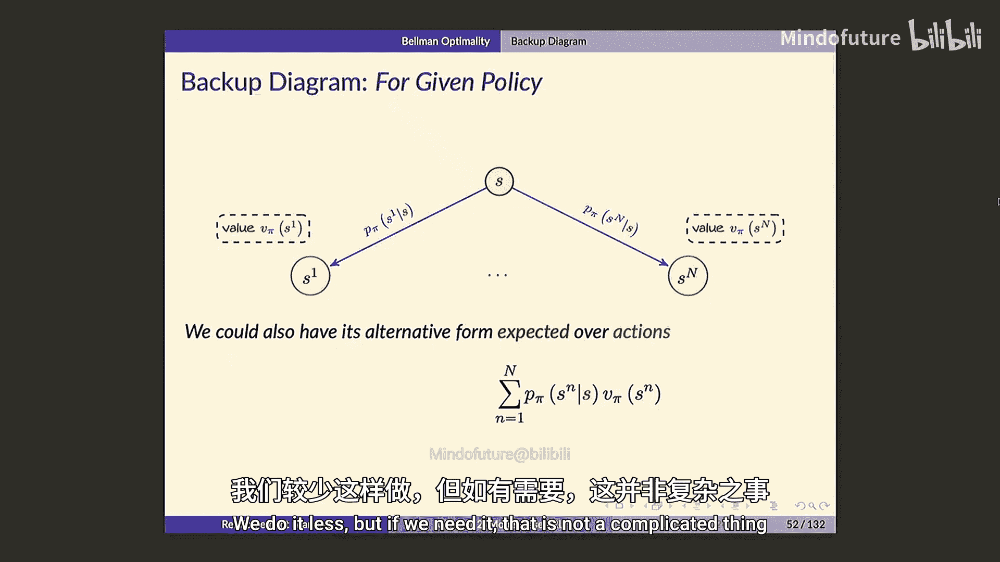

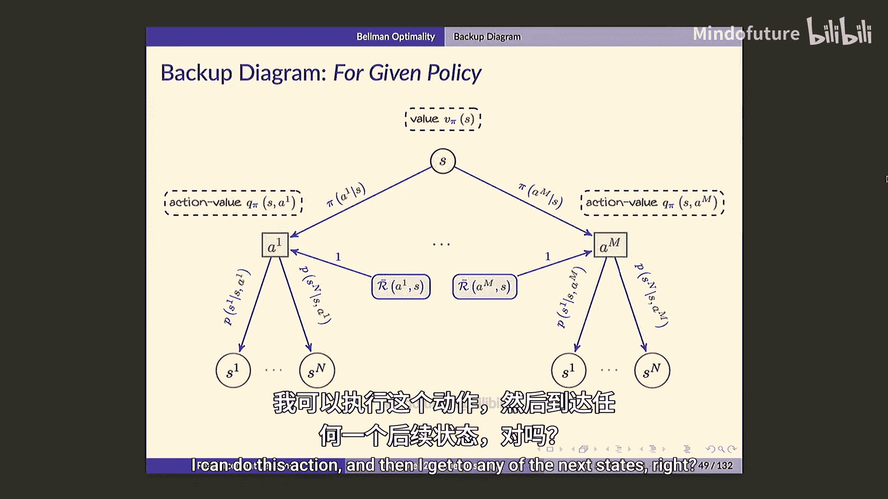

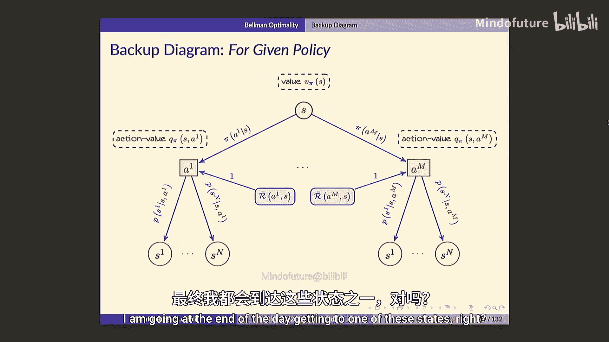

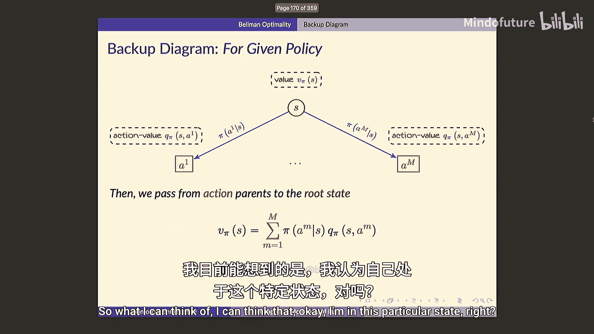

And what is the chance that I start from a state S and go to S1， That is the transition probability。

 right， which we computed for the first Belman equation， right。Everybody sees that。Now。

 if you want to think about this， this branch， this particular branch， how can you think about it。

 Anyone has any idea， look at this guy。

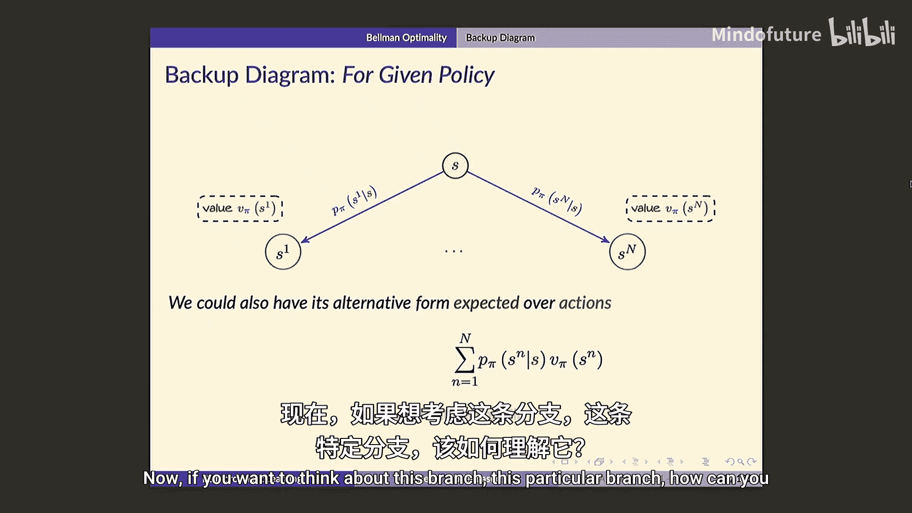

Can you tell me how you find that ranch。How you can end up with S1 from S。You can get S。

 you go do action A1， you get here， right？Right。You can do S。 you do action A2， you come down。

 You can do， you can be at S。 You do action A M。 you end up S1， right。

What is that branch in the other tree？It's like you get this one。The next one till this guy。

 and you average all of them based on this pie， right。

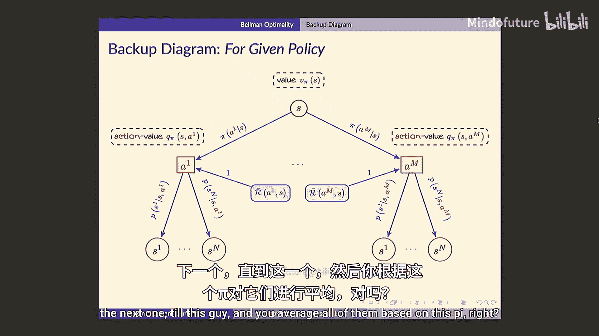

So you you would say， okay， I'm in the state S， if I do action A S1。

 the chance of going to S1 is this one， if I do action A2。

 the chance of going to S1 is this one and so on， so if I want to just represent everything with one branch。

 I cut this branch for all of them， I put them on each other， I average them based on the policy。

 right。

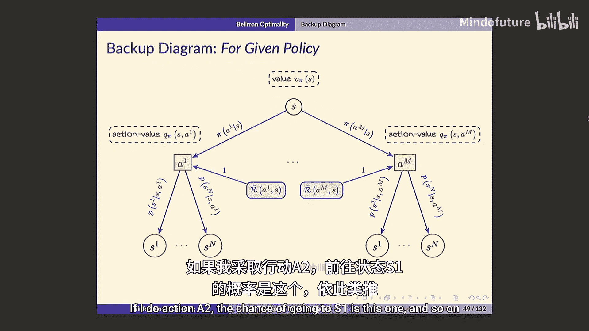

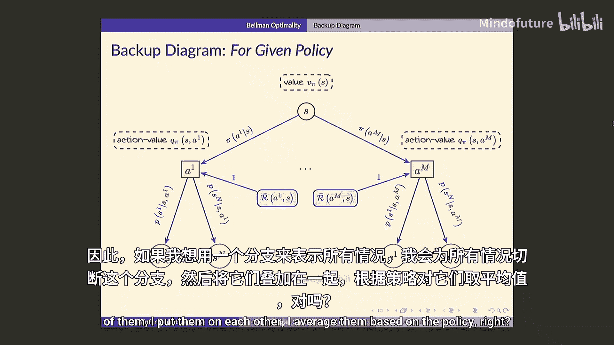

And then there is one branch now， right， connecting you from a。

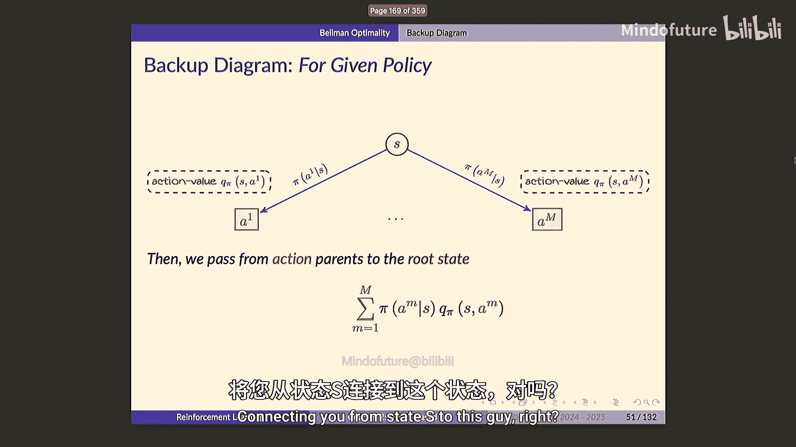

As。To this guy， right and so on for everybody。 Now you， of course。

 when you do you are in this estate and you move。You're going to get an immediate reward。

 This is the immediate。rewardward that we have for every single action。

 then you just add this one as well here， right and that reward that you see here is the average of those branches as。

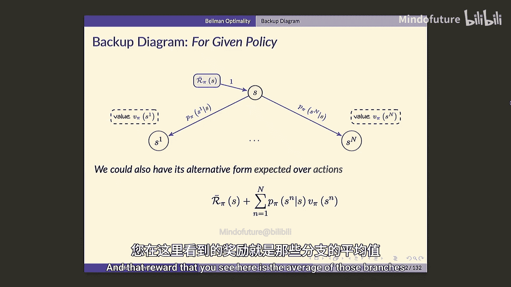