# 【多伦多大学】强化学习 2025 ｜ Uoft   Reinforcement Learning   Fall 2025 p15 P15_讲座_15_贝尔曼最优性方程 -BV1D3F2zhEry_p15-

You might tell me that， okay， this spellllman equation is going to let me more of a story to the value or action value for one particular policy that you have。

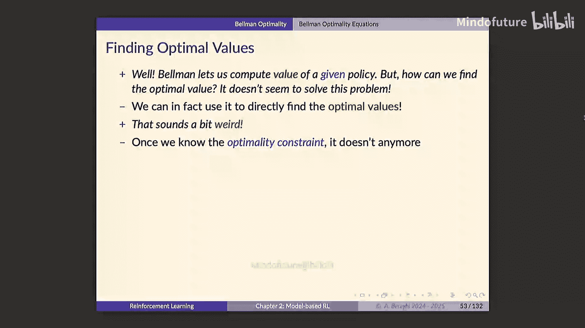

Neing to go。You know， time nested time expectations， just do some recursive algorithm。

 But what if we want to look at the optimal values and optimal policy。

 Can we do it directly using that because here we need to know the policy And once we know the policy。

 we can use Belman equation to compute value right？ But what if we want to find the optimal value。

 right， indeed， we can simply play around with that equation to just find it for the optimal policy without needing to know it in advance。

How is it possible， Let's look at this。

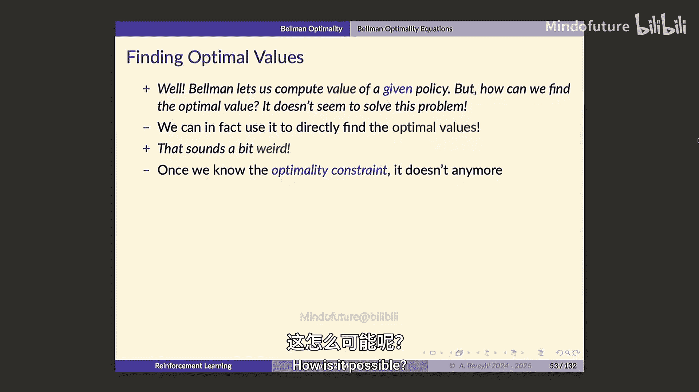

This is what I told you。 This is what this is still on the board。

 So if you have the action value for one given policy， then you can find the value for that policy。

 right。The value of the policy is written in this form， using the policy itself and the action value。

 right now。One thing that you pay attention， you might pay attention here。 this pi here。

 This pie is a probability， right？ So what is its value， Can it be negative。Can it be more than one？

What's going to happen if I add this pi over about a？😡，I going to add up to。

If I add a pi A M given S over different M M from one。 So if I remove this guy。

What is this animation？It's one great。 So this pro function between0 and 1 is adds up to1， right。

 Now let's use this very simple fact to see how this value gonna behave if we do know this action value。

 So I consider this axis。😊，Here， when you go right， the value is larger， when you go left。

 the value is a smaller， okay？Now。Where I just show action value for some one particular action with a red dot。

 Okay， if I have M different actions， how many of these dots I'm going to have。M different does。

 right， So they're gonna look something like this， right， Some of them have more action value。

 Some of them have less values， right。Everybody is clear。No magic， nothing weird， right now？

What can be this value V pi of S， This is eventually the average of these red points， right。

 with respect to policy。 I don't know what the policy is。 I don't care about that。

 But given this diagram， Can you tell me where is the area where my value can land。Can it be here？

Can it be here？Can it be？When you have a bunch of values and you average them with any any weights。

 can it be anything more than the maximum or minimum values， No。

 it's gonna to definitely be somewhere between the maximum and minimum values right。

 So if you average all of these points your value gonna be somewhere between them right。

 everybody is clear okay， this is simple right， So let's just use this fact。

 So this value is definitely whatever that is is between the maximum of the action values and the minimum of the action values right。

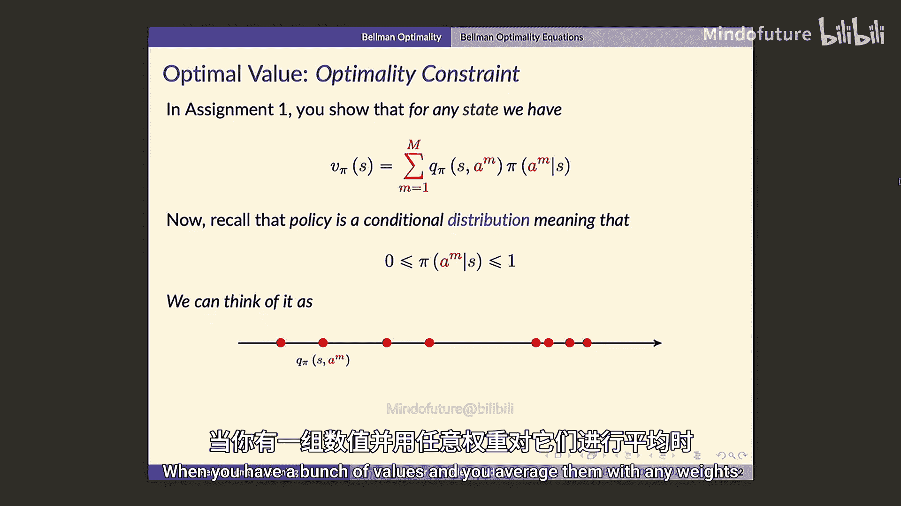

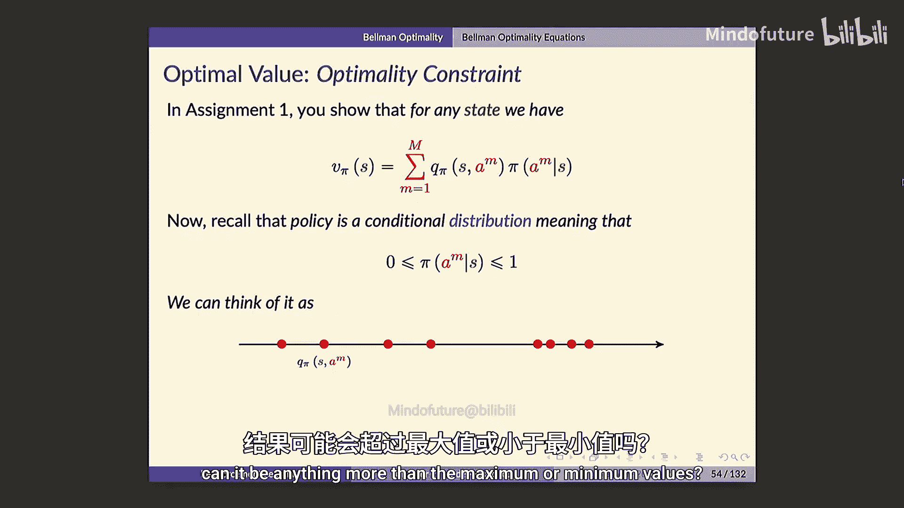

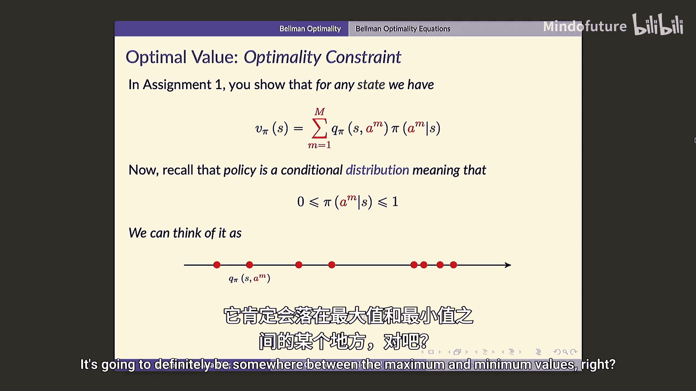

Everybody's clear。So meaning that when you are in one state。

 if you do know the action value for all the actions， right， value of all the action in this state。

 then the value of that estate obviously is somewhere between the maximum action value and the minimum actionality。

 right。Good，If we use that， we can simply use one constraint for the optimal values。

 So when I play with the optimal policy， what gonna be my value。

 This is the maximum ever possible value， right。Right，We define the policy。

 the optimal policy to be the policy that when I am in one particular state。

 the value that I'm going to collect。Wors with that policy。Tal you ever right。

Play with any other policy， if I change my policy， the value that I'm going to collect is going to be smaller。

 right？Everybody agrees。Cool， so what could be that maximum possible value？

Look at this guy and tell me， what is the maximum possible value。Maximum action value。

 When the action value is computed for what。Which policy。

I'm talking about the value of the optimal policies。 say I don't know what is the optimal policy。

 say policy exist， right， If I want to know the value of that maximum optimal policy。

 that value can be at most the maximum value action value of the same policy， right。

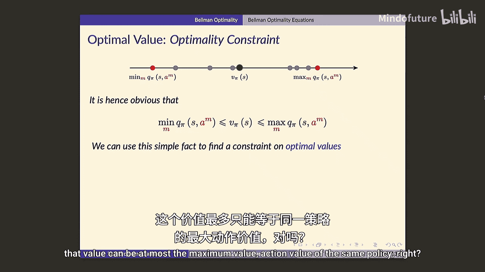

Everybody's cool， so it means that when you are playing with the optimal policy。

Then your value is going to touch the maximum1， which is exactly the maximum。

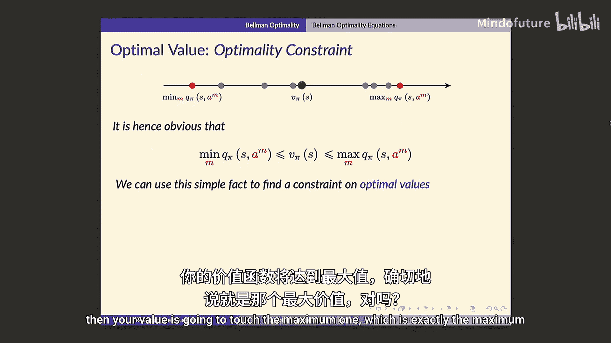

You right， so this means that this guy can be the maximum action value。

Among all the possible actions， when you are still playing with the optimal policy， right？

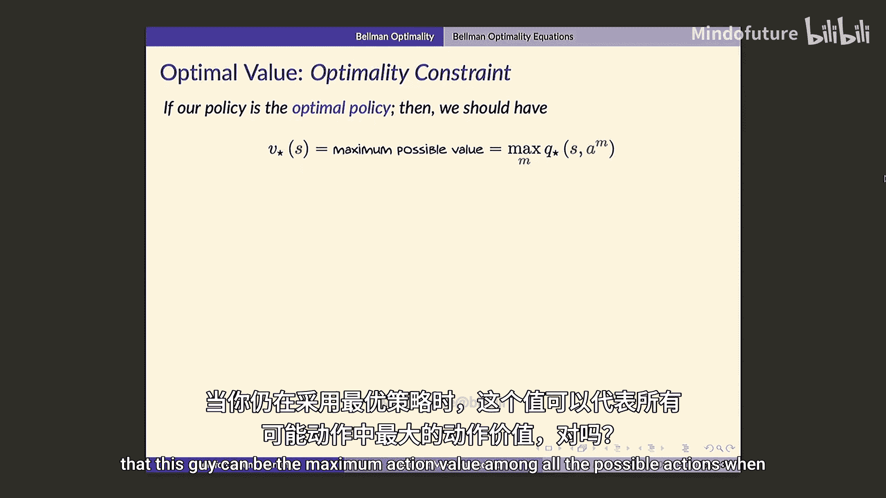

Again， you don't know what is the optimal policy yet you're going to know it soon。

But the point is that if you're playing with that policy。

 one thing that you are sure is that the action value computed at any state， when you maximize it。

 you must see the value of that estate， right？ If you don't see the value of that estate。

 when you maximize it， then this is not the optimal policy， right。Everybodys clear。

It's just two lines of discussion。 I know， but it needs a bit of time today digest。Everybody's clear。

Halfway clear。So。If you play with one policy pi， right。

 what you know is that the value of your estate。 So you're in one estate。

 Always think about my dummy grid world， right， If you're in one of the cells。The value of that cell。

 whatever that is， that is going to be somewhere between the action values， right。

 maximumum and minimum， it means that if you think about that cell and you say， I do action 1，2，3，4。

 any of those actions， then I'm going get one value， right， actionction value，1 Q， right and。

My value at that particular cell is between the maximum of those action values and minimum of those action。

 Now， if I claim that I am playing optimal， like I'm playing with the optimal policy。

 my value is supposed to be the maximum one right and the maximum value that I can take is the maximum action value。

 when I just search among all of the actions right。

 So this means that when I am playing with the optimal policy。

 my value at that particular state going be the maximum action value around all the actions right。

 now I still have now told you what is the optimal policy。

 but one thing that you right now now is that if I claim that I am playing with the optimal policy。

 you can check this right you can use Belman equation to find the action value。

 you can use Belman equation to find the value function and you can go for every single state。

 check if the value of that estate is really the maximum action。ValueIf this is the case。

 then I am right。 I am doing optimal policy。 If this is not the case， I'm lying。

 I'm not playing with the optimal policy， clear。Questions。他速。Definitely， definitely。

 we're gonna talk about that。We， we always have， not like most of the time we have multiple， right。

Questions。要。It feels like if I give you a non optimalal quality。There may be a way to。Definitely。

Is the maximum action？This is policy iteration。 What you said is just a policy。No， no。No， no， no。

 I am talking。 I I say that this is the optimal。 If you play with the optimal policy。

 then this should satisfy， right， What you said， you say that if you play with another policy。

 it might be a way to improve it， make it better， right， That is， that is the case。

 And this is what we call it policy itration。 You start with with a random policy。 You improve it。

 And gradually， you're gonna converge to the optimal policy。 This is what were gonna do。

 hopefully on Friday。哪个。So， but everybody sees this contrain now， right。Okay。Now。

One thing that you might ask me is that is it， is there any guarantee， I mean， right now， I told you。

 if I play with the optimal policy， this thing should happen， right， but you might ask me。

 is there any guarantee that this optimal policy exists。Like we can do really this guy。

 the answer is quite simple。 Yes， you can definitely write down the optimal policy。

 What is the optimal policy at every single state as long as I know the action value function。

 I'm going to do the action which gives me the maximum action value right if I do that then that pi is going to be one exactly at the action action that whose action value is maximum right。

 and my value is going to be exactly the maximum action value。Again。

 if you are in one particular state， you have bunch of possible choices for action。If you do know。

 what is the optimal action value。Meaning that what is the optimal value you're going to get if you do this action。

 the second action， the third action。Action。Then what is the policy。

 Just find the action gives you the maximum optimal。And then you keep doing that， right？So。

 at every single state。At every single state S， you just search among every possible action。

 and then you're going to take the action， whose corresponding action value is。Maximize， right。

 This is your optimal policy。That guy always exist， right。Everybody's clear。Now。

 if you got no question， I have a question。Do you see any problem in this formulation。

 I do know what is the optimal value function。 I do know what is the optimal policy。

 But what do I need to know in order to write these two guyss。

What I need to know to write down via star and pi star。Please tell me， I mean。

 just shooting the dark， maybe just works。Optimmal action value， I need to know Q is star， right？

Tell you how you can find Q is star because again， if you want to know Q is star。

 you need to know the optimal policy， right， And then you put it in the Belllman equation， correct。

 So the cad is just biting its own tail， right。But we can get rid of that issue。 That final issue。

 How we can do it。 Then we can simply just put these guys in the Belman equation。

 And then you suddenly see that you don't need to know the policy。 How can I do it。 So first。

 let me just write write down the optimal con。 So this is the optimality cons。

 It says that if your policy pi star is the optimal policy。 Then it would maybe look like this。

 right， So it gonna be， this is the optimal action value。

 And this is going to be one at the optimal action。

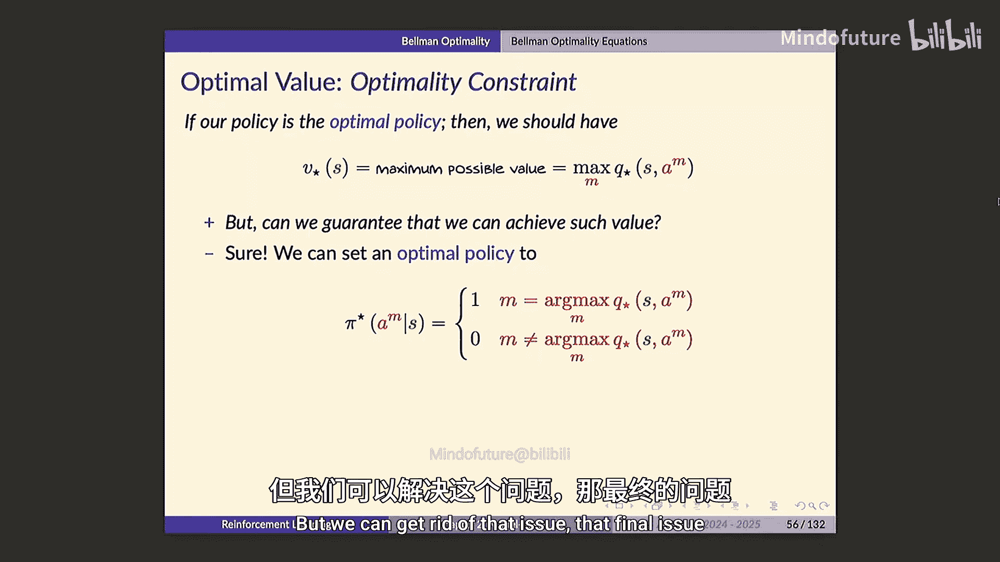

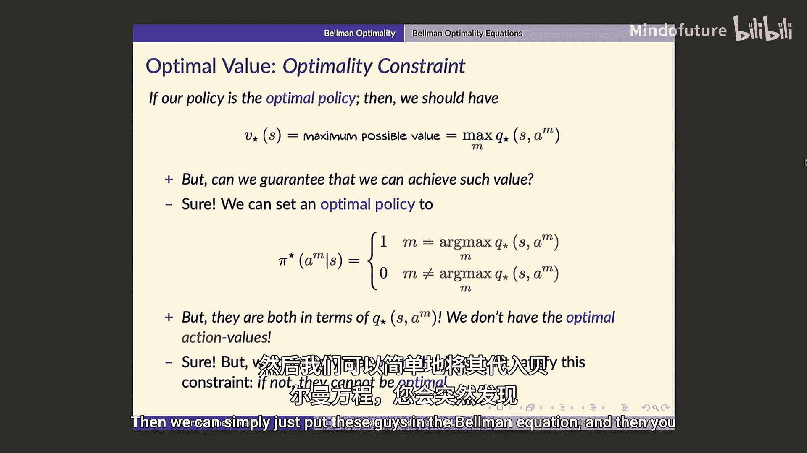

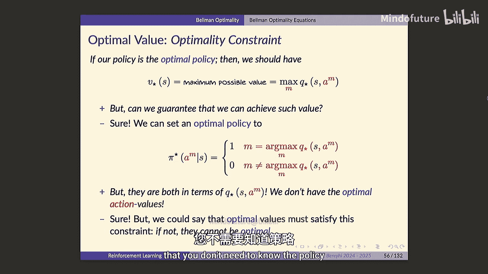

Or the action， which gives you the maximum value。 And then your value should also look the same。

 right， This is the optimality constrain。 If I claim that this particular policy is optimal。

 then you can check this condition and tell me whether I'm lying or not。

 But if you want to just start from a scratch and write down the optimal policy。

 You need to know this Q star。 How you can know this。Well， let's do this together now。

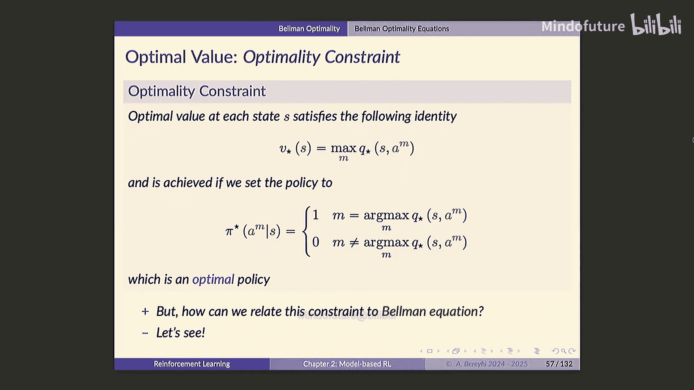

This is the Bline equation that we had before， right。I told you before。How an equation。

 if you just forgot， just take it from my side。 the Q function。

 the action value is written in terms of the immediate reward plus the average of the value at the different states。

 right now。If I have optimal policy， if I'm playing optimal policy， that policy is one policy， right。

 So the Bman equation should set should also hold for that equation， right， for that policy， right。

 meaning instead of Q pi I replace Q is star here instead of V pi I replace V V R。

This is still going to be the case， right。Everybodys clear。Now。This is Q is star， right？😡。

Q is star written in terms of V star。 And then I told you before， just let me get back here。

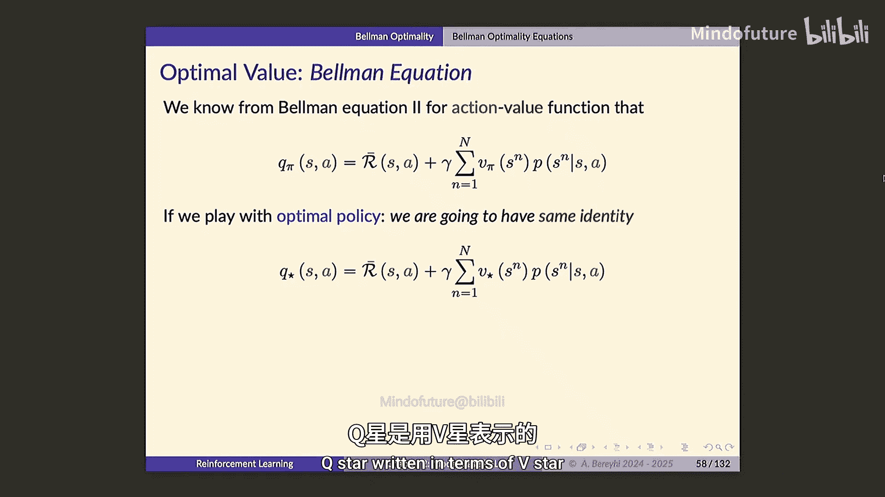

Can I write down V star in terms of Q is star？Yes。The optimality constraint tells me that if you know Q is star。

 you know VS star， right？

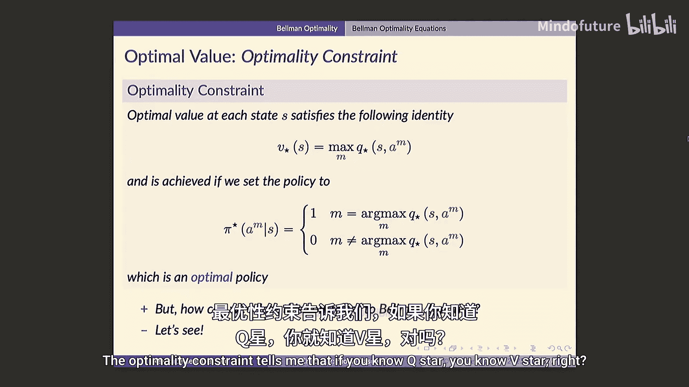

Everybody agrees。Right，So what I'm going to do， I'm going to say this is Q is star。

 If I maximize it over all a values， this is going to give me V star， right， So let me do that。

 So V star is going to be maximize maximum of this guy over all possible actions， right。

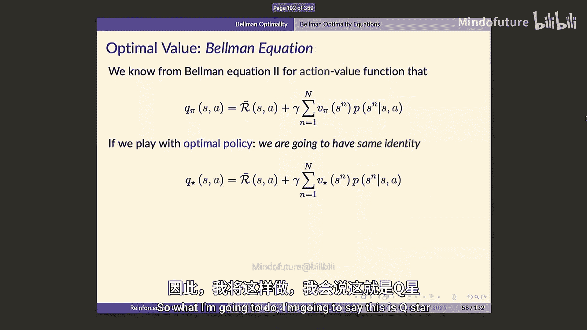

Everybody agrees。I didn't do anything。 I just used the optimality constrain instead of Q star replaced the right hand side of the Belman equation。

Everybody agrees。Okay， if you agree， look at this guy and tell me if you。Thing to compute this。

Do you need anything to compute via star。Do you need to know the policy to compute that？Yes or no。No。

This guy is the immediate reward。 It does not depend on the policy， right。

 It says that you're in a state S， you do action A， right。So you can compute this one。 That's easy。

Via star is your unknown， right？So you're going to keep it as it is。 And this guy。

 the probabilityty of going to the next state， given that you're in one particular state and you do one action。

 it does not depend on the policy， right， It's just depending on the MDP， right。

So this is one equation for a state S， right？You can write n different of these equations for the n different states that you have N equations and unknown。

 You know the optimal value， right。Everybody's clean。

This is what we call it the optimal optimality be constraint。

 So you essentially do not need to know the policy。

 the optimal policy in order to find the optimal value， because when you put inside this equation。

 policy shows up nowhere， right。

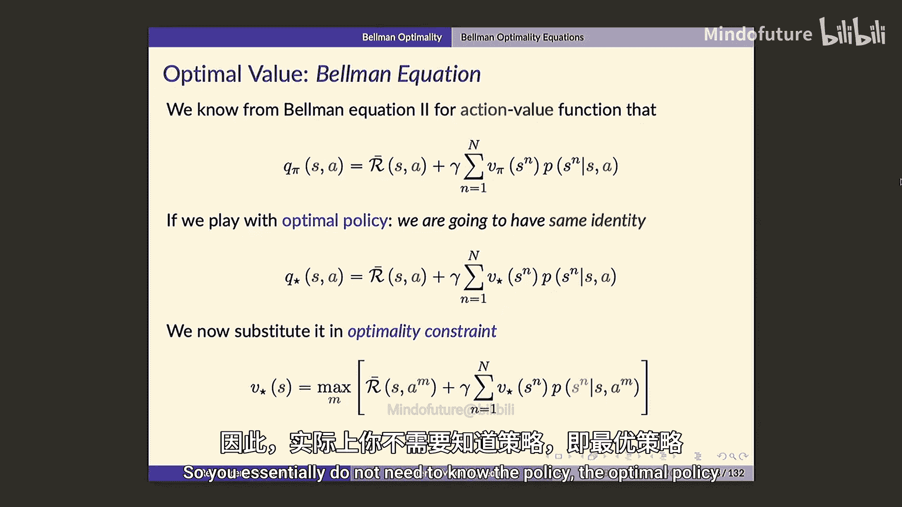

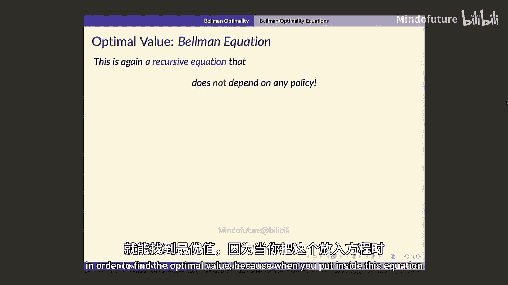

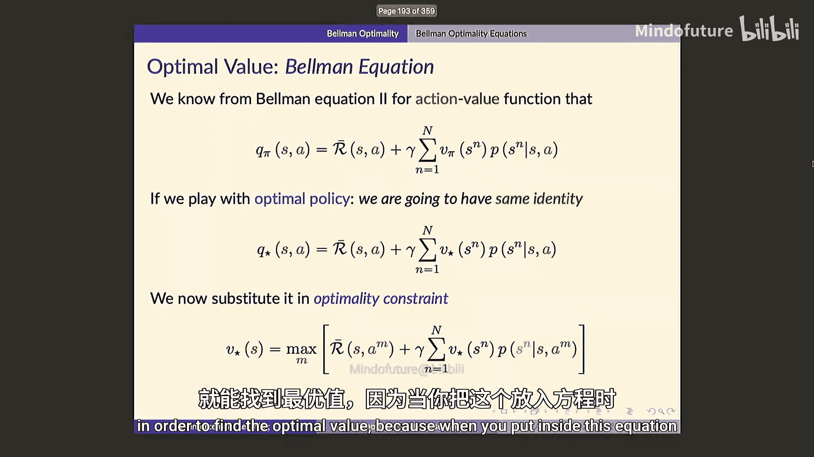

And this means that the optimal value at every single point at every single state is depending on the。

At the other states， through this equation， right， again。

 you write down n different equations and different unknownuns。

 you're going to solve it and you end up knowing your optimal value。

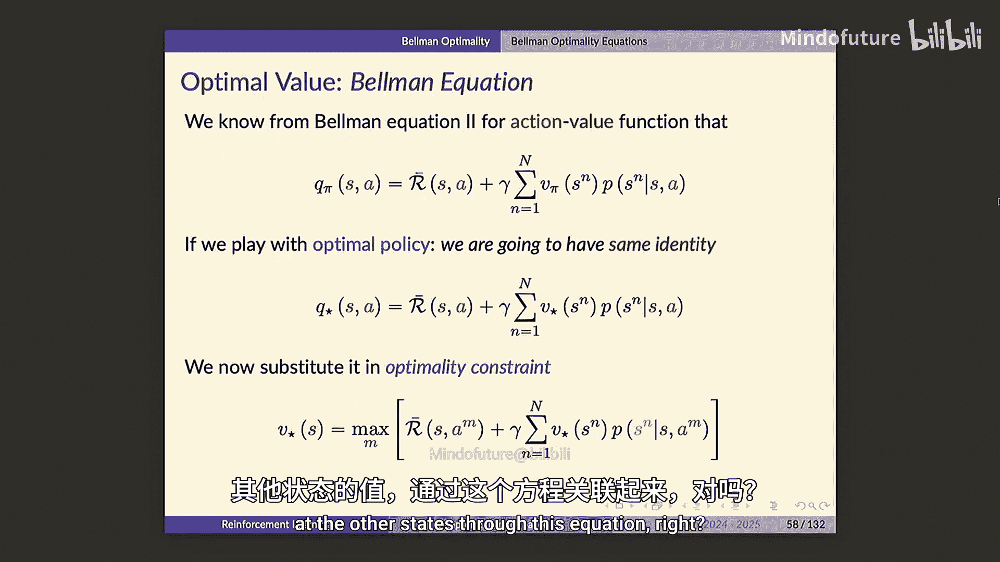

Everybody's clear。Questions？Right。So this is a fixed point equation in terms of VSR。

 You're gonna solve it for PR。 and then you're gonna to find optimal value。 Now。

 if you got no questions， say I found the optimal value through this equation。

 What should I do next if I want to know the optimal policy。If I know the optimal value。

 can I find out the。Yes， Belman equation for any policy。

 including the optimal policy going to take me from the value of that policy to the action value right So for the optimal policy。

 I know the value， so I'm going to know the optimal action value If I know the optimal action value。

 can I write down the optimal policy。Yes， problem solved， right。 Everybody is clear。

 So once you know MP， you can write down the optimal Belman constraint to find out the optimal value function from that one。

 again， you use Belman to get to the optimal action value function from that optimal action value function。

 You just build one constraint， which is policy， which is going which is the optimal policy， right。

 So that's the whole story。 And I'm gonna。😊。

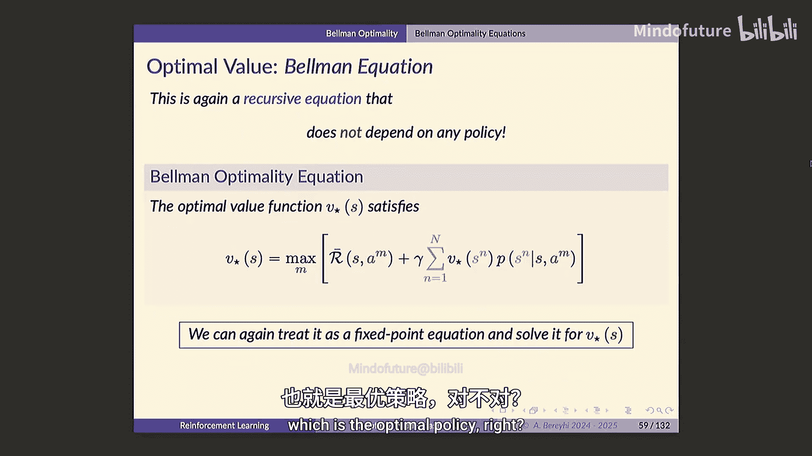

Explain it a bit of more details next time， because we don't have any more。

 So next time we're going to solve this optimal equation for the dominant grid world。

 We're going build the optimal value function。 And from that。

 we get into the optimal policy questions。

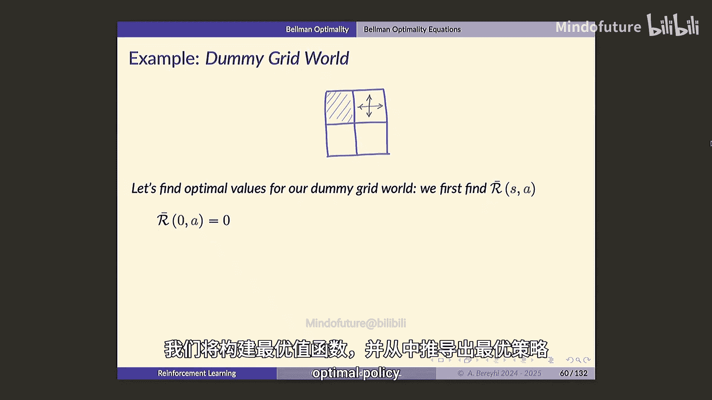