# 【多伦多大学】强化学习 2025 ｜ Uoft   Reinforcement Learning   Fall 2025 p16 P16_讲座_13_贝尔曼方程 -BV1D3F2zhEry_p16-

Let's start with the Bel my equation。 So the key observation that you might， we already have seen。

 We talked about this before is the kind of recursive property you see in the future return。

 So what is the point here， Sa that。

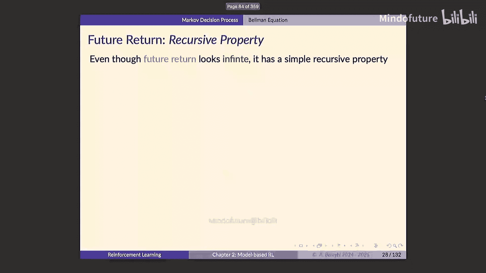

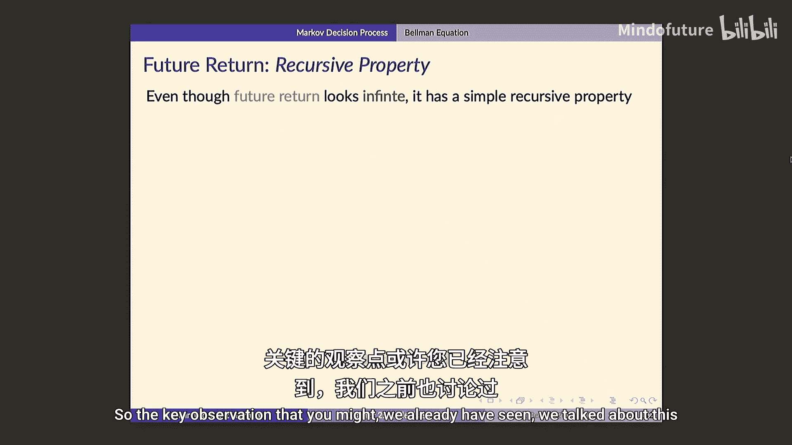

I want to just compute the future reward at one particular time T。 So when I am at time T。

 I do one action。 I start getting reward， right， So I get my next reward。

 That reward is R T plus  one， right？ So when I equal by 0。AndThen after that， I change my state。

 I do another action。 and then again， again， I get a new reward。 That is R T plus 2。

 And then the distribution of R T plus 2 is again， describe using my policy and the MDP， right。

 And you keep on going like this。 Now， the thing that I can do， I can just start expanding this sum。

 So I can start writing it down in this form。 And I have the immediate reward plus discount factor times the next reward and so on towards the end。

 And now I can just factorize any term， but the first term。 So I can just look at the。😊。

I keep the first term， and then I take discount factor as a factor out of the expression。

 and then I'm gonna remain with this expression right and this expression that you see is again。

 the future reward when you just go one estate further in time right So it means that looking at R2 plus2。

 this is the immediate reward that you get when you are in your next estate right So when you are in state S plus one。

 say that you already have passed this estate right。

 you have done your action after doing your action， you get your reward。

 you change the state right in that estate， once you do your next action。

 you're gonna get the immediate reward， which is Rt plus2 right And then after that you again get Rt plus3 and so on towards the end right？

 everybody's clear。So this guy that you see here in the bracket is the future reward that you get in the next time step。

 right， not in this time step。 So you can eventually write it down in this form。

 So I can say that whatever is my future reward is my immediate reward plus discount factor times next future reward。

 right， everybody agrees。😊。

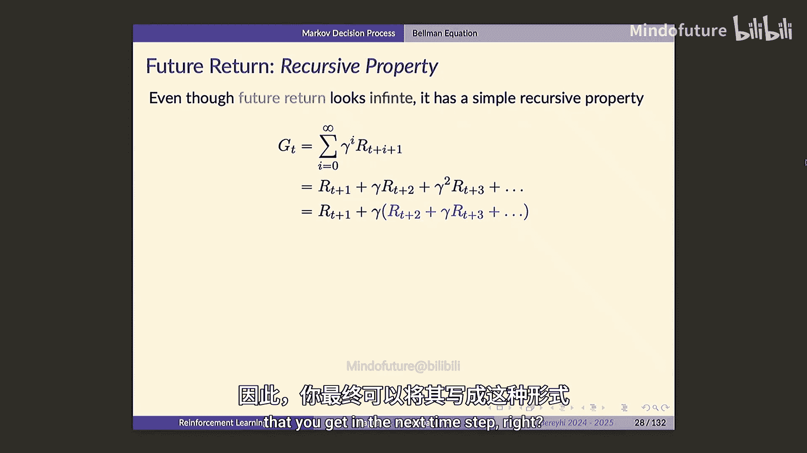

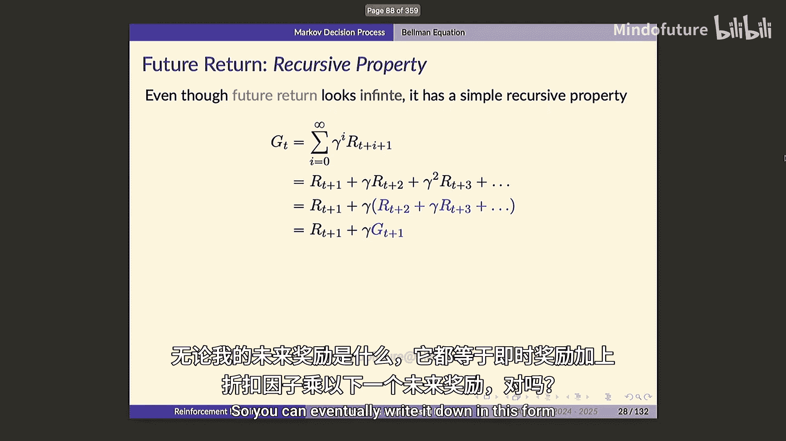

So this means that like I am right now at this particular state。 I do in action。

 I see one immediate reward， right， If I do know what I'm gonna get after that， then it's over。

 right， because I can take that future reward。 Add it up to my immediate reward。

 This is actually the future reward ad。😊，Stayate as the at the particular time T， right。

Everybody's clear。Questions。Everybody sees what I'm doing。

 right So this is a kind of recursive property because it is telling you like the next time reward。😊。

Is somehow related to your care and time， future reward， right， future return， sorry。

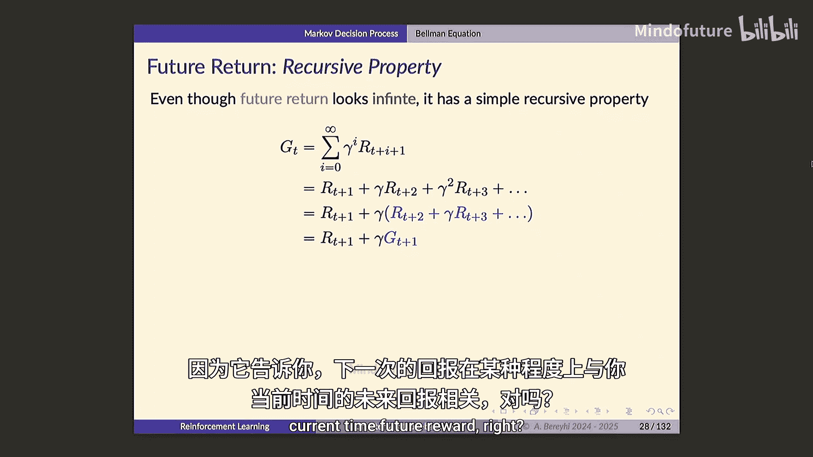

RightAnd then we can use this fact to develop one fixed point equation。

 which is going to make the evaluation of the value function much easier for us。 So how we can do it。

 let's say that we are playing with the particular policy pi。 If I want to just compute the value。

 What should I do， I should look at the reward， future sorry， return， the future return。

 and I take the expectation with respect to policy pi right。

 So this means that this is the definition of the value function。

 So say I am in the particular state S right， This is the state that I am in at the particular time S T。

 right， a particular time Im in this state S， right， and then I am in this state。

 I want to see if I play with policy pi。 What's gonna happen in the future。

 So I'm going just write down the future return。 and I take the expectation， right Now。

 next thing that I'm going do。 I am going to replace this future return with expression。

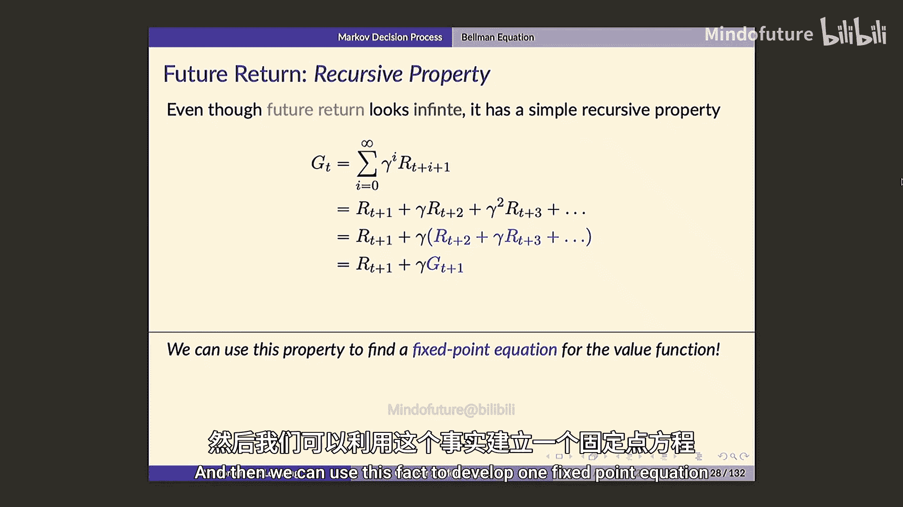

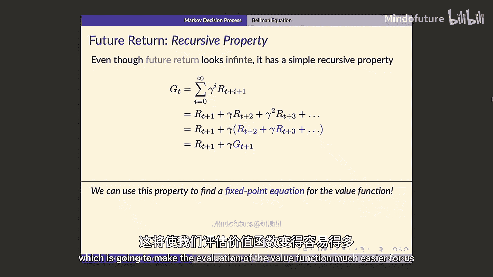

In the other in the previous slide， So the future return。G T is going to be my immediate reward。

 which is Arch T plus1。 This is the reward that I get immediately after playing my policy。

 And then I add up the future reward of the next time interval。

 That is going to be the future return of this time interval， right。Okay。

 now I can expand this expectation， right？So I can open it up。

 I can write it down expectation of the blue term， plus expectation of the yellow term， right？

Everybody's cool， right， No magic， Nothing happened yet， right Now， this first term。

 what is this guy， Do you remember this？😊，Expected immediate reward， right。

 with respect to policy pi。 We computed it once before。 if you want， we can compute it once again。

 But I guess you don't want it， right， So but it was quite easy， right。

 Because you are in this particular state as you would say。

 I do know what is the probability of the nextexus state。

 I do know what is the probability of the immediate reward that I get。

 I just average with respect to that， right？ If you remember， Okay。

 so this guy is the immediate reward that we showed it。 But what about this other term。

 Do you know what is that。Any guess？Any suggestion。So I am computing the expected future reward。

 given that I am in state S， isnn't that the value function of the state S？Yes or no？Yes， yes or no。

Who says yes？요。Great， so we have a couple of people saying， no， it's not。

 it's not the value function when you are a state S。 Why pay attention。

 This is a very typical mistake， To be honest， I did the first time I was signing reinforcement learning。

 Okay， no worries， that's totally normal because you see， you would say， okay， future reward。

 when I am in state S。 but what is this state S。

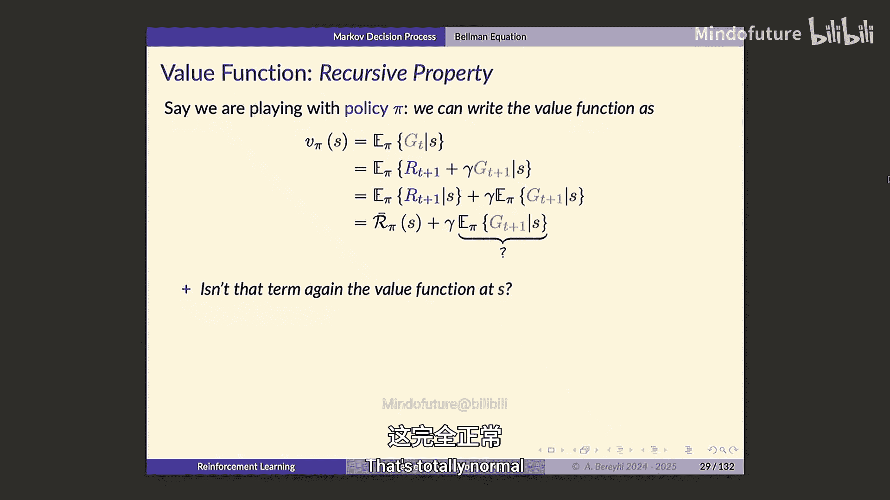

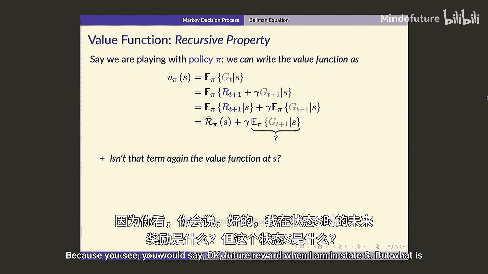

This state S is happening at time T right so you assume that your state at time T is s。

 but youre not talking about your future reward at time T。

 you're talking about your future reward at time T plus1 right so you're skipping one time step right if you want to write down the value function。

 the value function at a state S is the future reward of that time given that youre already in state S right so you see the difference there is one time step that you're skipping right。

So you're in this today， you' are not saying what is my future expected future award。

 You say that skip one time step， then I want to see what is the future。Reward return， right。

 So there is one step difference。 And so you cannot say that this guy is exactly as this one。

 So this expression， this one， which I kept as a question mark。

 is not the value function state S Everybody is clear。Questions？Yes。G T and G T plus1。 This is like。

 say your game is going to like your， your trajectory is going to terminate at some point， right。

 Now G T is the reward that I get say T equals by 2 okay。G。

 T is eventually the reward that you're gonna get at time，3，4，5， so on till the last time， right。

 But G plus 1 is the reward that you are going to collect at time。4，5，6， and so on。 right。

 So there is one。Time is step difference， right？ Now， if you were in time。3， then was okay。

 Like if instead of S T here， sorry here， instead of S T， I have S T plus 1。 Then it's okay。

 This is the value function。At point S right， because I am I am giving this state at the particular time and I'm talking about the future return。

 right， but here is not the case。 I am talking about this particular time step。

 but I'm talking about the future return not immediately after， but by skipping one time step， right。

 So that is。

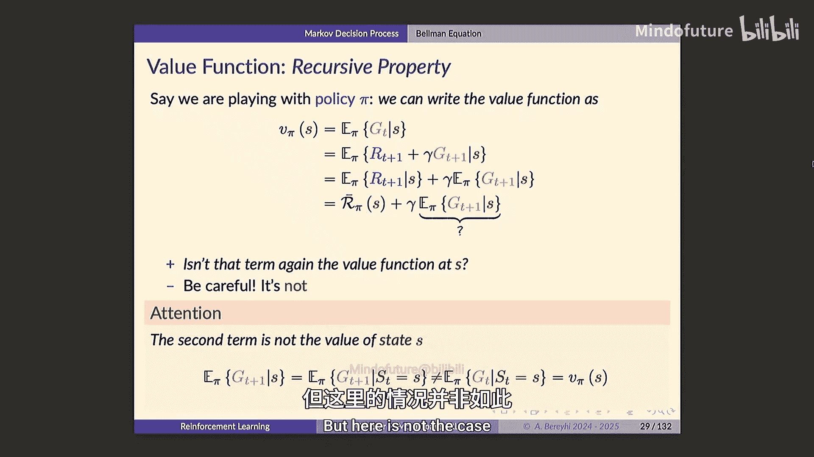

Different， right。哎国。Questions。No question。Okay， so if you got a question now the thing that I want to do。

 I want to see， what can I do with this expression。 And as you might guess。

 I am going to again use chain rule， right， We have done it all the time in the previous lecture。

 we should do it again， right， but I promise it's not going to be as mess as last time。

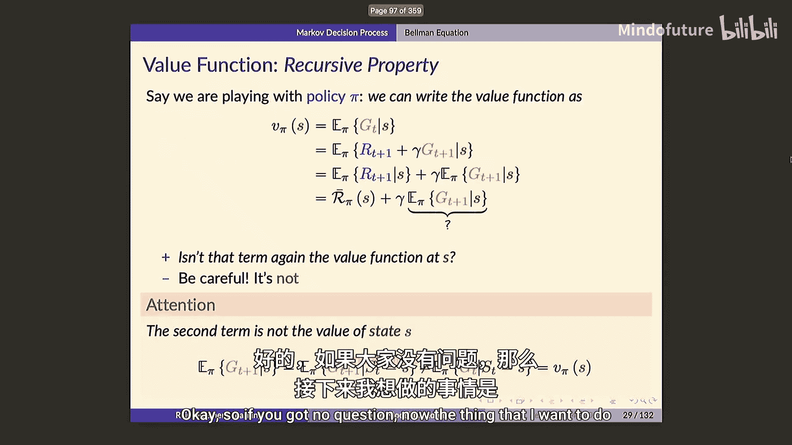

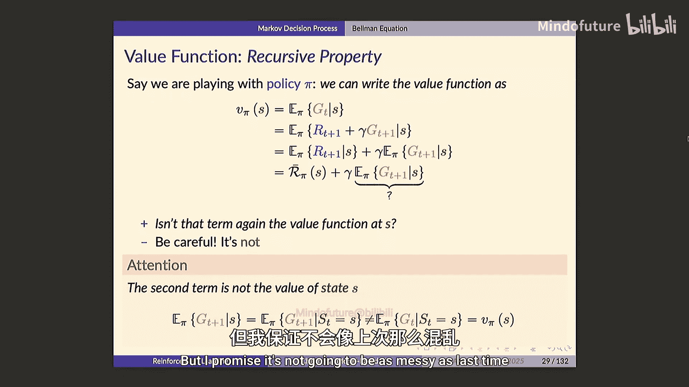

Okay， so look at it here。 So we have this guy。 So I want to know what is the expected GT plus1。

 given that I am in this particular state S right now。And I want to expand it。 Okay。

 what do you suggest that I add here， First of all， what do you。

 what should I add here to somehow get this guy something。No。Yes。Action， why action。If I know action。

 then still the time step is is escaping one， right？Next stage， right。

 if I know the next stage that I know the next stage I'm talking about the return after， right。

 it's again the value function， correct？Everybody agrees， so I'm going to put this guy here。

 which is the next state right， so I would say say next state is one particular estate SN。

 okay then things are now making sense， right？😡，So this guy。

 you might be able to compute it because you are just going one step forward in time。

 And now you're talking about the future return， right。

 You are at the same time as you are talking about the return。 That's fine。 Now。

 that aside right now， don't think how we want to compute it。 I just add this red term here。

 What should I do to relate this guy to this guy。😊。

Multiply with the provolty of the next state and then sum it up over all possible cases， right。

 So I should do the marginalization。 Everybody agrees。

Everybody is cool so I would say the probability that I get from state T S to a state SN in the next time step。

 I multiply it to the corresponding expectation and then I sum it up over all possible states right I am in one particular green state I would say that the chance to go to the first the other state is this the other state is that and so on。

 now I assume that I have gone to another state， I compute the return expected return right and then again for another state expected return and so on and then I average everything up right Co everybody is clear。

😊，Questions。Great， so if that is clear， then let me write it down in this format so I'm just presenting everything compactly so the green guy is the state that we are right now in。

 the red guy is the next state in time and then I just dropped that S and SD sorry S and S plus1 and just keep these here。

 but the colors should make it clear right。😊。

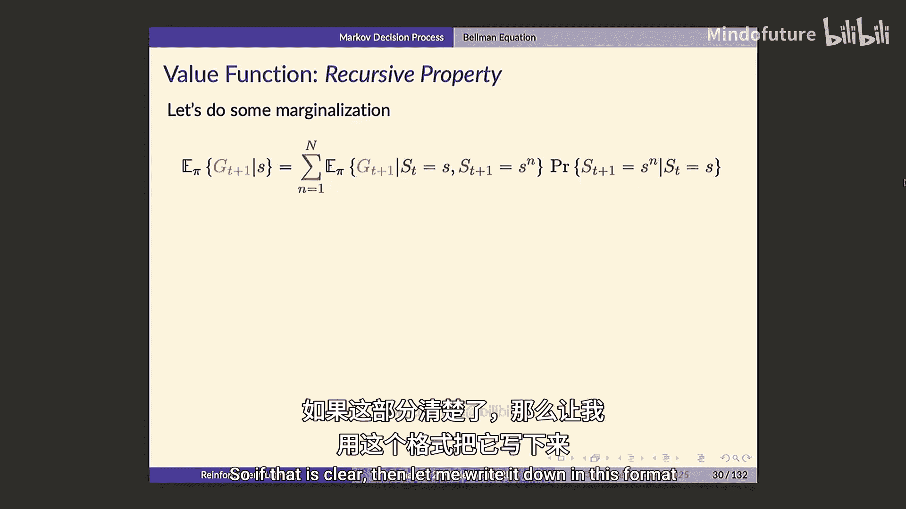

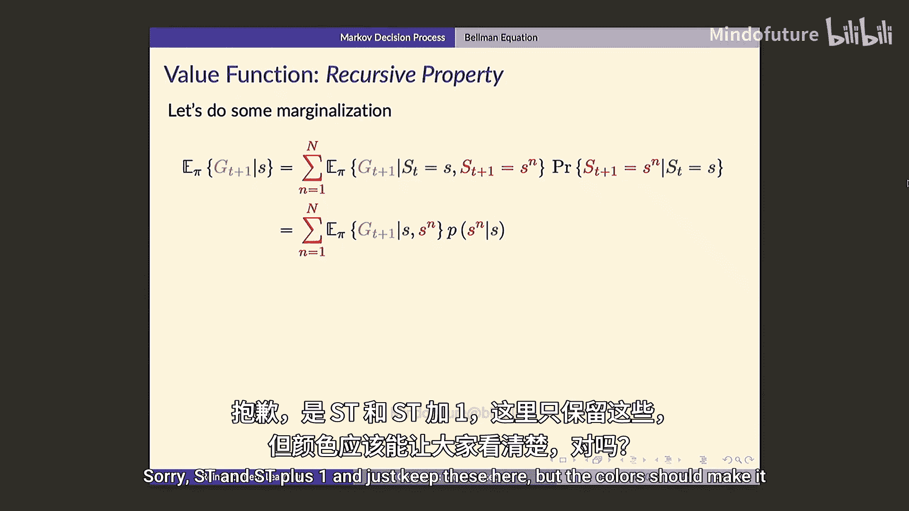

Okay， now I want to compute this one。 This means that I need to know the first term and the second term。

 right。Now， for the first term， anyone knows what is the first and what is this expectation of the return in time t plus 1。

 future return in time t plus 1， given that in time T I am in state S， in time St plus 1。

 I am in state SN，1 has a clue， yes。Any idea， yes。That's going to be the value function at which point？

St faster。Status and great。 Yeah， so this guy is a value function。 This one。

 Any idea how I can compute the second guy。😊，选学生包中。I just sum it over。Great。

Transition model and you need to average a summ of over actions right and the actions， again。

 you can describe it by your policy right They a distribution。 So we can compute these two guys。

 So let's compute these two guys。 for the first guy。 I am a time T in state S。 I do some action。

 you don't care， I just jump to the next time step and the next time step I'm gonna get to state S N and then I do some action and I keep on going right and I want to just find out what is the expected future return right And if you want to just compute that one。

 the key point here is that you don't care anymore more about previous time right because in the this is a markov chain and MDP is just explain with the last guy in the chain right So what I can say I can say the expectation of the future return is going given that the state at time T is S state at time t plus1 is S N。

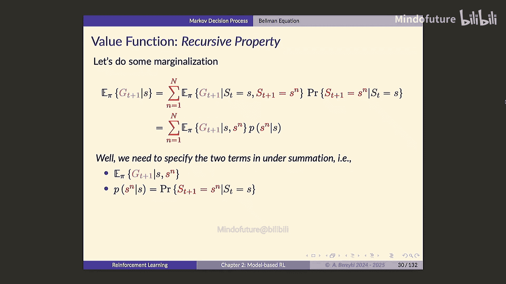

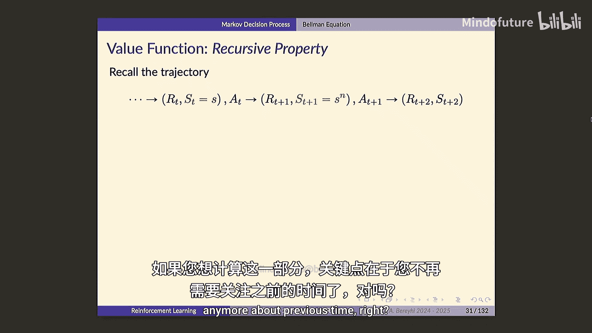

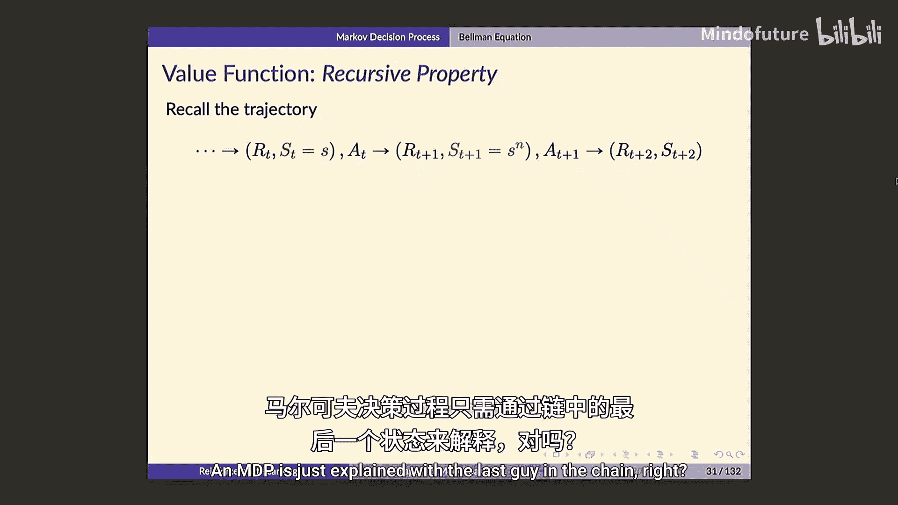

Is eventually this term， right， so I can get rid of the time T。 I already know time T plus1， right。

You know time 2 plus1 no。Chain。Everybody's clear， everybody agrees on that。😊。

And now this other term this right hand side that you see， this guy is again。😊，Value function。

Only difference is that is computed at the particular point S N， right？거。是啊。

This guy is the value function at S N， right， given that you are playing with your policy。Questions。

No question。So quickification。 So the value function is also。Time independent， right。

 because you assume it's time independent。 exactly。 depends on the state， not Yes， stay environment。

 environment and your policy， right， right。That's correct。Questions。No question。

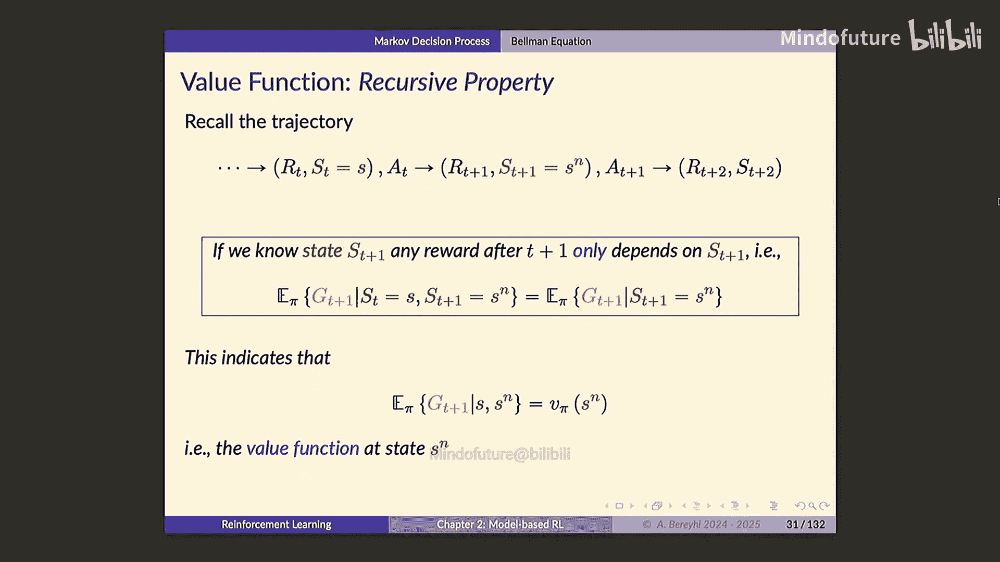

Okay。So that guy is now the other thing that we wanted to know is the distribution of the next state given or current state。

 well you can always do it by doing marginalization right if I do know the distribution of as an and the action given state。

 then when I sum it up over all the possible actions。

 then this is going to give me the distribution that I want right。And how can I write down this guy。

 Can you help me writing it down。So I'm going to use main rule what should be the first term？

I write it down， you tell me if you agree or not。I write it down in this form。

The probabilityvol of my action， given the state that I am in times probabilityvolty of the next estate。

 given the action in state that I am in。 everybody's school， this is just chain rule， right。

So I started this chain rule by the red term， then times the probability of the yellow term。

 given whatever had been used before， right， the green and red term， right？Everybody clear？Questions。

Okay， what is the first guy， this P？😡，This is the policy， right pi。

 this is the probability of doing one action， given that you are in one particular state， right？😡。

What about the second one？There is the transition given by。Environment describes an MDP。

 MDP going to tell you what is the probability of the next state。

 given the current state and the action that you do right so you can replace these two by using your policy and your MDP and that's it right。

 you have it。Everybody's clear。Now， one thing that I'm going to do， I am going to put a pie here。

 you see here。😡，And the reason that I put the pi here is because this expression。

 like the probabilityty of the next state， given my current in state， that depends on my policy。

 right， you see it here in this expression， correct。Right， so and it makes sense。 I mean。

 if Im in this particular state， what is the probability of the nextus state。

 it depends on my policy。 If I decide always go do that action that I'm gonna see always maybe one particular state。

 right， If I decide to just randomly do actions， I might see a randomly different state， right。

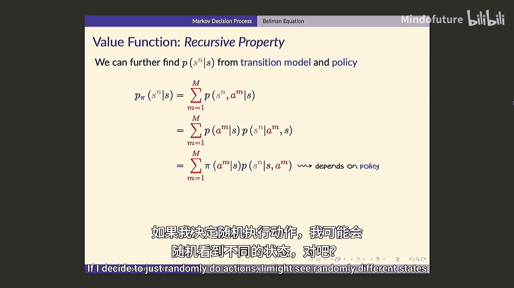

Every is clear。 So that guy depends on the policy， and I can keep that pie here。

 but this is going to again disappear very soon。 So no worries about。Questions。No question。

 everybody's clear。Great， so if you can have no question now we now have both the transition distribution and also the the other term that we had。

 So we can just replace it here。 And what you're gonna have is that your expectation of G T plus one。

 given the current state that you are in is written in this form， right。

 This is going to be the value function at the next state。😊。

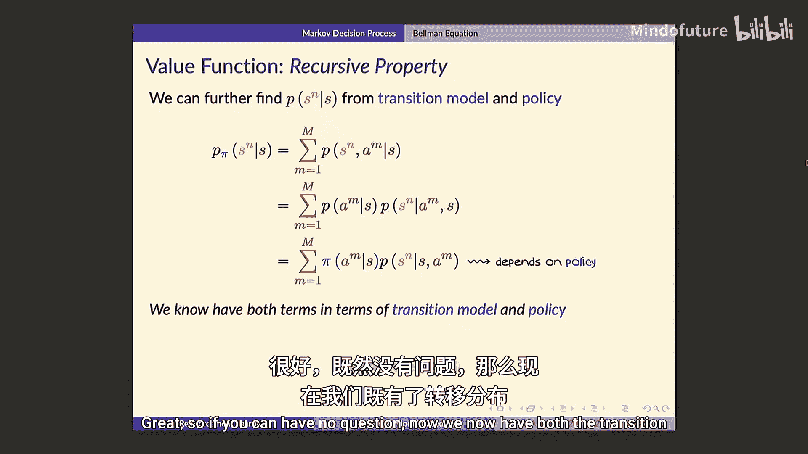

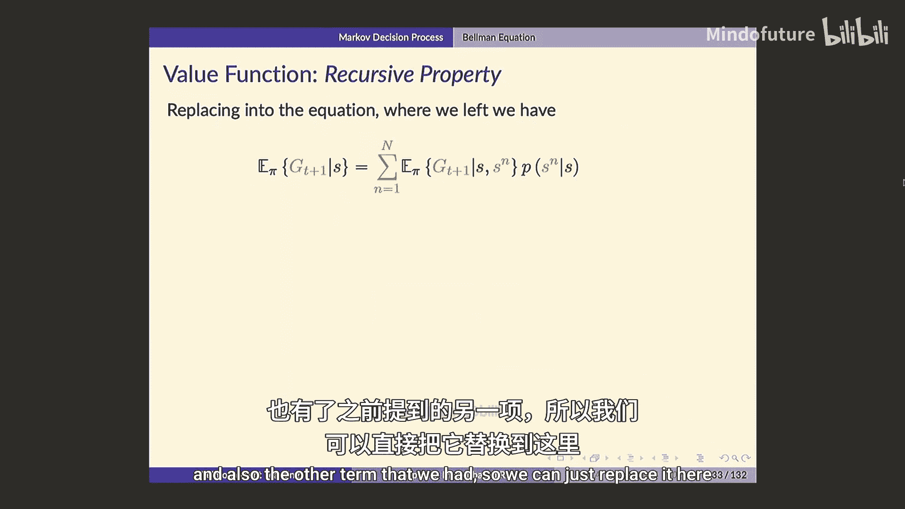

Time the probability of going to the nextus stage， right。Everybody's clear。

AndNow I can of course replace it in this form， I mean I have done nothing but just replacing this P pie in terms of the transition and the policy。

 and this is going to be a much longer version of the same equation。

 but we can actually write this down， much easier so okay。

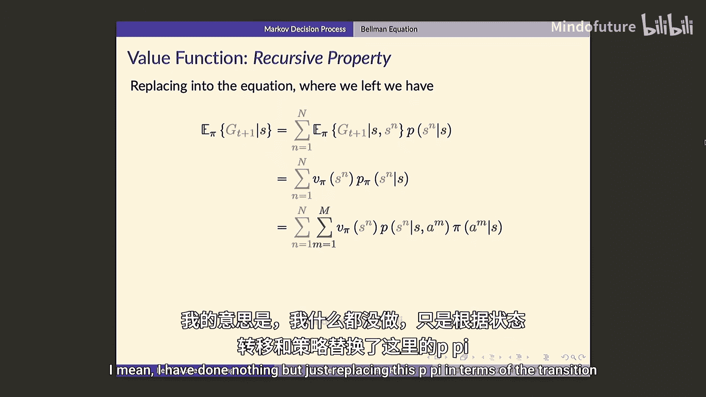

Say I have walk function。Say I have one function， function F。Of S born and S boring is my next state。

 okay。And I want。 So S4 is is eventually S T plus  one， right。

 The state that I'm gonna be in time S T plus1。 If I want to take the expectation of this guy。

 given that at time T， I'm going to state S。How can I write this now？So this is a function， right？

 You want to take the expectation of a function with respect to this random variable。

 Well what do you do， You're gonna to write down the function of S T plus1。

 you're gonna put S plus one to be one of the possible outcomes。 sayy S and， right。

 And then you multiply it with the distribution of that the probabilityvol of that particular outcome。

 right， the probability that S okay， maybe I take it a bit up。 sorry， that's here。 Okay， that's good。

The par allty that。St plus one equals to S N， right。

 And then you're going to add it up over all possible cases。 Everybody agrees。

Everybody agrees on there。 Okay， now I want to take the expectation。

 given that my state at time T is S。 what should I do if I want to what what change should I do here。

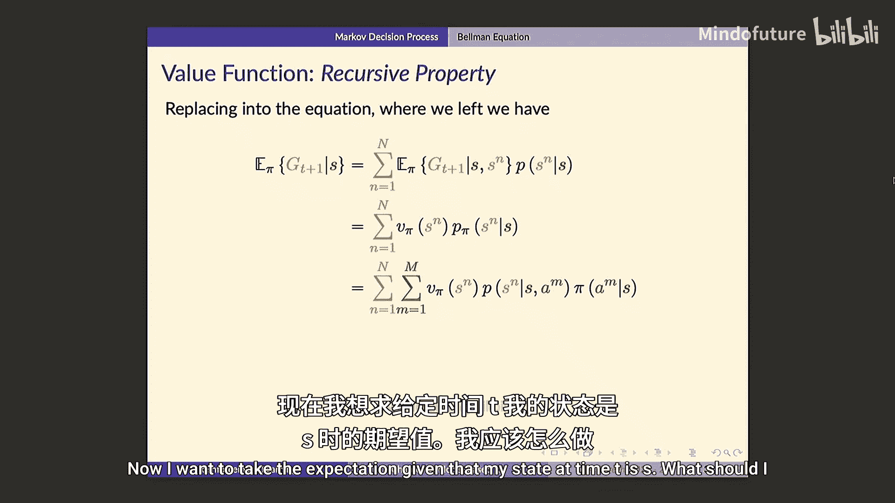

This is for the case when I don't have this guy， right， If I have this guy， what should I do。

Add a condition here， right， so I'm going to add a condition。Here， right。Everybody agrees。

This is the expected value of this function， right？Now。

 if I replace this function here with my value function， V pi。What should I do。

 What should I change here？I replace F only with V pi， right。

Do you see this expression in this slide？Yes。😊，The second line， right？

So you are computing the value at every single possible state and then you multiply it with the probability of going to that state。

 given that you are in your current state right and then you add this up right everybody is clear。

So that guy is eventually this one， right？😊，The expectation of your value function at the next state。

 given that you are in the state S。Everybody agrees。Yes or no。

Is it because of the lecture time or is it some personal issue that you're not responding？

Because in the morning， people are more responsive。So do you agree with me on that。

 Is it clear So this is eventually if you want， if you expand this。

 you're going to have the second line right， and you can compactly represent it in this form。

 So this means that the expected future return is eventually the expected value function。

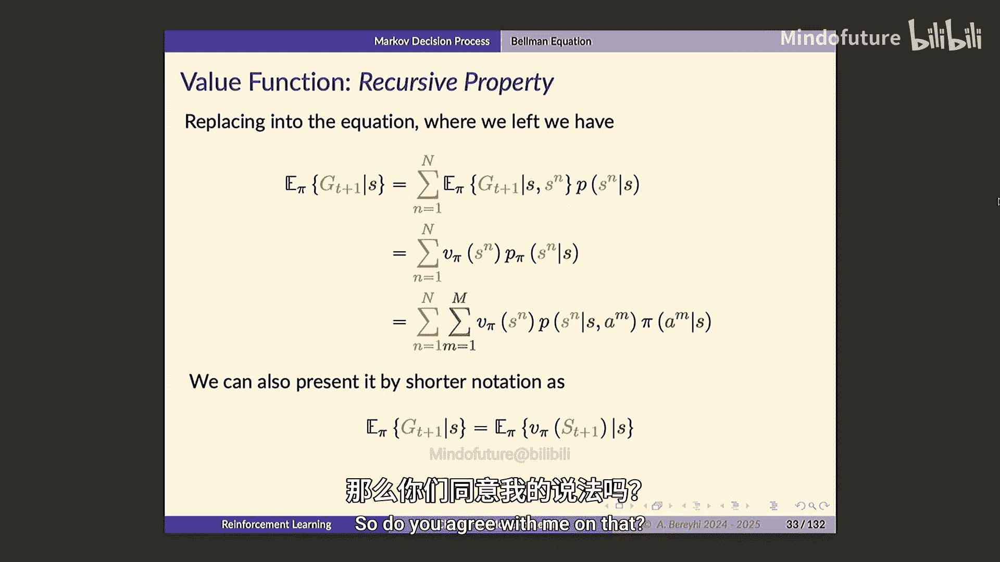

When you think about the next state right when you are in this particular state。

 you don't know what is the next state right， but since you have your MDP and your policy。

 you can find what is the chance of every single neexus state right So given that you know this distribution that is P of the next estate given my current state。

 you're gonna say okay， let's say that I went to the first estate right what is the value there So you put it in the value function What if I go to the second state then the value is this guy and so on till all possible states right and then you average it this is going to be what you are looking for right？

Questions。Everybody is clear。Now question。Okay， so if you got no question。

 then let me just replace it in the recursive form that we found。

We started with writing this guy down right and then when we wrote it down。

 we had this term and the second term， and what should I put instead of the second term now？

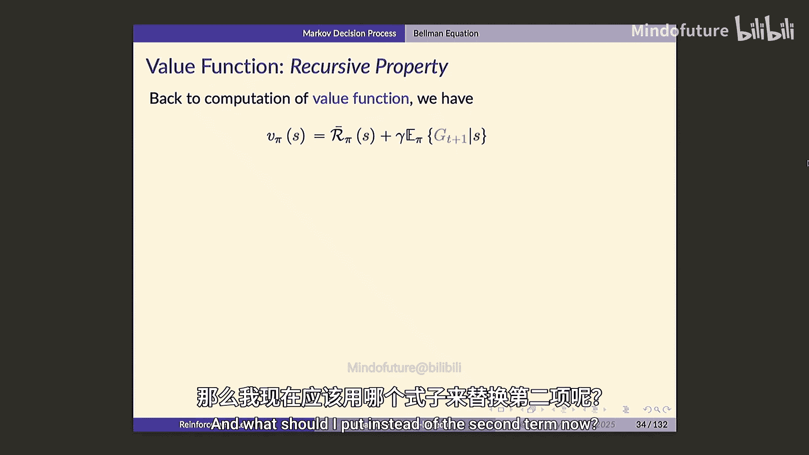

I should put this guy， right？Yes。So the expectation of the next future reward is going to be the expectation of the value function in the next state right and if you do that。

 then you're going to end up with this expression， so this one right？

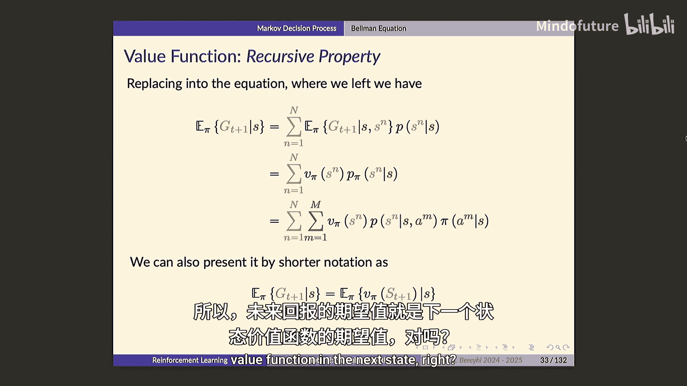

And I can always expand it， right， I can write down that expectation of the next estate in terms of the parvalty。

 right？Everybody's cool。So now， if you had。What I was doing， that's okay。 Take it from this point on。

 Okay， let's say that this equation is correct。 Okay。

 I try to make show you that this equation is correct。 But if you don't see it right now。

 you can take your time later to check how this is correct。 Let's say that this equation is correct。

 Okay， now this equation is what we call it the beman equation。Okay， and you might say。

The key point about the Belman equation， I'm going to explain it shortly。

How we ended up with this recursive equation that you have the value function in one particular state S related to the value of function at the different states。

 But if you don't see it immediately， that's okay。 you can take more time at home to just recap this but take this from my side。

 So the value function at any state is related to the other values in this form。 Okay。

 this equation is correct。

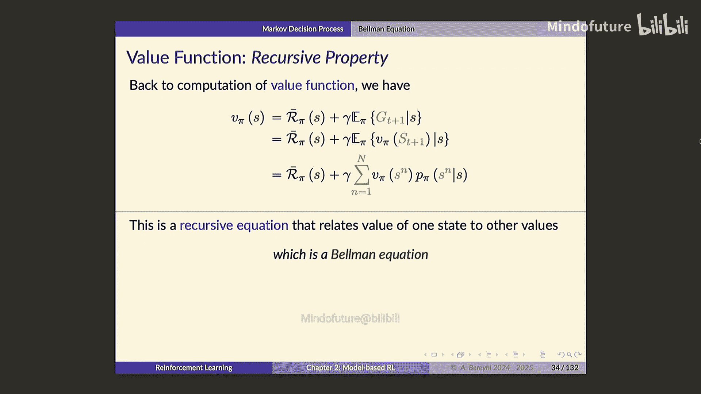

And this is what we call it the Belman equation。Okay， okay， so that is the beman equation。

 So the Belman equation， what it's doing is just looking in one particular state， right。

 So you have multiple possible states。 and then you're at one particular state。 What does it say。

 it says that if you do know the value of all states。

 then the value of these estate should somehow satisfy this equation， right。

Let's say that somebody has already told you that for your particular policy that you are playing with。

 the value of every single state is something given， right。

 So somebody describes to you what is v pi S。 Okay， for every single state。

 Then if you want to make sure whether that is really a value function or not。

 Then this equation should be satisfied， right， It means that you cannot simply throw a function and this is a value function。

 right， So your function must satisfy this equation。

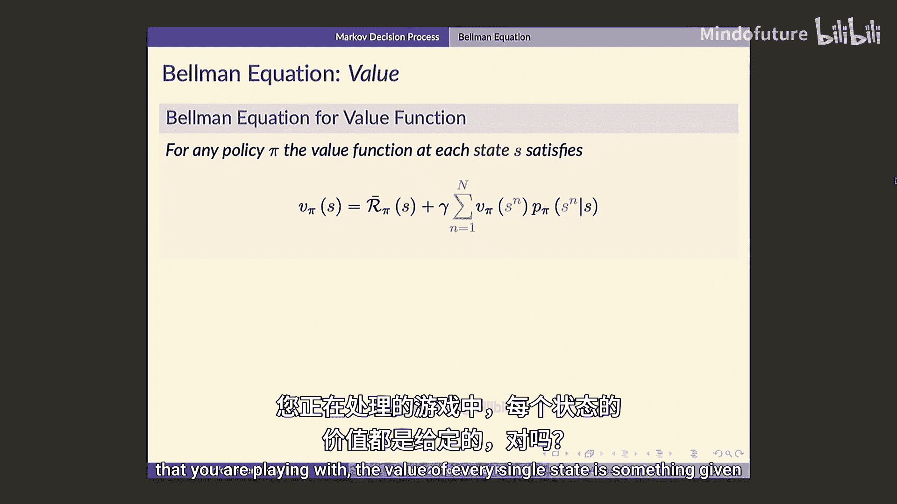

Everybody's clear。So。ThisThis particular equation going to describe a system of equations indeed。

 that are going to help you to。One particular policy without the need to go through all the expectation things that we had before。

 you might ask me how let's just break it down together。

 So let's say I am in one particular state and say I have in total and different state， right Now。

 what it says， it says that the value of that particular state S that I am in is related to the value of all other。

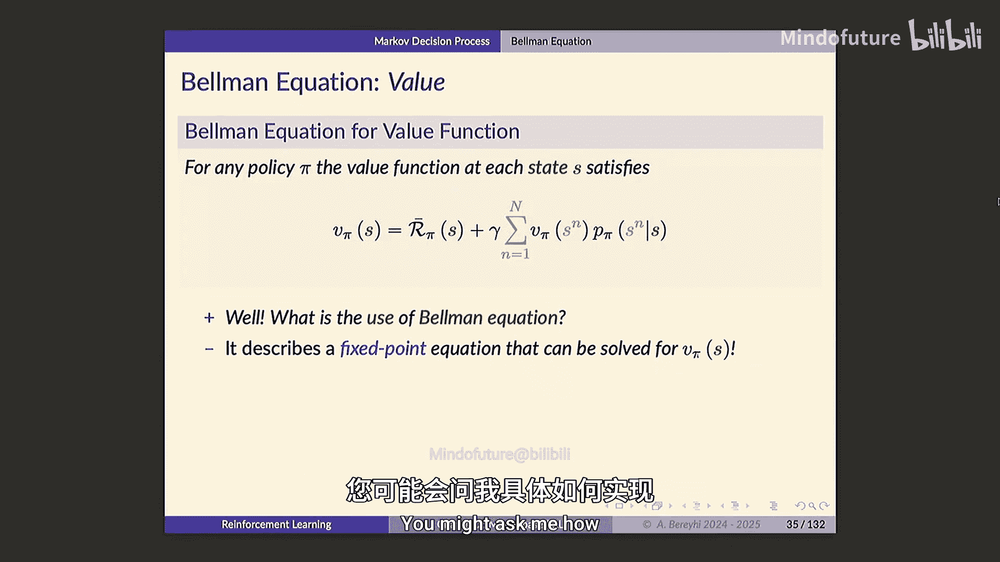

Using this equation， right？Right， so I had the value of a state S1 value of this state S2 and so on till value of a state S N。

 right。Now， if I look at one state， then I can use value of the other states to just confirm this state right so in general。

 if I have value of my policy at state S1 is till S N then I can treat them as a bunch of unknowns right and that I can write them in this equation right now I'm going to have。

 I mean， definitely this green S is going to be one of those estates right and for any state S that I put here。

 I'm going to have one equation right that equation， how many unknowns does it have。

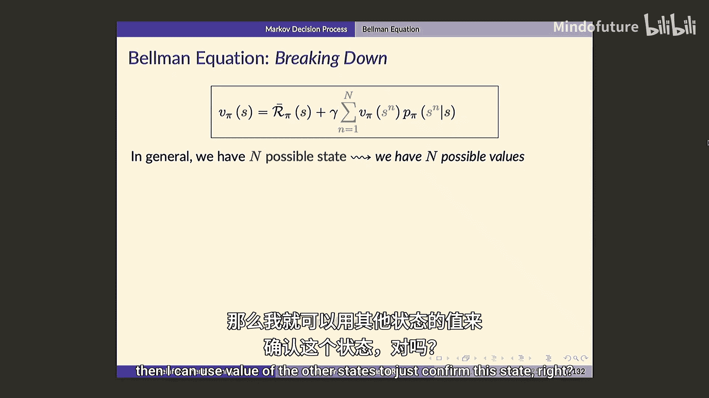

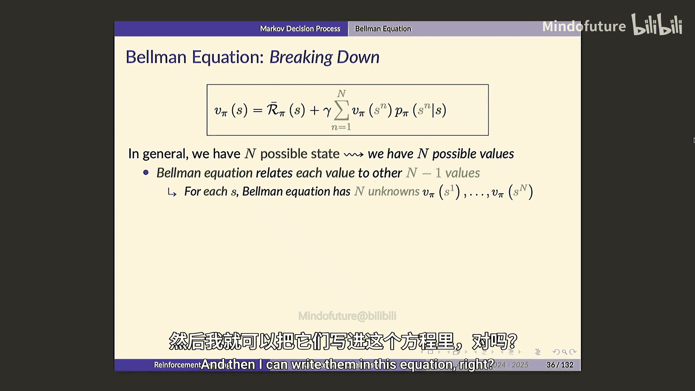

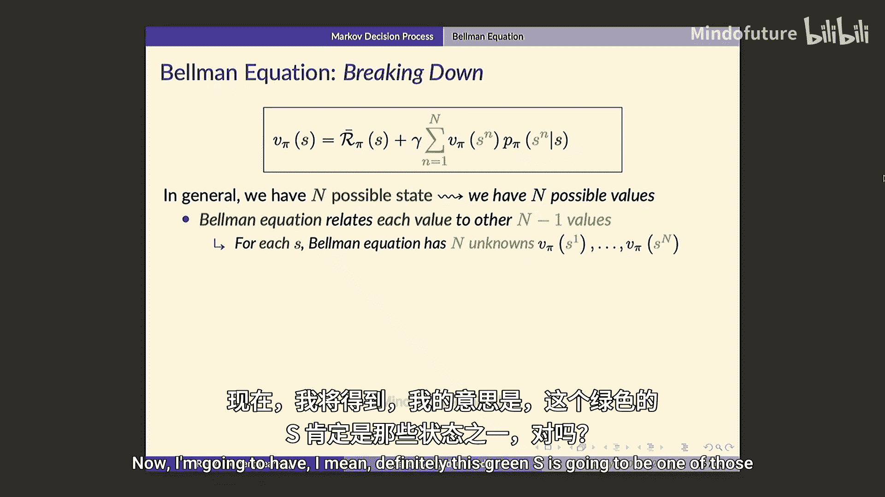

I'm going to solve an example， but try hard to see it right now。

 Then the example going to make it more clear。Say that。You don't know the value function， right。

You don't know the value function。 How many possible cases the value function could have。

 It could be v pi at a status 1。 V pi at a status2 until v pi is still state S N， right。

 So your value function could have n different values at n different states， right Now。

 if I just choose one of the states， then I can check the value of that state using this equation。

 right。Right， now， if I write down that equation， how many unknowns are inside this this equation。

Yes。就也行在美诺华尔上。We know R。 I mean， you can compute R。It can be。Why two variables？

Point and time you have。You don't know the value， and you don't know。Yes， but just check it here。

 you are summing up over all possible estates， right？😡，No， it's not one of those ends。

 You don't know which one it is。 Just look at the equation only。So say， I have 10 different。States。啊。

Or not even 1 say I have four different states， right？If I have four different states。

 it means that I could have S1， S2， S3， S 4， right？These are possible estates。

 I am not out of these estates， right， I am in one of them， right。

 now I choose this guy and I want to write down the Belman equation for that one。 How can I write it。

 I'm going say that V pi。 This is the value of my policy at a state S1。 It equals to。

 Can you help me complete this equation based on that。It's going to be the immediate reward at。

S1 plus， what is L？Don't try hard to just fool me because I'm not going to leave until you just explain this to me。

 so tell me what's going to be the next expression in this equation。What is it？Look at the summation。

 So there're gonna be a gamma。 And then I just opened the bracket。

 What is the first term in that summation。Please。V pi and。Yhy2。And it starts from。One， what is it？

Times。P派F。S1 given。S1。What is the next term？Times。S 2。So this is going to。Go on， right。

 So let me finish this。 So what is the next term。V pi is3 times。It's not enough only one of you。

 Everybody。 last one， V pi。Times。Okay， so this is the first equation， right？ Now， in this equation。

 let me see if we are lucky today。 No， we don't have any color。 Okay， it's fine。 So now this guy。

 this is the immediate reward。 You can compute it。 I'm going do it。 We did it last time。

 I'm going do it again。 So that one， you know， it's not unknown to you， right。😊，This guy。

 do you know it， V pi 1， Do you know it， You don't know it， right？ So this is unknown。

 What about this guy， Can you compute this。The pro of staying in your state S1。

 given that youre in state S1， can you do it？Yes or no。 Yes， because you know the MDP， right。

 This is gone， right， What about this guy， Do you know V pi2， No， what about this guy。Do you know it。

 the provata that you go to state S 2， given that youre in state1 and you're playing with policy pi。

 you know the policy， you know the MDP， you know this guy， right， What about this guy， V pi S3。

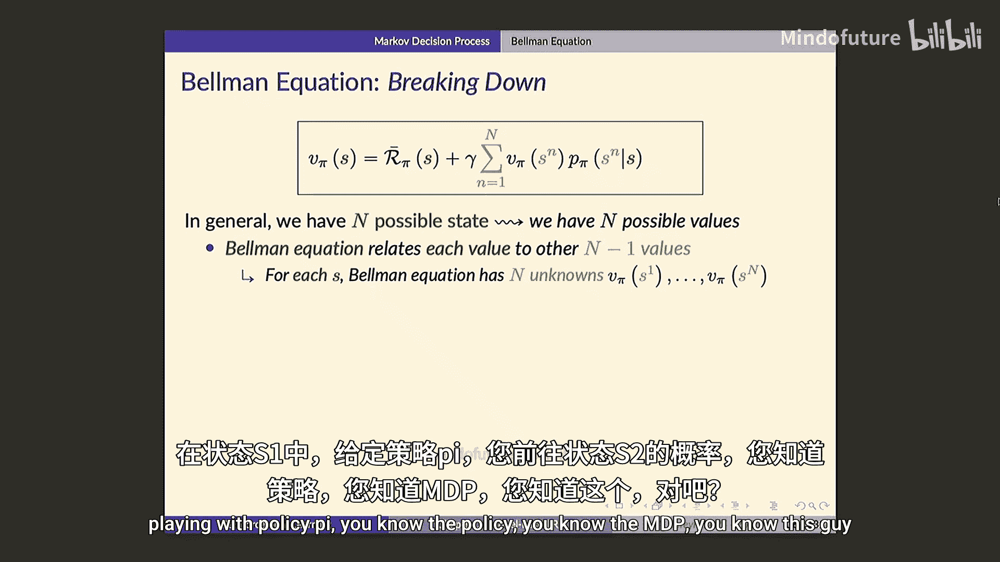

You don't know it。What about this guy？You know what， what about this guy？You don't know it。

 What about this guy， You know it。 Now， how many unknowns do you have here in this equation。

F right now if you have a general case n， how many unknown you would have？😡，N。

 and this is one equation， right， how many of these equations you can write？😡。

N right in this example4， right， because I can ride this guy again。

 I can write the same thing for S2， S3 and S4， right， Everybody's clear。You got it now， yes。

So this beman equation， if you write a down for every single n。

 then you're gonna have one equation in every single of those equations， you have n unknowns， right。

 So you have n unknowns。 You also have n equations， right？ You have。 these are your unknowns， right？

 And then you have。And equations as well。 And because of that， you have a system of equation。

 which is theoretically。Complete， right， So you can solve those anyway。Quations for the n unknowns。

 and then you end up knowing the value of every single state。Everybody's clear now。

So you see how this wellman equation is going to make you。Get rid of all of those expectations。Yes。

Questions。Now question， everybody is cool？😊。

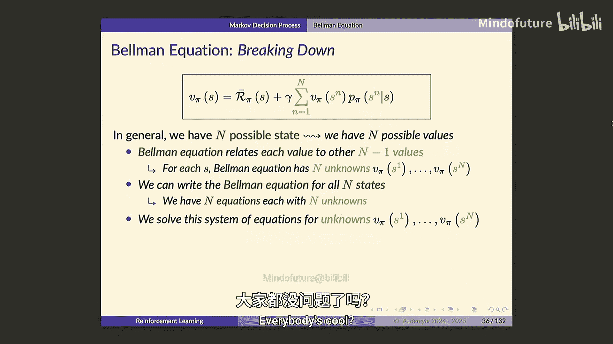

Great， so if you got that， let's try this for this dynamic grid world。 as we did before。 I mean。

 we computed the immediate reward here last time， and I'm gonna use that fact。

 And write down the equations to see whether I'm gonna end up with the values that we found out last time or not。

 Okay， before， before I saw， What is， don't look at the this slide。

 What is the immediate reward when you are in a state 0。 state 0 means top left。

 What is the immediate reward。😊。

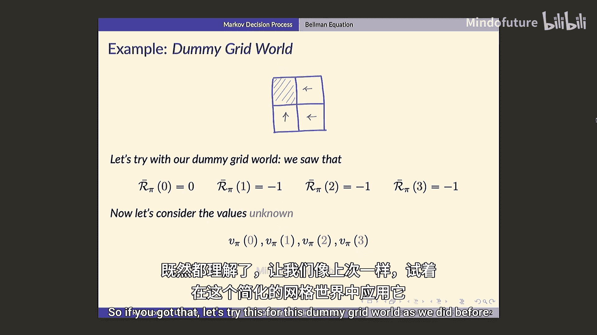

Zero right is a terminal state， you go to the terminal state you stay there right and no matter what you do。

 you're gonna always have reward0 right so the immediate reward here is0。

 this is why we have the first term right now look at this this diagram here。

 this is showing you the。The policy is the direction that is shown in the diagram Now。

 looking at this one， what is the immediate reward that you get when you play with this policy in a state one and state one is the top right one。

 What is it。

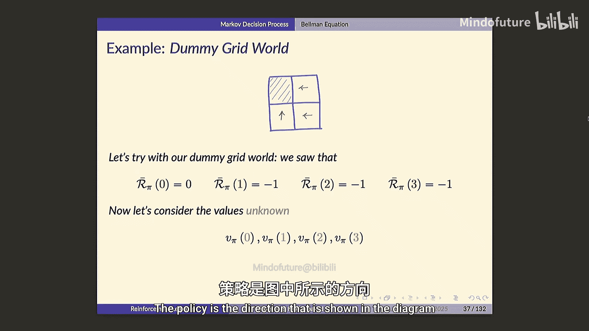

It's -1， right， because when I， when I am at this particular stage 1。

 I'm going to move one and step left， right And each time that I move one step。

 I'm going to get reward -1 So。A given this policy is going to be minus1， right？

What about these other two estates， What is the immediate reward in them？

Its again minus-1 in any of these when I move based on this policy I'm going to take to another get to another cell and because of that I get the immediate reward minus1 right so that makes sense to you that immediate reward the average given the policy is 0 minus1 minus1 minus1 right？

😡，Cl， if I change my policy， this is going to change right， for instance。

 if I make my policy at this particular top right cell to just move to right instead of left。

 what gonna be the average reward immediate one， go ahead。😡，us half exactly。

 is' gonna be minus half because it's gonna hit the wall right？ So I change the policy。

 The immediate reward is going to change。 Everybody's cool。 So。

 this is the immediate reward that I'm going to get in the particular state。

 each estate when I am playing with this policy pi。 Now。

 the thing is that I want to use only this fact plus the fact that I don't know this values。

 and I've use the beman equation to find the values。

 Okay let's go ahead and write down the the beman equation for every single state。

 So let me start with a state 0。 So if I want to write it down for state0。

 it's gonna be the average reward。😊。

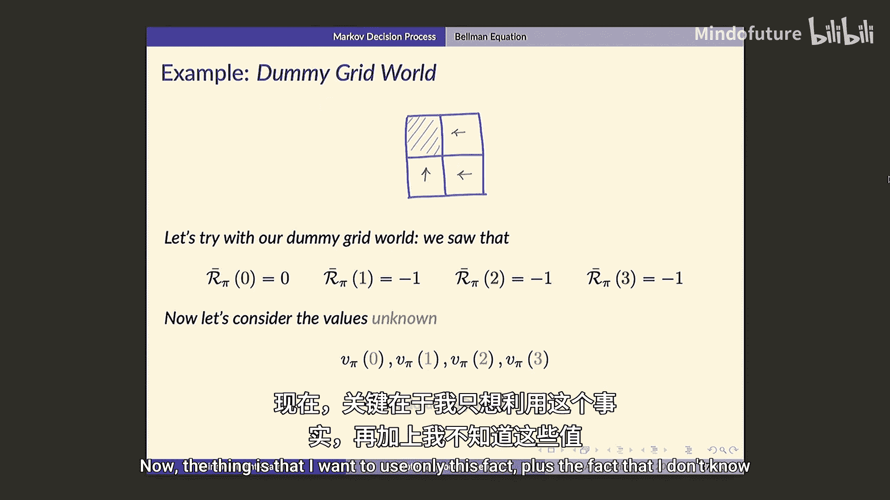

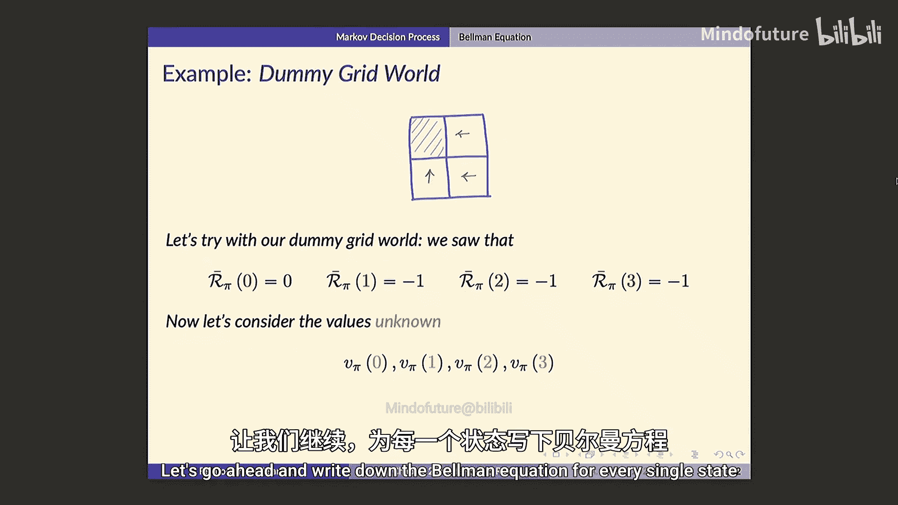

In state 0， when I play with my policy， plus the value of every other state。 So state 0，1，2，3。

 all the states in this， in this setting， right， The value of all of them times the probabilityllty that I just。

Transit from my current state 0 to the state。Everybody's clear。Now， when I am in state zero。

 what is the chance that I remain in state zero？😡，One， right， state 0 is the terminal state， right。

 When I am in that estate， I'm going remain in that estate forever， right？ So the parval is one。

 What is the par that I go to any other state。0， right， So I'm not going to leave that estate。

 So I can simply say that this guy， this is going to be one when the next state S4 is 0。

 it's going be 0 anywhere else， right？ So if S4 is 0。The provolti is 1。

 I'm always remaining in my state 0， so I was in a state 0。

 and I'm going to remain in this state0 with Provol to 1 and for any other future state。

 I have the Provolti zero right， Everybody's cool。You see it？Right， now。

 if I use this guy to write to just simplify this sum， what' gonna to remain in this sum。

Go ahead and say it， Yeah， Go ahead。そさ。So it's going to be one times the value function that is far equal by0 and it's zero for any other。

So this submission going to get left with only one term right， and that term is V of。😡，Z， right。

 we off pi at a state zero。 Everybody's seeing that。 So this guy is going to be v pi at 00。

 If you don't see it， I can write it down again。😡，So look at this guy。

 we said this one is this one is 1， this guy is 0， this guy is0。

 this guy is 0 right so these terms in the summation going to disappear only this one remains right and S1 for you is0 right。

😡，So the outcome going to be zero， right？So， yeah， sorry， V of as V of pi at 0。Everybody's clear。

Okay so this is going to be the equation， one point I have just put Gamma。

 the discount factor to be one because I want to keep it simple，😡，A I cool。 Okay， now。

 looking at this equation， this is an obvious equation， right。😊，V at state 0 equals by v at state0。

 obvious， right。It's not contradicting， but it's not giving any information， right。Everybody's cool。

 Now let's go for the next estate， The next thing that I'm going to do。

 I'm going to put my estate to be1 right， if I put my estate to be1。

 then I again write down the Belman equation， right。

Value it is state1 equals by immediate reward in state1 plus dis sumation， right？Now， first of all。

 what is the immediate value， the average immediate value for this policy as state 1。us1。

 you are at this estate， when you act with this policy， you're going to move left。

 so you're going to have immediate reward minus1， right？So that first term is -1。

 We now need to compute the summation。 What is the say you are playing with this policy。

 What is your what is the party that。You end up with a state zero when you are at the state one。

What is it， one， when you are as a state one and you play with this policy。

 you're definitely going to go to a state zero， right？😡，Everybody's clear。

What is the probability that you remain in state1？0ero， what is the probability value。2。Stay three。

 you're not going anywhere else you're just going to the terminal state right so you can again say that the par with this policy that you are seeing here。

 the par that I transit to a newest state when this newest estate is zero the proal is1 when this new estate is not zero the pro is zero everybody sees that。

😡。

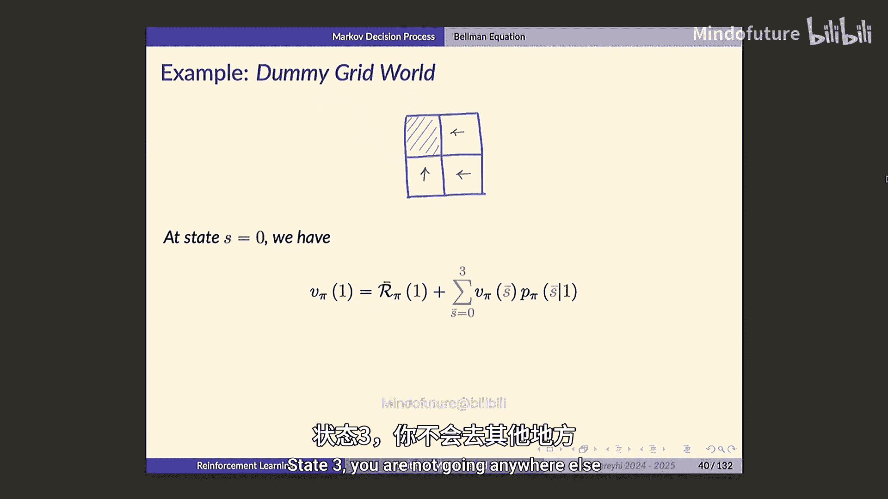

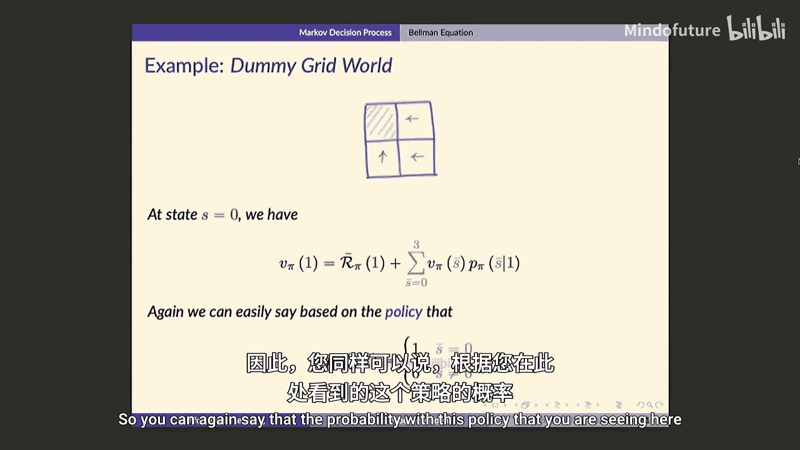

Questions？No question， now if you got no question， what's going to be this term then？

0 right so this whole summation again going to be v pi0 right。

 which means that the value of your policy at a state1 at this estate going to be the value of your policy at a state 0 plus minus1 right does it make sense to you if you just forget about beman。

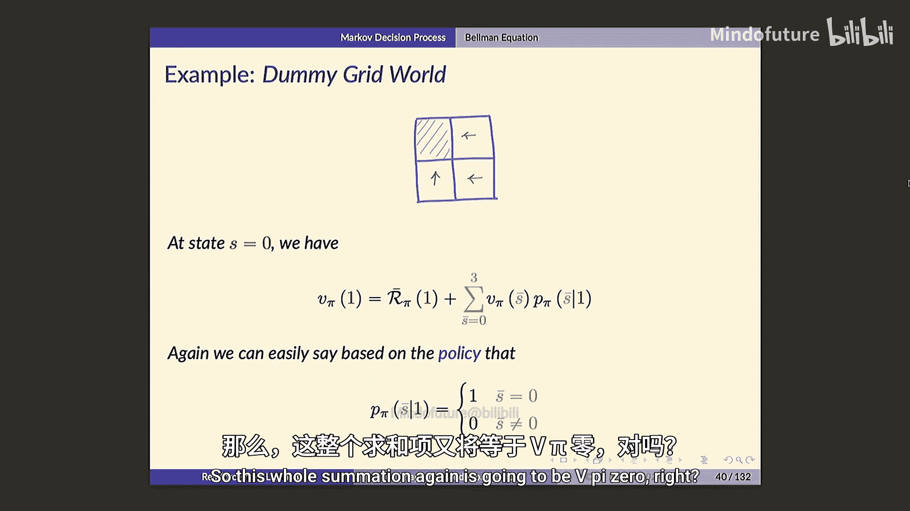

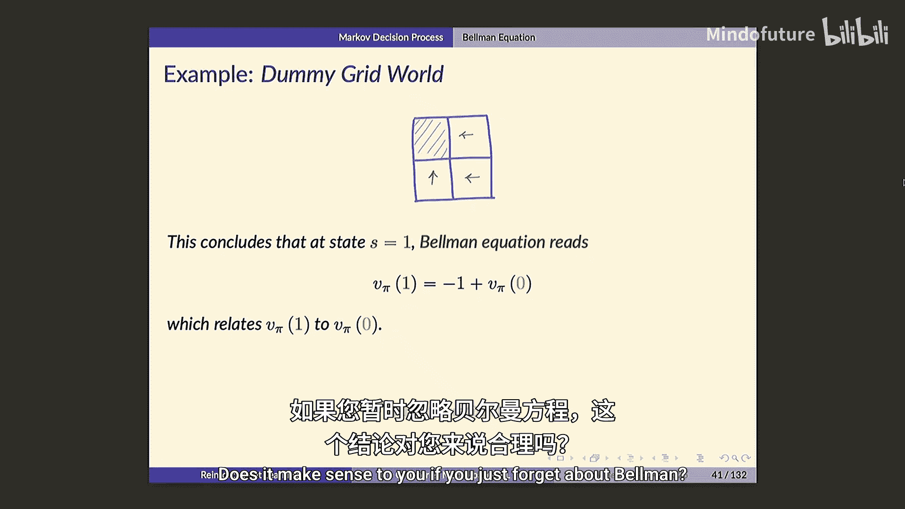

Yes， because with this deterministic policy you definitely know what you're going collect next right and when you play with this guy。

 you would say okay， the value that I am here， the value that I'm going to collect of this estate is going to be exactly the value that I collect in the next estate plus the reward that I get in my move right。

 I get minus1 I go to a state0 and whatever I collect from then on this is my value right。

 everybody's clear。😡。

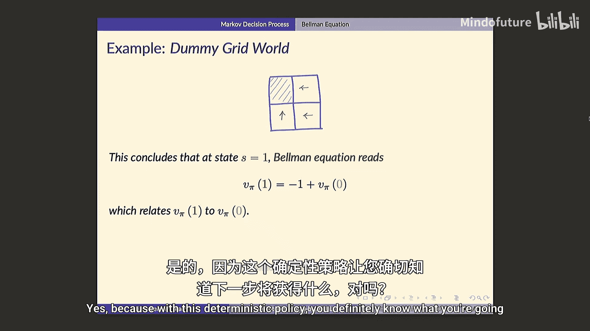

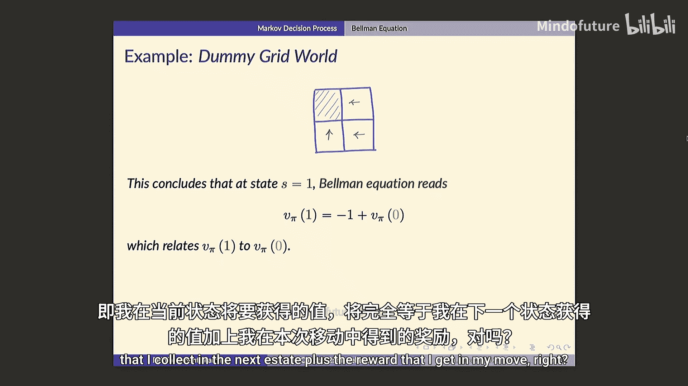

Now。Can you tell me what's gonna be the next spellman equation If you write it down for state 2。

Just look at this and intuitively， based on the。Based on the diagram。

 tell me what's going to be the value of your state 2。

Given other states that you have in this diagram。So I want to write down。

The value v pi at a state 2 and state 2 is the one on down left。 Okay， what gonna to be this guy。

 Can you tell me。inus1， this is your immediate warrant plus there are there could be a bunch of terms。

 but what should be here？😡，It's gonna be v pi at0， because when you play with this policy。

 you're gonna go in state 0。 And this is the value you， you just need to know that it's value， right。

 So it's gonna be value of pi at 00。 What about V pi and state 3。 What is it。Go ahead。

 just say minus-1 plus。V pi is state 2 because when you are as stage3 to play with this policy。

 then youre going to go to state 2， so whatever the value at that point is plus that minus1 that you are collecting in your move is going to be your value right。

 everybody is clear you see it now。

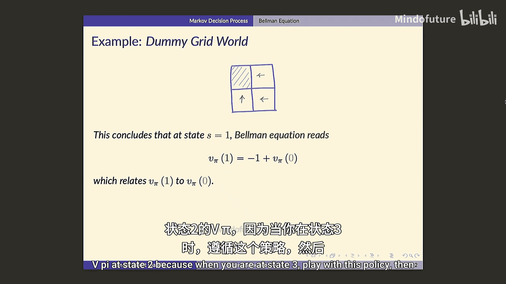

Perfect， so you can put these two guys also here， right。These are your your two other things， right。

 two other equations。 And now you have these three equations。

 The first equation I just dropped it because it says v pi at 00 equals by v pi at 00， right。

 which is obvious doesn't give you any information right？ Now you alert with these three equations。

 How many unknowns do we have。

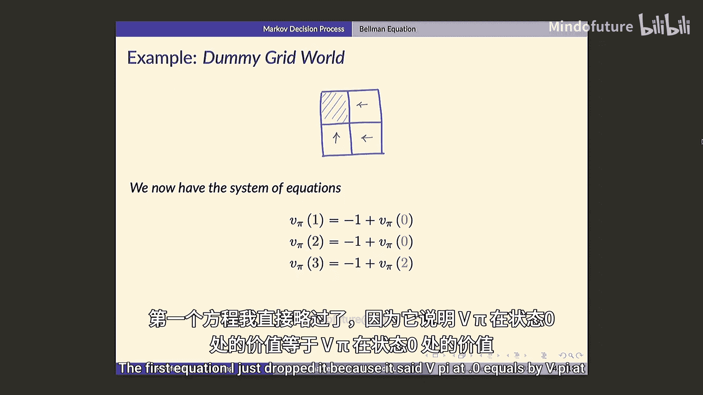

F， right， can I solve this？No， but do you know any extra information that are going to help you solve this？

😡，Terminal se， what is the value of the terminal state？

It's always zero right so you do know that the terminal state has value0 right that is the stage which gave you the noninformative equation right So you use the fact that a state 0 is a terminal state so the value is0 then you put value0 there its going to give you the value of every single other state right v1 state1 is going to be minus-1 for state 2 is minus-1 for a state 3 is。

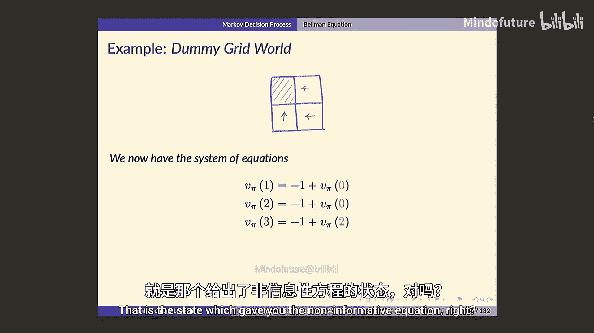

It is。inus2， right， So this is going to be the value function。

 and this is the one which we computed naively last time without using Bman equation。

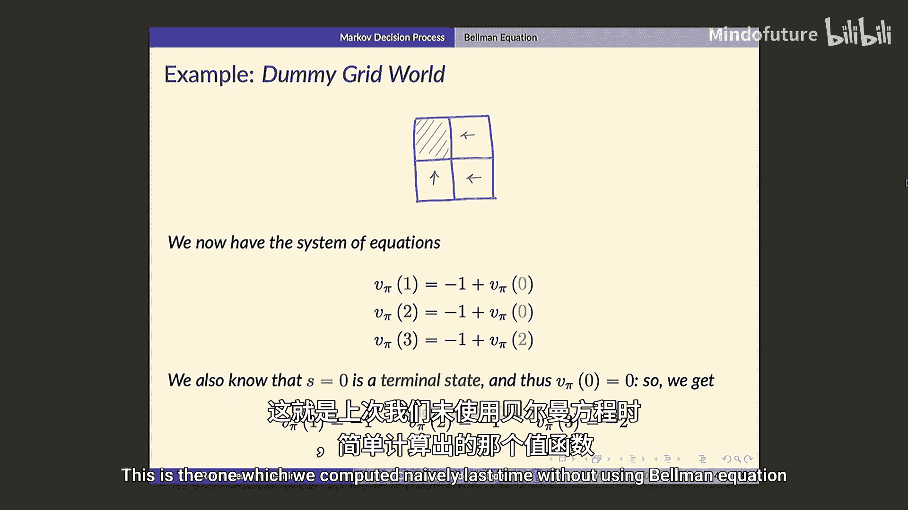