# 【多伦多大学】强化学习 2025 ｜ Uoft   Reinforcement Learning   Fall 2025 p17 P17_讲座_16_回溯最优策略 -BV1D3F2zhEry_p17-

The equationation that we have for one particular for this dummy grid world example now we see how we can use it to find the optimal values。

 We tried this guy before。 We do know what are the optimal values。

 Can you tell me what are the optimal values here。 So this states once again， top left is0。

 Then I go to right， This is one。 Then I come down left， It gonna be 2， And this guy is 3。

 What is the value of a state 0。

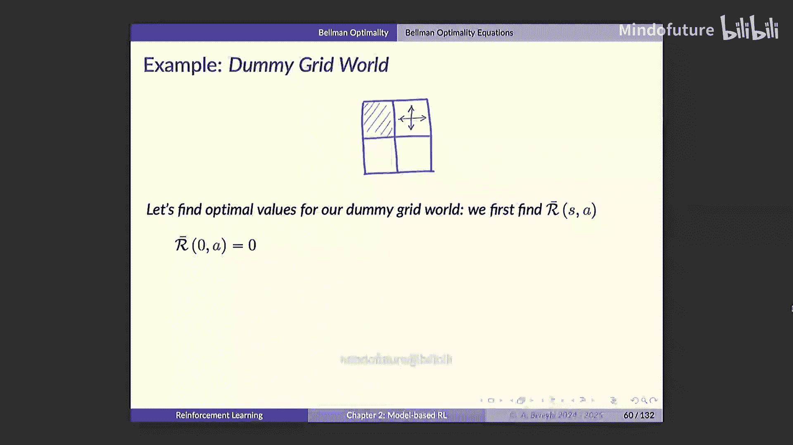

The optimal value for state 0。0， what is the optimal value for a state 1。-1 for state 2。

We're stay three。Min-2。 Okay， great。This is the optimal values that you do know。

 Now we want to see whether using the optimality equation。

 we're going to end over the same values or not， okay。Cool， so first of all。

 I am going to write down the average immediate reward for every single action and every single state。

 Okay say I mean state 0。😊，This means that I I here， if I do any action。

 I'm going to collect all the time reward0 because this is the terminal state， right。

 So the immediate reward is going to always be0 there。 This average one is also0， right。OK。Now。

 let's go for the next one。 say I'm in state 1。Do action not going to be the immediate reward。Sorry。

 I' mean in state 1， I do action 0。 I go to left。-1。 What if I go。What if I go right。

So this is the set of immediate rewards that I'm going to get， right， And there is no random。

Do not need to take any expectation anymore， right？ So the M DP here is deterministic。

 So when I want to move left， I'm gonna go left， right。

 There is no randomness that I might just end up right， right， vice clear， right。

 So here these are the mediator what that I'm gonna get at1， I go left-1 down-1。

 the other two directions。O。Of the nextus state， say， state 2。 How does it look like。

Can you tell me in the same order。Left is。Minus half for， for down。For the other two directions。-1。

 right？ So this is going to be this one， right， So if you go down。

 you're gonna hit the wall minus half。 If you go right or up， you're going get。But the last guy。

So if I go left， I'm gonna have -1。 If I go right or down， I'm gonna get half。 if I go up again。

 I'm gonna get。I do have the immediate reward or the expected immediate reward for every single。

Stays and right， So this first term that I have written here， you can think of it as4， right。

Because this is for N A。 So it means 0，1，2，3， right， Now I have 4 by 4。 I have。

D what is the average immediate reward， right？ Okay， cool， So that's this。

 And then now what I want to do， I want to use the beman equation。als， right。叫。First of all， for。

 for this estate， we talked about this in in the same example when we wanted to just evaluate。

We talked about it before。Easier if we immediately from very beginning， we just say， okay。

 the value here are gonna be 0， right。We do know that by default， this is0。

 So it's going to make life easier。 And then we're going to start with with state1。

 right Now if I want to just compute or write down the equation for state 1。

 the thing that I need to do， I need to know the distribution。Or the provolty of the。Next state。

 right。Given my parents to stay and the actions do， right。And I do need this for every single action。

 right？ So let's start with the first pair。 say I have one and 0。 So it means that I'm in state 1。

 and I'm doing action 0。 I'm going。The probability of the next estate being zero。One。

 the other this state is happening with provolti0， right？Rise school。 Okay， so if I do that， no， I。

 I can calculate this term。 This term is the second term in the Belmon optimalityality equation。

 So this is this guy。 So let me just get back here。 This guy， right， You see it。

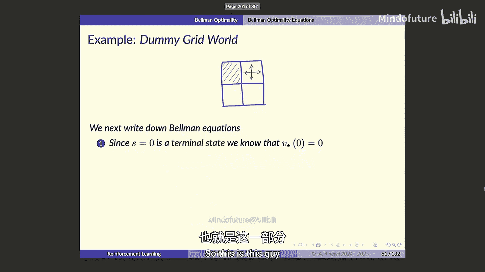

This term。So I need to know the distribution of the next estate。

 given my care and the estate and the particular action and that I need to average my next value over that。

 right。Everybody's school。Everybody sees that， what I'm doing。And I need to compute this guy。

 as well as this guy for every possible。E possible。

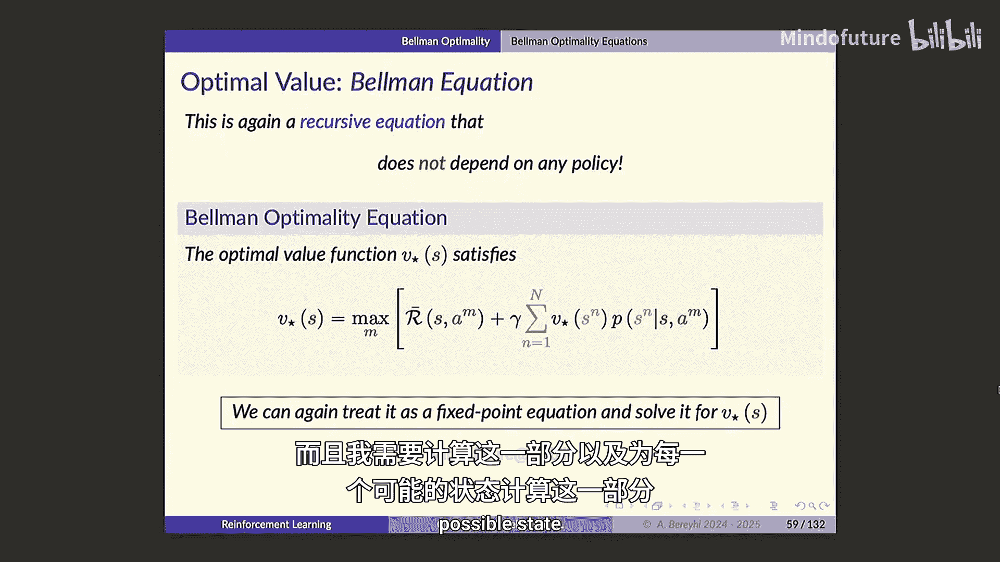

Very cool， right。Okay， let's go。 So， yeah， this is the first term， right。

 So I'm going to put this value function here。At any next state and multiplied it with the corresponding probability。

 doing that， What term gonna remain， Okay， these terms， these three terms gonna replace 0 here。

 So they are not going to show up。 The only term that is going to show up is the。For that one。

 the nextx estate is。0， right。 So it's fear that I write it down the next estate， right。狗。So。

 let's go for the next。Okay， the next case is that I'm still in the same state。

 I know consider the next action， right。For the next action， if I do action 1。

 action 1 means that I'm go down， right， If I go down， what gonna be my state then the next estate。

I'm in state 1。 I go down。 I'm going to end up state。3，3， then a them with Pro all to1。

 Anyone else happening with T。And you can again， write down the sum。 This is going to be。Right。

You can keep on going like this for state for action 2， you're gonna have the same thing。

 If you do action 2， you're gonna hit the wall， you're gonna remain on your stage， right。

 So you're gonna remain in state 1 as before。 And then this sum is going to be value of this state1。

 right。Can you tell me what's gonna be the this sum When I do action 3， I go up。

If I am in this state， stageve 1， right， and I go up， what gonna be my next state。

It gonna be the same。 And then if I write down this sum， what's gonna come out。Its gonna be。

Value of Y 3。St if I just go on。The same state， right。1， I go up。 I hit the wall。Right， so the。

Remaining in state 1 is one。 the par of going。You write down the estimation。

 it' going be a gain value up。So same thing going to happen for the case where I have stayed。Right。

 so it's gonna be the same thing， right。

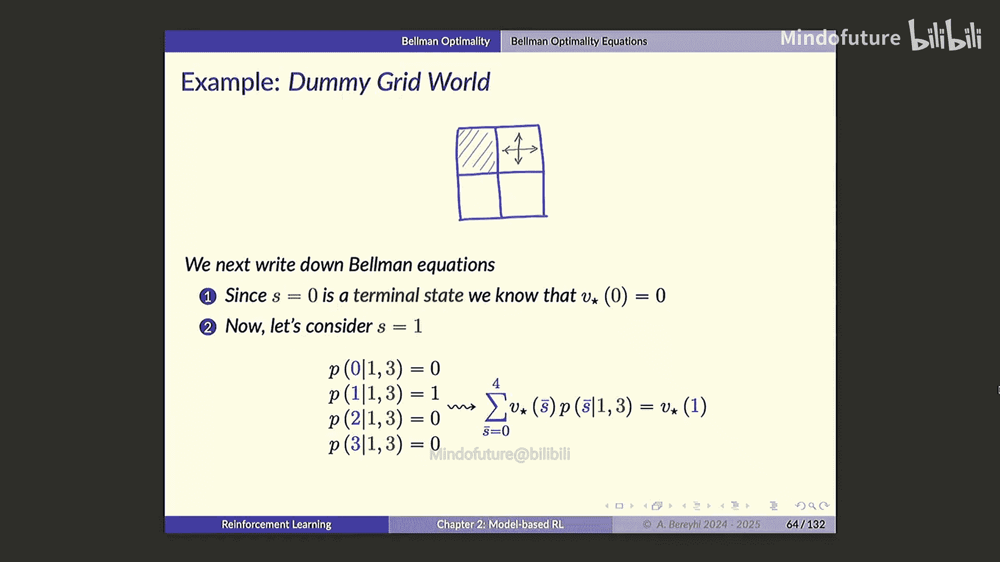

No， let me。If I want to know the optimal value of1， I can put it inside this equation。

 The optimal value of one state1 is going to be the maximum of these terms for different actions。

 right？ So I consider state to be1。In this equation。

 and then I am going to compute this guy for every single action。 And then I take the maximum。

 And we have done this already。 Okay， so the things that we had， we had -1。

When we do the action going left。We had this one， which is when we just go down have this one and this one。

 they are exactly the same。Be go up in the world。 We the same state。Like the same immediate reward。

 And the next estate is。Maxum these four different terms must equal the optimal value at01， right。

Everybody is clear。고。You can go ahead and do it for state 2 as well。 So you go again and stay 2。

 You see that now you're doing。To the first set of Belman equations。 is now we need to consider。

The guy， which is maximizing， right？ So again， you say that I'm。I look at the next estate。

 I average the value of the next estate and the immediate war。 I just find four different terms。

 I take them right， That guy equal。In state optimal value in state 2 and so on for stay 3， right。

 So for single of them you。With these equations。So， now， first of all， I mean， looking at this term。

 for example， you have minus half be star 1， minus half star 1。 I can just drop one of them， right。

Same thing happens here。 minus F V star 2， minus F V star 2 just here up one of them。

 And same thing here， right， These are the case where you hit ball right。The same day， nothing。

You can just drop that extra term always。 And then you're gonna end up with these three equations。

 right。

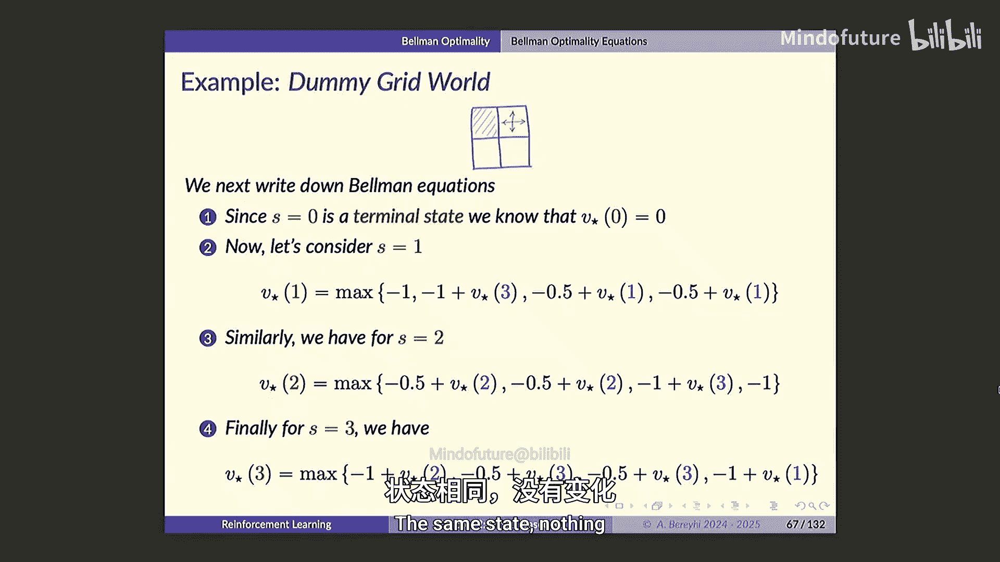

So these three equations are telling you the optimal value in state is related to the optimal value of the other states。

right。Are three different unknowns， right， The optimal value of state 1，2，3。

What about the optimal value of a state0。That's0， right， That's gone。 So we don't need it。

 So we only have three right， only three left。 And then they are related with three equations。

 Hopefully we can solve it。 But this is not a very trivial equation， right？

 This is not a linear system of equation that you simply solve it， right。But for this dum example。

 we can easily do it。 How can we do it， for instance。I can say that this first guy， whatever that is。

 cannot be this term。 It means that it cannot be the last term here， right， How can I say it。

 I could say， okay， say this， this maximum is exactly this last term。

 So this means the maximum is this。

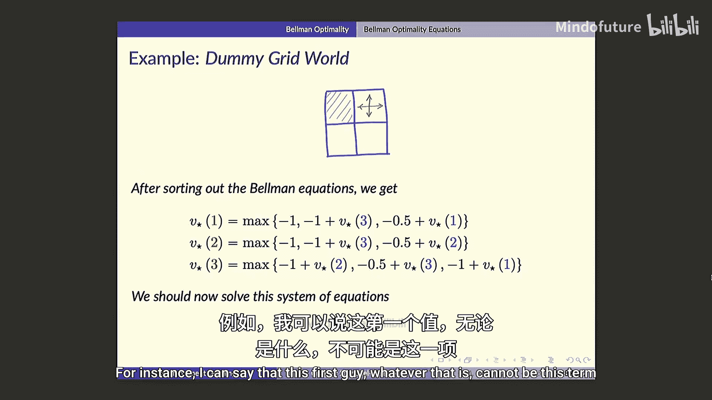

Now， when the maximum is this guy， I take this 1 I put in in the。Optimality equation， right。

 What does it say， say the value， optimal value at one is minus half plus。

This means that stories have is impossible， so。Going to drop one of the terms in the in the maximization。

 right， and you can repeat this idea over and over to just。

So you could say that same thing happens to the other two equations。 And after doing this。

 you're gonna to end up with these set of equations， right， So this simplified equation。

 you look at the first one and the second one。 They are exactly same， right。

What do you conclude out of the first two equations。The optimal value at one and2， whatever they are。

 they are the same， right， because they are written in the same form as the optimal value at 3。

 right。Clar。So you have the optimal value at one and two， they should be the same， right。

And then this is going to conclude for you that whatever this maximization is simply -1 plus。

And没 you get。im equation cannot be the second term。 And because。

Your optimal value at 1 and 2 should be -1。We do， just。Higher level picture。

 so we just wrote down all possible cases。We put them in the Belman optimal equation。

 We ended out with a set of equations。 We just played around with that set of equation。

 That is now a bit tricky， right， because it's not a simple linear equation。 But still。

 we were able to solve it， right？ And once we solved it， we found the optimal value。😊。

For this environment， right。Every school。Questions。Now， when I found this optimal value。

 did I try any policy， Did I need to know the policy。No。

 I didn't put any policy here consider all possible actions at every single state， right？

And then I found the optimal value， right， That's it。 I have the optimal value function。 Now。

 from this optimal value function， I can compute the optimal action value， right。The Belman equation。

 again， gives me the optimal action value。If I find the optimal action value， I eventually have the。

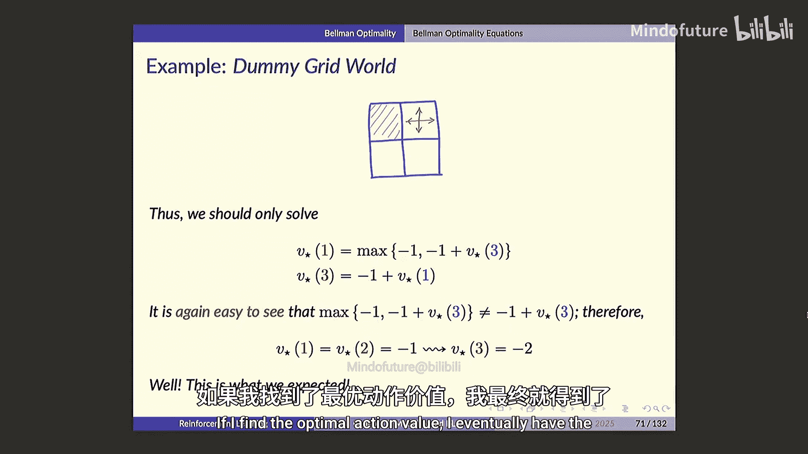

包围。This is the idea of how you can find the optimal policy from the optimal value。 So you eventually。

 when you have the optimal value function， you can simply use it to find the optimal policy。

 So use the Belman optimal equation to find the optimal value。 Then out of that。

 you again use Belman equation to find the optimal action value。

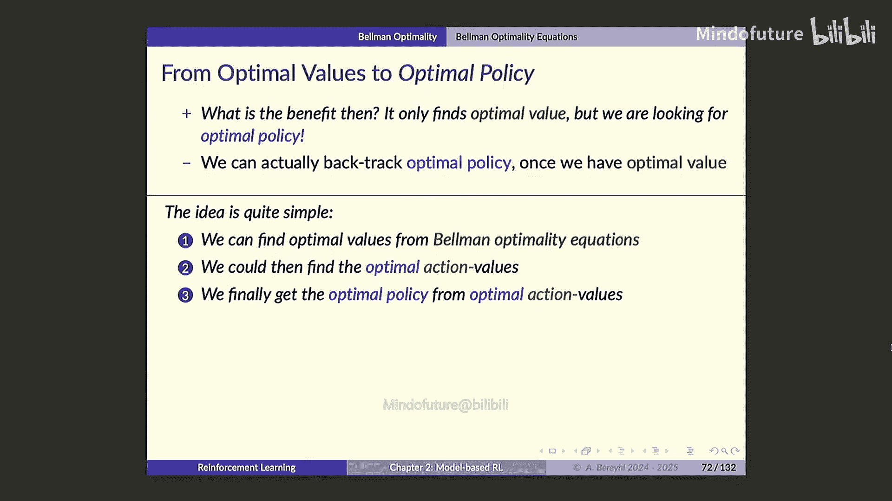

This is what I call it the op。给。You can find out of the bemanopalology equation。

So the whole idea is that you start writing down bellman optimal equation for all possible states。

 right？ You have n different equations and。And。Different unknown。

 And then you try to solve this system of equation， exactly like the example we did， right。

 And then once you have。Then you go inside your look， and you find。

Find the action value for all actions， right， And if you want to do that。

 you can play a game Bel and equation， right so。The Belman equation says that the the action value for any policy at the particular state S and action A is the immediate reward plus discount factor times the expectation of the。

啊。对。Belman equation， version 2。And。Since I have this equation holding for any policy。

 it's going to hold。So I'm going replace instead of V V store。 And this is the optimal policy here。

 Then this guy is going to be the optimal action value， right。1吧。Now。

 you have the optimal action value。 What going to be the optimal policy then。If you are in one state。

 what is the optimal action that you can do？The one which。Please。原个我。

Well the thing that you gonna do you。InEvery single stay。

 you look all to into all actions and you take the one， which is giving you the maximum value， right。

 So you do that action always， right。Everybody's clear。Questions。

So I this makes now things clear how you can get。the MP that you have， how you can get the optimal。

DP you solve the problem， right。Itt computationally that's feasible if it's chestes。

It's huge in number of states， right？ So that system of equation could be created large， right。

 You can never， ever solve it， right， because you can never it。 You can never。

 ever find the optimal action value。 And so。You cannot do this to the optimal policy。

 But theoretically， on the paper， if you have。MDP， you are theoretically able to find the optimal policy or define the optimal policy。

 right。Questions。No question。行。签到。但是。No question。

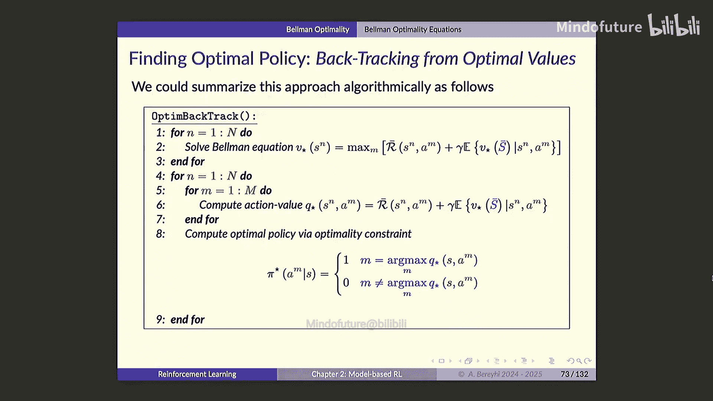

Okay， great， so。OK那。Well， we already computed the optimal value， right， It was 0-1，-1-2， right。

 That was the optimal value。 And if you want now you can， at every single stay。

 you can see what is the action value。For every other action using this optimal value function。

 right， say， for instance， I want to know what gonna be the action value。When I am in state 1。

 so I am in top right and I do action 0。 I go left。 right， What is the action value you just tell me。

this guy up the one that you see here， this is optimal。And in this D example， if I just go left。

 what gonna happen。I'm gonna。Happens， I mean， the terminal say I'm going to remain 0， right。

 So the action value here obviously， is -1， right。先。This equation， right。

So when you write down these things， you're gonna see that this is。That's not hard。 I mean。

 this is going to tell you the immediate reward in in a state1 in top right when you move left。

 immediatemedia reward is -1。 then this is going to tell you what is in average。

 the value that your optimal value that you are collecting after doing that action after doing that action you get to the terminal state。

 And at that terminal state， whatever you do， you're gonna remain in the terminal state。

 you always collect value0。 So the future value， this d star of Spo is going to be always0。

 and then thats sum is going to remain 0。Everybody's clear。Can you tell me， for instance。

What gonna be this next term。Say you are in a state 1 and you do action 1。 you just go down。

 What's gonna happen。Right。Right， so when you are in this， in this state， top right， right。

 and you do action 1， youre going down， right。 First， let's see what is the immediate reward。

 What is the immediate immediate reward。 If I go down， you've got be -1， right， There is no。

Randomness here， right， I just want to go down。 I go down。 I always collect -1， right。

 So that R bar 1 and1 is going to be -1。 immediatelymmedia， I'm gonna take a。After that， I go down。

 I am。T， right， This means that I am playing with the optimal policy， right。

 When I just move from top right down， I'm gonna get below down down right， right。

 And after that playing with the optimal approach is is going to just left and then up， right。

 So it means this means that in the next state， the optimal value that I can collect is。I。

What is the optimal value that I can collect when I am。I can collect as -2，-2。 I mean。

 no matter I mean even if I change this policy， I cannot do。I just get from top right down。

 So the first thing I collect is -1。 And after that， I'm going。Second term is going to be minus。喂。

For everybody， right， So -1，-3，-1 half-1 f， right。This is the optimal action value that you're going get in a state one for every single。

Small action value。 What is the optimal policy in this estate。我据。呀，各海。Action 0， which is left， right。

 which is the one you expect， right？ So the optimal thing to do is to just go to the action。

 which is， which is giving you the maximum action value。

 So it means that you should just do action 0， right。

 You should always go left because going left is giving you the maximum。

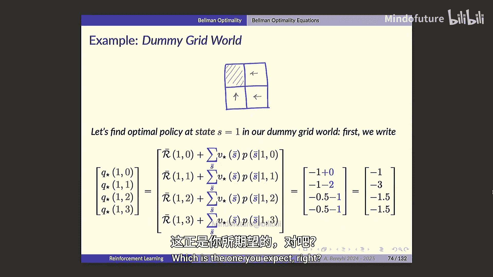

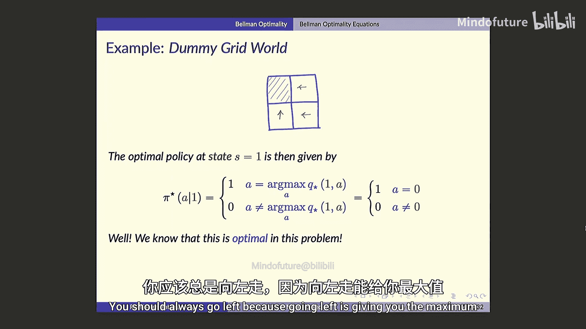

Same thing。 you can try the same idea on every single state to verify what we have developed with your observation。

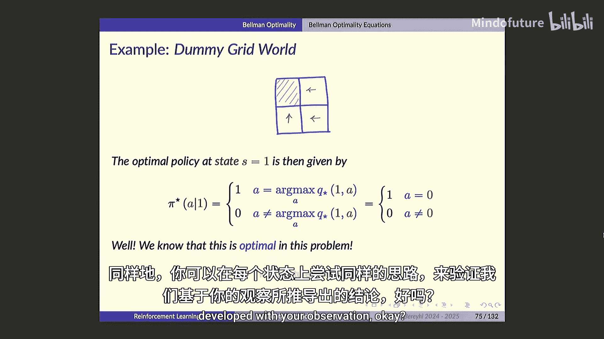

Everybody。一个年关系的。One question that you might ask me is that you might tell me， okay。This means that。

See is always the。deterterministic policy。 Why did we define a random policy at the first place。

 right。You can have a random policy as well as an optimal policy。 How can that happen。

 say in one particular state。Two different directions as you move give you both-1， right。

 The maximum value you could collect， right then。Do you dare to go in any direction。No。

 you can go any of them right， so you can go one of them， right， another。

 or you can randomly choose between them， right。Both of them are giving you the same action value so you can build random policy。

 right， which is optimal。啊。S choices of deterministic optimal policy。Then a combination of them。

 a random combination of them is still optimal。Go is。This is the key idea。

 So if I am in one particular state， right， and this particular state。

 when I look at the action value function。 So in state S the actions from one right。

 and all of this action。Then definitely， this optimalpoli。哎。

But if I have multiple maximizer in one particular state。Between them， right。

 And then this is a random。

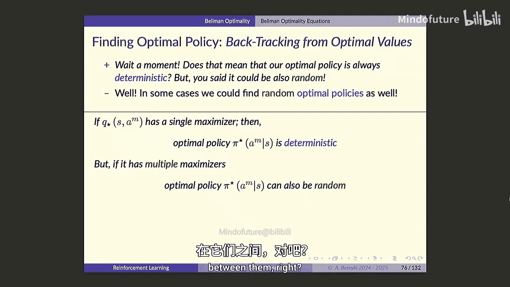

This is the idea。Q is R。Okay。I have this Q star。 This is the optimal action value that I computed After using the Belman optimality equation。

 I have this guy。 And then at one particular state， as I have JD friendend Max。😊。

That there is action AM M1， AM M 2， AM M3 till AM M J， all of them are giving me maximum values。

 right。Right， then if you have this policy of this form is to be optimal。Question。

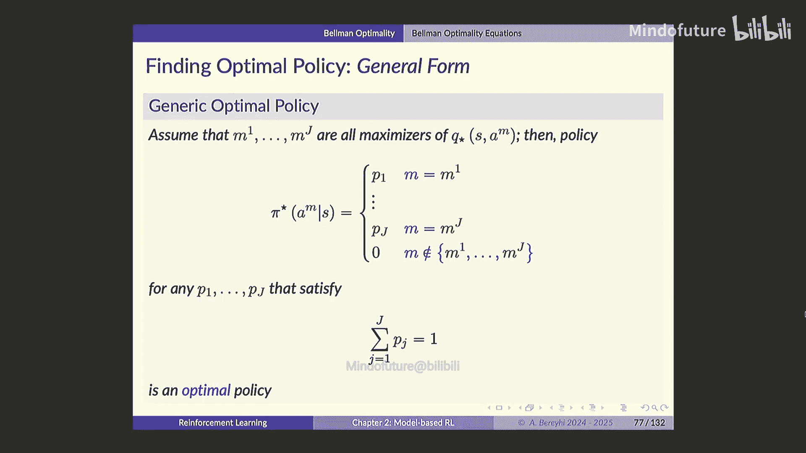

对。Now。The， the proof is quite simple because you can show that the optimal value。

Is going to be the average of those action values。 And since the action value at every single of those action is the same。

 then this summation is going to end up to be the maximum action value。 I don't want to confuse。

 okay。是。What I showed you in。Tly very obvious for you， right， that doing any of those actions is。

Is optimal， right。Okay。Okay， so now， yeah， so this is basically the same thing that I told you So。

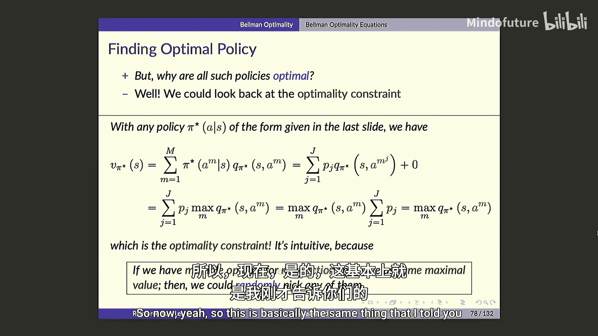

Last point that I want to indicate here is that。You always have one deterministic optimal policy。

 right， So if there is only one single policy， which is optimal， that guy is， of course。

 deterministic， right。But if you have multiple。Optimmal deterministic policies， then。

Any combination random combination of them is again optimal。 So this is why I mean。

 I want to put this， this particular result here or theorem here that if you know the MDP of the environment。

 there exist at least。

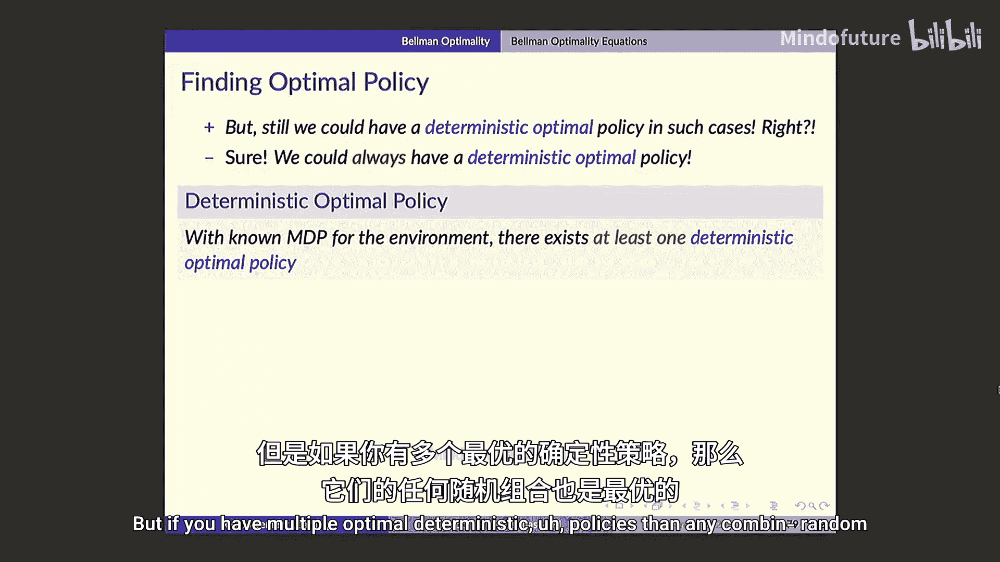

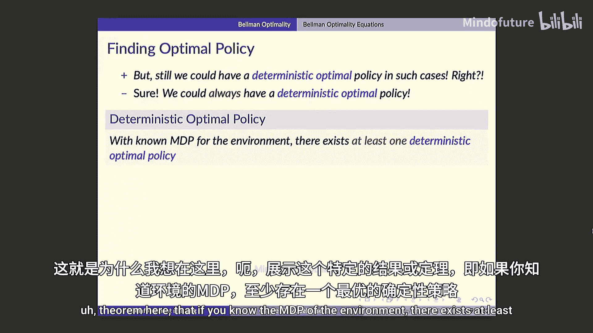

It's not like you don't have optimal policy in this environment。 That doesn't mean right。

 You still have one。 sorry， you， you at least have one。 and that one。 if it's one。

 one gonna be deterministic， but you might have multiple and those multiple。

 you can randomly play around among them， okay。OK是。Yeah， yeah， that's what I already said。

 So you can always find the deterministic optimal policy。 You might have multiple of them。

 and then you can randomly play around them。 Okay， look at this example that I have here。

 Can you tell me whether I have。

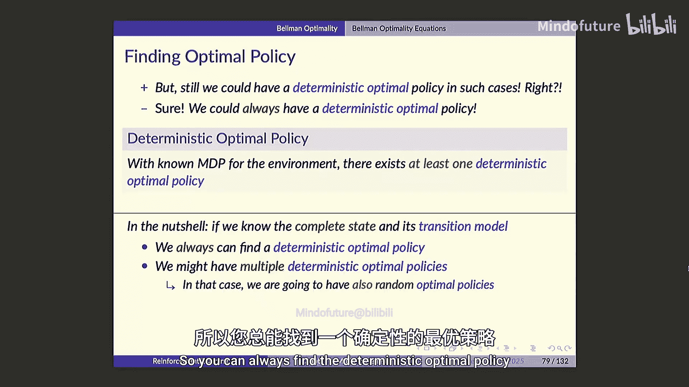

Multiple or single optimalpoli。各位。As between。are going。没有。DoNow， let's look at this particular cell。

 cell Lama 3。 And when you write down the Belman equations out of the optimal values。

 you're gonna end up with this guy， right。What does this say。

 This says that if you are in cell 3 in this below。Right。So this guy。

 if you are here in this particular cell， if you play zero， which is left。If you play action 3。

 which is up。Kin， which are going to hit the wall。 You are going to collect as 2。

5 because you once hit the wall。 then you play up。哦。Okay， so obviously。

 you can just play either left or up， right。

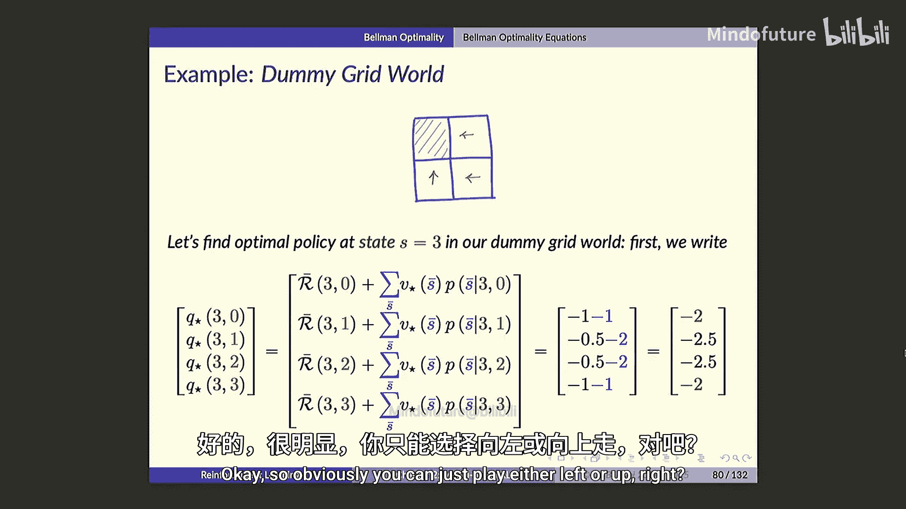

So this means that this guy， the one which we had， is optimal。This one is again optimal。

 So you can go up。 Or when you are at this cell， you can， you can randomly choose between them。

 right。Time you go up， half of the time you go left， right， Both of them are doing up。

The combination， a random combination of them is again optimal， right。Questions。你 question。No， no。

 I guess I have another example You can do it as you wish， right。

 Its going to harm because any of those actions， you're going to collect the optimal value， right。

 and the average of the optimal values is going to be the same thing， right。Questions。Sorry。

It's your choice。 You can put anything。 You can do play any， anyway， any random。不认识。Questions。

No question。Okay， so if you remember the backup diagram we had。One estate。

 and that in that particular state， we play with one policy。

 This is going to just end us with one action， right， And then when you do that action。

 you are going to just transit to a new estate， right？ And same tree is going to repeat over。那。

Say that when you are playing optimally， one thing that you can do is that like you're in this state。

 if you really play with a deterministic policy， optimal policy。

 you're going to choose one of these branches， right you're going to always say， okay。

 I'm in this state， I do action A1 right And then when you are in action a1。

 then you are going to transit。 it might be random because your environment is random right。

 you end up randomly with another state。 But when you at state again。

 you do know one of the branches， right， that state is going to again look like this， right。

 because this S is somewhere again in between here， right you get there。

 youre again a bunch of actions and your deterministic optimal policy tells you go do this action right。

 So you're gonna do that action and again， you repeat the same。不样。Right。Everybody。

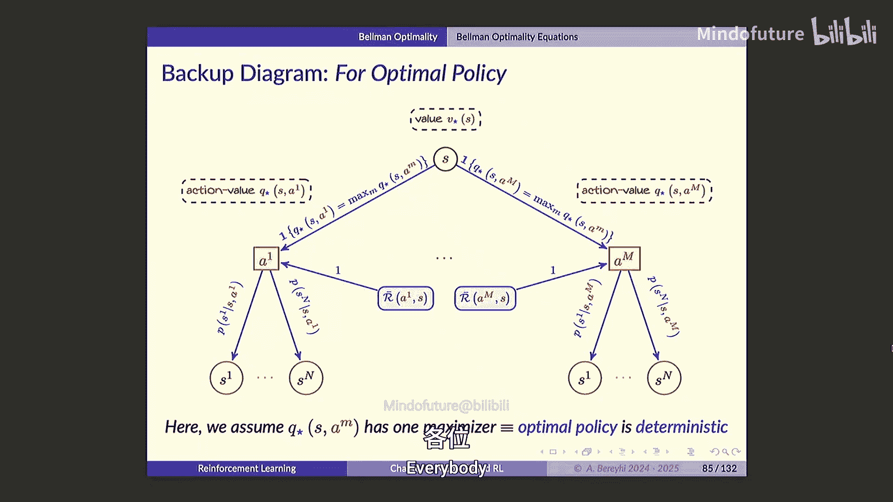