# 【多伦多大学】强化学习 2025 ｜ Uoft   Reinforcement Learning   Fall 2025 p18 P18_讲座_17_通过动态规划进行策略评估 -BV1D3F2zhEry_p18-

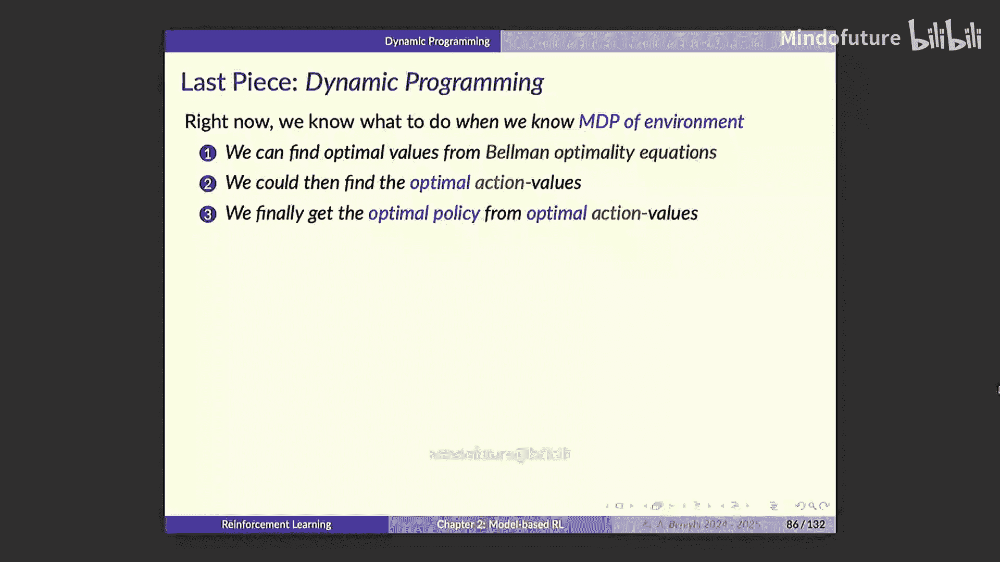

Next thing we want to discuss is dynamic programming。 I mean。

 I do know many of you probably have heard of it。 Many of you have already used it。

 You had this in the algorithms， and they distract your course probably in undergra， so。

Dynamic programming， given that you have this very nice recursive form in the Belllman equation。

 is going to help you a lot computing the bellman， the solution to the Belllman equation。

 So the key point。When we have， we know the MDP of the environment， of course。

 we can just do these three steps that I told you， you can just solve the optimal equations。

And then you find the optimal action values out of the solution。 And then finally。

 you find the optimal。But the key point as you。Exle was that solving that system of equations doesn't seem like sound like something simple。

 right， So you need to just do some tricks。 And if you think about general environment。

 this is something that you would be happy with， right， So you want to one algorithmic solution so。

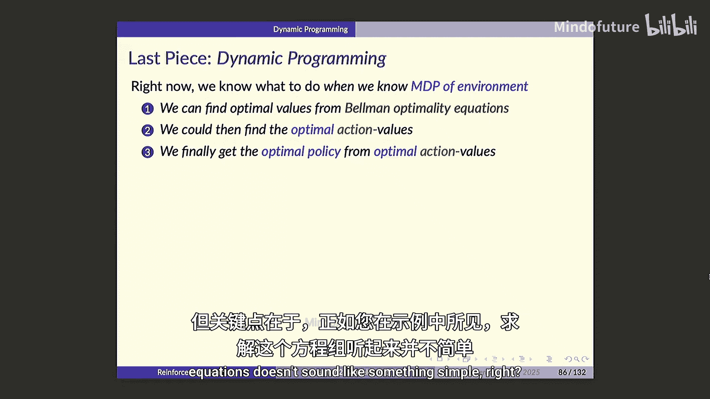

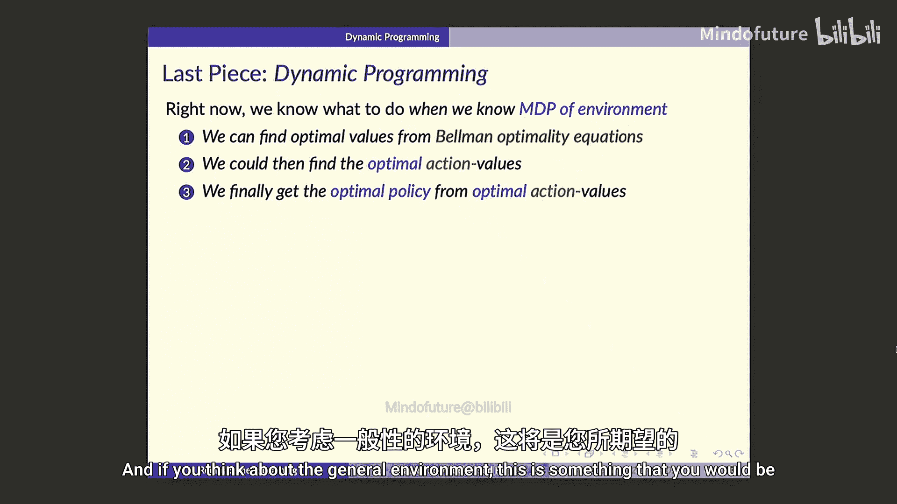

Can we just come up with one algorithmic solution for finding。啊对。但是。

The equation is actually showing every recursive property。 So what do I mean by dynamic programming。

 I do know， as I said， many of you might have seen it before。

 just to give you the particular example we have in this。

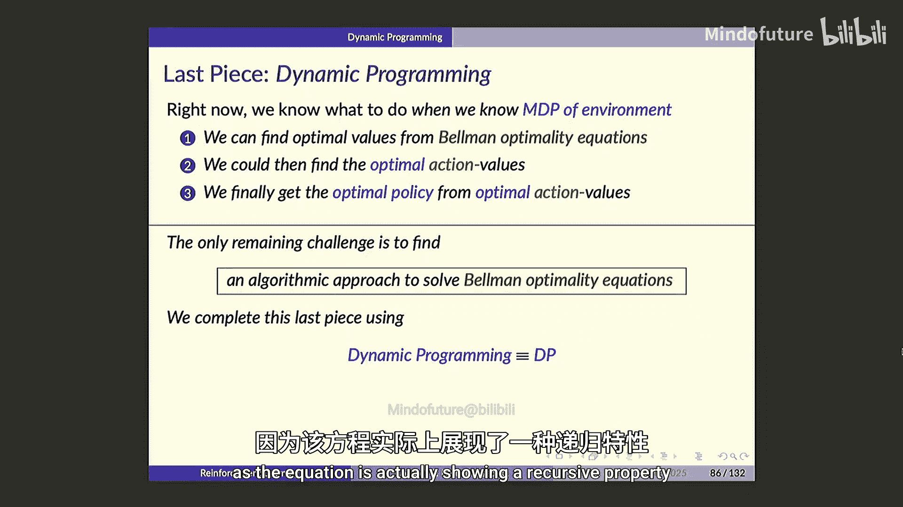

The we need for this Belman equation。 So say this simple， very simple example。 So you have。那我们。

You have this equation， right， This is a equation。 X equals by F X， right， And you want to solve it。

 I guess someone wants to get in。Somebodys looking I。Thanks， thanks a lot。

So have this equation right， and you want to solve it。 X equals by F X。

 You have seen it a lot in your courses。 And what is the idea to solve it？ Well。

 there are different approaches like in the numerical computation courses where students are supposed to get。

Hard questions。 They're gonna give like a crazy F for， for the exam， right。

 and tell you find the solution using an algorithm。 So you typically write it down in this form。

 So you're gonna write it down F X minus x。 And then you set it equal by 0。 Then you would say， okay。

 maybe this is possible to be fraction decomposing to polys or it not。

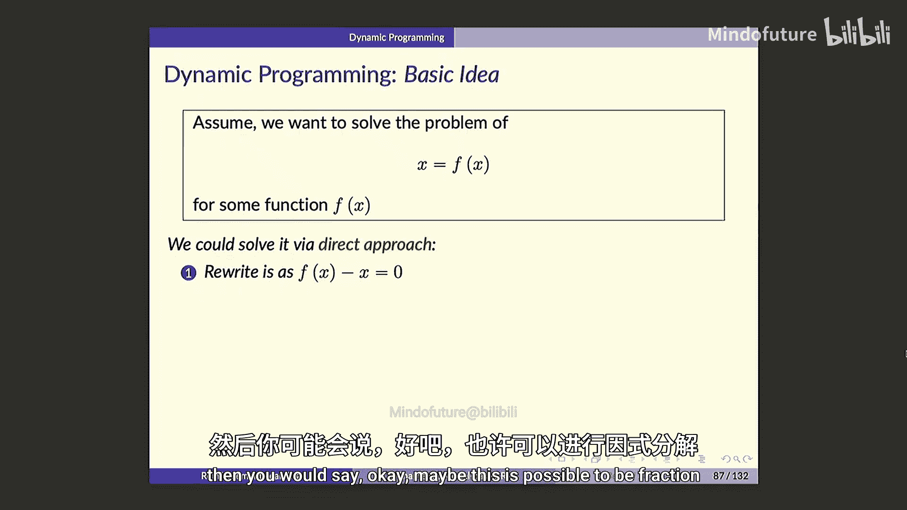

Some zero finding algorithm like Neton rat。And then on the zeros， right， This is the typical case。

 This is the one which is being used by many solvers。 But one more efficient approach。

 one numerically is。You can say， okay， let's start from one Dmmi point x0， right。

 And if that x 0 is the solution， then when I put x 0 in s function F。

 the output should be x0 itself， right， but you do。Its x1。 what you do in X。1 you again put it in F。

 right， And hopefully the next one is closer， right， So x2 is closer to x 1。 You keep on doing it。

 right。Hoping that every time the new X that is computed by F is getting closer to what get into F。

 right？ So if you have， for example， in like old days。The age of Cha GP， like in my time。

 when we had， we can only take the simple engineering calculator with us in the exam。

 This was the trick we could solve numerical problem in the exam。 So we define F。

 We write it down this form， and then we put x as the input。

 and we write this function in the calculator that whatever is output put it back。

 And then you press this A C as fast as you can。Do together and the winner， the best。Impressing。

 no mistake when entering the function。 So you do here， right， You put X， you take it out。

 you give it back to the function and you keep on going， right。

This is the most basic idea of dynamic programming。

 and you can even do it for more complicated problems in the algorithm course， as I said。

Want to find， for example。Length of some Q。I it down in this form。 and then you solve it by just。

To the input。 So one key point that you should pay attention here。

 this F that you have here should have。Sure after doing this recursion is going to converge， right。

 So for some choices of F， this is not going to converge。 Okay， so let me show you one example。

 This is one example， okay。

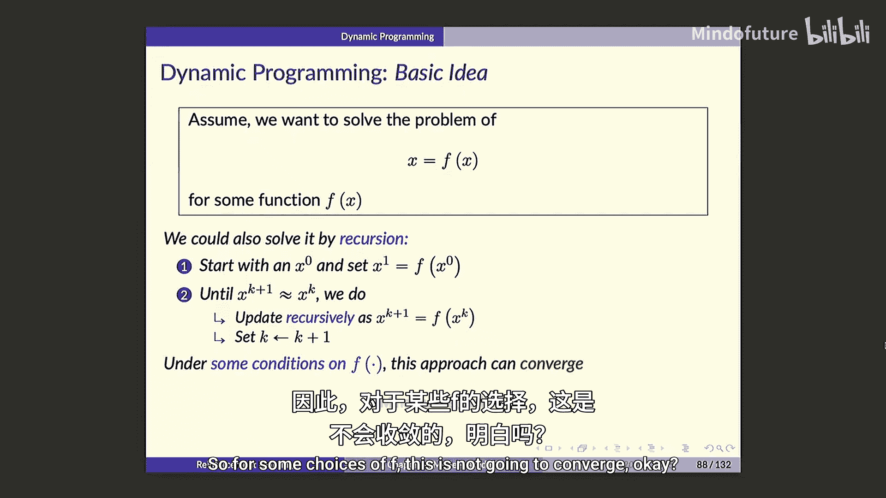

Equal to minus。You multiply the both sides with。You just take everything in one side。

 You just factor it out into polynomial。 and you're gonna find the solution。 What is the solution。

 Can you tell me， do you have any clue。-1 right？ So if you put x to be -1， this is -1 over 1。

 here is -1，-1 equals -1。 That is the solution， right， But say you don't know the solution。

 What you can do You can start by 0， right？ You put 0 there。 This is going to be- half right。

 then you get - half。 you put it back in the function， right， It's gonna be-1 over 2- half right。

-1 over 1。5。Right， minus-2 third。 And you can keep on doing this， right。As you keep on doing get。

 you see that when you irate enough of times， then you're gonna get into minus k over k plus  one。

 right。 Now， if K is very， very large， this is rather minus。The solution that。哦。没有。

Here in this particular form that I showed you， if you put， if you start from any point。

 you're gonna add this -1。It doesn't matter which point you start with。Stend out with -1。Okay。But。

 I mean， except x equal minus definitely。 you don't want to have 0 in denominator。

 But the other case is that I just write down the same equation as above in different form。

 So this one is the same equation as the last one， right？ You see it。

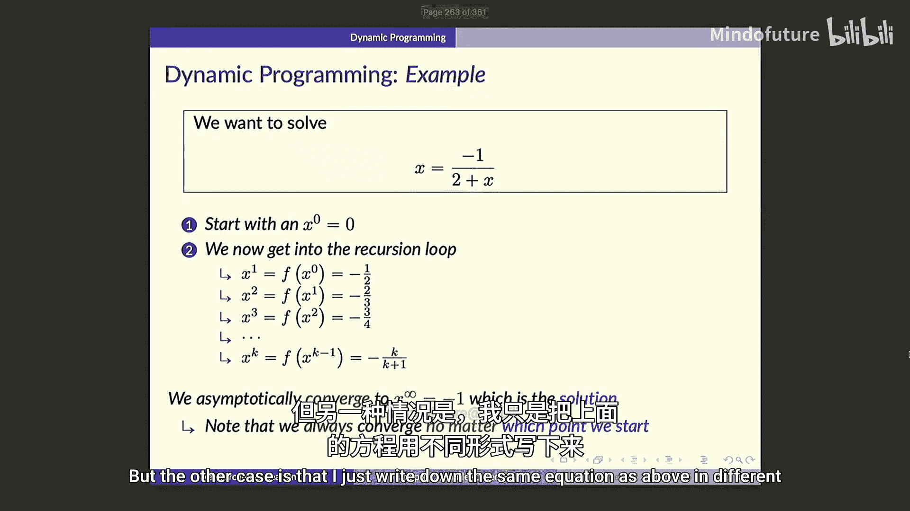

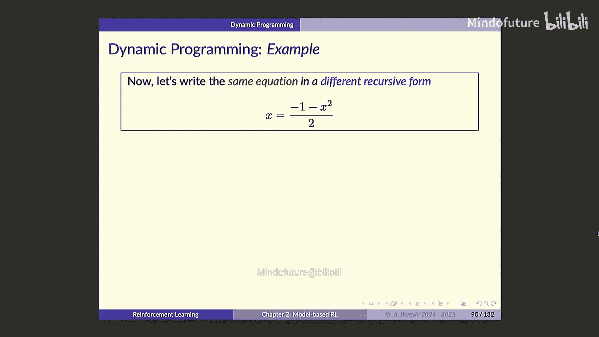

So if you look at this guy。I just both size by two plus x。

It's gonna be x times 2 plus x equals by  -1， right。

And that this is 2 x plus x is squared equals by -1。

 I want to write it down again in the form of x equal by minus as x equal by f of x。

 So I'm gonna keep x here。 and I write this guy down x equals my -1 minus x is squared divided by 2。

 right。This is the same thing， right？As that one。Same equation。

 I again wrote it down in different form， right？Is again。

 the same recursive for the same recursive expression。 But with different F， right， Now。

 if you have this one， you can simply see that if you start with 0， again。

 you are going to converge to -1。

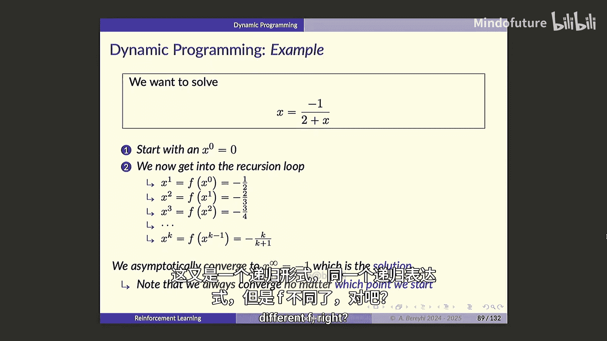

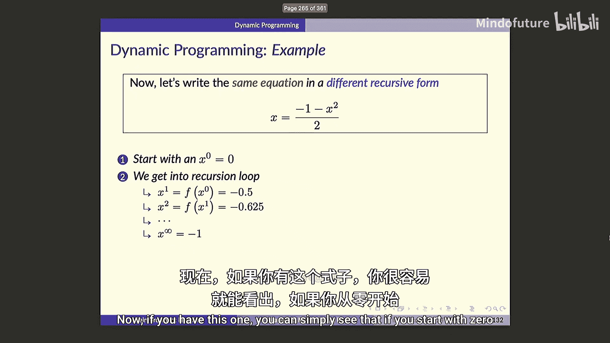

If you put。Diveverse， right， each time that you put it in the gives you larger。哎是。Right。

 so this is what I meant by the fact that when you are doing die recursion， you need to have your F。

Satisfying a bunch of properties， right， So this is just as a hand that that by recursion。

Solve the problem。For the sake of the problem that we have in this chapter。

 it's not that you think most of the time you are converging。Okay， everybody's cool。

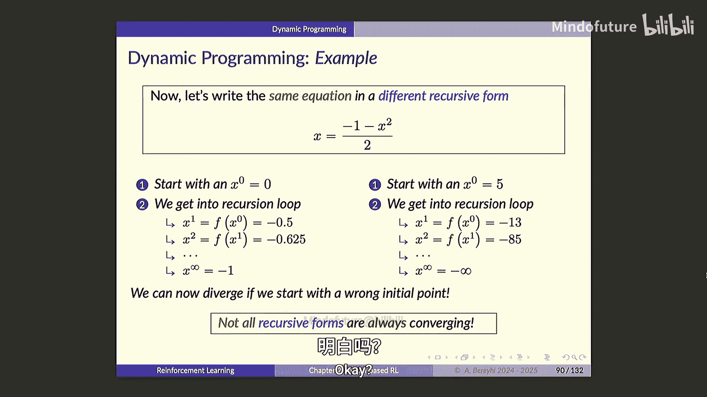

Okay， so if you're cool， then one thing that you might see is that the an equation is eventually。

The same form， right？Is a recursive form， right， because。For value， say this value function V。Is。

A set of different values for different states， right， Every value is written in terms of。

Allld values， right？Now， if you think of it in a vectorized form。

 you have the value vector being written as a function of the same vector， right。

 You have value function equals the expression in terms of the value function and you want。

Upt to or if you use the basic value equation for one particular policy。

 you want to find the value of that policy now。We can again， use the same idea， right。

 We can get the policy。Put it inside， like， we can install with a bunch of random values， right。

 Were putting in the equation。 This is going to。为什么。Howman equation， right。

bunch of values at the output， right， and we keep on trying it till the value is going to converge。

 like the values that go inside theman equation are exactly the one coming out of Belman equation。

Everybody's cool。So you get the idea。 So it's the same idea。

 The difference is that instead of having one single variable， you have the value function。

 the whole value function。And one question， do you see that you can think of value function as a vector？

Yes。😊，If you don't see it， that's fine， just let me know。 You don't see it。So。What is value function。

 say you have one policy。You have policy pi， right， And I write it down V pi of S， right。

 What is this guy。The state， right， How many estate do you have。N different state， right？

 So how many values this guy could have。And different values。 So you can say that this guy。

Could be value of policy pi state S1。Value of policy pi is state S 2 and so on。

 feel value of phi as state S N， right。So I can remove this S here。 This is the same thing， right？

Right， so you want to find this vector， right， everybody sees that。Okay。

 so you want to find this vector。 This is the same thing as a function， right。

 A function if S is even continuous is an infinite dimensional vector， right。Same thing， right。OK。

Now， when you want to do the dynamic programming here， you typically have two different。

Ways of going。 now， one way do policy iteration。 So the policy itration starts from the policy。

 So you start from a dummi policy。You evaluate this policy using Belman equation。

 This is what we call it policy evaluation。 So I start with random policy， right。

 I see how this policy works。By just computing its values， right。

 Once that I see the policy is not doing well， then I do policy improvement。

 How do I do the policy improvement， Well， you don't。Maybe you don't have it in mind right now。

 but just as a bit of a spoil。 So you can simply say that， okay。

 obviously this policy is not doing the actions which are giving me the optimal the maximum values right So I just replace change the policy to do those actions。

 even though I don't know that I have the optimal values yet or not， right And then once I do it。

 I'm going get an improved version of the policy。 Again， I evaluate the policy using Bellman。

 I improve it。 I evaluate。 I improve it。 I keep on improving it。

Polic is not getting improved anymore。 that guy is the optimal policy。

RightThis is what call the optimal theration， or you can do value itration。 You would say。

 I don't want to play work with the policy。 I the Belman optimalology equation， right。

 And then I keep on doing this。Gming paradigm， this time using the optimality equations， right。

 by doing that， you are going to evaluate the optimal value， right。

 Once you have the optimal value conged， then you put it inside the Belman equation to find the optimal action。

 and then you find the optimal policy。Okay。So you can use dynamic programming in both cases。

 in one of the cases， your variable that you are trying to find is the optimal is the policy。

 So this is what we call it policy itration。 And in other case， your optimal sorry。

 variable that you're trying to find by dynamic programming。Talue function， when you do that。5。

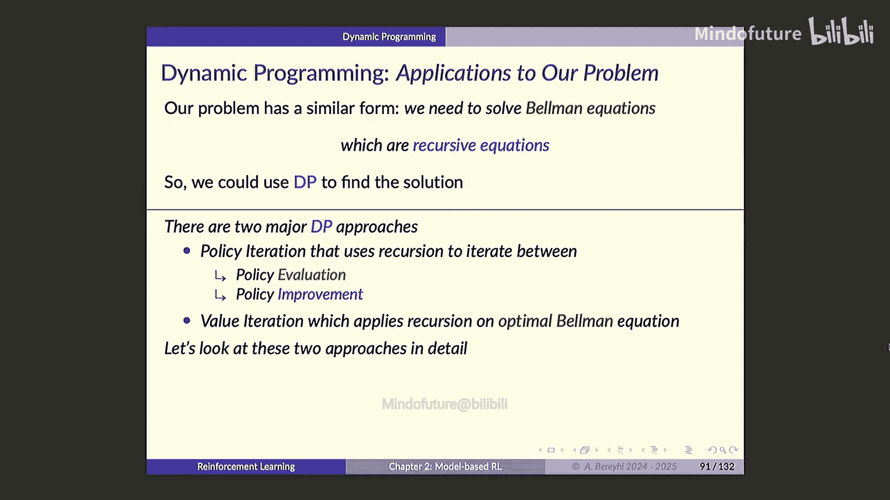

Okay， so now let's try the policy iteration。啊。The steps and details。

 So the first thing is to just do the policy evaluation。 And by policy evaluation。

 I simply mean that I give you one policy pi。 And then I want you to tell me what is the value of function。

 I want you to give me this particular vector， right。

That is explained in telling me at every single state。

 this particular policy pi is giving me that what value， right now if you want。Po policy evaluation。

 This is again， a dynamic programming using Bellman， right， What you can say， Well。

 I have a bit of simplifications here。 I just explain them。

 But if you don't see it like or if it is too much notation， just skip it。 That's okay。

 It's not going to。

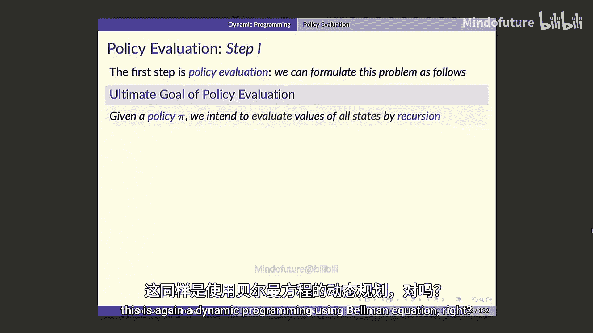

Majorly harm your understanding of the algorithm。is that you might be unclear about what exact term you need to put there right but it's okay you can do all the time based on the available resources。

 So one thing that I'm gonna do here， I am going to just write down。

 This is these are the terms that we already have defined。

 This is the immediate reward that you get at every single state。 And if you have the policy pie。

 you can simply compute it out of the average immediate reward for the action this form right So this is the average immediate reward for one particular action。

 And then you average policy going。Immediate reward for that estate。

You can simply write down this guy in this form， right， So you could say here I have R bar。

 This is my。Respect to policy pi。 This means that I get this term。 I'm。

With policy every single action I sum do， right， This is expectation， right， So this is just the。

Other form of the same。对。

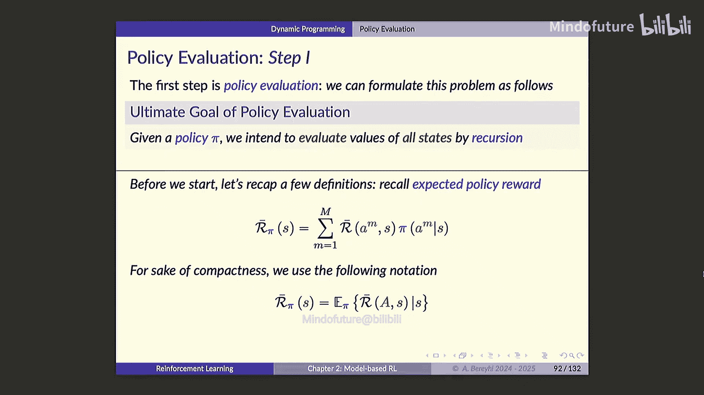

Here， this next thing is that usually in the in the Belman equation。

 you want to have something like this， right， So this is the expectation。

Of the value in the next state， given the current state and the action， right。

 And if you want to do it。嗯。One other thing is that if you want to get from this guy。Which is the。

Checkick the next value， given this state。 So you don't want to take the action into account anymore。

Any clue。I don't want you to tell me the exact formula。 Just tell me what should。Next。

Every single action。 Now， if I。The average next value in the。所以。So this， this average。

Value current state is going to be written in terms of the other one in this one， right。

 So it's just the average of that guy with respect to a。

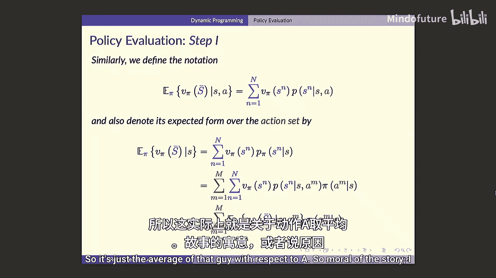

So moral of a story。 I mean， the reason that。Is because when you are reading this board。

 when you want to get the beman equation this compact form。DoOkay。

 so I am just now writing down the Belman equation compact。

 So the value of each state is given as the expected immediate reward plus this term。

 which is the expectation of the next value given state。

 And if you want to talk about the action value， you should write down exactly same thing as above。

 instead of。Immediate reward for this stage。 You have immediate reward for this state in action。

 And again， here， instead of taking the expectation。Given only stage， you need to put the action。

 so this is giving you more compact for。对啊。

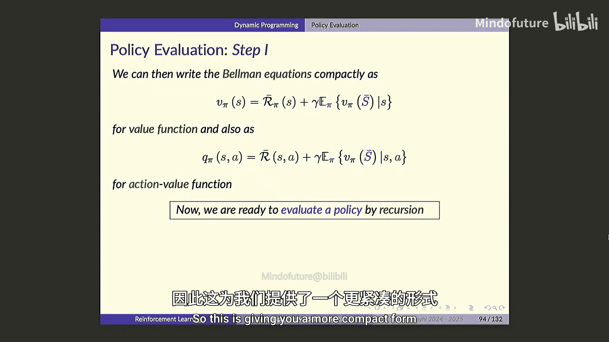

Get back to our interpretation of the Belman equation。If you have development equation。

 how do we interpret that， We interpret that we have n different values。 Look at the board。

 we have n different values， and we don't know them but we do know n different equations which are relating them to the。

All of these equations， the value equals to something of the other values， right。I that。

 So now what you're going do， you' are going to say， okay， I， I don't know what of policy。

 It doesn't matter。 I'm gonna to randomly just。

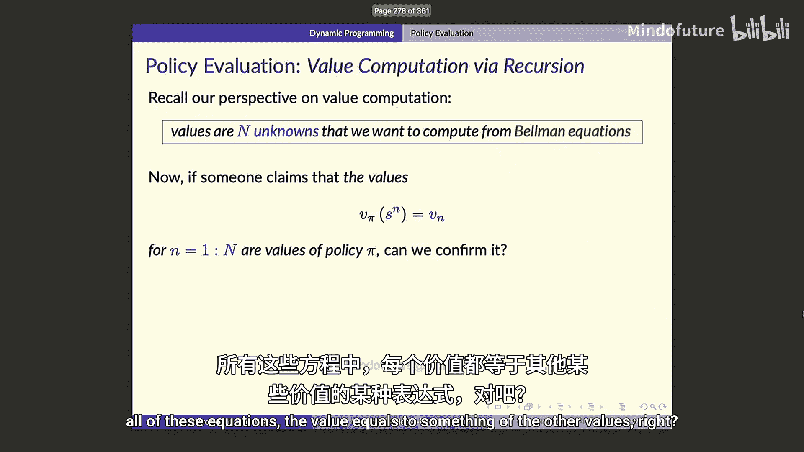

Every value is something， right， So I'm gonna say that I don't know。 Maybe this value is  one。

 This is 0。 The next one is 1，1，0 and 2， something like this， right。

 I just randomly choose those value。 The only thing that I should pay attention to is that。

Can you tell me what should I make sure when Im just assigning these initial values。

The terminal state， right， What should be the terminal state value。0， that I know that is0， right。

 So if I see any terminal there， I'm going to put it 0。 If you don't put it 0。

It might be the case that your algorithm is not converging， right。This could be right。

 But for the others， it， it doesn't matter。 You just randomly choose some values， right。

 So these values， I don't know whether this is the value of this policy or not。

 How can I confirm whether this is the value of this policy or not。I can put it inside it。

Bllman equation， right， What does the Belman equation say， So the Belman equation say that。

 for instance， well， if you want to know what is the value of one particular state。

 you can write it down in。Mete reward plus that extra expectation， right。

 and you can always compute that extra expectation。 Given the values that you have considered here。

 right。

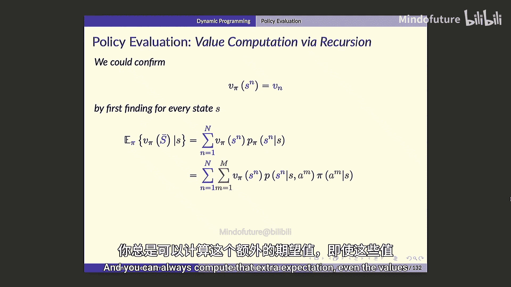

Say， for instance， I want to know what is the expected next value。 So V pi at the next state。

 given that in I am in one particular state。 For example， Im in state 1。 What should I do。

 I need to write down this expectation， right？ Now， these values， this V pis that I have here。

I would replace the values I just assumed here， right。I would replace them with those values， right。

 And if I do that， I can compute this expectation， right。

I can compute some number for this expectation， and it's not exact one。That doesn't matter， right。

mI'm going to replace those。That I assume for every single step。Term， right。

 so this term is going to。那个。Given the current state that I am in， right。

 if I want to confirm that the values I initially put for for， for different states are correct。

As the immediate reward should be exactly the same thing as the value I have for that state S， right。

 So I'm going to replace it here。

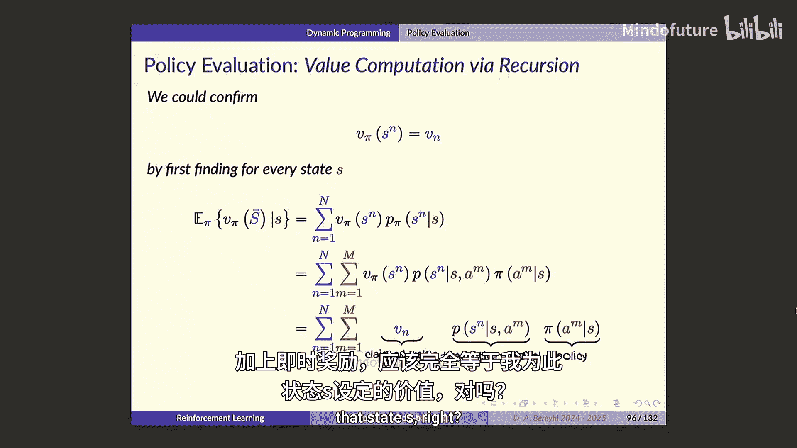

That this term is something computed out of。The values I had。

 So all of these values I put initially for my value vector， I put them here， V1 to V V N。

 And then this term plus the immediate reward should be exactly the same thing。For that。

Had a bit of trouble following what I was doing。 Just throw everything away。

 Just look at it right now。 Okay， if I consider one set of values here。 So this guy。I。V1。

 V2 till V N， right， When I put it inside the beman equation。This guy。

 I can compute it out of my policy and。The MP， right， So this is not something important。

For this one， I need to know values wherever I need the values， I'm going to use those yellow values。

 right？When I find this term， right。This guy should be exactly giving me the N， right。

 the value of this state N， right。For example， if I write it down for the first estate。

 V1 going to sit here。This guy should be this term computed as state1 plus this expectation when I set the values V1 to V N。

 right， this should happen if this values that I initial。Exact。

But if I randomly do initiate these these values， do you think that this happens。No。

 you are going to get a new bunch of values， right。To write down this equation。

Term that comes out of this this， this expression is not going to。到位。You repeat this， right？

are going to comeverse to the value of the policy。Yes。If呃。I should double check that。 if you said。一。

This is one thing。 And I guess， if you have。Like in some environment。

 maybe the discount factor might。对。Should converge， I think。Think like if gamma is less1。

 I guess it always converges with terminal states being。I guess so。 But I check I， I'm not 100% sure。

Questions。So did you get the idea how you're evaluating。

 So I'm giving you the policy once I gave you the policy， you want to evaluate this policy。

 how you're gonna do it， You just initiate a bunch of random weight values。

 You put it inside the Belman equation。 You're gonna get a bunch of values， right， these value。不定。

You get a bunch of new values。 and you keep。T con。Usually， it is smaller than one。 But like in。喂。

Terminal state， typically， if you set it， even it's not going to make any trouble。

 Like if you have an environment like is's going forever， right， you can have an episode。

 which is not terminating。 then if you said gamma equal by one。

 then you could have the case where this value is not converging， right， it' gonna get infinite。 So。

 but if it's a smaller than one， typically it' gonna converge， right， So yeah， that's it。Questions。

No question。Okay， so yeah， if you got no question， then this is going to be the value policy evaluation algorithm。

 So each time that you put your values inside this， you're going to get a new value。

 say V bar and this V bar is not the same thing as V and U and then going do。

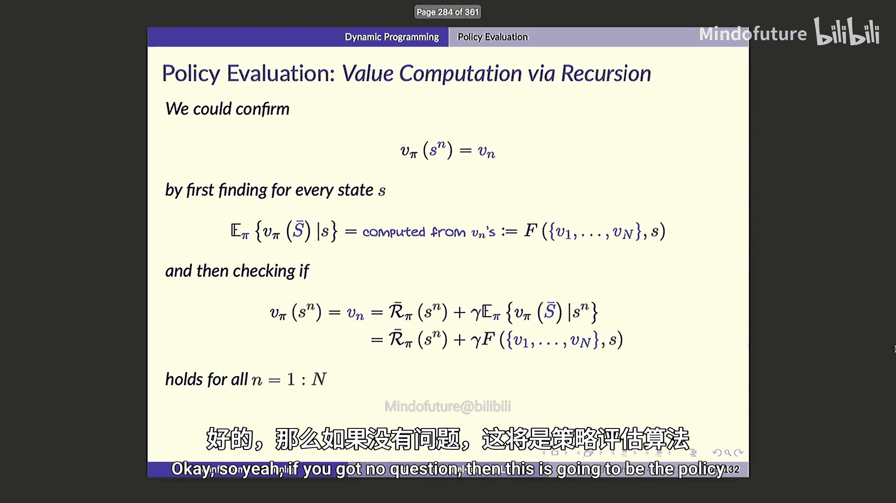

So， you're gonna say。New value function。So you get these new values。

 You again put them inside Belman equation。 You see what this Belman equation give me for every single。

Now， the same thing you're repeated， right。

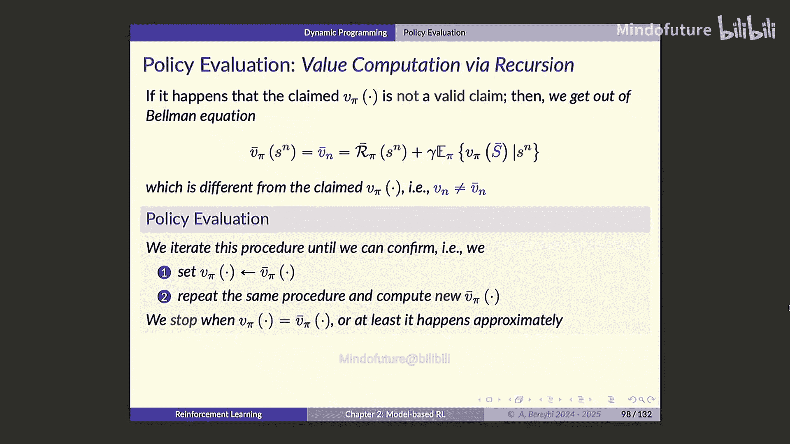

Keep repeating， right。Questions。Now， once again， as I told you before。

 I totally understand if you don't see every single details of derivation。 That's totally fine。

 I hope the big picture is clear for you what we are doing， right， And whenever you want to use it。

 of course you。In detail， what number you should exactly put there。You can follow the。

 the main picture， right， the main。Progress， right。 Everybody sees what we are doing， right。So。

Please just do not con yourself by paying too much。OK库 sell。Now。

 we can write down the studio code for this policy evaluation。 So typically。

 if you want to do policy evaluation， I'm gonna to give you a policy， right。嗯。

You could start with some initial values， right。So you typically the initial value is zero for the terminal states and for the rest of them。

 you just randomly choose something。 Now， forget about line three right now。

 we don't care about that。 What we are going to do， What should I do first。I have the policy。

 and I initiated a bunch of values first。Going to first compute the immediate word。 of course。

 And then after doing the immediate reward， you can simply put it in the bellman equation， right。

 This is immediate reward。 you put it here。 then this is the beman equation。

 This is going to be the values that you have。 So K first is 0。

 right You start with your initial state。 sorry， initial value function and then you compute this guy。

 this guy， you can compute it。 If I hope that I could make it clear for you that you can compute it。

 If not take it from my side。 trust me， I'm not lying That line 9， you can compute the right inside。

 And when you compute the right inside。 Now， you're going to end up with a bunch of new values right and call them V1。

Started with V for each state， No V1， right。Now， you have this V1。

 You are going to check what V1 is exactly like。0， right， How you can check it。

 Well you can to compute this guy， right， You could say that V 1 minus v 0 at every single state。

 I compute the difference， right？ And then I take this。I consider the state， which has the worst。

Diffence between the two values， right， I take that one。 This is going to be Delta， right。

 So it's got to explain how your new value。Different is to the previous value function， right。

 And now as long as this， these two are not the same。 So as long as this delta is large。

 So this is what we're gonna do in。Line 7。 So as long as Delta is large。

 So it's more than some small epsilon。 We keep on eye。So you again get the one。

 You put it again same。V2 and V1 are the same thing。 If they are the thing you stop， if not。

 you keep on going， right。Everybodys cool。Questions， yes。Policy， you're just initiating your value。

 right， and then yes initiate anywhere， The only thing that you should pay attention is this one that the terminal state should have value 0。

 right。To， to to divergence， that could happen。Questions。No question。Okay， cool。One thing here。

 line 3 that I told you。 So this epsilon is a kind of threat。You converge exactly to what you want。

 You get close to it， right， And then you put a threshold， a tiny epsil。

 like as long as what I get is just changing tiny bit in every itration。

 And I am pretty sure that I have converged， right， I am very close to the value， right。

 So you approximate to solve and。With this， this Delta infinite is just to start going in the loop and then it gonna get updated。

 right。OK。

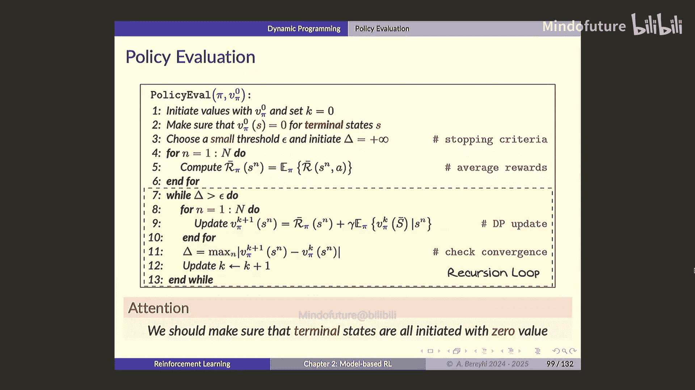

， so Dmmyg world， I know that everybody laughed when I started with Dmmyg War。

 But I guess now you're appreciating that， right， It helps a lot understand what is going on algorithms so。

😊，If you want。Use this recursive form， right， to come。read world。对于。

How we can do it So I have given you this policy。 So the policy is given。

 I have told you that every cell what you're gonna do， right， is given， right？ Now。

 the only thing is that you want to find out what are the values。

 Like if I play with this policy at every single cell， what is the value that I'm going to collect。

 right。If you want to do that， then。Of course， you can， first of all。

Start by computing the immediate reward in every single state。 So the immediate word at 0 is 0 at 1。

 Obviously， is -1 at 2 is -1 at 3 is -1 again， right， at any other cell that you are。

Idi water that you're gonna get。 It're gonna be -1 because you always move to another cell， right。

So that's it that you can write。Based on the policy and the right。

 Nothing else you needed to compute it， right did。Policy to compute that。 That's the first thing。

 Now， next thing is to compute the second term inside the Belman equation。

 I told you you can compute it。 I tried to show it in terms of equations。

 but you can simply see it right now here， right， watch。You could say that。

 say I have initiated my or I have considered one particular value function。 V P K in itration K。

 So here I have four different casess。This means that my value function， V pi。K。

 this guy is going to be V pi K at a state 0。V pi K at a state1。

 v pi K at a state2 and v pi K at a state3， right， I have three four different values， right。

 The first one you always know is 0。 I mean obvious， right？

 But these three guys say you don't know it and you want to evaluate it right。

 So you have this4 four dimensional vector and you are in one particle iteration K。

 Now say that you are in state 0。 state 0 is the terminal state， right。Now。

 what is the value of the next estate in average when you play with policy pi？

If you play with policy po。但是。Terminal state， you're gonna remain in the terminal state， right。

For this future state is going to be again 0， right。

And then the expectation is going to be the value of that state itself， right。

 You're in a state or you're in this terminal top left。Sell， you're gonna remain in topil left。

 no matter what。 even if you play with pi， right， And this means that the value that you're going to collect is the of that cell itself。

 right， No， let's try another one。 Let's say you're in cell 3。Below， right。

When you play with this policy， what gonna to be your future state。You got to be a state。2， right。

 now you are playing with this policy pi。Your future state is default too， right。When you are in。

You play with policy pi， you end up being exactly at state2。

 So this expectation is whatever your value function is at a state2。Everybody's cool， you see it？

Same thing for the other two， right。

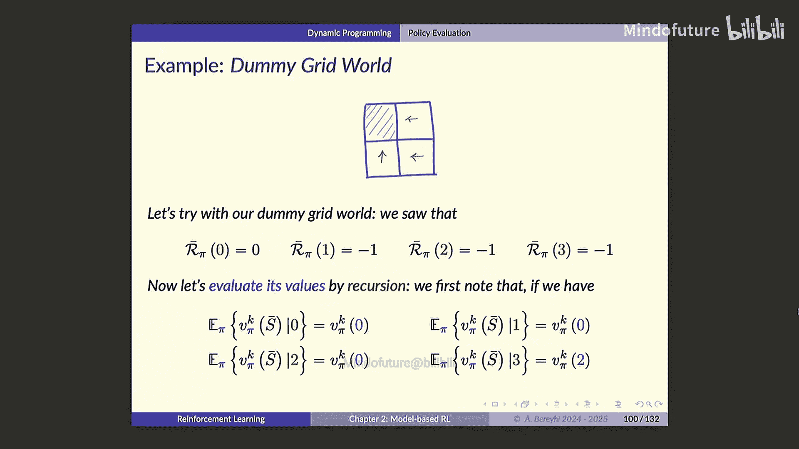

You can compute these ones easily。 And since you can compute this。

 you can write it down in the policy evaluation algorithm， right， So you start a bunch of values。

 So you initiate a bunch of values。 What one thing that you pay attention is that the top left。

 the cell 0 is a terminal on state。 So you can initiate it by 0， right， But for one。3。

 you use any value。And when do it， then you're gonna to get inside the loop， right， So you would say。

 I go inside the loop。I update my next value at every single cell using the Belman equation。

 The Belman equation， for instance， for the cell number one says -1 plus that expectation。

 which was a value of the type at cell0， right。Same thing going to be for the for line 5 and line 6。

 So line 4，5，6 are eventually the building equation。Well， my both。It be the value function。 No。

 I am treating the left side as the value function of itration capability。

I the value function of the ittration K， right， And I keep on ittrating， right。

Till I see no change inside my value function。 Now， for this one， how many as do I need to do。1。

 right。So red guy is going to be 0， right， So these are going to be 0。

 This is going to be exactly -1 for this one， whatever that guy was in the next going to give you the right value So you。

P。哎，是。ry， you keep on。Till it converges， like the values are not changing。From K to K plus one。

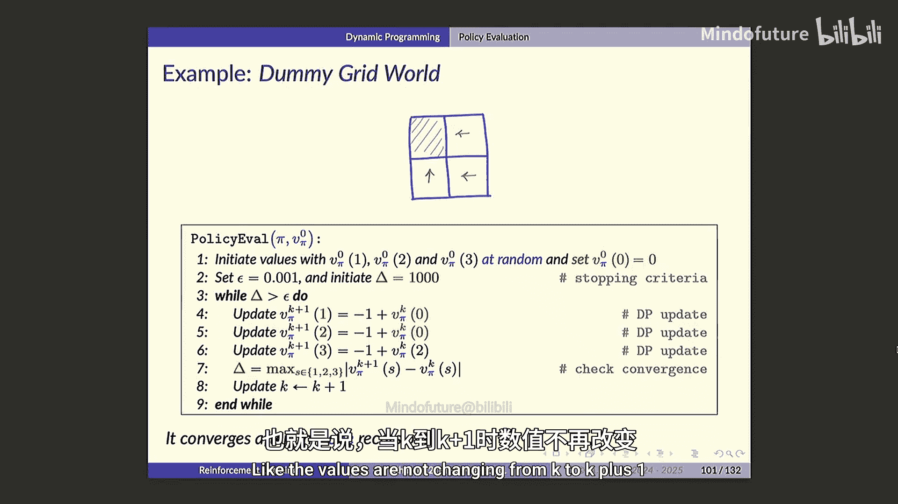

Yeah。