# 【多伦多大学】强化学习 2025 ｜ Uoft   Reinforcement Learning   Fall 2025 p19 P19_讲座_18_策略改进与策略迭代 -BV1D3F2zhEry_p19-

是。

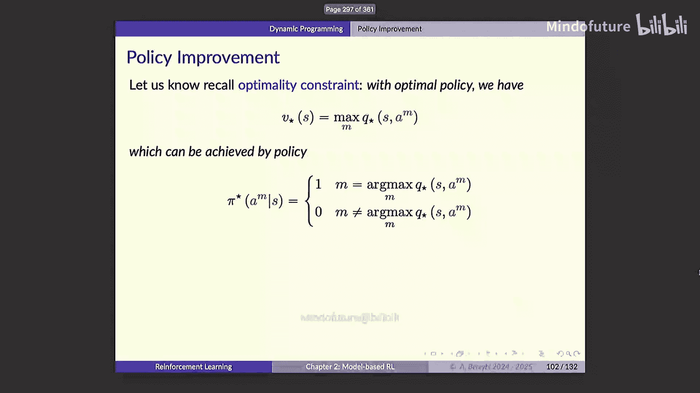

More of a story of the policy evaluation。 policy evaluation itself is an iterative algorithm。

 It is using the Belman equation。 You can randomly start with a bunch of values。

 You do the iteration。 You end up knowing the value of that policy， right？ So if I you the policy。

Value function， right， simply use the policy evaluation algorithm。 Now you have this one。

 But now what you want to do， you want to improve policy because you might started with some bad policy。

 right， Maybe instead of the optimal policy， I would start with random policy， right。

 If I start with a random policy。 then you are going to end up valuating the random policy。

 giving the value for the random policy， right， But this is not the the policy that you want。

 you want the best policy policy， right， So how you can do the improvement in the policy。

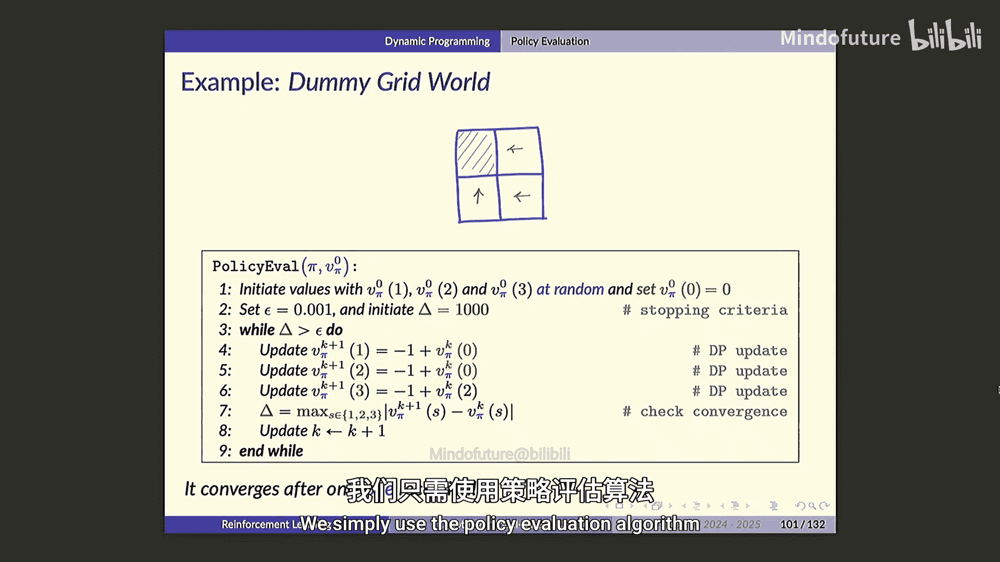

You would say if I have optimal value， then optimal value in every single state is going to be the maximum。

Amongong all the actions in that estate， right。That's the constrain。

 That's the simple optimality constrain， right。Now， if you're。烧炮啊。All the time， right。

 There are some states where in that estate， the policy is doing something。

 which is not giving you the maximum。Right。And this makes sense because you are not playing optimal。

 right， If you were playing optimal， you would have seen this， right。Right， so if you don't see it。

 what you。Or。Polic this form。 So you say， okay， I have this particular policy， right。

 and for this particular policy using policy evaluation。

 I can understand what is the action value in every single state， right， Now。

 I don't see that my policy is giving me exactly the maximum value right， It's not doing the。

To change this guy， right。In every single state， I see this current policy that I have。

 What is the maximum value that I would get， right？ So I'm going to do that action， right？

 This is a new policy， correct。So this is the idea。 I'm going to put pi bar。

 This is the new policy to be in this form， right。Randdom。Policy tells you just this direction。

 this direction up down randomly right。 Now， you evaluated everything at the end of the day。

 you see that the value that you or the policy like you randomly moving everywhere， right， but。

When you have this policy。Even the random policy， the maximum。

Value you would get is when you always go up， right。Then you would say。

 why should I play any more randomly， right。I'm going to keep going up， right？ Well。

 this might be the case that going up is not ultimately the optimal thing。

 but that guy is going to be better than just randomly going everywhere， right。

 Now you decide to go up and then you keep on going the new policy A。好， and you see。

It looks like if I go left， I'm gonna get higher， right， So I gain right， based on this new policy。

 I change my previous policy， right， So I'm gonna go left， right。

 And you keep on doing this till you see your policy is not changing anymore。

 So this is again a higher level of。It recursion， right， between the policy and its value， so。Here。

 as I said， is that you just look for every single state and you would say that the value that I get for action within the out state。

 I want to just do the action， which is giving me the maximum value。嗯对。Policy。

 you can simply prove that this pie bar is better than pie if you don't。

You can just go and check online， right， So I didn't put the the。For you。

 but you can simply go and check it on and be more patient and try to go through the buttons textbook。

 You find it there as well。 But I don't want to prove it because I am confident of myself。

 This is a truet statement。So if you do that， you are。Your policy， right。

 And soon as you know that you're improving your policy。Right， so you start with a random policy。

 You evaluate it using policy evaluation。 Then you get a bunch of values， right。

 You just choose the action which based on that， those values are giving you the maximum。

Value gain you this policy， right， You play this policy。 You get the values of this。

and you repeat this。 You keep on going till you。That change that。

Because each time you are improving your policy。Questions。No question。

So this is going to be the policy improvement。 So the policy improvement is simply that you just look at this action value function。

 and then you're gonna to take the action， which is giving you the maximum value。

 This is going to be your next policy。 So you started with policy pi K。月几点。You have the values。

 Now you can just build your improved policy， right， which is pi K plus one， right， And again。

 you give pi K plus one to your evaluation algorithm。 You know what is the value of this policy。Now。

Fel pi K plus one is exactly same as pi。This is the pseudo code for improving the policy， so。If， oh。

 one thing， one thing， okay。Sorry。😔，So I forgot to ask you this。 So if I want to compute this Q pi K。

啊。should use policy itration， right。sorry， policy evaluation， right， Policy evaluation algorithm。

 But when you use policy evaluation， what do you compute。

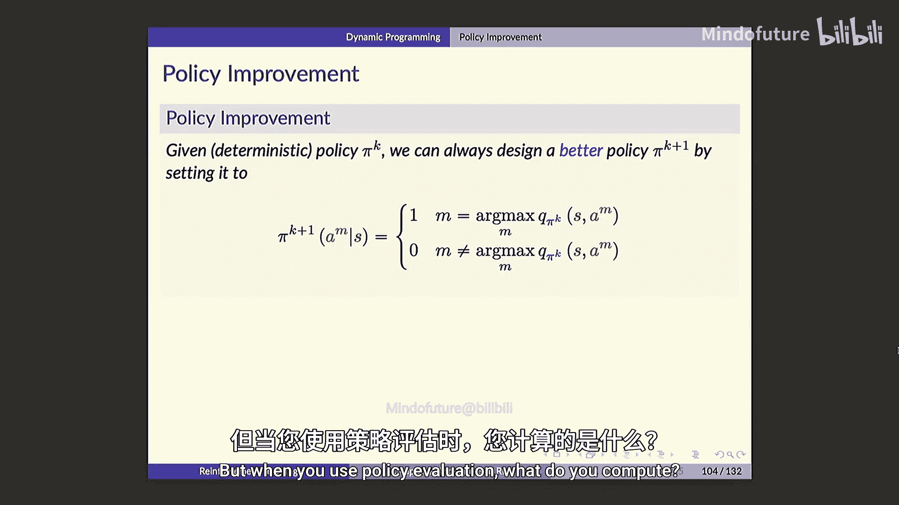

The value。

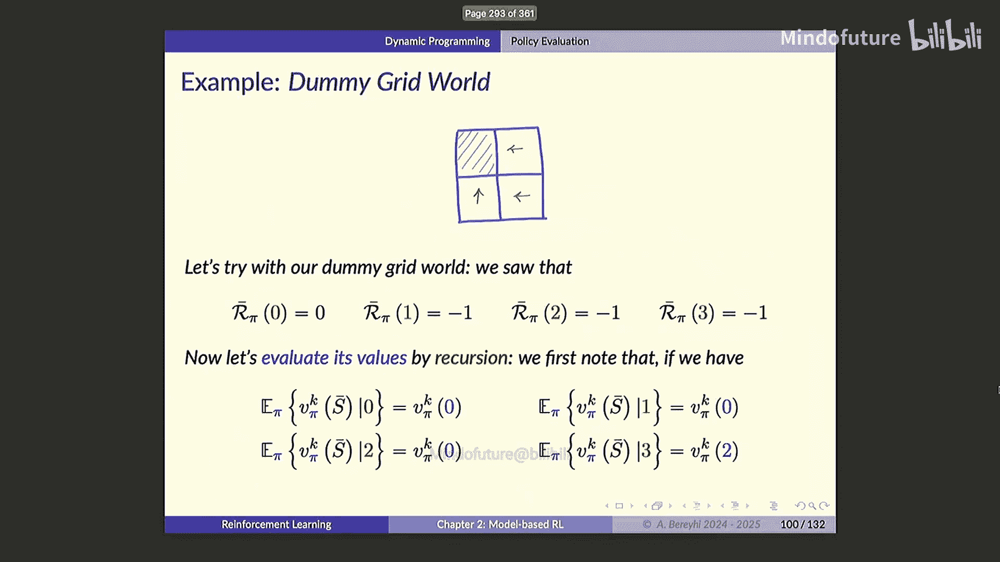

You value function comes out， right， How can I get from the value。是没有。Be virtue， right， so。

You know the value function。 You know the action value function in。No M P， right？

 So you don't get confused。 Like you say， okay， I have V。 I do not have Q。

 You can get from V to Q simply using Belman equation so。

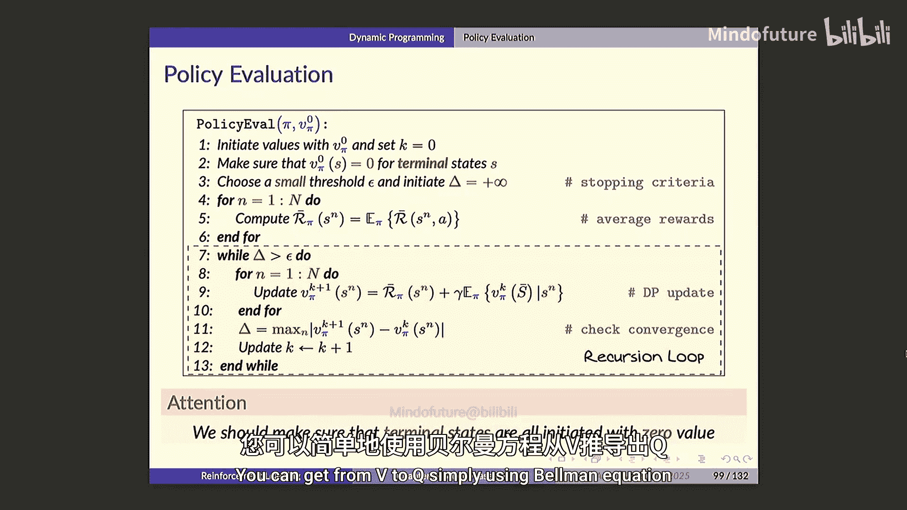

This is going to be the case。 If I give you the value function。

 So you have the value function of the policy pi， and then you are going to use the beman equation to convert this value function to the action value function。

 right。有。当。So stage。You， I'm gonna do。Based on this particular policy。Maximum value， right？

 So this is going to be your new policy， right。ForPrevious， right。

 and you keep on repeating this till you come， right， So this is one step of policy improvements。

 So if I give you V， you give me the improved version of the policy， right。

 And here you don't have any recursion， right， because I give you V pie， you compute Q。

 you you improve your policy， right， then。Compute the value， right。

 So you go inside the policy evaluation algorithm， You compute your value function for this pi bar。

 and then you take that value of pi bar into this algorithm and gonna improve it once again， right。

 So no recursion is happening right here by the recursion is happening in the。

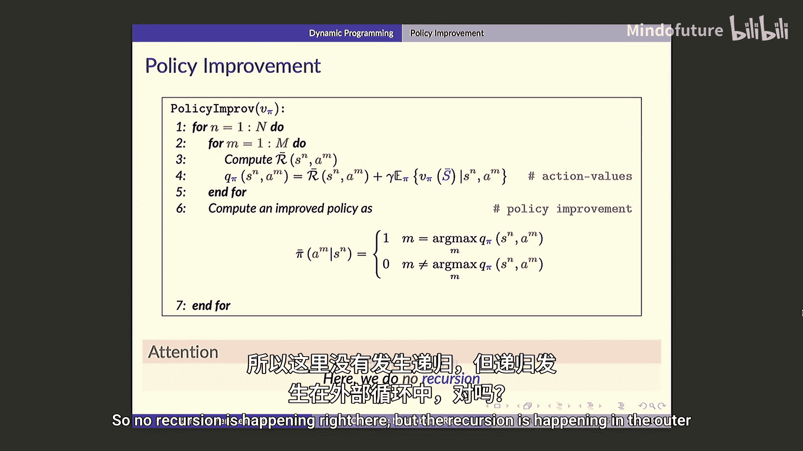

Alger loop， right。Everybody's clear。😮，Questions。Now， question。Okay， so if you have no question。

 then I think， yeah， we have this one where we want to actually improve the policy， right， But watch。

 yes， should improve the policy， right， Now， look at this policy here。It obviously not。Right。

I think that really need。Po evaluation here， because you can simply write down this Q function for this particular policy。

 right， So look at this policy。 Let's say I would like to be in。Yeah， let's start with this state 1。

 So， yeah， state 1 is actually the bad one。 Sorry， So you're in  one， right。Top right， right。

 And then you look at every single actions that you can do。啊这个。啊。哎。So when you are a one。

And you do action 0。The value that you are going to collect if。Right， you go。

 you go to the terminal and from the terminal on， you are playing with your policy。

 This means that youre remaining in the terminal， right， and you're going to collect 0， right。

 So it doesn't matter what the。Policy pi is you're always going to collect -1， right。Next thing。

 say you go down， right。If you go down and after that。

 you keep on playing with your policy When you go down， you get -1。

 then the policy tells you go right and sorry left。Left， right。You go left and then you go up right。

-1-2-3 right， So you're going to collect -3。 Now again， you' are here next time you go right， right。

 you hit the wall， correct， So you hit the wall。 you get minus half after that。

 you keep on playing with your policy right， minus half， then you go down policy says go down， right。

 minus-1。 half minus2。 half。The action value is 3。 half， right， If you just decide to go up。

 you hit the wall ones。 So you has， you have your minus half。

 and then you keep playing with your policy。 you're gonna collect not right。Po5， right now。

 looking at this guy。Are you doing the action which is giving you the maximum value with this policy。

What does the policy do， What is the action that the policy does？Shes action 2， right， over sorry1。

Is left，1 is down。 And the value of one。3， what is the maximum value， though。-1。

 which is for action 0， right， So you。The maximum value of this is given by action0， which is -1。

 which is not one you are getting here。Policy， right。See is not optimal。 You can。所。

Ting to do is that you are going to change this guy， right， You you say that， okay， the。

Theres going to be action left， right， So I'm going to change that action。

I don't touch anything else， right， This new one is eventually the optimal policy， right。

So we don't need to eyetrate anymore， but could eyetrate。 You stay in this policy forever。

So you see it。How it is happening。 So when you compute the action value out of that action value。

 you have the chance to improve your policy， right， based on what you see。

 because here by just looking at all possible action that you can do see。

That even with the caring policy that I have better choices。Not down， right。

 So I'm got direction down to left， right。

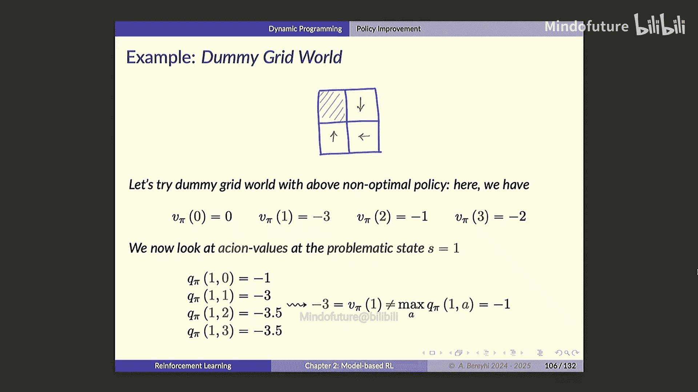

No question。Okay， so if you got no question， then let me just wrap up the whole idea of policy allocation So the。

The I creative way of using these two algorithms， right， So you you start with one policy。

 you evaluate that policy， then you can improve it right Once you improve it， you would say， okay。

 this improved1。 I don't know what are the values。 I again put it inside the policy evaluation right and I find a new policy right and I once I found the new policy。

 I sorry， I put it in the policy evaluation。 I find the new value function out of that value function。

 I again improved my policy。 and I keep on going till I see that this policy is not And we start hard to see that the moment you get into the optimal policy。

 you gonna stay in that optimal policy forever。Because when you are doing optimal policy。

 then using value policy evaluation， you are ending up with the optimal value。

 Then you get the optimal action value。 Then the improvement is going to take you back to the optimal policy。

 right， And you are going to stay in that optimal policy forever， right。

 So that makes sense that means that this algorithm is going to convert， right。

So optimal policy is basically the fixed point equation or fixed point policy of this particular iteration。

 And this is what we call it policy iteration， right。

 You start with one initial policy and they evaluate it。Then you update by policy improvement。

 and you keep on doing it。 So you don't see any。Is clear。都容易。

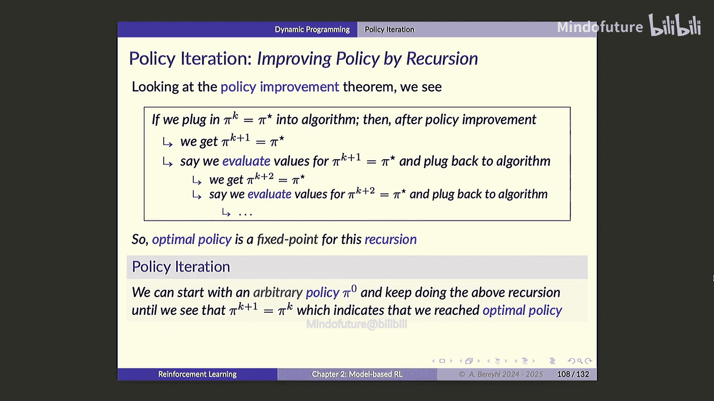

Yes， but you can do it for all these states。 And here。

 the point in this example is that since here you are doing optimal。

 then you're gonna to see that the action which maximizes is exactly the action you are doing。

 So nothing gonna to change on those states。But you're right。 if， for example， this。

 this one was also down， then once you update， this is going to also change。 It could change。

 That's right。You do it on all the estates， right。In this states where you are doing somehow good。

 the action may may not change。 The policy remains the same， right， in those which are obviously bad。

 the policy is getting improved。

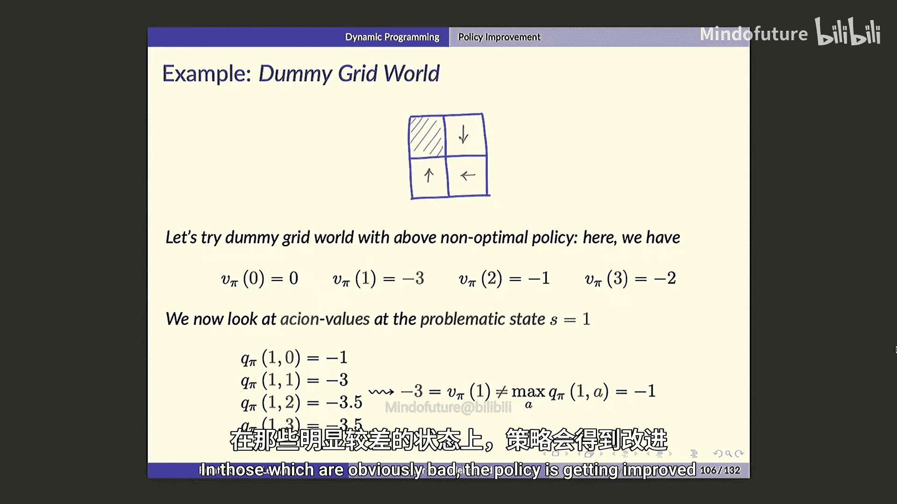

Exactly， I'm going the。Here。Yes， one。Right。Oh， I don't know， to be honest。 I should think of that。

 I cannot say it right now on the fly， but I guess it's gonna be a hard thing to make， like a case。

 But if you make it a bit larger than yes， it gonna happen。 Yeah。

 So I'm gonna give you one example where you need to。 I mean， not today on Tuesday。

 I'm gonna show you one example where you need multiple itts to converge。We're gonna see。

 But in practice， of course， you need so many itrations。 if you have a real environment。啊。Right。

 but for that one， you are not supposed to use this for this assignment。 right， Yeah， you don't。

 you don't want to use it。 Just， just write down the optimal policy。 Just ask for that。 But right。

 if you want to do that， then it' gonna be a hard thing， right， This。

 this is why you are going to write the program to deal with， right。Yes。Yes， I mean， if， if that。

 I mean， the policy exists， right， if those values are going to conver are value policy evaluation is converging。

 bad one is going to converge always。Because you are deterministically updating。

 and you know that there is at one deterministic policy。 So you definitely convert。

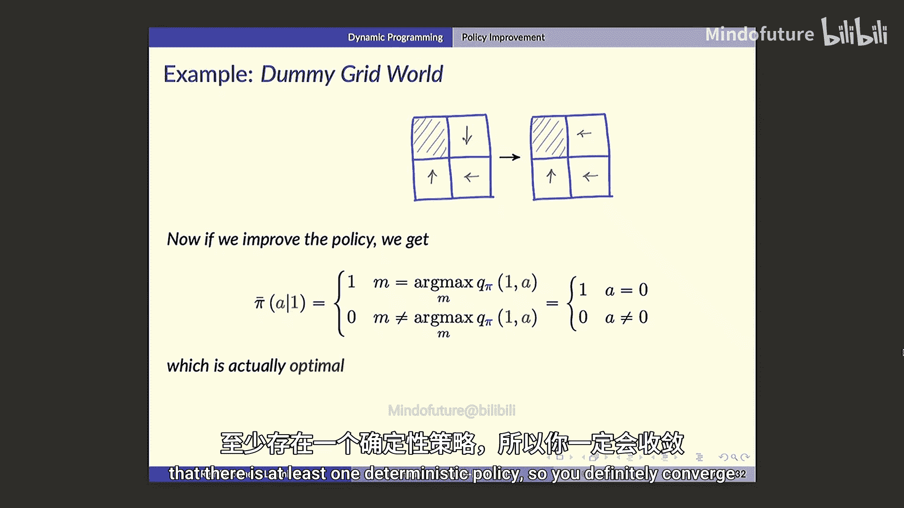

Just let me wrap it up before the time is over yeah。This is going to be the policy iteration， right？

 So you are going to start with a random value function， right。

 And then this value function is for one policy。 So you think some some random policy。

 say just totally a random policy。 And once you do that。

 then you're going to get into a one loop right each time you evaluate your policy right and by evaluating your policy。

 you are going to get a new value function once you have this value function。

 you can compute out of that value function。 the action value function and you improve policy right This is what you are going to do on line 6 right。

 you keep recursion till you see that this pi bar is not changing iss compared to pi。

Everybody's cool。Questions。Yes。A fully observable MP， right， that you can explain its statistics。

 right， right， If you， if you know the distribution of the next estate and the reward。

 then you can do it always。But as long as computational， youre， you're capable of doing that， right。

 if you have a crazy， large number of states， again， you cannot computationally do it， do it。

 But this algorithm theoretically lead you to there。没有。That's right。哎。So one thing here。

 first of all， you should pay attention that this guy is recursive itrative algorithm because you do one itration here from4 from 4 to 7。

 But in line 5， that policy evaluation itself again itrative right。

 So in each time when you go inside the loop to do one policy evaluation it。Which is another loop。

 So it's a kind of nested one。 So both of them are going computed recursively。

 One thing that you might say is that this guy， this guy is recursive， right， But this guy。

 you might say that， well， this means that I have a nested loop。 So it's gonna converge very slow。

 right， But one thing that we typically do in practice is that we do not start simply all the time with initial values being dummy values。

 right， So。One， the first time。When I want to do policy evaluation。

 I start with a bunch of random initial values， right， and I just use it to evaluate the policy pi。

 right， I end up with the value of policy pi， right， Then I improve the policy when I improve。

 the next time when I get to the loop of line number 5。 I do not start with a random initial point。

 right， I use the value of the previous policy， right， If you use that It's going to converge faster。

 right and then。Gradually， in a very good policy， it kind of converge in just a few iterations。Okay。

 so。

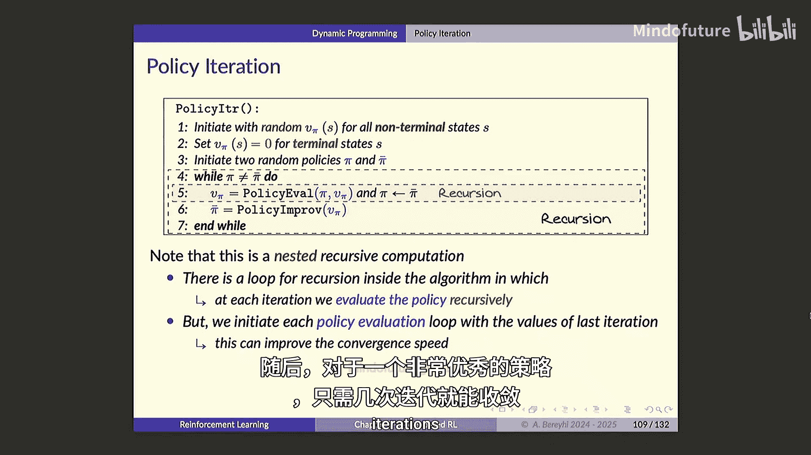