# 【多伦多大学】强化学习 2025 ｜ Uoft   Reinforcement Learning   Fall 2025 p20 P20_讲座_19_价值迭代 -BV1D3F2zhEry_p20-

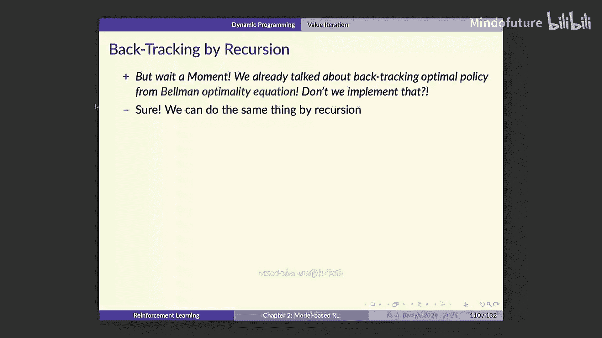

Valial itration probably makes more sense to you if you just remember what we did very beginning before we get into dynamic programming。

 right。The idea that we had initially was that， okay。

 if we can come up with the solution to the Belman optimal equation。

 then the problem is solved because then we can find the action value function and we can backtrack the optimal policy right So this makes sense。

 and this is the idea of value ittion right So we can simply solve the Belman optimality equation again by dynamic programming right So you start with setting some random values for your optimal value function and then you put it inside the Belman optimality equation and then you i traderate by dynamic programming till this converges right when it converges。

 you have the optimal value function for your environment right and out of there。

 you backtrack the optimal policy right So this is the idea of value itration。

 So you just do the dynamic programming， you do recursion to solve the Belman optimality equation。

Then you out of that， you get the beman sorry optimal action value and out of that。

 you just compute the optimal policy。 So this was the algorithm that we initially wrote for backtracking the optimal policy。

 So we needed to solve the Belman optimal optimality equation。 And after that。

 we could just do whatever we want， right， So we just do the we compute the action value and we find the optimal policy。

 Now， the only thing that we want to do in this value iteration is that we write down this line1 using dynamic programming。

 right。

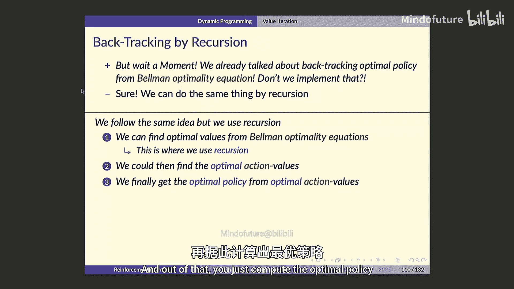

Everybody's cool。So we just want to do it by dynamic programming。

 And I guess it makes total sense to you， right， it's very obvious how you can do it， right， So yeah。

 this is the Belmon optimality equation。 So the optimal value in one particular state S depends on this optimal value at the other state using this equation。

 right， So here what you see， this is the immediate reward for a particular action。

 And this is the expected value in the next state， right， So when you do that action。

 you're gonna end up with a new state， the new state is going to have one optimal value， right。

 And then you just。

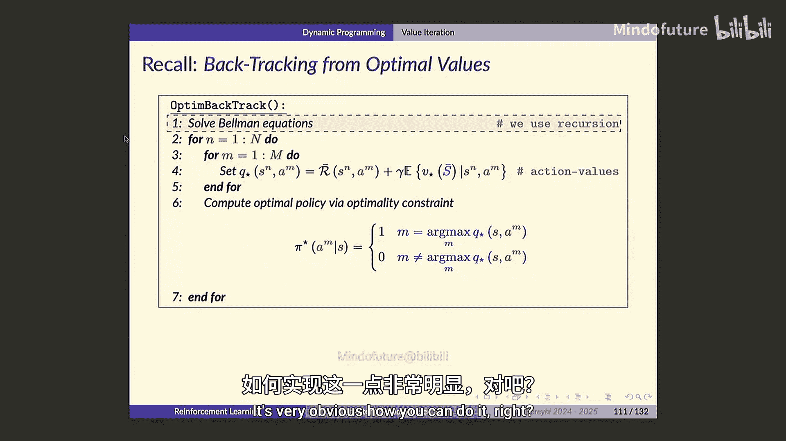

Take the expectation。 This is going to give you。The optimal value。 This is the beman equation， right。

 And what you can do， we， we can eventually again do the itative approach， right。

 So you start with some values again， as we did。 So your value function， we talked about it。

 Your value function is essentially just a table， right， A table of numbers。And those numbers。

 you're going to initiate them with some values。So。Yeah。Okay。Here。

So you're going to have a bunch of values， so you're going to say， okay， my optimal values。

At the Iration 0， This is a bunch of randomized value。 You just generated them randomly， right。

 So you're gonna say this is the optimal value at a state S1 and another random value you choose for state S2 and so on till your last stage。

 right。😊，So you're gonna take this vector randomly， you generate this。 The only thing that we。

 we need to pay attention is that we should put the optimal value for the terminal state to be 0。

 right， we talked about this before， This is a crucial thing because sometimes it might make your your system of equations incomplete right So you put them0。

 anything else， you just randomly generate， right， If they are optimal values， really。

 this equation should hold， right， This means that if I take those values and put them here。

 compute this expectation and take this maximization for every single state。

 I should again see the same value， right， If you don't see that， then you are going to update right。

 So if you're in particular Iation K， you're gonna take your。

Estimate of the optimal values in itration K in this form。

 you are able to compute this particular expectation。 Once you compute that。

 you're going to update your optimal values using the Belman equation， right。😊。

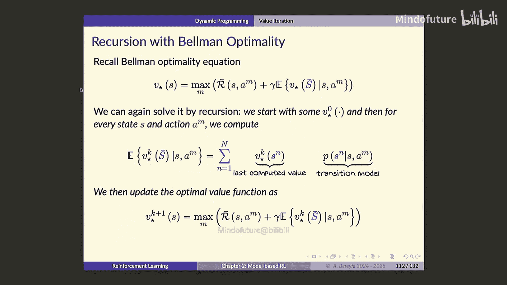

Rise go。So you do that。 and then you keep on itrating， right， So this is the。

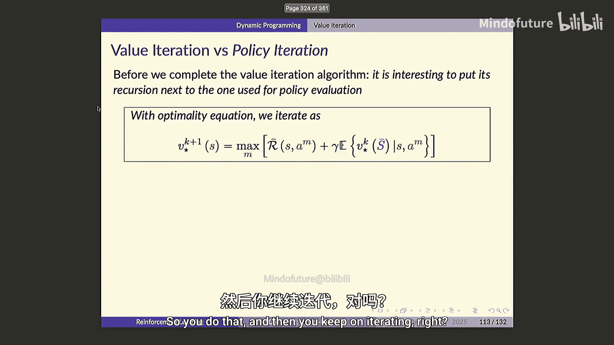

Update rule that you have in this iterative algorithm。

 you keep on itrey till you see that in one particular iteration。

 the values that you injected into the equation， the value that are coming out of the equation are the same right Once they are the same。

 you have found the optimal value function， right。

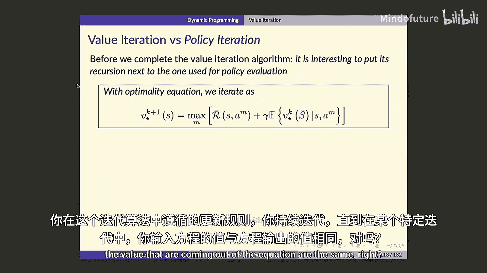

Okay， so。One thing that is interesting here， just to give you a bit of idea。

 and we're going to talk about it more in Cha3 is if we just compare what we do with the optimality equation。

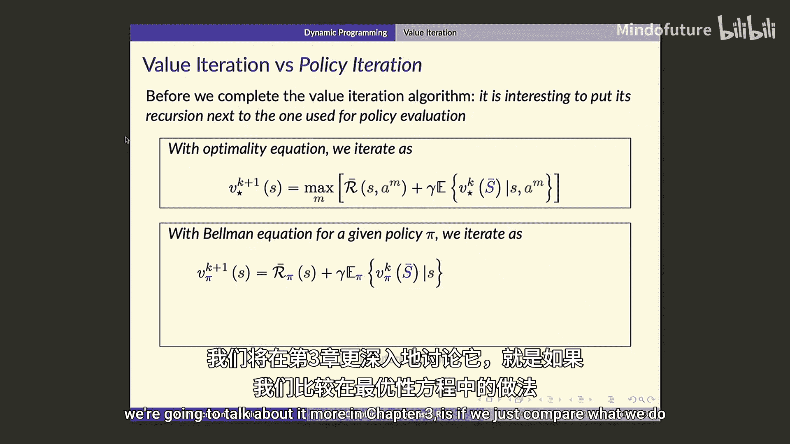

With what we do in the， you know， plastic policy evaluation approach， right。

 when we want to do policy evaluation， What do we do， we just take a policy， right， even policy pi。

 and then you take that one， you put it inside this equation， right。

 This is the equation that you are computing， right。

 And then this is going to give you the next value。 So this is the value function for policy pi。

 right， and this other equation here is the one which is updating the optimal policy， right， Okay。

 so now what I can do here， I can open up this term， right， and we did it a couple of times before。

 So I'm gonna show only the final equation。 So the final equation gonna be this one， right。

 So this guy that you see here， Yeah， this is the average of all possible。

Immediate rewards over the actions， given that policy。This guy， again， is the average。

 The one which you see at top is the one which is this guy when average over the actions。

 given the policy。 And， I mean， you just do the math， These two equations are， right？ Now。

 you see the equation in the second line here， and compare it to the equation。

 The optimality equation。 What is the difference， Do you see the difference in your update。That。Yes。

买。Maximum is going to be one of the terms in the sum。 same thing here。 we don't have policy。

 We have policy， right？ So if you put them next to each other， I mean。

 both things together are correct， right， So the key point here is that the argument that you have here right？

 So you need to compute this guy for every single action， right， correct。

 when you want to take the maximum， you need to compute it for every single action， right， correct。

 So this means that when you think of one particular state as you compute that expression inside the bracket。

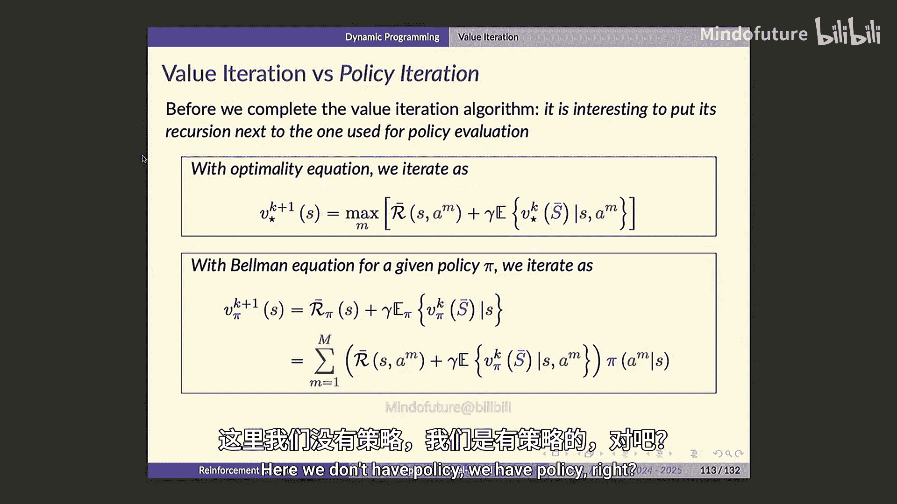

For every。But what you do in the optimality equation， you are taking the maximum， right。

 what do you do in the policy evaluation？You average same values using your policy， right？😡。

So this is the only difference。This is the only difference that you' are doing。

 So this guy is exactly the same thing as you do when you are doing policy evaluation。

 The only difference is that in the policy evaluation， you have the policy。

 You're going to average over the policy， right？ But in the optimality equation。

 you just take the maximum。 This is something that we call it this top one。

 This is something that we're gonna to call it later of policy。

Meaning that you don't care about the policy。 you only do work with the values。

 and this has a very nice connection to something called important sampling。

 We are going to talk about it later。 okay but the key point here is that in the top one。

 you don't need to know policy right， you get a bunch of values。

 action values and you do the action whose value is maximum right， whereas in this other one。

 you are playing with a policy right， So you have policy pi， and your average and things over pi。

 this is what we call it on policy， okay here in the model base on policy and of policy has less meaning because you do know what the environment is you really don't need to sample that environment But we going to see later that if we just go with this approach and sample the environment we are going to end up with off policy。

 this is what your learning is going to be。 and if we do this one， then we are doing on policy。

This is what we call it for instance， SArsSa does。 Okay so we're going to talk about that。

 but it's interesting to see the difference between these two from computational point of view。

 both things are the same right， So you do the same calculation in both itative algorithms here in each update。

 you take the maximum one in the other one， you just take the average one right okay。Cool。

 so the key point here that for every single state， you need to compute M different values。

 right in the policy itration when you are just evaluating your policy。

 you just take the average of those M different values。

 But in the value itration or when you are dealing with the optimality equation。

 then you're gonna take the largest one， the maximum one， right。

 This is the only key difference here。 And this is going to be the value itration approach， right。

 So the value iteration， what you want to do at the end of the day。

 you want to get your your optimal policy， right， and the optimal policy。

 what you know is that you do the action， whose action value is maximum， right。

 This is what we talk about if I do know the optimal action value of function。

 then I'm gonna at each state， I'm gonna do the action， whose value is maximum， right。

 the only question is that I want to know that action value function。 How I can find it， Well。

 we can just。

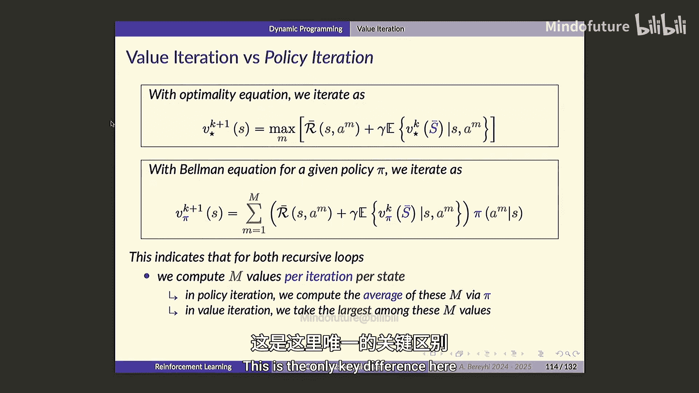

trade by dynamic programming， right， So this is going to be the dynamic programming loop。

 I'm going to just consider some small value epsilon。

 then I get into the loop for every single state， I need to just compute action value for all possible actions。

 right So this Q value that you see here。 This Q function that you see here。

 The right hand side is exactly the equation that you need for your update， right。

 So this is what you compute to update right， for every single state。

 you compute this for every single action。 And then when you want to compute this guy。

 you need to know the value function。 So you're gonna take the one which you have in ittration。

 then what comes out of it。 you take the maximum one。

 and this is going to be your next optimal value right and a typo here。 sorry， this shouldn't be pi。

 This should be star in line 8。

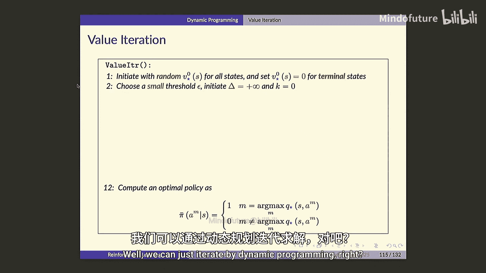

Okay， I tried my best to， yeah， find typos， but obviously here in line 8 and line 10， I have missed。

 So in line 10， it should also be be a star。 Okay， so just you don't compute any V pi。

 there is no pi here anymore， right， any anywhere， if you see any pi。😔，It should be replaced by。St。

 okay， so youre you're taking your optimal value， and then you keep itrating， right。

 You keep itrating every single it。 Youre comparing your new optimal value with your previous optimal value。

 And if you see no change， this means that you have converged to the optimal value function。

 you're gonna stop。 once you stop， you have the optimal value function。

 You can compute the optimal action value and you have the optimal policy， right。

Same thing as a policy evaluation。Questions。Everybody's clear。No question。

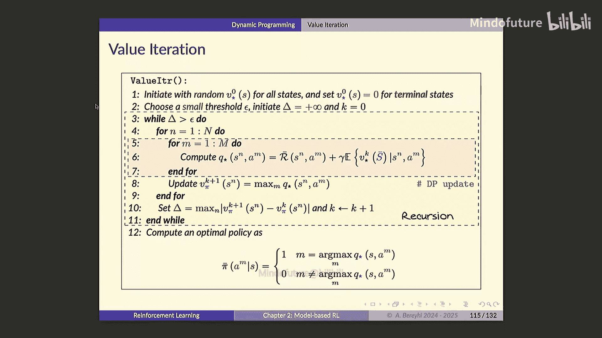

Okay， cool。 So if you got a question， you can go ahead and solve this dynamicmic grid world that we have done before。

 This is going to be super easy。 Okay， so I'm not going to do it again for you。

 but you can simply try it at home。 if you wish。 Yeah， just consider all the four stairs。

 start with one。Initial values。 So just said the optimal value for your。

For your terminal state to be 0 or anything else where the others is okay。

 And then if you keep on itrating just one ittration。

 you're gonna conversege to the optimal value function， right， and out of that。

 you can easily compute the optimal policy。

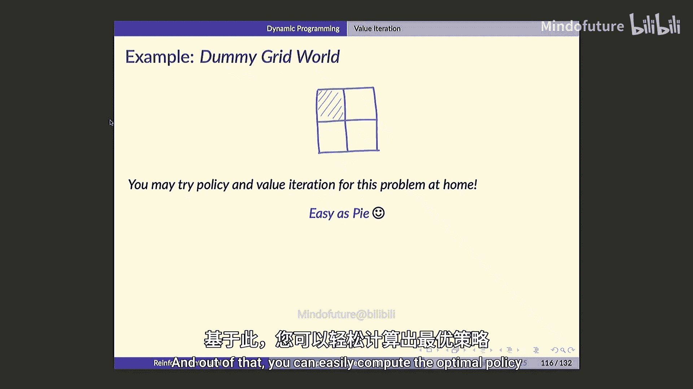

Okay， now。