# 【多伦多大学】强化学习 2025 ｜ Uoft   Reinforcement Learning   Fall 2025 p21 P21_讲座_20_广义策略迭代 -BV1D3F2zhEry_p21-

Let me give you now a better example。 So let's consider this particular this other example。

 So in this example， what do we have， We have again， a grid world， but now is 4 by 4。

 So we're going have 16 different cells， right， We have two terminal stay。 So stay 0 and stage 15。

 right， If we get anywhere there。 we are going to get keep on getting reward 0 and we stay there forever。

 right， So these are where the。

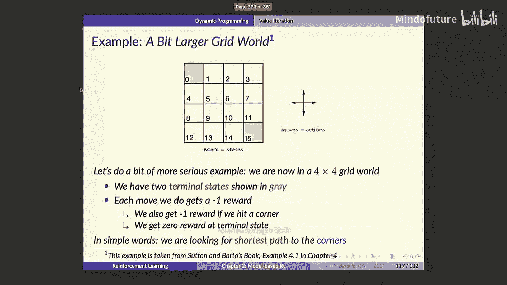

Everything is going to be over。 The episode is over， right， And now you start from one point。

 one state in this， this grid world， one of the cells。 and then you can move exactly as before。

 up down left， right， And then each time that you move。

 you're going to get a reward -1 And this -1 doesn't matter。 if you hit the wall， you still get -1。

 right， each action you do， you get -1。 unless you， you arrive to the terminal state。Okay。

Everybody's cool。 So eventually， what you are doing。

 you want to start at one of the cells and you get to the to the corner， which is。😊。

SoIf you're at 11， for instance， the right choice is to just go down， right。

 whereas if you're at one， the better choice is to just go left， right。

 end up with that terminal state， right Everybody's cool。No，0 and 50。

 both of them are terminal states。 Oh so I can go 0，1，0。You cannot get out of0 when you are at0。

 you're over。 It's a terminal state。 You're gonna stay there forever， right。全自信。Right。

 some random cell you start， and then you want to just move like optimally like you take the shortest path toward the corner。

The short as past two。Of course your。E iss either 0 or 15 depending on the cell， right。Yeah。

 so if you're at 11 or 10， the shortest shortest or nearest corner going to be 15。

 but if you're at one， then its going be zero， right。Ns。So， everybody's cool。Now， first。

 let's consider the policy itration。 How we're going to do policy itration。

 We're going to start with some random。

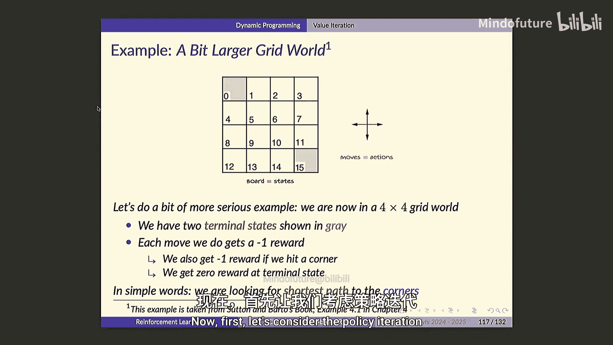

I'm going do a total random policy， meaning that I just consider this policy that at every single cell with the same probabilityvol。

 I'm going to move in one of the directions， right。

 So probabilityvol of going up down left right is one over4， right？

 So this is a complete random policy， and the thing that I'm gonna do。

 I'm going to set all the values to be 0。 Eventually。

 if you set all the values to be 0 is a safe choice always， right， because by default。

 the terminal save are 0， anything else could be any number， right， So they are all being 0， right。

 So I'm going start with the value， completete value 0， right， And what I'm going do。

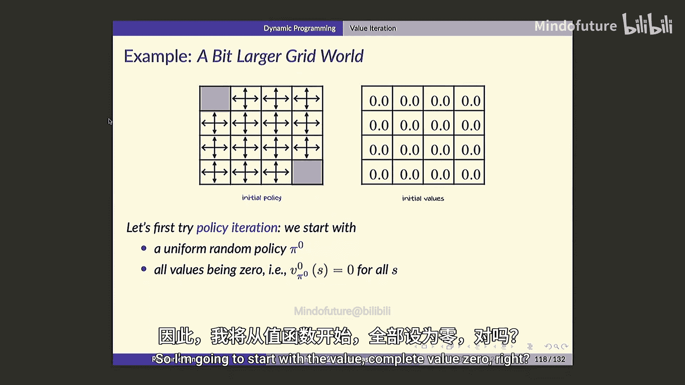

I'm gonna do policy ittion， meaning that I have started with this pi。

 This pi now is the complete random policy。 The value is V pi， which I start with is complete 0。

 That table of complete zeros， right， And now I start to do dynamic programming to find out what is the value of this random policy。

 Okay， cool。 So I'm going do this。 And I start with this one。 Now you do one itration 2 itration。

 you keep on keep on it trainingrating。 If you do one itration。

 every single cell is going to get updated by -1， right， because。😊。

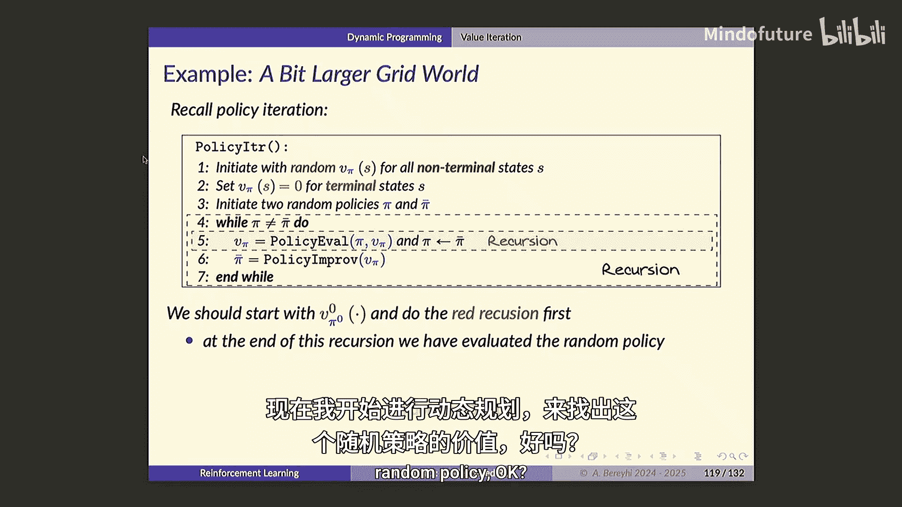

Value， for instance， look at this guy。 The value at this point at this cell 1 is0， right？ Now。

 when you want to find out what is the value for the the next itration。

 You're gonna take all of those zeros right and add them up with the immediate reward that you get playing your policy。

 When you play your policy， it doesn't matter which direction you go， you always get -1， right。

 and the expected value of the next cell is still 0。 So you're gonna add up -1 to that0， right。

 So any guy in between gonna get -1， just the terminal state is gonna remain0， right。

 and you keep on ittrating。 So you go on maybe one more itration and you keep on going till you have enough itration。

 you see that your values are not changing。 Okay so when you get to this guy to this table。

 you see the values are not changing。 If you start game from this values。 So you take it as。V P K。

 and you give it to the beman equation。 What you see at the output of Belman equation is， again。

 the same values， right， And this means that these are the values of this random policy。

 Everybody's clear。Right，So I got this one。 This is the value of which policy。😊，Which policy？

Random policy， the policy that I just move in all directions randomly， right。 Now。

 what should I do next。If I'm doing policy itration。Improve the policy， right？

So what what I'm gonna to do， I'm going to just。Takeick go in every single cell and see what is the action whose action value is maximum。

 right， So let's do it for one of them just to make sure that you understood this。

 So let's consider cell 1。 Do you see what is cell 1。Do you see what he's selling on？So it's the one。

 which is on the first row second cell。 Okay， that is cell 1。 Okay。

 so now let's look at that one and。See， what is the action value when we are。

What is the action value when we are playing with this random policy。

 So I want to know what is Q pi 0， okay。At this particular one， when I do one of the actions。

 so let's first consider the action up。Okay。Let's consider that one， Okay， now。

How can I write it down using Belelman equation？If you use the Belman equation。

 this is going to be the immediate reward that you get。At this particular cell1。

 doing action up plus。The expectation with respect to pi often value in the next cell， right？Okay。

 maybe I can't take it up。The expectation of the value of pi。In the next cell。

 given that I am in this particular cell1。And I am doing action。

 So this is what you're going to get out of the bellman equation， okay。Now。

 what is the immediate reward when I am in one and I move up， what's going to happen？😡，-1， right。

 It doesn't matter which direction I go。 I always get -1， right？ So this guy is  -1。Now， if I am in。

In cell 1。 and I move up， what gonna be my next state， What gonna be my next cell 1 again， right。

 Because I hit the wall， I remained there， right？ And if I keep on playing randomly after that。

 what is the value that I'm gonna get。Look at the table。-14， right？

 So if I play with the random policy， the value that I'm going to get-14 in cell。One， right。

 You see it。This is-14， right， this guy。Everybody sees that。

This is the value of cell1 when you play randomly， right？Everybodys cool？Okay。

 so what would be this expectation then。If I am in one and I go up， is there any confusion。

 Is there any randomness， No， I'm going to end up exactly one， right？ So actually。

 I don't need this expectation anymore because it's not like I'm just jumping from one cell to another。

 right， I'm going remain there。 And this value is。-14。 So eventually。

 this expectation simply is value of pi at cell 1， which is going to be -14， right？

 So now what is the。Action value of cell1 when I go up。😡，-15， right， So I'm gonna keep it-15， right。

Okay。Everybody's cool， Now let's just consider another one。Any other color？No， we're。We the oh。

 least we have more。O。Now， let me just write it down here for you。 So Q。

Q function of the policy pi 0。 this random policy that we started with at cell 1。

 When I go up is going to be-15， okay。Now， let's just replace this one by another action。

 So let's say that this is the action。 I'm gonna go left。 Okay， now I want to know what is the。

Action value， so。I'm going to clean this off。Here， and then。Everything should be the same。

 So it's going to be the immediate reward at one when I go left。The expected value of the next cell。

 when I am at cell 1 and I go left， right？Now， what is the immediate reward if I go left？😡。

Minus1 again。What is the next cell if I go left。If I go to sell 0 and I play with my random policy。

 what gonna be the value。Because it' a terminal I say， right， So it's going to be cell 0。

 The value is0， right， What is then the action value when I go left？And I go left， that is。-1， great。

 right。 Now can you tell me what are the two other action values， Do you have any idea。

Just look at the table， I guess now you can guess， what is the action value if I am at one and I go right。

- 21 because if I go right I'm going to go to the cell2 right and that is giving me value minus 20 minus20 plus 1 minus1 is going to be minus21。

 What is Q pi 0 when I am at cell 1 and then I go down。😡，What was is going to be？-19， right。

18 plus 1 is going to be-19， right， Now， looking at these action values。

 what is the optimal action to do。Just go left， right， because it has the maximum value， right。

 among all of them， right， So we started with random policy。

 that random policy gave us a bunch of values for the random policy。

 But what we obviously see is that this random policy， given those values is not optimal， right？

 So what is the right improvement is that when I am at this cell 1。

 I move left instead of doing any other action， right， So I'm going to take this action， right。

I'm going to take this action， right？Right， O。So let's see。 No I'm very afraid。

 Maybe it's not the right solution。 So let's see。 So I need to improve， right， line 6。

 I want to improve。 So I had the values that I computed this table。

 I give it to the policy improvement， I do exactly what we did on the board。 And then we improve。

 So this was the first policy and okay， we are right， Okay， no worries。 So for cell1。

 the right action is to go left， right， and you can see on the values here for everybody， right。

 So when you see， for example， where when you are here， you see that if you move here。

 you're gonna get， I mean， this is the next value， which is -14。 But if you go here or down or up。

 all of the values are less， right， So the right choice is to go left， right。

 So when you keep up if you update this policy， but this policy improvement。

 this is going to be your new policy。😊。

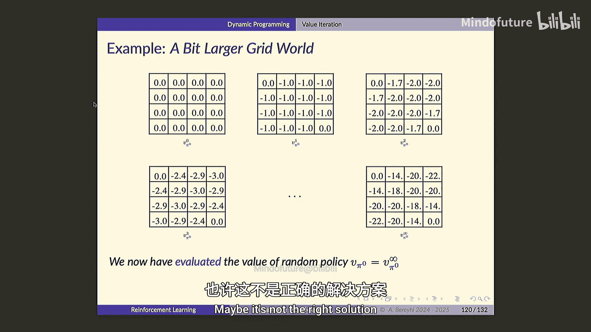

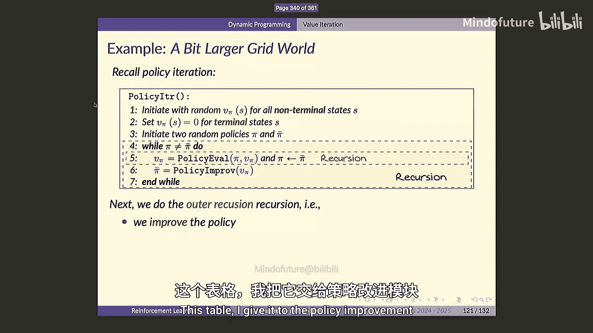

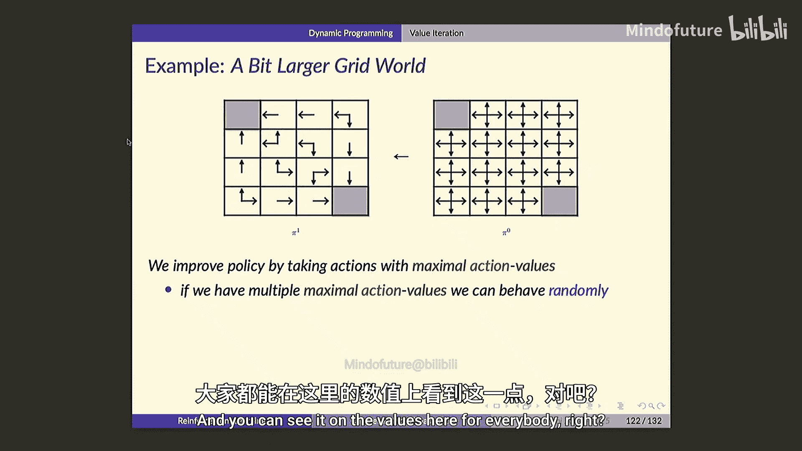

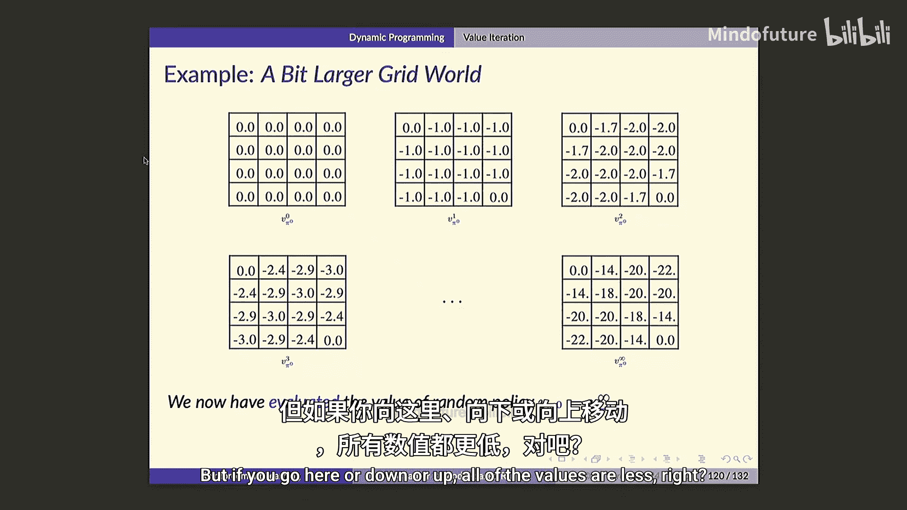

Okay， now you have your new policy。 you're gonna take it again。

 put it inside the dynamic programming algorithm， right。

 meaning that you start with a bunch of values。 we use now this particular policy to compute the bellman equations and we keep itrating till the value function converges right So if you we get again back to line 5。

 But this time instead of using the random policy， we use this improved policy pi1 right So you keep on doing this。

 So you you could start from complete zero。 but typically， as I told you。

 the best thing is that you said the initial values to be the values you compute it with your previous policy right So these were the values。

 you just computed for random policy。 And then you can keep on itrating right。

 keep on itrating till you end up with this new value function， right。

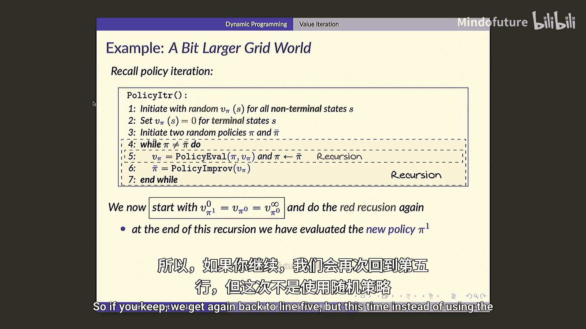

This value function makes sense， right？ If I do this， this particular policy， sorry。

 this is the policy pi 1， right， If I do that policy， this is-1， This is -1。

 Here is-2 because I either go up or go left and then go to the terminal and so on， right。Now。

 this is the correct value function。 Now that you have this correct value function。

 you could again improve your policy。 But as a matter of fact， for this dummy example。

 if you do improve it， you're gonna see that pi pi2 is going to be exactly pi1。

 meaning that your algorithm the algorithm you found the sorry， policy you found。

 it was optimal policy， right， and the policy iteration algorithm has stopped。Questions。

Everybody's clear。 So you got the idea how the policy itration works， right。

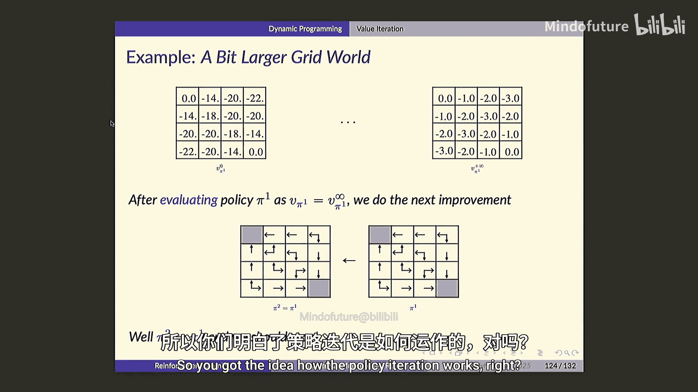

Cool， so that's the case， but。What you can do， you can also use value ittration， right。

 if you want to use value itration。 again， the thing that you're gonna do。

 you're gonna start with some initial values。 But these initial values are not the values of a specific policy。

 right， They are the values that you initiate for your optimal policy， right。

 And then you gonna go ahead。 So you're gonna say that optimal value for all cells or 0。

 And then you are going to just ittrate with the dynamic programmings。

 meaning that you just put it inside the bellman equation。

 you compute the next one and so until you converge， right。

 And when you do enough number of ittration， you're gonna see that you get these values， right。

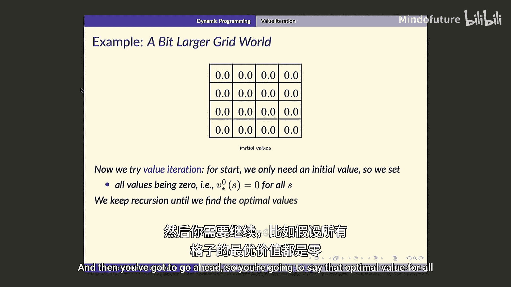

Out of these values， again， like what we did on the board， we can find the action value， right。

 And then out of the action， this， this is the optimal value function。

 Then you're gonna get the optimal action value。 And then out of that optimal action value。

 you can just write down your policy， which is going to be exactly the same thing。

Everybody's cool questions。No question。

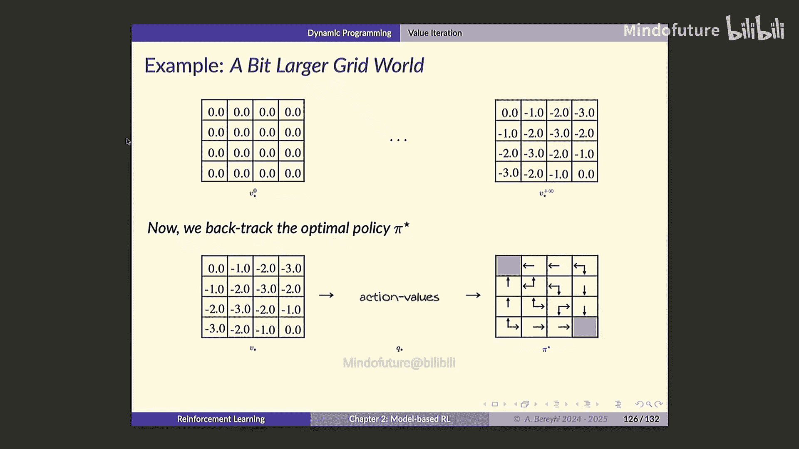

O。So if you got now question， now one thing that you might。Ask me is there， well。

 if we just do value ittrition， it seems to be less complicated， right。

 because for value ittriration， you just need to do this dynamic programming loop one， right。

 you don't update your policy， correct， So you have your no policy。 You just find the optimal value。

 And then once you find the optimal value。 Everything after that is not iterative anymore， right。

 So it might come come to your mind， it's not wrong。 I mean， in many simple example。

 this is really the case。 but this is not generally correct。 Okay。

 and just to show you why this is not generally correct。 So let's。

Think about the particular example we had。 We had this policy pi 0， right， and policy pi1。

 policy pi 0 was the random one。 P 1， which was， was the improved one， right。

 And then when we had to first evaluate this policy。 say， for example。

 K1 ittations was the number of itations we took to get into that policy。 that value function。

 So this is the first recursive approach and say K2 is the one which we took to just evaluate the second policy。

 Okay， meaning pi 1， right， now。K1 plus K2 is the total number of its you have done in this whole algorithm。

 policy itration algorithm， K1 for the first one， K2 for the second one。

 and one thing that you would see in practice is that this K2 is going to be significantly smaller than K1 because when you want to just evaluate policy pi1。

 you start with the values of policy pi0 right and that is a very good start point。

 So you're gonna converge you much faster。 Okay so typically you see that K2 is significantly smaller than K1。

 But in total， you can say that K1 plus K2 is the total number of values that you have taken right sorry。

 the number of its that you have taken now if you want to do the value itration。 well。

 you probably do k is star its right So you start from all values being 0 and then you i trade using optimal de and equation till you converge right。

 say that this number of itration。

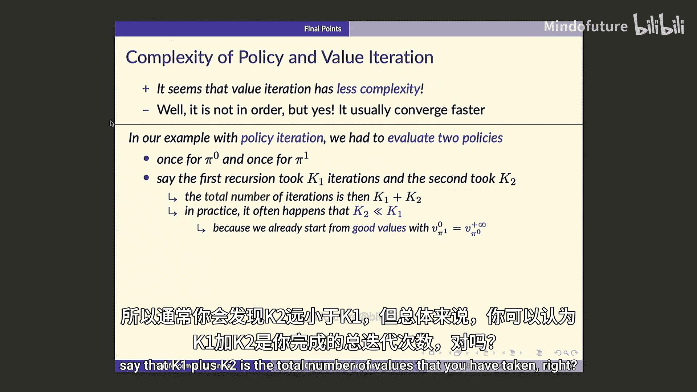

ks star。 There is no reason for k star to be smaller than K1 plus K2。 You see it， right。

 There is no reason because one policy might be very simple so that the convergence is happening very fast where the optimal policy is complicated。

 then it takes time to converge， right， So there is no reason for k star to be same as K1 or K2 or even less than that。

Right， so it could be the case that， for instance， K star is more than K1 plus K2。 It could happen。

 right， But if you think about a kind of a bit generic MP。

 and then you think about like doing enough number of vibration creations for every policy evaluation。

 then this is typically the case that K star is a bit smaller than the summation of those。

Iterations you do within the policy itration。 Okay， this is typically the case。

 But in terms of the order， the order doesn't change。 So the order like。By order， I mean。

 how it scales with the number of estates that you have or the number of actions that you have。

 It doesn't change in the order。 Okay， it gonna be the same。

 meaningan that if you have a very big environment。

 both of them gonna take roughly the same amount of time to converge， okay now。U。

This is the key point。 So there is no reason that this value itration is strictly simpler than the policy itration。

 but typically in practice， you you see such an observation。 Okay， Now。

 one thing that comes to your mind then is that okay。

 if they are having the same order of complexity in terms of the number of or the time that it takes。

 then what is why should we do policy itration， right。

 Why should we just take a policy evaluating it， improve it again， evaluate and improve it。

 why we just why we don't stick to one giant loop for evaluating the value。 Well。

 there are a bunch of reasons， But the most important reason for that is the fact that we cannot really conver in those loops。

 So what is going to happen in practice。 if you are not having a dummy example like what we had here。

 if you have a real environment， Then the thing is that when you go inside that loop。

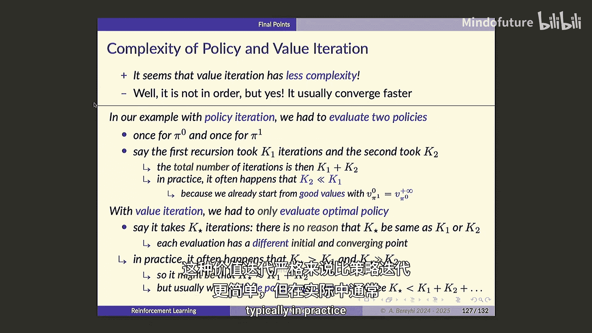

Which is just itrating doing the dynamic programming。 It's not going to converge exactly。

 So there is no point where you see exactly the updated value is the same thing as the previous values。

 it's going to always get better and better and better right， but this improvement。

 the new values that you compute are getting closer and closer， right。

 So what you need to do at the end of the day， you need to terminate it at some point， right。

 So you're going say I'm going to do dynamic programming 400 itration。

200 iterations right when you terminate it， the values that you take out of that loop are not the exact values。

 right， there are estimated values right And then if you just keep the giant loop for the value itration。

 you are going to estimate the optimal values， right， But that estimate could be a poor estimate。

 right， This could happen。Really， the environment is complicated。

 Then you could have a poor estimate。 whereas if you start from some dummy dummy policy， like。

 for example， the random policy， this could be the case that it converges better， right。

 So the values that you get out of that iterative approach。

 the dynamic programming are better estimate。 And since we have a better estimate。

 you can improve your policy more concretely。 And the next policy again is going to converge better and better and better。

 right， So the main reason that policy itration could work better than or might be。

Preferred in some situations is simply numerical because numerically。

 it could be more stable as compared to the value itration， right。

 So if your value itration loop is going to really converges to the optimal value， that's okay。

 But in practice， most of the time， it does not converge， you need to terminate it at some point。

 right， And when you terminate it， you could get。Loser kind of approximation as compared to what you would get with policy itration。

 Okay， so this is the reason that when you really do appmative computation。

 then people prefer to do policy itration， because it could get give you a better estimate and eventually ends and ends you up with a better policy。

 right， So more of a story。 So if you， if you do value itration。 Your algorithm might stop faster。

 you might take less time， not in order， but like slightly less time to converge or get your output out of the algorithm。

 but that guy might be less reliable numerically as compared to what you get with policy itration。

 So this is a tradeoff， you might。Would consider， you might need to consider when you are just implementing。

 okay。

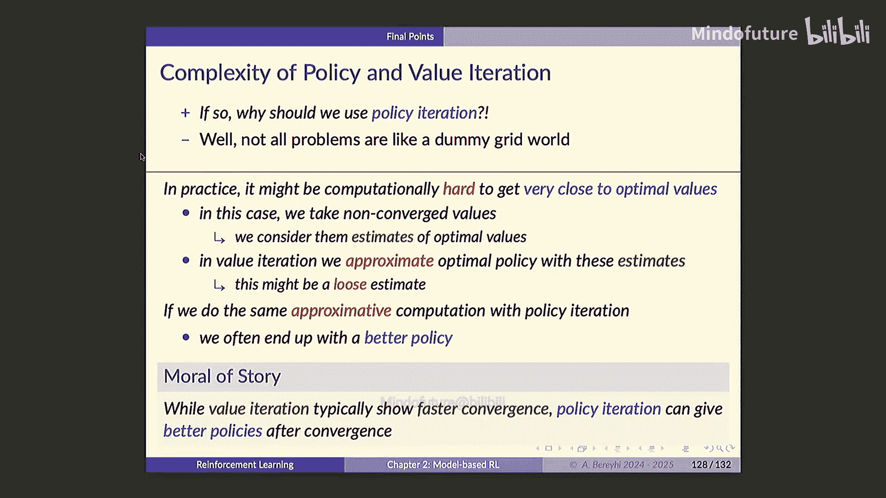

Question on that。Now question。Okay， so if you got a question now one thing that。People would like。

 typically to get out of this policy and value itration is what we call it generalized policy itration。

 And that is exactly the same policy itration as we had。 the only difference is the numerical。

 the computational or implementation aspect。 I just said。 So in practice。

 when you do policy evaluation， that evaluation loop， this loop， which you have in line 5。

 If you have really policy evaluation algorithm。 This is not necessarily converging， right。

 Maybe you need 1 trillion its till it gets converged， right， but you don't want that， right。

 because you want to get this， improve your policy， do it again。 if each time you want to take。

 I don't know， tend0 to power 10 different its， then you're gonna take forever， right。

 So probably what you want to do， you want to just give it a maximum number of its。

 right So this is like a kind of terminated version of the policy evaluation。

 And this is what I have written here terminated form of。

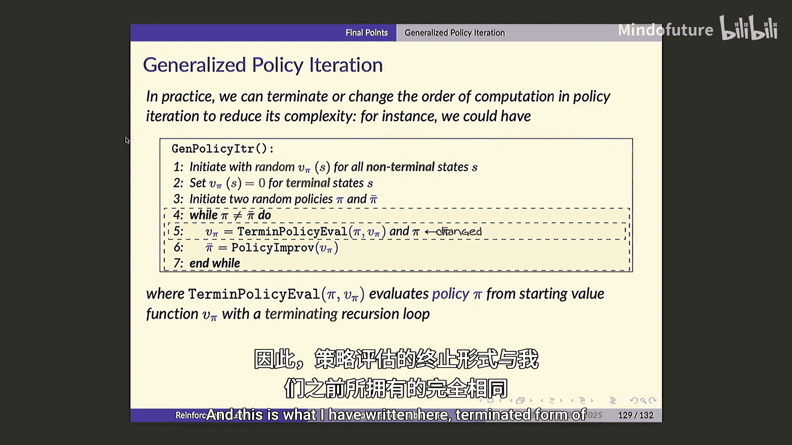

Po evaluation， so the terminated form of the policy evaluation is exactly like what we had before。

 This is the policy evaluation。 Exact same thing。 The only difference is in line 7。😊，And line 7。

 you don't wait till your， your algorithm converges like the new value is exactly same as the previous value。

 So you're gonna， I mean， if it happens soon， well， we're gonna take it， If not。

 we are going to just do it for a maximum number of ittrations， right。

 This is always the case when you implement any itt algorithm， right。

 So you're gonna have a maximum number of itts you give to it， right， And if you do that， as I said。

 what you get out of this algorithm， there is no reason that this guy is necessarily the value function that you want。

 right， It could be that guy， if it happen really in line 7。

 you really have the first constraint happening， but it could happen that you have。

An approximate version of that， right。 And if that happens。

 then what you need to do is to just take that one approximately now。

 and you put it back into into this algorithm， right， So you're gonna get this approximated value。

 and then using that approximated value。 You can still improve your policy， right。

 improve your policy with this approximation and you keep on going， it is going to converge。

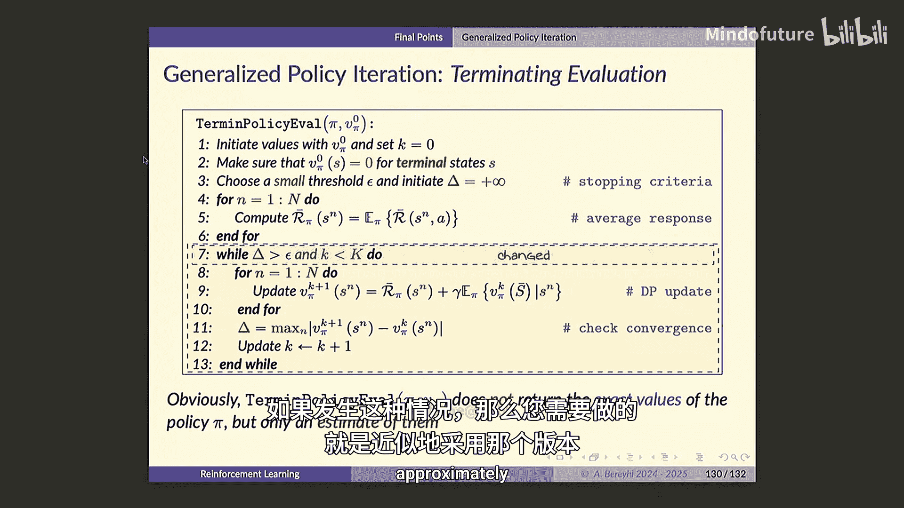

It is going to converge most of the time。 So this is what we call the generalized policy attion。

 So you are eventually going back and forth between policy evaluation and improvement。

 But when you are doing the evaluation， you don't really need to evaluate exactly your policy function evaluation function。

 you can just do it up to up to a specific precision right。

 And what you can think about it is of this form。 So you could say that okay。

 I start with one policy， and I evaluate it， right， but the evaluation that I get is a bit noisy。

 right， it's okay。 I'm gonna take it， and I improve my policy， right， So I improve my policy back。

 I get to a new one， right， And for this new one， I again evaluate again。

 I have to terminate my evaluation because I cannot do it forever。 again。

 I get a noisy version of evaluation。 but but it's okay。 Now。

 typically whats going to happen the level of the noise that you're gonna see this time is going to be lower。

😊。

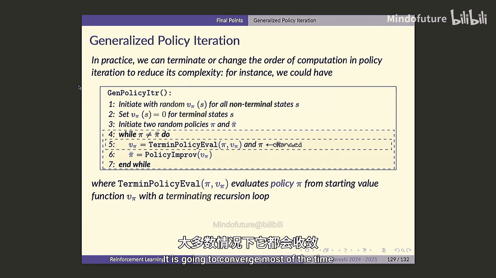

Okay， and then again， using this approximated value function， you again improve。

 You keep on going till you see this， this。Jump this inre。

 inaccur and your approximation is very small， right。

 And you eventually end up with the optimal policy。Everybody's clear。Questions。

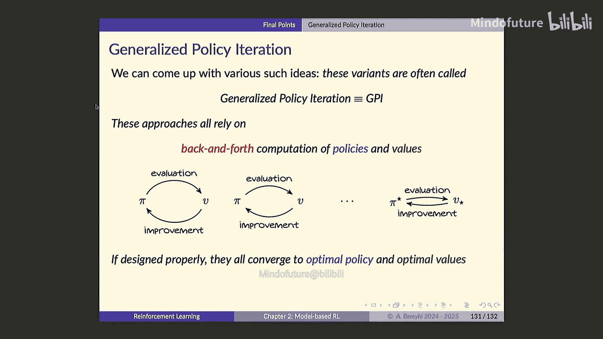

No question。 Okay， so if you got no question one。Side note。

 is there any guarantee that GI generalized policy itration converge， Yes。

 there are a bunch of proofs for that。 For example， I put you here a link。

 This is a quite old proof by Tim Mitchell。 Do you know him。Who has seen 13？

You have a textbook on machine learning， right， One of the textbooks I is by Tom Okay。

 so the guy is quite well known person in machine learning。 So he has one。

 one note on the proof of the generalized policy itration to converge， okay。

 you can take a look at that。 if you click there， you're gonna see that proof。 And yeah。

 so this is typically the case。 So most forms of generalized policy itration。

 like if you have this termination of the its within the policy evaluation algorithm。

 even very small， is it still going to converge。 Okay。

 but just I put you here as a side note is that。😊。

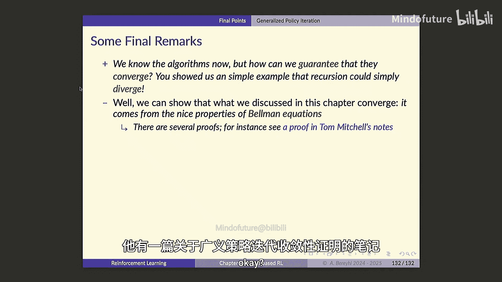

First of all， that proof that this algorithm is converging。

 It does not guarantee that it's converging very fast， right。

 It might be still that you need to do the improvement forever， right。

 So there is no guarantee there as well。 But it says that if you just terminate your evaluation。

 but you just improve forever， then you're gonna converge right， again。

 the question is that in that outer loop。 When does it converge， You cannot necessarily go it。

 So some specific conditions on which you are going to converge In some other cases。

 what you are getting out of your algorithm is an approximate。poli， that is a fair approximation。

 numerically okay to take that one and work with that one。

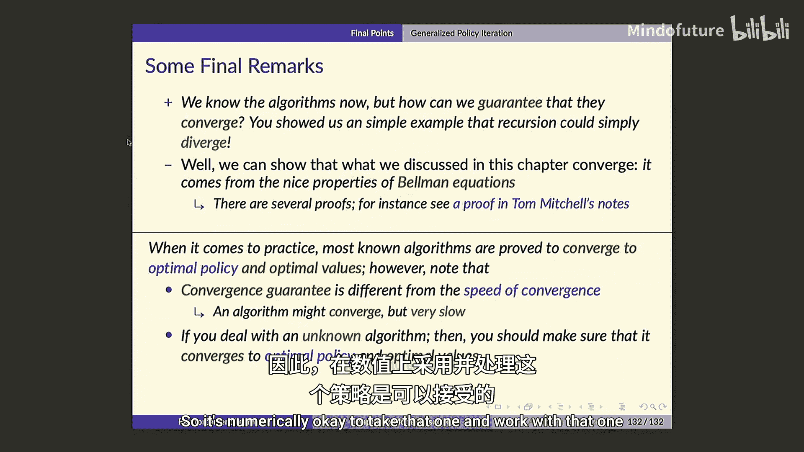

Okay。