# 【多伦多大学】强化学习 2025 ｜ Uoft   Reinforcement Learning   Fall 2025 p22 P22_讲座_21_通过蒙特卡洛进行无模型策略评估 -BV1D3F2zhEry_p22-

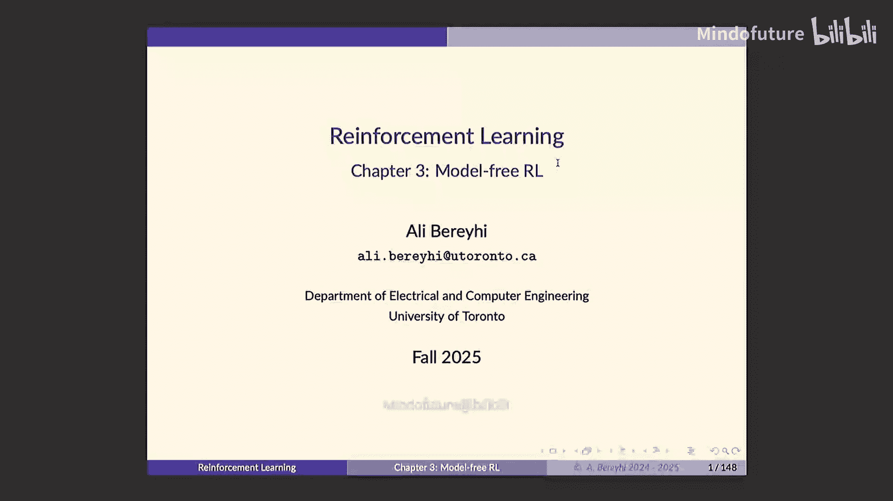

So well。We are over with model based approaches。 So， as I said before， when you do have the model。

 when you do know the MP， then everything is over， right， because you essentially。

You can essentially describe by MDP or environment。 And out of that。

 you can specify the optimal policy。 Everything is perfect， right。

This is not really happening in practice。 and don't kill me。

 I didn't teach you that because I wanted to just add content to the course。

 We really are going to use whatever we learned in in this chapter。 So it was not out of you know。

 extra time。 I want to just add complication。 Now， we really are going to use that。

 But the fact is that we cannot really use it in the like a statistically accurate way that we have done in this chapter。

 Okay， so in practice， what is going to happen is that we don't know the environment。

 And then we want to just come up with one remedy for that。

 we want to just design a mechanism that we can approximate do whatever we have done in chapterpt 2。

So once again， the ultimate goal just to find the optimal policy。We talked about this。

 We have two major challenges when it comes to practice。

 The first one is that we need to compute the values it。Explicitly。

 and the other one is that we want to just like run it on a real environment with huge genre of states。

 So that part two， we have not been we have not arrived there yet。

 So we're going get after this chapter we're gonna get there。

 okay this is where we start the deep reinforcement learning。 We are still in part one。

 and in part one， in the previous chapter， we talked about the model based approaches where we do know what is the environment。

 right， we can describe it using the MDP。 Now what we want to do in this part is we want to just do model free approach。

 meaning that we assume that we don't know the MDP right， when we are in one state。

 we really don't know what going to happen to the nexus that we cannot describe it， right。

 there is no mathematical formulation for that anymore。

 So model free methods are simply methods where we do not have the atic model of the。

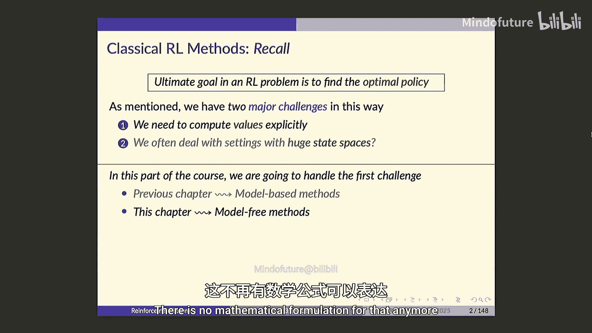

And what we want to do， we want to just compute those value functions， action values， optimal policy。

 all of them。 We want to compute them out of the samples we get from the environment。 Now。

 this is getting more close to what you have in your mind。About learning， right。

 because you just see some samples from the environment and you want to decide how does this environment behave and what should I do as the optimal policy。

So。This part， which I showed you initially， we are now over with it。

 So right now you know what is Belman equation and you do know that there are these two different algorithms。

 policy ittion value ittion。 these are the algorithm which are going to help you find the optimal policy right Now what we want to do we want to again do the same thing here So we want to come up with one remedy to find at least approximately the value function and out of that we formulate how we can find the optimal policy right and this is the first part of the course that we are going to do。

 So we are going to talk about the temporal difference and Monte Carlo。

 these are the two approaches which are going to help us estimate the values when we don't have the MP and out of that then we get into this idea we can for instance do on- policy approach to estimate and then we end up with one algorithm called Sarsa。

 the other approach is that we work off policy and then we're gonna to end。With Q learning。

 so hopefully when you' are over with this chapter。

 you have understanding of all of these terminologies here。

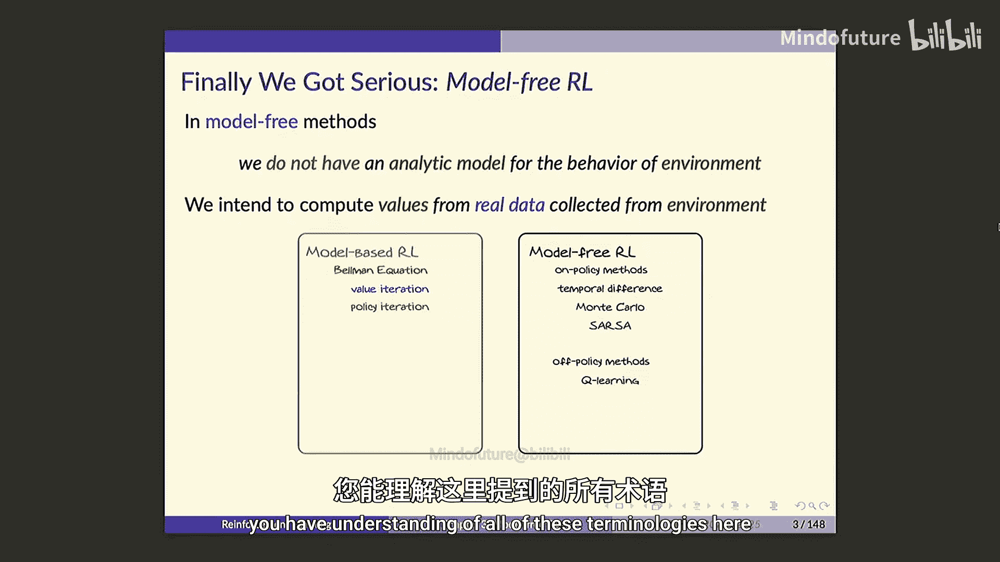

Cool， so。Now。Let's start with the model free approaches。 First of all。

 everything you do in model free is essentially generalized policy itration。

 So you're gonna to start with one policy。You just try to find an evaluation for that policy。

 You improve that policy and you keep on going， right。

 So this is the general approach you do also here。 The only difference here is that when you want to evaluate your policy。

 you don't have this nice spellman equations because you don't know what is the emptyP。

 you cannot compute those expectations anymore， right。

 and you want to replace that thing those expectations with estimates you get out of your samples。

 okay。

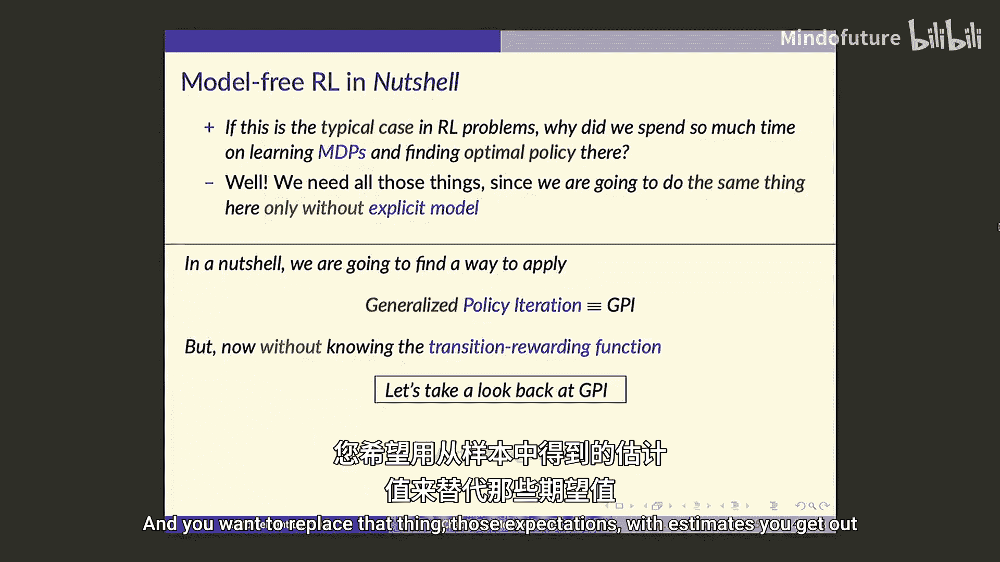

Cool， so this was the generalized policy itration。 So you start with one policy。

 You just evaluate that policy。 Maybe you evaluate it in a generalized form。

 It means that you do not necessarily end up having the exact value of that policy。

 maybe you terminate fast early， maybe you get an estimate， which is not accurate， but it's okay。

 something like that。 So you're gonna find some sort of value out of it。

 This is not really the value of your policy anymore。 It might be an estimate of it。

 That estimate might be initially completely detached from reality。 You don't care。

 you keep on going doing that， right， And since this algorithm is quite solid algorithm。

 Most of the time it' gonna end us up with something useful。 So you get this this value。

 and then you put it inside the policy improvement。 So you improve that policy。

 using those bad estimate， for instance， that you have and you keep on itrating that， right so。

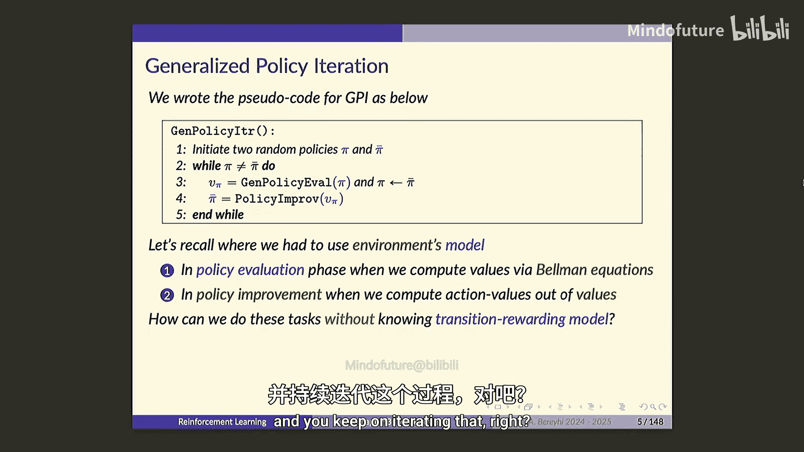

Now， first approach that we can use in order to estimate the values without knowing the MDDP is the idea of Monte Carlo right So what is the Monte Carlo approach。

 say I have like let's I guess many of you know this。

 but just to give you a quick recap on what Monte Carlo is， let's consider a very。

 very simple example， So say you're in a lab and in your lab。

 you have one particular device right and this device is connected to a signal generator and the output of this guy。

 you're getting you're seeing some some output right each time you turn on that signal generator。

 some random signal comes into the device and then you see only the output of that device you can measure that one。

 If you are in a lab and you want to know what is the average output of this guy what you're gonna do you're gonna run this signal generator multiple times right And each time you see one you're gonna record all of。

Thoseose outputs and then you average them right So this is the way that you do it。

 So if the device is the simple function F and x is what is coming out of the random signal generator。

 then this output y is random because x is random and the thing that you want to know is that you want to know what is the expected value of this device when random signal goes in it So eventually what you do in practice what you need to do if you know the distribution of the signal generator you need to compute this expectation right but in practice you cannot do it because you don't know the distribution of that signal and how the device works right the only thing that you can do you can only sample from your device right So meaning that each time you turn on the signal generator you're measuring monitor is showing you some value right and you just record those value and you average this is what you do in the lab and this is。

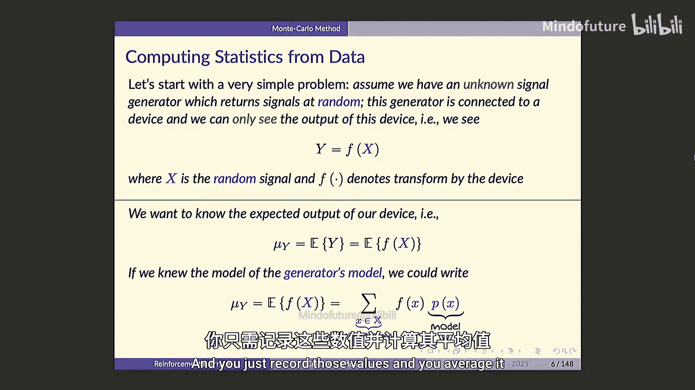

Basically what we call it Monte Carlo method right。

 so you're going to sample a bunch of samples y1 to yk k different times you do the experiment。

 and then you average those k different samples， this is going to be an estimate。

Estimate of the mean value。 So what is the exact mean value， The exact mean value is this guy， right。

 The expectation， which is taken over the data distribution， right or the signal distribution， right。

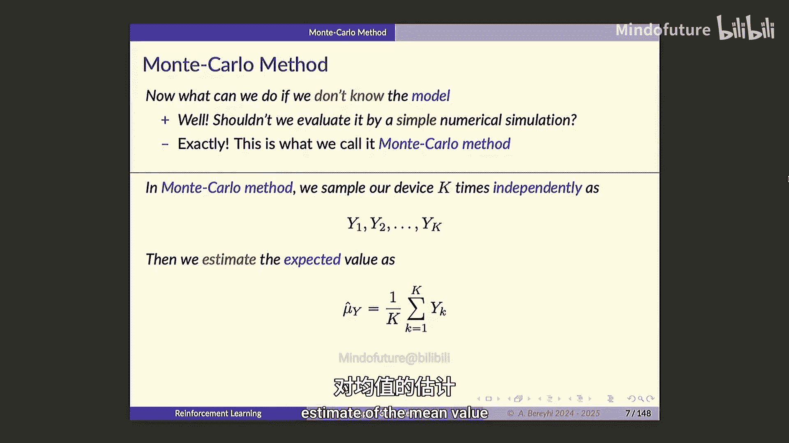

This is the exact。Value you're looking for， but you cannot find it because you don't know that distribution。

 right， The thing that you do you just do this one right once you get this mu hat。

 this is not exactly mu right， this is close to mu hopefully right So sometimes when you do the experiment it just land somewhere after like larger than mu sometimes smaller than mu somewhere around it right。

😡。

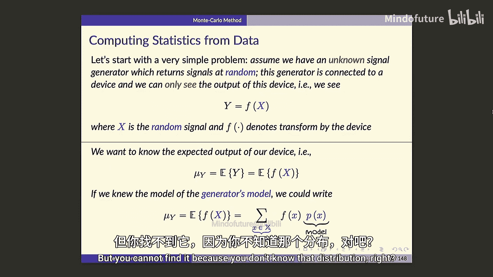

Now， if you want to reduce this， this variation around me， what should you do。

You just use more number of samples， right， The more samples you have。

 the better your estimate going to be， right， Do you know what is the reason。有。

Law of large number or the central limit theorem in both of them is the same thing right。

 So the reason is basically because of central limit theorem or law of large numbers。

 So if you have this k different samples and they are just randomly coming from same distribution。

 which you don't know， right you don't know what is distribution of y and you don't care。

 the thing that you know is that each time you run that signal generator。

 this is coming from same distribution right， independently。

 Now you have k different samples independently from the same distribution。

 And then if you just average them， So if you compute this guy， right。

 the thing that youre gonna see when this K gets larger and larger。

 this is going to converge to a Gasian random variable， right。

 the mean value of this Gaian random variable is exactly what you are trying to estimate。

 the variance of it is。

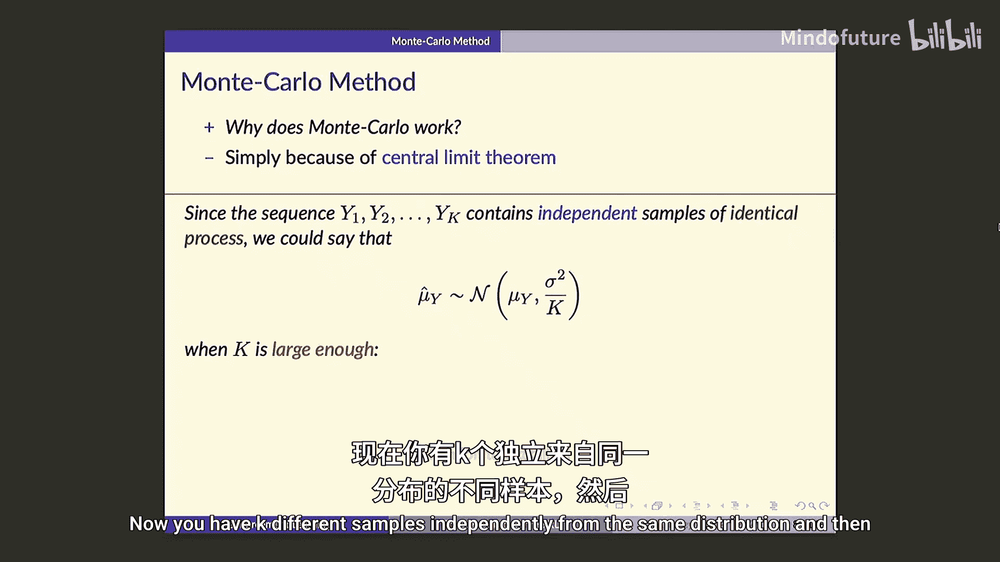

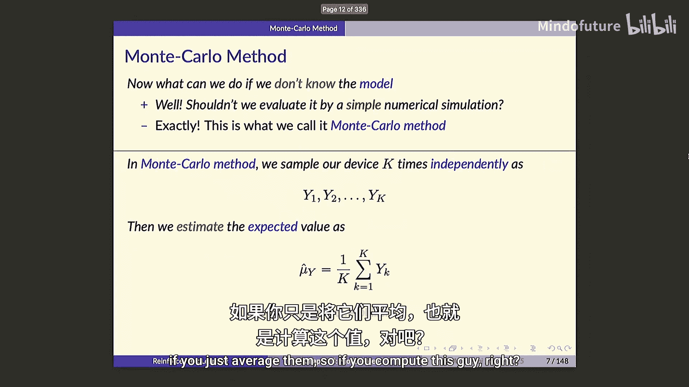

Some variance， which is the variance of your sampling or whatever or the original data coming。

 divided by the number of samples you have， right， The more samples you get， the smaller。

 your variance gets right， meaning that if I am trying to find one is specific value and say that value is one。

 but I am sampling。 the first time I sample I get two， right， the second time I sample I get0， right。

 Each of them is an estimator for that one， right but2 is very far away。0 is very far away。

 But when I average them， it's now one， right， So if you do it like with five samples。

 you you just vary somewhere around one with one1 window which is proportional to one over5 right If you do it。

With 50 samples， then the window is going to shrink。 It's gonna be  one over 50 and so on， right。

 So you are just going to get closer and closer to what you want。

 And this is the reason that this is working， this is what we call it Monte Carlo approach。 Now。

 what I want you to have in mind from now on is that when you are doing this approach when you are sampling from something。

 And you don't know the distribution。 It's okay。 I want to think of this guy in new head to be what you want plus some error。

 And this error is is a kind of， you can think of a Gasian noise， right。

 So it's not necessarily thegotian。 But like if K is large enough， this is approximately thegosian。

 right。You can think of it as a kind of error。 So this is the true thing that you want with a bit of error around it。

 right？ And this error is going to shrink， gets smaller and smaller。

 The more and more data samples you have。 So this is important thing。 Just keeping it in mind。

 but're gonna make all understanding of this chapter much easier for you。

 Not only this chapter in the entire course。 because at the end of the day。

 we are not able to compute any of those expectations we have in the Belman equation。

 we are going to always approximated by this approach， right。Everybody's cool。Questions。Now。

 do you know what is Monte Carlo word coming from， the name Monte Carlo？Yes。勉称？Game show close。

 So it's not Monte Or Carlo。 These are not people。 Monte Carlo was a casino in in Monaco。

 Do you know where is Monaco。 iss a tiny country below France。 is a kingdom。

 And then I think the name of the mathematician who developed This is Ulam。

 He was in the Manhattan project， but he was a statistician， And he had a uncle。

 He was having the uncle had gambling habit。 and he was going to casino。

 This Monte Carlo Ca doing gambling。 And then you said， oh， you have lots of data。

 Maybe I can estimate something out of it。 He came out with this Monte Carlo approach， right。

 It's quite old thing。 but Monte Carlo， I mean， it's not fear because Monte Carlo is not the one who developed。

 It's just the casino。 But yeah， I mean， got the name， right So。😊。

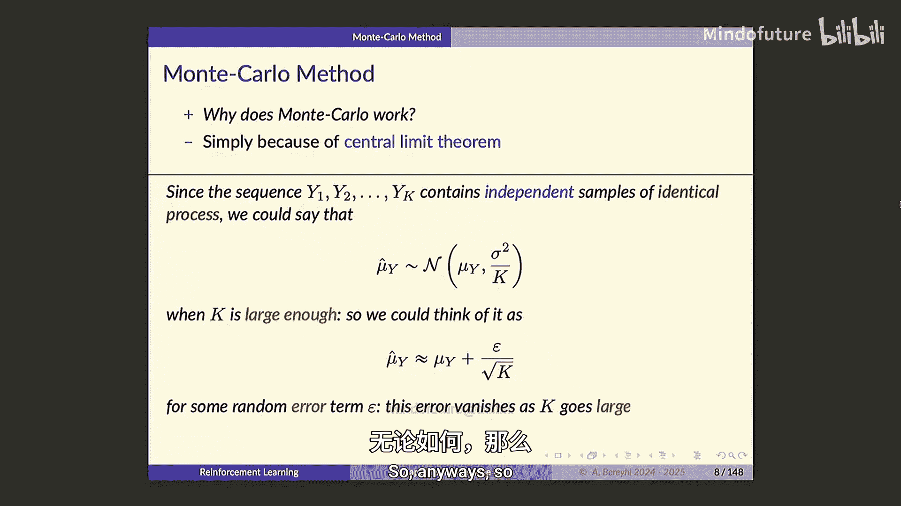

Anyways， so。Now， the idea is that you can use this idea of Monte Carlo to estimate the expectations you want in your。

 your Belman equation or anything。 like when you want to evaluate your value function。

 The easiest way is that you first forget about the whole Belman equation that we had。

 you just start with the definition。 So what is the definition of the value in one particular state。

Is the expected future return， right？ So what you can do， you can start in one particular state。

 right。Play as much as you can， right， Each time you play， you just make an episode， right。

 till you end， right， And then you see what is the future return， right， This is one sample。

 You take another sample sample。 if you keep on sampling， then you're gonna have lots of sample。

 you average them， This is approximately the value of that particular state， right。

 So you can simply do this with this very simple idea。 So you start with one particular state S。

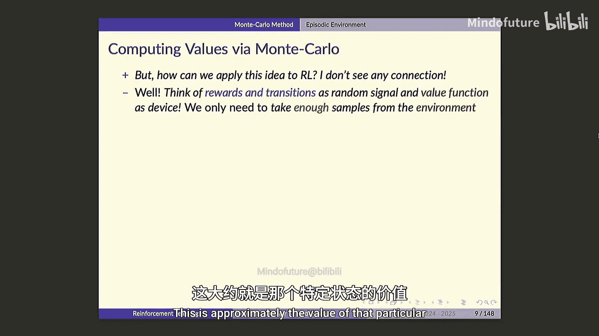

And then you want to know what is the value of this estate。

 If you play with the particular policy pi， right？ So you can play one episode， right。

 You start with that a data state。 and then you play with your policy till you end up with the terminal state。

 right， This is one episode， right， So you start at this estate， you play policy pi。

 when you are at the terminal state。 then it's over， right， say T time steps。 and then you finish。

 right， This is one sample that you got。 You can just compute the future return。Of that。

 that particular episode， right， So you see that I started with this state。

 the first rewarder collected。 What is the next one， What is the one after， and so on the very end。

 right， And then you add all of them up in the specific form with the discount factor， as we define。

 This is one sample future return， right。If you keep on doing this for k different episodes。

 then you're going to have k different samples right and the value of the policy at this particular state can be estimated。

 you see the hat here right， can be estimated by the average of these sample returns， right。

Everybody's cool。So you got the idea。So this is the easiest way you can think of estimating your value function out of the data right so what you can think if you want to think in terms of the backup diagram and I just put it here because later on we are going to use it a couple of times so just to get used to it so this was the backup diagram that we talked about。

 we start from one particular state then if we play with the policy we can go depending on the policy we can go in one of the actions and then when we go that action again in this new action the environment is going to take us to a new state in that new state you are again going to take one action policy and you go to the new action and then the environment is going to change the state and so on right and what you're going to do if you know the MDP it means that you really know the probability of all these edges so you do really。

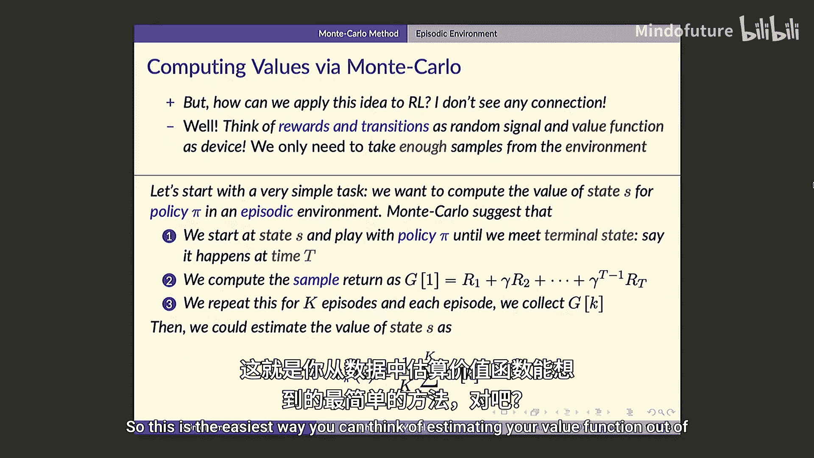

know what， how when you do one action， how this environment is going to change the next policy。

 right， But now you don't know them。 You don't know the pro voltage is on these edges。 What you do。

 You just sample from it， right， Youre starting your。Your state。 and then you do one action。

 So you just play with policy。 The policy tells you do this action， right， you do that action。

 you get into this particular action。 Now， upon doing that action。

 the environment is going to take you to the terminal state， right？ This is one sample that you got。

 Maybe next time when you do it， it does not end you immediately with the terminal state。

Next time you play with your policy， you do another action because maybe your policy is random right and then doing that that action is going to end you with another state right。

 It's not a terminal state Again， in that state， you are going to play with your policy。

 you're gonna do one action and after doing that action。

 you end up with the terminal one right and you keep on doing。

 So you're sampling from branches of this tree， right。And when you end up with one terminal state。

 then you can add up whatever you have collected。 This is the sample reward， the return that you get。

 you average it， you are approximating the or estimating the value function， so。

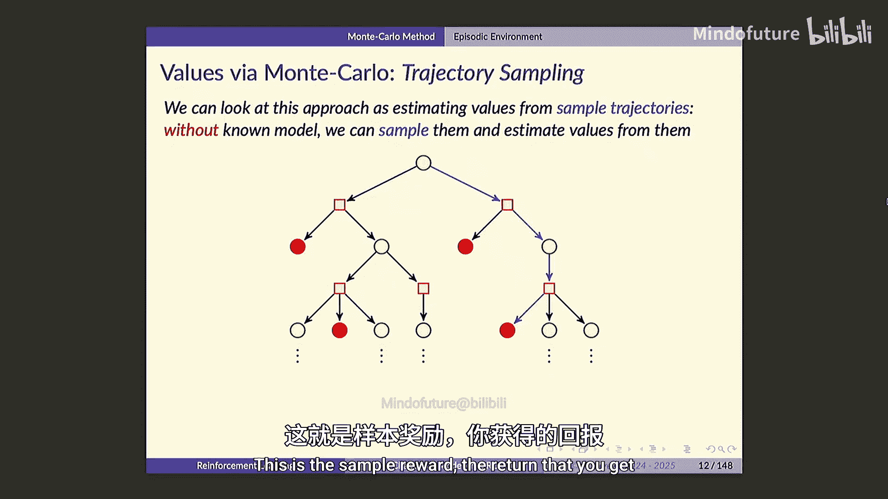

This is the algorithm quite simple。 So what I'm doing here in this algorithm。

 I want to just evaluate the value of one particular policy and at one particular state and you should pay attention very much。

 I'm computing the value in one single state right， if I want to do it for all the states。

 I should the same process for every single state right， right， So I could have n different states。

 This n could be very， very large。 This algorithm should run over all of them right So I'm now talking only about one state right。

 Everybody is clear right， So I have this particular state as I have the policy pi。

 now I want to know what is the value of this policy。At this particular state。

 And then the point is that I don't know the MP MP。 What should I do。

 I start with values 0 initially， And then I start sampling， right， So I go inside this loop。

 I start with this particular state S， right If I start with a particular state S here。

 then I keep on playing with my policy and playing with your policy， you are doing one action。

 go to the next estate。 Another action to the next estate。

 So until you end up with the terminal state， right， This is going to be one episode。

 And then once you finish this episode， you are going to collect your sample return。

 and then you are going to add it up。To your， to your value function， right。

 you are going to average。All the samples that you had。

 And you're going to take this as the as the new the estimate of your value function at the state S。

 everybody is clear。Questions。Now， question。So。Now。One thing。

 if I want to just estimate the value of my policy at one particular state with this algorithm that I showed you here。

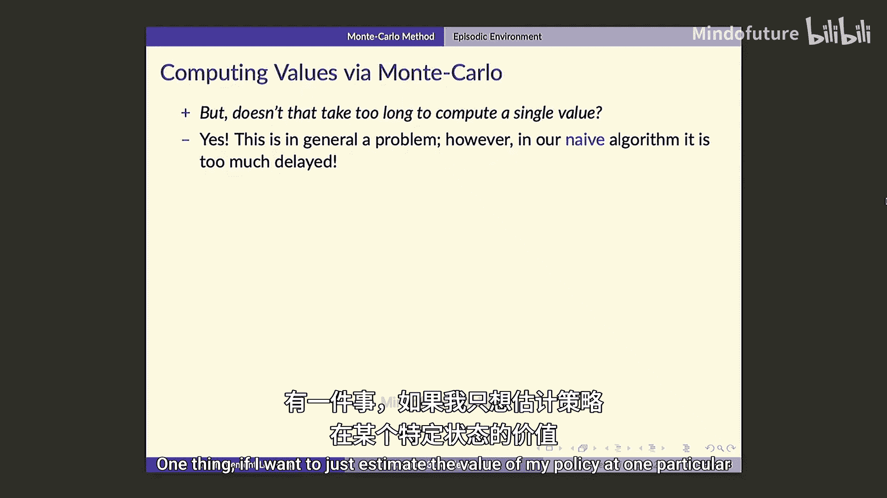

Can I when do I have the value。Can I do it after every sampling or should I wait till the samples are over？

I need to wait till samples are over right because for every single sample I get one sample G。

 I need to collect all of them。 and then I average them right。

 So it means that this algorithm is going to give me the value after k different samples right So I need to play k times see the values and update it right But one thing that you might tell me and this is very valid is that okay。

 if I do like， say， for example， K is 100 right but after the 10th trial。

 I have maybe a bad estimate， but it' still I have an estimate Can't I use it at this point。

 And then when I get the new sample I use， I improve it。 Well。

 we can do it right this is what we call it online averaging。

 So right now in this very dummy algorithm that I showed you。

 you need to wait till all the K episodes are over， but you maybe say that okay。

 if my few first episodes are over。 I can use the sample return。

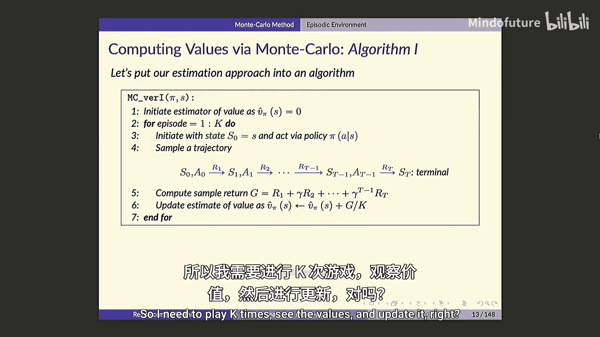

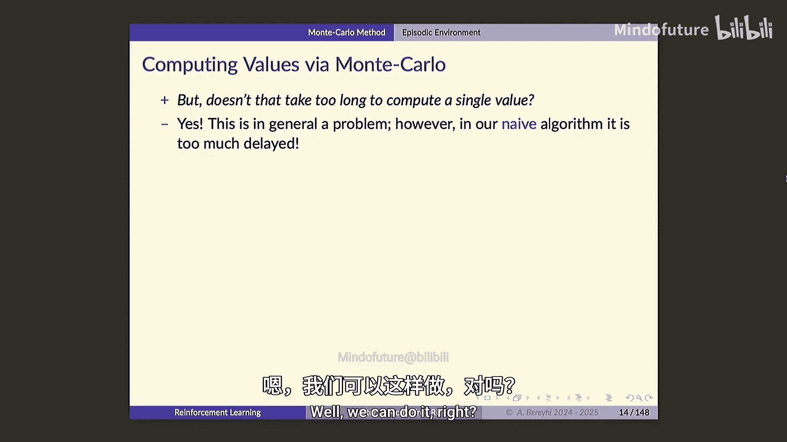

to compute one bad estimate and gradually each time I get more samples， one new sample。

 I can update it to get better sample right a better sorry。estimator， right。So。

This is what the idea of online averaging is。 This is not a very say， very complicated thing。

 The key point is that the thing that you are averaging right now is this one， right。

 You are collecting K different sample returns。 and then you average them， right。

 Now what you can do， you can open up this summation， right， I can write it down in this form。

 So I have k different samples， right， I add of the first K -1。

 and I keep the last one out of the summation。 Okay， everybody's cool。😊，Right， now。

This first guy that you see on top， so I'm going to copy everything the other side。

 so one over k is still there， I have this bracket and GK is here right。

 Everything is here as before， The only thing that I'm dropping right now is this summation right。

Everybody's cool， okay， now if I get this summian and I divide it by 1 minus k minus1。

This guy is the estimate that I get with k minus1 samples， right？Correct。

Then what's going to be that summation is going to be k minus-1 times this estimate， right？

Everybody's cool。Now， which guy is the better estimate， can you tell me？

Which guy is the better estimate？Et K or Eta K -1。Eta K， right， because it has more samples， right。

 Okay， But anyways， now I can simply write down this dimension to be K -1 times Eta K-1。

 I replace it here。 Okay， everybody cool。😊，Now， just do a bit of math。 So first you multiply it。

 So it' gonna be in this form。 Then I'm gonna take Eta K out is our Eta K -1 L。

 And then I just factorize1 over K。 So it's gonna be in this form， right。Everybody's cool。

 So your new estimate Eta K can be written as your previous estimate plus1 over a k times。

New samples minus previous estimate， right。This is what we call an incremental averaging or online averaging。

 because here you don't really need to wait for all the samples to be over。 right。

 You have your first sample。 you have one estimate。 you get your second sample。

 Youre gonna update that estimate， right， You have your third sample again， you update and so on。

 right。

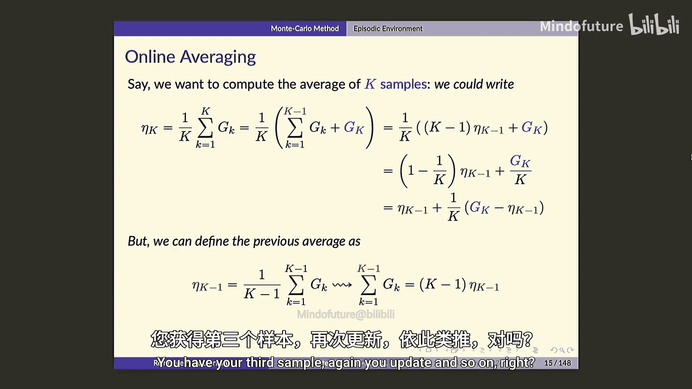

Okay， so。This is what we call it online averaging and simply you just do this right so every single time your new estimate is going to be your previous estimate plus 1 over k times this delta and what is delta is your new sample minus previous estimate right？

Everybody's cool。Yeah， you're still Green。You are a serial playing， right， But when you。

 you are over with one episode， you have one estimate， right， and you again replay， you improve。

 you improve your estimate。 What's the difference。Oh， you cannot。 I mean。

 here you're not updating like， don't mistake here you are。 I mean。

 this one that you get is not in between before the loop is over。 This is not the right estimate。

 right。

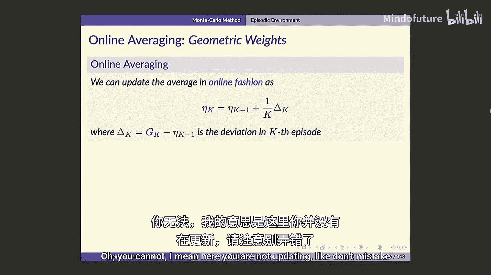

So this is the case。 Like if I have k equal by one， then in the first iteration。

 my estimate is exactly the sample I got right in the second estimate I get the first sample plus the second sample divided by2。

 in the third one， first plus second plus third divided by3。

 But here what you are getting is every time you just multiply one by3， and then you added it right。

 So this is not the same thing at that one， right， So， maybe maybe it was not a good idea here。

 Maybe I should have put this out of the loop。 So maybe next time I do it like that。

 But here this is not an online update because in between before youre over with the whole K episodes。

 this value that you get is not the right estimate， right。

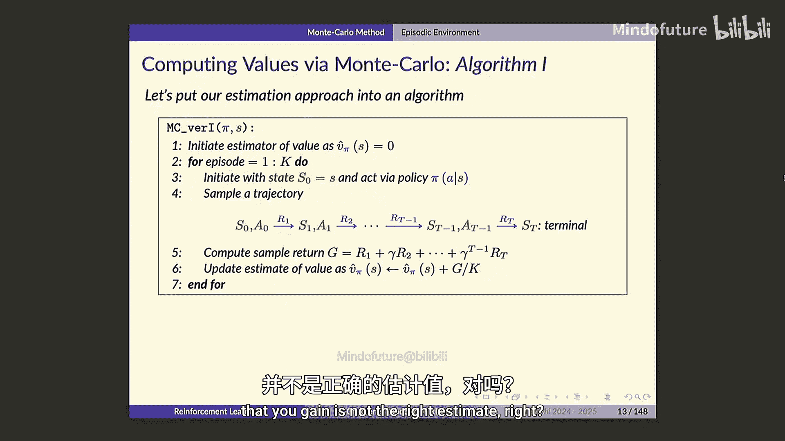

Okay， so everybody's cool， everybody got this idea。 So eventually you start one episode。

 whatever you get， this is the only sample you have， this is the only estimate。

 right Second time you get a new episode， you get get a new sample and。Update your previous estimate。

 right， and you can keep on doing it as much as you want， right？So we are。

 we are basically not change anything the whole mechanism。

 The only change changes that we are just each time we are collecting one new estimate， right， Now。

 one thing that we typically do is that。We typically drop that one over k and we replace it with something like alpha。

 Now， this alpha is a general factor， right， It could be one over k。 if it is one over k。

 it simply means that my average is first sample plus second sample plus third sample till the last one divided by K right。

 This is the case。 but you might average things with nonuniform weights， right。

 you can do it as well。 Like， for example， you have one estimate。

 which you know this is a very good estimate。 You have one other estimate。

 which you know is a poor estimate， right， What you do。 you're gonna to get this one。

 maybe you multiply with 0。9。 you get your poor estimate， you multiply it with 0。

1 and you add them up。 youre still averaging them because 0。9 plus 0。

1 is one right but the only difference is that you are giving less weight to the poor estimate as compared to the。

Good estimate， right， And this is what you can do in general。

 So you really don't need to consider it to be one over k。

 You can it think of it to be one specific alpha。 Now， this alpha could be constant。

 it could scale with k。 If you set it to be exactly one over k。

 then this is basically what your what you're doing linear averaging。

 So you are linearly or uniformly weighting your your your weights in your your approximation in your estimation。

 But if you keep it constant。 So if you put， for example， alpha to be 0。1。

 then you can do the math and you see that you are basically doing the averaging with geometric coefficients。

 like one of them is alpha， the1 is proportional to alpha squared Al cubic and so on。

 right And then if you sum all of them up at the end。

 it could be one when alpha is smaller than one right So you keep。Always alpha smaller than one。

 This is important。 But if you keep it fixed， this is still going to work。 And typically。

 we keep it fixed。ok。Questions。要关。So if I want to use this online averaging in my algorithm。

 So my algorithm is now exactly as before。 again， I am going into one loop and inside this loop every single iteration sorry every single time I am just sampling one episode。

 and this episode is giving me one sample return， right， Now， the way that I update。

 I simply update whatever I had as the previous update plus alpha difference， right。

 and this is a new update， right， you keep on doing this as much as you want。 Everybody's clear。😊。

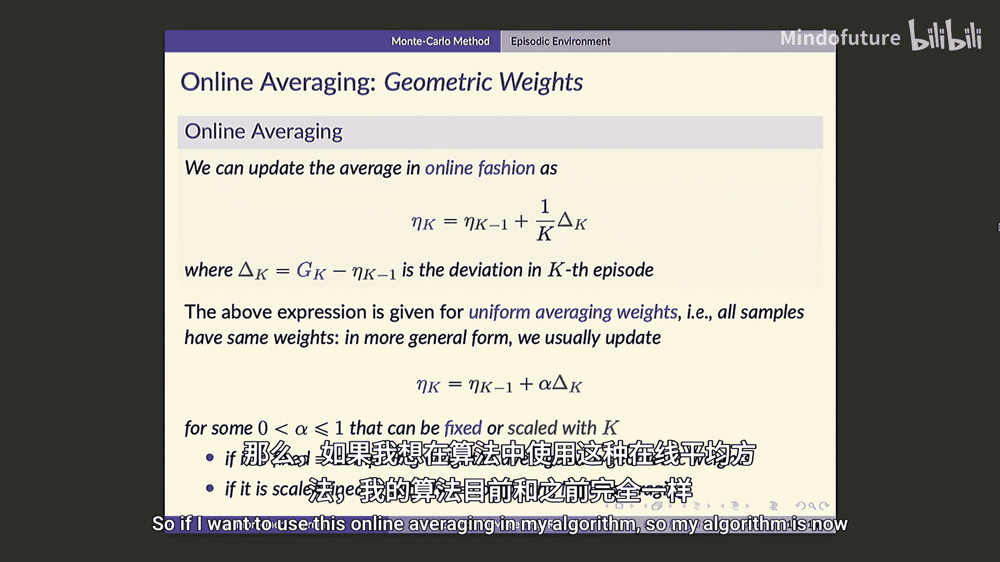

Questions。No question。 So you got the idea of Monte Carlo with online。Online averaging， right？ Okay。

 cool。 So now。

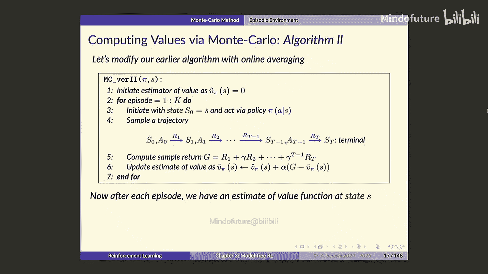

Next thing that you might see in this approach that we have done is that。What I'm doing right now。

 I am just doing one sampling one episode， right， And when I sample that episode。

 I start with my state， I go on all the way towards the end of trajectory。

 But I use this whole trajectory to estimate the value of this starting state， right。

Is it optimal or can I use this trajectory better。Can I use this yet， go ahead。you knowledge。Perfect。

 right， So you can do that as well， right， If I get from a state1 to a state 2， right And after that。

 I go on， right， Now the sample return for state 1 is whatever I collected after it， right？

 What about the sample state 2。😊，Stay 2， whatever I collect after that as well is another sample。

 right， That sample is the sample return for state 2， right？

 So I am not actually with one episode with one trajectory。 I am not sampling just。One sample return。

 I am sampling all the sample returns Who the state is seen in between， right。Everybody's cool。😊。

So what I can do， I can say， okay， maybe I have started at S 0。 Of course。

 what I're going collect after is going to give me a sample return for a state S 0， right？

 but of course。R towards the n is giving me the sample return for S1， right？That's right， right？

I can forget about what were had before。 I started at S1。 I played with my policy。

 I ended at the terminal state， right， You again another sample， right， If I go S T minus-1。

 I immediately start with the terminal state。 This is again， another sample， right。Everybody's cool。

So this is not just one single sample return。 It is indeed two different sample returns， right。

 And I can use all those these to update the corresponding estate， right。

 So I could say the value of S0， whatever S0 is that the value of that could get updated， right。

 the value of S1， whatever that guy is can get updated and so on the value of S minus1， right。

 because for every single of them， I have one new sample， You see it。

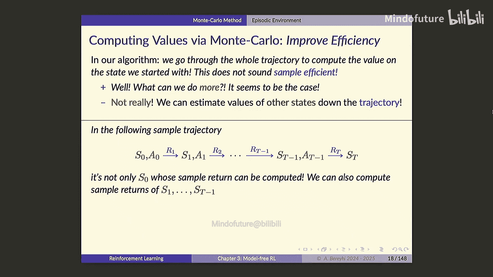

Questions。Okay， so this is going to be the case where I am just sampling with one episode。

 And look at this algorithm。 I am not writing down S anymore， right， inside that algorithm。

 So I'm not talking about one particular stage， right。

 Because when I just sample from the environment， the complete trajectory。

 I have lots of a state happening in between， right， And I can update all of them， right。

Everybody's cool， you see there。Okay， so what I'm gonna do， I'm gonna take the episode。

 a K different episode。 startinging with the first episode。

 I just sample one complete trajectory towards the end， right。

 Now I start with saying that the sample return is 0 when my， I am at the terminal state， right。😊。

When I consider terminal state S T， S T is the terminal state， right， and at that terminal state。

 the sample return is 0 obvious because the terminal state， all samples are0， right？ Now。

 I go want to step back。 So I say， what about S T -1。 Well， at time now this is small T。

 Think of it to be t -1。The value of this day， whatever that guy is t minus1 is going to get updated whatever it was before plus alpha times the difference right。

 how I compute this G here， what is the G when I am at t minus1。

 what is the sample return for S minus1。What is it？No。

 sample return when you are at at this is state S T -1 R T， right， right， So R T。

 you collect after that 0， right， that is R T， right， So it's gonna be R T。 So for S T -1。

 this G is R T， right？ What about S T-2。 What it gonna be。

rt minus1 plus for now I assume that the discount factor is 1， rt minus1 plus rt， right？

What if I am at one particular time T， it's going to be R。If I have a one particular time t。

 it's going to be rt plus 1 plus 2 and so on right， but that rt plus 2，3。

 and so on is eventually the sample that I have computed previous time right So each time you can write it down to this form right everybody sees that。

So you start with G being0， you're a terminal state， right？

The sample return for t minus1 is Rt plus 0， right？

The sample return for Rt minus2 is Rt minus1 plus whatever I collected before， right？

R T -3 is gonna be G sorry， S T-3。 It' gonna be R T-2 plus R T -1 plus R T， but R T -1 and R T。

 some of them is the previous G， right， So each time you start from V end。

 you start by saying that the sample return is 0， obvious at the terminal state。

 And each time whatever the return I see， I'm going add up with the previous。Sample return， right。

 And this is a new sample return for that particular state。 Now。

 I can go ahead and update every single of those estates that I see in between， right。

Everybody is clear。Questions。Now， if I do one trajectory。

 how many estates could potentially get updated？How many state。

What is the most complicated like most， say， diverse case。S 0 is one state。 S1 is different from S 0。

 right， So you start from one state。 You go to another state， right。

 S 2 is different from S 1 and S 0 and so on。 Each time you see a new state。 If that happens。

 how many states you see in between。T different states。

 right So one of these trajectories is going to update T different estates， right， potentially。

 but it might be that you start from one stage。 you go again to the same estate， right。

 You hit the wall， your back， right， Then you are collecting two samples of the same stage， right。

Everybody sees that you're clear right， but in the most ideal case。

 each trajectory is going to give you T is going to go over t different states right if you do k different episodes and each time youre startinging from one different state。

 you are going over all completely different states。

 then you are going to have K times t different updates right everybody sees that right。Clear，いらで。

That you went。Yeah， the first sample for。Would it be？No， no， no， no， no。

 you have two samples for a 0。 One of them is the one。 Like you say I start from， say cell0。

 and I do， I play， I again get to cell 0， and then I terminate， right。

 One of the samples is the the second one。 the other one is the complete one， right。

 It's because like think of the random walk right on the grid。

 So if I start here I randomly walk I in one of the samples， I just walk exactly get to the terminal。

 right， Once again， I just play around and then I get to that one， right， Both of them are samples。

 right， what is your value is the average of all of them， right， So you need to have both of them。

Questions。

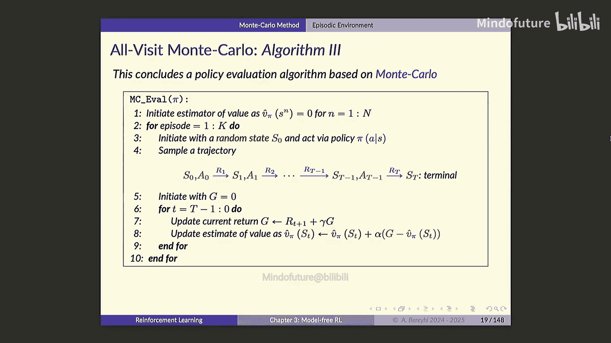

No question。Okay， so no。

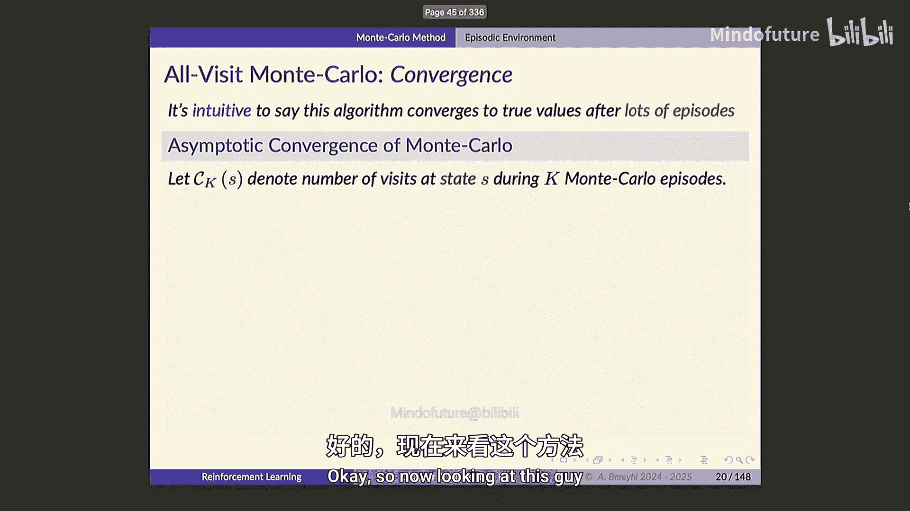

Looking at this guy。If you start doing this algorithm， right。

 you can go ahead and sample your environment right， So I take one trajectory。

 I update right and then if you think of that table。

 I used to show in the example in the previous chapter。 you start with all the values in the table。

 think of your environment as the grid world， then every single state is one of the cells right and you want to write down the estimate the value of all these cells right every time that you do a trajectory。

 a couple of them gets updated right。Right。Everybody's clear。 So if you。

 if you think about this guy in form of the the agreed world。

 then you're gonna have such an environment， right， This is the whole environment that you have。

Right， so you start with all of the values being0 because simply you have had no samples at all。

 right， Everybody is zero， right， but no you start to play right。

 you start maybe from this cell and then you come here， you come here。

 you come to the terminal stage， right And when you do that， this guy。

 this guy and this guy is are going to get updated， right， maybe once again。

 you start here and then you come again here and then you come here， you come here， you come here。

 you come here， right， anyone in between is going to get updated， right， everybody's clear， Now。

 you keep on doing this this process。 So each time you just sample a new trajectory。

 you randomly start somewhere， you play with your policy。

 you go over a bunch of cells till you end right again， you start here， you play， you end right。

 you keep on doing this， and each time you're updating right， Now if I play。

A lot of times significant a large number of times side that I'm pretty sure each of these cells have been seen。

 say 100 times okay then the one that I am computing the estimate that I am computing is the average of 100 sample returns for that cell right and that is a fair approximation right a for estimate right so if I can make sure that I am playing enough number of times side that I am meeting every single state in my environment for a large number of。

Tals， right， then this average， which I get， this estimate that I get out of the Monte Carlo approach。

 is a good approximation， right， And this is what we have here。

 So eventually this Monte Carlo approach could converge。

 if you just sample enough number of times and how much this enough means this simply depends on the number of estates you have in your environment。

 right， if you have environment with a few states， then when you play 100 times。

 probably you see all of them enough number of times， right， But if you have a huge environment。

 then 100 is not enough， right， probably you need to play thousands of times or even more， right。

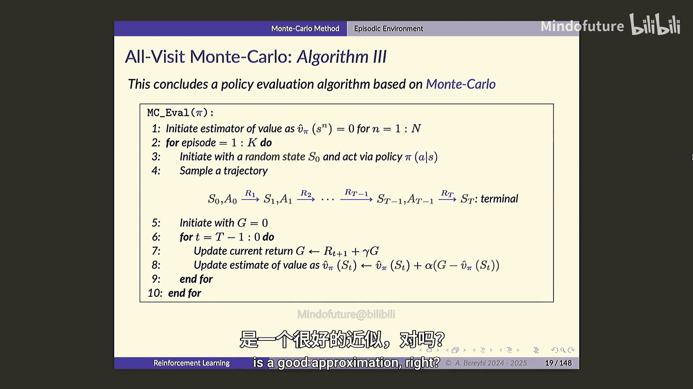

But you can formulate it concretely here， so you could say that say C KS is the number of times。

 so I have k different episodes。 I play k different times K different trajectories right and I am just counting the number of times that I am seeing the particular state S right so this state S is maybe this guy right。

 this guy is a state S， if this guy， this one， say this guy is a state S right。

 if I play two times like the1 I showed you here， both times I am seeing this guy right。

 So it's gonna be two right， but the number of times that I see this guy in these two trials is0 right I have never seen it right I had no sample so。

😊，C KS is the number of times that you're gonna to see in the state you're gonna see a state as in your case trials。

 And if you have this property that every single state that you have in your environment。

 all these cells here。 All of them are have are seen enough number of times。

 like you play K so large and your sampling process is is designed away that when you just play infinite number of times。

 each being。Numb of times， right If that happens， then you could say that the value that youre collect estimating using Monte Carlo is converging to the exact one。

 And that makes sense， right， because I get to this cell。 infinite number of times。

 I have infinite samples。 I average those samples。 This is going to converge based on law of large number to the exact expectation。

 right， So there's no magic in this theorem here is basically law of large number。

 I just formulated it more concretely。😊，Questions。No question。So if that is the result。

 So it says that the value function is going to be， I mean。

 the estimate is going to be value function。 So if that simple approach is solving the problem。

 why do we have the reinforcement learning， any idea。What is the trouble in this result？What。

Number of states N， right。 So if you really want to see all these states enough number of times。

 right， this K should be definitely larger than the number of states you have， right。Right。

Because each each time you play， if you're very lucky and always you pass through different states at then end。

 you need to have seen all of them at least once， right。

 And then the result is not even telling you at least one。 it says like enough， right。Now。

 the number of estates that a chess game has is I told you10 to power。 I mean。

 you check the first assignment， right，10 to powers 0 was 120 was channel estimate and there was reduction。

10 to power 40 right just I give you discount 10 to power 30 right10 to power 30 states you have how many samples you want。

 at least10 to power 30 right And now you compute how much time you need more than the age of universe you're gonna need in order to sample that much of samples impossible right So this result is nice。

 This is giving you a concrete way to estimate your value function without using the exact MP but the key point is the computational is not feasible right And this is why we gradually try to play around with it。

 We just do some modification to it to make it more and more feasible and eventually we're gonna get at some point to the deep reinforcement learning where we。

Actually。Confirm that。 I mean， we， we accept that we can not。

 we can do nothing about the number of states。 So we。

 we just need to estimate this whole value function like this estimate。 we should find it using a。

 Okay， but that we there we're gonna get to。Questions。

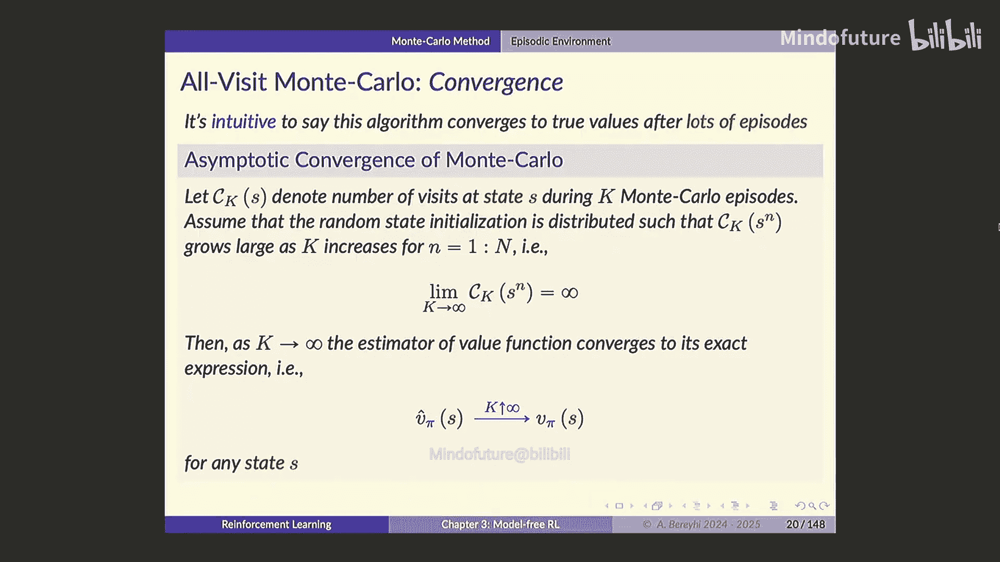

No question。Okay， so I think the time Oh， let me see okay， I have three minutes。

 So three minutes only。 And this is going to be less than three minutes。

 So if you get into the dominant grid world and you start with the random policy。 Now。

 you can use the beman equation。 And for the random policy。

 you're gonna see that the values are like this。 Okay， this is the terminal state is gonna be 0。

 the other one just write down the beman equation， do the calculation。

 you gonna end up with this value， right， And then this is a very small environment， right。

 you just need a few samples。 Yeah， if you start like this is the optimal value function。

 So at the state 0， it is 0 at a state， yeah， state 1 and 2， it's -4。

5 and state 3 is-6 right for this random policy right。

 But you start playing with the random policy in this environment and you don't use the MP。 Okay。

 if you start with everything being 0 and you play couple of times。😊。

You're going to see something like this， right， So it's getting close to the numbers。

 but it's just jiggling around it， right， But you need to just keep on playing。

 And if you keep on playing eventually， at some point， you're going to converge very close to that。

Exact value。 Everybody's clear。

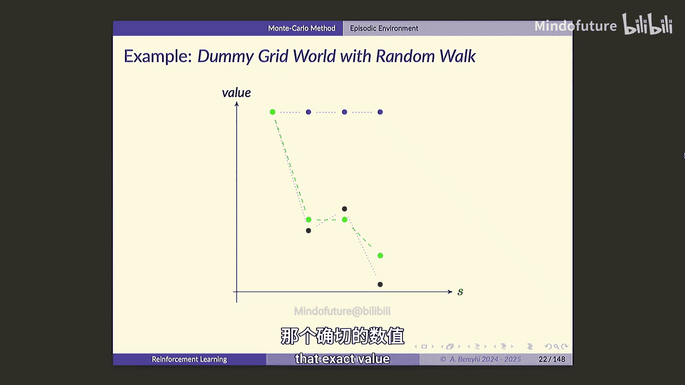