# 【多伦多大学】强化学习 2025 ｜ Uoft   Reinforcement Learning   Fall 2025 p23 P23_讲座_22_通过蒙特卡洛实现广义策略迭代 -BV1D3F2zhEry_p23-

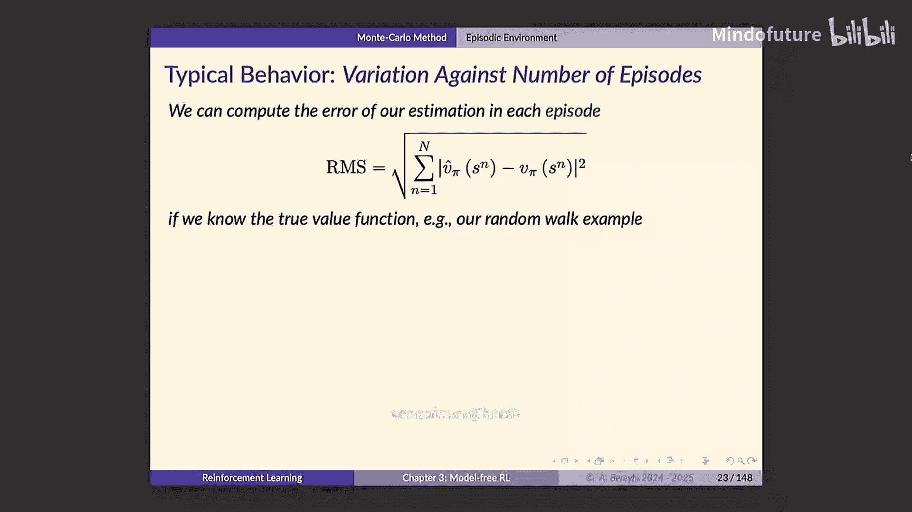

One thing， one kind of behavior that might see when you do want call estimation。

You just sample a episode。Estimate your value。Assuming that you know the。Exactly。

 so if you know the value function。 So here V pi is the value function。

 V hat pi is the one which you。By。I guess。I work。我得去。1清。Yeses，就是。You there was one box one says here。

fine。没进去。Okay， to get better。Here。Oh。Is it now。Okay， okay， yeah， thanks， thanks a lot。Listen to。O。So。

Yeah， here。 So assuming that we have the true value function and this V hat is the one which you get。

Now， I mean one。This V pie that I'm showing here。 I mean， obviously， we don't have it， right。

 because if we had it， we didn't use。Monte Carlo， yes。

 so we use Monte Carlo simply because we don't have it。 But for some dummy example。

 like the grid world example that I gave you， you can write that down。

 and then you can see how to Monte Carlo compute the estimate， right， if you do that。

 then you can find what is the difference between these two， right， Obviously。

 what should be the the difference if you just sample， I don't know。

 infinitefinite number of samples from the environment。 What where should it go。You go to0， right。

 And then the more samples you have is going to drop， right， So you always see such a behavior。

 You start with huge error， like your estimate is totally nonsense。 But gradually。

 your your estimate start to get better， right， theres always some value for K。

 which gives you a kind of。第二个我。两。Obviously， it depends on the number。

But one thing interesting that you see， and you see it all across the algorithms in the model free case is such a behavior。

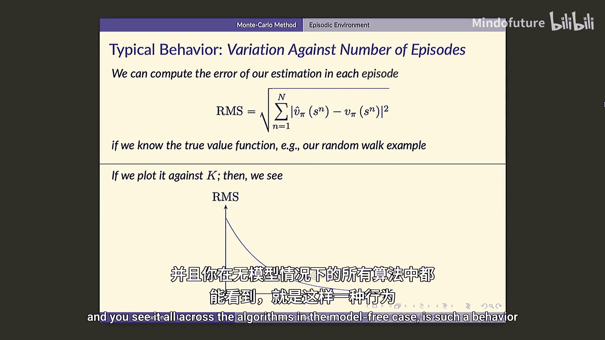

The behavior is that when you are updating and you do the online update。

That alpha value that you use each time you want to update， right， That alpha value。

 it has a sort of optimum。So it means that if there is。To just fix your estimate in every sample。

 If that step is too large， your estimate is going to get bad。 If it's too small。

 it's going to get bad as well。And what is the right choice of alpha。 Well。

 this is something numerical。 So it depends on your environment。

 You typically need to try different alphas。 And then you just find out what is the variance for every single of them。

 And then you choose the right one。 But the key point here is that this value of alpha is not like you increase it or you reduce it。

 You're gonna see a monoonic behavior。 It's a kind of。い。

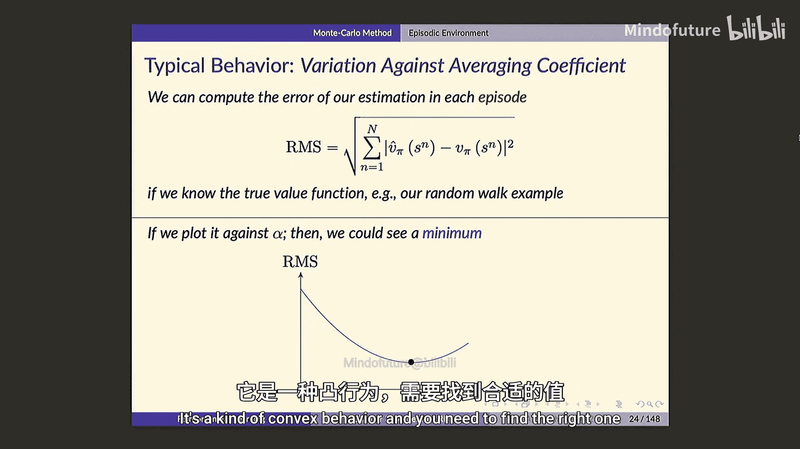

to find the right one。Okay。So that's being said。 Now， I want to use this idea of Monte Carlo to。

I and the policy。Where should I use the Monte Carlo approach if I want to do policy it。

So policy itration has two parts， right， One of them is evaluation。 One of them is improvement。

 right， And which of these steps I should use， Monte Carlo。In the evaluation， right。

 because once you had the evaluated one， you can't simply improve it， right。

 improvementrovement is nothing important。 The key point is that you want to evaluate it。

 So I want to use。も時から。The one which I showed you looks at the environment。Times the。Now。

 if you want to do the increase。我。You need the value。Go。Action value function。 Q function。

Because Q is the one which has actions， right， And then you just take the one which has。Right。O now。

InChapter 2， we really did not care about the fact that we。

 are we working with a value function or action value function， right？

 So we said you just find the value function。 Then you compute action value function。

 How did we calculate action value out of value function。N was not averaging。

 The other way around is averaging Belman equation， right。

 So if I want to get from the value function to the action value function。

 I need to use Belman equation， right， So let's write down the Belman equation。

 So that was the Belllman equation， which we use in Chapter 2。 We said， like。

 you have the value function。 Now， if you average the value function。At the next stage。

 and you add it up with the immediate reward function。 Then you're gonna find the action now。But now。

 if I open out this tour， then I'm gonna end up with this expression。 like。

 I need to compute this expectation， right， And for this expectation， I need to know what is。

The transition function， right， If I want to know what is that expectation。

 I really need to know what is the。GoFrom this estate to the next estate， right。

 And that is the transition function， right。Moral of a story。

 you cannot use Belelman equation here anymore。 It doesn't mean that it it's not valid。

 You do not have the provoive function to， to compute it， right。The still。

Any idea how I can resolve this？Can I use Monte Carlo directly。

I can use Monte Carlo directly to estimate the action value， right， I don't estimate value function。

 Just action value function， right， And for that one， again， I can do it， right。

 What is action value is just， you， you know， state and action， right？

 And then you want to see what youre going to collect afterwards， right。

 So you just start with one state。 you do want a specific action。

 And then you start to sample from the environment， right， This is one sample return， right。

 And then you just average them over all all samples that have same state and same action， right。😊。

This is going to be the action value。 So this guy cannot be done directly。

 So we are going to just use Monte Carlo to， to estimate the Q function from the samples。

 We are not really using velman anymore， because if we want to use velman， we need。we don't know。

说我不知道。

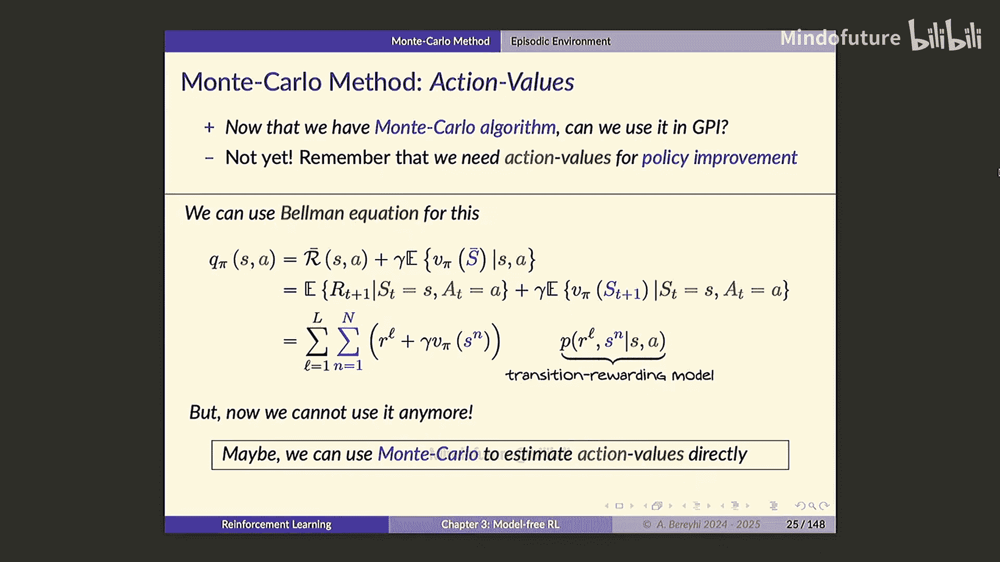

Okay， so this is the way that you can estimate action value。

 So let's look at one trajectory this is one trajectory that I have sample。

 I was in this particular state， right， I did action a 0。

 And then the environment has taken me to a state S1， right。Have done playing with Mike。Right。哎。

I just played with my policy ID。Next state。 again， I played with my policy to the next estate and so until I got to be terminal state。

 right， now， if I look at this one at s 0 and a 0， right， I have collected R 1。

 R 2 towards the very end， right， correct， So if I add them up， this is one sample return。

 given that I was in state S 0， and I did action a 0， right。If I have， say， hundred of those samples。

Then eventually， when I average all of them， this is going to be an estimate of my action value function at the point a 0 and a0。

 right。Everybody's clear， right。So same idea。 now， instead of just thinking about this day。

 youre thing thinking about the pair， stayed in action together， right。Everybody is cool， right？

 Okay， So if you got it， then probably， you can see that I really do not need to estimate only the action value for this guy。

 right。I can estimate the action value for this guy and the guy next and the guy next towards the very end。

 right， because we're every single。Whatever I have。第发。

So this is not one simple11 single sample return is actually a bunch of sample returns， right。

 And you do the same thing。 So what we do。Yeah， what we do。

 we usually start with the action values to be 0， so。St for all act。That。Now we start to sample。

 right， we just do one random trajectory and you start from one stage。

 You do one action with your policy。 and you keep on playing， right， And once you do that。

 then you would say， okay， maybe if I think about the very last1。 Like I want to know what you S T-1。

80-1。 Okay， S T-1，80-1， the action value here one sample that I have got is actually G。

 which was 0 plus plus， I mean G， which was 0 initially plus the return that I collected。

 the last return， right， and I update my estimate for that particular state。

And then I go once and step backward and say， okay。

 what about S T -2 and8 T-2 When I was at a state A S T-2， and I did action8 -2。

 I kept on playing with my policy， right， And then I collected R T -1 after that R T。

 and then it was terminal， right？ So what I collected was R T -1 plus R T。

Wite it down R T minus bound plus the G that I。This is the new sample。

 So I'm going update my estimate for S T-1，80 -1 again， right， And then I go1。Going to like the。

I go for my next strategy。I sample another trajectory It a new trajectory。

 and I again go over every single pair， right， And I update my action values。 Now。

 if you keep on doing this for enough number of episodes。

 then you gonna converge to some action value function， which is under some conditions。

 a very good estimator of your action value function。 Everybody's clear。

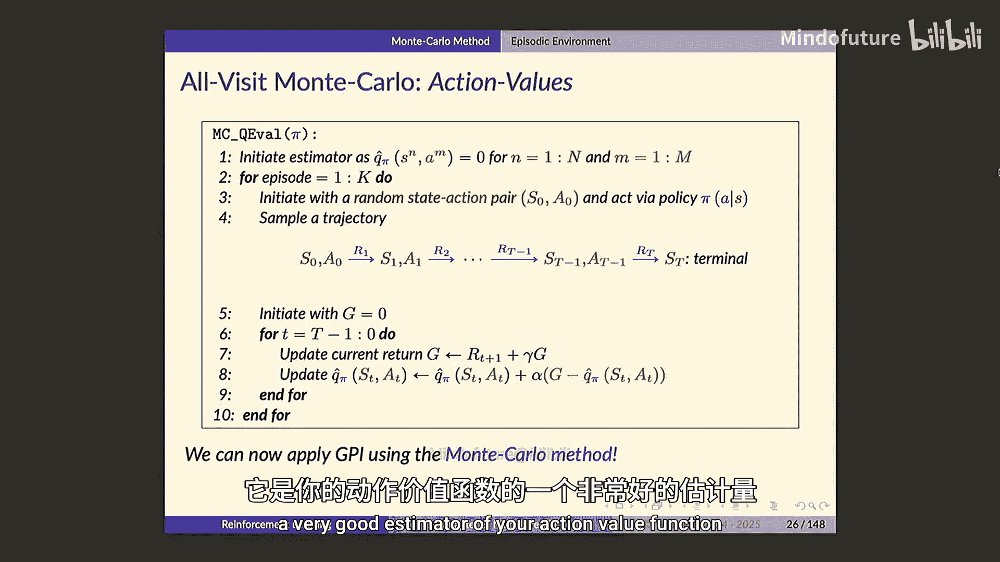

Same thing as before。 Now you have action value， right， now one question。

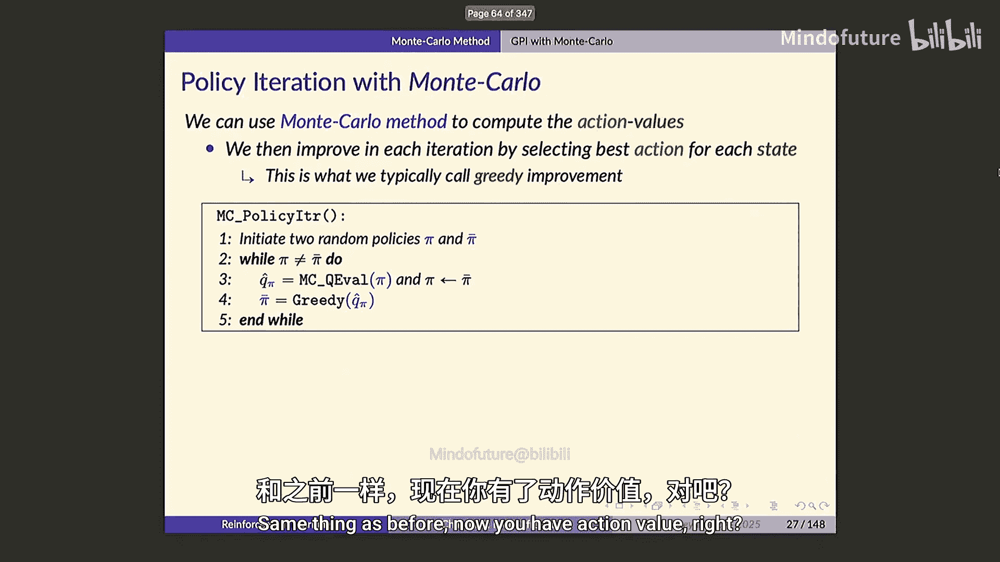

If you do this。For action value。 And you do the one we had before only for this states。

 just the value function。 Which one you think converges faster。The， right， why。郭海军说。Yes。

 because if you think， for example， you have， say you have0 states and0 actions， right。

 in the value estimation， you are just estimating  hundred different values， right， So 10 values。

 each of them for one of these states， right？ But if you have hundred actions when you want to estimate Q function。

 you have hundred state0 actions。 So you have 10000 years， right， you're now estimating 10000。

Proometers， right， And this is going to take longer because you need more samples。

So action value and value， they are， of course， same mechanism。

 But you are estimating more parameters here because you are thinking about every single pair of actions at states。

 right。

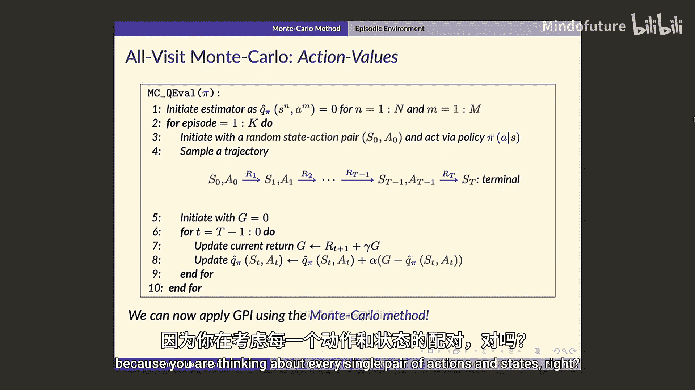

Everybody's clear， right。Okay， cool， now， if you got that。You have one mechanic。这一块儿。

Need the MVP anymore。So we can' eventually do this generalized form of the。The policy itration。

 which Im calling it here Monte Carlo policy itration。 So how does it work。

 This is exactly the policy itration。Before the only difference is that。

 So this loop is exactly the policy it。 So you start with one policy， you evaluate the policy。

 you improve it， right， And again， you got this new policy， You replace it here。

 you improve you evaluate that new policy， you improve it。

 and you keep on going till you got converse to some。Stationary policy。

 that is hopefully your optimal policy。Okay。But the key point here is only that we are using the Monte Carlo estimation to evaluate your policy。

 right， because we do not know M P。 We cannot do like dynamic programming anymore， right。

The only thing we can do is just sample from the environment and average， right。Okay， now。

 one thing that you might ask me here， I have written here greedy。 I haven't written here。

Improvement， right， So this greedy thing that I have written here is essentially the same improvement as we had before。

 So that is the same thing， right， So the new policy is basically。

 I look at this action value function， I take the action， which is doing optimal right。

 in in that sense， given that what I had evaluated， right。

 So I look at the action which at the particular state is giving me the highest estimated value for action value。

 So it's the same thing， the only reason that I call it greedy is that now this action value function that I have here is not necessarily the true action value。

 right， is an estimate of it， right， meaningan that for the given policy， I might be still wrong。

 right， So this Q had of pi， it might be very different from Q of p。 If my estimation is poor， right。

😊。

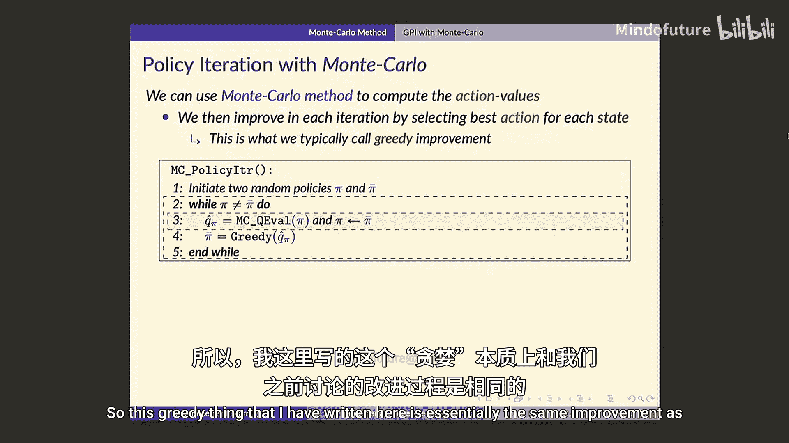

So this is why I call it greedy because you somehow think that， okay， youre impatient。

 You just do estimate given a few samples that you have， but youre impatient。 You are too greedy。

 You just， based on those values， decide to just improve your policy， right。Everybody's clear， yeah。

哦。Great， so。Now， this guy that you see here。In a very ideal world where you can really。

Definitely from your environment and your estimate is very， very accurate。 This guy is okay。

 But in practice， we don't have that much of samples and we don't have time to wait for so much episodes。

So what we do。Are really greedy。 Like we just estimate with few episodes。

 and then we decide to improve。 And because of that， this idea is not the best idea。

 So some of you might have heard of the epsilon greedy。That is a kind of modification of this one。

 which we are going to do later in this chapter。 But right now， based on the policy itration。

 this is the kind of update that we do， the way that we improve it。O。

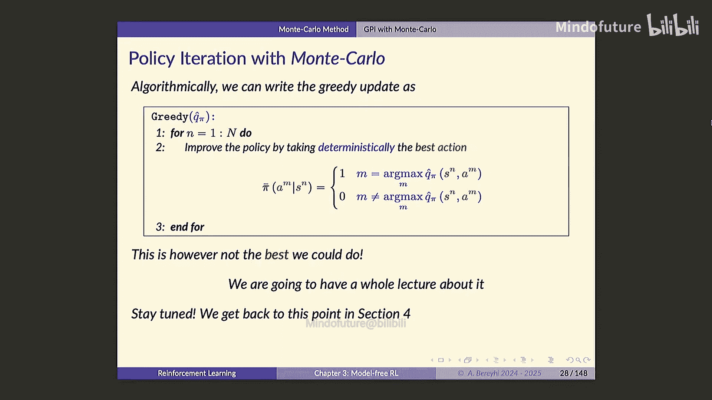

是啊。Now， in this case， if you want to just compare this Monte Carlo。That we have。最第。0？

So theyre what I told you。 I told you that we have one policy， and then we do evaluation。

 We get to the value function。 That value function was giving us the Q function as well， right。

 And then we just improve it， right， once we improve it， we get into the next one。

 And you said that we were doing the evaluation。 we were just doing it suboptily because we said like we don't want to wait for the dynamic programming to really converge。

 We just want to stop it at some point， right， And then was just initially for some random policy that we start。

 maybe it was not very good evaluation， but gradually was getting better and better， right。

 So the variance of changing was reducing。 And eventually。

 we were going to we were going to converge to the optimal policy。

 We are pretty much doing the same thing here。 The only difference is that we are just using Monte Carlo。

😊，Right， we are using Monte Carlo to do the evaluation， right。

 And this Monte Carlo could be problematic， right， because there we were just terminating the algorithm。

But here we are estimating， right， this is much more noisy。This， this。

Kind of variance between the true evaluation。Evaluation what。Good。Again， this guy。policy。

 your evaluation is total nonsense。 But when you start to improve it。

 it gradually is going to get better and better， right， And it makes sense。 Like。

 imagine that you have the whole entire world and you want to walk in this world， right。

 So the initial policy that you evaluate because you don't have so much samples。 You cannot go。

is very。But once you narrow down your policy， we say， okay， I'm gonna just take this path。

 then you gradually start to collect more samples， right。

 because you have reduced the space of your choices。 You're just walking on that path， right？

 And since you are just walking on that path， you get better estimating up。A down function。

 but this is coming at the cost of the chance to that you lose some other optimal path that you're not really trying get at first。

 right， And this is why we are going to later do apsilent greedy。 But for now。

 we don't really need to care about it。关系。Now question。Okay， so if you got no question。

 then just wrap it up。 So you start with some policy in this approach。

 you just use Monte Carlo to evaluate the Q function。

 and that Q function is going to land you some other at some other policy， right？

 So if you do greedy improvement， you're gonna get into another policy。

 and you keep on doing it till you conversion。Oim。 now， here。

 there is there is no more guarantee that you converge。Policies。安徽区。

Sure that every time you are using Monte Carlo， you have infinitely large number of samples right and by infinitely large。

 I mean like the number of samples that you have as compared to the number of that you have is much larger。

 but this is something that is not going to happen in practice right And because of that。

 you cannot guarantee that you are really ending up with the optimalpoli。Okay， so。

Questions on Monte Carlo。Yes， I mean， in model free from no on， we always evaluate action value。

Because we cannot really use that Belman equation directly to estimate action value from value。

 right， to sorry， compute action value from value。

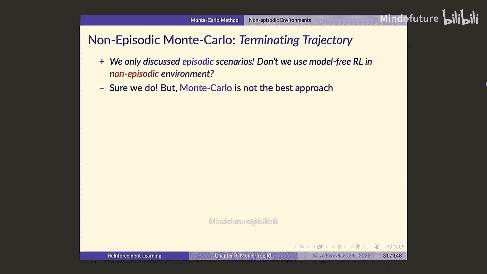

Here， yes， it should be Q， right， I meant Q， right， Sorry， Yeah， it's better to put this Q。

 I'm gonna fix it。

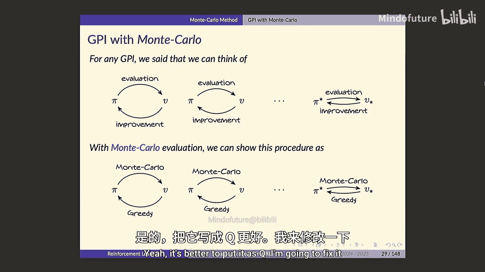

OK。So， no question。So now， one thing that is happening here with Monte Carlo is that if you really want to use Monte Carlo。

 you need your episode to end， right。It means that when you are in one environment。

 you need to have a terminal stage， right， And that terminal stage should happen in a foreseeable。

To have a world。Hll terminal no。You might。Obviously， that does not。With the terminal very soon。

This is a problem， right？This one episode that you're collecting from the environment takes forever。

 right？So。This is one issue。 So if you want to really sample， you really need to have a。

Terminil stayed then that。Somehow ends up your trajectory or。 Now， what happens you don't。You think。

 well， you might say okay。even maximum。Me that I start from S0， and at S T。

 But I stop playing simply because I don't want a longer trajectory， right。

But there is a bit of challenge here。 The challenge is that when you want to estimate the。

 So if you want to just collect your sample return， right。

Your return gonna be R 1 plus R 2 plus R T -1 plus R T plus what you would get after， right。

 but you are terminating。With a terminal said， everything is fine because R T， after that。

 you are always getting0。So that is no problem。 But here， when I get to R T， then after that。

 I know there is still some rewards coming， I don't see it anymore。Because I terminated it。Right。是。

That is the issue。 So the problem that you have is that， for example， if you think of G T -1。

 the reward that you get after T -1， this is R T plus whatever comes after that。

 But those guys do not exist anymore in your sample， right。

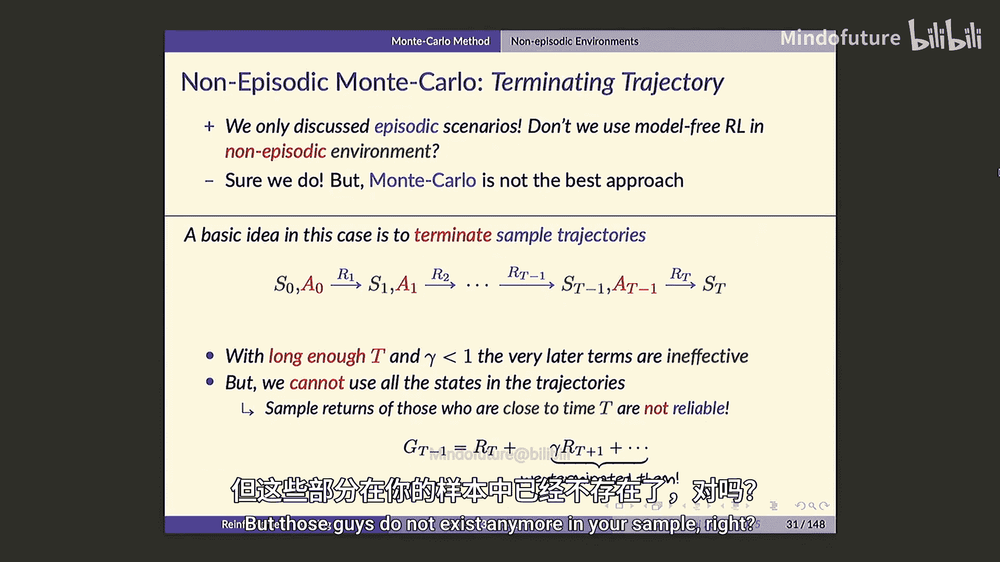

Now， how can I do this in practice？ So if I want to use Monte Carlo on such a thing。

 the idea is that。

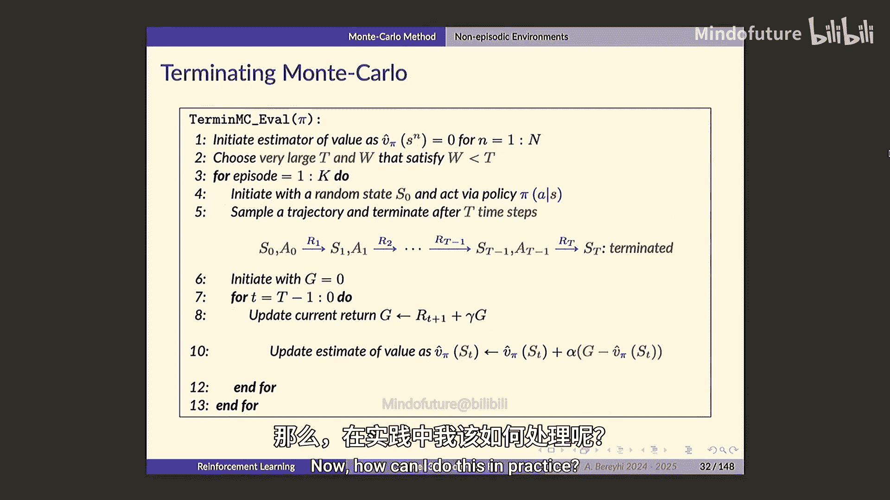

Sa， okay， if I can。でかて。Depending on the climate。実か。而。at some point on。

 I am not too much interested on my rewards， right。

 because if I am thinking of this T to be very large， say it is 100 right。

 And I'm talking about the sample return for the very first time。

 then it's gonna be R 1 plus discount factor times R 2 plus discount factor to power 2 times r 3。

 And so when it gets to R T， I already have gamma to power t -1， right， for the next ones。

 its gonna be gamma to power T。 and it doesn't even if gamma is 0。9， when t 100。

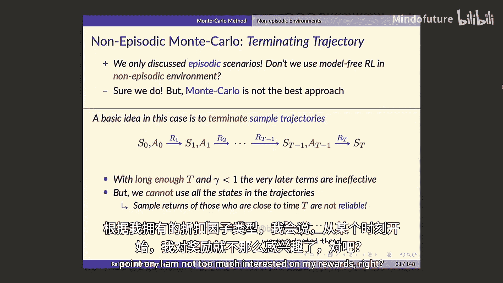

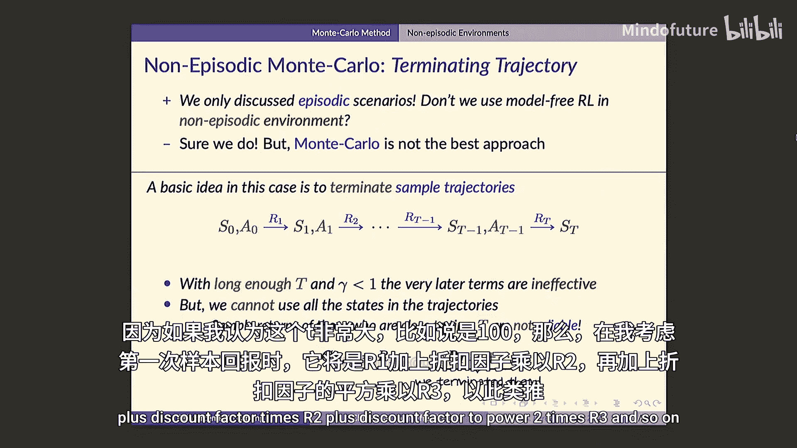

L is extremely small， right， So that is almost 0。 So I can roughly say that when I think about the very first estate。

 then whatever comes after the determination is not really impacting my sample， right。

 It's definitely much smaller than noise that I'm seeing in my sample， right， So what I can do。

 I can say that okay， it doesn't matter， really， So I can start from。

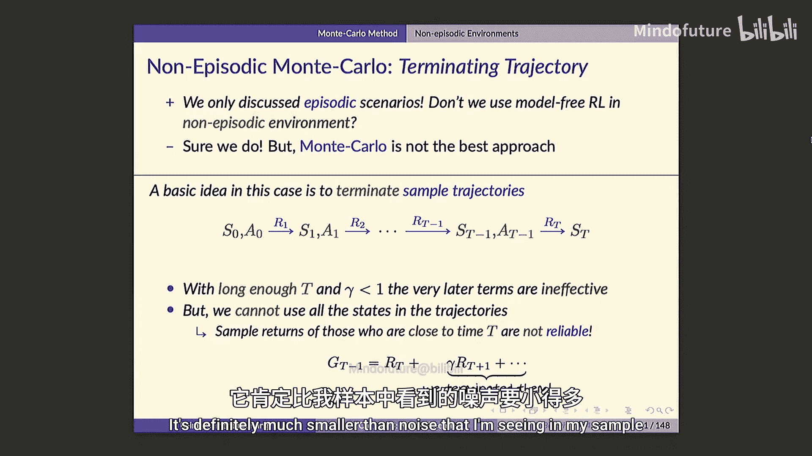

Back very end and collect whatever I have。And then I take it for for the value or action value of my first。

The tragic。That's fair， right。8。This statement is correct for this guy。Right。

 this is not correct for this guy， right。You agree， right？

 So you cannot really estimate or take samples for the for the pairs。

 which are at the tail of your tragic career， right， You can just do it for the first ones， right。

So this is why we have this window W as well here， right？ So I'm gonna consider one window W。

 And this window is like the time we're up to which。

 So W is something is smaller than T is one of the time steps here in between。

 And that W is where I feel right like anything after this W is fair to take I mean。

 is fair to ignore， right， but before that W I mean， I can estimate anything before W after W。

 I cannot really estimate anymore， right， So you do the same thing as before。

 the only difference is that you're not going towards the very end of your your trajectory， right。

 you go up to times t minus W， and that time T T minus W is going to somehow give you a fair window。

 fair buffer that you can assume that for the very last。P， you're estimating your trajectory。 still。

 the impact of termination is。Okay。This is Monte Carlo by termination， right？8。This guy。Obviously。

 is giving you less sample efficiency as what you had with。Terminal state， right。

 because in the case with Ter state。Trajecty and every single pair on your trajectory was one particular sample。

 right， So you had， you had one trajectory。 You were using everybody inside the trajectory， right。

 But now your。Throwing away a bunch of them in your trajectory。

 because you know that they are not giving you reliable estimates， right。

 So this idea is not a very good idea。

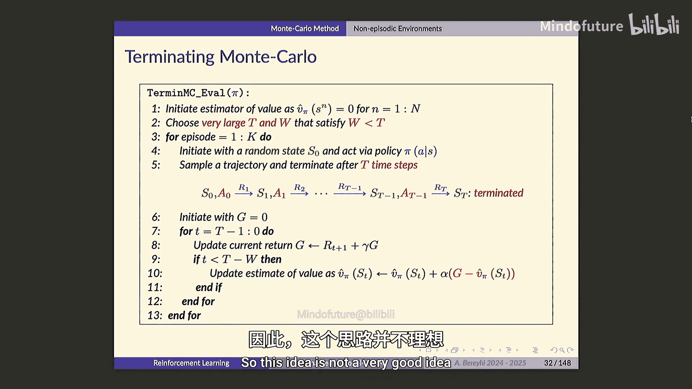

So this is eventually very simple inefficient。 And what we can do to resolve it is the idea of Buhist trapping。

 so。

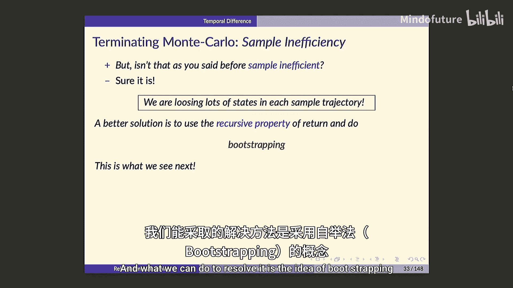