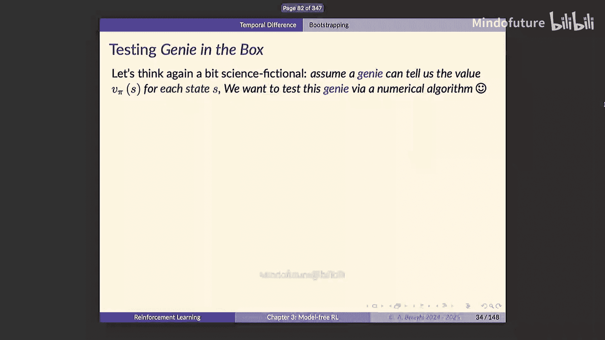
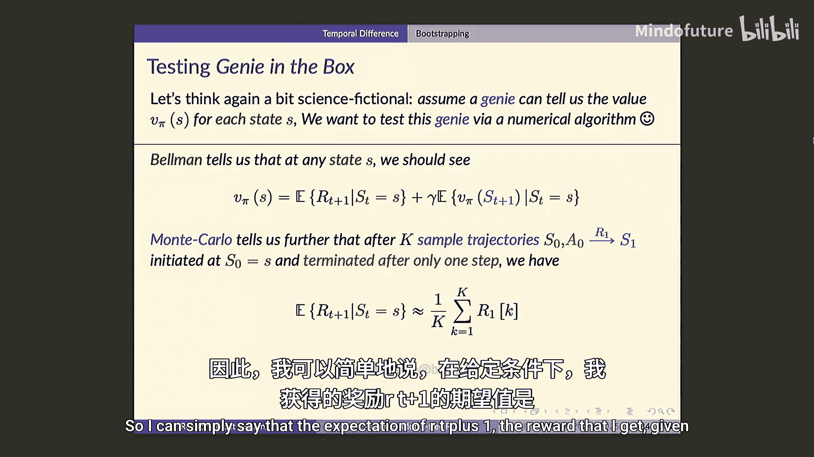
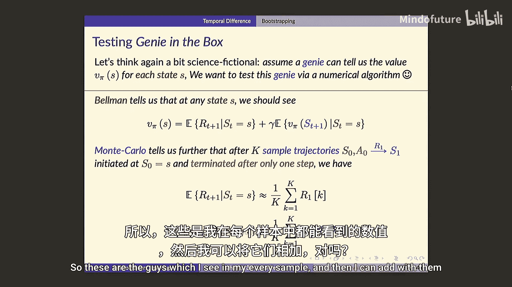
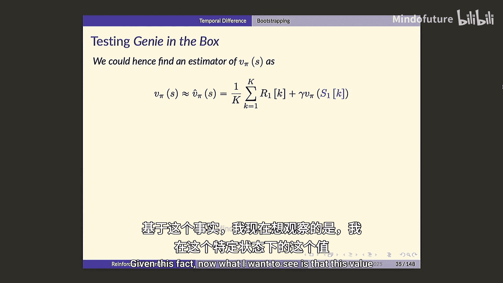
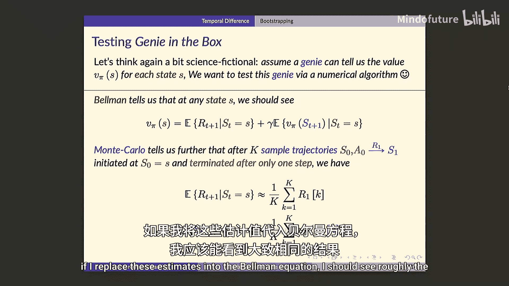
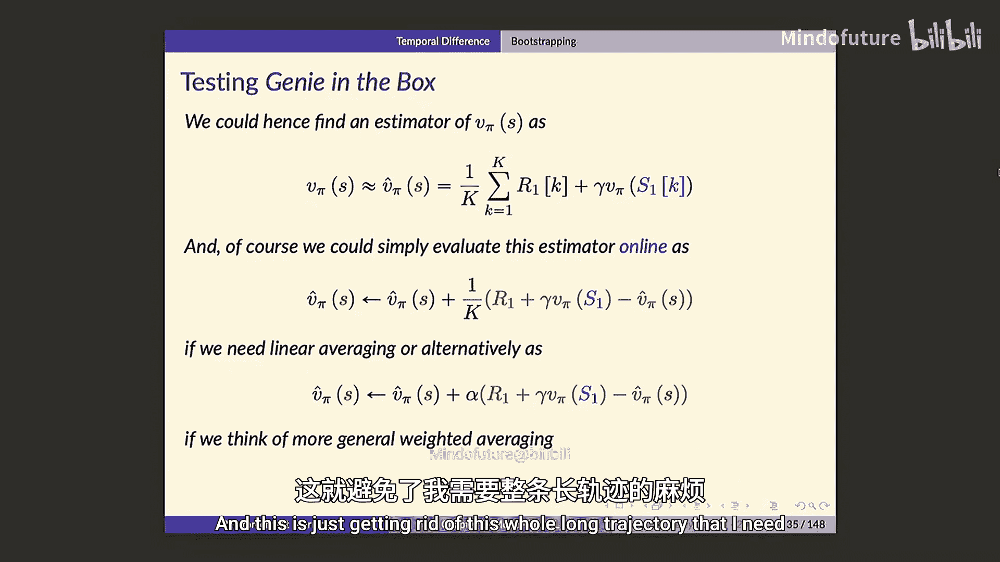
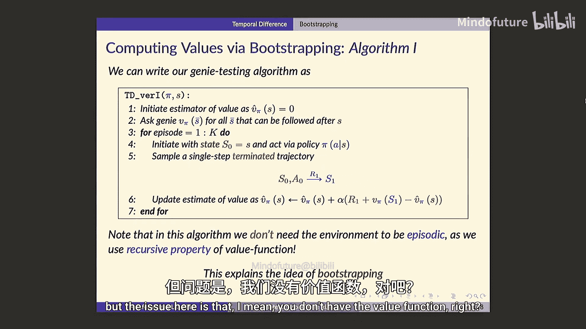
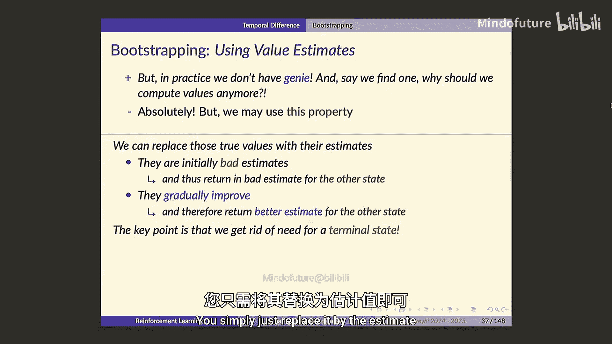
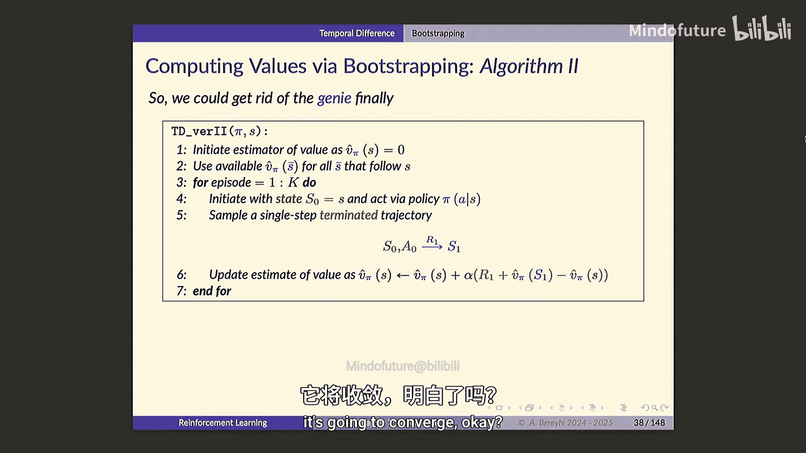

# 【多伦多大学】强化学习 2025 ｜ Uoft   Reinforcement Learning   Fall 2025 p24 P24_讲座_23_自举法 -BV1D3F2zhEry_p24-

Here， so let's。

in this space。 sayy I have one gen。 Okay， and this genie has this power。 What， what it can do。

 If I tell the genie， what is my state， It' gonna tell me what is the value of my policy at data state。

 Okay， now if I have the genie， I don't need to evaluate anything anymore， obviously， right。

 but let's say I want to test this genie， meaning that I want to make sure whether he is telling me right values or not。

 right， so how can I do that。 Well， I can go ahead and use Belelman equation， right。

 So I'm gonna say， okay， let's say I'm in this particular state， right。

If I am in this particular estate， just this estate， right。

 then I play with my policy and I do one action， right， and doing that action。

 I go to the next estate， right， That is what we have S T plus one right， That is the next one。

 Then what Belman equation tells me is that， well， the average immediate reward aggregate you get that estate plus discount factor times the average value of the next estate is going to be your。

Value at the particular state that you are， right， This is the Belman equation， right。

 So I can use this Belman equation to test the gene。Make sure whether， the values are right or not。

 How can I do it， I can just， again， like Monte Carlo sample K different samples。

 but I really do not need to sample towards the terminal state， right？ I am at this estate， right。

And then I just sample one time a step。 So I'm this a step。 I play with my policy。

 I go to the next step， right？ This is one sample of my current estate， my action， my next estate。

 right？ And I'm gonna see my sample reward， right？ So if I play once。I with， I mean。

 I start from S 0 being exactly the state that I want to evaluate。

 Then I do action a 0 based on that policy that I have。 I get the reward。 I go to the next estate。

 right， in the previous way of sampling， I kept on playing， right， But I stop here， right， again。

 I get back to my original estate， which was S again， I play with my policy， I do one action again。

 like one reward， I get to the next estate， right， So each time that I sample this next estate。

 this action， this reward are different， right， you agree with me， right， because when I am。

At the same estate state is S， right， as 0 is exactly S。 But when I am in one state。

 if my policy is random， then my action could be different， right， each time that I sample， right。

 When I do that action in this estate since my environment is in general random。

 I'm gonna get a random reward， I'm gonna go to a random next， right， Everybody agrees， right。😊，Okay。

 if I do that， I have KD frame samples。 Now， can I use those KD friend samples to compute this average。

How can I compute that average。I have K samples of R 1， right？ All of those R1s are coming。

Condition to this fact that I was in this state S， right， I was in this estate。

I played with my policy。 Ive got ky Friend downpa rewards， right。

 and all of them are immediate rewards， right， So I can simply say that the expectation of R T plus one。

 the reward that I get， given that I am in this estate is average of the immediate rewards I collect。

😊。

あこ。Its okay。Right。没我的么。Ex this value。How can I。Estimate this term。

 this expectation of the next value。Remember， we have the genie。I am in what this state， right？

 I play with my policy。 I go to the next stage， right， Each time I do it， I go to another state。

 right。There's yes。Yes， I'm gonna ask the gen for every single sample that I have， right？

 So if I am in this is stay。Right。And I play once。 I come here。Give this estate to my genie。

 You can tell me what is the sample value of the next stage， right， I get back。 I again play。

 Maybe this time I come here， right， again， I give this stay to my genie， right。

 it's gonna give me another sample， right， if I average all of those。

Value is given by the genie that I am computing the expected next value， given my。Cool。

 so my next value， the expectation of the value at the next estate is simply this average， right。

 approximated with this one。 This is a good estimator of the next value， right。😊，Aise go。

So these are the guys which I see in my every sample。 and then I can。喂。

OK now。Given this fact， now， what I want to see is that this value that I have in this particular state is exactly if I replace these estimates into the Belman equation。

 I should see roughly the same thing， right， So this means that if I want to check the gen。

 I am in this estate， I really do not need to sample towards the end， right。

 I just sample exactly this estate， K samples for one time step， right。

And then I compute these to averages， immediate reward and the value of the next。And then。

Check this out。Ask compared compared to the value。They are roughly say that the genius。

They're not the same in the chain line， right？Everybody is cool， right。这样。Now， if I want to。

 for example， do the app online， I can， again do the same thing as before。

 so I can start with the estimate of my value at this particular stage， right。

 And each time that I sample， I just update everything in this form， right？

 So R1 plus value of the next state， minus what I add right up to this point at as the estimate。

 When you keep on doing this each time that you get a new sample。

 you get a better and better estimate， right， And eventually。

 if you do it for enough number of times， then this guy is going to converge。The true value， right？

So。This is the case that we can update our value with only one single time step。

 We don't really need to go towards the end， right， If you want to do it linearly1 over J。

 if you don't want， this is again the alpha， the same thing as we did before， right。没有。One question。

 What is the problem in in this whole process。 I mean。

 what I am doing right now is that I am estimating the value of my estate， right。

 And if I want to estimate the value of my estate， I really do not need to sample till the terminal state。

 I just sample one time step， right？ What is the challenge now in this estimate， this sounds very。

 very effective， right。What is the challenge？What is impractical in this whole process？What is it。

What is too many states？If I want to do it， I really need to know the value function， right。

It's true that I am computing the value at this estate。

 But each time that I want to compute my estimate， I need the value of the next estate， right。

 But the whole process is to find the value function， right， So this is a bit contradicting itself。

 right？ But you can guess that you can replace。also with this。I don't have the true ones。

 So let me just put the estimate one， right， And if I put the estimate1。

 then each time I am going to estimate my current estate value。

Based on the value of the estimate of the。Getting me rid of this whole line。Prorajectory that I need。

O， so。This is。The idea of Buddhist wrapping。 And in this idea of Buddhist trapping。

 I still keep the value function to be given by the genie。

 So I assume that I have the genie who is going to give me the value of the nextexus estate。 Okay。

 if I had the genie， then I really did not。Two words the。The trajectory。

 I just need to example a lot， right？Because what I do know is that the value of this guy based on the Belman equation。

 it， it can be given by the expectation of the value of the next guy。 right。

 So this fact that you are just cutting the whole trajectory by using this recursive property。

 This is what we call it。O。我先。No question。The value of。啊。But this gonna be then exactly。Markov chain。

 and sorry， Monte Carlo。It gonna be that exact Monteco。 You say that， but I。

 I cannot guarantee that when， I mean， in a general environment。

 I cannot guarantee that I really know where is this state。

 which always the next state is terminalcy， right。So yeah， but you really do。

To terminalmin said this is going to be Monte Carlo。

 We're gonna talk about this because you can actually extend this with this trapping longer and longer。

You can extend it longer and longer。And if you extend it like for infinite length。

 then But we're going to talk about that。关先。要关系。Okay， so this is the idea of Monte Carlo。

 but sorry with a strapping。 But the issue here is that， I mean， you don't have the value function。

 right， So what we can do， Well， basically， we can simply use the estimate that we have。

So I don't have the genie。 What do I use。 I just start with some random， say0 values， right。

 When I start with the zero values， Now， at every single state that I am， right。

 I look at the next stage， right， and using the value of that stage， which is estimated based on my。

 my table， I'm gonna update the estimate of the current stage， right。Now， I updated this one。

 I again sample， right。 And the next sample that I get， maybe this happens that from one state。

 and I end up with a state， which I already have updated， right？

 And then I use the estimate of that state to update the other state， right。

 So you can use this idea of with the scrapping， but you don't use the exact value function because you don't have。

You simply just replace it by the estimate。 Okay， so this is what we call it the temporal difference。

 So this is the second version of the temporal difference I'm showing you。 And now。

 instead of having the， the genie， I am going to replace it with the estimate of the value， right。

 So it means that。

I get into I start with everybody being zero。 This is a safe choice because we know that the terminal estate has value 0。

 Anyone else could simply get updated。 And then I start sampling one episode， right。

 and in every single episode。 If I want to know what is the value of the particular state S。

I am going to start with that estate。 I do one action。 I get one reward， and I go to the next estate。

 right， And I forget about the fact that I don't know the value of this next reward。

 I am going to update by the estimate of the value of the next。Right。嗯你把基。な。

That value function gonna get updated enough number of times。 And then eventually， at some point。

 you gonna converge okay。Questions。

