# 【多伦多大学】强化学习 2025 ｜ Uoft   Reinforcement Learning   Fall 2025 p25 P25_讲座_24_通过时序差分实现广义策略迭代 -BV1D3F2zhEry_p25-

You're gonna see it。 So what you're doing like in the Monte Carlo。

 when you wanted to just sample from this backup diagram。

 you start from one state and then you sample one action and then you sample the next state。

 And you're gonna stop when you get into the terminal state， right， meaningan that if you come here。

 you're gonna have a short trajectory， but you could have a long trajectory as well。

 And you only I mean， the idea only。

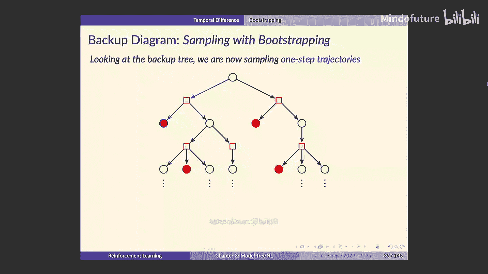

If you have。The terminal stay at the very end， right。

 But you don't really need to do that because like。

 you always need to sample one time step in order to be able to estimate your current value function。

So you just sample here okay， next to state is 0。 So sorry terminal。 So it' gonna be zero。

 But what if that happens is okay， you got you're going to again stop here and you're going rely on the estimate of the value you have for this particular state right And if you keep doing this for all these days over and over。

 this is gradually going to converge to what you want okay。So this is the idea of Buist trapping。

 as I said。 So each time you're just sampling one time step next。

 and this is going to give you a kind of estimate for future。 Now， what we do in practice， of course。

 we are not going to just sample one single time step。 We are going to again。

 sample a long trajectory， right， And then similar to the Monte Car approach at every single time step。

 you can look at the forward as your next time step， right。

 And then you can estimate the value of the estate in that particular time step， right。

 again you go for the next one。 Well， what is the next estate。

 I'm gonna estimate the value of this cut。

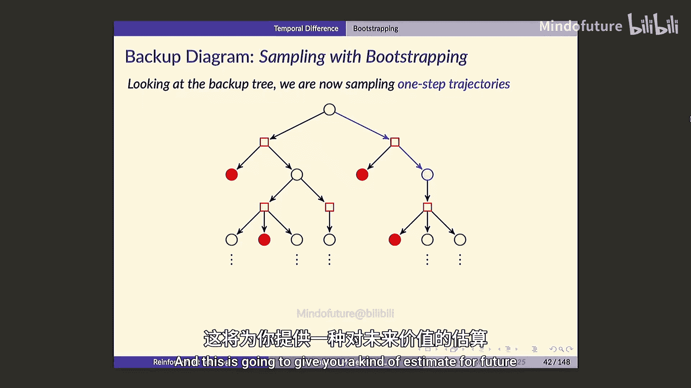

再来。4 right， so we're gonna start from some initial value estimates。

 and then we're gonna sample one complete trajectory。

 So if I have the complete trajectory each time that I want to estimate the value of this state in one particular time step。

 say the value of this state here。 I am going to just collect the immediate reward plus the estimate of you have the next state right。

 and so on。 Then I go for S1， I say the value of S1 is going to get updated by the immediate reward and the value of this state。

In time， too， right， And then I keep on going forward。要。

You go over this project or one particular state might get updated multiple times， right， You agree。

 right， because you might be in a state0 here and again somewhere in between here and here， right。

 this could happen，So you could have once it updated multiple。 And this is totally O， right。

 exactly like the Monte Carlo approach。是。You， you， you are going to just simply go rid and then you update using the Buddhist wrapping idea。

 This is what we call it temporal difference， right。

 And what we are talking about right here is technically temporal difference0， TD 0。

 You're gonna see how you can expand it。 You can guess instead of just one times step。

 you just go two times step。Or three times steps。 Always， you can write value at any estate。

 reward plus reward plus reward value afterwards， right， you can always write it down。

 And if you do that， you are basically doing temporal difference because you're gonna say。

 what is the value here， I mean， if I know what is in a bit future。

 then I can just explain what is the value here， right， and you use。

Property in your trajectory to find an estimate or update the estimate of your value function。

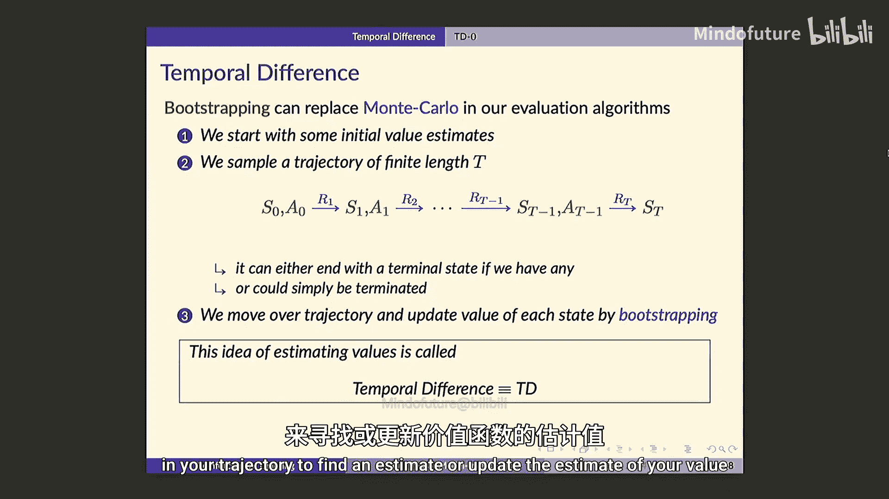

Here is the temporal difference evaluation for one given policy。

 So we're not talking about one particular state anymore。 So I give you the policy。

 I want you to evaluate it。 And if you want to use TD， you are going to use this one。

 right So you're gonna start with all the values being 0 initially。 So every state is 0。

 And then you just sample one trajectory， I have this trajectory that I start to just go over it in time。

 right， So I start with the first guy S 0， I say value at point S0， is going to get updated。

 So this is the previous value before I see it and then this is what I get。 So R 1。

 the immediate reward plus value at the next state。

 which is S1 right I'm going update with this value right Now I go for S1 right When I go for S1。

 I can update the value of S1 based on the immediate reward and value of S2。

 If it happens that S2 is exactly same thing as I had at S。0， then I have already one estimate。

 right， So S。Thank get outて。Now to keep on going like this。 again， if I have。Eodeode。

Keep on with this approach。 Eventually， every value that I have in this environment is going to get updated。

 right， And then it gradually converges to one。And specific function。

 which is hopefully the value function that we want。 Now。

 one key property that you see here is that when you want to update in TD。

 You eventually don't need to wait till your trajectory is over， right， in Monte Carlo。

 it was correct that you can update after every single trajectory。

 we did online averaging to do that， right， But it still， if you want to update。

 you need to sample the complete trajectory， right。Then you start from very end， right。

 You would say this is 0， R T R T-1 plus R T。 and you keep go backward， right， That was the idea。

 right， This is the way we update it。 But here， I don't know， right， I don't need because I。

 when I am at time 0， if even this guy has not ended yet。

 I can simply use R 1 and the estimate of value of S 1 to update that。那是。喧がし？Sort of online approach。

 And we are going to use it later on when we are just talking about online control， right。

 But this is important to pay attention。 This is actually completely online now， right。

 So as you are just sampling one trajectory from the environment， you can improve the。the values。

 right， your estimates of value。

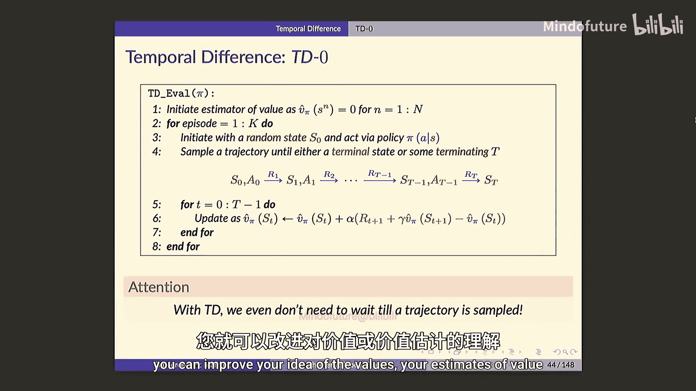

Okay， now you can obviously use the same idea to。Or estimate your action value function。

 This is the same thing。 Only you just go for two dimensions。 right， Again， what you're gonna say。

 you're gonna say， okay， Bellman equation is telling me that the Q function at one particular state in action is the average of the immediate rule。

W that is statement？Plus， the expectation of the value in the next time stage next estate， sorry。

Right， and what you can do， you can simply。Treated as a kind of estimation problem。

 And then you estimate those expectations simply by averaging， right。 And if you do online averaging。

 this is going to be the。Expression you end up with。

 You want to know what is the you want to update your Q function in one particular state in action。

 you want to update this guy， you would say， okay， what is the immediate reward I get。

What is the value in the next time step， right。That value and the next time， I said。

 please the immediate reward is going to update my Q function。Everybody's clear。Questions。

No question。So again， similar to the Moncal approach。 if you use this approach。

To estimate the Q function and the same approach to estimate the value function， V function。

V function is going to converse faster， right， because you have less parameter。 You have only states。

 You're gonna conver faster， right here， you need to see enough pairs of actions and values。

 sorry N states， right， because of that gonna take longer time。

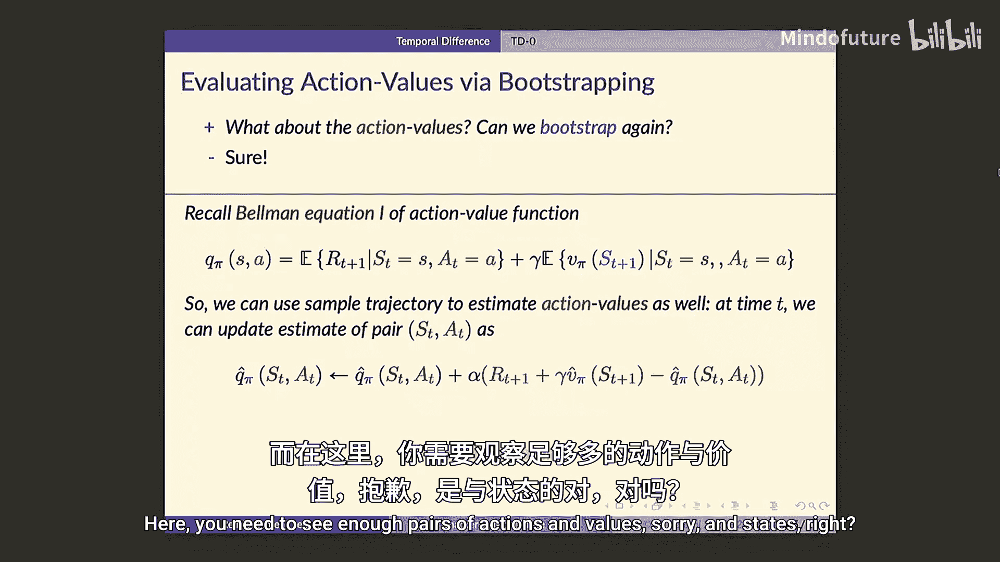

Okay， so this is the。Action value estimation using temporal difference。 Again。

 you start to just collect bunch of trajectories in every trajectory。

 you can update every single page。 So I have seen this guy， then I have seen this guy and so on。

 So I'm gonna average update based on immediate reward and whatever I have afterwards for that Q value。

 right。Questions。No question， everybody's cool。

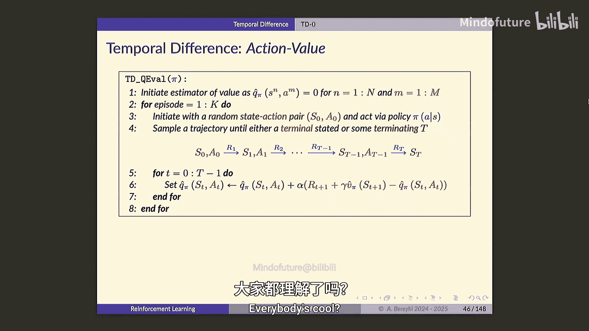

Okay， so。Dmy Gr world， you can try it at home。It's very simple。 I mean， again。

 you' gonna converge one。You're gonna see if you start from 0。 this is going to come very fast。

 because eventually， when you play， like you start from everybody being 0。

 And then this guy is going to end up with the terminal。 and then you get the right value for it。

And then you go on for the third one， this this corner one。 again， you're gonna get the right value。

 And then this is over， right。So just you just play with a random policy。

 and you just meet enough number of time 10。15 times you play。 You get a rough。

 good estimate of the correct value。Okay， that's it。 Again， similar to the Monte Carlo approach。

 you're gonna see this behavior。 So if you want to know how well your estimate is behaving as compared to the true value function。

 this is going to drop as you increase the number of samples。 This makes sense， right。

 you have more examples。Your estimate， right， Your estimate is getting less。That's obvious。

 The other thing is that this against alpha， again， this guy is showing this kind of behavior， right。

 So if you are updating online。Lar very small choice of a step size alpha than it could lead to。

Bad estimate， right So again， you need to tune it。 This is a kind of hyperparmeter tuning for your algorithm right。

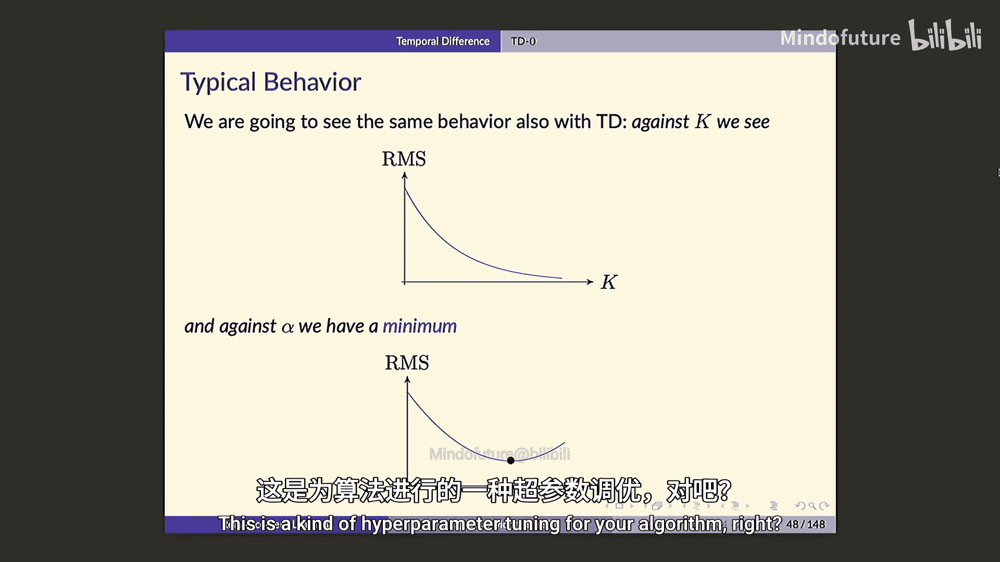

That's it。 so questions。No question。 Okay， now to just give you the idea why Buddhist trapping is doing better as compared to the Monte Carla approach。

 I have the。Dumbest example ever you can think of。 So it's even dumbmier than the dummy grid world。

 And what is the idea in this game In this game， this is a very exciting game。

 So you have just one key here， this key。 if， you can press this key。

 And each time that you press the key， you see one color on the screen。 Okay。

 if you play press this one and you see green or blue， like each time you press。

 you're gonna see either green， blue or red。 Okay， if you see green or blue， you can keep pressing。😊。

If you see red， it stops。 Okay， And now you said that you press。

 you are going to either get 0 or one， right，0 randomly。 you don't know， really。

 just you press you that reward 0 or one。 and you keep on pressing once you see red。

 Then you cannot press。 If you press you get nothing。 You gonna say red clear。

 I know extremely dummy， but it's going to explain what is the difference between Monte Carlo and temporal difference。

 It gonna clarify why temporal difference could be of better performance in， in such a case。

In environment with you， sorry， episode。So now the， the states that you have are green， blue and red。

 right？ So it's the color that you see on the screen。 right， If you see green or blue， you can keep。

If you see a ready gun and stuff， action is actually just one。 You don't have any choice。

 You just press， right， So there is no action， really。

 But you can say that you have just one action that is just pressing， right。这个。It， as said。

 So now one thing before we go on， I have this green and blue stage， right。

Do you think that the value of these two guys should be different。If you are in green blue or green。

 it doesn't really matter。 You can keep on doing the same thing， right。

 And when you keep on doing the same thing， you're gonna always see a random reward coming， right。

 So technically， just get green and blue and merge them into a new color purple。

 Then I have purple and red。 And the only difference is that。During red stop， right。

 So green and blue should not be different， right。So you expect that you see roughly the same value for them。

 right。So when I am in this estate， I expect to see。Something specific。 If I get to red。

 it's the terminal。So you have this expectation from this simple world。

 And then let's consider one particular sampling。 So we don't know the distribution。

 So we're gonna sample， right。 So I start playing。

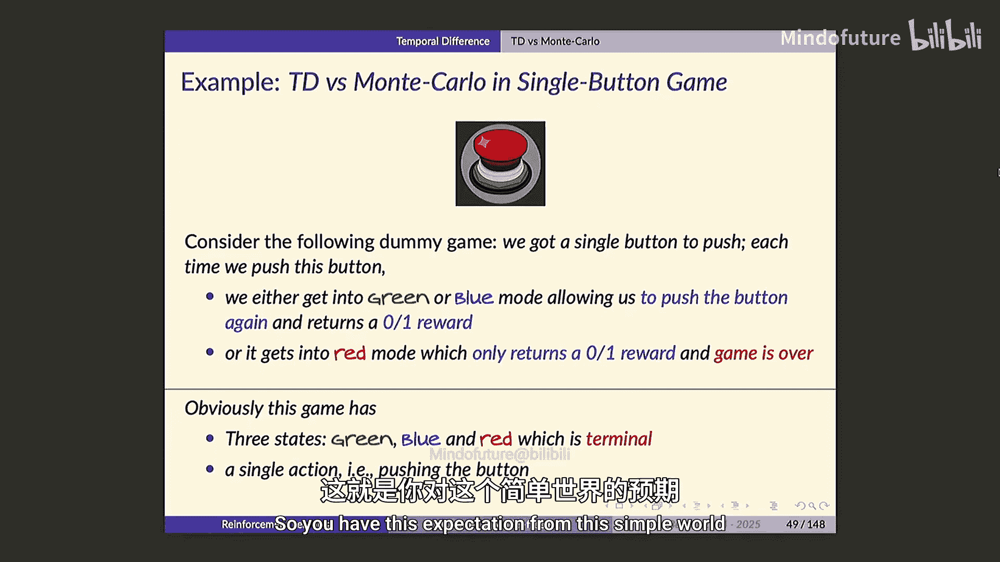

AndWhen I keep playing， I'm gonna just see blue， I press blue， I press， I get red。

 and you see the rewards that I get 1，0， right， again， I play once again， I see blue I press。

 I get one reward and then it stops， right， Again， I start playing blue I press， I don't get nothing。

 again， it's blue I press， I get one and then it stops， right， I try playing this here is 1，2，3，4，5。

6， I have six different trajectories， right， as you see here in the trajectories。

 most of the time I'm seeing blue， right， But once I see the green1， right， Now。

 can you playing based on this observation that green is happening much less than blue。 Well。

 maybe you can say but it's not going to impact the fact that the value of seeing green or blue Its the same thing。

 right。Correct。Okay， now you see this。 Let's start just estimating the value of every single state using the Monte Carlo approach。

 If I want to do it by Monte Carlo， how can I do it for blue first。

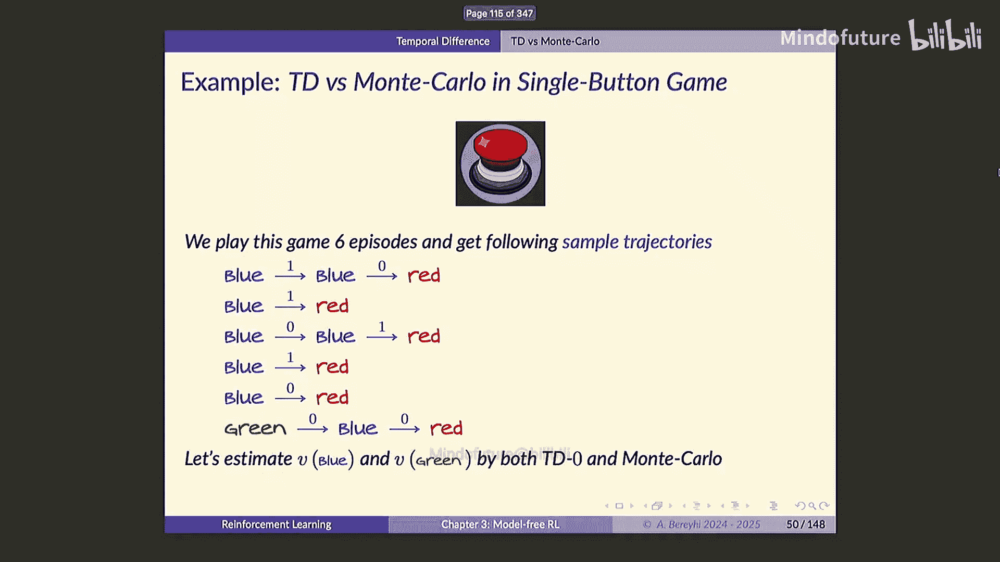

For blue， can you tell me what is the value of blue， How many samples of blue I have。

I don't know personally。So here is one blue， right。Second one， right。Third one。4ourth，5，6。7，8， right。

 We have eight different samples of blue， right。What is the。R futureture return for the first sample。

 What is it。Or G of yeah， G1 of loop。Can you tell me what is it。If I look at the very first blue。

 I play blue， then I get one， then I see blue。 and again keep playing。 I get0 stop， right。

 So anything that I'm im of， this factor is one。 Okay， It gonna be one。 What is G2 of blue。

 Can you tell me。It's 0 because the second blue， when I get in the trajectory to the blue， I press。

 I get 0 then in the stops， right， So it's gonna be 0， right。What is G3 of loop。为谁？

It's again one because this is the second trajectory。 I press blue but I see blue。 I press。

 I get one。 Then I stop， right， So this is again1。 I can keep on writing it down。

 Can you tell me what is G 8。 The last one of blue。It's against0 great。 So you see it。

 So if you do that， you eventually have four different cases where you are at a state blue and you collect your word one。

AndReturn1。Cases where like 0。 So your Monte Carlo estimate is half， right。Every school。Now， when。

Montic Carlo estimate is half what it tells you。 It means that it says like whenever you see blue。

 half of the time after that， you see  one， half of the time after that， you see 0， right right and。

Roughly speaking， you are going。Like half in general， right till you finish right， now。

 you expect to see the same thing for green， right。Because when you wearing。For this environment。

Keep bring kind of behavior， right？But the whole issue here is that if you estimate it based on these samples that you have。

 what。0， right， You're gonna say I have one sample of green。 I have collected only 0 after that。

 So my green is going to be 0， right。哦。From the fact that really。

 I have seen lots of samples where green is always， whenever I see green after that for no no。

 always I get towards the terminal I stay with no reward， right？ This is not because of that。

 This is because I have been inside green once only， right， So I have just one sample， right， so。

Estimate is very poor estimate， right， whereas this guy is much better， correct。

This has eight different samples， right， So its variance is by factor 8 smaller than this one， right。

So it is very high variance estimate。 Now， what can happen。地里。What can happen if I use TD， Okay。

 well， for blue， it。川わやって。Where I stored and where I am， but。Choose the right value of alpha fine。

 You keep updating。 Like initially， you would say， oh， here is gonna be one plus value of blue right。

18。It was zero。Next time you're gonna say blue， I am here。

 is's gonna be 0 plus difference to the value of red， right， The value of red is 0 now， right。

 And then you can roughly say that you have one and now you have 0。

 So now your your estimate is going to get updated to half right， And you keep on updated。

' gonna go up and down up and down till it roughly converges to half。 Okay。

 this is why I put it approximately have because it's not necessarily half when you use TD。

 But you get roughly to have。 if you choose right choice of alpha。 okay。Now， you got to have。 now。

 if you are say you are at this point， right， So you're updating。 you start from here。

 you can immediately update， right， In value for blue is 0。 TV would say tell you， okay。

 I reward 1 plus the value of the next estate is one， right， And then you get here。

 now you have 0 plus the value of red， which is 0。 You're gonna average it with whatever you have。

It's gonna be。Keep on going like this， right， So when you keep on going at this point at this blue。

 you have again updated your value and now it's half， right。 Now。

 what gonna happen when you get to the value to the greenest state and you want to update it。Using。

The estimate for value of green， you initially started by 0。 right， You're going to update it。

 This is going to get updated with what sample。Immediate reward， which is。0 plus。

Value of the next estate， which is blue， right？ So this is going to be the way you update， right。

 You're gonna say， okay， this guy was 0 before， right。 So the current value of this estimate is 0。

 right。And then you have your 0。 and immediate reward is 0。 That's fine。The value of the next estate。

 the next estate is blue， right。So you're gonna be roughly half， right。

 And you're updating your zero estimates。 So this is not going to show up。

 This is going to be roughly half， right。So here you are getting more reliable。Result， right， yeah。

Here， alpha， I put it。 I guess I put it one， right。No， no， Al is not discount factor。

 It's the one which you update with。So if you remember， like if I have estimate up to time。

 say I have k samples， right， If I estimate with k samples， then my estimate say mu K。

 I can write it down mu K-1 estimate by k -1 samples plus alpha times my particular sample that I have。

 say， for example， this is g or whatever right G of the the new sample。

 This is the new sample that I collected minus whatever I had before。 So it gonna be mu K-1。哎。

This is the al。 And this is something between 0 and 1。This is that usually it's one over our cave。

Yes， you could put it one over a K， right， And if you put it here one over K because you have one sample for green。

 then it' gonna be one， right， but。This is really not a kind of。Mandatory choice， so。

 or even optimal choice。 So you can， you can play with it， right， But here I simply put it one。

But even if you just put it something else， you are going to end up with some nus zero value， right。

 which is giving you less value。I to。

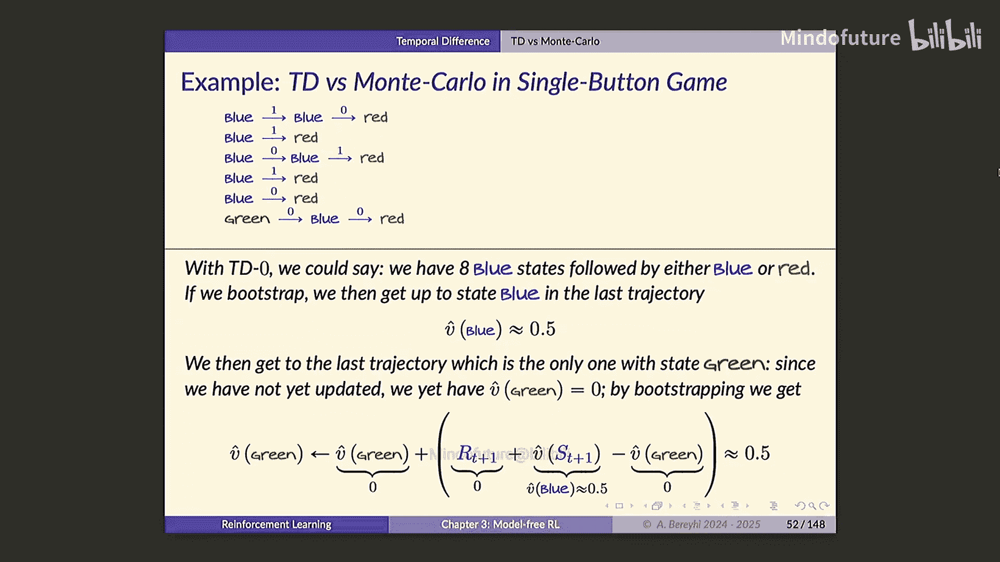

要关系。OK。Now， what I showed you in this example is actually a general kind of property that this TDM Monte Carlo approaches have。

 So what we do in Monte Carlo， we are really do not caring about whatever happens in between， right。

 Every time we want to update or estimate。 We're saying that I am in this estate。

 Let's see whats gonna to happen towards the end。 And then I get that sample I update， right。Correct。

 this is the way that you update。 This means that you do not hear what happened in the way， right？

 But when you use TV， you are looking on what happened on the way， right？ you would say that， oh。

 I was here right， And at the green point。 And then I just went one step further。 it was blue。

 And then I got to the terminal state， right， And it's true that in this particular sample。

 I just collected0。 But I do know that in average at blue， I am collecting half right？

 So maybe this time I collected 0， maybe next time I collect one， right？

 And then I rely on the estimate of the blue， right？ Now。

 what is happening here is that eventually you were somehow implicitly using。我。It's just described。二。

Because you would say whatever happens next， right， is carrying the information， right， with it。

 And that based on that， I can say that， O。Well， if I know what is going to happen afterwards。

 maybe I can use it， right， I， I do not need to throw it away and simply rely on a single sample that I have towards the end。

 so。

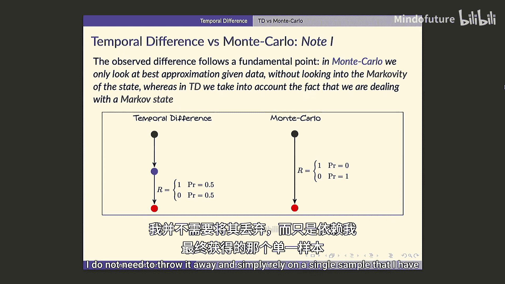

That is a sort of thing that you can say。 So this， I think I have mentioned it here。

 Mon Ti approach is using the Markovity of the of the environment。

 It says that it's a kind of process like Markov says that when you are at green， right。

 Then there is one probability to go to blue， right？ And then when you are at blue again。

 there is one probability to go to red， right？ So you don't care about the fact that you were second。

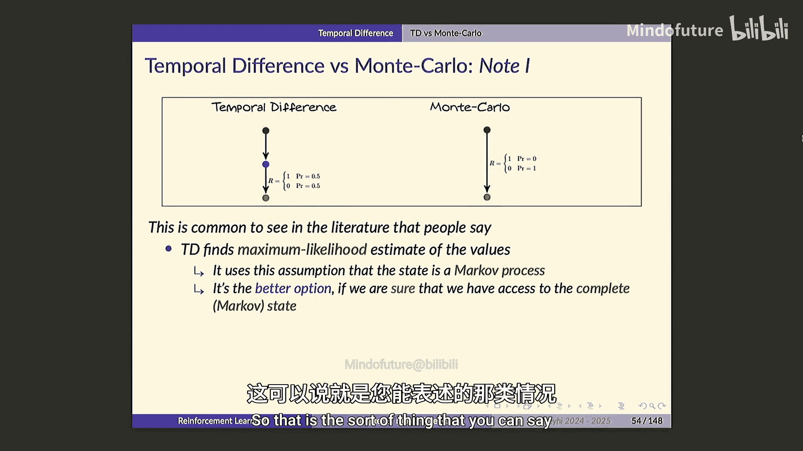

Last time is step at green， right， And because of that。

 you are somehow cutting the memory in between， right and using this fact。

 this TD is giving you a better， better kind of estimate。 So here。

 what you see is that Monte Carlo is assuming that from green。

 you're getting to red with reward one with provolti0 and reward 0 with provol 1。

 because it has only one single sample。 And in that single sample， this was happening。

 But in the difference， this is not the case。 It says that okay。

 this is true that I have one sample from green to blue。 But from blue to red。

Half of the time the environment goes with reward  one。

 halflf of the times the environment goes with reward 0。 So maybe I can use this。

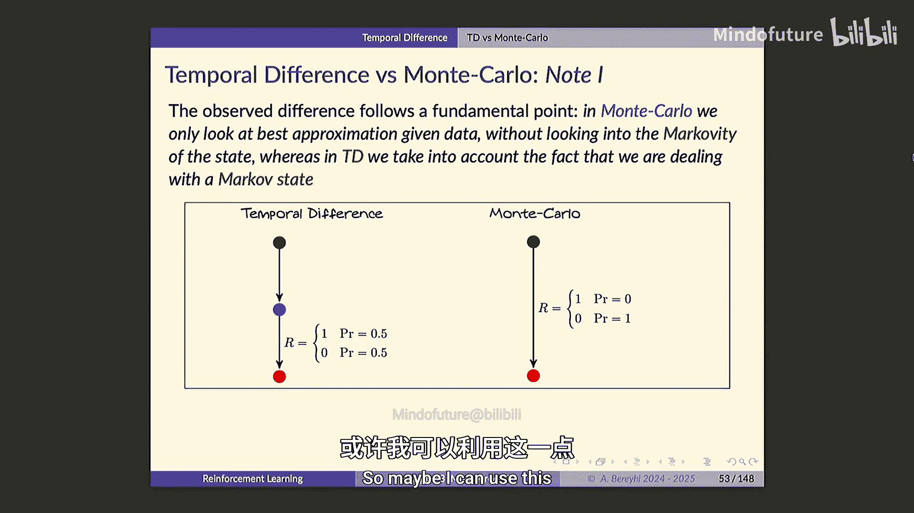

So this is the kind of property that makes the two approaches different。

 This does not mean that TD is always the best thing ever。

 So you don't really need to think like that。 So if you have crazy large number of samples or you have a very weird kind kind of observation set。

 which is somehow not related too much to what really happens inside the environment。

 sometimes Monte Carlo gives you a better estimate。 Okay， now。

 the thing that I want to tell you here， I don't。Imediately this is only to tell you here in case some of you are interested to read more about it or have some background on that。

 So one thing that people say is that TD is using maximum likelihood estimate based on the markov process。

 right， So what it wants to do somehow it wants to it assumes that from one estate to the next estate。

 This is always described with one specific distribution， right。

 And then it says that I have so many samples of this distribution。

 Let me estimate that distribution implicit， not explicitly， implicit， right。

 somehow behind the scene， TD is doing it that and how you can estimate one distribution。

 the best approach to do is maximum。So it is somehow doing that。But Monte Carlo is not doing this。

 right。 So it says who says that necessarily there is a Monte like Markov chain happening here。

 right， We talked about that a real environment should always have Monte Carlo， sorry。

 Markov chain property， but。The key point here is that you need to make sure that what you are taking as this state is really this state。

 right， We talked about it， right， We said that maybe something that we see and we call it a state is not really this state。

 right？ Maybe there are some information behind the scene that we do not have access to， right。

For example， in the case of。Stock market， right， How you can say that all of those information you listed like the。

 I don't know those。Liquidity and those stuff。 I mean， people who are in finance no better。

 So market margin， those stuff。 how who says that those information are really describing this state。

 right， Maybe there are something that you don't know about。 No one knows about， right。

 Nobody Nobody claims that they know really what is explaining this environment， right。

 So because of that Monte Carlo is somehow saying， okay。

 I'm not sure if this is really happening because I don't have access to the to the mark of chain。

 So I forget about it， right， So I only rely on the samples that I'm getting towards the end。

 And I just use them。不觉在。

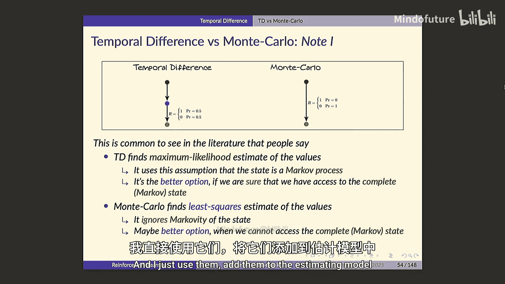

不有。Eventually， what we call it this is for estimate， right。

 And there is one one key factor here is that this guy， the， the maximum lag。

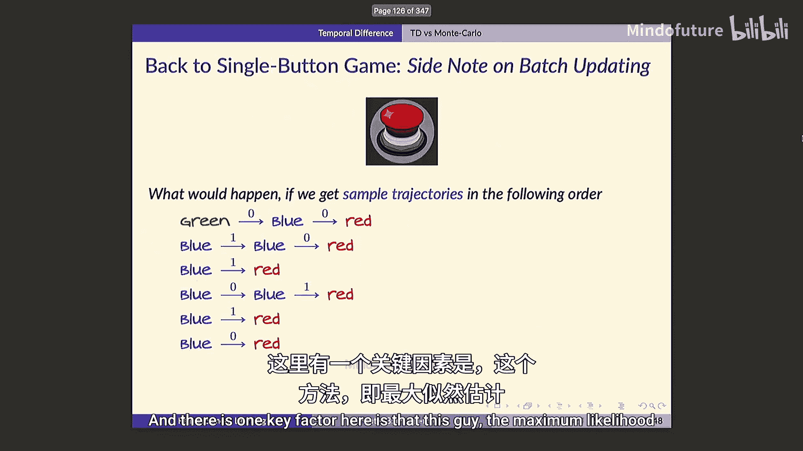

Could give you。It means that when you just estimate your value function。

 your value function is going to start jiggling up and down faster， right， but it could be biased。

Like， you might instead of converging to value 1， you converge always to value 1。2， right。

 But you are slowly jiggling around 1。2 very fast， right， whereas in the Monte Carlo。

 you are not biased。 You are getting exactly to one， but your estimate is just。You know。

 changing high variance。 So like the right value is one。 you're getting to one。

 But the estimate that you get with your samples are 1。5， half1。4。0。6 and so on， right。

 you slowly get there。 right。 So this is a kind of trade up that these two have。 But as I said。

 this is not really impacting our understanding of the core。 So don't see it。 That's okay。

 Just wanted to give you like maybe sometime in future。 Some appreciate that， right。

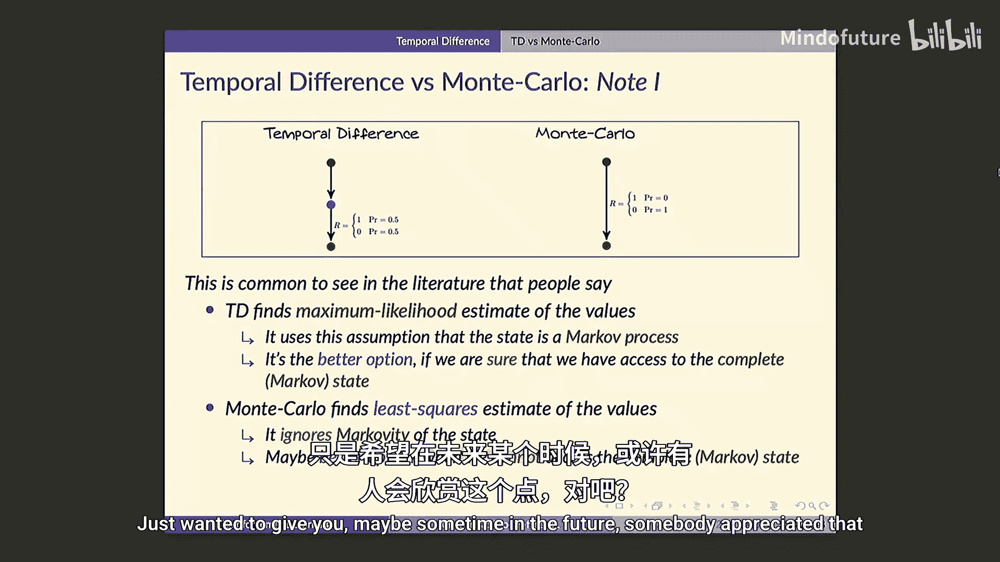

O。Cool， so now one other thing that I want to just tell you about this。

 this model free approach is since we are using samples in the data samples from the environment。

 it might be the case that going over your data multiple。Is going to。谁家是命代的话就。

Took my episodes and updated my values， right， or estimated my values。 I should throw them away。

 You are going to see it when we get into Q learning， where you can do。Bffer replay。But right now。

 you can simply see it also in this example。What can happen if I want to use TD。

 But instead of this order that we had before， I have this order。In my day， my sampling。

 So I start sampling the environment。First time I see green， it goes blue， red， it is stops。

 And then I get all the other。这。What gonna be the estimate of。It gonna be 0， right。

 It gonna remain 0 and you go and you update your blue value towards the end。

 and you get roughly half， right？ So this is going to happen when you have when you have the other sort sorting in your。

 your data， right。

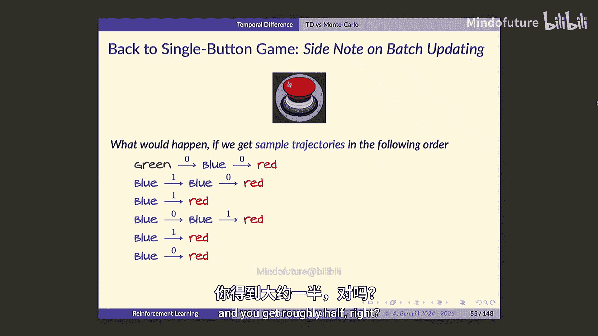

But now， if you go once again over this data， what gonna happen。If you go once again over this guy。

 then， then this one is going to get half and that。Right， because you are0。

 You you again start from green。 And now you're gonna say， okay， I've got 0 plus。Value of blue。

 right， And the value of blue is half。 So I'm gonna update。So you can give roughly。

So just to give you decide eye， it's not necessarily the case that。You can use it multiple times。

 And each time you go over it， maybe you have a better risk。

Know you are looking at it from a different perspective， right， It's like you don't like a meal。

 But today you are very hungry， right， So let's look at it once。You can see。 So， yeah， now。

 just a few notes here regarding the quality of your estimates。

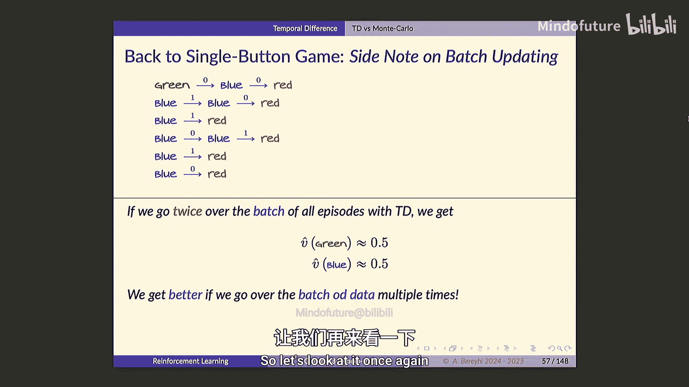

As I said before， the quality of your estimate depends on many parameters。 So， for example。

 this alpha value that you see is the one with with which you are updating。

 And if you use different alpha values。 You're gonna see different conversions race， right？

 So This is for the Monte Carlo， this is for TD， what you see here is that your TD is dropping in the error quite faster。

 This graph that I am showing for you。 sorry， I should have mentioned this， so。I told you the down。

Now you just increase it very large， you start moving。And now you want to know what is about。都像。

And you can't compute it using the Belman equation。Because you know the environment， you know the。

 the policy， right， Now， if we do that， and then we estimate using Monte Carlo and TD。

 then you can compare to see how much error you have。What you see about TD。

 you see that the error is just dropping down quite fast， right。This is what I told you。

 you have a small variance。 So it's going to be the value of one particular state is maybe high goes down high。

到。But that value that。It might be slightly different from the true value。

 whereas this guy is dropping the slower， but it can lead you exactly to the value that you have。

 the true value。Okay， so this guy， the red guy， the Monte Carlo， has higher variance， right。

 it's like。High， going down， again， going high。 It's not coming down You need so many samples to get down。

Okay， so yeah， this is exactly what I。Talked about right now。 Yeah， definitely。

 you know what is bias and variance， right。Is there any chance you don't know it。It's okay to add。

Everybody's cool。 What I mean by by， I mean， I think I explained it intuitively for you， so。

Just to make sure because I felt。 and I， I felt like， yeah。

I don't know why I didn't put it like before。 Yeah， but I'm talking to be fair。

 I'm talking about it later。 Okay， but what I mean by bias and variance is that when you have your estimate。

 So this is the value of one particular policy pod and you are computing at S， right。Now。

 if say this is the like。This orange one is the true value。 Okay。

 and then you are just computing one estimate， right， Now， this estimate， as we talked about。

 you can write it down this guy， plus。Plus some error， right。

You can always write it down in this form， right？ So this guy is always the true value plus some error。

 right， And this error that you see here， if it has 0 mean the average value of this error is 0。

 then you don't have any bias， right？ This means that when you keep on sampling and averaging。

 the variance of this guy gets to smaller and smaller and smaller。

 Eventually it gets to 0 and you end up with the exact value that you have， right。

But what you see as the estimate is this summation， right？ So it means that when you estimate once。

 you might get somewhere above， when you get estimate once again， you might get somewhere below。

 But eventually， when you just keep estimating for a long time。 then this guy is going to be exact。

 right。Now， this guy could have bias as well。 the at the mean value。 So it's not necessarily0 mean。

 right， If it has a mean value， it means that when you just converge， the variance is going to 0。

 but it's mean not 0， right？ And then you're gonna have your true value plus some mean， right。

Correct， that is the bias。 This is exactly the thing that I told you。

 So I have it here in this slide for the particular case。 So if I have V hat。

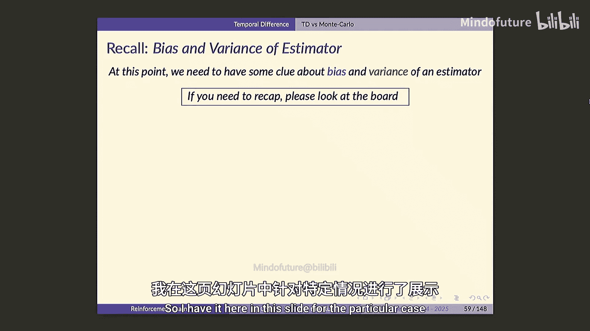

To be the estimate of my value in， in one particular state。Aage V have， when I do not have any bias。

 is exactly the true value function that I have。 And this is some property that the Monte Cardo always have because in Monte Carlo。

 you are just using independent samples。 Every single sample that you are using is eventually the the unbias estimator of what you want。

 when you average them， they remain unbiased。 Okay。

 so the average value that you get out of your estimate is exactly the value that you have。

 But in practice， it has a large variance。There。When you have a few samples and you do the average。

 you are landing somewhere around。have you and this around could be very large。Whereas in T。

 this is not the case。 So they expected that the average value the。

Estimate that you get in average is not necessarily exactly like the value that you have。

 So you could have some value。But in return， you are just getting smaller variances， right。

 So it is exactly the same example I told you， if the true value is one， when you use Monte Carlo。

 you are just always jumping up and down around one， right， But you are just taking very large jumps。

 right， But in the TD， you are maybe jumping up and down around 1。2。 But you're jumping smaller。

 right， So this is the tradeoff， right， Because say you have one estimate， right， Just one estimate。

 just。Collect samples and estimate。 Then when you have high variance in Monte Carlo。

 the value is one， but you might estimate it as 1。8， right， because you are jumping up。

If you estimate from some other data， you might estimate 0。2， right。In TD， you might have 1。

2 S the average rate， But maybe because of the small variance， you end at 1。4， right。

And then it's going to give you a smaller error in general， right。Kind of general afraid of。

Aism biases。Now this one is always in statistics。When you want to estimate one on。

You need to deal with the bias and variance， right。

 Maybe you can reduce the variance at the cost of having a bias。 Maybe you don't like。

So you need to take the high variances。 For instance， when we are doing deep learning。

We usually care about having no bias， right， because we say when youre doing a stochastic gradient decentcent。

 because you would say in every single itration， I am randomly moving towards the average direction。

 But if I have a bias， I could just。For instance， right， But in some other applications。

 you don't care about the bias。 You want to reduce the variance， right， so。

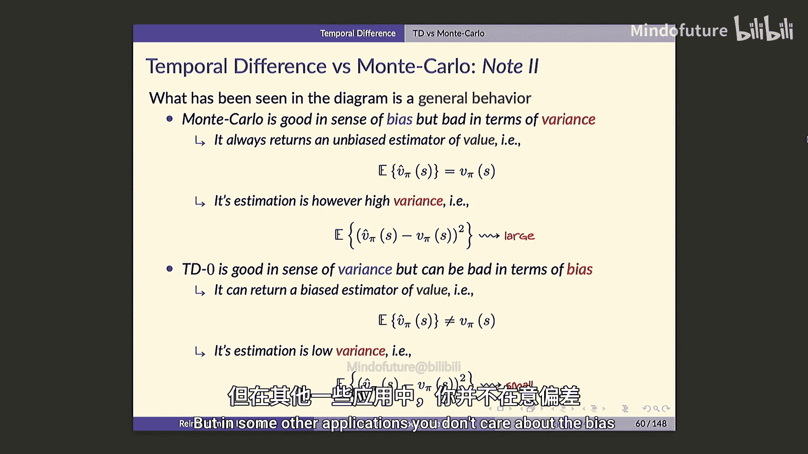

That being said。 So， yeah， now， let me sorry， questions。呀。Yeah。で前る。哦，对白。写啲Y咧。大人でき。お先大ます。自以は so。ち。

教員がです。点都。完しする。没有。M have。法庭结束了。一员。Questions。No question。 Okay， so if you've got no question。

 let me just just give you a quick overview on this one。 And then I'm gonna stop here at T D 0。

 so we can just talk about deeper TD next time， so。

The whole idea of TD was that instead of un use TD。

 But at the end of the day I use this TD to evaluate my policy， right， once I have TD。

 I can use it to again implement policy ittration， right？ So what I'm gonna do。

 I'm gonna do exactly the same as before。 So I'm gonna start with some with some policy pie。

 I just evaluate using TD。 And then given the value that I get， I update and or improve my policy。

 And I put that back to the TD evaluator to just evaluate it again， right。And the greedy algorithm。

 which is in which is improving， is same thing as before， right。

 So it's exactly the same thing as we have for Montete Carlo， instead of using。Just using PD。

 This is what I call it TD0 approach。 And the reason that I call it 0 is because， as I said。

 when I am just estimating， I use the value of the immediate next state， right。

 We're gonna see that instead of immediate next state， I can take the value of the second next state。

 right。And then it might give me a lower bias。把。A tiny bit of higher variance， but maybe I I like it。

 right， Maybe it's a better thing， right， as compared to 0 immediate。Next state， so。

This is what we call a T D 0。 And then T D0 is doing exactly like what we do with the Monte Carlo。

 We start with one policy。 We evaluate it。 Of course。

 the evaluation that we are doing here is not exact anymore。 Again， this is an estimate， right。

 And then when I get this estimate， then I am going to get updated by the greedy approach。

 and I keep on going like。😊。

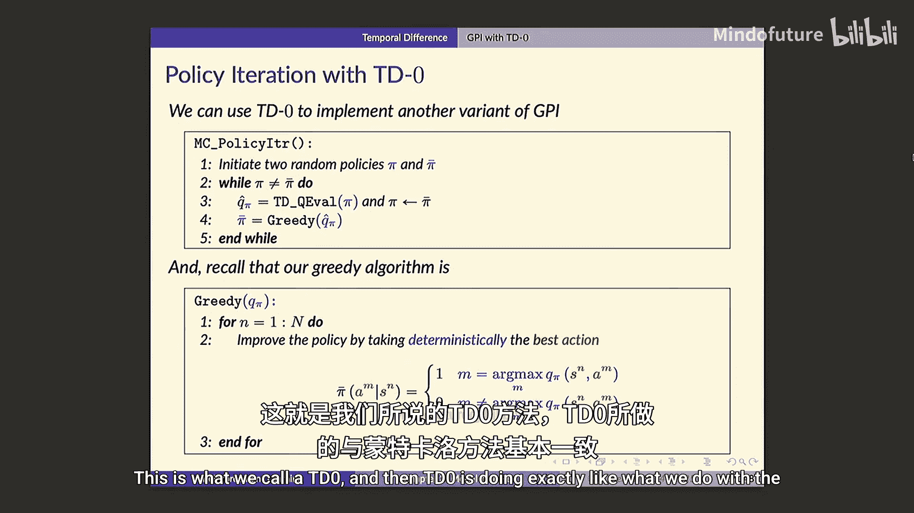

One thing that you should pay attention to is that here， even with TD。

 even if you have extremely large number of samples， because you have bias。

 your estimate might be eventually at the very very end， still different from the value。

might cause that even if you have extremely large number of samples。

 you are not converging to the optimal policy this might。There is no。

 no reason that this is necessary correct， because different estimating different values is not going to necessarily。

your estimate of policy， right， If I estimate value of every direction by a shift of 2， I don't care。

 right， at then， the one direction， which gives me the largest value or largest estimation is going to be。

Same as the one which is large value， right。The bias is not necessarily doing any harm， but it could。

 It could cause some harm， right， So that being said， this means that if you use TD， okay。

This is usually very good for the case where you have limited number of data。 But in practice。

 you cannot imagine a kind of environment where you have enough data， right， This is why in general。

 TD is good， right So if you have like environment， which is crazy。

 large in number very small so that you can collect crazy large number of samples。

 then probably going for a Monte Carlo gonna give you a more accurate。

 or at least you can guarantee that you end up with the optimal policy。 Everybody's， right。😊。

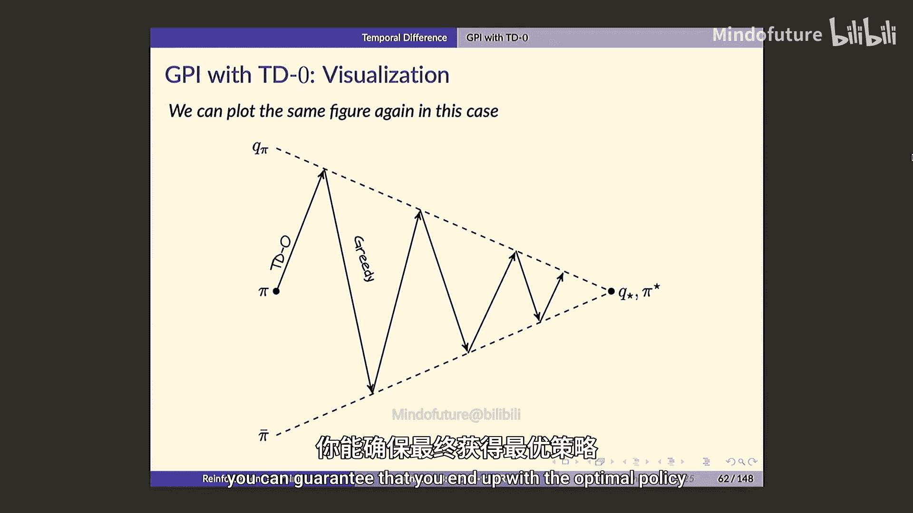