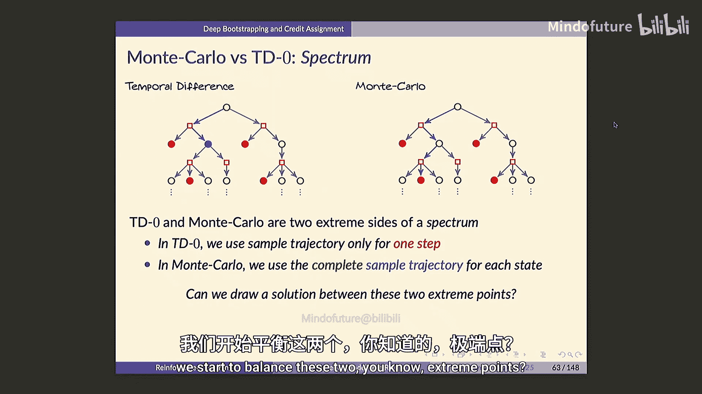
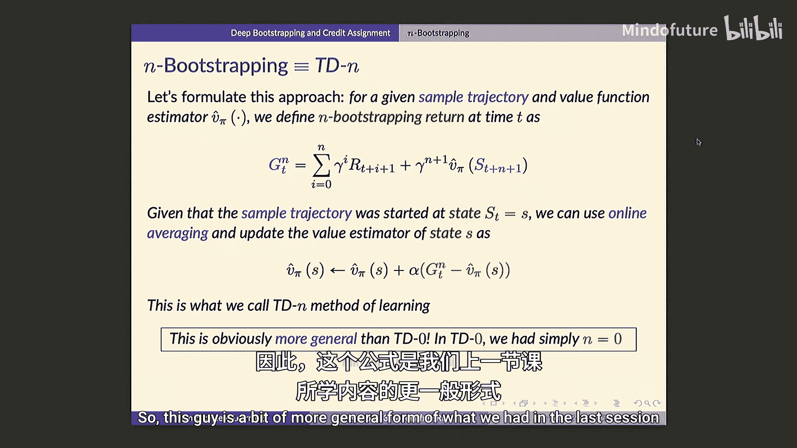
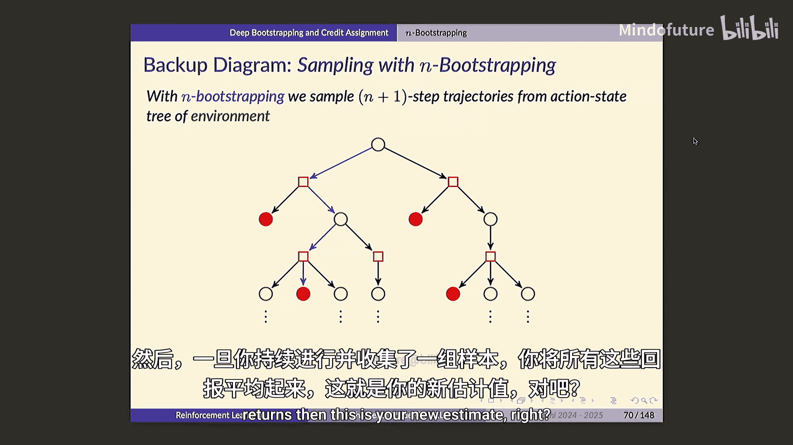
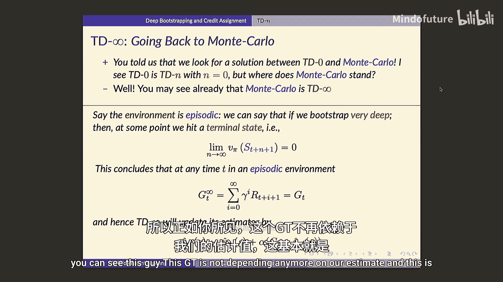
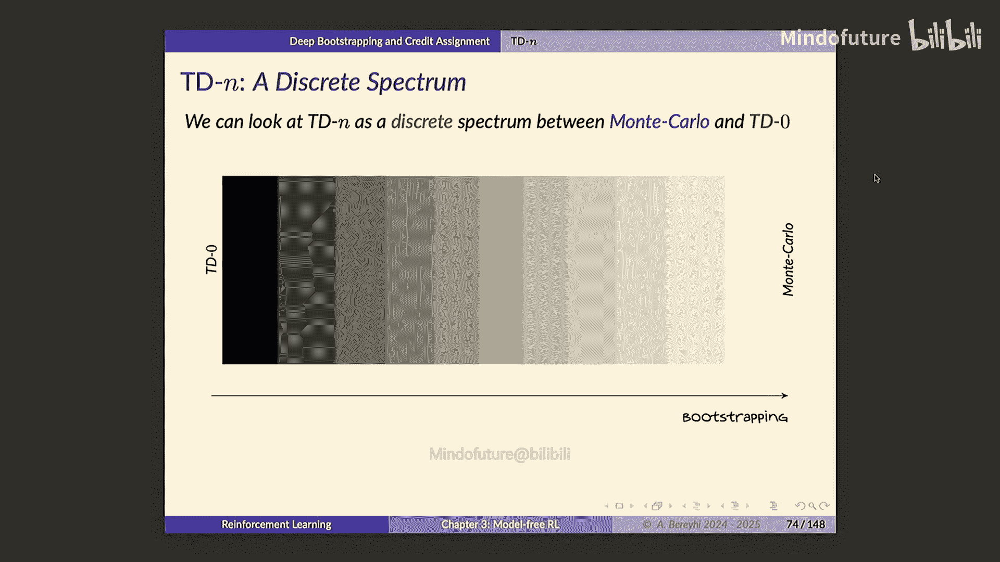
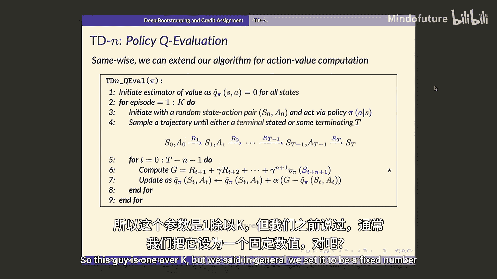
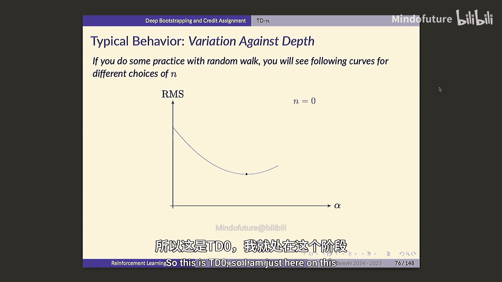
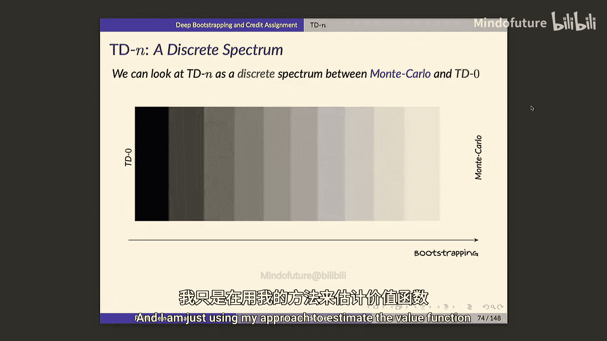
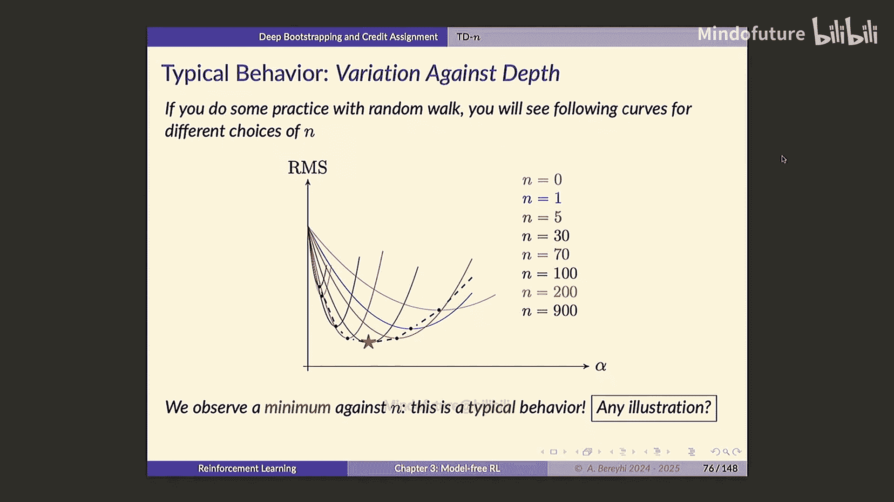

# 【多伦多大学】强化学习 2025 ｜ Uoft   Reinforcement Learning   Fall 2025 p26 P26_讲座_25_深度自举法与TD(n) -BV1D3F2zhEry_p26-

We want to do， we want essentially。To make the TD process a bit deeper。

 and this whole bootist strapping idea， we want to just increase the depth of that。

 So let's just have one particular observation here。 So this is what we did last session， right。

 This was the TD approach。 you start from one state。 you just sample one time step， right。

 So this is the state。 Then you just do one action based on your policy。

 and then you get into a new state。 This is one sample， right， the value of this guy。

 the sample value for this one is what you get out of your action plus the sample value of the next state。

 right， You again try it maybe this time you hit another state。 Then again。

 you get another sample and then you average it right， whereas in Monte Carlo， what we are doing。

 we start， we start from the sample state。 Then we keep on sampling the whole trajectory till we hit terminals。

😊，Right， that we use the fact that the terminal state has value 0。

 And then we just compute the whole， you know。Sample return， right？ And then you average that one。

 So maybe you start once here。 Maybe the second time is it's not that long。

 Like you take this action and you hit this terminal stay and so on。 So you average all of them。

 right。 So one thing that we can see here is essentially。TD does one step。

 and Monte Carlo is doing the complete trajectory， right。 So if we want to think in terms of。

 you know， very idealized abstract form， you could say TD0， which we have here。

 is just doing one time step。 So it's just going for the next time step next state。

 And then is is deciding Monte Carlo is actually taking infinite time， right。

 because you are going to get into the terminal state。 And from then on your， you stay there， right。

 So somehow Monte Carlo is just taking infinite and TD is taking0。 But。

The question is that is there any solution in between these two approaches like we neither go forever nor just immediately like one step。

 right the question that you might ask me is that why should we do anything in between because。

 I mean we see two behaviors right TD has a bunch of good properties and a bunch of properties。

 Monte Carlo has its own good properties and its own bad properties。

 So I tried somehow explain you that Monte Carlo could when you have so many samples is going to be very good。

 but it's not that sample efficient， like when you have few samples that youre getting high variance。

 like the estimate you get is a bit detached from the reality whereas in the TD case。

 you're getting a better estimate in terms of variance。

 like your estimate is going to con to something but it could be bad， right。

 it can be shifted as compared to the true value right the question。

that can we draw a line in between so that we start to balance these two extreme points。

And the main idea for that one is that to just go for deeper with with his strapping， right。

 So what we do here in TD0 is that we start from this state， the first estate。

 and then we get into the next estate， then we estimate， right。

 But maybe we can be a bit more patient， right， So I start from this estate。 I do want action。

 I get to another state， right， now that I'm in the other state， maybe I keep sampling， right。

 I go for the next estate， right， I do another action， I see the next estate。 And once I am there。

 Now， again， that guy has a value， right， Now， if I want to know what is the return that I'm gonna get。

 I'm going。This is the first immediate reward。 Plus the second immediate reward。 plus。

 whatever I get after that， right， And that one is given away the value of the second next estate。

 right， If you go deeper in time， you can just。😊，Draw a longer Buddhist trapping trajectory。

 But all the time， I mean， whenever you want， you can stop at any state。 and you could say， okay。

 from now on， I'm going to only use my estimate。Everybody's clear。Okay， so that is the idea。

 so you can basically expand this recursive property。

If you want to just do it on paper so we can start writing down the future return for one particular time step。

 right， So if I am in this time step， my future reward is going to be whatever I get as the immediate reward after doing my action plus the future reward of future return of the next stage right So G T is going to be our immediate reward。

 plus what I get after that right And then again， you can open up this guy right。

 So you can write it down as this guy itself is going to be the reward I get in the second time step plus whatever I get after that。

 and you can keep on going like that right So if you want to just go deep in。

With step or with length n。 then you could say， okay。

 this is the first reward plus the second reward， plus so on n reward plus whatever I get after that one。

 right。Everybody's cool， right？ Now， why should that be a be better should be a better idea Because at the end of the when you want to estimate using this idea of Budhistrapping。

 you want to go and use the value function at this point， right？ So what I mean， I am at this estate。

I go one time step forward。 I get into one estate， which I have never seen。

 And if I have never seen that estate， this means that the data is I mean。

 I do not have any estimate of the value of that estate right But what if I keep on going。

 if I go to the second time step， then I see one estate which I have seen before。

 right So I have roughly some idea about the value right。

 So maybe I can start that point and do my estimate。

 This is going to be more reliable as compared to I just rely on this state。

 which I have never seen right， So this is why you can play with this n as you wish。

 and sometimes playing with that one is going to help us Okay No worries， I'm not going to stop here。

 we are going to just discussing in details， but just want to give you the idea。

 Like if you keep on going in time。 Maybe you hit one state， which you have seen before。

 you really do know what is the state of that one。Or you have a very good estimate for that。

 And then if you do that， then by this you're going to get a very good estimate， right。

 a very good sample now。So。What we can do now now is that we can start start from one particular state instead of going only one time step。

 then we can go n time steps forward， and then we can just use this whole trajectory to estimate the particular state。

 So what I want to do， I want to do as before。 So I'm assuming that I am at the particular state S。

 right， one particular state。 I want to know what is the value of that estate。

 So I'm going start at that one。 And I'm going take n time steps forward。

 And each time I'm going collect one reward。 And now I am able to compute my sample return， right。

 So what I can say I can say the value of my policy at the particular time state S。

 this is going to be some of everything that I have。😊，In future， right。

 and then this is basically the n first rewards that I have collected plus the value of this state that I stopped。

 right， because this guy is going to tell me what is the value of or what I'm gonna collect from that point on。

 right， time n plus one on， right， And the previous rewards I do have them， right， so。

This expression that you see here， this is basically an expansion of the beman equation。

 You can do it exactly the same way that we did for the Belman equation。

 but you don't really need right， So just just set n equal by one sorry， n equal by0。

 then this is going to be the beman equation that you have。

 and then you can again write the bellman equation for the next one。

 like the one inside the expectation， then you're gonna expand and so on。

 right So you really don't need to do that。 you can just take it from my side。

 that what you're gonna have as the value of this estate is the average immediate reward plus the average second immediate reward plus the average third immediate reward plus so on till you arrive at that particular state the average value of that estate on right So this is basically the expectation of the original equation I showed you。

 but you can just use Belman equation。To shall we is just an expansion of that。 Everybody's cool。

 right。Now， if you are cool with this equation， how can I use this equation to estimate the value of。

Policy added state S。How can I use this guy to estimate this？ So I want to estimate。

The value of policy pi and the state S， how can I do that？Using this equation。

So when you want to estimate in or framework， what do you do， I mean。

 you cannot compute those expectations， right， You do not know the distribution， right。

 What do you do with those expectations。You replace them with。With。You can say it， no worries。

How do you， what is your estimate？Average of the samples you have collected， right。

 So you sample those trajectories， right， in each tra， you see some R， right。

 And then you get into one state。 And then you're gonna use that sample， I mean。

 as much as samples you have， you average them， right， the Monte Carlo idea。 Now。

 if I want to write that down， Can you help me writing it down， So say I have one right now。

 assume that I'm just sampling one trajectory。 I'm going have or。T plus1 plus I。I going from one to。

And right， that's the same guy there。 So I have gamma eye as well here。 Okay。

 I'm gonna drop gamma eye right now for our example。 Okay。

 just to assume that the discount factor is one。 Now， I have that guy。

 So this is the same guy as above with expectation， right。😊。

Then what going to be the next thing here？😡，What should I write here？The value of pi at。

SD plus one plus n， right yeah。This one， but I do not have this guy， What should I do to that？

I do not have the value function。 This is what Im trying to estimate。

I'm gonna replace it with the estimate， right， So I'm gonna replace that guy also with estimate。

 right， Okay， this is what I get for one sample， right， So if I have K different friend sample。

 I'm gonna have K different friend of these guys， right。😊，Then what should I do with them？

Average them over K， right， So you're gonna get this guy1 over K， summation over K。Whole thing。

 right？ So you see what I'm doing， right。Clear。Every cool。

 So same thing as you see on the board without expectation。

 That is one sample you can collect when you have one trajectory because you started this state S。

 you just played for n times right， for n time steps。

 and then you ended up with this particular state S T plus one plus n right。

 This is this state that you ended up with。 And then you did not play anymore。

 that guy is not necessarily a terminal state， it could be any state right and what the Belman equation tells you is that if you just repeat this process for infinite number of times。

 and then you average this guy on the board over all of those infinite。Trials。

 then you're gonna end up with the value of that estate。 I cannot do。

 I cannot do it for infinite times。 I do it K times。 I average， average that。

 and I take it as the estimate， right， So this is one sample that I get。

 exactly the summation we have on the board plus。The value I am replacing here things with V hat。

 because I do not have access to V itself。 This is the whole thing that I'm trying to estimate。

 And then I average it over the samples that I have collected。 Everybody's cool， yes。

So you see what we are doing。 I mean， this is always the case， right。

 And the Monte Carlo was the same thing And T D 0 was the same thing。 Here is the same thing。

 The only difference is that what you are trying to estimate， right。Everybody is cool， Yeah， okay。

Great， so that is yeah， that is the way that you can average or estimate the value of this state at the particular value of the policy at the particular state S。

 And then if you do this with a particular n， this is what we call it TD N。

 temporal difference with n time steps， right， now what you see is that obviously TD0 that we had is the same thing when when we set n equal by0。

 right， So if we just immediately use the next state， this is TD 0。 if we wait n time steps。

 And then we use that state that we end up with， this is TD N， right。😊，And yeah， in general。

 you can simply do it by online averaging， right？ So if youre just sampling one trajectory。

 this is going to be your sample return， right， whatever you collected up to time n plus the value of your state at time T plus n plus one。

 So n plus the last state that you stopped at。 and then what you can do， I mean。

 if you want to update your estimate of the value， you can get your previous estimate。

 and then you added added up with this particular incremental change， right。

 So you would say the new sample G TN is given that and indicates that we have done it for n time steps。

 That new sample G that I got is different from my previous estimate with something。

 So I'm gonna add up that difference to whatever I had estimate up to this point。

 This is the new estimate right。And you keep on going， right？Everybody's cool。Questions。Yeah。Yes。

Certain。右て。Right， right。 Yeah， I mean， in， I'm gonna show it in few in few slide。 But in Monte Carlo。

 you end up with this state， which is a terminal state， right。

 And then the estimate and original value， everything is 0， right？ So that last term gonna disappear。

 you essentially do not need to have access to estimate when you want to estimate update or estimate。

 right。Whereas here you're not assuming that you're ending up with the terminal state， right。

 That n is the one you're choosing， right， So you would say， okay。

 take one trajectory of length 10 only right And then then if you want to update， as you see here。

 you need to know， I mean， this G TN， this guy。 if you want to update your estimate。

 you already need to access the estimate of the other states right， And of course。

 we start with bad estimates。 but hopefully when we keep doing this。

 it's gonna get better and better。Yeah。Questions。No question。Okay。So now。

 one thing that you can obviously say， as I told you。

 TD 0 is basically the same thing as we are doing here with n equal by 0。

 So this guy is a bit of more general form of what we had in the last session。

 So this is the way that you can think of it。 So you basically start from this estate。 For instance。

 here， were assuming n equals by one， right， So we're not doing the immediate one。 We are just。

Taking the second time step as well， right， So if you are here and you act。 then this is your action。

 And then based on the policy。 and then you come out at this estate。

 If you use the value of this estate to estimate your value or to get the sample estimate the sample are return。

 then you are basically doing TD 0， right， but you can keep on plane， right。

 you can just do the next action。 And after doing the next action， you end up here。

 maybe this guy is a better guys compared to this one。

 in the sense that you have a better estimate of its value， right， Maybe who knows， right。

 And then you can use the value of this guy to get a sample return， right。

 So the value of this guy plus。The value the return you collected the reward you collected here and the reward you collected here is going to specify your sample return。

 right， then you do it again。 you just take another sample， this time you get here。 and again。

 you get into this state， which is not a terminal state， but you can for example。

 have some estimate of its value right， And then again。

 your next sample is going to be this reward plus this reward plus value of this state right And then you keep on going。

 maybe next time you hit a terminal state。 Well， this is a good one because you know that the value is zero。

 So your sample is very reliable。 And then once you keep on doing you collect bunch of them。

 you average all of those returns。 Then this is your new estimate， right。

So that is an Buddhist wrapping。 based on that we have the TDN approach。 So in the TDN approach。

 you have everything exactly as we had in the previous algorithm。 You start with one random state。

 then you play based on your policy， you collect one trajectory from0 to t right， and then。😊。

At every single state， if you want to update the value of this guy， Well， in the basic TD。

 you would say， okay， the immediate reward plus the value of this guy， right。

 So that was the way that you update。 But now what you do， you just go deeper in time， right。

 So you would say， okay， I want to， for instance， now what is the sample for S 0。

 I'm gonna add up R 1， R 2， I go on。 Maybe n is simply2， right， if n is 2， then I would say， okay。

 R 1 plus R2， Sorry， n is1， for instance， R 1 plus R2 plus whatever I see as this state 2， right。

 this is going to be the value of state2。 and you can keep on doing this， right， Now。

 one question here。 If I start at time 0， how long can I go forward in time。So if I like， okay。

 I start from 0， right， and then I can update the value of this guy because I would say， okay。

 the sample gonna be R 1 plus R 2 plus so on until R N plus whatever I see。As this stayed afterwards。

 right？When I come here， the value of S1 is going to be R 2 plus plus plus till I get to the value of n plus  one。

 right？ So till where I can go。Can I update the value of S T -1 if n is more than 0。By this approach。

What should I write if I want to update the value， what gonna be my sample。

 if I want to update the value at T -1。What it would be。Say n equals by one。Say n equals by one。

 then whats gonna be my G when I am at time T equal by capital t -1。 Can you tell me。

Just look at line six， tell'll me what is it。Wass the first guy？R T， R capital T， That's right。 Plus。

 okay， set gamma to you want。嗯嗯。Rt plus1。And then what is that。Plus。Value。啊。T plus 2。Or。AndNo。

 small T is capital T -1， right， and n is1。T plus one， right？ So it's gonna be S T plus1， right。

Correct。You see it， right。I am at time t -1。 I collect the next reward， which is Rt。

 the reward after that， which is Rt plus1。 then I end up at this estate S T plus1。 No。

 the value of that estate is going to tell me what I get afterwards right So this is my sample and write that down based on my trajectory。

Can I。Yes or no。No， I mean， everybody， yes or no。No， why。I do not have I do not have the S plus1。

 right？ So I need to stop before t -1 here n equals by1。 I can at at most go up to t-2 right。

 If I get n equal by2， then I can go at most to t-3 and so on， right。

 So I always need to keep a buffer towards the end， right， because for my estimate。

 I want to go deep in time， right， And I cannot go towards the end， right。

 So I can go up to a point pretty much like what we did when we wanted to terminate the Monte carlo right。

 So we say like we don't care about afterwards。 So we had to just keep11 window of time right So it is clear for you that I cannot go towards the end。

 right， I'm gonna end up at t n -1， right， because this is the last time which I really know what is the。

And next stage， right， if I go one time a step further， then I need to know S plus1。

 which I do not have it， right， Everybody is cool， yes。Questions。嗯。Now question。

So if you got no question。Is there any problem with this algorithm？Tm of the it's correct。

 That's fine unless you can find another typo in it。 But， I mean。

 is there any kind of issue you feel here， Do you think like we are doing something bad。In real like。

What what， sorry。How many。Yes， but say， for example， we fix T。 Okay， say we we have 100， right。

 but say I want to put n to be 10， right， When n is 10。

 I cannot really update the last 10 states in the trajectory。

 right each time So it's sample inefficient again， right？ Im throwing it away， right。

 So I am updating S 0 S1 up to some point here， but afterwards， I'm not updating those guys， right。

 because I need to go a bit deep in time， right， And then I do not have。Really， the next ones， right。

You see it， right。 So we're gonna to get rid of that issue， but you see it right。

So I'm not going to T exactly。 I'm going to t minus n， right。

 And this is make me like not updating couple of stays at the very end， right。Questions。No question。

Okay， so if you got another question that， well， we can just do the same thing with the action value。

 right， So action value is again， exactly the same thing。

 So if you are at one particular time is step， then you would say， okay。

 the next words up to the depth that I want to go R T plus 1 R T plus2 till R T plus n。😊，Plus one。

 So I'm gonna get all of them。 And then I add them up and the value of the end next state。

 I'm gonna collect it。 again， I use this sample to update my action value for every single action value sorry。

 action state pair， right。Everybody's clear， right？Okay， a repetitive question。

Which of these two algorithms is going to converge faster， this one or this one。The first one。

 and the reason is。Because you're estimating less parameters， right， So you have n different states。

 So you're estimating n different values here Here you have N times M M is the number of actions。

 N times M different pairs。 and you're estimating all of them。 So obviously。

 this guy is going to convert。Slower， right， It needs more samples to converge。 Everybody's cool。

 yeah。Okay， so。That being said。哦啊。Now， okay， so I told you when you said n equal by 0。

 then you basically get back to TD， the basic TD， right， basic TD 0 algorithm。

 Now what gonna happen when you said an infinity， Okay， I， I guess I mentioned that， right？

 So when n goes to infinity， this means that。You start at this particular time， and then you say。

 okay， I'm going look。Towards the end for infinite number of times， right。

 And you can always imagine that， okay， you're gonna end up with one terminal state。

 and then you're gonna stay there forever， right， So this is basically the Monte Carlo。

 So what you can say is that Monte Carlo is basically TD0 infinite。 And what is happening here。

 I mean， this is just a justification I told you， So you can always say that， okay。

 if I play for enough number of times like infinite in time。 eventually。

 I'm gonna get to a point where it's a terminal state。 And then I'm gonna stay there forever， right。

 And then the value at that point is going to be 0。 So then your。Infinite。

TD sample is going to look like you collect everything towards the terminal state。

 This is essentially what we had in the Monte Carlo approach。

 And we are exactly updating with the same approach。 So here， as you can see， this guy。

 this G T is not depending anymore on or estimate。 And this is basically what we started with the Monte Carlo approach。

 so。

Now， what you can say here is simply that if you consider this axis to show the depth of your Budhaist trapping。

 eventually， when you start with zero depth， then you are at TD 0 and gradually as you increase that one。

 the depth， you' are going towards the Monte Carlo right And now this N， if you choose it properly。

 then you are actually somehow balancing between the TD approach and the Monte Carlo approach right。

 So that guy， Monte Carlo is like unbalased very good， but it needs is sample inefficient。

 This one is much more sample efficient。😊，But it has some， some drawbacks as well。

 Like it it's adding a bit of bias。 I mean， basically， you estimate based on the estimate。

 So it's a bit less reliable at the end， right？ So， and as you go。

You are increasing the sample inefficiency， reducing sample efficiency at the cost or you're improving the reliability of your estimate at the cost of sample inefficiency。

 right。Everybody's clear。Questions。

No question。Okay， so Dmmy grid world， if you want， you can go ahead at home。

 Just use the same approach that we did here。 play a random policy。

 It means that at every single cell， you just go any direction at random with the same chance and then use TDN。

 Okay， you can do it in Python， just write the code and use that to see what's gonna happen。 I mean。

 for this one， it's going to just converge quite fast。 but。If you do for a larger environment。

 you gonna see a better result， okay。Questions， no question， right， Okay， now。

One thing that we we would observe if we just tried the TD approach for multiple choices of depth is that you're going to see that it showing a sort of trend in terms of n now。

Just to show you that one， what I'm showing here， here is RMS S。 So we are considering random walk。

 Okay， random walk is basically this guy。 basically this one。

 when you increase the dimension of your environment。 Like it's not2 by 2 is much larger now。

 right Okay now this is a larger environment。 And what is the thing is that I do know the exact MP。

 right， for this one。 I know the MP， so I can compute based on the Belman equation。

 I can compute the value function， right， for my policy。 I have that one。

 I want to just test how does this TD work。 Okay， and what I'm doing。

 I am plotting the error of the TD Okay， this is the error that you get when you use TD to estimate your。

😊，Your policy， your value function。This is the error， and I am plotting it in terms of alpha。

 What is alpha。Do you remember what alpha is？Wei。The step size， right， this guy。This guy， right。

 You see line 7。Right， the one which we update with， right。

 If you want it to be exactly uniform average over all your samples。

 what should should you put alpha。1 over K， right。 So this guy is one over K。 But we said in general。

 we said it to be a fixed number， right， This was the step size。 Now。

 before I show you the figure here， do you remember how this guy looks like against alphapha when we were doing Monte Carlo。

It was showing it was it was a kind of convex function， So it was going down。 And then it goes up。

 We said that alpha should be tuned properly， right， Now， say that I mean。

 you plot this one and this curve assume that I have done like so many sampling。 Okay。

 so I have run that one for a very， very large number of episodes。 My algorithm。 So K is very large。

 very huge。 Then you're gonna see such a curve。 and this is the minimum error that you would get。

 right， So this， this particular point that you see is that if I just tune alpha perfectly。

 this is the minimum error that I would get。 if I use TD。 And here and is 0。Right， everybodys clear。

 right， So this is TD 0。 So I am just here on this。 I am here， and I am just using。

My approach to estimate the value function。 The best I can do is this point， right。

 Now I start to increase n。 Okay， just increase n to one。 Then the thing that I see。

 the minimum is happening somewhere else， okay， but that minimum is a smaller than the minimum I had with n0。

 right， So this means that if I go one step deeper in time， right。

 I can eventually make the difference between what I get。And what the true value function is。

 I can make it smaller， right。Does it make sense？Yes。

 we said that when you increase when you go deeper in time， then you're reducing the bias， right。

 and eventually you can reduce that guy right， Now you keep on increasing。

 So if you go for n equal by 5， it goes down right and if you go for n equal by 30。

 it keeps going down， what do you expect to happen。 if I just increase n crazy large。

It should keep going down always， right， But this is not the case。 right。

 If you start increasing n at some point， you're going to see that this minimum is going up。Okay。So。

It's good to go deeper and deeper。 But if you just want to go forever， forever。

 then it might be bad as well， right， So how deep you go in in time。

 this is also something that you can optimize， right， So if you want to think in terms of n。

 this is somehow coming down like this， right？ And then we start from this side down。 I mean。

 it starts here goes down。 But at some optimal n， this is quiet， like minimize。

 And after that it starts to go up， right。Anyone has any sort of illustration for that？

Why this is happening when you have infinitely large time？I do not expect to see it immediately。

 I mean， we need to go through the next part then you see it。

 But do you have any idea why this could happen。Like。

 imagine that your environment is not really ending， right。Now， if you go very， very deep in time。

 then eventually you can just。Hit the same point， like same mistake more and like in the in the。

In random walk， you can just keep on walking， you get back here， right？😡，And you again。

 keep on walking， you get back here and keep on walking。 you get back here， right。

 And all of these guys are accumulating， right up to some down。

You are just going in the environment you have not。You're not back at this point， right。

 But if you go and you get back at this point， right， the best idea is to just stop there， right。

 You don't go any further， right， because you are just accumulating the error of the same process。

 right？ So this is not the best idea to keep on going forever when you are really sample you're using samples to estimate you are not really doing a true estimation。

 right， because the more you go in depth， you're increasing the chance of this， you know， I mean。

 the variance of the whole process is increasing， adding up right。

 and then you get harder time vanishing it， right， So somehow at this point。

 you are improving in the sense that you are reducing the bias， right。But at some point。

 you are unable。 I mean， there is no bias to reduce anymore。

 This is eventually the variance is getting higher and higher， right。

 And that increment in the variance is just showing up there， right。

But I do not expect you to see it immediately。 Just take it from my side right now that increasing going crazy in time then in time is not necessarily a good thing。

 right。Questions。Yes。制学とこ。に？Yes， but but Monte Carlo converges in I was talking about the bias。

 right， I told you it's giving you an unbiased estimator， right。

 but if you wanted to just give you the right thing。

 you need infinite number of samples to shrink the variance right and this is where the variance is showing right So imagine that youre just walking in this environment right So the more you keep on going。

 the higher would be the variance of the sample you're taking right because like the variance of the next time each time of step is adding up right accumulating on each other。

 if you think about this added reward So when you have just two time of steps is going to just jump up and down a bit But if you have 1000 time of steps。

 it could just jump usually right。Now， up to some point。

 you are able to improve because you're reducing the bias， right， So you're going deeper in time。

 somewhere you're heating back your， for example， regional state。

 This is helping you to get rid of the bias， right， But at some point on。

 you're not doing anything about the bias anymore， You're just adding up the variance of your estimate because you're collecting more noisy samples。

 right， now， if you really want these guys to get a small， then you need to increase your。

 your number of episodes， right， So you really need to have infinite episodes that these guys get down。

 right， which you do not have in practice。😊。

