# 【多伦多大学】强化学习 2025 ｜ Uoft   Reinforcement Learning   Fall 2025 p27 P27_讲座_26_TD(λ)方法 -BV1D3F2zhEry_p27-

Here about what is the right choice of N。 Then maybe we can just think about multiple choices of N。

 And then the average。

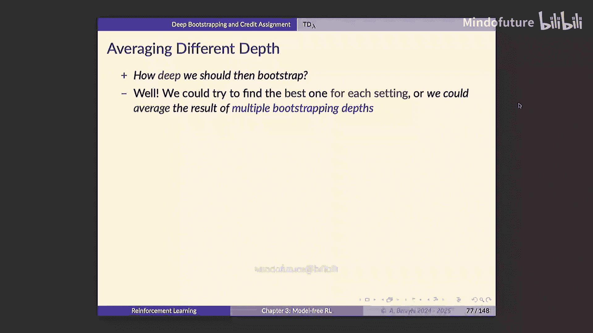

The estimates that we get with all of them right now to get this idea。

 I just put you here one simple example， right。Look at this guy here Now。

 if I am at at the particular just I am considering two different cases， one of them is n equal by0。

 the other one is n equal by 2 right Now if I am in one particular state right Im in this estate I can use or I can collect one sample considering just the next time step right This is tD0 correct So I would say I am in this state then I get one imry word plus the value of the next state that is tD0 estimate right I can also do it by n equal by two。

 So I go one step to a step， then I do it right correct actually one step sorry to a step  three step and then I go right So I can do it with two different choices of n for every single state right and then when I get both estimates or both samples。

 I average those samples and then I use that one as my new sample so you get my idea。

What I'm talking about the averaging， right？I'm at this time， I would say， okay。

 I go one step further。 Okay， I'm here。 now td0 already gives me a way to estimate or sample from this time。

 right， whatever I collected as the word plus the value of this time step right。

 but maybe I want to go more Okay， I have this estimate。 I have sorry this sample。 That's okay。

 I go one step more in time。 Now again， I am a new time step so。If I want to use TD1 now。

 I would say， okay， the first reward plus， the second reward plus the value of this stage， right。

Okay。Anyone knows whether the previous sample was better or this one。 Well， we don't know it， right？

 I mean， this guy tells us that we don't know it， right， necessarily。 So because of that。

 maybe I take that one added to this I average them right， And again， I go one more time， right。

 So one next time。 now， TD2 would tell me first one plus second one plus third reward plus the value of this time。

 right， I again， average with this guy and keep on going right， up to where I want， right。

 So this is what I mean by averaging over time。 Everybody sees what I'm doing， right。

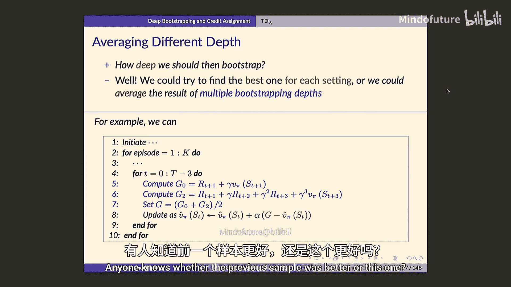

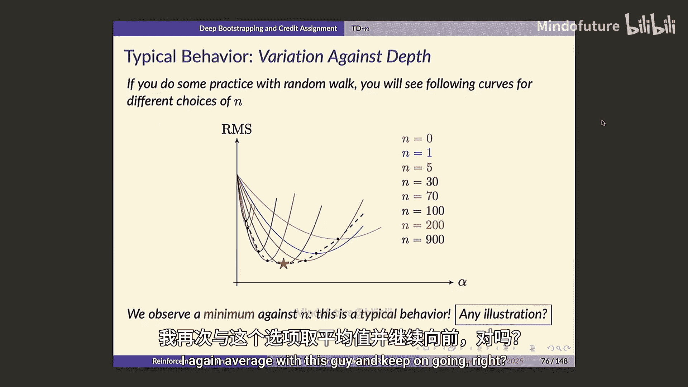

So maybe we can do this one。 Now， the question that you might ask me is that why this is a good idea。

 Okay， now， if you consider that curve， I showed you going down， right。

 So it says that when I keep on going in time， up to some point， I am improving， right。

 after some point， I am just。

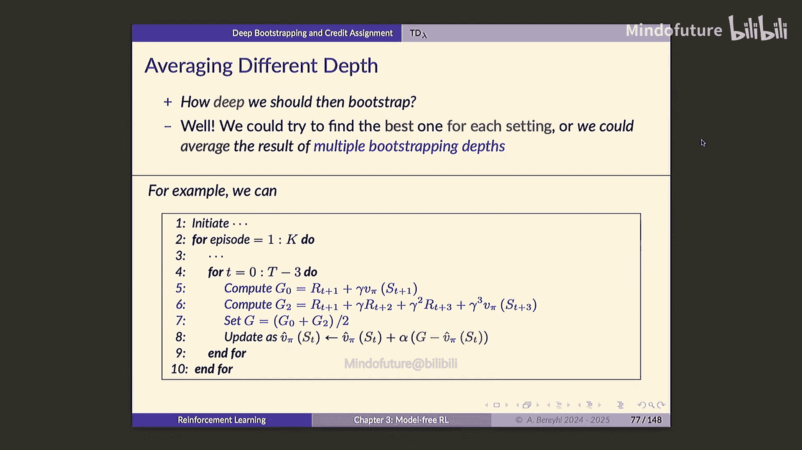

Making things worse， right？ Now， if I don't know what bad guy is。

 maybe I can look at everybody and average them out， right， Now， the good guys is there。

 the bad guys are there as well， but they average out， they are definitely better than the bad guys。

 right？ And if the good guys are very low， then they are going to dominate the whole thing， right。

So this is the idea that we can do。 I mean， we can say that， okay， the good one is within these guys。

 So if I average that out， this might potentially dominate if it does not dominate at least it's gonna to improve as compared to the case。

 but that just hit one particular N， right so。We do not have the exact idea。

 Which one is the best one。 So basically， we just average everything forward。 right Now。

 one thing that you might say is that， okay， this is going to help us with in the sense that we are not anymore focusing in one particular depth in time。

 So we are not thinking about one particular n。 But at the end of the time if you want to average。

 this means that I cannot go again towards the very end of my my trajectory， right。

 because I still need to compute the estimate or the sample of TDN， right， each time。

 And then this means that the last n guys， I should throw them away。 Well。

 we can just get rid of that issue。 But the idea of geometric weight。

 So what is the idea of geometric weight。At every single time。

 I am going to compute my sample return in this form。 Okay， now， this might look a bit complicated。

 but once we open it up， you see what I'm doing。 Okay， no worries。Now， what I'm doing here。

 So you see 1 minus lambda here， right， Lada is a number between 0 and 1。 Okay， half0。2。

 anything they want。And then this capital L L is the length of my one particular point on the trajectory。

 Okay， now， let's just start from time 0 and see what I am doing， okay。Now。

 if I want to compute this G T at time 0， Okay， first of all， set L equal by 0。 sorry。

 L equal by one。Said L equal by one。 This means that I am at the state S 0。

 I go one time and step forward。 I am now at S 1。 L equals by1。 Okay， now。

 can you tell me what is that guy。Can you tell me？It's gonna be， I mean。

 I'm gonna have one minus lambda， right， times。This is mentioned from 0 to L -1。

 This is going to be just the guy 0， right， Lambda to power 0 is one， right？

 So this is going to be G T。0， right。And they okay， and this is going to confuse you。

 So lambda equal by 0。 Now， or G T lambda， Sorry， it's not this guy。 Sorry， G T lambda。

 G T lambda is1 minus lambda G T 0 plus。What is the second term？Longda L is1， G， T1， right， correct。

TD 0 plus TD1 average by lambda， right？ So this is obviously an average， right。

 because 1 minus lambda plus lambda is one， right， Everybody is clear， right， Okay。

 now here was L equal by one。 Let me do L equal by 2。😊，G T lambda， what it will be。

 It's gonna be 1 minus lambda。 Then you help me write down the other things。

 So what is the animation。Gt。N start from 0 to L-1， which is now  one， right， L is 2，0 to1。

 Then you have lambda to power 0 first。 It's one。 So I'm not supposed to write anything。

 Then I should write G T。0 plus。 What is the next term。Wmda G， T1， right， plus what is the last term。

Ln this word。猪猪。2， right。Now， G T 0， T T 0， T T1， T T2， right。

 each of them is getting multiply with one weight， right， Now， let's just compute the base。

 If I just multiply 1 minus lambda with this whole thing。 So one minus lambda gonna to show up here。

 So I can write down this one as。1 minus lambda G T0 plus what' going to happen to this guy。

 So one minus lambda going to show up here， right。Correct。Right。

 now I multiply 1 minus lambda with lambda as well。 So this is going to be。

Lambda minus lambda squared， right？Everybody's clear now。

Add up the ways 1 minus lambda plus lambda minus lambda squared is。

So minus lambda are gonna cancel with lambda， right，1 minus lambda squared plus lamb this squared。

One， so these waste have always this property。 It doesn't matter what L is。

 If you add up those ways is always one， right， You see that， right。And what I am doing。

 I am computing an average of every guy in front of me， right？So I'm going to say I am in time T。

 right， then if I use Td0， then I'm going to get Gt0， right？And then if I use TD 1。

 then I'm gonna get G T 1。 If I do TD 2， I'm gonna get G T 2 and so on， right。

 I can compute all of them towards the very end， right。

 And then I average everybody in this trajectory， right？ Now。

 this guy is get getting me rid of this sample inefficiency problem。 Do you can you say why。

Because I can choose L as I wish， right？If I am here at the beginning of the trajectory。

 I can just consider TD0， TD1， TD2 towards the very end， right？If I some were very close to the end。

 then I can just take a few TDs right when I exactly before the last state on the trajectory。

 I just use TD0， right？You see that， right。Everybody's clear。So this L here， this value L。

 the length that I'm specifying， I can choose it right。

 and every single time I can choose the length that I have right So when I'm moving on my trajectory。

So time I would say， well， I can go at most。 I don't know。 length 5， right。

 Let me average everybody I I have for in front of me， right， But when I get to the very end。

 I would say， oh， I can I have just。Single time is step left， right？So you see what you're doing。

 right？Everybody's clear。So the main idea here is like this。 So I am taking like。

 if you think in terms of。In terms of the， the。Trajectorory。

 so here is the state that you're starting from。 You go to the next state， right， Now。

 when you get to the next state， you can already compute0 butist strapping estimate， right。

 You can compute the sample of TD 0， right。You you give it the weight1 minus lambda， right。

This is this guy 1 minus lambda G T 0， right？ Now you go one a step further， right。

 You just go a bit deeper。 So this is the second time step forward。 Then would say， okay。

 this is one guy， which was T T 0。 I have it already。 Now I just skip this 1。 I get here。

 When I am here。 again， I can estimate or I can sample the return using T1， right。

 I would say first return reward plus second reward plus the value of the second X guy， right。

 And then this is the TD1 estimate。 And then I am going to just multiply it with one minus lambda times lambda。

 right。😊，If I keep on going， if I go for TD2， then I am going to have first guy plus second ga plus the third guy plus estimate of this one。

 right， and I can multiply with one minus lambda times lambda times lambda， right。

 each time Im going forward I add one lambda right to that coefficient。You see it， right。

And then if you keep on going towards the very end， this is the last guy on your trajectory。

 You kind stop there， right， And then L is a specified with the length that you had on your trajectory。

 right。Correct。Everybody sees that。Clear。Thumbs up， yep。I mean， you don't really communicate with me。

 I， you stop somehow we got detached。 I understand。 the timing is not well for the course。

 but I hope that things are clear， right。Sounds very good。 Okay。

 so this is helping us with a sample inefency。 Basically， what we are doing。 We say。

 like at the very beginning， we can go very deep when we get towards the end of trajectory。

 we cannot go that deep。 That's okay， right， We just take whatever we have single sample state。

 right in time。 And if we do that， then this is essentially the idea of TD lambda algorithm。

 So T D lambda is basically lambda average。 And by lambda average， is simply mean。😊。

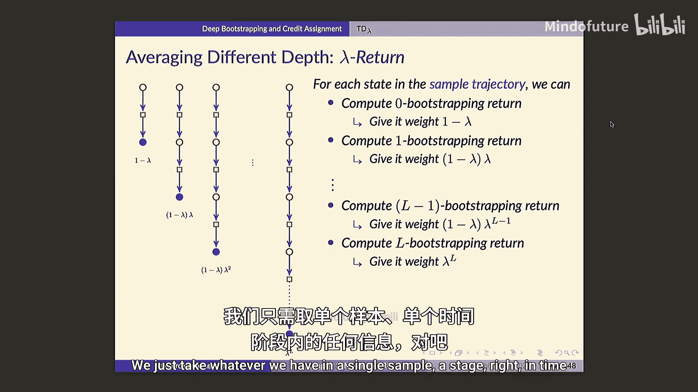

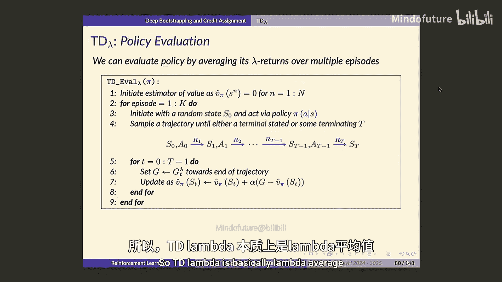

This guy， right， La the average of whatever you would do in defra choices of N， right。

 So what year you essential start with this estate。 So when you are at a state 0， you have TD 0。

 right， which is given by this state S 1， right， You have TD 1， which is given by state 2， right。

 S 2， and you can keep on going till you have TD T， which is given by your last stage， right。

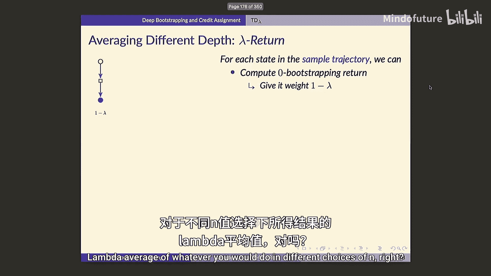

So you have all of them。 You average them， right？ So this is what I mean by line 6。 So in line 6。

 it's not anymore easy for me to write it down。 I do understand that it's a bit hard for you imagine how exactly computations are going on。

 but you don't really need to think about the numbers here。 you just think intuitively。

 like here you can compute you can get one estimate when you you look one step forward。

 if you look two steps forward。 you can compute another estimate and so on， right。

 you get all of them and you average them by some weights， right。

 which are specified by lambda right， And then again， you go forward。 You go the second time。

 again at that time， of course， you do not have as much estimate as you had before。

 you have one less right， because you are not going to have TDT anymore， you have TD 0。

 TD1 T2 till TD T-1， right？ And if you keep on going at the very end， you're gonna have only TD0。

 right， Nothing more。Everybody's clear。Questions。But now this guy is going to let us look at line 5。

 It is going to help us just go towards the end of trajectory， right， because if I am at time t -1。

 Well， I have only the TD 0 estimate， right， I'm gonna take that one。 That's okay， right。Questions。

No question。Everybody's clear。 So this guy is what we call A T D Lada。 So you can do it for value。

 I have given this guy for value。 Obviously， you can do the same thing for action value。 right。

 No need to just repeat that。

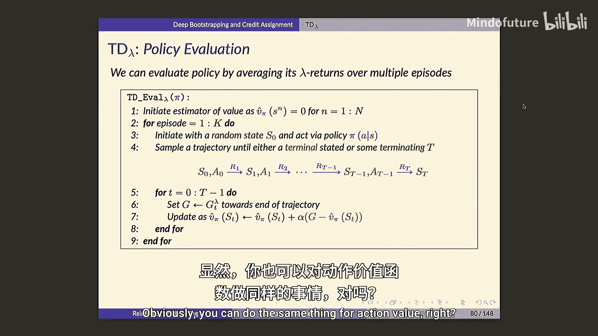

Okay， cool。 So now two things that you might pay attention to is what gonna happen if you set lambda equal by 0 and lambda equal by 1。

 Okay， let's put lambda equal by 0。 Look at the board。 If I set lambda equal by 0。

 what's gonna happen。In the first one。You see it here， right？If I put lambda equal by0。

 what going it be my sample？TD0， right？What about this one。What about this one if I。Again， T D 0。

 right。 So that lambda is going to show up anywhere after TD 0， right。 And when I said is 0。

 everybody gonna get 0， right， When lambda is 0， I have TD equal by。Sorry， I have only Td0， right。

 so this means the lambda co by 0。Is basically TD0， right。

 every single time you just look at the next guy。Right， you don't go deep in time。Everybody's clear。

 right， Everybody's seeing it。Now， what going to happen if I set lambda equal by  one？

You are just taking the very last one， right？And if you are at one。

 if you think of one single trajectory， whose very last estate is a terminal estate。

 What are you doing then？M。TD， that's right。 But I mean。

 in that particular example where you have just your last terminal。

 last estate to be terminal estate。 What gonna happen。

 you're gonna get you start from very beginning， right， you just average TD 0 TD1 till D D last guy。

 But TD La guy is0 simply right， So you're gonna just collect this one It's a sample return you get right。

 for this one for the next one， again， you do the same thing。 you add this one， this one。

 this one towards the end for the next one against like that。 What is that one。That is Monte Carlo。

 right， every single when I put lambda equal by one， if I think of the very last guy。

 like in my trajectory， look at it look at it here。

 if that S T is a terminal state if I put lambda equal by one， then what I am doing here at time0。

 I don't care about any TD in between， I just collect R1 plus r2 plus R this guy till I get here and then value of this one。

 which is0 right， So what I am taking as a sample is some of all of these rewards， right。

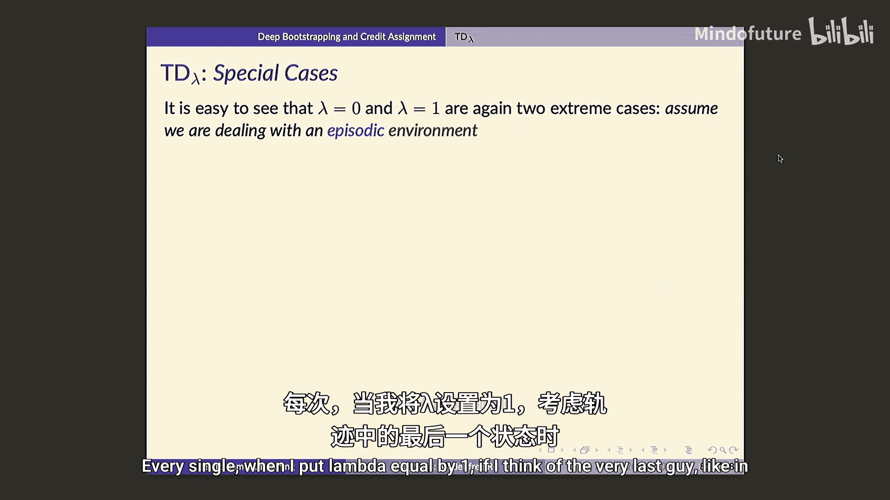

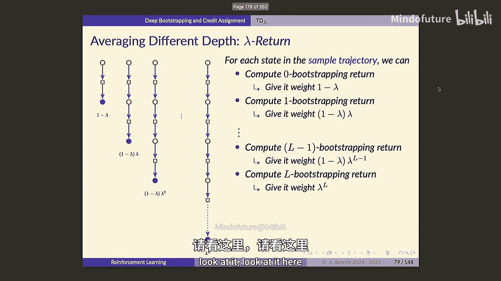

If I go the next time again I am averaging with lambda equal by1。

 this means that I do not care about any TD in between。

 I only care about the last TD right and the last TD is R2 plus R3 so on Rt plus the value of this guy which is 0 again right？

😡，You see it， right， you're following， yes。Okay， cool。 So again， I am doing the same thing。

 So every single time relying on the fact that the last guy is a terminal estate。

 I am simply sampling by Monte Carlo approach， right。

 I'm just computing sample returned by Monte Carlo。 And this means that when lambda equals by one。

 then I have eventually the Monte Carlo。 right？ So what you can say if you if Lada is 0。

 then essentially， you always compute your G T lambda in this form， right。

 which is essentially TD 0 next reward plus。😊。

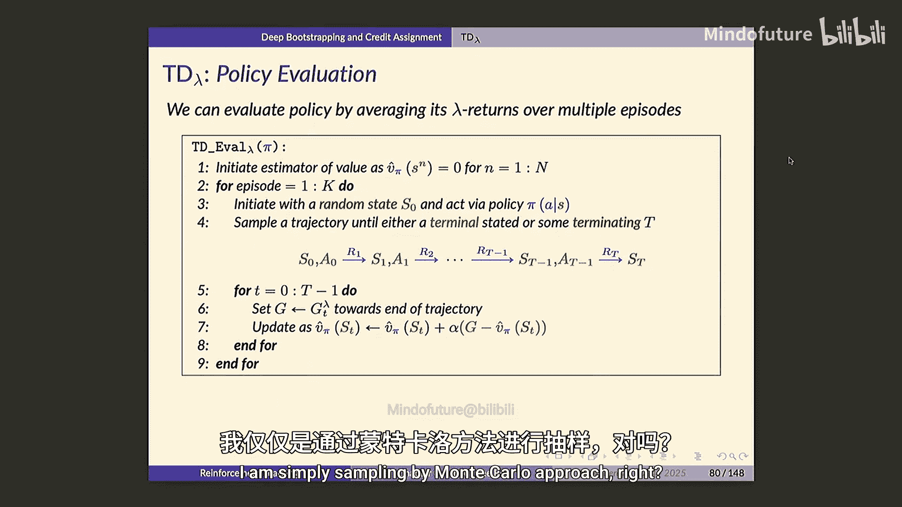

The sample return of this nexus state。 and if lambda equals by one， then well。

 eventually you are just computing anything towards the end and youre dropping the last guy。

 which assuming that that last guy is a terminalized state。 that value is always0。

 meaning that what you have here is basically Monte Carlo， right。Everybody's clear。Questions。

So what is happening now， you have a lambda value and that lambda value can change between 0 and 1。

 right， If you start with 0， yourre TD 0， If you start to gradually increase it。

 you're getting from TD0 to Monte Carlo， right？ So it's a better sort of， you know， spectrum。

Pacing as compared to the case where you have N， right。

 And you have also this property that you are not throwing away any sort of sample， right。

 So you are efficiently using the whole trajectory。To update your estimates。

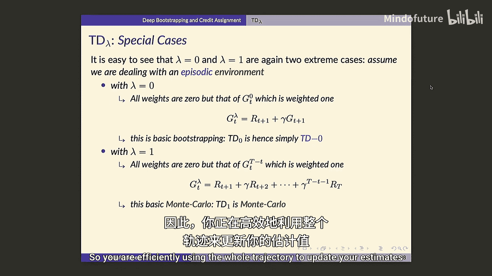

So this is again， the same thing as before。 So here is TD 0。 Here is TD 1。 And now， yeah。

 it make it might sound a bit confusing because we have TD slash 0 is slash1， right。

 And this is where we have n。 But at this point from no one。

 you just throw away TD N because we're not going to use it。 Okay。

 I just define TD N to define this one， okay。We're gonna hopefully get rid of the whole thing today。

 And then we end up with one thing。 You can just use that one。 Okay， but to get there。

 we need to yeah， get all of these troubles， right so。By TD， I mean， I'm showing it as an index now。

 And this lambda could be something between 0 and1。 If lambda is 0， then I am at the basic TD。

 If lambda is1， then I am at Monte Carlo。 And essentially， now I am just continuously。😊，You know。

 moving between these two different cases。 This is different from TDN， right。

 It was like step to a step。 It was quantized。 Now， you're continuously changing， right。

Everybody's clear。Questions。No question。

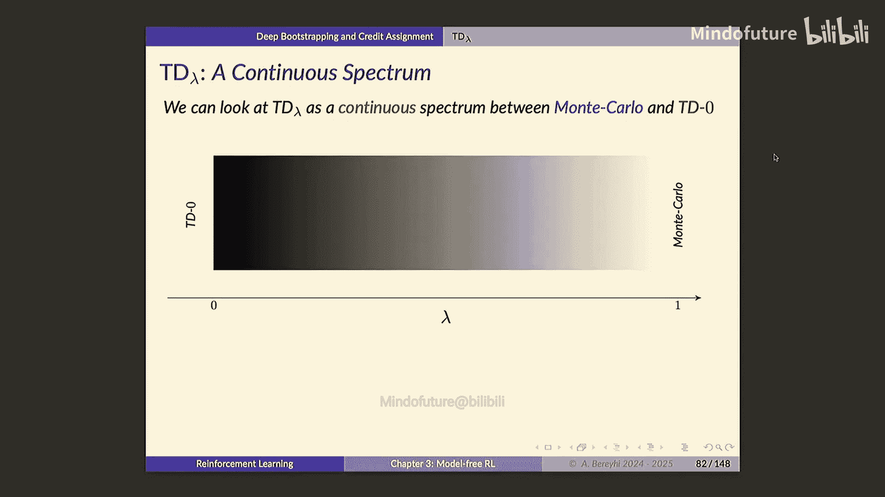

Okay， so now again， if you just do the same thing。 So again， you have your environment。

 you fix the number。Using。You specify the best the exact value function。

 and then you start to estimate it using T T lambda。

 Then what you can see is that if you set lambda equal by0 then youre gonna this is again error against the step size alpha。

 then you're gonna have this optimal value for the error。 Now， if you increase value of lambda。

 then this is going again to drop again， this is going to go up right。

 and it's the same property as before， right， this lambda is not pretty much doing anything different as the K as n。

 basically the only difference that is happening here is that you're now within a very limited space。

 right。Revise clear， right。 So again， there is a one specific choice of lambda。

 But then this this change here is going to be a smoother as compared to the other case， right。

 in the other case， it would be deeper because for every single N， you ignore any other TD estimate。

 right， But now yourre averaging all of them。 So it's gonna reduce this， the， you know。

 complexityveity of this。This diagram。So you're gonna have the same thing。 again。

 you're gonna have a minimum against lambda。 Then minimum eventually happen。

 depending on the number of episodes you're using at the point where you have the sweet point。

 like you have a you have reduced biased enough， but you have not increased too much the variance。

 right， And then after that lambda， you are going to increase the variance。Questions。

So now if you got no question， then let's just get to the more interesting part of this whole discussion。

 And the more interesting is that how we can really include it into a practical algorithm because what I'm doing right now。

 I mean， of course， you have seen the algorithm for TD Lada。 but every single time， what I'm doing。

 I'm just looking towards the very end， right， I'm evaluating all TDs， right， I'm averaging out。

 and then based on that， I am estimate improving my estimate， right。

 I again go for the next time I again look at everybody。😊。

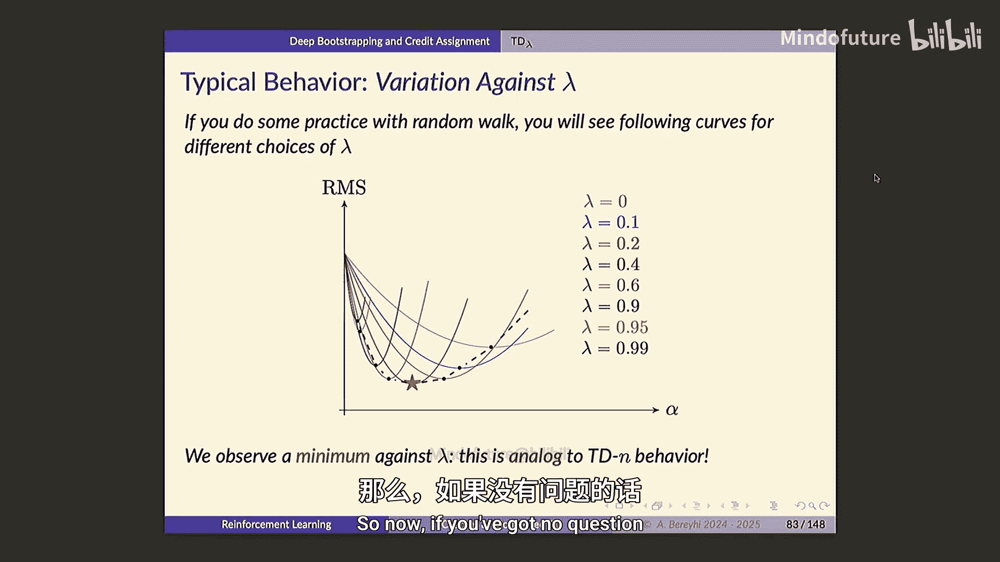

If ahead of me， I just average their estimate， the estimates given by them。 I update， right。

 And I keep on going like that。 And this is a kind of。Exhausing approach， right。

 This is not really practical in time， right， You want to have some sort of online algorithm that every time you just do one single operation。

 That's it。 you go forward， right now。To see that， let's， first of all， look at this。

 this diagram and this diagram that you see are the weights of this averaging that we are doing。

 right？ So look at this guy。This is in this case， when I have only two terms。

 like my trajectory is very small， then。My first weight is 1 minus lambda。 The second one is lambda。

 right， say， for example， lambda is something like 0。2。 Then this guy is 0。8。 This guy is 0。2 right？

 Now， what gonna happen if I increase， This is going to be 0。8 as before。

Then this guy is going to get a smaller。 0。8 times 0。2， right， And then this last guy is 0。

2 is squared， right， So it's going be 0。160。04， right。Now。

 the thing that is going to happen when you look at this time。

 this is your at the particular time T on your trajectory。Whatever you get with T D0。

 you're taking it by 1 minus lambda。 The next guy， the weight of the next guy is reduced， right。

 The weight of the guy after is again reduced， right， so on。

 the weight of the last guy is the smallest one， right？ And this is going to go down， right。

Everybody's clear， right？What is happening？ So when you are estimating here， what you can say。

 you can say that the next guy。Is having the high like the estimate that I get out of the next guy is having the highest。

W in my final update。 But the one which I am considering to be at the very last of the trajectory is just contributing the less in this update。

 right。Okay， so now。You might ask me this question that is there any specific intuition looking at these ways。

 And there is actually a very interesting question。

 because this is the whole idea of what we have in this section。

 suppose least what we call it credit assignment， right So let's talk about this one。

 So what I'm doing right now here， I am just removing all of these Ladas here that we have on the board。

 Okay I just make it make it simpler for you。 What I can say。

 I can say that at every single time that I am。 So I am in one particular point on my trajectory。

 I'm gonna get the TD 0， TD 1 TD2 till the last TD I can compute， right。

 And then I average them with a bunch of ways， right。

 this W T and that you see this guy here is actually those ways which are dropping always。

 right as you go forward in time， they are going to drop， right。😊。

And the thing that is happening here is that the first guy， as we said。

 like TD0 has the most weight and the next guys are going to have less and less weights， right。

 what does it mean， it means that when I okay， I'm going to look at the next estate and based on the next estate。

 I'm going to decide， okay， I guess that I'm going get this much of value right。

 because the next estate is this and based on my available estimate。I know like I am here。

 I just go to the next estate in the next day， I get value 10， right。

 and then I just collected one reward。 So I say， okay。

 I estimate the the value of my current estate is 11 right？ Now， if I go two steps forward。

 maybe the second step value is 6 right？ And then I had collected one1， No。

 my update or my estimate is going to change， right？ I I say like one plus1 plus 6 there is 8 right。

 now， the question is that which of these two numbers is more valuable，11 or 8 Yeah。

 because my next estate tells me。I mean， you start from here， you ended up there， you collected one。

 here on， you're supposed to get 10， right？The second next estate is telling me like。

 you started there。 You just collected one another one。 This is  two。 And from no on。

 you are going to collect6， right。So8， right， Which one is more trustable now。

Natural thing that we do。 we always look at the next estate first， right？ So if someone tells you。

 oh， do that and you are going to get this much money， right？ But you might know that， okay。

 if I get that money， if I keep on playing on might lose， right？

 But this is a natural thing that we always give more priority to what we see next， right。

 we're rely more on what is right now， happening， as compared to what is supposed to happen in very。

 very far future， right。Right， so you do not insure yourself for。100 years from now， right。

 but you insure yourself for your next tree that you're going， right？So， this is the idea。😊。

The more you go in future， the less weight you would give to your estimate。

 And this makes sense from a kind of natural learning process that we have， right。

 when we want to find or evaluate our policy， we just play once and say， oh。

 we got a very good outcome， right？ So because of that， this is a good policy， right？ Well。

 if you keep on going in time， Maybe you start to lose， right？ But who knows。

 you always rely on that one。 So。What you're doing。

 you are giving more credit to the immediate reward that or immediate observation that you do next to yourself。

 And this is the idea of credit assignment， because you could always bring up this question。

 The question is that while I am here， if I get immediate reward， which is very good。 that's fine。

 But maybe in future， I lose too much， right And then how I can rely on what I see， well。

 this approach， what we are doing here or T Lada what it's doing is giving like it's not ignoring everything in future iss still taking that into account。

 But the more you go in future is giving less weight， which is somehow natural。

 given the way that we play games or we interact with an environment， right so。😊。

So what we are doing， we are essentially assigning credit to the kind of estimate based on the observation that we are going to do in future。

 And every time that go forward， since we are getting more far away from our care state。

 we are going to just give it less weights， right， less credit， right。

 So a normal person is for you is the one who is saying like thinking about the。

Like third next the salary of the next three months， right。

 a person who is just losing too much salary because he is thinking like in in two years。

 he is supposed to get a huge reward is not very rational to us， right？

 And this is the same thing that we are doing here， right？ Everybody is clear， right。😔。

So this is how you can think of it。 So you are at the particular state S S T， right。

 and then you're gonna have all these states towards the very end， right。

 And each time you're collecting one reward。 And you have one estimate for the guy in future， right？

 So you would say， okay， the estimate given by my observation here is more credible as compared the estimate that I I'm gonna to give after seeing this guy after seeing this guy and so on towards the end。

 right， And this makes more sense， right。😊。

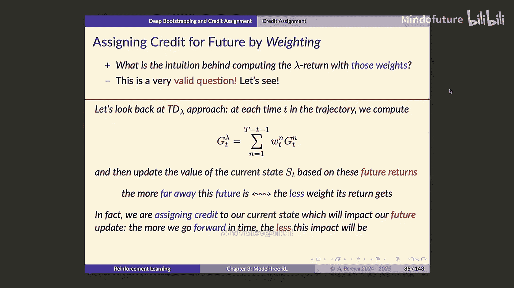

But clear。Questions。No question。Okay， so now。啊，や。That's， yeah， that's pretty my this interpretation。

 The only thing that is left that we need to do is to just find out if there is a way that instead of looking towards the future in every single time。

 I can just do my update。 and I don't look at the future to update， right， because right now。

 I need to just get this estimate plus this estimate plus the next estimate。 I average all of them。

 And once I average them， this is going to be my， my。My estimate for， or my update for this time。

 right， Now I go the next time is that， again， I need to repeat the same thing and so on。 This is。

 as I said， very exhausting。 Is there a way to do it online or not， okay。

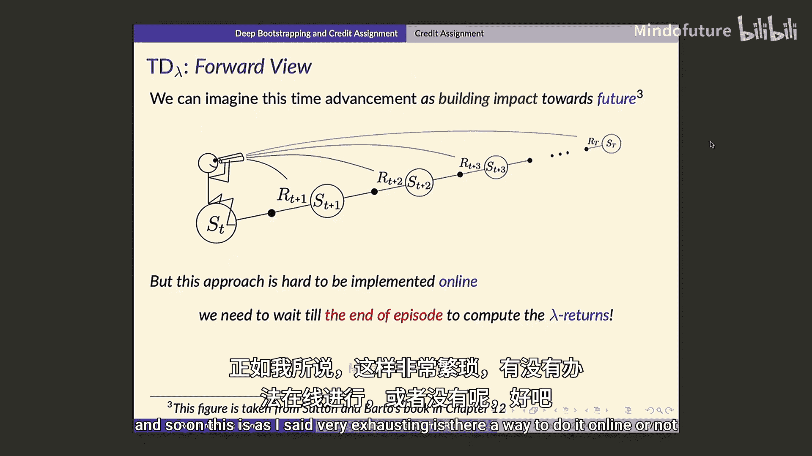

Now， there is actually a very simple way to do it online。

 And this is what is the final goal of this whole discussion here that you just understand this algorithm。

 Now， from now on， I mean， if you had any trouble following details there。

 you can just throw it away， the only thing that I want you to understand keep in mind is basically this one。

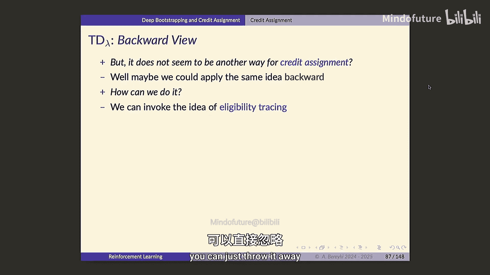

So is that when you are doing TD a Lada in one particular state， right。

 you can just talk about the future based on your trajectory， right。

 So your future is like the media dual plus estimate of the next one， right。

2 immediate words plus the estimate of the second next one and so on， right。

 You have all of them and you combine them and how you combine them， you rely more on the next guy。

 as compared this is second next guy， third next guy and so on， right。Right， you rely more。

 And for waiting that， you have a solution， right Now， the thing that we want to do。

 we want to see if there is a way that I can just update here without taking into account whatever is in the future。

 right， So I just start from beginning of my trajectory。 I update I go ahead。 I update again。

 I do that。 And I don't really need to rely on the future so much， right。

 I want to see whether I can do it。 This makes more sense。 This is what we're。

Is going to end up us with the algorithms that we know like SArsa and Q learning。

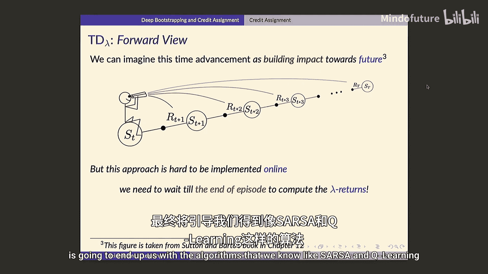