# 【多伦多大学】强化学习 2025 ｜ Uoft   Reinforcement Learning   Fall 2025 p28 P28_讲座_27_带资格迹的时序差分 -BV1D3F2zhEry_p28-

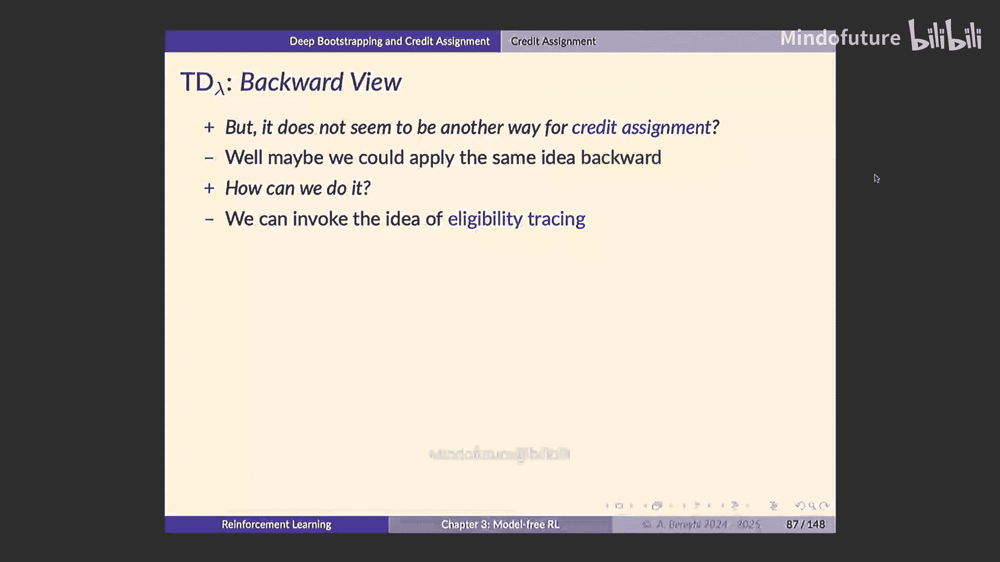

The idea here is that， well， I want to just do the same credit assignment that I'm doing。

 So I want to just give weights to future estimates， and I want to give less ways to very far away。

 guys。 I want to give more weight to the nearer guys， But I don't want to do it forward in time。

 I want to do it backward in time。 Sos a bit weird， but eventually we can do it。

 So the way that we are going to do it is by what we call it eligibility tracing。 Now。

 I could start with doing all the telescopic summation and other things to show you that you can do it really in time like that。

 But I guess like。

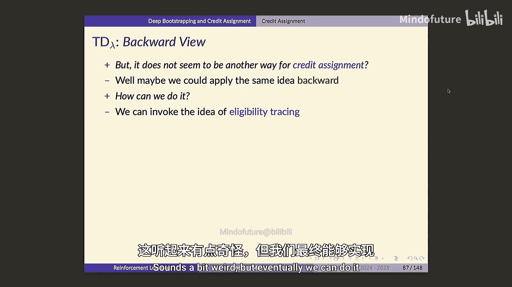

This topic itself is complicated enough that if I add that one， it's gonna make everybody lost。 So。

 so right now， I'm gonna explain you an algorithm。 You really don't need to see exact connection to what we have done up to this point。

 once you got the idea of how the algorithm works， I'm going tell you what is the connection。 Okay。

 and we are not going to get into the derivation details because this is very confusing。

 but you can definitely do it if you it's just submission and you know， expansion。

 if you do it at home。 You you gonna see it immediately。 not immediately it takes time。

 but you can see it right， but I'm gonna explain how you can see it。 I don't show it here。 Okay。

 I my personal experience that this way is easier to understand。 So now what I'm doing。

 I am doing this eligibility tracing and what is the eligibility tracing。

So say that I am in one particular time。 So Im Im seeing one particular state。

 And then in this particular state that I am。 Okay， so I started from very beginning。

 that I got into one particular time。 I am this estate， right， What I want to do。

 I want to just look back were and see， for instance。

 this particular state or any other guy before it， how many times they have happened and how much impact they should be take for this。

Frequency should be taken into account， okay。So this is the idea that I want to do it。

 And now I'm going to show you the algorithm right away。 So what is the algorithm。

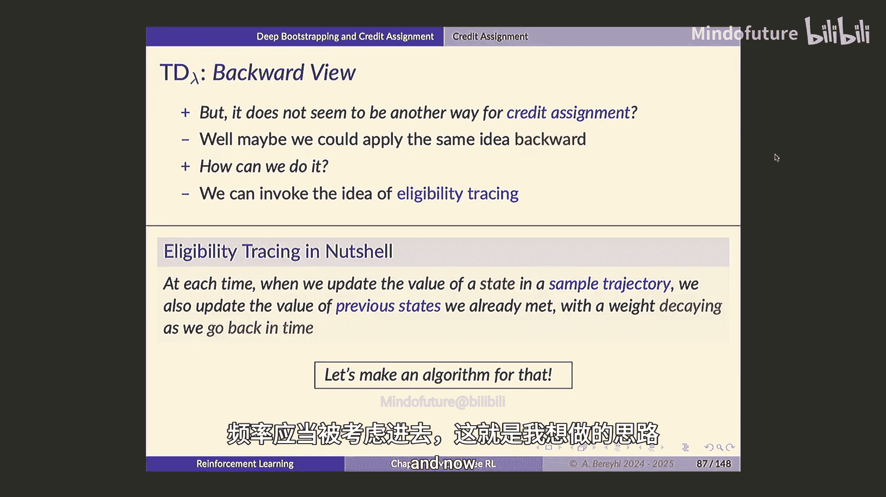

I have this eligibility guy E。 And what is this E is a function or is a kind of table given for every single state that you have inside your environment。

 This means that。If I have。Say I have four different estates and say that for simplicityity。

 let me just take it now。Say that for simplicitylic that my estate are okay， state 1，2 or yeah，0，1，2。

3， like the Dmmi world， right。😊，Dmy yeah， dummy grid world。 Okay， I have these four different cases。

 Now， I have E of every single state， right。😊，So for every possible state。

 I have one eligibility trait， okay。I have this eligibility。 You see it， right。 Now， initially。

 I'm gonna set this guy。 This is like a table， right， This guy is oh。

You can guess that I was also bad in drawing in school。 And that's right， so。Yeah。

 so E F S is happening Here。 Here is this state。 Now， initially that you start。

 you're going to put everybody0。 Okay， every guy here is 0。 there is no trace of anyone， right。

 I have a start with my trajectory， right， Now， let's say that I go for the first time step。

 and the first time step， I see this is state， right， I see a state  one。😊，What I'm going to do。

I am going to just add the trace of this guy to be one。So I make it one because this happened one。

 okay。Everybody's clear。Okay， so I was I started from nothing。I just tried hard。

And then I got to state1 right at a state 1 that I see it， I put it one because state 1。

 this cell 1 happened with， okay， maybe I showed the world world as well。 So here is cell 0， cell 1。

 cell 2， cell 3， I was here， and when I was here。 then I have seen this is state1， right。😊。

Tras got one， right？ now， one thing that I'm gonna do， say， I just move from this one to this one。

 Okay， what I can do。 Okay， I had seen already one I'm going to， I am seeing now three。

 So I should update this guy by one， right， So now if I go back again， then I get here， right。

And then again， I have seen this one again， right， So I'm gonna make it now too， right。

 and I keep on playing in the environment any time I increase。 If I do this basic thing。

 I am just giving credit for every single time， same right。

 because I say I was at the very beginning here， right。

 This was the same value for me as I came as the second time I seeing it right， So I was here。

 the trace was one， then I came here again， I got back here。 I added one， right。

But this is not really the case， right？ We saw it in in our credit assignment in the credit assignment。

 we sell， like when I am at one particular time， the more far away I get in time。

 the less impact I'm supposed to have， right？ So the better idea is that I do not do it like this。😊。

I'm going start with 0。 Now I come here。 I start here that I make it one， okay。Now。

 if I go one time forward， I can reduce everybody here， right， because I say， okay， time passed。

 right， The impact is supposed to reduce。 I'm going multiply everybody with one number。

 which is smaller than one。Okay， you see it？So if I multiply everybody with factors， say。

 for example， 0。1， whats going to happen？This is going to be 0。 This is 0。1 now，0，0， right， No。

 I got here to 3。 This is the freshest state， right， I am going to add one here， right。You see it。

What I did now， again， from this three。 So I came here Now， next time I go up， okay。Now。

 how should I update my traces？I multiply everything with 0。1， right。

 this going to make this remain zero。 what' going to happen to this guy？😡，0。01， right。

 What about this guy， zero， what about this one？0。1， right。 And no。

 I am going to add the trace or the trace of the state that I am in， right， which is one again。

 So this guy is going to be 1。01。 So you see what I'm doing。 So now what is happening here is that。

In this trace that I am giving， this trace is giving me 1。01。 This one is telling me that fresh。

 I am right now in state 1， right？ And then it also tells me that some time before I had been in this stage。

 right。But how far away it had been， I mean， the I get the smaller this impact gonna be， right。

You see it？Everybody' is quick。Questions， yes。关。被个。呃。Sorry， I didn't get your question。Yes we in。Yes。

 just based on the numbers， actually。Is that important？Yeah， but， but well， I mean。

 the thing is that， I mean， you're at the end of the day going to sample this one， right。

 So you don't know what is your exact trajectory yet， right？ So I told you。

 maybe you are playing with the random policy， right。

 There is no reason that every time you start here， come here and get back here。For sure， right。

 You come， you come here， maybe next time you come here， right， But the thing that you said。

 like from 0， like the fact that is 1。01， I understand that the second previous time was there。

 This is actually what I want to somehow embed inside this eligibility trace。

YeahSo this is going to exactly recover what we are doing in future because basically what we are doing right now in the future t the lambda we say like one minus lambda。

 then the next one get one minus lambda times lambda right one minus lambda times lambda times lambda right So each time we are just multiplying everything with a lambda in future right and reducing it I want to just do it backward。

Yeah。 everybody is clear。Question？So this is the idea of the eligibility tracing。

 So what we are doing in eligibility tracing is that。We start with every eligibility trace to be0。

 and then we go over all the states that we have every single time on a trajectory。

 when I see a new state， right， I'm gonna get my trace。

 multiply everything with a factor is smaller than one。 I am writing it down here。 Gamma times Lada。

 Gamma is a discount factor。 Lada is exactly the same Lada we use in TD Lada。 Okay。

 why I have chosen this number。 first of all， this number is definitely smaller than one， right。

 you see it， right， this is definitely smaller than one， But why I choose it。

 because I want at the end of the day， my algorithm recover TD lambda。 This is the only reason。

 right， And since you are free to choose Lada， you are also free to choose these guys， right。

 So this is just to make a knowledge between the two cases。 So now every time I get all the traces。

 I just reduce their impact by multiplying them with this number smaller than。😊。

And then I add to this state， to the trace of this state， which is right now happening， right？

Everybody's cool。 So this is executive example that we said。 Like when we start with everything here。

 sorry， we start with the trajectory。 Everything is 0， right， No cell has。

 no state has happened before。 So all the。😊，Traces are being。0， and。And then what I am going to do。

 I am going to just go ahead with this trajectory。 The first time S0 happens。

 I am going to update its trace with1， everybody else remains 0 right then the next time when I go to t equal by 1 then I am going to just update the trace of s0 with 0。

1 if you assume that that value gamma times lambda is 0。

1 everybody else going to get multiply with 0。1 then the trace of S1 is going to be1 right if that happens that at time2 again I get back to the same estate that I was in time 0。

 then this guy S1 is going to get updated with 0。1 S 0 is going to get updated with whatever we had before multiple multiply with 0。

1 which is exactly like the example we did 0。01 and then you add a 1 to it its。

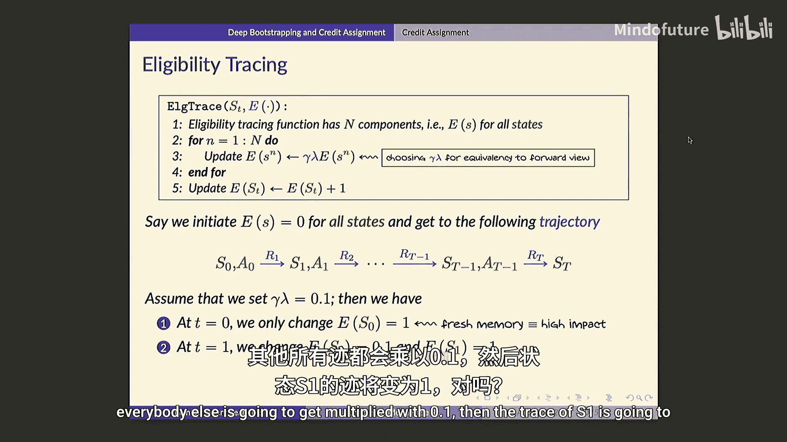

1。01 so go on， you are just somehow counting how much time you have hit one particular state and how much far away that estate has happened before in time right？

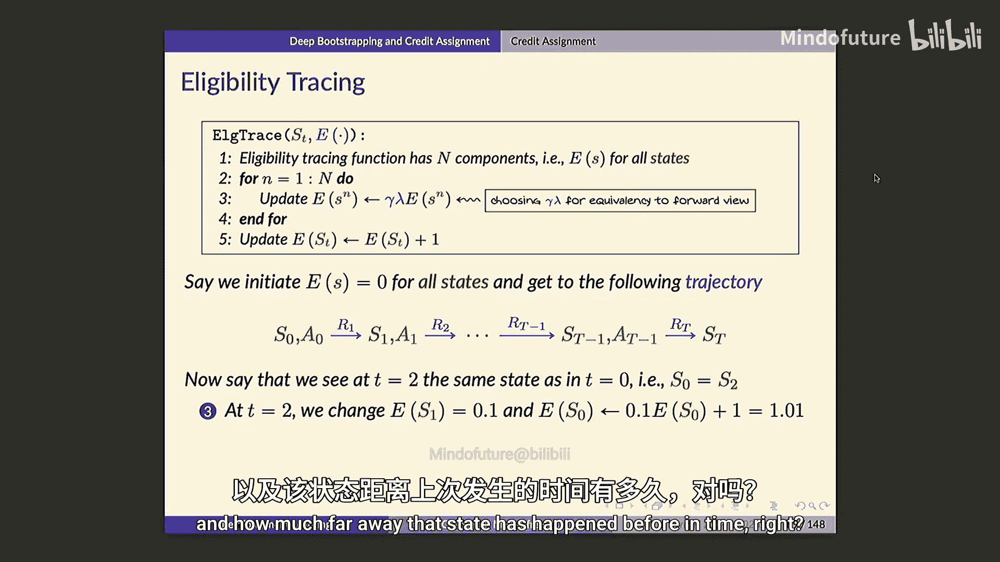

Now。What is the benefit of this one or using this eligibility trace。 What we can do now。

 if we have this eligibility trace， we can start doing something like this。 So at every single time。

 I am going to just use TD0 to estimate。 So I'm going to say， I am in this time， what is my next guy。

I take the estimate of the value。 I added up to my immediate word。 This is what you get out of TD0。

 Now， if you wanted to just update with your TD0， what you would do， you get this delta， right。

 And then you add up this delta to your update， right。

 youre gonna update your estimate with this delta， right， Now， if you get the same delta。

 But instead of just updating with delta， you're update it with delta times the eligibility of the state。

 Okay then what you are doing basically， you're doing TD Lada。But， reverse in time。

So you got the idea。 So you're basically doing back again TD 0。

 But the only difference is that now you're just giving。

The eligibility of every single state when you are updating it， right， So this means that， well。

Update this value， the value of this estate with this much of step。

 But take this into account that this estate has happened 10 times before， right。

 And then when this state has happened 10 times before， then。

Its estimate is more reliable as compared to this state， which has never happened before， right。

Everybody's clear， right。 And now， if it has happened 10 times before， the first time it happened。

I did have。 I had no clue about it， right？ So that estimate was not a good guy， right。

 The second one was better。 The third one was much better。 And the one which I have rhino is much。

 much better， right。So the trace of the impact of very far away guys is less。

 The impact of the guys which are getting closer is increasing， right。Right。

 and this is what your state from this state。 So you saw from a particular state every single time that。

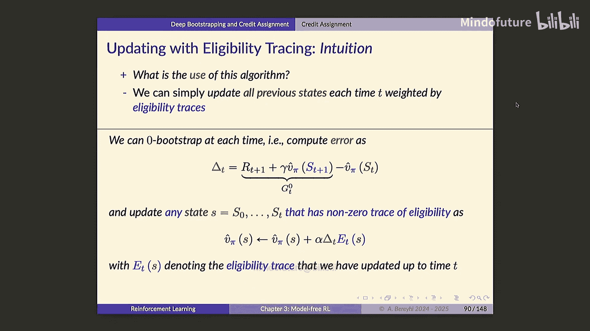

You you see a new state。 So say youre in particular you had been a couple of states。 you get at this。

 when you are here， you're seeing， first of all， you are giving the eligibility of every state to be scaled down right and that down is scaling is done by this gamma times lambda I told you the important thing is that this is something smaller than one right But this gamma times lambda is simply I put it there because I want to make forward and backward calculation exactly the same This is the only reason。

 But the thing that you are doing， you say that okay I have， I don't know。

10 different possible states I am now at time T Now I have seen each state starting from the beginning of time。

 couple of times right each time that I have seen I have taken into account there eligibility Now I am in one particular time T。

 How do I update I would say whatever the eligibility is。

Im going to first scale all of them down because I am passing one time step， right。

 And then once I scale them down。 So the scale down is line 3。 After that。

 I am looking at this state that I am in。 and I add one to it， right， So it's like。

You start from all of them being0。 You see one estate。

 You only add the eligibility one to that estate， right。

 And then you go to the next estate in the next estate， you would say， okay。

 the previous one should already get damn。 So I'm gonna get this factor smaller than one。

 multiply with that。 And then I add one again to the new estate I've seen。

 and keep on thing like that， right So as you pass through time if you think of this eligibility trees as a table giving eligibility in front of every state。

Are getting something zero value， but value value。These eligities depend on how。

 how many times and how long before you have seen that particular state， right。

 And now the I that we had。Was that。

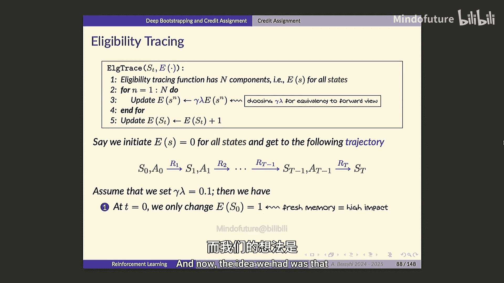

Was that somehow using this eligibility trace to do the update using this one， right。

 So just put the algorithm， which is at the very end。 And then I， again。

 like the eligibility tracing， I move backward and explained the previous slides。

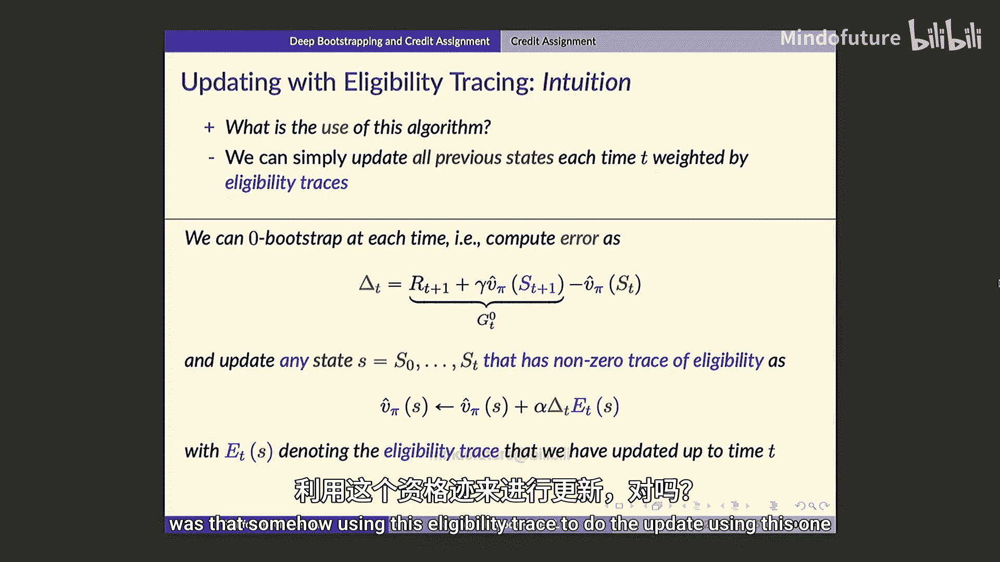

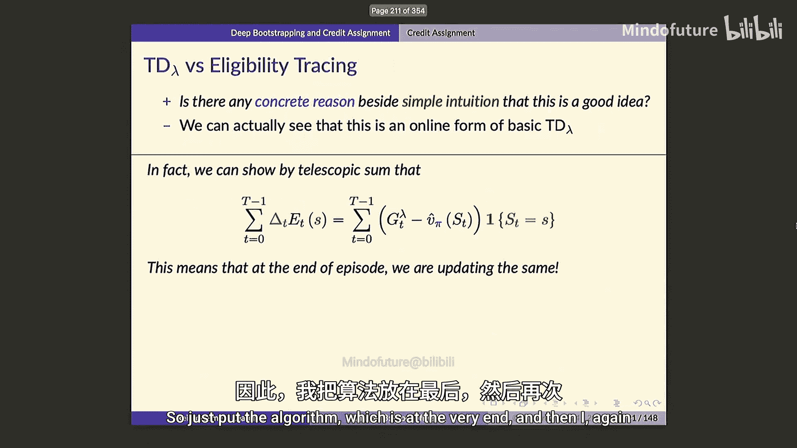

Okay so this is the algorithm that you can update or evaluate your your policy by eligibility tracing。

 And let's look at it together what you're doing， you're just sampling episodes。

 Okay that's obvious and then you start from some state you play with your policy and now you're in line4。

 we just sample the complete trajectory So I have the trajectory you starts from one state。

 I do an action， go to the next state action and so on towards the end Now I have the trajectory。

 I want to just update the estimate of every single pair right or for the moment。

 let thing only about the value。 So I just want to update the estimate of the value of every single state that I am in the thing that I'm going to do is that I start with the very first state。

 So you're gonna be a state zero and then in line 6 I am going to just update it eligibility right so when I start from scratch all the e。

is r0， right？But if I have done multiple。Trajecty is。Up to no， I have changed the eligbilities。

 right。 So if you think at the very first trajectory， very first stay， this E。

 the table should be all zeros， right。And now you have seen a state as 0， then eventually。say。

 for example， is cell 1。 Then you go for cell 1， and then you make its eligibility one， right。Clear。

 okay， now， when you do that， then line 7， as you see， is basically what you do always in TD， right。

 in TD 0， actually， So what you're doing， you look at your reward that you get reward T plus 1。

 which is in this case， when T0 is R 1。 So you're in a state 0。 You already counted its eligibility。

 And then you would say， okay， this is the reward。 I have seen S1 as the next estate， right？

 So I'm gonna take the value， the estimate of the value for the next。The remaining return。

 And I added up with my immediate reward， right， So this is going to be the sample return。

 I'm collecting G。 Now that I have G I can compute the difference in my estimate。

 So I would say whatever it was this the estimate of my S0， my instead S 0。 Now。

 this sample is different from it with this expression， right， So this is delta。And now。

 I am going to add this deelta。To every single state， according to its eligibility。

Meaning that I would say， okay， if you think of this S N here。

 one of these states to be exactly as 0， the first state。

 that I am updating my value exactly as in TD， right。

 So the value of my state as 0 is whatever it had been Okay， a typo here， it should be S N。m sorry。

 okay， Here is S N dropping in the brackets。 And then I am going to add it up with my delta with my difference。

 right， So the value， the new value of my state is the previous value plus this delta， right。

 This is how you update it for TD， right， everybody is cool， right。Okay。

 this is when you do it with TD， you don't go over all the estates， right。

 You just go for that particular estate as 0， right， you own value of that estates， right。

Just for a second for。ability and forget about this line 8 and line 10。

 which is opening and en closing the loop。It in in line 9， if you want to just do basic TD。

 what you do， you're gonna get V hack pi of S 0 capital S 0， right， and you update it， right？

 This is how you in TD。Right。把你。Just a。your。You are not doing it but only for that is zero。

 you do it for everybody right So you would say whatever state I have。

 I am going to update it right so all of them are getting added with this delta。

 So all the estimates are getting updated， but the portion of the deta， which is contributing。

 is proportional to the eligibility of that estate。Right so if you are in the very first estate。

 in the very first trajectory。Eligibility is one for S 0。 It's 0 for everybody else。

 What gonna happen to this loop between line 8 and 10。It gonna update only one state， right。

 That is 0。 basically TD， right， because other have not been seen before， right。

 This is your first trajectory。 First state， you have not seen any other state， right。

 But if you go for a state S1 and。S1 is exactly like a 0 right then next time when you come in this loop。

 then S0 is not getting updated with the same delta as TD right。

 you're taking this fact into account that in it before so this update is more eligible right。没有。

Keep on going with multiple trajectories。 somewherewhere in between， you have this eligibility trace。

 including lots of non zero entries， right and then each time that you compute this delta。

 then you go update all of these states that youve seen before， right。哦，喂。

When you see one new state and then you get the new sample return。

 you don't use it to only update the value of that estate。 You would say， okay。

 I have seen a state3 and 8 as well before right and I have seen them with this eligibility right so I'm going to go go backward and also update the value or estimated function at those estates。

Everybodys clear。So you got the idea， right， So you are again doing TD 0 here。

 But the main difference here is that in addition to computing or computing your new sample return。

 those G values。You are also taking into account how many times in what distance in time you have seen different states。

 right。You encode it somehow inside this eligibility trace。

 and then you use it to update everybody together， right。Now， why we should do that。

 So as I told you last time， there is a very good mathematical reason for doing it。

 because if you keep on doing this， So say you start with the first state and you go towards the very end。

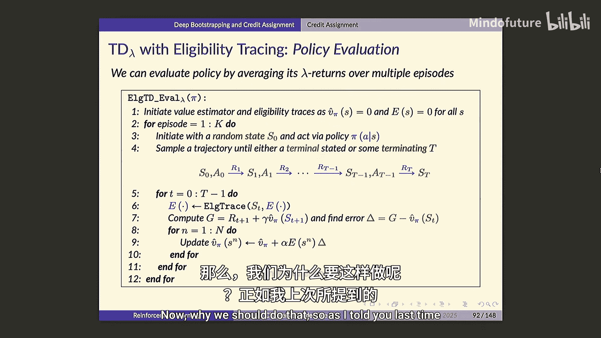

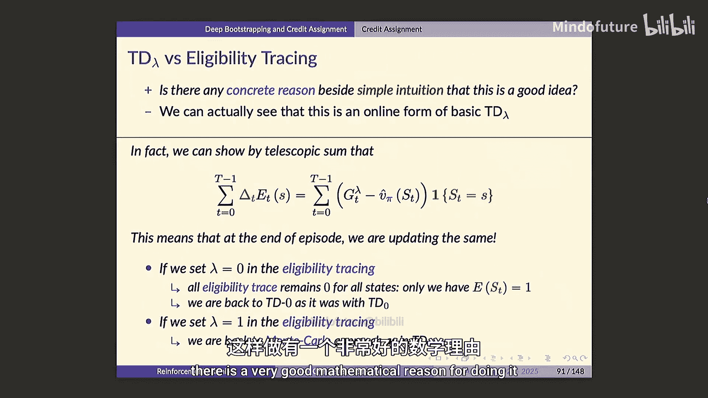

And you update all this state value using this approach with this。没。Eventually。

 with you start here and do TD a Lada towards the future。

So mathematically is the same when you are over with the trajectory。

All of the value is going to get updated the same。😡，RightBut the key factor here。

When you want to update at time T， you don't really need to know about this state at time T plus 1 T plus2 and so on。

 right， The only thing that you need to know is this states。Making your algorithm more online， right。

You see that。Everybody's clear。So moral of his story， this is eventually TD Lada。

 but in an online forum， right， And then we're going to keep this one because this is going to help us build new algorithm。

 more efficient algorithms。Questions。有。This is aval TD。Its exactly the same thing。

 The only place that they differ is in between one trajectory。

So say you start with a bunch of values， right when you are at the beginning of one one trajectory。

 you start to update one by one， right till youre over with that trajectory。 Now if you do TD ada。

 then at the beginning say at the beginning of the trajectory。

 you have a fixed value set of value estimates， right And then you keep on going on that trajectory towards the end when you are over with the whole trajectory。

 say you use TD lambda， you get a set of new values， right if you do this algorithm。

 when you are over with the trajectory， you end up with the same values right the only difference is that you might be in the middle right。

 in the middle time， like somewhere in the middle of this trajectory。

 it might be the case that the estimates are not exactly the same， but it's just a trajectory。

 right you don't care。 You're gonna finish it anyways， right so。Trajecty that you complete。

 you get back exactly to TD Lada。 So if TD Lada， after， I don't know。

1000 trajectories is going to converge， this guy is going to definitely converge the same way， right。

Make sense。Questions。And the reason why this is happening is simply this identity。

 like this is what you do in the this algorithm。 The other one is what you do in TD Lada。

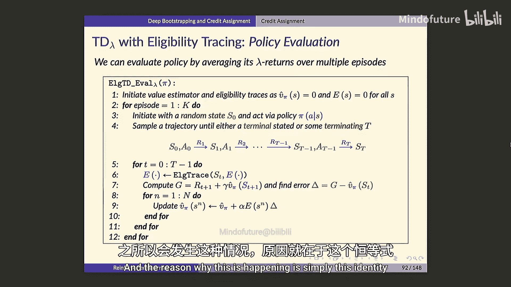

And in the TD Lada， you look towards the future here you look back。

And if you sum up all of those updates， they are going to be equivalent。Sly that。Okay。Okay， so， yeah。

 that was this。 So just let me make sure。 yeah， I I， I guess yeah。

 completes what the last discussion we had last time。 this is the algorithm， which is the。

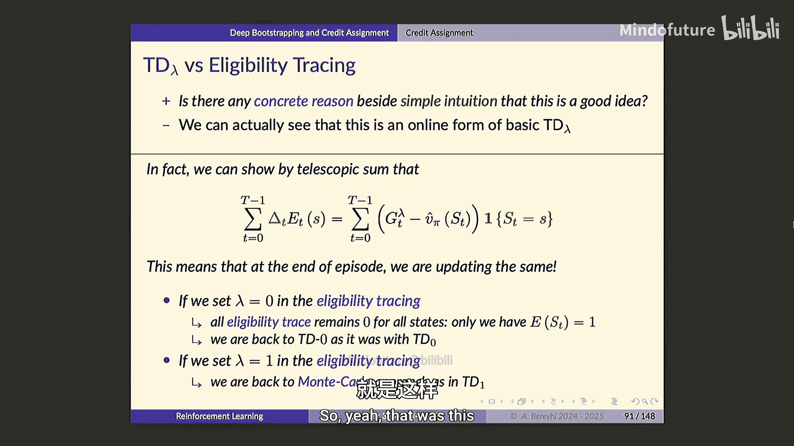

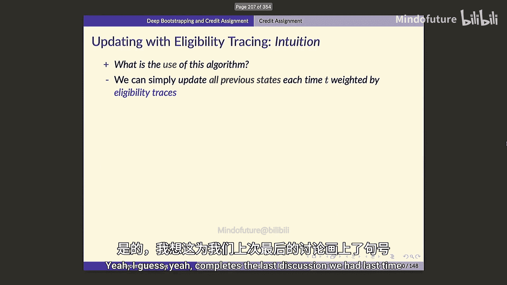

Traccing， and this is actually an online version of the basically the a lambda that we talked about last time。

 okay。

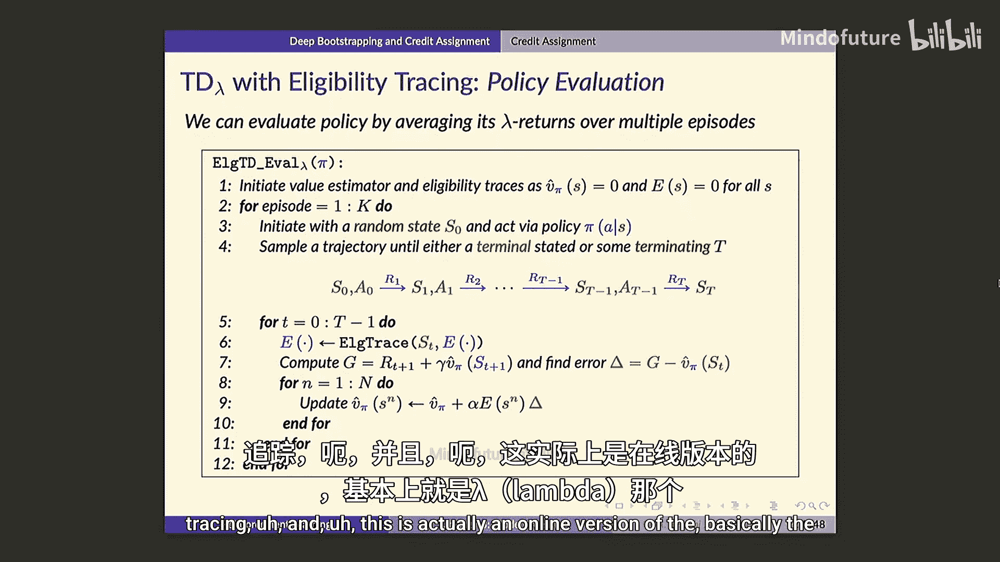

Now， what you can think here in terms of eligibility， you can think in this form。

 So you could say that I am in this particular state， I haven't seen like I just start right。

 I haven't seen anything before。 so I'm gonna update right I'm gonna update my estimate。

 I go to the next time step。 again， I see a new state which I have not seen before again。

 I update and going I arrive somewhere in between and I see a state right and now when I see that estate is's like I say。

 oh， I see this estate and I see this particular estimate update， but if I update this one。

 this guy happened before right。And shouldn't I just。Update any guys who use that to update。

Do you see what I'm saying， So you get like to into S T， right， And you would say， oh。

 three time steps before I had this。Friend estimate for it， right？

 But I used it to just update my previous time step， right， now， since I updated this one。

 shouldn't I also update my previous time step。 Well， I can do it， right。If my time。

Impacted my update at time 4。 And then I go on in time 5。 And I see that this is exactly time 3。

 right， So maybe I can again update my time 4 because my time4 used the value of state 3 at time3。

 right So maybe I can update it again right So this is basically the idea when you are in one particular time somehow you're just telling anyone else before you that hey guys。

 the value of this estate got changed right， and anyone who used it before。

 just go ahead and change it right and they're going to change it right is a more efficient approach is just simply looking at one estimate sorry。

 sorry just simply updating one single value。

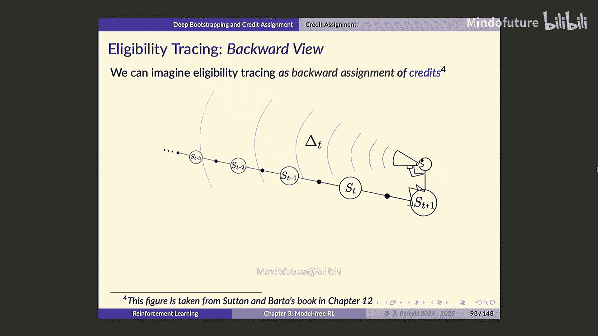

O。