# 【多伦多大学】强化学习 2025 ｜ Uoft   Reinforcement Learning   Fall 2025 p29 P29_讲座_28_蒙特卡洛控制循环 -BV1D3F2zhEry_p29-

Next thing that we want to learn is how we can just convert what we have learned up to this point into the control。

 right， So what we want to do， what we have done up to this point is what we call it prediction。

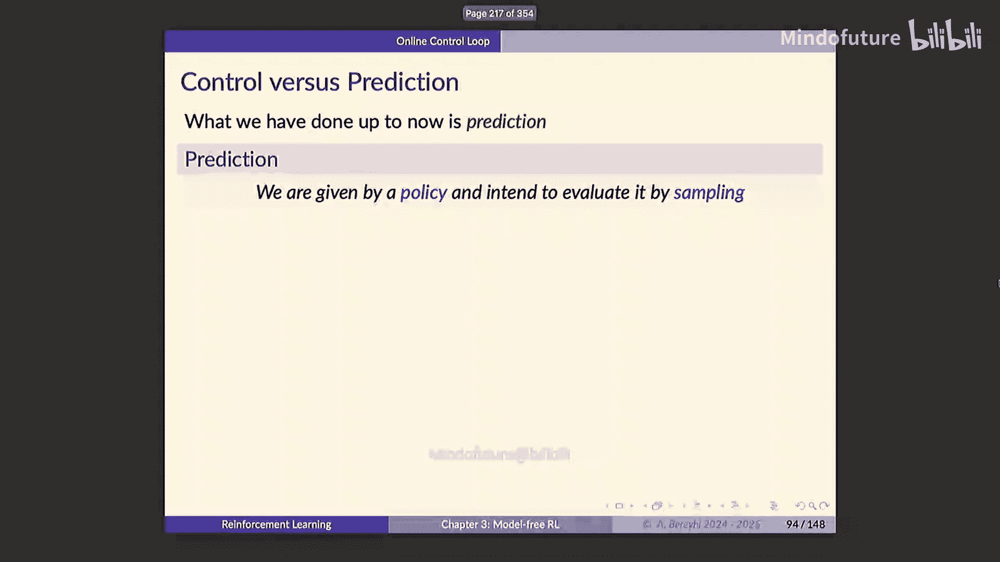

And why this is prediction is because I give you a policy， right？ I give you one policy。

 And I tell you that， okay， get this policy， go in the environment。

 play with it as much as you want and come back to me， tell me a table。

 give me a table which includes estimates of the values or estimates of the action values， right。

 So you're fixing the policy。 You just evaluate that policy， right。

So this is prediction because you want to just predict this policy， how does it work， right？

But what we want to do in practice is control， right。

 So you don't want to just get the policy and evaluate it and come back to me， told me that， oh。

 it's not a good policy， right， You want to。I mean， ignore any policy。

 You want to just go in the environment and start doing something and gradually learn how to play optimal。

This is your final goal， right？ This is what we call it control right。

 because you want to see the system is developing。 And based on this developing by this in the states of the system and in the actions you do。

 you start to get feeling some sense about how you can play optimally Now。

 one thing that you might tell me is that well， you already told us about GI right。

 generalize policy itration。 And this means that if we we know how to evaluate the policy。

 we can always find the optimal policy， right， you just start with the policy。

 you evaluate it using the prediction algorithms we had up to。 Now you know the values。

 you can improve it right， you just do the greedy approach right， You just select the action。

 which is maximum value。Then this new improved algorithm。Get。To just evaluate it。

 and then you again improve it。 you keep on doing this。T you're over， right。

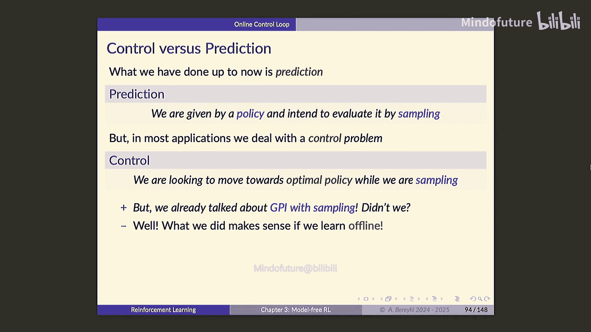

Iagine that， I mean， just imagine that you want to get this。

 this idea of GI and you want to implement it in on a robot， right， What does it mean。

 It means that you need to。giveive it a random policy。 Every angle is just randomly moving， right。

 And this robot goes in the environment forever， like for years。

Find out how exactly a random moving gonna look like Once that you understood， it comes back to you。

 you just improve it。 Again， you leave it alone in the environment。 And this is going forever， right。

 This is not something practical on paper is nice because it' gonna work or theoretical。

You the optimal policy。 But this is not something that you are willing for， right。

 So what we have done up to this point is basically offline reinforced learning and offline learning。

 it means that you don't care about the number of samples you want to use right you only think about building one loop。

 one algorithm， which is going to find you the optimal policy right But how much samples you need。

 Well， I don't care， right as long as I can do it by sampling。

 I'm fine because I'm gonna get some samples right So this is offline R。 what what we want to do。

 we want to do online R。 This means that want to get my robot and this。

I mean every single step that it takes， it' gonna find out at least a bit of sense about what is the right action right。

 And gradually， it's gonna make its own way towards just acting normal， right， so。This is a bit of。

 you know， philosophy involved as well because we as human beings。

 we don't try a policy billions of times to understand。 like like the kid， when you teach it。

 when a kid learns to walk， they do not just simply start to just walk and fall down randomly and then start。

 oh， this was not a good policy。 they get。 no， they start to just。There step。 and then they fall。

 Then immediately after that， they're going to do the。不是。

wait they understand how exactly the policy works。We typically， we， as a human being。

 as intelligent creatures， we， we have online policy or online algorithm to just learn the policy。

 And this is the way that we do it。 We usually sample the environment。 We get some。

Moify a tiny bit what we want to do next。 And we keep on going forward， right， Defitely。

 we put a bit of。This is going to be reward and so on and so on and so on。

 And then we're going to come up with a better solution。 But at the end of the day。

 we do not wait till we are over with like。The whole bunch of trajectories until we want to just improve or change our policy。

 right。Now， this is just just a simple example that if you really want to just use offline or。

 then for every single improvement in your decision。

 you need to just weigh thousands of eye traditions， thousands， sorry， thousands of trajectories。

 sampling to just start getting sing。 It doesn't make sense， really， right， and。

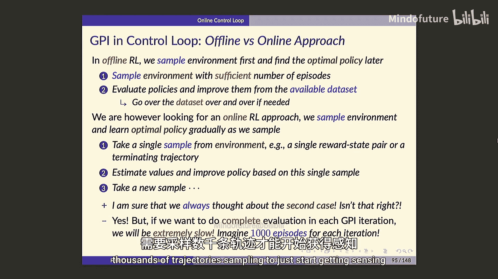

This is why we want to just get into a kind of algorithm that this algorithm does not like simply work on a single policy。

 So it's gonna ignore any policy， right， and then you're going just sample from the environment。

 every single state， it' gonna do one action。 And after doing that action。

 It gonna get a reward and go goes to a new state right。

 based on this reward that it see it' gonna to improve its own policy own move， right。

 So we want to just end up with such an algorithm。 and G in the basic form is not going to do the thing for us。

 at least for a practical environment right So this is why we want a control algorithm。

 And what we do， we basically just again， do， of course， But we try to just。

just take this GI to its extreme case， like。Let's get back to the G。

 So this was the G algorithm or approach。 And the idea is that you start with some policy。

 And then as long as your policy is not is changing， you're going to evaluate that policy。

 you get the action value function。 And then based on that action value。

 you act greedy right and by acting greedy。 I mean that you look at the action value function。

 And then you would say， well， for this particular state。

 the best action is this one because this is having the largest estimate of the value right And then you're gonna do that action right you keep on going like that right So this is the G algorithm。

 And this was the greedy approach。 So when you want to update your policy。

 you would look at the evaluation that you had。 this is the prediction you got。 This is。

 for instance， is given to you by TD lambda。 And then once you。

Did or perform TD lump down your policy pi。 thenre gonna tell you in a particular estate doing one particular action。

 What is the value， right， What is the of the value， Now you are in particular estate S。

 then youre gonna just look among all the actions that you have。 You take the action， which is。

Giving you the maximum value， right， So this was the approach for updating。 and now。

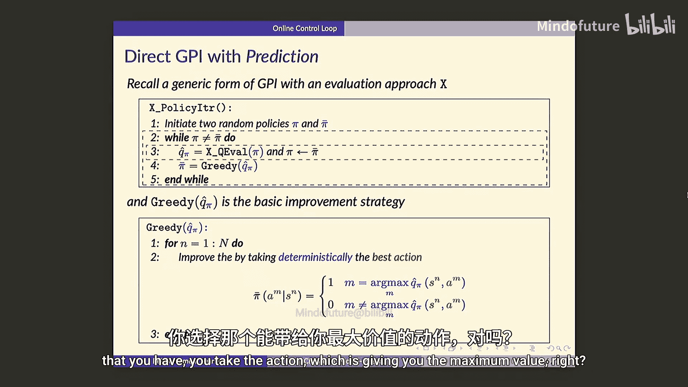

What we want to do。We want to just make it online。 So what is the the most basic approach that you can say。

 you can say that， well， yeah， I think this is again， a story。

 I'm sorry that I'm being so storytelling， but I think I want to just say the same story as I said before。

 So it simply says that this is not efficient。 I told you， right。

 So it's okay that I go for the neus slide， right， Okay so now。

 but how can we just make this GI online Any idea Any suggestion。

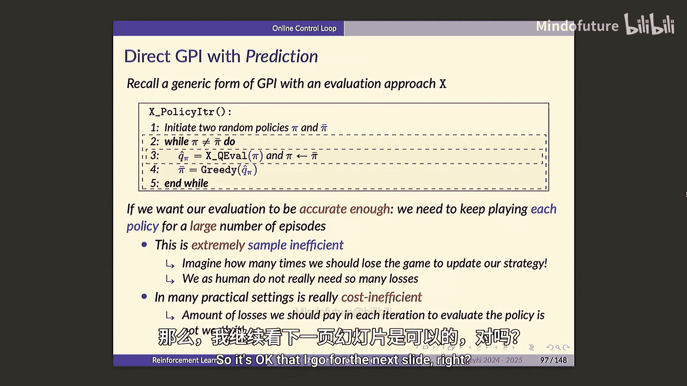

Can I just do this GI simply online。When you are evaluating， what do you do。

 you go on on a trajectory always， right， when you do use TD or Monte Carlo。

 whatever the approach is and every single step that you take， you see a new sample， right？

 And based on that sample， you update your values right or your action values， right。Correct。

Do you agree。Okay， now that you update， if you are using GI， you're not going to do anything。

 You keep on going and updating right， So you keep on playing with the same policy as before and you collect new samples and you keep on improving your update。

 right。But why we should do that？Maybe when we update， right， we have a new action value， right。

 Everything got updated， right， We just use that very bad estimate to just improve our policy， right。

 And therefore， the next action， we don't act with the previous policy。 We act with the new policy。

 It makes sense， right。So if you just， if， if a child just start。Next time that they stand。

 they do not work the same as before， right， They try to put this step differently， right。

 So they just got one sample falling。 It was a very bad reward。 based on that。

 They estimated that it is not a good。Move， so the value of that action state pair just went down。

 Now， a new a new action， which is just putting putting your leg differently， is get going up， right。

 and they are doing it differently。 Again， they fall。

 They do not do any of those moves they have done before。 right， They do the third one。

 They keep on going。It tilt and just take the first step， right。

 and then again for the second step is the same right， So the main idea here is the。right。

 so this is the control algorithm。 This is eventually GI。

 The only difference is that your GI is not doing any evaluation really。

 It just uses a single time step to update the action values。 And then it's gonna use it for。

So what youre doing。 So I'm talking about the general algorithm X。 So X could be Monte Carlo。

 it could be TD， anything， whatever algorithm you use。 Just think about TD Lada。

 the most general one。 So you're gonna put that algorithm。

 This is able to just do prediction for you。 is able to evaluate your policy。

 So you're gonna give your policy to this guy。 This guy is going to time。It's from one estate。

Other state。 and immediately， when it's in the newest state， it is able to update this。😊。

Action values it gonna update， right， So it's gonna say that， okay， Im in the new state。

 I got all the action values change， and then I am going to update my policy based values。

And converge actually， I'm gonna show you。 Yeah， but there is a bit of trick here。 I mean。

 eventually converging is gonna converge。 but your question might be。

 does it converse to the optimal policy， right， then then we need to just add epsilon here， right。

 we need to make it epsilon greedy right But I'm gonna explain。 this is the whole this part。

 of course， is whole about this， right， But it a valid question。This one is going to converge。

 definitely， but it is not necessarily going to be the optimal policy。

 So we're gonna talk about that。Questions。No question。 So， so basically what we are doing here。

 we are having one。One pair of action values， right？ So you're in one state， you do one action。

 this guy policy pi， right， So now that you play with this policy， you got that action。

 this is your action value that you had before， you're gonna sample one particular sample return。

 right， if you， for example， use TD0， you're going get into a newest estate。

 the value of that new state is going to give you the sample return right So you're gonna compute the sample return。

 you're gonna update this guy， right， So now that you update this guy。

 this action value has changed right， And if youre， for example。

 thinking about the case where you're using TD a lambda。

 not only this action value is going to change。Everybody who has happened before is going to change right？

 And now， given all of these new action values， you can just update your policy， right。

 you would say， okay， this particular action is not anymore giving me the maximum value， right。

 So I'm going to change to the one which is giving me the maximum value。Everybody's cool questions。

No question。

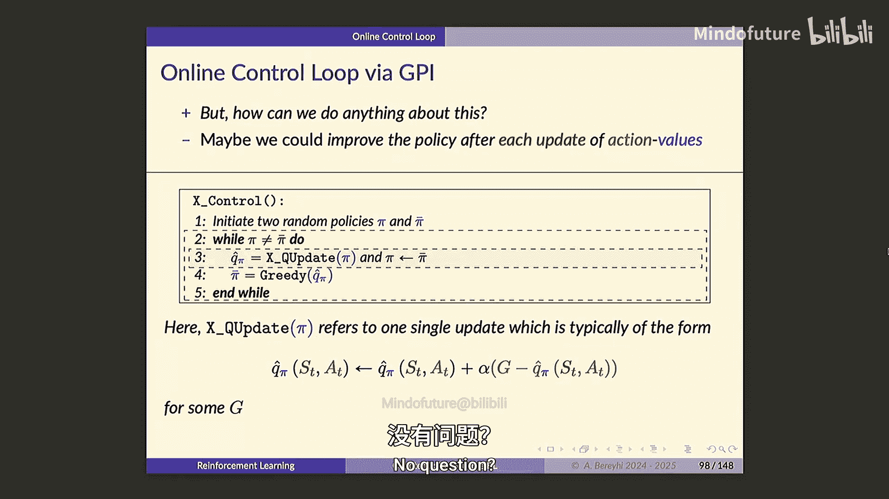

Okay， so now this is a very valid question。 So it sounds totally random， totally loose。

 The point here is that， well， you can eventually converge to something。

 but you cannot guarantee that this guy is necessarily converging to to the optimal policy。

 but we have a trick to just make it converge to the optimal policy as well。 So we're gonna see that。

The key point is that GI， I mean， the policy itration， as I told you before。

 this is very robust against the error in the， in the evaluation， right。

 So if you just do couple of ittions and you terminateinated。

 even though you don't have the right values， but it still is going to converge eventually。

 So based on this idea， this one is also going to converge， but it needs a bit of improvement， okay。

Now， if you got no question。We write down the control loop for one particular approach of estimation。

 And then this is going to make things much easier， much clear。

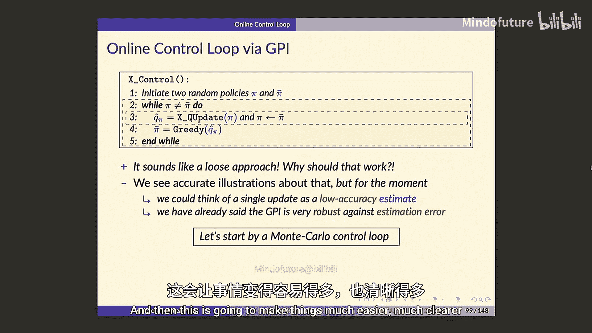

Okay， so Monte Carlo， that guy is the easiest one， right。

 because you don't need to think about the TD， the Nex estate， No Belman， no， no has it no such。

Complications， so the only thing that you need， you need to look at the whole trajectory， right。

 And then you want to just you just collect all the rewards you have collected。

 This is your sample return。The easiest one， correct。

 Now this algorithm that you see here is eventually the Monte Carlo algorithm that we had before。

 right， So you have this episode1 to K。 So multiple episodes， you just start with a random pair。

 And then you go on a trajectory， right， And this trajectory。 Well， you're doing it with a policy。

 policy pi， right。Right， so you are just doing it with a policy pie。 And then you get this one。

 Then from this one， you jump to another one till you get to the end。 And now if you want to update。

 well， you're gonna say， okay。This guy， the sample return is anything in future。

 So this is going to be G。 And then I am going to take this G and update my action state pair， right。

 And then you go for the next pair and so on and so on。 this is the way that you evaluate。

 you update your estimation action values， right Now。

 if you want to do it you're converted it into a Monte Carlo loop。

 The thing that you need to do is that every time that you are。Taking a new new trajectory。

 you just update your policy。So what does that mean。

 This means that let's say I am at the first episode。 So I just collect one complete trajectory in。

 right。And then going over this trajectory， I just update all the values， right。

So Q has been updated in my table for different action and states。 I have different values。

 They are not best estimates ever。 They are actually very loose estimates initially， but that's okay。

 right now。I want to go for the next trajectory。 I want to sample the next trajectory。

 If you just do Monte Carlo evaluation， you basically keep with the same policy， right。Correct。

 but now you're going to update your policy， right， What you're gonna do。 You're gonna say， okay。

 I look at whatever I ended up as the Q function here。 And then I give it to my greedy algorithm。

 It's gonna give me a new policy。 right， when I want sample the next。

 I am going to just sample with this new policy。Everybody's clear。

So the first trajectory was sampled by one policy， right。And then you got some idea。

 Now you would say， okay， this very bad estimate tells me this action is better than this action。

 right， So next time I want to sample， I am going to sample this guy right whenever I am in this estate。

 I'm gonna go this way， right and then you make this new policy。

 which is the greedy version out of your estimate， and then you sample your next trajectory right now that you go on the next trajectory。

 you're gonna see a bunch of new estates。 you're gonna see some previous estates again。

 and you're gonna update all of them right， and then you get a new action value function。 again。

 you go to line 4， you update， then you sample the new guy， right。And you keep on going like this。

 right Now， what is the compared to evaluation， Well， you don't need to wait forever， right。

 So you just need to sample one trajectory。 you get some rough idea。 You start game， right。

 It's like you play a game。 And after playing the game， you just lose， you say， okay。

 was this was a mistake。 next next time when I get here， I'm gonna do another move， right。

And you again play， right， and you keep on playing。 If you play so many times， then eventually。

 you're gonna to just see every possible state and in every possible action。

 gonna to get somehow tested。 And out of that， you're gonna understand what is the right policy。

Everybody's school。Questions。Yes。With a single， right， right， somehow， yes， somehow， yes。

Yeah its eventually Monte Carlo evaluation with only single traor is the same thing。Qu yes。啊， yeah。

Don't do it。 I mean， we really don't do it even。 I mean， we are going to do TD， right？

 I just wanted to give you the idea， but this is a valid challenge。

 So if you have really no terminal stage， you actually cannot really rely on this one， right。

 because you can trancate but then you need to again have a long trajectory and just don't use the last parts。

 right。Exent。Yes。ating with a render。State action pair for like each trajectory。

Ping to start always starting with Oh， well， right， what is the benefit， Well， yeah， I mean。

 typically， I， I guess I shouldn't say random。 I mean， it doesn't impact。

 But one other way that you can do it。 just generate random state。

 And then you play even your first action with your policy。 You can do it。

But this is not going to change too much。 But what is the benefit of starting from a random stage。

 Well， the benefit is what you're gonna see next that you are not going to get locked into one particular path。

 right， but this is not enough。 We need to add to to this。啊审的。Right， yes， yes。

 because we just want to know what is the value of your policy， right。

 So you need to start from a random place that you just go towards and like play randomly or play with your policy in the environment。

 right， You can now always start from the same one， right， because it might be that this one。

 this guy is just next to the terminal state， right， you gonna only learn。

The value of that is failure you never get the chance to just get the other action unless you really play with the random part。

 right。Well， depends whether you have initial state or not， right。

 So you can not you do not necessarily have initial estate， right。Now， for a game you have， right。

 But if you're thinking about like a robot， it's not necessarily case。关先。

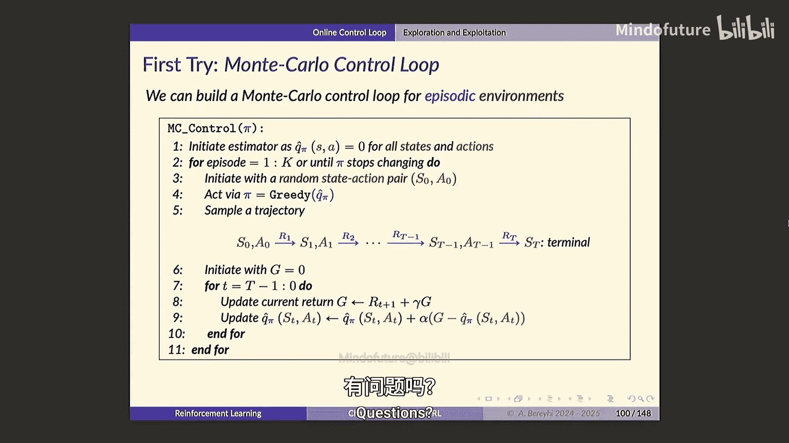

No question。 Okay， so if you got no question。 then yeah， let me just finish this part。

 And then we're gonna have a break。 So， so if you compare Monte Carlo alleg with this one。

 So it's basically just you do in greedy improvement only in line  for。

 And this means that you're gonna use one sample trajectory to estimate very bad estimate。

 But that's okay。 You're going use that to just improve your your policy。

 And then you use that new policy to just sample your environment。 Okay， so。Now。

 let's get back to this big question。 So does it converge， Okay， if we do this one， Does it converge。

 The answer is that not really。 Can you think of a case where it's not going to converge。

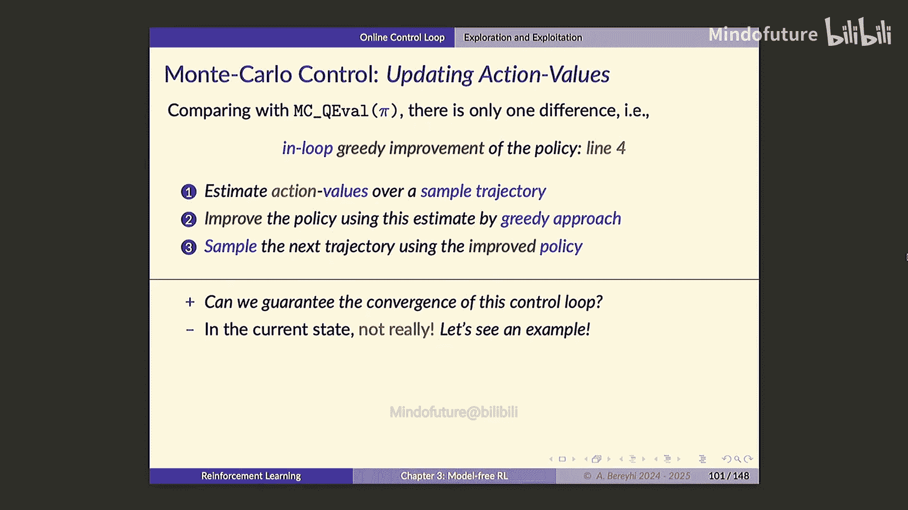

Do remember this guy。We started with。Right，This was the robot。

 And then I wanted to just find out which guy is paying more， right。

And then what if we we are doing here。What do you think， What' going to happen？

Let's say we have this robot。 We have company A and company B。

 I guess company A was paying more in average， right。啊，OK。So company A was paying more。

 And now this guy wants to just use this。Control approach that I told you to just find out where to word。

 right？ So what it' gonna do， is' gonna start randomly and say out of bad luck。

 it starts with company B， Okay， the random choice。 first choice， it gonna choose company B。 Now。

 when it just works at company B， it' gonna get one reward， right， the reward is say 1 hundred50。

 Okay， the first day。Payment is 1，50。 And then it gets this one out of this iss going to update it。

28方。It says that。Doing this action， doing the action of going to Company D is giving me 1，50。

Company A， I don't have any sample。 It's gonna remain0， right Now， next time that it wants to play。

 what it gonna do。 Now， look， I mean， it's not going to again。

 keep sampling randomly the environment， right， It's gonna improve the policy。 then it samples。

 right， So it' gonna say A or B be  hundred50 A 0， B， right， So it's gonna go working for B again。

 right。And so on for the third day。 and so。 So youre getting fuck with company B simply because it is started with company B。

 right， If it starts with company A， it's gonna be the same thing with company A， yes。Here。

 you don't have any state， actually。Action， right。You just randomly choose your action。

 your first action， right。The first action， right， And then for the next， I mean。

 each time that is' just going to one company， I'm considering that one considering this one trajectory。

 right。So there is no state。 The problem is super simple。 There is no state here。

 The only thing is that you have two actions， A or B and you want to choose， right。

 and then you're gonna choose B， right， Now that you do。 So this is why I put a state empty， right。

 there is no state here。 So you go for for a company B。 your trajectory is over。

 right Now you can update your action value。 A and B right， And then the A and B， I mean。

 your action value function has only two different values， right。

 state empty and action A state empty and action B， right and you have only a sample of action B。

 So you're gonna update that one。 A A has not happened。

 So you cannot update it right So you're gonna remain0。 If you started with the initial value is0。

 right。It it's， it convers it right， It converged actually after the second one， right， because。

 but it converged not to the optimal policy， right， So it just convers to the。One converging point。

 right， yes。Yes需要。It's converging， right， So it's just doing one thing forever， right。

 But this thing is not necessarily the optimal thing。Yeah， this is what we do in Abpsilent Cry。

 right， This is the next thing， right。 Yeah， Yeah， this is。

 I just give you the the reason why or you get the intuition。What is the problem here， right？

 So the problem here is that if you just keep on with this one this control loop。

3 control loop or just being relying on those few samples。

 and then this can just stick you with a bad solution。Simply don't get any samples update， right。

Everybody's clear。Questions。No question。

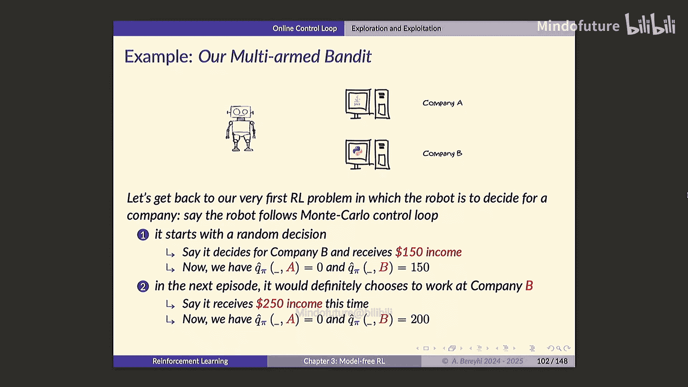

Okay， so。This is what going to happen forever。 So this is not a good idea。

 One thing else that you could say， you could say that even if I， for example， randomly just。

 you know。Just once or two ways randomly make this agent to work for a company A in future。

 Like you starts with B， gonna work with B over and over and over。 And somewhere in between。

 I just say once， just go for once to a， right， that sample from company A would never give it like its very low chance that that sample from company A gonna give it like a larger。

A larger estimate sorry， a larger estimate of the value， right。

 because it could be that it goes that day to a and a gives just for that day it pays low， right。

 So if it really wants to get the idea what is the right choice。

 We had it at the very beginning of the course。 It has to play enough number of times for A and B so that it gets a good estimate of both cases。

 right， And then based on that you gonna now it can build， it's greedy algorithm， right。

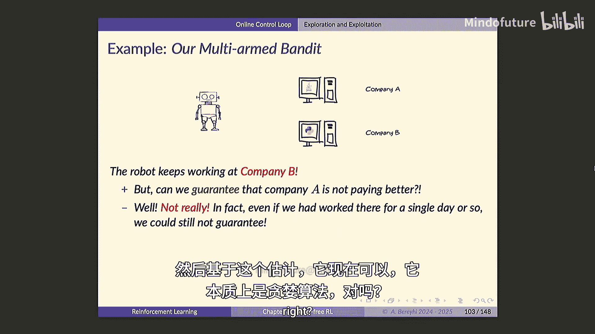

So that is the issue。 This is the issue that we say this algorithm is actually having lack of exploration。

 This is something that could happen if you just stick to the greedy approach。

 meaning that you start with one estate， right， And then out of。First， random policy。

 you start to get one path， right， And that path is going to get some estimate， nonze estimates。

 right， whereas the remaining guys in the。In 0， right， now， next time that you want to just。

Play for greedy policy， since you are just taking the actions which have higher values， right。

 you're gonna somehow stick to what you have done before， right。

 because most probably they are better than。Correct， so if you want to get from。Or and。嗯。Well。

 you finally get to that for， right。 Now， if just update these steps that you have taken in between。

 all of them are non0， whereas any other location is 0， right。

 next time that you want to move if you are。You're gonna to look at this and say， okay。

 should I this。ction我。Its not。You' going to again， go that direction， right。

 It's like you do a mistake。 you keep on doing that mistake forever because you only know about the reward of that mistake。

 You don't know about the reward of other things。 So you are not exploring the environment。

You are just exploit。Right， so this is the challenge。 You're lack you're only exploiting。

 your're lacking exploration。 If you want to get rid of that issue。

 So this is the key downside of doing greedy improvement。

 The greedy improvement is just going to exploit the noise days that you have collected。

 And that knowledge is going to quickly converge to some。

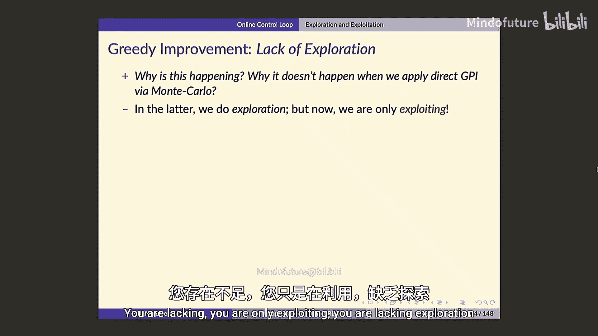

YouFrom exploring the rest of environment， right， So this is a challenge， how you can resolve it。

 You need to just add exploration to that， right， so。Maybe this is， okay， this。

 this particular path is taking me to the door， right， but maybe I can try another path， right？

 So when you are doing ingredients like you are afraid to do anything else。 Like， oh。

 I just got to the door。 and that's it， right。So maybe I should， I should take it forever。

 I don't want to explore anything new， right， but maybe you can take another path， right。

 And maybe this path is going to take you again to the door with a better with lower time， right so。

You need to add some exploration to that and how we can do it。 Well， basically。

 this is the absolutepsil ingredient， which we are going to talk after。

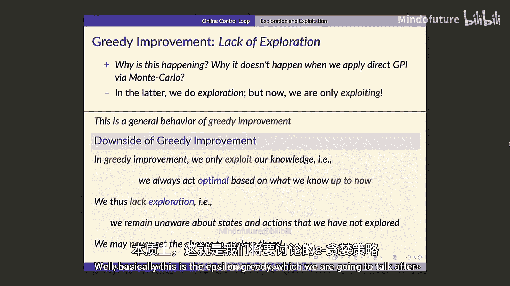