# 【多伦多大学】强化学习 2025 ｜ Uoft   Reinforcement Learning   Fall 2025 p30 P30_讲座_29_为控制循环添加探索机制 -BV1D3F2zhEry_p30-

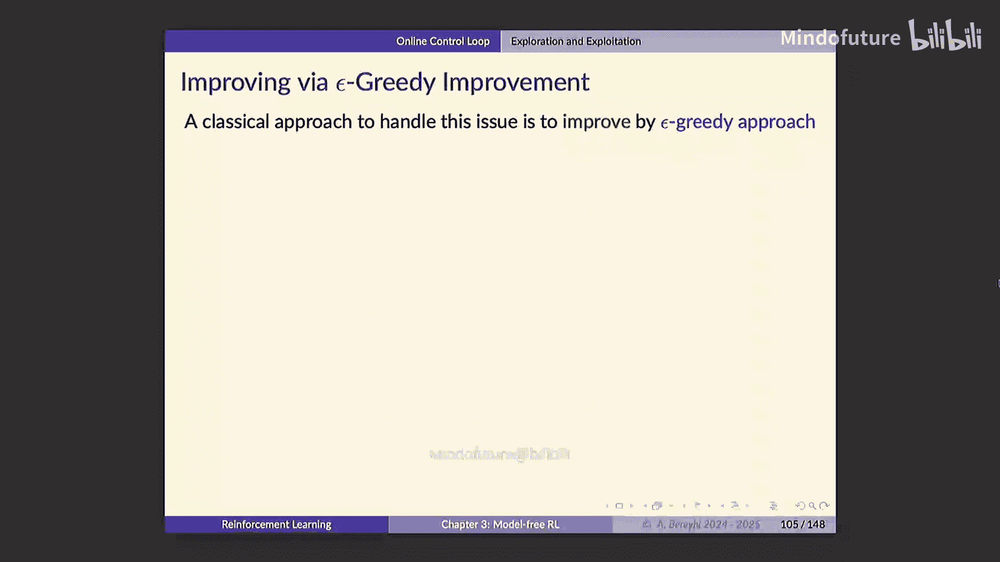

Prole， the main trouble， the。Greedy improvement in the control loop is that we are going to stay。

Expled once。 And then we're gonna exploit it forever。 This is not a good idea。

 A better idea is that you just， just go for epsilon greed。 So what is epsilon greed。

 This is quite simple。 So， well， given the estimate that you have， you have action value。

 you can decipher the optimal action based on that。You know that this estimate is not estimate。

 right， There are a bunch of states you have never seen yet， right。

 So the thing that you are going to do at every single state that you get。With some chance， epsilon。

 which could be some small chance。You just play randomly。

 so you choose any action or you with with the chance 1 minus epsilon。Once again。

 the main idea is that you play optimal based on the estimate that you have with the chance 1 minus epsilon and you play randomly with the chance now what is the benefit here is that every time you get into a state。

 Well， your estimate tells you go this direction right and you can。Maybe this is not the good one。

 So let me just randomly go some other direction see what's happening， right。

 It's like you want to get to the door。 And yeah， you're doing。If I go this way。

 it's gonna end me with the door right， But maybe this time when I'm in between。

 every single step that I take， I would say， okay， maybe this direction is also good， right。

 So I just randomly go into that path and see whether I end up with a better reward or not， okay， so。

That is the idea of epsilon greedy improvement。 So basically what we are doing。

 you're just doing kind of adding some exploit exploration into our policy。

 So this is basically what you did in assignment 1， right， for the dummy example。

 we have you actually did it already in assignment 1 where you just do some exploration with Provolti Epsilon。

 And then this is going to help you。 I mean， you saw that if you just。

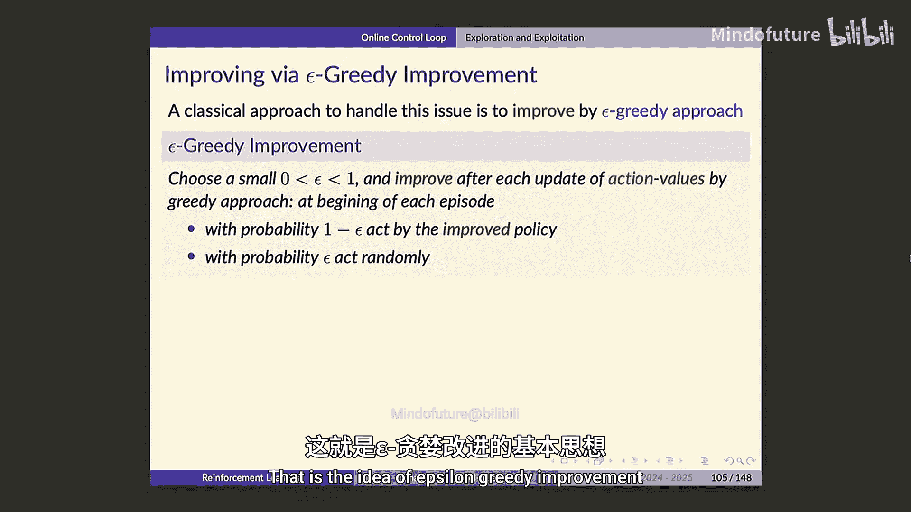

Every couple of days， once you just randomly choose to work for a company， eventually。

 you are going to again get to that good limit， right。

 This is because you're not always closing this for yourself that， well， this is the best to do。

 right， So maybe my estimate is wrong。 Maybe I should improve it。 but just randomly trying once。

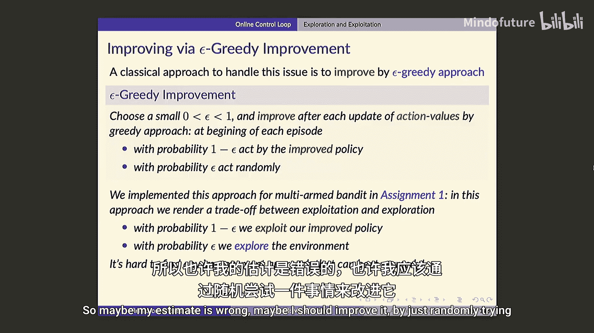

So。This is the absoluteps greedy policy。 So if I have a particular action value function you have。

 then what I'm going do， I am going to just look at that action value。 Now。

 I'm going look at the action， which has the maximum maximum。Value。

 and I'm gonna do it with one minus epsilon。 And I do any other action with the chance Epsilon over M。

 right？ And you see that why I have plus epsilon M。Also above， right， So if my。Tells me that， well。

 going this direction is the best， right。I am going to go to this direction with chance 1 minus epsilon。

 right， but。Epsilon， right， and any。I'm going to去。The actions is again this guy， right。

So I can go with epsilon for this direction。 Epsilon for this direction， Epsilon for this direction。

 Epsilon for。This epsilon over M also adds up to the policy， right。Everybody's clear， right？

Questions。Yeah。Well， it's not about the model here。 I mean， right now。

 you're just building your policy。 So your policy is eventually just one table， right， which says。

 like， what is this state and then what is the chance of that action。Buildilling that that table。

Right。Yeah， I mean， if you assume that things are happening independently。

 then the proities are the same， right？ But what you say is when you have a sort of correlation like。

If I got your question right， you ask whether I do the first 10 days and the second 10 days。

 or I just randomly choose one every single day and then go right statistically it should be the same if your choice every day is independent and the companies are paying you independently right。

 but if they have a temporal correlation， of course， then this is not really， I mean。

 they are not the same。That makes sense， okay。Okay。

 so this is the Epsil ingredient algorithm for updates。 So you are going to just explore more。

 And this is going to。😊，Improve your information about the environment。

 eventually improving your action value Now， one question that you might ask me is that， well。

 this sounds nice。 I mean， I am starting to explore。 but is there any guarantee that if I do this。

 then I am eventually going to converse to the optimal policy and the answer the answer is yes。

 but can you see why this is happening this Monte Carlo before before I show show you the proof。And。

 he guess why this is happening。And when I am saying that is converging to the optimal policy。

 it means that I forever， right， I mean， of course， I know with a limited number of samples。

 is a again。Not necessarily converging， but if you play forever， like。TheR of your life， right？

Exactly， so if you play with this approach， every single time。

 you have a even if Epsilon is very small， you have a tiny chance of going to other states as well。

 right， Now， eventually， when you keep playing forever。

 then you are covering all possible states right And in every single state。

 you are again covering all possible actions right。

 because you are playing forever right And by that。

 then you are going to estimate this Q function properly and then you know the right。Right action。

 right optimal policy， right， whereas in the other case。As we had in the example。

 it could be that you just a stick。 I mean， you don't see some other states for the rest of time you you're playing。

 right， because， I mean， you get the bad estimate first。 And then based on that that bad estimate。

 your algorithm is converging to one greedy policy， which is for that estimate optimal。

So we can actually prove this。 And if I want to prove this， how can I do that， Any idea。

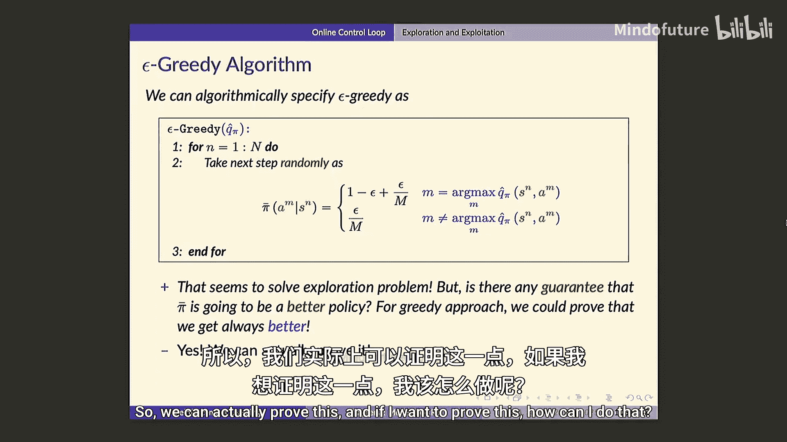

Yes， but like what I am doing each time I am updating with the Epsilon greedy algorithm， right。

 So I have one policy pie。I just play with that。 I get one estimate I update right and once or one sorry sample I update and once I update it。

 I do Epsilon greedy， right Now the thing that I need to show is that after doing Epsilon greedy。

 that new policy pi bar， which is coming out of Epsilon greedy update the pi bar here。

 Okay This is better than pi。 How can I show that。 What should I show。

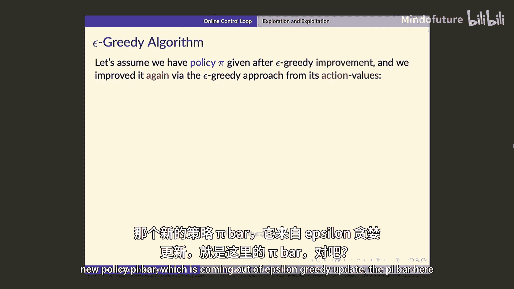

Yes。The value is higher， right？ So we define policy A or pi is better than policy pi bar。

 Or I want to show policy pi bar is better than policy pi。

 If the value of P bar is more than value of pi for any state。 if that happens， this means。Bibor。

 which you get out of epsilon greedy， is better than the policy you had before， right。

 And if you keep doing this， right， you each time improve your policy and eventually you converse to the optimal policy。

 right。Everybody's me， right。Okay， so I need to show that when I am doing。

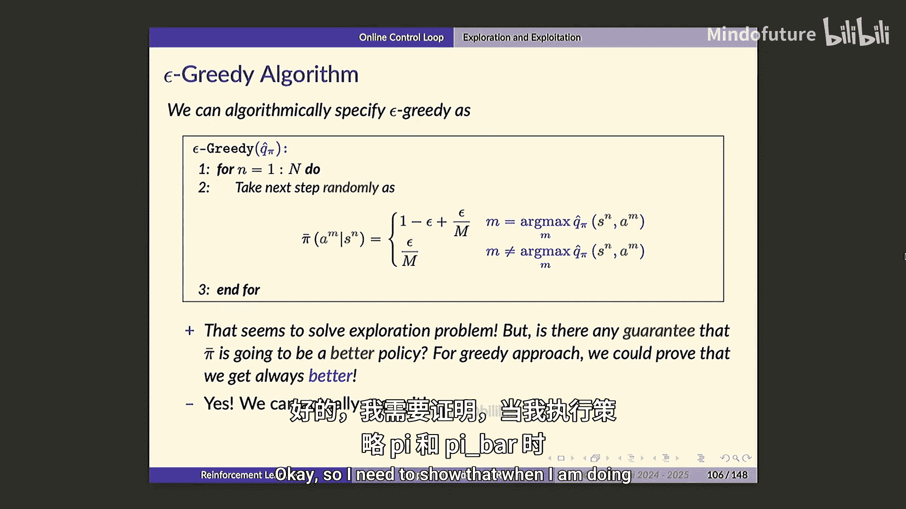

The policy pi pi bar， I'm getting a better value as compared to the case where I have policy pi now。

I start with this equation。 So we had this before。 you had it in the assignment right。

 so have the action value。 This is the action value of policy pi bar right。

 If you have this action value， now if you just multiply with a policy and you average it over all the action then this is going to be the value function of your policy P bar。

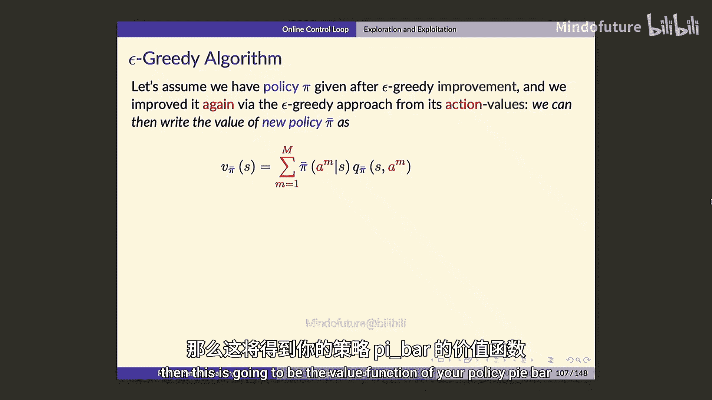

R agrees， right。 Now， the thing that I wanted to do， I want to open it up， given this guy。

 can you help me do that。

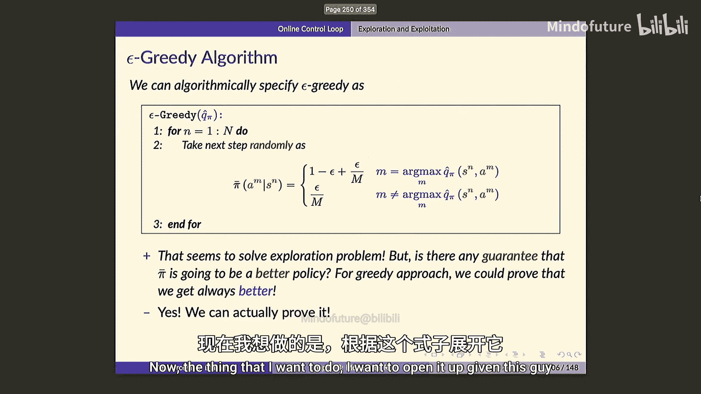

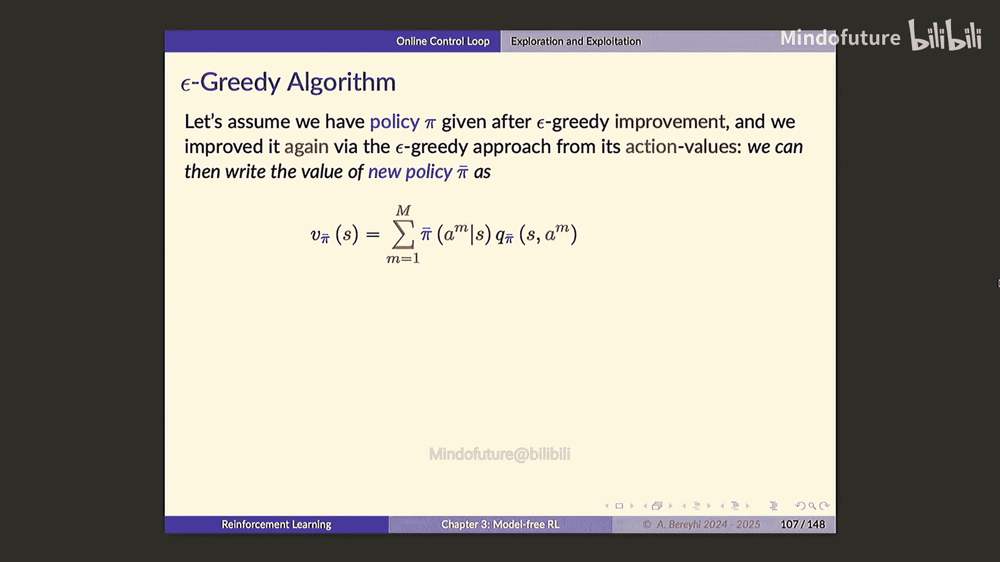

What is the chance of doing this best action， say this action， which is the best action is a star。

 The chance of this guy is this one， right，1 minus epsilon plus epsilon over M， right。

We're getting about epsilon over M right now。 So1 minus epsilon。 I am doing the best action， right。

 So it is going to be。

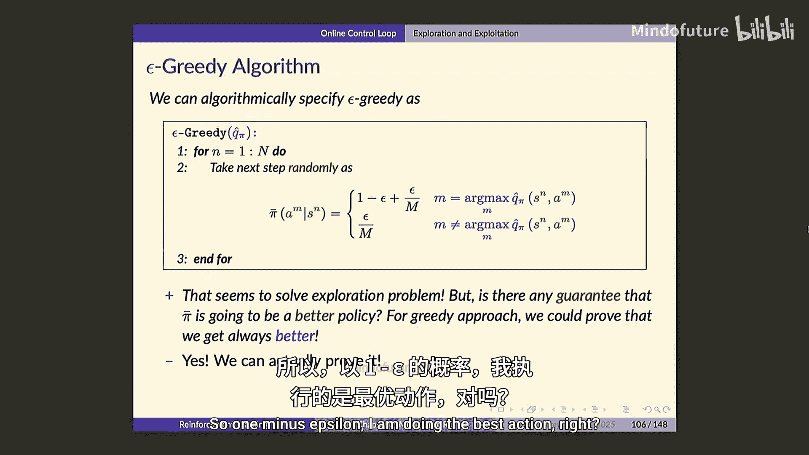

This guy computed at the best action times 1 minus epsilon plus any other action times epsilon over M。

 right， So I can write it down in this form and you tell me whether you can see it。

So any action possible A M， any of them， including the optimal one， right。

 is going to happen with the same chance Epsilon over M， right， I can move this direction。

 this direction， any direction I move with the same chance， right？

 So epsilon over M multiply with this guy added up is one part of fasciation。

 the other one is that I could go for the optimal policy， right， And if I go for the optimal policy。

Which is which is happening with chance1 minus epsilon that I am going to only do action AO。

 right and the action A is the best action the one which is giving me the highest action value。

Everybody sees that。Questions。So this is what you get out of exploitation。

 So you're in a state with chance1 minus minus epsilon。 you're gonna to do only this action， right。

 and then。When you do only this action， the value you're going to get is the action value of this action。

 right？Whereas or just plainly， you can do any action and each of them is happening with the same proities。

This happens with 1， minus epsilon。 The other one happens with epsilons。For all please。

Everybodys school， right， Okay， so this is。You might guess that I also had lack of concentration as a student。

 and you were right。是啊。So now I have this one。 Now， one thing that I can say。

 I can say that this guy， this Q pi that you see。 this is the one which I do。 I mean。

 pi is my previous policy， right， the policy。I got it。

 I evaluated it and then or actually just tested with one one sample。 And then based on that。

 I decided， right， So this Q value is actually maximum at this particular point， right。

It means that if I put instead of a star any other action， then this Q is going to be smaller， right。

 So if I you forget about everything here， everybody else here。 So Q of this state for this action。

 A star is more than Q of any other action， right？ Now， if you average this Q over any weight right。

 it is still going to be smaller， right。Because one of them is a star， which is the good one。

 The rest of them are a smaller， right？ And then when you average the maximum value with a。

The smaller， right。 So if I put any W， which is a。Averaging weight， it means that if I sum them up。

 they add up to one， right， If I put any W here， then this guy is definitely smaller than this one。

Aee。

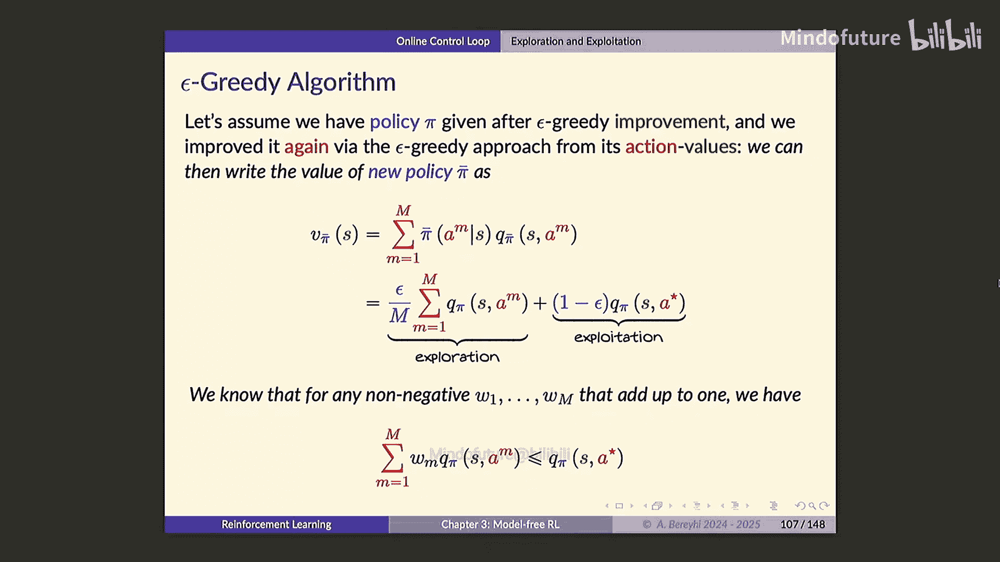

Now， the thing that I want to do， I want to choose this particular W。 Why I am doing it。

 because it's gonna work。 That's the only reason。 Okay， but the thing I want to be sure。

Is that this W is actually adding up to one。 Does it add up to one， Can you check and tell me。

The weight for one action N is policy pi of that action minus epsilon M divided by one over epsilon。

1 minus epsilon。Afteron， if I add it up。Over actions。So if I add W up over the actions。

 So I'm adding up over M all the actions， right， So I'm gonna add up this guy， right。

This one minus epsilon going to come out， right。Doesn't do anything。 remains this guy， right。

What is the summation of the policy over all the actions？What is it。One。

 because policy is the pro distribution on the actions， right， What is the sum of epsilon over M。

M from one to M。Epsilon， right，1 epsilon over M times M， right。

 So it's gonna be one minus epsilon divided by 1 minus epsilon。 That's one， right？

 So this WM that you see here is eventually averaging weight， right。

 If I add them up over a different。Then you want。Everybody agrees， right。Okay。

 so now let me just give it back here。 So we said that the value of the new policy pi bar at one particular estate is this guy。

 right。And then this guy， well。I can write this down。 I mean， this is the optimal one。

 The maximum one。 This guy is， you know， Q value of the previous policy pie over all other actions。

 And then the thing that I can do， I can say that whatever this guy is， Sorry。

 whatever this guy is this， this second guy， right。

 that one is more than summation of these weights times Q。Now， I just wait a second see it。

See this summation。 the first summation is the same thing in the second line， right。Right， now。

This one minus epsilon is again， repeating in the second line。 That's okay， right。

 But this Q pi at the maximum action。That is definitely more than or equal by some of some weights times Q。

 right。

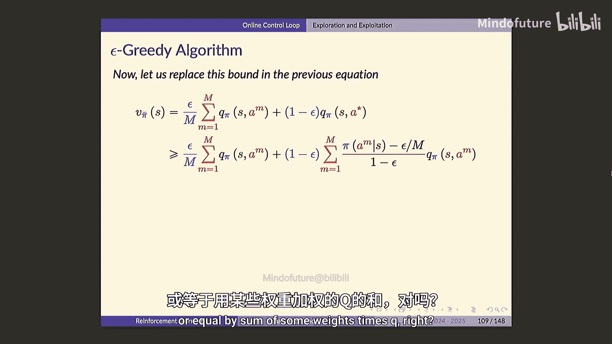

We had it here， right？Q at the maximum action is more than or equal by sum of Qs at different actions by some weights。

 right， And I just put that weight to be this guy， right。

 And we know we can do it because it adds up to one， right。

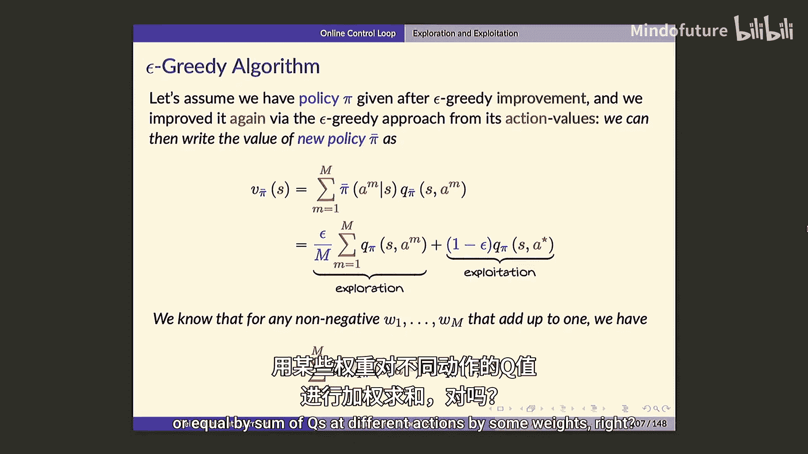

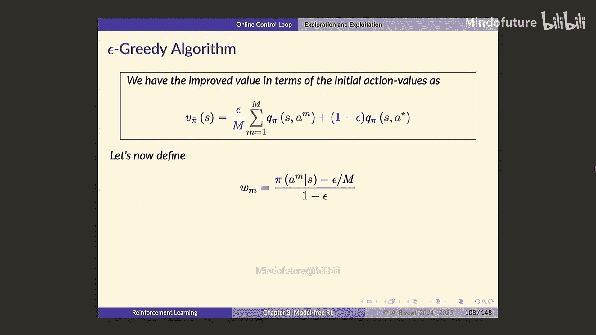

So the only thing that I have done is that instead of this Q at the maximum action A star。

 I have written it as the average of the Qs with these weights。

 And then I can say this is more than or equal， right。Definitely， right now。

You can go ahead and do a bit of calculation。 If you do the calculation。

 you're gonna see that this whole expression because you have Q pi， Q pi， same terms。

 same submission， you can factor everything out。 and it's gonna add up to be this guy， right。

 And this guy is the value of your previous policy at the particular state。Everybody。胡。

I told you I can do magics。Yeah， so what does it say， It's that your action， your， sorry， policy。

 your new policy at any state is definitely better than your previous policy， right。

This means that you keep on doing epsilon greedy。 you eventually converse to the optimal policy。

 right， So even though the greedy itself with epsilon equal by0。

 like it sticking to the best policy from very beginning that is not going to converse to the optimal policy。

 But if you give it an epsilon， which is nonze， then you eventually gonna converse to the optimal policy。

 right， And again， it makes sense because you are actually somehow exploring everywhere at the very end。

 right， the only difference of this approach is that you are not randomly exploring the environment。

 right， you get some estimate of the。Values， and you keep on doing more than more than those values。

 right， sorry， those actions。But you do not ignore the other possible actions， right。

 You explore a bit them， right。Questions。No question。

 So this is the epsilon greedy improvement theorem。 So what it says。

 it says that if you have this policy pie and you do epsilon greedy improvement on that。

For some epsilon， which is not zero， then this pi bar that you get。

 this is definitely a better policy， right， And if you keep on doing this。

 then you are going to converge， right。That's cool， right？Now， mean if I use a control algorithm。

I am going to converge。Necessarily to the optimal policy。 and be very careful when you answer。

So this eps greedy improvement what it says is that if I am in one policy， right。

And I do excellentps ingredient improvement on that， right。

 Just randomly choose one direction or stick to the best one， right， And I improve it。

If I do this one enough number of times， then I am going to the optimal that school。 But in practice。

 if I am using a control loop。Do you think that this theorem is valid？If not， the answer is no。

 If not， where is the problem。Yeah。That is not an issue， actually。That that is not the problem。

 If I got your answer correctly， but no， the problem is with some， some drawback that we have。

 some limitations that we have， yes。Okay， that that's that's acceptable。 But this is not again the。

 the point that I say。 Like if say you have infinite time or now if you have infinite time。

 then it's a bit challenging， but say you have good amount of time， but not infinite。

Is there any any specific thing in this whole analysis here that。We don't have access to。

When we are doing control。Exactly， the true action values， right。 So it says that again。

 if you work evaluating that policy， So here is Q， right， you're not talking about Q hat， right。

 You're talking about Q。谁的。You're talking about Q here。 This theorem is correct。

When you're able to evaluate it， right？When you are not able to evaluate。

 you're gonna add a bit of error to your estimate right and that error could send you to non optimalmal policy as well right But again。

 as your friend said， if you have infinite amount of time。

 then you are going to converge there right because eventually when you have infinite amount of time at some point you start to stick to one policy and then you get able to estimate that policy properly right。

And then that policy， most probably is the optimal policy。Okay， so more of a story， Epsilon greedy。

 theoretically gonna to work in practice。 Again， we are just doing it based on samples。

 which is not perfect。 But given the theoretical guarantee， we are somehow。

Safe to just keep on doing that， right。

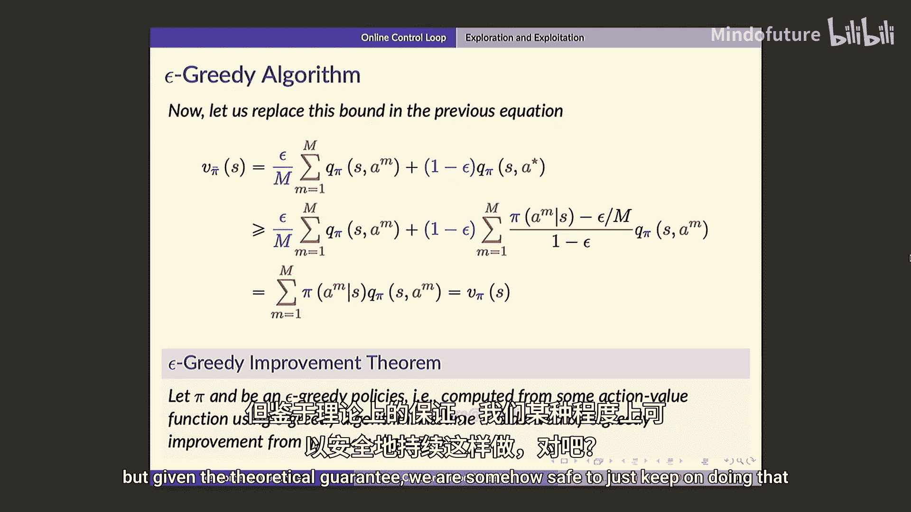

So this is the control loop using Epsilon greedy。 So what you're gonna do again。

 you're gonna start with some policy。 You just update your Q value for one trajectory。

 maybe one single time。 And then after doing that， you just update your policy by Epsilon greedy。

 right， and you keep on doing this till you converge， you see no much difference in your policy。

Questions。So this is pretty much what I told you before， right， So in practice， you have estimates。

 right， And when you do estimates， you might have initially very bad estimates of the action value right。

 And starting with that， you don't expect to see like， well。

 this policy is just getting improved step by step。 No， you don't see it initially， right。

 But as you keep on going at some point， you're。les， if your estimation approach is a。

Is a good approach。 Then you are getting a good estimate of the values。

 and then then on you start to see improvement in the policy， right。

This is why this graphs for R is always super nois。

 and they go like the loss goes always up and then it starts to go down， right， because first。

 you just try to find out some， just explore the environment， get some idea。

 and then you start to just get better estimates and improve。

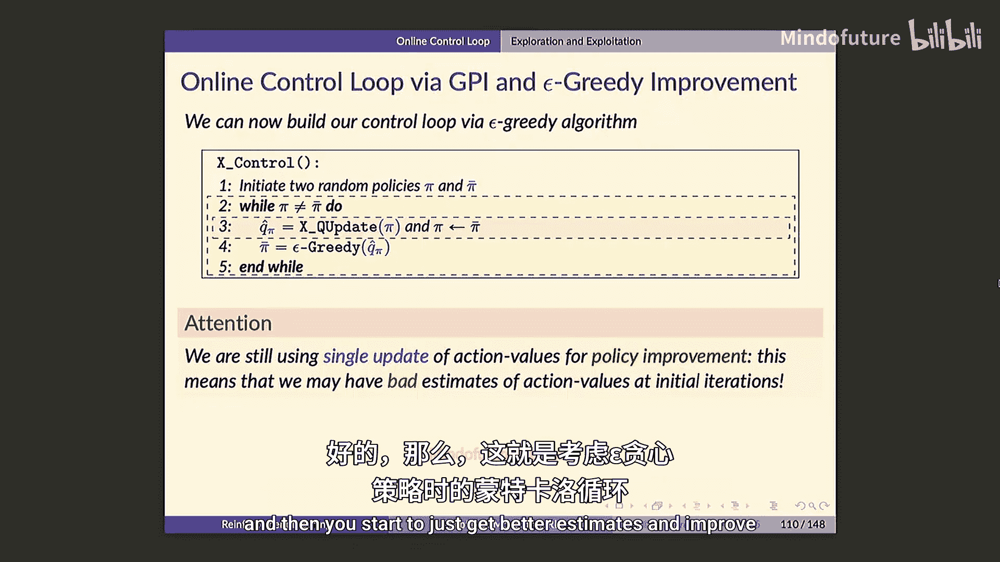

O， so。Well， this is going to be the Monte Carlo loop when you consider epsilon greedy。 So basically。

 this is the same thing as we had before。 the only difference is that in line 4。

 instead of doing greedy， you are going to do epsilon greedy。

 This gonna give you the chance to explore the environment。 And as a result。

 you can converge to a much better。Asyally and optimal。Policy， okay。

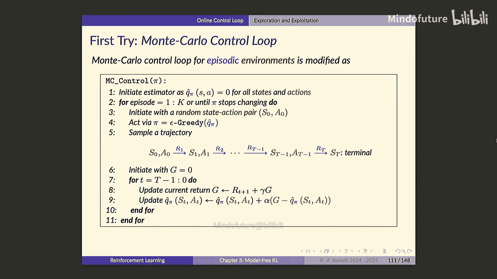

Questions。No question。 Okay， so this is the cliff walking。 You had it in Simon 1， right。

 And then just to see the idea why this exploration is going to help you just look at this guy。

 So let's say that I mean， for this one， if you remember， you have a start point。

 you have a destination。 then you don't want to hit these guys right And then if you hit them。

 then you're gonna get a big negative reward。 and then you start back here， right。

 And then if you just take one step forward， then you're gonna get only -1。

 and you want to find the short fast eventually And this is the optimal solution， right。

 this guy is also a solution。 But this is suboptimal。 This is not giving you the best return。

So it's give you less return， but you are not getting。

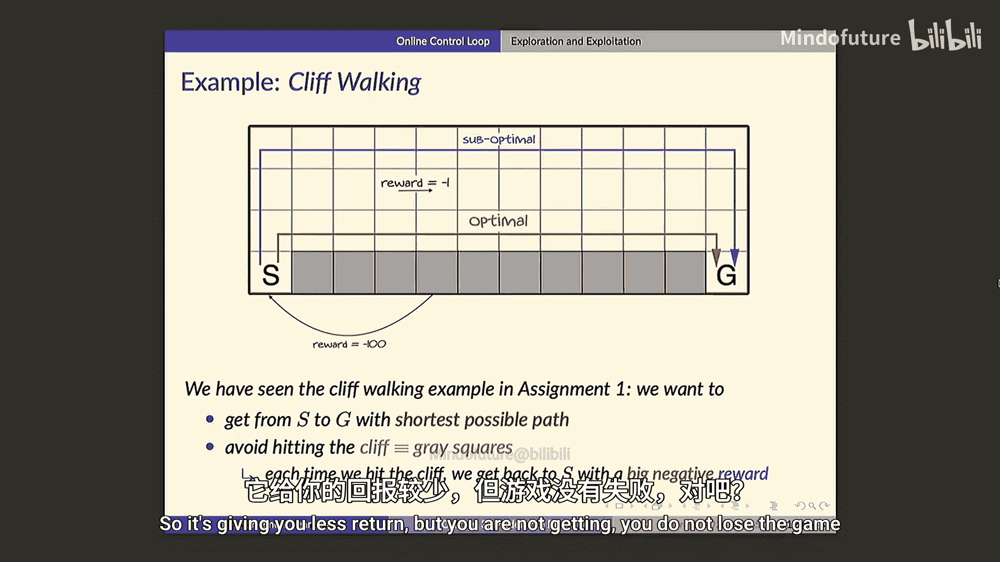

You do not lose the game， right。没有。What you can do， maybe you start。Just playing with the。

 with the greedy approach。 Maybe you start here， and then you get， you just。Well， first。

 you have no estimate， right， since you have no estimate， you just randomly play， right。

 So you randomly play， you just go up write down a cost， right。

 Now date your value for this particular state， this particular state and their peer action， right。

 So the action value function is getting improved。 Now， next you want to start， you would say， okay。

First time I went up， then I went。Right， and then I went down and then I lost， right。 So this time。

 maybe I start differently， right， because it still this guy has value 0， right。

 This guy has a negative value， right？ This one has more value， right？

 So you're gonna go this way and you're gonna hit the wall， right， So again， you get a big minus。

 correct。 So this is also getting out of the choice， right。😊。

Next time you're going to hit the other side and you keep on doing that， right。

 But say that you play that and out of the sudden it turns out it happened that you're gonna go like this and you end up。

 right， once you end up the reward that you get the estimate that you get for any any action value here in between is much higher than anyone else before right。

 So this means that if you keep on playing greedy， you would never get into another path， right。

 you keep on always playing this one， right because this one gave you was the only one which gave you the right or the highest values right and there is。

电两。Out of that， that direction。 But if you just do action， if you do。

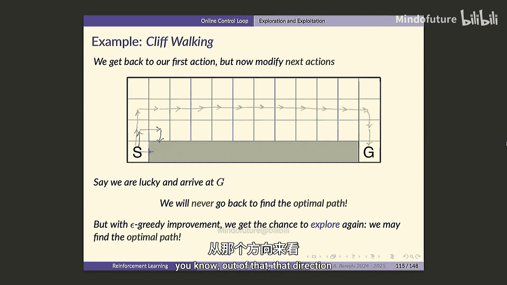

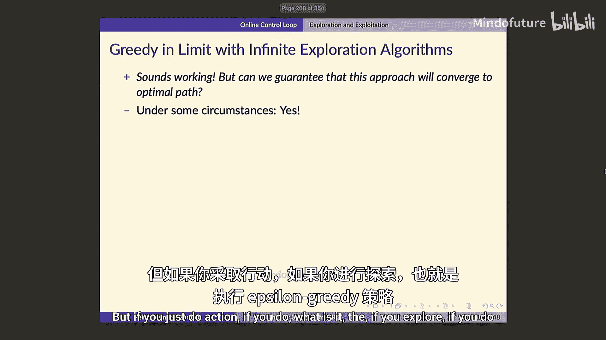

What is it the。If you explore， if you do epsilent greedy。

 then it would be potentially the choice that eventually， at some point。

 you also try other other cells and you and。Actually。

 you can try epsil greedy with sampling for this one with Monte Carlo。

 and you're gonna see that this one is going to converge to the optimal policy because the environment is quite simple。

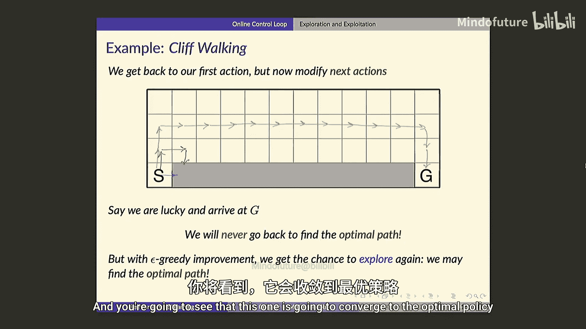

O。O。Question。Now question。So if you got a question。

 let me just wrap up this board by just talking about the degree algorithms， so。

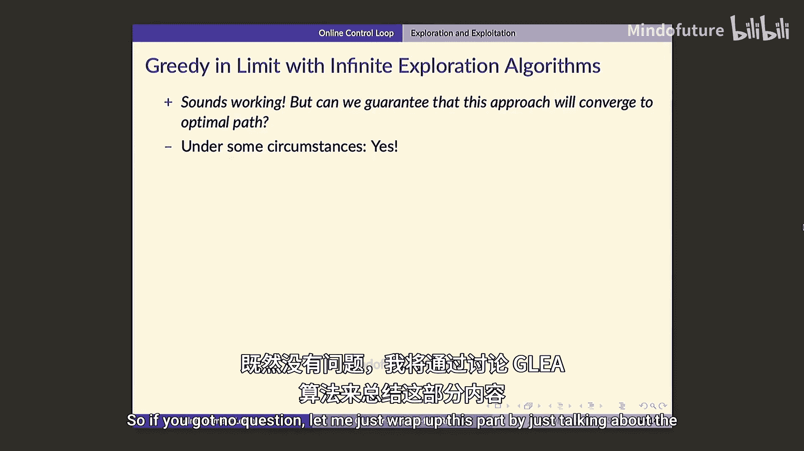

What the idea is， in， I mean， in these algorithms is that， as I told you， when you do Epsilon greedy。

 you eventually give this chance theoretically that you are going to explore all possible actions and states。

 right， Because sometimes you are going to play randomly and out of playing randomly。

 you're gonna explore new states。 You do new actions and you're gonna get an estimate for those action and action and state heres。

 so。One thing that we discussed before， we discussed that if you are doing Monte Carlo。

 and if you' are just talking about one particular policy， right。

 then if you can guarantee that you get into every single state and you play the every single action in that estate enough number of times。

 So this C was the number of times you see a state S and you do action A。

 when you have K different episodes， right， So if you come up with some。Approach。

 which makes sure that this number is increasing when K increases。 like you have more episodes。

 every single state of your environment and every single action is getting。

Chance to be explored more number of times。 If you have this property， then eventually。

 when you just sample enough number of trajectories， if you play enough number of times。

 then you are seeing every single state in action here。Enough number of times。

 you get a good estimate of the action value。 and you're finding the optimal。Action， you're sorry。

 you're estimating the right value of that policy， right？ So same story gonna happen here as well。

 So what you can say， you can say that if you do enough sampling side every single time you just get the chance to just get into some new estate and you do。

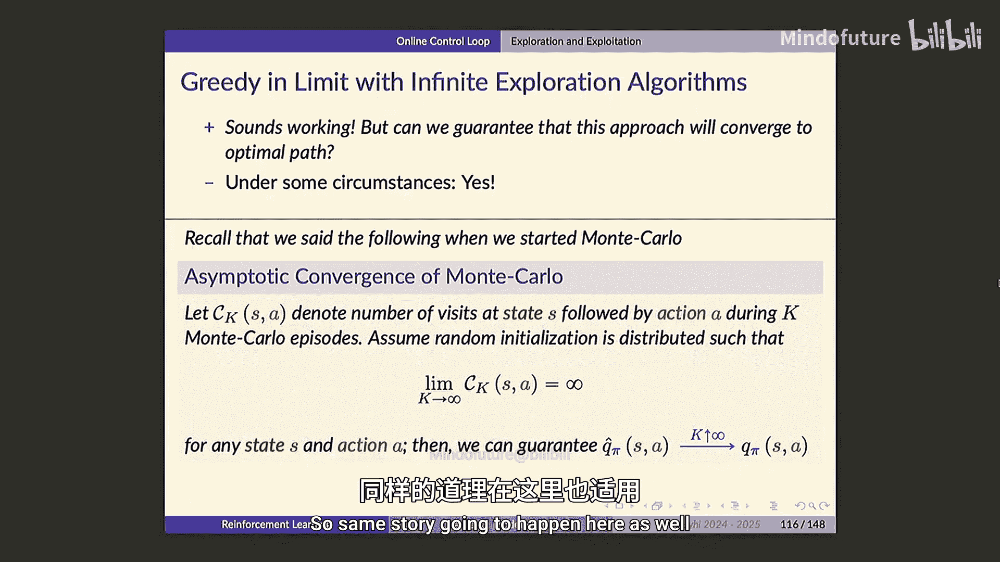

New actions there， right， that eventually， at the very， very end。

 if you theoreticalically thinked of doing it infinite number of times， you're going to just explore。

You the absolutepsilent greedy， you are going to eventually converge to the optimal one。

 So if we keep playing enough for all the state in actions。

 then eventually we're going to get into the optimal values and actions。

 And then this is going to make this algorithm to just converge into the。To the optimal policy。

 So one point that you should pay attention here is that if we just keep playing Epsilon greedy。

 then。Well， you start playing one epsilon greedy， right。

 And then you fix epsilon and you explore all the possible cases， right。

 when you do it enough number of times， then you learn the optimal policy。

 But if you keep with epsilon greedy， this means that even if you know the optimal policy。

 still epsilon。Pcent of the time you're just doing randomly， right？

 So this means that eventually when your algorithm has converged to the optimal policy。

 you need to have that epsilon， right。Everybody is clear， right， yes。Right。

Because at least you'll stay with Epsilon follow the optimal one that I know optimal now or I just randomly move。

 right， And even if you really have concluded the optimal one and you keep on playing that you're still going to to have this。

 right。对。Right， so we need to cut it off at some point， right， correct， Okay， so。

 but the issue is that what you do in practice， you're not really。Playing enough number of times。

 And then you say， oh， enough。 Okay， I have just learned the optimal policy。

 Let me stop this epsilon， right， This is not going to happen， right， because eventually。

 you have so many estate and actions that you probably。You're not most of them。 So what can we do。

We can start with high epsilon， and then we can gradually reduce it， right， So initially。

 you keep it one。So you just play randomly， right， Maybe you estimate after a few steps。

 you just make it half， right， Next time you make it fourth。You make it 1，8 and so on， right。

 And when you go to infinity， right， that epsilon is shrinking。

 going to 0 and it still it gives you enough exploration that you somehow somehow cover the whole environment。

 right。So this is the idea of what we call it D algorithm。

 So this is greedy and limit with infinite exploration。 It means that you are doing two things。

 You are keeping some good epsilon every time。 This means that you are having infinite number of exploration。

 you are seeing every single state， infinite number of times， a lot。 But at the same time。

 youre making sure that this epsilon is just shrinking over time。

 And as it shrinks when you go in limit， you are being only greedy。

 You are not being epsilon greed So greedy and limit when time is passed enough。

 but you are doing infinite exploration because you have chosen。Right beginning and。

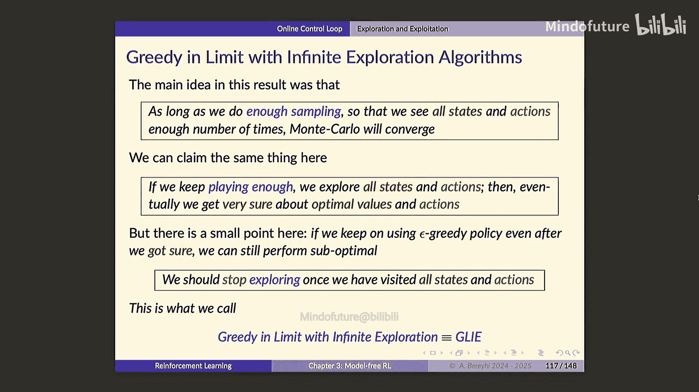

This is what we call a glee algorithm。 So the glee algorithm has these two properties。

 So it's not necessarily the 1 I showed you。 The 1 I showed you is a glee algorithm。 Okay。

 but if you just play with epsilon。 but in general， you could have different other algorithms。

 but the key point here is that for a gl algorithm。

 you need to guarantee that if you play infinite number of times。

 then you' are actually going to meet every state in action pure enough， right。

 so there is no particular state in environment， which is going to get missed if I play forever。

 you get this idea right So by going to infinity， I don't mean that you really need to see a number of times。

 if you have one approach， which or if you follow one algorithm。

 which is somehow blocking one particular state。 that algorithm is not a glee algorithm， right。

We see， we have seen the greedy approach for update， right， If you do greedy approach for update。

 it could very well be that some estate will never seen， right。那 right。

If you consider the dummi example of company A And B。If you start with B。

 you're gonna play forever with B。 if you just play greedy， right。Correct。

 and then it doesn't matter how many times you sample。Even if you sample an infinite number of times。

 you are never going to C， A， right。So， this is not。L algorithm， right， even。At itration， at。

Sampling number 10。 I am going to once C， A， right。Still， it could very well be that you just go 1，2。

3 till 9th to B。 Then you go to a。 And from 11 on， you again， keep on going for a B， right， Again。

 if you infinite， this guy is one。 It's not getting larger， right。So agree algorithm。

 make sure that yourre， if you play like。Billions of times。

 at least some hundreds of times you have seen everybody， right。

So it doesn't matter if you have seen this guy more or that guy more。 If you increase。

 both of them should eventually increase， right？ So when you play enough number of times。

 every state in action should be seen enough number of times。 And the other thing is that。

When the number the episode is going to be infinite。

 right you just increase or you go for the next trials in time。

 then your policy is going to converge into the greedy policy， not Epsilon greedy。Bleak radio。

And the optimal way to play right， if you know the right choice of。

 if you know the right estimate of the values now。

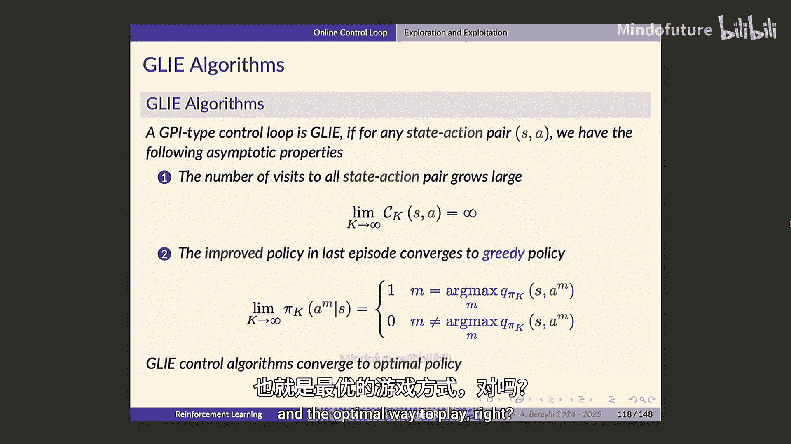

So I think right now， by。Maybe some somebody asked that， well。

 if we want to just make this epsilon in the epsilon ingredient small enough。

 then it means that we are not going to visit。To make it converge， right， to， to make it sorry。

 satisfy both the K the constraints。 One of the good choices is one over K， right？

 So first time that I am sampling， I just totally play randomly。 Second time， I'm gonna do epsilon。

Greedy with epsilon half， right， third time， one third。Fourth time， one， fourth and so on。

 right So this chance of exploration is not going to get absolutely0。

 iss not going to get super small pretty soon， right， So if I keep playing enough number of times。

 eventually， I'm gonna see everybody， right， But when I keep playing like 1 trillion times。

 then after that， this one over a trillion is pretty much0， right。

 So it's eventually converging to the。Read the algorithm right。 it's somehow satisfying， both places。

Both the properties。 this is， if you do epsilon gradient with that epsilon， this is a glee algorithm。

Everybody's familiar here。

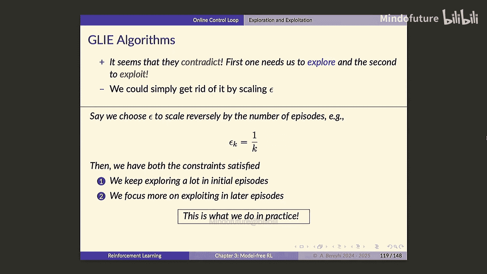

Questions。No question。 Okay， so this is the gl version of the Monte Carlo。

 So you basically have the same algorithm only in line 4。

And that you want to sample a new trajectory， you just reduce your absolute。

And this is now a safe one to play with right So you start with one Epsilon1。

 So first you just explore， you just get a good trajectory， you estimate you're reduced right。

 your epsilon。 you just play half of the time based on the estimate you got half of the time randomly right Next time you have better estimate。

 you reduce epsilon to one third right one third of the time randomly。

 two thirdd of the time based on your estimate。 and you keep on going right eventually you're going to play greedy。

 and this is going to converge into the optimal policy。

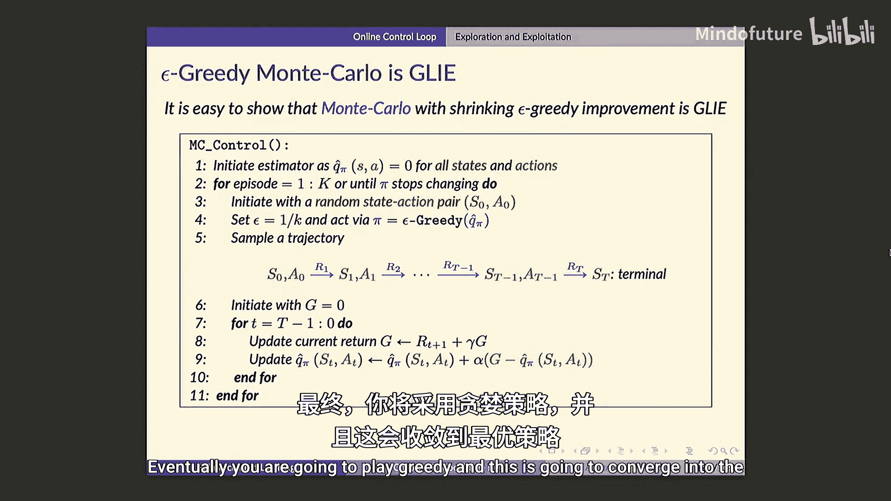