# 【多伦多大学】强化学习 2025 ｜ Uoft   Reinforcement Learning   Fall 2025 p31 P31_讲座_30_通过SARSA实现同策略强化学习 -BV1D3F2zhEry_p31-

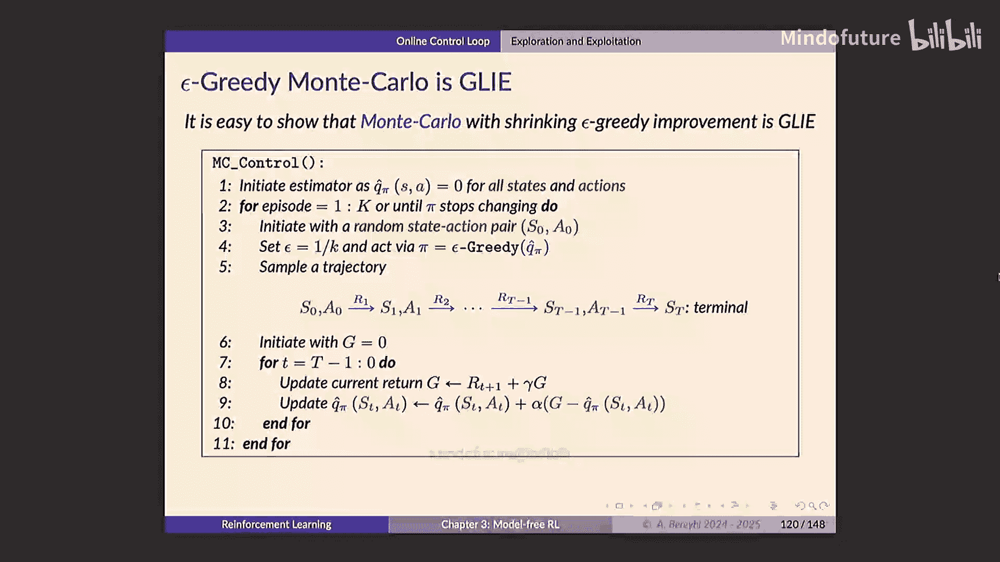

Now， what we want to do today， we want to get into the serious algorithms。 And for them。

 we cannot use really Monte Carlo。 I mean， Monte Carlo sounds nice。

 but as we talked before in practice， you don't， I mean。

 is very sample and efficient and not really complete online algorithm。 So what we want to do。

 we can do TD， right， So the very first thing that you might see when you want to just switch from Monte Carlo to TD is that in Monte Carlo。

 when you want to update， you need to wait for a complete trajectory to be over， right。😊。

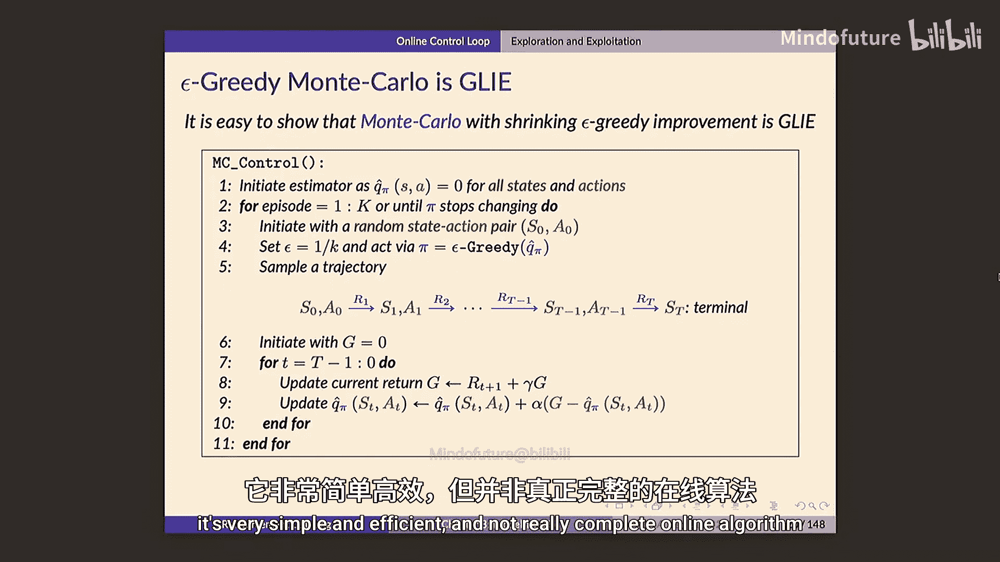

Correct， so you need to start from state， right， you go all the way towards the end till you meet a terminal state。

 then you have one trajectory。 now you can update several states and actions the value for them。

 And then now you can just do one epsilon 3D update， right。

And if you don't have an environment which is terminating。

 then you need to just truncate that environment。 But eventually you're not going to use the kind of you know。

 a bunch of final detail of that trajectory， right， So that is a problem。

 this is not really fully online because you need to wait for every episode to be over。

 But we say that we really want online thing， right， So as we are progressing over time。

 if you have a real control system， you don't want your， I don't know。

 high power station to just play random policy and just blows up a couple of times。 And after that。

 you understand that， okay， the level of the power should be that right， you don't want this。

 You want to just keep training over time， right， So we want this to be fully online。

 And because of that。And because of that we must we are going for TD。 So what can do with TD。 I mean。

 first of all， when you're doing TD， every single time， you're just sampling one time step。

 right So if you are in one particular state in action and you do one time step。

 you you get into the next state， right， And based on the value for the next state。

 you're able to update your estimate in the particular state and time state in action， right。

 So we we can actually update after every single time step， right， and because of that。

 we can actually do epsilon ingredient update as well after every single time step。

 So since we update in the value function is happening after every single time step。

 we can also improve in every single time step。 and of course。

 we need to do epsil ingredient improvement because。

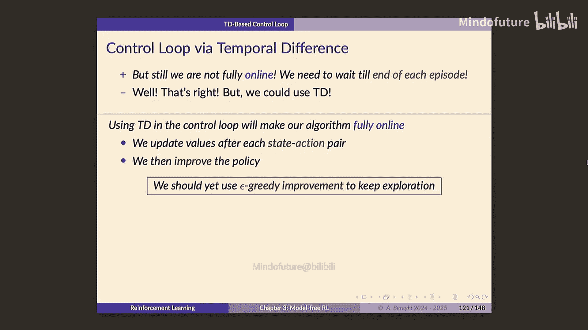

We don't want to get a stock into one particular suboptimal behavior。

 So the very first algorithm that we do is what we call a Saa and Saa is a state action reward。

 a state action。 Okay， you're gonna see why we， we just put this order。What does Saa do。

 Saa basically does what we did with the Monte Carlo using TD。 Okay。

 so you basically use temporal difference to estimate every single value， right。

 And each time you update， you are going to。Do one absolutepsilon ingredient improvement， okay。Now。

 we can use different forms of TD， right， So you can use TD 0。 if you do that。

 then're gonna be the very basic Sarsa， you can do TD N。 So you can just go deep in time。

 and then you just collect like a very long Buddhist wrap example。

 and then you update that you' gonna be Nsa。 and you can use TD Lada。 And then if you do that。

 this is going to be Sasa Lada。 Okay， now a quiz just do it by your own。

 I'm gonna check it right now。Just joking， no， no please， So one question。

 which one are we going to use， what do you guess in practice？😊，The last one， right。

 This is going to be the most efficient。 This is the whole reason that I took you through all of this pain to just learn all of them。

 We are going to just focus on this one， but I'm going to start with a basic one。

 not because I want to just make it more trouble。 I just。

 I think like that one is easier to understand。 once you understood that one。

 we quickly just get the final version， okay。

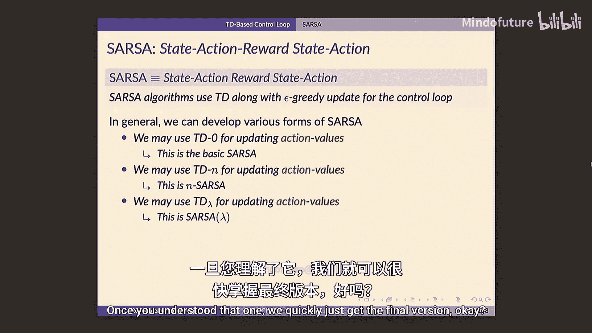

Okay， so let's start with the very basic one。 And this one probably is going to help you understand why we do。

 We call it SArsa， like state action reward， state action， something like this so。Well， now。

 look at this guy。 So what I'm doing here。 the thing that I'm doing is that I start with a bunch of zeros。

 right， So what I want to do， I want to update my Q function， and I start with everything being zero。

 right I had no clue。 and I get into the environment。

 I start to sample right Now I could have multiple episodes right。

 So one to K I could have one single episode of K could be very large number of episodes。

 that's not important anymore here because we really don't want to terminate necessarily。

 And then we get into one episodes right， the very first state， very first action。

 you probably do both of them randomly you choose one random state， you go there。

 you just randomly choose one action， you act and now everything got initiated right So you get you start with this random pair。

 and then you go through time as you go through time。 once you are in one particular。St okay。

 you have your action done， right， And this action that you have done is going to give you one reward。

 right， and the environment is going to send you to another state， right。

 So the thing that is happening， the reward and the next state are coming from the environment itself。

 correct， Okay， Now that you got here， can you do any updating your estimate of the Q values。Well。

 yes， you can use temporal difference， right， This is what you're gonna do。 You're gonna say that。

 okay， the sample return that I have G is going to be the immediate reward I got plus。

Value of the next estate， right。Correct。So this is the value of the next estate that you have。

 This is the next estate that you're seeing。 So you put it here， right？

 and this is going to be the next sample， right， I am at this particular state。

 I got to a newest estate。 and whatever the value of that new estate is that guy plus the immediate warrant collected。

 This is a sample return that I have right Now you got your sample return G。

 So you're gonna update right， So this guy is your your Q value at the particular state and action。

 and then you get the sample， you do this increment， you update， this is a new value right。

 new estimate of your value at that state and action。 Everybody's cool right Now one question。

I started building this table， right， this， this queue for different states and actions， right。

 now in line 9， when I want to just collect my sample return， I need to have the value function。

 What can I do。I need the value function V to calculate my my sample， but I have Q。

 How can I do that。Average over the policy， right， So this is what you're gonna to do， right。

So in line A， you see if you want this value for the particular policy that youre right now plane。

 then you just take this guy and you average it over your policy。

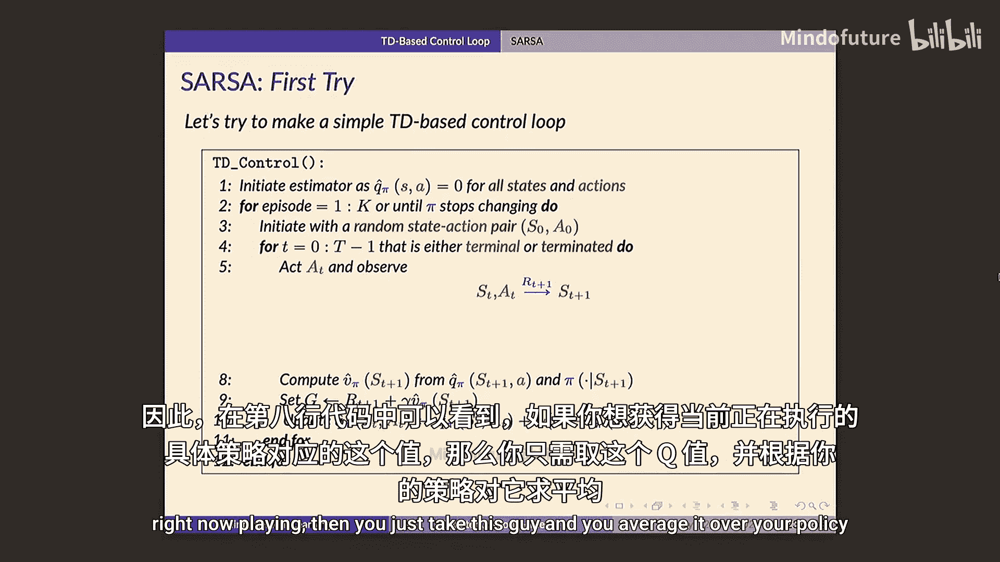

Everybody is clear。You started with a random policy， for instance， right？You went into one estate。

 You did one action， got into the newest state。 Now， given that you know your policy。

 you have a bunch of estimates， you can do line 8， and then you sample。

 you can do line 9 to update right？ now you have updated。 So your Q values get changed right？

 Now you can use these new Q values to simply update your policy， right。And provide's clear。

 so you can do Epsilon greedy to update your policy based on this new sample or these new estimate。

This is what you're going to do in line 6 and 7， right， So I did this action。I got the reward。

 I went to the newest estate。 Now I'm going to update my policy because I say， okay。

 this Q had got changed， right？I'm going update my policy。 And after updating my policy。

 I'm going to take my next action based on that policy。 Okay， Everybody got the main。The main idea。

 so you start with one policy， you do act， right？This is your first action， right。

 and then when you do act。😡，Then you're going to see the next estate based on the next estate。

 you're going your Q values based on those new Q values。to update your policy right And again。

 you act right？ But the question that you might ask me is that why I put these two lines here in6 and 7 right。

 because at this current form， I could do it somewhere else， right。But there is one reason for that。

 And I'm gonna explain it。 But everybody got the idea， right， So you just， you're in one stage。

 you act based on your policy。 And then after that， you get one reward。

 And now that you're in the newest stage， you can estimate once you estimate you use your estimated version to update your policy and you keep repeating this as you go onward。

 right。五。Yes。You can only update the policy。The best。That's right， like you got an award。

Being in state one， so you can only update sort of state zero because you don't know anything about how the value of state。

Yeah， yeah。 but but we are going to let do。 This is the main reason that we。

 we just learned that eligibility tracing， because when you do it by eligibility tracing。

 of guys gonna get updated right， But you're completely right。 right now。

 you're just updating one single value。 and it doesn't make too much change too much sense， right。

 that's totally correct。 This is why we need TD alumda in practice。Yes。Whats your episode。

like the nameza we're saying like state action。Like you were saying about the place yeah。

 the reason is exactly this order because you have a state， this estate， you do action。

 you get the reward， then you update again， you act， right。

 you get into the new estate and you do the new action， right？ So you are in one state。

 you do the action with your old policy， you get the reward， you update。You get into I mean。

 by reward， you get into the newest stage， you update your policy and do the next action， right。

 state action， reward， state action。 So it's just indicating the order of the， you know。

 acting with different policies in different time that。Yes， okay， yeah。

 So the main reason is exactly this order。 One thing that I want you to notice here is that what you are doing is the action here in line 5。

 right， in line 5， whatever your action is， this action is done based on your previous policy， right。

Your policy pie before getting updated， right， once you acted。

 then you go and update and do your next action， right。

 So your action at time T is done by one policy。 Your action in time T plus1 is done by another policy。

 right， The updated version。Everybody sees that， right？ So this is the first thing。

 And the second thing is exactly the one what that your friend told said already。

 So if you look at line 10。If you are doing this version， which is T T0， right。

 the only thing that you are updating is just one value， right。

 The Q function is getting updated at just a single pay of the state in action， right。

And by doing that， this update here is not making too much difference， right。

 so probably your policy is not changing too much。 It's just changing very tiny bit， right。

And we're going to get rid of that issue using TD a Lada later， right， or eligibility to tracing。

Okay， everybody's clear。Okay， cool。 So now let's just make it a bit more more serious。

 so or more practical。 Now， what I'm gonna do， I'm gonna focus on line A， right。

 I want to just compute the value， because if I want to just sample in line 9。

 if I want to take my sample return。 I really need to know the value function V， right。

 So if I want to do that， I'm going write down the expression for the value function in terms of the value function。

😊。

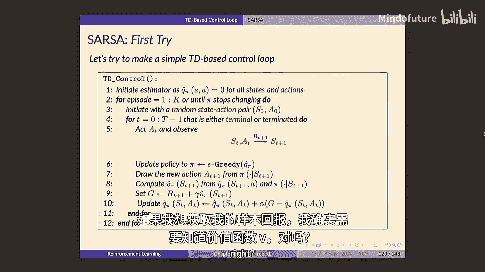

So you look at the action value function Q， you average it over your actions， right。

 And once you average it over your actions， then this is going to be your value function， right。

Everybody agrees on that， right。 Now， here is the trick in SArsa。

 So what we do in our approach is that I told you here I am going to update my policy and act， right。

 And I put this guy at line 7。 So to just indicate that before I start estimating my value。

 I already know what is my next action， right。

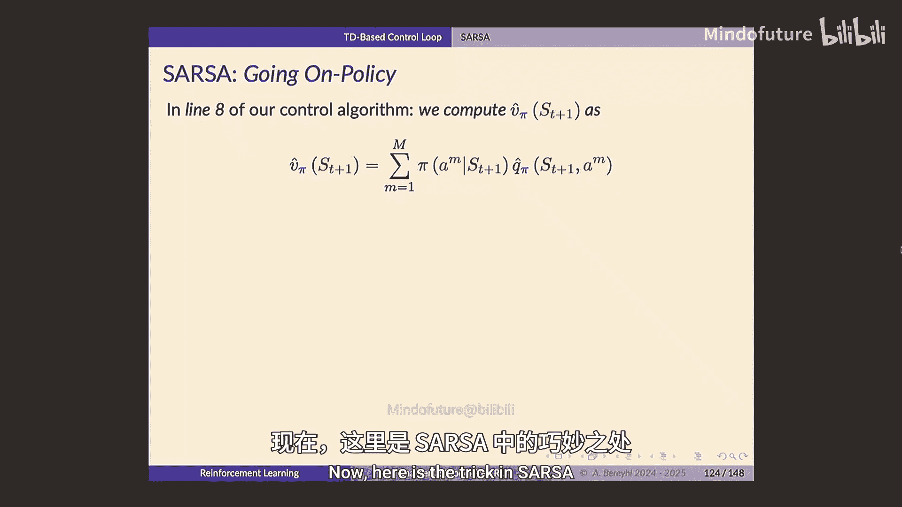

Everybody sees that， right？ So in line 7， I already have updated my policy。

 I already have done my action， right， my next action， correct。

So the next action is now what I want to do now， I want to compute the value by averaging my value over the actions。

 right， but the key point here is that well， if I am averaging this guy， this AM here。

 this AM that I am averaging over， this is the action， given the next stays， right。

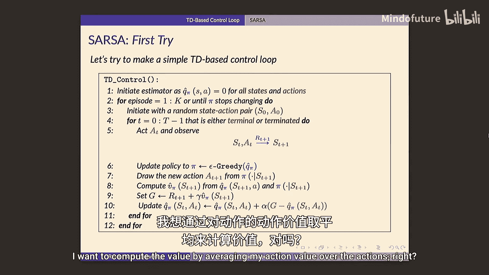

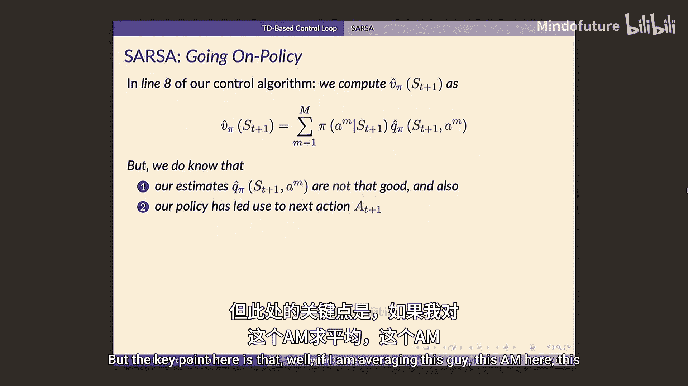

Everybody agrees。 So that A M that you see here， that guy is eventually A T plus one， right。

 and I am averaging over possible cases of my action in time T plus one， right？

 But given that I have already sampled that guy。 I do know that one， right。

If you want to average some。Onreization that youre seeing， you could instead say that， well。

 I do I do know what is my next action right， I am in the next estate。

 I have done my next action so I could say this 80 plus one is not a random rival for me anymore right it has been revealed to me right so I could say that I am doing whatever that guy is with Provolti1。

Or I am doing anything else with Provolti 0， right。This thing that you see here is not100% concrete。

Yeah， so if you find it a bit weird because you could say that， well， why should I act first， right。

 Maybe I could have computed V by averaging， and then I act， right。Yeah， I mean。

 there is no reason for， for what I say here to be better option。

 But the key factor is that this is going to help us do on policy， meaningan that as we are updating。

 we are also playing， I mean， we just update by what we are playing。

 We don't need to just really think about anything about our policy。Okay。

 so this is something that we you can take it from my side as a kind of， say。

 practically bitter approach to think。And then in that case， if I set my policy to be this one， Yeah。

 because I already have acted， right， once I have acted。

 my policy is eventually only the action that I have done， right， And then if I replace it here。

 what gonna happen， what comes out of this average。Just Q at the next state and next action， right。

 So you could say that the value of function。Of the next estate is eventually the Q function at the next estate next action。

 right。And at the point that you want to estimate the value function of the next state。

 you already know your next action。Everybody's clear。Questions。Again。

 I totally get it if you just question this approach， right， but。People have done it before。

 and it works。え。😊，Okay， questions。But you got the idea， right。

 So this is the idea of what we say on policy。 is like we are moving on the policy as we are updated。

 right， So we just look at the。With we collect the samples of that policy and we just。Work with that。

 right。 So this is our on policy idea。 And in this case。

 this new value is going to be eventually the Q value of the nexus data action， right。

 And if you do that， then you can eventually。Replace that value you need for sampling with this term in the algorithm and gonna be the basic form of Saa。

 So this gonna be the case now。 So I am within one trajectory and I am in one particular action sorry。

 time T。 So I'm gonna do the action A0 and this action80 is done based on the policy that I have right now。

 policy pi right So I play with policy pi with action A0。 So the state that I am in， I do act。

 I get the reward I get into the next state right So the policy that I have is already the policy before I update right So you see that I act then I update my Q function。

 right。

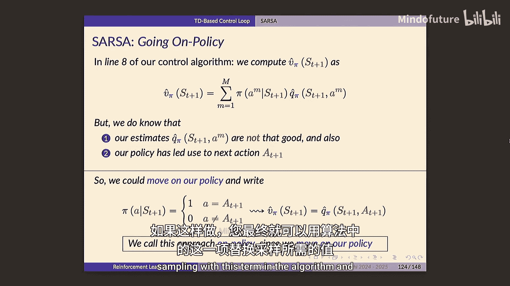

Correct， so this Q function， when it gets updated， right。

 iss going to change from the Q function I had with policy pi， right？ So I act with my policy， No。

 I get this new guy， right， this action。 I get the newest mistake。

 and then I go ahead and do the update， right， Once that I update， I have a new Q function。

 I look at that new Q function。 After doing my first action， I update with Epsilon greedy。😊。

You see that。So you play with policy pi first， then you policy based on the estimate that you updated previous time and step。

 right， but you do not apply it immediately， right， you wait till。Your action。

 And then you just updated for your next action。 Okay， now， now that I have done it。

 So I update my policy， I just draw one action from this policy。 So I updated my policy。

 I play with this new policy。 My next action。 So this is going to be the。

Complete one and step time trajectory。 I wanted an S。 I did play with pi。 I got A。 I saw the reward。

 Now I get into the newest state and I play with my new policy。

 I'm gonna get the action state action reward state action。

 This is the name right And now that you see this right， now you are going to just estimate。

 And if you want to estimate， you don't really need to use value function anymore。

 You can just use the action value。 instead of the value。

 you're gonna take your next state in action and you take the action value of that here as your value。

Or sample return， right， is going to be。For there you get plus the action value at the next pair。

 and then you take this one to update your Q function， right， Now you updated your Q function。

 You haven't updated yet your policy pi， right？ So you go for the next time。

 You still play with your previous policy， right。Action A T， know that you have done。

 Now you update your policy， right， And then you again use this updated policy to again do the action and you keep on going。

 Everybody's clear。Does it make sense？Questions。

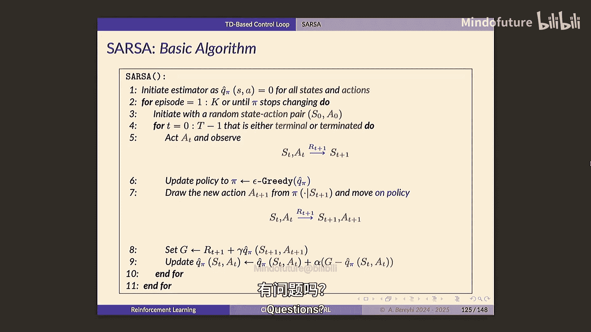

So。Well。If you've got no question， then this is the most basic form of SARSa that you can think of because you are basically using t td0。

 sorry and then what you can do， you can eventually go。

 for instance or deeper butharapping right you do that everything is as before only instead of having those simple Gvalue。

 you're gonna have GN So you're gonna just take multiple rewards and then you take a look at the very final actions。

 So of course you need to just do your first action based on your previous policy and then you update。

 then you keep on going right So the order of update is the same。

 only you just do more actions in time right and this doing more actions in time gives you more samples of that particular new policy and it could eventually improve the quality of your estimate right so you can do that one but this is obviously gonna add more delay right so。

because you need to just do multiple samples， so again。

 one single update requires a quiet long trajectory right， and this is what we didn't want to do。

So if you wish you can just go ahead and do this at home。

 but I'm not gonna discuss it because it's not very useful for us here。 And yeah。

 there is no much novelty here by extending this one， okay。

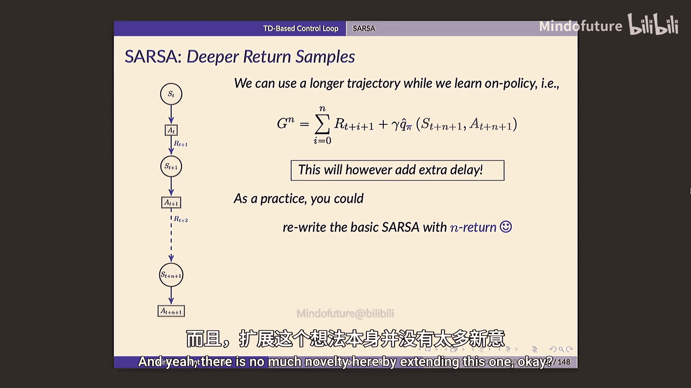

So yeah， now the key thing that we want to do is SARS a lambda。

 because that one is the most efficient one。 you can guess。 And what you can do。

 you can go of course， think of TD ada， right， The only difference with the one which we discussed right now is that。

Using TD ada to sample the future return， right， And once you do that。

 you're gonna get a different sample。 You update based on that sample。 and then。

 and then that is going to be what you。What you get as as a real source。 Now。

 if you want to use TD Lada， you have two different views。 We talked about it pretty much in details。

 So you could have start from this time。 And you say， okay。

 I'm going towards the very end of the trajectory。 And I get all of the TD estimates。

 right And then I average them。 But you can right now， see that this is obviously not working， right。

 because when you are in particular time， if you want to sample towards a very long trajectory。

 then it is obviously delay， right， you don't want that， right， right now。

 you want to just update based on whatever you have seen， this is online algorithm。 So obviously。

 this is not practical。 This was the whole reason that we just went to to study the backward view。

 based on eligibility tracing。 and this is what we are going to look into it， okay。Everybody's cool。

 So the only thing that I want to do now， I want to get that Sarsa。

 And now I write it down with eligibility tracing， right。

 So you remember what was the eligibility tracing， right， What was it。I was starting from one estate。

 And then in this estate， I would say， oh， the eligibility of this estate is one。 Anyone else is 0。

 right， And then I go one step in time。 Then I just。Damp everybody。

 So everybody gonna get multiply with a small scaling factor， smaller than one， right。

 And then I add one to the new guy that I see， right， And I keep on going like this， right。

 So it was somehow collecting the impact of time。 as well as the number of times I see1 a stage。

 right， So that was the idea of eligibility tracing at that point of time。

 I didn't make it more complicated and we just focused on estimating the value function， right。

 the V function。 But now we want to estimate Q function， right。

 because we really need Q function for epsilon greed algorithm， right， how we can do this。

 We can simply extend the idea of eligibility tracing to this state in action right， the P。

Its like you start with one estate。 You do one action， right？

 This pair is now having the eligibility one， right？ Any other pair has zero， right？

 Now you just go to your next estate， you do your next action， right？ Now， when you want to update。

 You're gonna say， whoever had nonzero eligibility factor up to this point。

 they are going to get damp with with a small factor， and then you add one for this new pair， right。

 and you keep on going like this。 So everything is as before， instead of thinking of just a state。

 Now you should think about the pair， right， the action state pair。

 So this is the case where you do eligibility tracing for a state and action。

 So you have this eligibility tracing。 How many entries do you have now for eligibility。

How many values you have。N times M， right， N is the number of states。

 M is the number of actions you have in total n times M different pairs。 For every single of them。

 you have one value of eligibility， right So you have this table with n times M different components。

 Now the eligibility of one state and action is initially set to0， right， you keep on going in time。

 every single time you do this update。 So when you see a new state S and action8， first of all。

 you are going to update all values inside your eligibility trace。

 you are going to update them by multiplying them with a factor， which is a smaller than one。

 right again， we put this gamma times lambda here because eventually we want to end up exactly with TD lambda。

 But I mean， obviously， you can think of n gamma。On Lambda and then it's just factor smaller than one。

 right？Now， you're just damping the eligibility of whatever you had before。 So you update this guy。

 And after updating this guy， know you would say， okay， I have seen this new S and A T。

 I am going to add one to the eligibility of this pair， right。And you go forward in time。

 right Next time everybody again gets multiplied with this factor。

 So eventually this guy is also getting smaller。 and then the new estate。

 which is S plus1 and the new action，80 plus1， going get one update plus one， right。

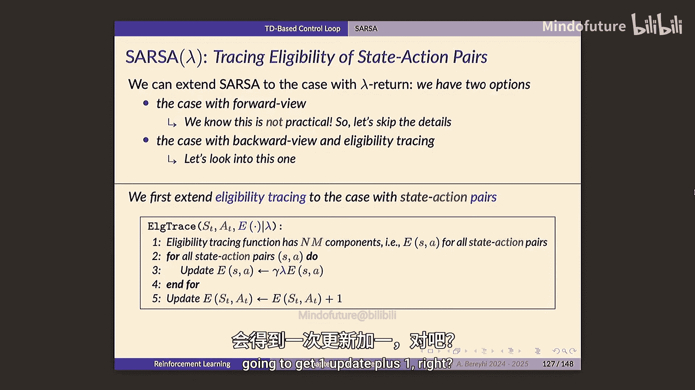

Every clear， right？ So doing that， then you're gonna have source a lambda， right。

 And then this source a lambda now makes sense more than the basic source。 So while we do， again。

 you look at it here。 So I am getting into one look for episodes。 Now。

 at the beginning of every single episode， every single trajectory。

 I I could just simply start with some random state in action， right， or you could just。

 maybe you have a policy。 So you just start with a random state and do the action based on your policy。

 right。Now， you are going to get into one trajectory。 Once you get into the trajectory。

 here is what you do with SArsa。 I mean， obviously。

 you first do your action based on your old version of the policy。

 the not updated version of your policy， right， So you do your first action 80 based on that。

 you're gonna see the reward and the next state。 now that you are in the new state。

 now you update your policy， right， So you wait till you see the new state and then you update your policy。

 Okay， you're gonna update with Epsilon greedy， and once you update that one。

 now you act with your new policy， right， So your next action。Right， so。

My new estate is based on the my new action is based on the updated policy。

 So with state action reward state action。 Now I have this guy。 I want to update my。

 my value function， right？ So if I wanted to do basic TD lambda， A TD0， Sorry。

 if I wanted to do TD0 in this case on policy。 What do I do， I'm gonna say that， well， this guy。

 this， this particular expression or plus gamma Q of the new pair， This one is my sample return。

 right。😊，Correct， so this is the G that we had in basic SAsa， right？So I have this G Sa return。

 which is simply coming out of td0 minus whatever I have。For my。Action value， right。

 My previous estimate， right， And then I get this delta。

 I add this delta into my previous estimate by factor alpha。 This is going to be my new estimate。

 right？ So this is when you do TD lambda， right， Sorry， T D 0， right。😊，It revised clear， right now。

 if you are doing TD0， who's going to get updated， what is the pair here？😡。

I have written here S and A， small S is small A， right。If you are doing TD0， the basic SArsa。

 what is that pairer SNA？Say it yeah。S T and80， right。 So in line 11。

 youre essentially updating S T and80 only， right， This is T D 0， right， now。

 But now what I want to do， I want to do it by TD a Lada。 So I'm doing eligibility tracing。

 meaning that。When I get into a new state in action， right。

 I'm gonna update the eligibility of that is state in action。 Okay， I guess it would have been， no。

 no， that's fine。 That's fine。 So I in line 5， right？ So I'm gonna just look at my state in action。

 and looking at this is state in action， then this is line 5。

 and I am going to update my eligibility。 once I update my eligibility。

 This eligibility is going to update for every pair， right， everybody is clear， right。

 So every pair is going to get update。 I'm going get this eligibility。

 I multiply it with the delta that I sampled only for S and8， right。

 And then I do this update for every pair that I have inside9。😊，Environment， right。

 everybody's clear now， right。 So what I'm doing， I am doing。The the action based on the old policy。

 I get the reward， right， new state， new action by the updated policy。 know that I have everybody。

 No， I do update every single value that I have， right。If I haven't seen any pair before。

 then they're elig they're going be zero， then obviously they are not getting updated。

 This is going to happen in the first entries inside the very first trajectory right but as I keep on going in time I start to see more and more pairs right and each time I see a new pair I'm going to update everybody that I have seen before right now it makes sense that I do one policy update every single time because after every single time I'm eventually dating good part of my value function right。

😡，A good part of this Q function is getting updated， right。

 This means that the policy from one time step to another could change significantly， right。

 And this is what is going to happen。 You initially play only random。

 But as you keep on going in time， you see more and more pairs， and then you're gonna get more and。😊。

Idea about the right choice， and。Start to somehow get very quickly into into the right policy。Okay。

Questions。No question。Okay， well， one thing that I， I maybe I should mention here because me myself。

 I just did a mistake a few minutes ago。 So in this line 6。

 you see that I say act  A T and observe R T state， right？

 So one key point that you should pay attention is that this A T is eventually 80 plus  one of the previous time。

 right。So it doesn't mean that you're sampling new thing， right， So you already have sample， right。

 you only want to see the reward。 So this is why you can put this eligibility tracing in line 5。

 right。Like a1， you get reward2 in a state2， then you just update， you do action A2。

 and you do whatever you do。 But here when you come， when you want to see R 3。

 you don't need to do any new action， right， You already know that action。

 You just need to apply it to the environment， right。

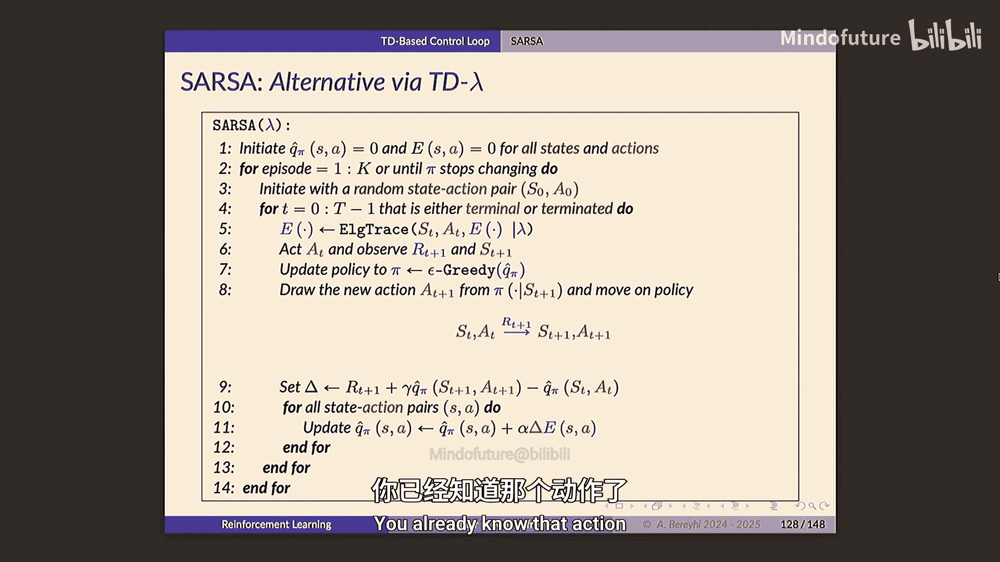

哎。