# 【多伦多大学】强化学习 2025 ｜ Uoft   Reinforcement Learning   Fall 2025 p32 P32_讲座_31_通过重要性采样实现异策略强化学习 -BV1D3F2zhEry_p32-

Next thing we want to talk about off policy approaches basically want to talk about Q learning and what is Q learning？

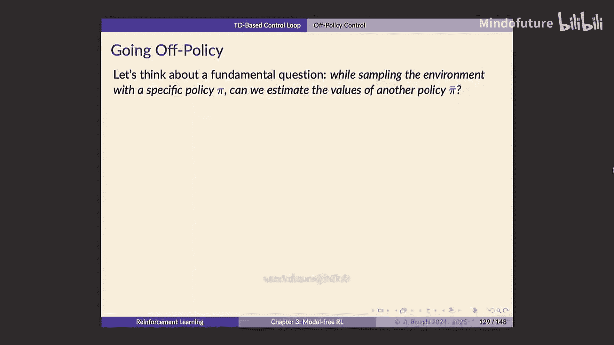

Well， we're gonna get it quite soon。 But let's first talk about what is of policy。

 So what we did in oura is what we call it on policy。

 I guess it makes sense because what you're doing， you're playing with one policy at every time。

 then at the next time you are going to update it， right， And once you update that one， again。

 you play with that one， right， and you keep on going like this， eventually。

 you hope that when this updates are being done properly。 And the very， very end。

 this policy that you are playing with is the optimal policy， right。Is the。

Policly that you're updating is the same policy。The policy that you are playing with is the same policy as the one which you want at the very end。

 right， the optimal one。But one question that is here is that。

 do we really need to do on policy or work on policy。

 Can't we just learn the another policy or can't we just estimate how another policy works based on the action we do with。

One other policy， right， This is a quite fundamental question。Everybody sees why this is fundamental。

 This is why I give you a couple of reasons here。 The very first one is that。呃。I mean， in practice。

 you don't simply learn how to play one game from someone who is playing perfect， right。

 You can also learn from someone who plays very bad， right， because when they play bad。

 you would say， okay， these are wrong actions。 I shouldn't do that， right？ and you do the right ones。

 right？ So this is one thing。 And the other thing is that like if you look at someone who is playing good。

 it doesn't mean that you really want to mimic。

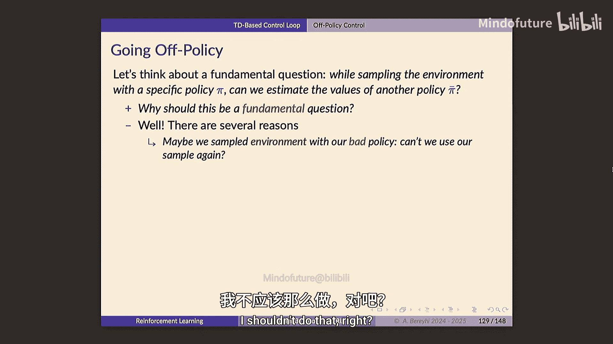

Policy， right， Maybe you get this idea that， well， this is okay in this particular situation。

 If I want to change a bit， maybe I can get the same mindset。

 but I just adapt it to my own way of playing right So more of a story in practice you know we as intelligence creators。

 we do not simply learn our policies based on the samples coming from our own policies right So we may learn things from the samples of other people。

 and this could be good or bad samples right And then the question is that can we do the same thing here in this framework and the answer is yes。

 This is what we call it off policy。 It means that we are not playing with this policy there is one other policy that we're playing with but of that policy。

 we want to learn how another policy is working right so。

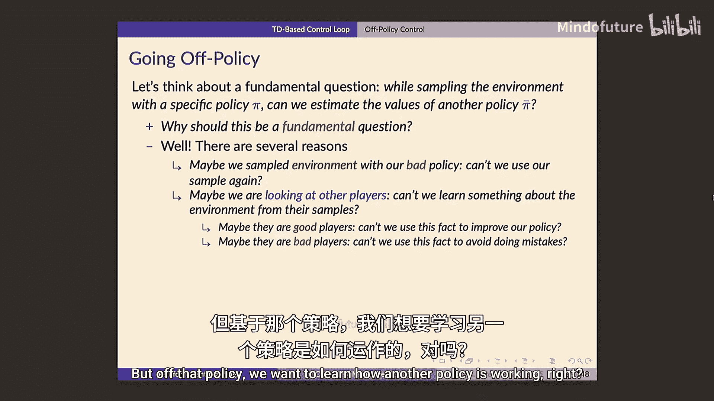

This is what we call it of policy control。 And let's just consider just learn a few basics。

 Basically， we need to learn what is important in sampling。 And based on that。

 we can just develop one of policy algorithm， so。

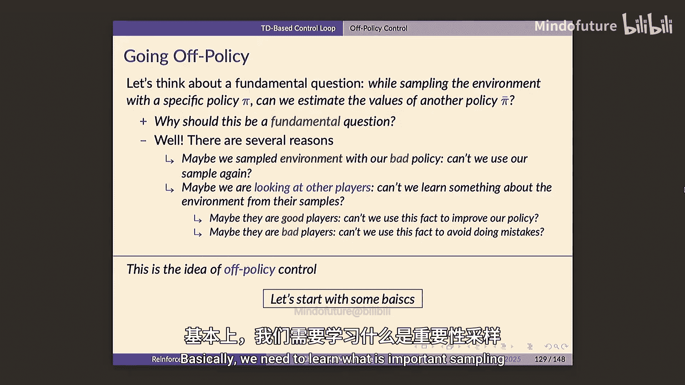

Important sampling， have you heard of this？Before， so if you had the generative AI course。

 you might have heard of that。 we also do important there。

 So it's a quiet known as statistical tool tool or approach。 what is the idea。

 The idea is that say I have this X right， And this X is distribution with one particular distribution P X。

 Okay， So I have distribution P X every time that I sample X is coming from that distribution， right。

 Now， if I want to know what is the expectation of this X。

 I'm gonna compute this expectation with respect to the。Distribution， right。

 So I put this P here just to indicate that the expectation is taken for that particular distribution P。

 So it means that I get every possible outcome of x。 I multiply it with P。

 And then I add it up over all possible outcomes， right。

This is an expectation with respect to distribution P now。This is Gu MUP。

 and then if you do Monte Carlo， for instance， if you do Monte Carlo。

 how you can estimate this MUP out of Monte Carlo。How do you do that？

 You're gonna sample x so many times， right？ So you have this bottom。

 which you push and every time you push， you're gonna get one sample of x， right。

 So you push an enough number of times。 Then you average whatever you see。

 that is going to be an estimator of this mu P， right？

 How do you say that that guy is estimator of this one because you assume when you are pushing that。

But that guy is actually coming from this distribution Px， right？

 Like the frequency of seeing every single outcome is proportional to this Px right Now。

 the next question that I have is that what if I had this X distribution with some other distribution right say kind of random variable。

 but the distribution is changing right like you have a binary variable。

 one binary variable is happening 50，50，50% of times 1，50% of times 0。

 Another one is just happening with with frequency， say 20%。

80% right Now what if I want to just estimate this mu Q。

 So which is expectation of this x with respect to this distribution Q。

 given the samples coming from distribution P。 how can I do that。

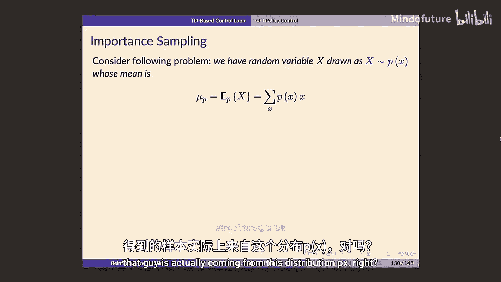

How do you do this in the binary case？If I just， I mean， obviously by。But if in case。

 and you do know that this binaryard thing is coming 50，50。

 then you expect when you push the bottom half of the time you see 0， half of the time you see 1。

 right， Now， if you know that there is one other distribution， which is happening with 2080。

 What you do， you would say that， okay， I should increase the ratio for one。

 I should reduce the ratio for0， right， if I want to compute the expectation。 Now。

 you can get this same idea and directly apply it here is like super simple but very efficient。

 what can I say， I can say that the expected value of x with respect to distribution Q is this guy。

 everybody agrees， right， Now the next thing that I'm gonna do， I'm going write it down in this form。

 So I'm gonna multiply it with P divided by P， right。everybody agrees。Right now。

 looking at this new summation， what kind of expectation is that It's an expectation with respect to distribution P。

 right， What is the argument that I should put inside the expectation。X times。QX divided by px。

 right， Do you agree with me on this？If you average this guy inside the brackets。

 you're gonna write down this term， right， and then you can cancel denominator with nominator。

 You're gonna end up with this term。 And from that term， you end up with mu Q， right。

Everybody agrees， right。 Now， what I am doing， I am here as computing this guy using samples coming from distribution P because my expectation is happening with distribution P。

 right。😊，Everybody cool， everybody's cool， right？Questions。Now。

 what I want you to keep in mind always， I mean， I hope that you got it up to this point， but I want。

 because in the deep learning part is very important。 this is the only thing that we can do there。

 When you see expectation with respect to anything。

 you think of generating samples and averaging them because in practice， we can only do that， right。

Like， if you think about the very high dimensional data。

 you can never find out what is the distribution。 exactly。 The only thing that you can do。

 you can just sample from that distribution， right， If you think about the distribution of all。

Cat images， you cannot write that down Never， ever， right。 The only thing that you can do。

 you can just collect lots of cat images。 and you can think that distribution exists。

 You pressed upon you get cat images， right， So you have samples。

 This expectation is going to get approximated by some Monte Carlo averaging right。

 Now what we are doing here。 We are averaging something with respect to P P oh sorry。

 with respect to P。 but we are computing the expectation that we want with respect to Q， right。

 And this is what we call it important sampling。 It means that I use the samples from distribution P。

 but then I am computing or estimating something with respect to distribution Q， right？

 Now the guy that is showing up here is the ratio of Q。 your new distribution。 to P， right。

 your old distribution by which you。Sled right and this is the same thing if you think of the01 binary example right when you see 50。

50， then you would say， okay， that guy which is if one is happening with pervolt is 0。2 now in Q。

 I'm going to just scale those ones with 0。2 divided by 0。5 yeah。Right。

 and the other one with or yes， with 0。8 divided by 0。5 again， right。Everybody is clear。Questions。

So you got the idea， right， What is important in sampling。 More of a story。

 you're sampling with one other distribution， you can compute the estimate or you can estimate the average with respect to another distribution。

So this guy， the red guy， which we do not have samples from。

 we can just simply estimate it using the samples from P， right？关。Now， there are a few things here。

 First of all， if I want to use this approach， do I need to know what is Q and what is P。也算。那。To use。

Did you。These guys。Yes， I need them， right？ I definitely need them。

 I cannot do it without knowing P and Q， right？ So P and Q， I need to know them， right？

 This is no problem here because P and Q for us are policies right。

 and we do know what the policies are right This is one thing。

 later when we get into the deep learning part。 again， we're gonna have some network right？

 And that neural network is going to specify the policy for us。

 So we can evaluate this at the point X right？ So that is not no problem。 But if you think that oh。

 I need to know Q and P， you are totally right。 You need to know that。Second question， if I do that。

 I mean。8 me muu Q with。With the use of samples from P， do I give any。

 is there any cost I'm paying here？Is my estimate looking the same as before。

 like as good quality as the estimate I get if I would have sampled Q directly。

It's not going to be the same and the reason is that we're going to talk about it more later。

 we are going to have a bit of more variance， right？

Because I am multiplying with this  Q divided by p right for some cases this  Q divided by p could be significantly large because in my P。

 that particular outcome is happening with low probabilityvolty right but with  Q is happening with high probabilityvolty right and if this is the case then  Q divided by p is a large number and then you are averaging large number。

 this is going to have higher variance right So this makes sense again because you have sampled by P P is not seeing that particular outcome too much right but then you want to。

Estimate whatever you get with Q， where that particular sample outcome is happening too much。

 And then， of course， estimating that guy out of these samples is not going to be very high quality。

 right， That is， again， in fact， we're gonna talk about it more later。

 but I just wanted to indicate that it's true that I'm getting this guy here。

 but it doesn't mean that I'm paying nothing， right， So my estimate is not as good as。

The case where I sample with Q directly， right。 But that's what I just want to know whether I can do something or not。

 okay。Questions？So everybody got the idea。 What is important sampling， right， Co。

 So if you got the idea， let me just go ahead。 and yeah。

 here is basically what I try to explain in words。 So if I am estimating mu if I am sampling from distribution P with K different samples。

 I IDd， then my estimate is going to be mu has。 So the average of them， As I said。

 always think of the expectation to be this operator right， you sample， and then you average right。

 this is what you can do in practice。 and you can alsoest mu Q right， you can do that one as well。

 and if you want to do that instead of x， you multiply x with the ratio of the distributions and then you average。

 right。

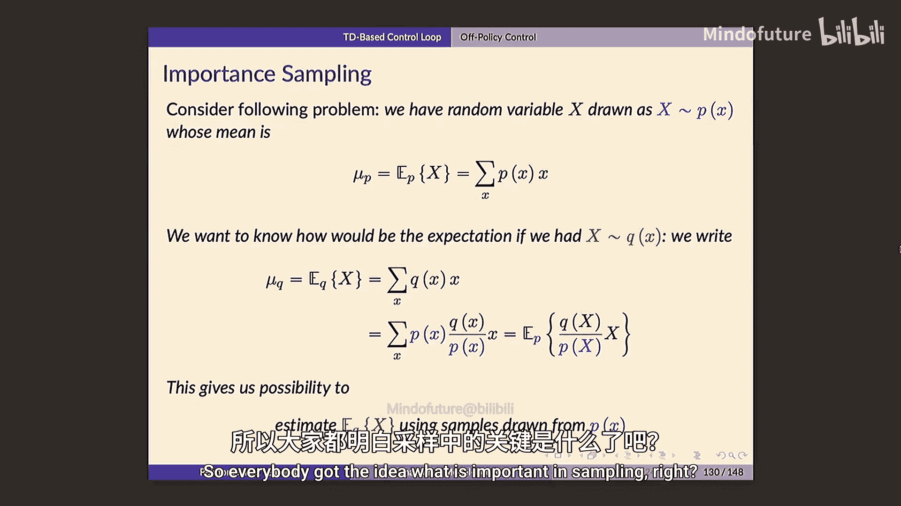

And again， we need to pay attention。 We need to know what is Q and P。 If we don't know。

 we cannot do it again， right， We need to know what is the ratio。

 at least this importance factor we need to know it， right？ Okay， cool。

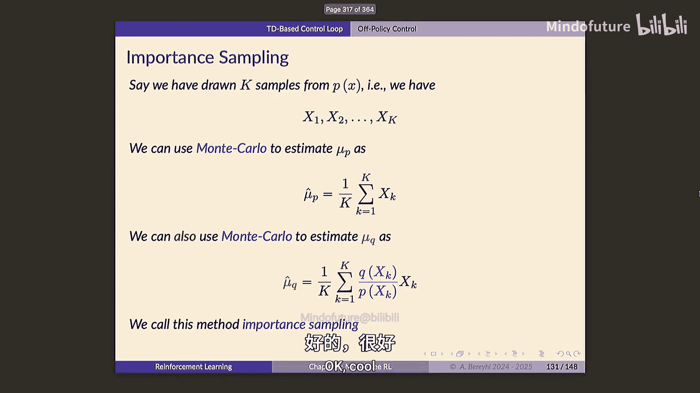

This is what we call it important sampling and now let's just apply this to our problem that we have。

 what is the problem that we have I am in one particular state I start at a state zero。

 I do one action， then I just jump to another state another action jumped to another state and so on I go to the end right。

And right now， assume that I have played with the policy pi。 Okay。

 this means that every single guy in this trajectory。

 every single action is coming out of the policy pi pi of that action， given the particular state。

 right。Everys cool， right。 Now， my question is that I am looking at this guy。 Can I use， I mean。

 first of all， I can use this guy to estimate the value of my policy pi。 That's correct， right。

 iss a sample coming from that policy。 I can just use Monte Carlo， whatever you want。

To just estimate the value of policy pi。 That's correct， right。Okay。The question is that。

 so this is going to be the value of policy pi， The question is that can I use the same trajectory that I have here to estimate the value of another policy。

 for example pi bar so I don't want to play with that policy anymore， I have played with pi。

 I want to use that sample to know how does policy pi bar look like。Can I do that， Well。

 I have pi bar， supposedly， I have pi。 I can just use the important sampling， right？

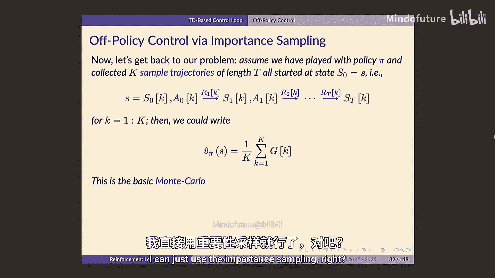

So this is going to be the case here， so I have this particular sample， right。

 this is collected by policy。Pi， now， if I want to use this sample to instead just estimate the value of policy pi bar。

 I need to multiply it with the importance factor。 What is the importance factor。Any idea。

I don't want the explicit expression right now。 what should be nominator。

 It should be the probabilityty of seeing this trajectory with policy pi bar， right， is Q for us。

 right。And in thenominator， we need to have the probabilityvolty of seeing the same trajectory with policy。

So this is the one， right， Everybody agrees。 Sonominator is what we had Q。 Dnominator is P， right。

Everybody agrees。Now， anyone has idea what is this ratio？Let's do it for one very small trajectory。

 And then you're gonna get when I write I show you the complete trajectory case。 So say， I have。Say。

 I have。S 0 and a 0。 And then I go to。S1 and A1， okay， And then yeah， this guy could also go to S2。

 but not important。 I just want to write this first two steps。Okay。

The what is the probabilityty of seeing this guy altogether， Okay。

 I'm gonna to write it down in this one first。Provol of S0。And a0 and S1 and a okay。Say this， okay。

Maybe I also keep S to as well， just。For completeness， this is the one， right。

 assuming that I am playing with policy pi。 So I put pi， sorry， pi bar。 I put pi bar here， okay。

A high school now， same thing in the denominator。But with policy time， right？亮有。

If I look at this ratio， here is pi。 Here is pie bar。 I want to open it up。

 and I want to use chain rule。 Okay， let's start with the nominator。

If I want to start with the chain rule， the first one is going to be P。F S 0。Okay。

 should I put pie here or not？😡，Pi bar， should I keep it？😡。

Is there anything in S zero happening based on pi bar？No， I started randomly with one policy， right？

😡，Every why in school？So if you are doing SArsRSa， for instance。

 you randomly choose one policy as the beginning。 and you keep on sampling the trajectory， right。

So this guy has nothing to do with my policy， right？

The next thing is policy of sorry probabilityvol of a0 times S0， right？Does it depend on pi bar？😡。

Yes， it's basically only pie bar， right， so I can clean this guy。And right here， pie bar， right？

Everybody agrees。What is the next guy？Just use Cha and tell me what is the next one。

 Look at this one。 I already have written S0， a0。 No， is term for S1。 What should I write here。S1。

 given。S0 and a0。Should I put any pie bar here？😡，Pay attention， no， why？ロ比啊。Yeah， I mean。

 I know action and I say that's right， right， and then what is going to give me this priorityty？

The transition model， the environment， right which has nothing to do with my policy， right？

 So this guy has nothing to do with Pbar， right， Now the next guy that I'm going have in this innominator is going to be P of what is the next term I have already written S 0。

 a0， S1。 and now I should go for a1。 Can you at first tell me the complete term。

 So he's gonna be a1 given。S 0， a 0， S 1。That's it， right。Now。In this case， for this expression。

Can I simplify this， Can you tell me what is this guy。Is a1 given S1 Y。

 because in every single state， every single time， I'm going to look at my policy at my state and use my policy right so I can remove these two guys right。

 Everybody agrees right now what is this one， P of a1 given S1。Pie bar， right。

 so I can clean all of this， right， and I can write it down Pi bar again。A one given as one。

What is the next guy？Last term， it going to be P of S2 given if I use chain rule， it's S 0， a0。S 1。

A one， right。But can I simplify this？Yes or no？What it going to be as to given？S1 and A1， right。

 which is coming from the environment， right， It has nothing to do with my policy so I can simply write it down as。

S1 and a one， right。Everybody agrees。Everybody's cool， yes。Okay， now， what about the denominator。

 I have the same thing with policy pi， right， Now， you helped me just write down the terms exact as what we did here。

 So the first guy。Is P of S 0， right？ Do I need to put pi here or not， No。

 because I started with some probability quality， the first state， right， What is the next term。

Pi of a 0 given as 0。 What is the next term。Does this guy differ from the guy in nominator？No， yes。

 this is the same environment right， when in this environment you are at this estate in action。

 you're going to transit with same probability， right。What is the next term？Pie up。

What is the laster？P， S 2， S1， A1， right， again， this guy is same as the ynominator， right。

This guy cancels out with this one， right？This guy cancels out with this one。

The initial probability I started the same right， So this one counts out with this one。

 The ratio is only the product of the policies， right？ You see that， right。Now。

 if you keep on going in time， you only add up to these terms， right， They're going accumulate。

 And then this is going to be what you're gonna see when you keep on going in time。

 So this is going to be the expression。 And I hope everybody could agree with me now， right。

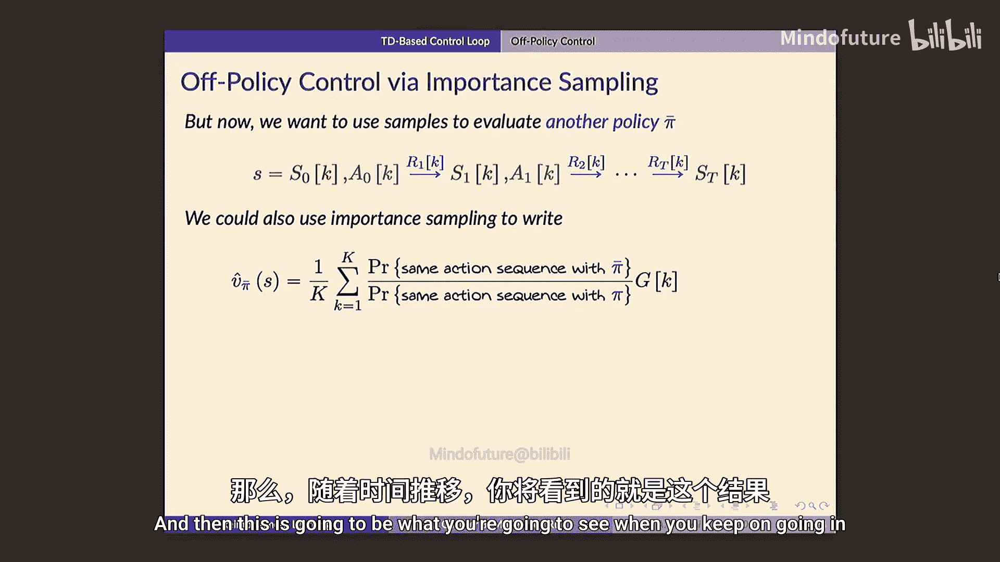

So it's gonna to be pi bar of the initial action， given initial state times pi bar of the first action。

 given first state and so on until last one， right。And same thing， also here。F pi， right？

This is only bar and pie remaining in this fraction。 Nothing else is going remain here， right。

 Everybody's cool。Questions。Okay， so if you got no question， then I can simplify this in this form。

 So it's basically the ratio of the policy in every single pair right。

 multiplied it over time right and this is the guy which is going to be the importance factor right now if I have sampled my environment with Gk right。

 now I can instead of you with with policy pi， then I can just get this Gk I multiplied with this factor。

 then I average over this one right and this one is supposedly giving me an estimate of the value of policy pi bar right So I played with policy pi I collect that a sample right and then。

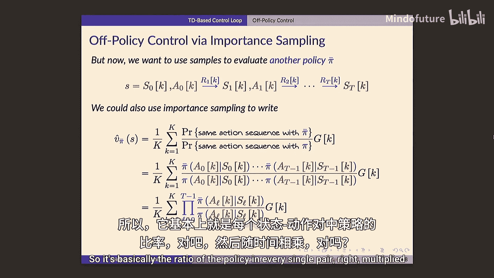

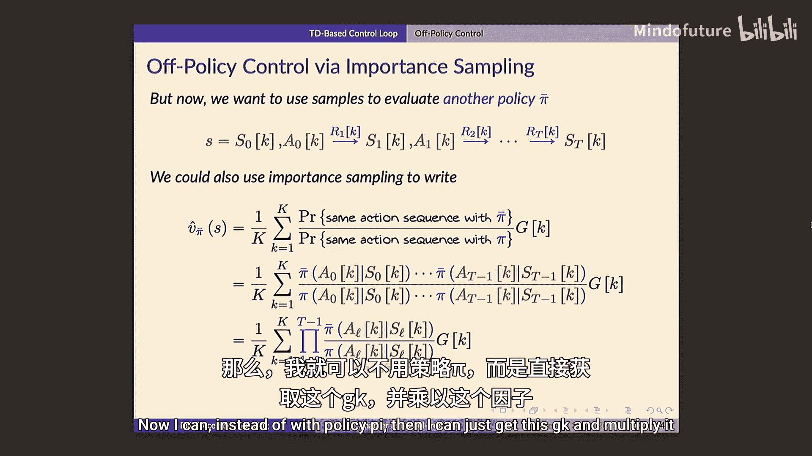

I use those samples to also understand what is the policy P R， right？Everybodys cool， right。 Now。

 one thing again， that you should pay attention。 It's not coming at zero cost， right。

 If my policy pi is doing one particular action with provolty 0， right。

 then the denominator is going to be 0。 Something divided by 0 is going to be infinite， right。

 The variance of your estimate is infinite， and it makes sense because policy pi。See that action。

 right？ It happens with provolti 0。 It never goes there。

 Then you cannot use that sample to estimate pi bar efficiently， right。

 What you estimate has infinite variance， right， If pi is too different from pi bar。

 this estimate is is one estimate， But it is a very， very bad estimate， right。

Pi and pi are closed enough。Is going to work fine。Everybody is clear， right。

 So this is the idea of estimating using important sampling here what we are doing。

 We are basically doing Monte Carlo， right。And we can do the same thing with TD， yes。

We don't like with this policy， we don't do this action at the particular stage， right。

Have have seen the trajectory that was。被。How they。B0。That one could never be 0。 That's already。 Yeah。

 I mean， that's， that's right。 I get， I get your question。 You're right。

 but I didn't mean that it's really 0。 I mean， very， very small。 Yeah， Yeah， I just meant that， but。

Here it doesn't make sense。 if you have pi to be a neural network。 then that could happen。

 That could happen。 This is what we're gonna see later。 And in that in that case。

 then you cannot use this one。 I'm gonna give you high variance。 But your comment is totally right。

 I mean， I cannot have it absolutely0 because if it is absolutely0。

 is not going to show up here in between， right， But I could have it with a small probability。

 And then my next policy is doing that much so frequently， So the key point here is that if。

 for instance， you are doing with one optimal policy， right， or some sort of close to greedy policy。

 then you cannot really estimate something like a random policy， right。

 But if you' are doing a random policy， you might be able to estimate the greedy policy， right。

 that is not making a huge variance。 the number of actions you have are limited， right， Yeah。

 But your argument your your point is totally right in this example。

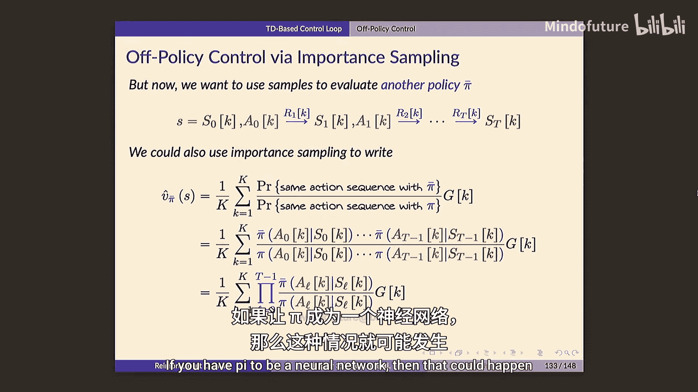

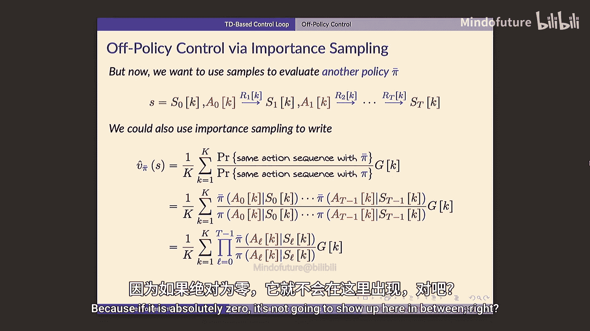

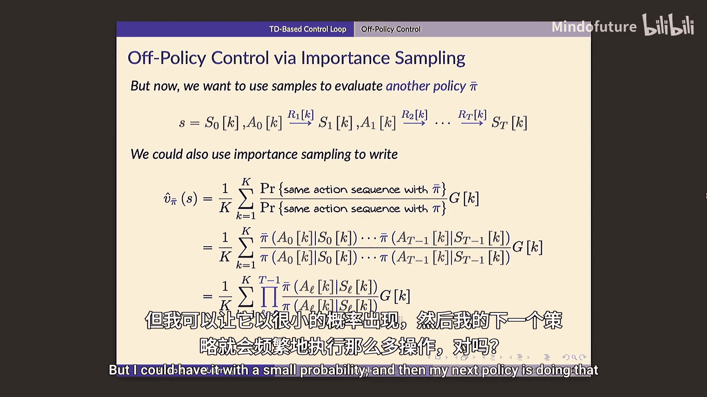

Questions。Okay， we can do the same thing using TD， right， So we sample with TD。

 We get the sample with one policy， and then we use it to update another policy， right， yes。

On the board。Yes。T equal by2。 but we weren't。The G ofKs， we just didn't affect it。Yes， yes， yeah。

 exact。 I just wanted to compute the fraction， yes。

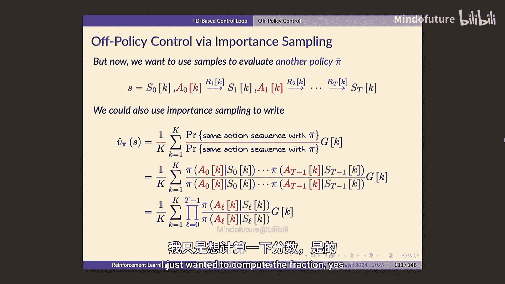

Okay， so now what if I want to do TD， okay， if you just do TD with one specific policy and you sample that policy。

 right， and then you're gonna have your return。 This is the sample return given by TD how you compute it basically you're gonna compute it as the next value plus the immediate reward that you got。

 and if you want to update your your value function。 Well。

 you're gonna just subtract it from the previous estimate that you had and you add it up to your estimate right。

 this is your update with TD right， now what you should do if you want to do important sampling。

 So assume that I am sampling this guy， this sequence this trajectory that you see。

 I am doing this one with policy pi。 but I don't want to update the value of policy pi。

 I want to update the value of policy pi bar。 What should I do。 I get my sample。

I just multiply it with the importance sampling factor， right。

 what is the important sampling factor in this case？I'm going to show it， right。

This is the important sampling factor， right？Oh， sorry。 I Im not yet sorry。 I'm not yet a TD。

 I guess。

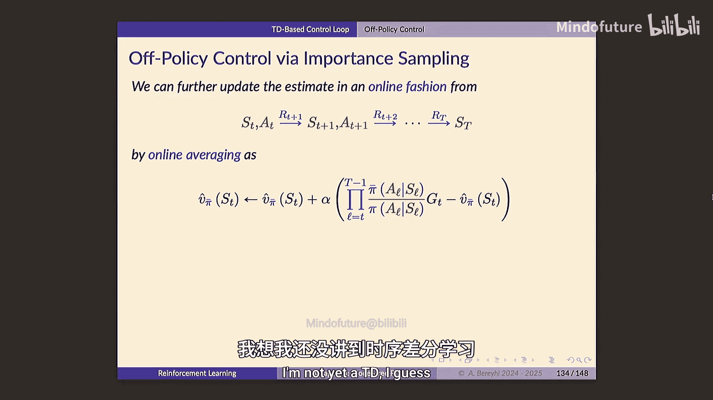

Yeah， yeah， sorry， sorry， sorry。 Don't get confused。 I mean。

 I this is just the online version of this guy。 I'm sorry。

 So I just wanted to indicate that you can do the same thing with in the online form， right。

 not not important， really， nothing， nothing very important。 This is just Monte Carlo。 now。

 now let's go for TD right now for TD。 If I am in TD， and I do play with policy pi。

 So if you think of all of these pi bars to be pi， right， if I play with policy pi。

 then I would eventually get my sample return， this is the immediate reward I get plus the next value function。

 And then I subtract it from my current value I update right Now if I want to just do off policy。

 It means that I am playing with policy pi， the action I did was with policy pi。

 but I want to update the estimate of policy pi bar。 What should I do。

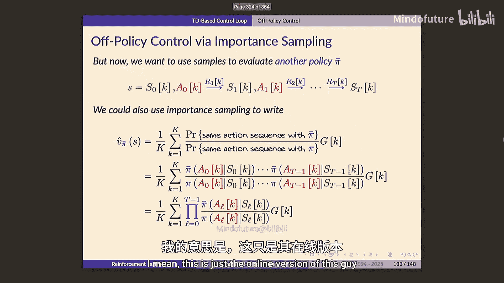

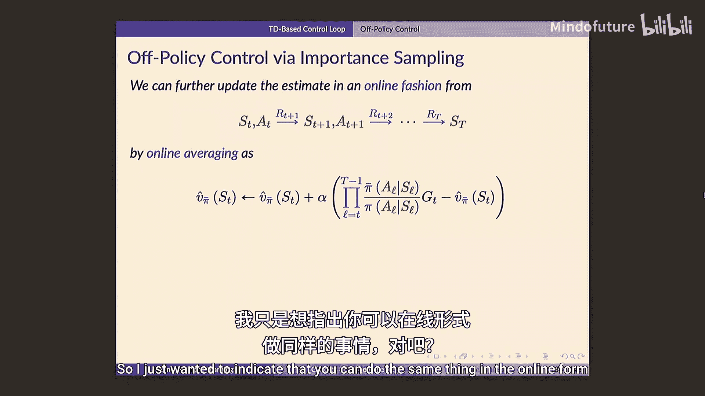

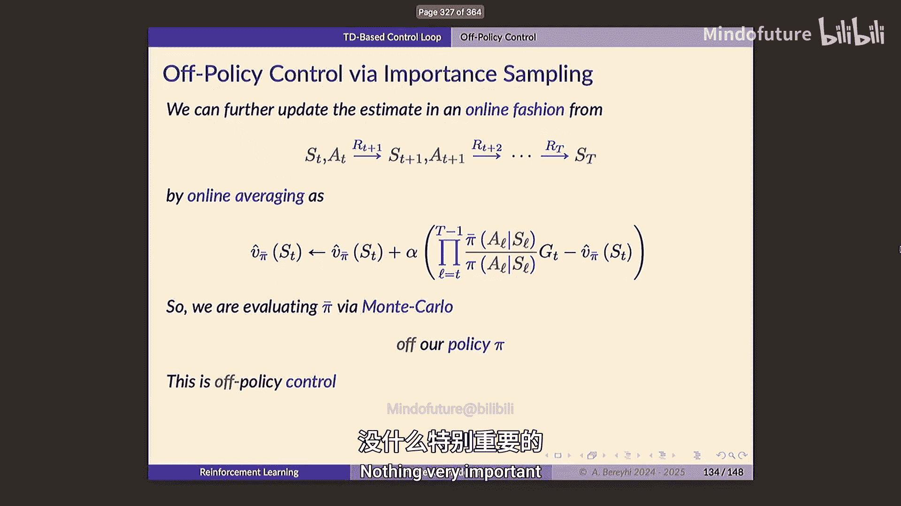

What should I put here？Any idea。It's definitely the ratio of the policy， right。

 but how many of them do I need？😡，Just one of them right。

 so it's going to look like this right because in TD。

 you are not really sampling the whole trajectory， right？So you sample every single time， right？

 So this sample that you see， how you can specify it is just depending on the probability of your current state。

 right， Transating to the newest state， right。And this is going to be your care in the state doing the action。

 And then you transit。 right， That's it。 right， So whatever I showed here for a longer trajectory。

 you just write it down for one time step， right， And this is going to be the scale that you gonna multiply your sample with。

A revised revised clear。Yes， this applies for PDD0。For CdN， then you need to just multiply it n。

Yeah but in practice， we always do eligibility tracing with Tt0， right， so we always have this guy。

 right？Avise clear？Now， what if I wanted to update instead of V， I wanted to update Q。

Does it look the same？Suggestions。So there is one trick here when you are doing Q。

 If you are updating Q， what is Q Q function is the value of。Do one particular action， right， right？

 So this means that you see this state， you see the action， then you compute， right。

 So this means that the next reward that you get， right。

 it doesn't matter which policy you are playing， right。

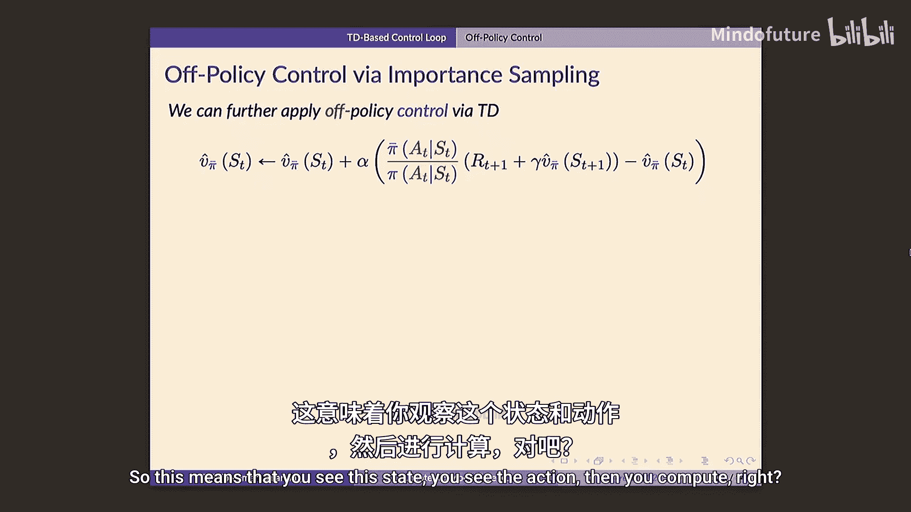

I mean， the action in state is known， right？ The immediate reward is known。

 right from then on policy gonna kick in， right， So this is why you're gonna have such such an expression in the Q update。

 So you have your R， this R is the same。 whether you play with pi bar or pi， right。

 So the ratio here is one。 But for the next estate。 Well。

 the value of the next estate depends on the policy that you play， right， And that one， I mean。

 gonna be the ratio of your target policy， your sampling policy， you're gonna just do that， right。

 And then you can update with this one， right。

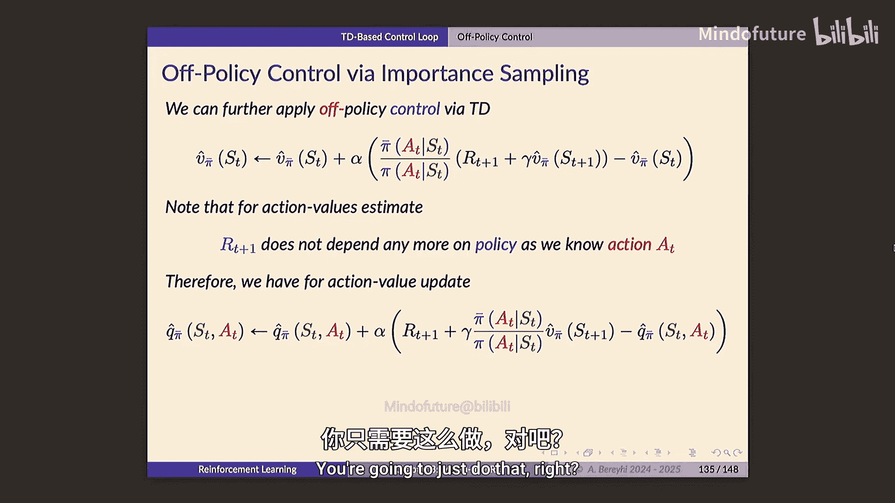