# 【多伦多大学】强化学习 2025 ｜ Uoft   Reinforcement Learning   Fall 2025 p33 P33_讲座_32_Q学习算法 -BV1D3F2zhEry_p33-

I Q learning。 Q learning is off policy。 This means that you are not playing with the same you are not updating the same policy that you are playing with okay so you play with one policy。

 you sample from the environment right and as you keep on sampling your environment。

 you're going to have another target policy right you can guess that target policy is the optimal policy。

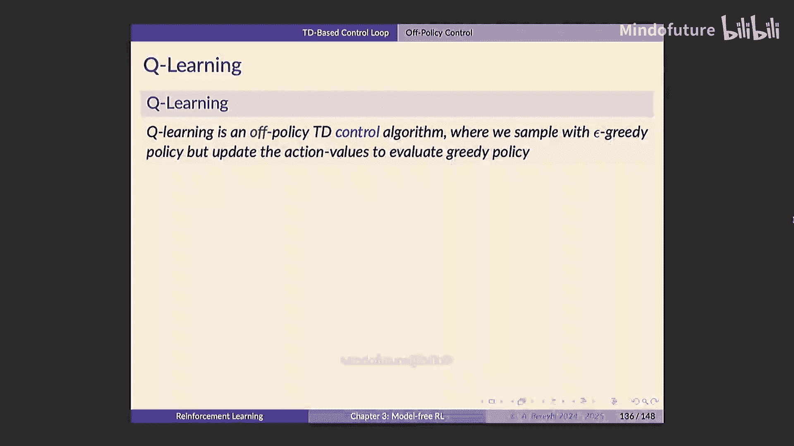

And you try to estimate the value of the ad policy instead of using your samples to estimate the value of the policy you are playing with。

 right Now in Q learning what we。Efficient version or pair of these two policies。

 The policy that you are playing with is epsilon greedy。

 The policy that you try to estimate is greedy itself。

 The optimal policy that you want right So in Q learning what you do you essentially do off policy with TD control。

 but you play with epsilon greedy， like every time you just with some probability go random or you do greedy based on the value function and that you have。

 But when you want to update， you think only about the optimal policy， which is the greedy approach。

 Okay So let's look at how it looks like it' gonna get like super simplified as compared to the complete important sampling case。

 but we needed this important sampling because later it's gonna play a lot of role in the policy gradienting approaches。

 okay。

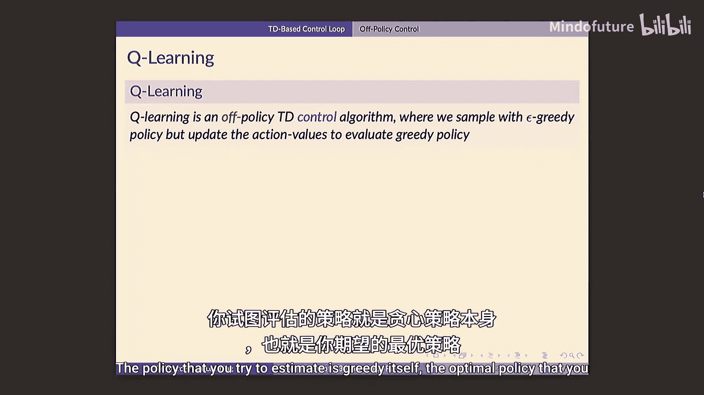

So， well， in Q learning， your pie， the regional policy that you're playing with is epsilon greedy。

 right， and the target one pie bar is greedy。 It has no epsilon， right？

 This is the the only difference。 And how does it look like well。

Let's say that I am doing one TD approach。 So here what I have。 If I play with pi bar。

 which is the greedy， I'm gonna update like this， right。

 So this G is the sample coming from that one。 So G is the return that I get and the value based on the policy pi bar。

 which is the greedy one， right， I know if I want to just do important sampling。

 I basically need to replace this G because I am playing with pi， right。

 I'm playing with Epsilon greedy。 I need to just replace that G inside the expression with this one that we saw in the previous slide。

 right cool。😊，But now。This pi bar to pi is going to look a bit simple。

 Any idea how does it look like。What is pie bar if you think about the greedy approach when you are in one particular state and you want to play greedy。

 What do you do。You're going to fight， yes， go ahead。Right， so this guy， this pie bar。

How does it look like the provolty， It's gonna be one the best action。

 It's gonna be 0 everywhere else， right。This means that this guy here that you see， right。

 is either one。Divided by the other one right or zero， right？

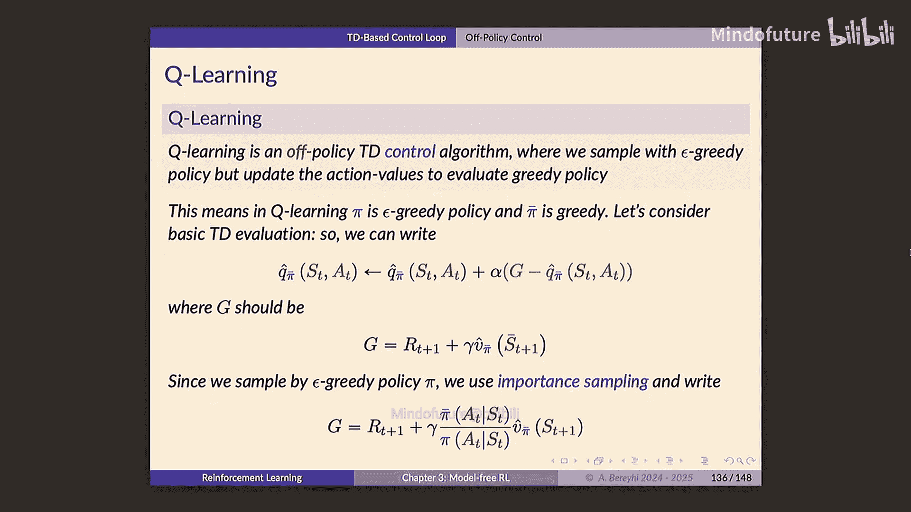

Everybody's clear。So。What you're gonna do， you're gonna say that this guy right。

 this pi bar divided by pi is either something for one action， this is something non-ze。

 it's gonna be zero everywhere else right because my greedy approach just does the optimal action right So this guy you can eventually not hear too much about this。

 but this one which is the value in the next state。

 this one you can actually simply compute it out of the Q function that you already have。

 how you can do it， let's look at look at this together。

 So as I said this guy is going to be just one at some point it's going to be zero everywhere else。

 but the value of the next estate that you want to compute what you're gonna say you're going say okay。

 this pi bar whatever that is that is one in the optimal action right and it's gonna be zero anywhere else right and the value of the next estate is always looking like this one。

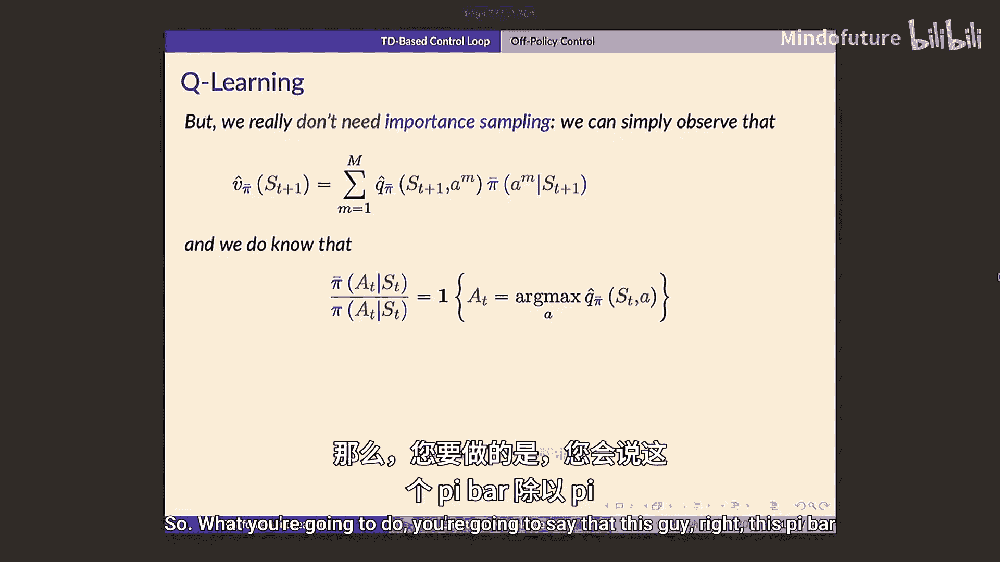

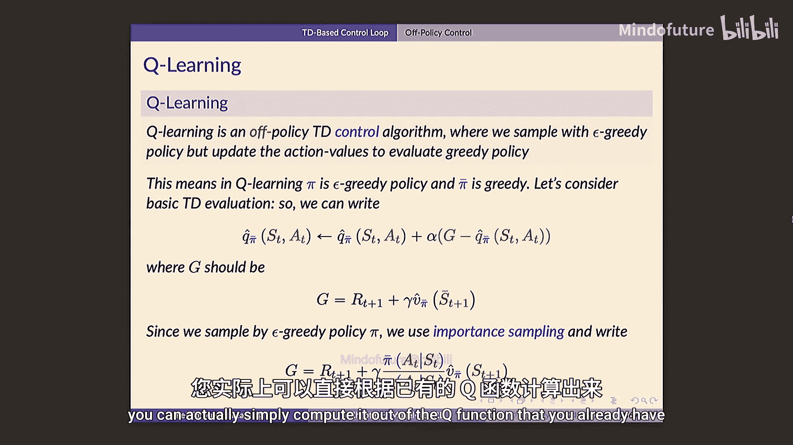

え。Everybody sees what I'm doing。So when you are thinking， I mean。

 you are playing with the Epsilon greedy algorithm， right， Epsilon greedy update。

 But every single time you would say， oh， if I wanted to play greedy， I wouldn't do a random jump。

 right， I'm gonna do the optimal action， right。Correct。

 so the value that you need to update with is the optimal value。

 which is the maximum of your Q function。 You don't really need to look at that average anymore。

 right。So in this particular case of Q learning。I mean， without important sampling。

 it doesn't make sense， but the important sampling is gonna reduce to simply computing the maximum of Q。

 right？ So it's not that serious， important sampling argument。

 But the reason that it's working is because simply。

You are thinking of policy right so you would say every single state that you are in， you would say。

 okay， I am in this particular state， I am playing epsilon greedy it means that in this state I would just either go for the best action or I randomly doing action right。

 but no matter what Im what I do if I wanted to play greedy。

 then I would do the maximum the optimal action right。Correct， and the optimal action。

 the value for that optimal action is eventually the maximum value I'm going to get out of this。

Q function that I have， right？Everybody's clear。Questions。This is why in Q learning。

 you are somehow working with the optimal pair， like your policies that you're putting next to each other。

 they are actually behaving very well together， right because for greedy。

 you' are using the same value function as you use for epsilon greedy， right。

 The only difference is that in the epsilon greedy。

 you just jump randomly for with chance Epsilon in the greedy， you don't do that， right。

Since you have this， you don't get into those troubles of having high variances， bad estimates。

 This is not going to happen。But later， as I said， you're gonna see that this is happening in policy gradients。

 for example。 Okay， so moral of a story， longest story short。

 the only thing that you're gonna do instead of having that， you know， important sampling argument。

 you can just remove everything and put the maximum of the。

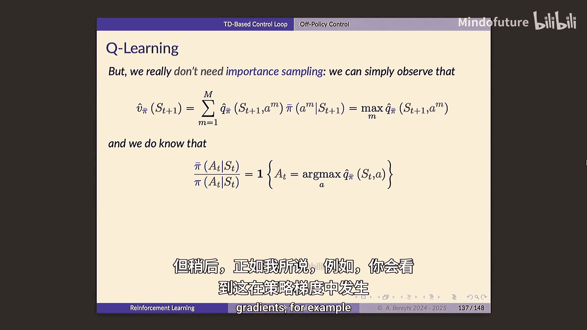

Qo function。Okay， and this is again， off policy update。 This means that every time I am playing。

 I am randomly maybe jumping somewhere， right， But at the same time， keep in mind that， well。

 if I would have had played with the optimal policy， this would have been the， the value， right。

And then I put that value here instead of the epsilent greed that I'm doing， right， again。

 get into a new state。 Maybe I am in this estate。Because I just jumped randomly， right。

 because I'm exploring， but I don't care。 I would say I am in this estate。

 If I want to play optimally， I would go for the maximum value， right。

And then I'm gonna update based on that assumption， right。 Now。

 the thing that you are updating here is not any。The Q function of your epsilon greedy algorithm。

 right， Epsilon greedy policy。 The one that you are updating here is actually the Q function of the optimal policy。

 right。So you basically play epsilon greedy once upon a time you randomly jump。

 but each time you would say， okay， what about the optimal policy and that optimal policy is going to get updated in this form。

I mean， again， this is an estimate。 definitely is not the exact function of the optimal policy。

 But this is the way that you can estimate that one efficiently。Questions。Yes。あルされ。No， Q pi。 I mean。

 pi， how do you build it， You build it based on this Q function， right。

 This is absolutepsil ingredient。 This is the point that I try to make。When you do epsilon greedy。

 what do you do， you would say， okay， I'm gonna play greedy with41 minus epsilon， right？

 So I'm going to use the same Q function， right。I use this Q function。But want greedy。

 I always do the best act。When I do excellent greedy， sometimes I just do randomly， right。

 When I do randomly， I don't care about the fact that I have done randomly something， right。

I do a new action。 Maybe that action is random。 I don't care。 If I am in this estate。

 and I wanted to play with the optimal greedy approach， then my value would be this， right。

 And then I'mm gonna update the value of the optimal policy with that mindset right as I keep going every single state somehow I I would say。

 okay， in this estate， what would be the best approach or best action based on the estimate that I have right now。

 Well， this is going to be max the one which is maximizing the Q function， right。

 So maybe I'm not doing it， but I don't care。 the value is going to of the optimal。

Policy is getting updated with that action， right。And I just randomly maybe jump to another one。

 right， When I randomly again jump to another one， I would say， okay， here。

 what would be the best action I could do based on any action based on the value function that I have right now。

Is going up， right？ And then I'm gonna to say that， okay。

 I'm gonna go ahead and update the value of going up， right， based on what I have， right。

 But maybe I don't go up。 I just go left， right。And I keep on going live that。Q learning。

 we don't need to reduce the epsil No， we don't know。 Yes。

 just purely using the pi S exploration exactly exactly。 is， yeah。

 this is the key factor that makes it work better than sourcersa for for low dimensional problems。

 Yeah， but this is a very good observation。 I'm going to talk about that。Yes。Concus。Yes。

But pie bar is the greedy one， right？Approaching the optimal， right， sorry。

 if I made did not make it clear。 But pi bar， I I think in the， in this1， I make it Q is star， right。

 This is the estimate of your optimal 1。 But pi bar， I told you here that pi bar is pi bar is greedy。

 right？ And if you assume that you have a， you have a good estimate of the Q function。

 then this eventually should be the optimal  one， right。

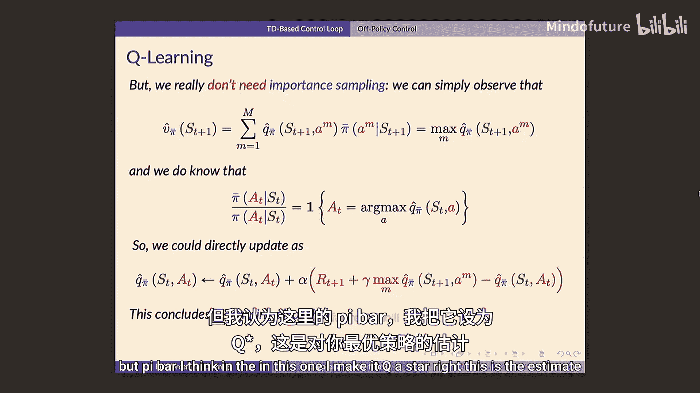

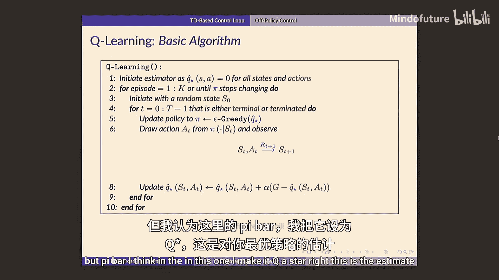

Because I keep I keep updating pi， right， And then it supposedly is going to get to the optimal policy。

 right。So its somehow you have this mindset that every time you would say， okay。

 I am no exploring plus playing optimal， right？ And now， if I assume that， then how can I update the。

Q function of the optimal policy， right， then I update， and then gradually。

 I'm going to converge to that policy， right。Make sense。Questions。Yes。What is the。

The important sampling， I know what you want to say。 you wants to say this guy is one。

 This is not one。 they ain' gonna be something else， right。

 but the key factor is that this whole thing that you want here。

 okay this whole thing that you want to update You actually don't need to do it anymore because you can directly estimate this guy right So that one is not one。

 So I guess this is not this is a type of from last here， I forgot to correct。

 but this should not be one， this is one over something pi right that epsilon thing right but then that guy is going to get multiply with your next action because your next action is again going to be either random or the optimal action right they are going to cancel out but you don't really need to do that because if you think that you are playing this S bar is your next estate when you play optimal or you play greedy that one is going to be the Q value of the optimal or the maximum Q value right so you cant just think about this whole thing。

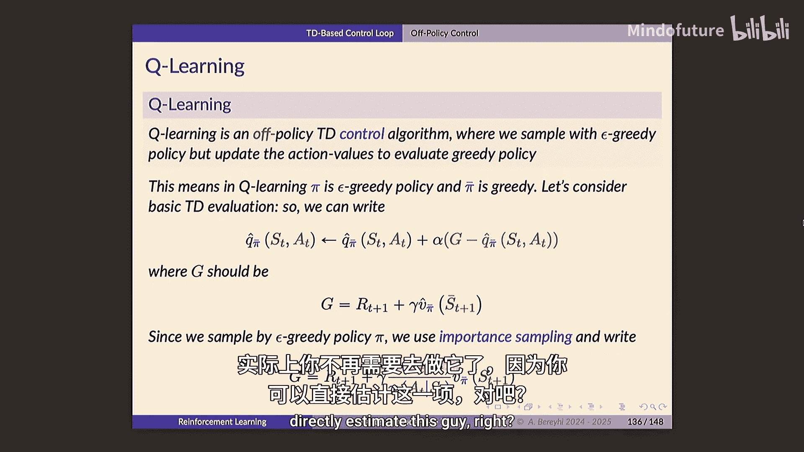

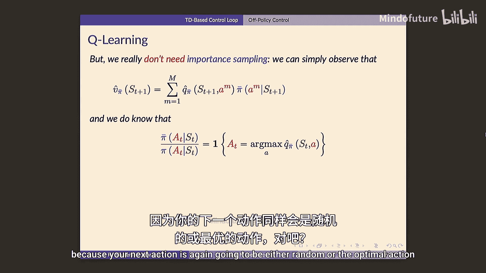

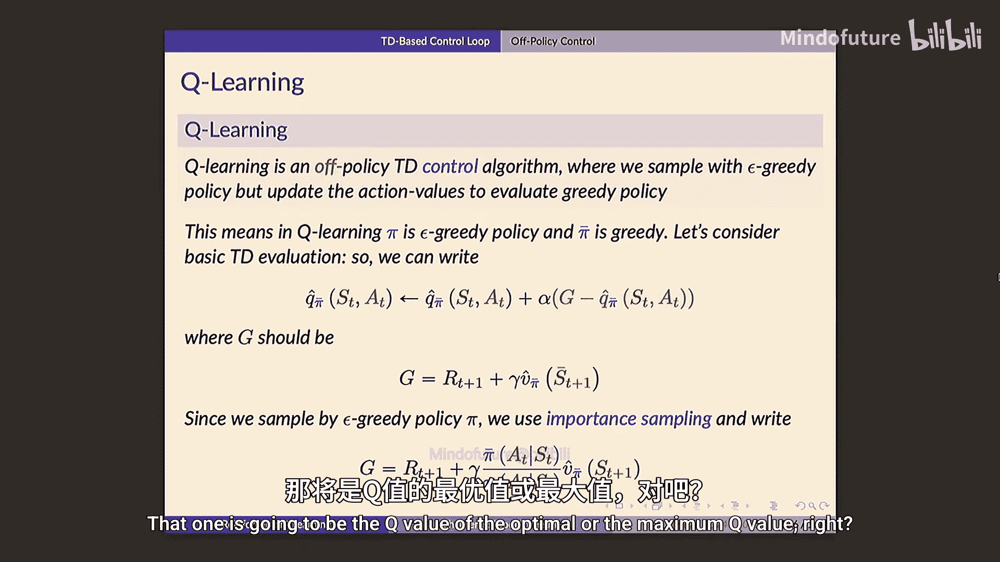

And replace all of this fraction multiply with your value of the other policy， right。

 or value sampled by the other policy。 You can just replace all of it with that maximum， right。

 But you're right。 I mean， this is again a typo。 This is one over part of that thing。

 which I forgot that one， right。

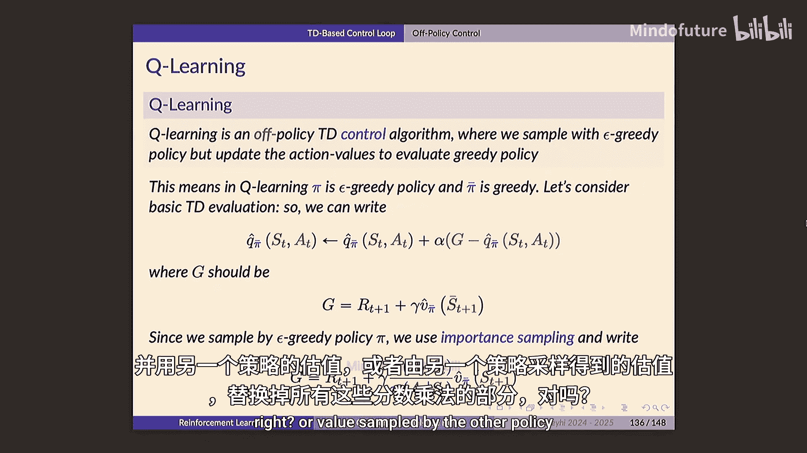

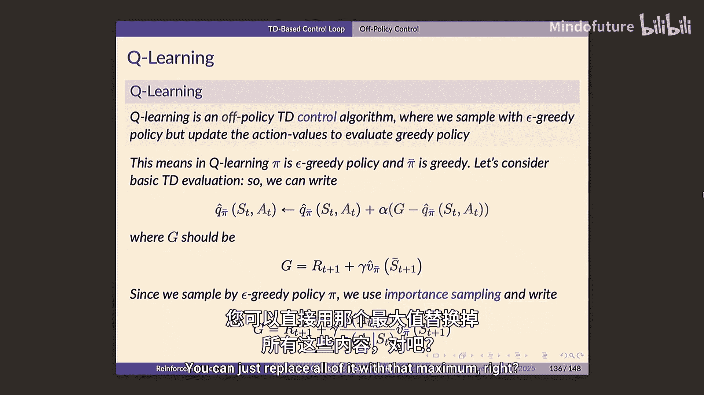

Questions。

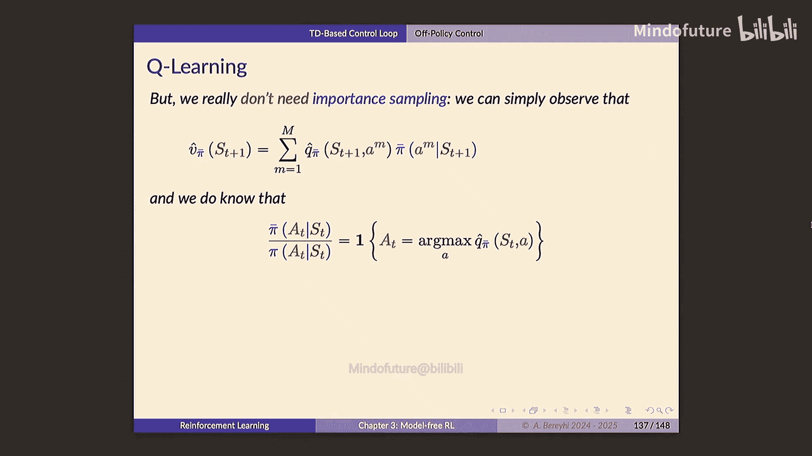

No question。Okay so if you have no question， then let me just wrap up the Q learning algorithm。

 So this is the Q learning algorithm。 What you have here。

 So youre gonna start with a bunch of episodes now you get into one episodes。

 you initially sample one random state and then you go inside the trajectory right each time you are going to update your policy to be epsilon greedy。

 it means that at state， you could either go next action based on the estimate that you have right now or you can just randomly jump to one one action right so you can do that then now that you take your action。

 then you're gonna get the next state right once you are in the next state you are going to just update your optimal Q function right so you would say that my optimal Q function in this particular state and action is my sample minus。

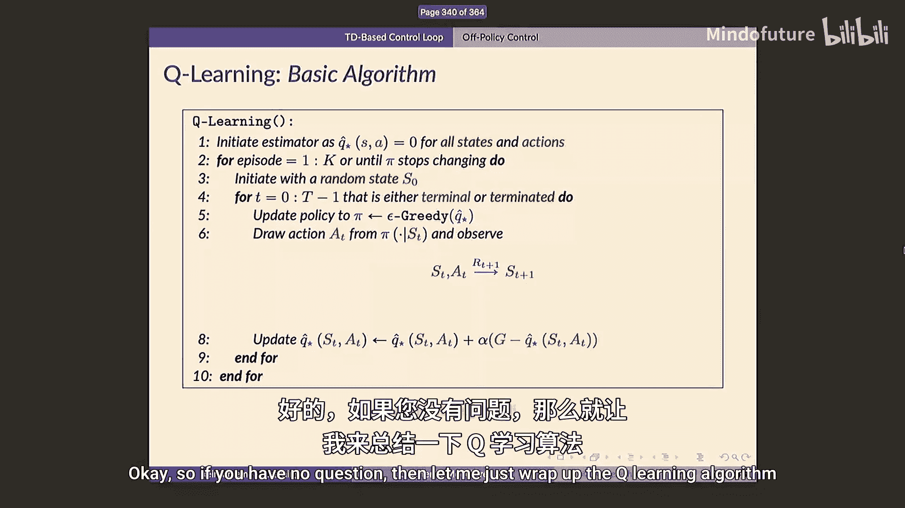

Whatever I had， I just add of this increment， whatever the estimate was， right。

 and what is this particular sample。 Well， this particular sample。

 you look at the estate that you have。 I mean， the next estate that you see。

 and you don't care about the action anymore， right。

 you don't really know need you don't need to know what is80 plus one。

 because you already know what that would be if you want to play optimal， right。

 if you want to play optimal and the next estate， the thing that you do is you just take the best action。

 right， And this is going to give you the best Q， the maximum Q right。

 So that is the only difference。 So instead of having in this G gamma like this gamma times Q of your policy。

 next estate next action， you just replace it with a maximum Q value， right。

 and this maximum Q value is supposedly the value you would get。 if you would have had play greed。

 right。

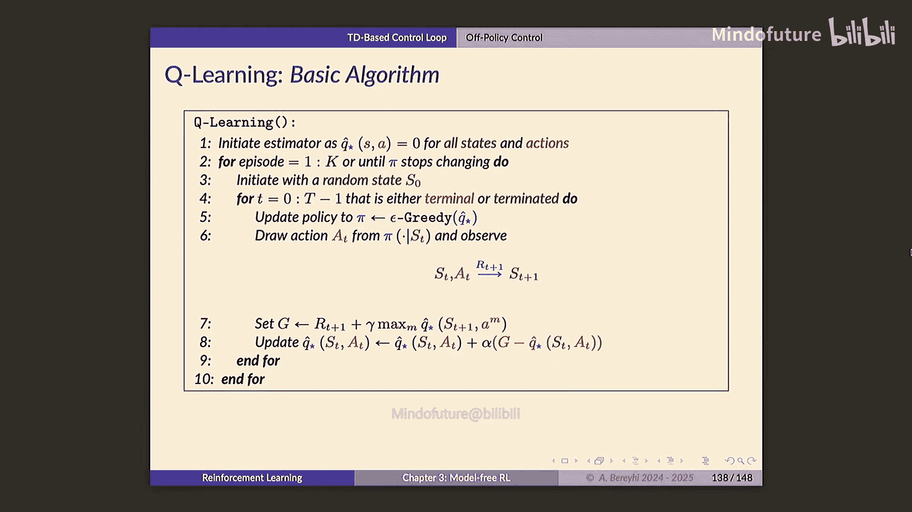