# 【多伦多大学】强化学习 2025 ｜ Uoft   Reinforcement Learning   Fall 2025 p34 P34_讲座_33_Q学习与SARSA的收敛性 -BV1D3F2zhEry_p34-

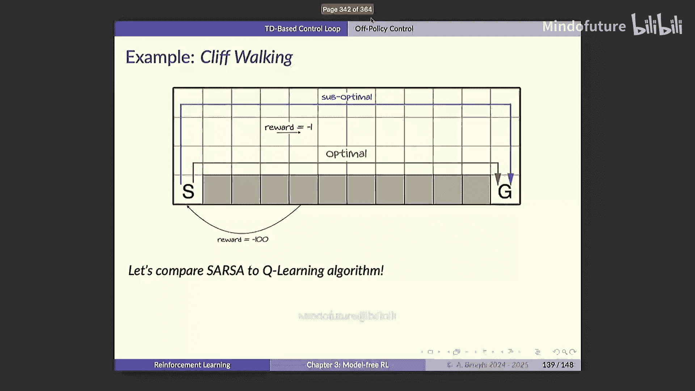

Well， this is here one example of cliffwalk。 And then when you do the cliffwalk。

 you remember these examples， you had it in your assignment。 So you start from one point。

 you want to get to the destination with minimum path and then the optimal path gonna be this one。

 if you don't， if you think of the termministic environment。 But if you want to to learn it。

 essentially you start playing here。 And each time you get like you hit some some wall。

 and this is giving you the like if you want to stick to that when we talked about it。

 if you want to stick to the greedy from very。Right， now。

 one thing that you can do here with with what you do with Sarsa， eventually。

 you would start to play， right， And then you might hit somewhere then hit the wall。

 And then it tells you， don't go this direction。 But then you give it the absolute greedy opportunity。

 right， sometimes again， randomly， you play that。 and gradually through time。

 you can end up finding out the optimal one。 whereas if you don't do that。

 then you can hit the suboptimal one。 Okay， now one thing that。

I want to show you is that what's gonna happen if you do Q learning and Soa。

 And I want you to pay too much attention before I explain it。 You just tell me。

 try to explain why you see that difference。 what does that mean， Okay， so look at this one。 Oh。

 this is sourcea versus Q learning。 Okay， and now。

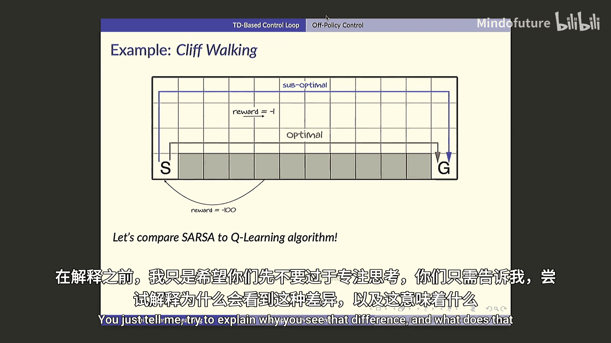

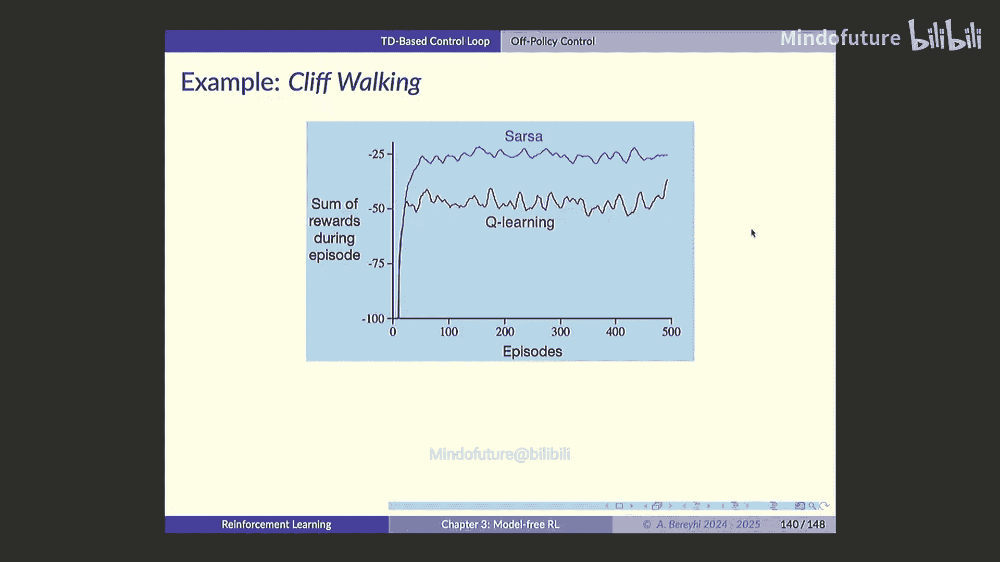

Grarant that you see is the sum of the rewards you are collecting。 so the more。Some is。

 the better you get， right。Smaller sum， like a smaller minus。

 it means that you just took a shorter path， right。Whereas with the， the smaller value。

 like the higher negative value， it means you took the longer path， right。Clear， right。

 So with this number， I simply mean how much you collected through the way， right Now you see this。

 this some reward that you're collecting at the end when you are doing this is average over multiple episodes when you you feel like the algorithm converged。

 so you start training you start going and you just update your epsilon greedy policy。

 But eventually at some point， you feel like your your Q function is somehow constant It's not changing anymore。

 right， in both cases， either sourcea or Q learning right So in Q learning that Q story is fixed in sourcea。

 the only queue that you have that one is fixed， right， And then at that point， you say， okay。

 my algorithm got train got to converge point。 and then you start to play with that。

 And then when you play with that， you just average whatever you collected。 Now。

 when you look at this， you see that Q learning is getting less than。What does that mean。

Does that mean that Q learning got into a suboptimal road and SAA is optimal。No， why。More exploring。

 right， great。 So this is important。 You should pay attention to this。 Everybody sees them。

So this does not mean that Q learning is doing worse， right， Because in Q learning。

 you are not supposed to drive epsilon， right， Even when you learn the optimal policy， still。

 you can do epsilon greedy， right， 20% of the time you still explore because who knows maybe there are some states you haven't yet figured out。

 right whereas in SArsa， you cannot do this right， if you want to get trained right。

 if you want to get into a con point， you need to reduce epsilon， right。

 So the moment Saa starts to play right， you're gonna see that eventually epsilon is very small。

 right， So it's not actually jumping anywhere anymore。

 right very tiny So you see what I'm talking about right。So Q learning is giving you a smaller value。

 but it's because a good fraction of time is's still playing randomly， right。

 but it's not harming your training。 It's still converging to something， right。You see that， right。

 So initially， they didn't know anything。 Initially， they were giving getting something like。

I don't know。0 or maybe even even worse， right， This， this was the time that you did not get get。

Trained your algorithm was not converging。 but eventually it starts to converge， right。

 And when it converges， it's just getting smarter。 It's not because it's subopmal。

 It's simply because it is still exploring， right。Whereas Saa， it。

 it is supposed to just reduce the exploration。 And this means that Saa is really getting into the optimal policy。

 right， The the policy that is playing with is directly the optimal policy， right。Everybody's cool。

Now， now， if I kill this epsilon inside your learning， say， say I stop here after episode 300， I say。

 okay， stop that's enough。 I don't want training anymore。

 So I'm gonna set Epsilon 0 in both algorithms。 What do you expect to see。Yeah， but if you。

 you think that yeah， that that's generally correct。 You cannot say it for sure。

 but this is typically in practice happening。 But I didn't mean that。 I mean。

 what gonna happen to this curve。 Does it jump up。Probably they both jump up at the same point。

 right， if assuming that both of them got the optimal policy because the。

 the problem here is quite simple， right， Both of them are gonna both of them gonna figure out the。

 the optimal path， okay。

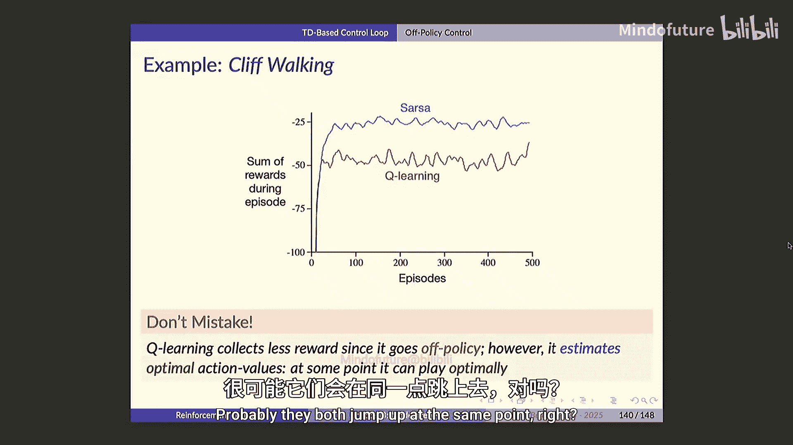

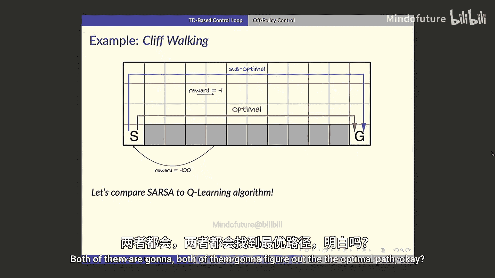

Right， right， right。 So both of them are going to get roughly same value， right。

 And the value is probably somewhere around this -25， right， because Soce is already playing it。

 right， Q learning is the one which is not playing it， right。

 And this guy supposedly killing Epsilon。 It should go somewhere up，Everybody's clear。Questions。Yes。

Right， right， exactly。TheYeah， because because it is still learning， right。

 It's just these are episodes that you're collecting to form your Q function。Right。

 so you had initially nothing。 You're increasing， right， You increase your samples。

 you improve your estimate， right。So， but Sa is doing it by reducing epsilon through time as well。

 right， whereas Q learning does not need to do it， right， And。

 but both of them are learning the the one。 If you want to just deploy that policy， then， of course。

 you can the epsilon， right， But if you don't do this epsilon drug in， in。In Saa， then eventually。

 you're not ending up with what you want， right。

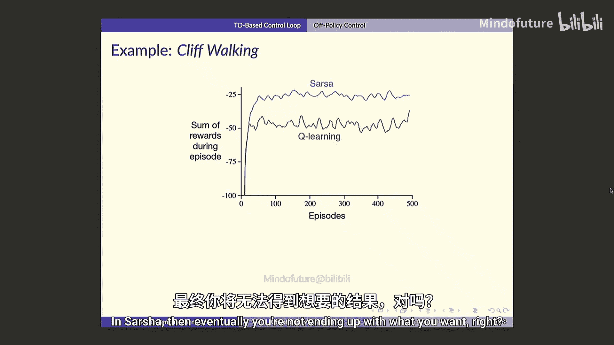

I mean， the whole difference is in this， in this guy， right， So you see here you've got maximum。

In Q learning in Q learning， but in source， you don't have maximum， right。

 And then if you don't put maximum and you do not drop epsilon， then eventually you can just。

 you're evaluating the random policy， right。You get the idea， right。Clear questions。

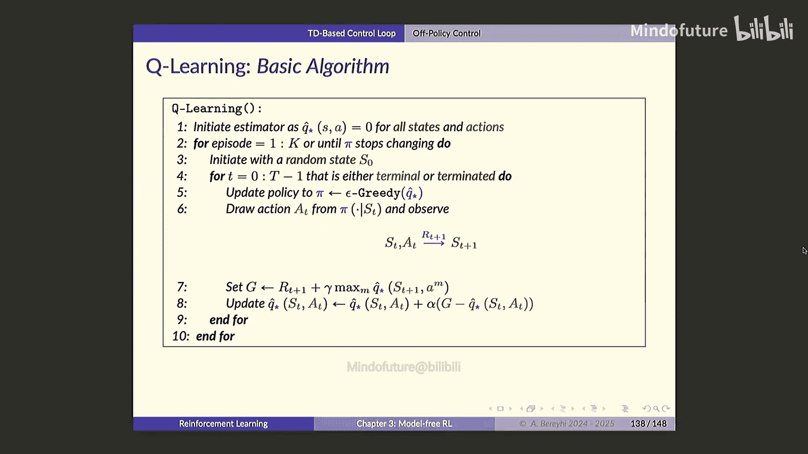

是。K takeaway， source is on policy。 So it is supposed to get to the optimal policy eventually。

 but your learning does not need to when it's training， right， But you can always exploit it。

 deploy it to just play optimal right。 So that's the key point Now。

 Just a few comments on the convergence properties。 So both algorithms are quiet。

 robust and they really converge， if you have an environment which is finite in size。

 like you have a few stays or yeah， not huge number of states and actions。 they can converge， really。

 and they basically， I mean， both of them can somehow describe a gl algorithm。

 So if you just just as a recall about gl algorithms。

 they need to have these two key properties right the first one was that the number of times you are going to check。

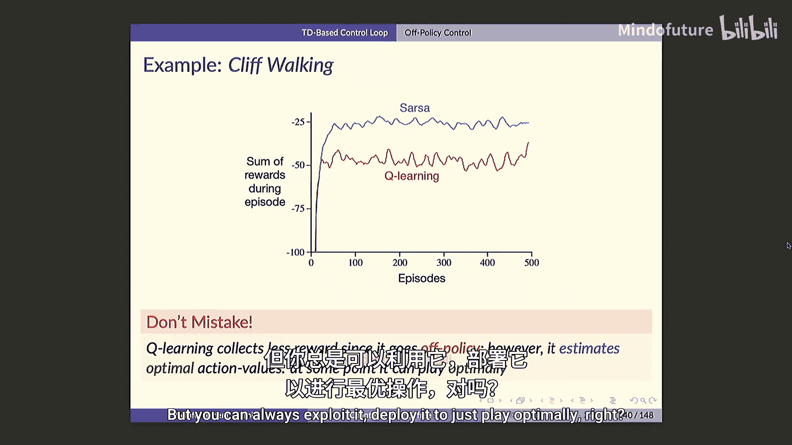

Every single state in action period should be large enough。

 And the other one is that the policy is supposed to converge to the optimal policy， right。

 And Saa is doing this， right， because it's dropping the epsilon。 So it means that gradually。

 the policy that is learning is greedy policy with hopefully all the right Q values。

 And then because of that is eventually the optimal policy with the right Q values。

 And then this is the optimal policy。 and。This one is also happening because you just scale epsilon with a kind of form that this is actually not dropping so fast that you miss any state or action。

 right So if you can do both of them， then this is a gl algorithm。

 This is what we talked last time about when we were doing evaluation initially and there we were talking about this episodes。

 So K is the number of episodes that you do。 but you might tell me that when I am playing with Sarsa it could be the case that I am playing in an environment where this environment is actually not ending。

 not terminating。 And if we are just doing control。

 we do not really need to terminate the episode So this thing that I showed you here。

 this is simply because the environment that you have this guy。

 it has a terminal stage right you either hit the wall and you start from scratch or。

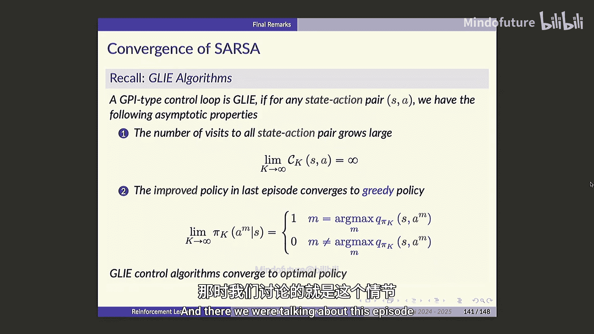

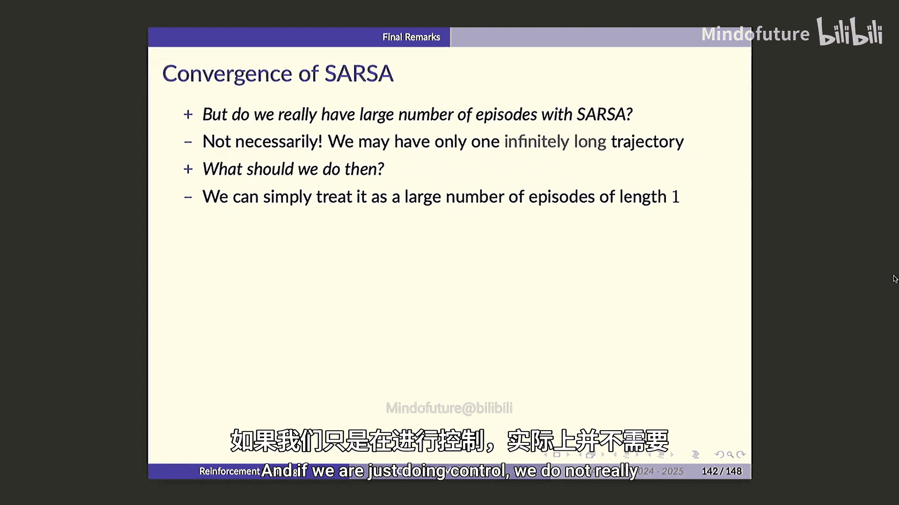

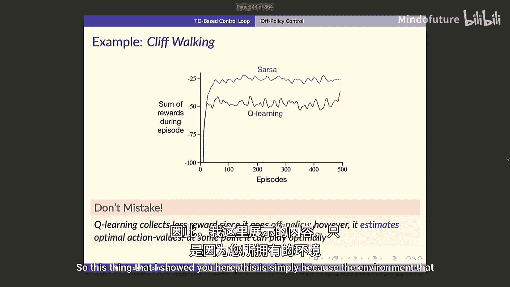

That with the with the destination， right， So your environment itself is。Having episodes， right。

 it's， it's terminating。 But you can have a situation where the。呃。Environment is not ending， right。

 And if this is the case， you really do not need to do any termination or something。

 You can say exactly same thing as we have here for in time， right。

 because every single time that you go on， you are just taking a new sample because we are in both cases。

 we are doing temporal difference， right， So temporal difference means that we are in one estate。

 we get one reward and we get into a new estate。 And that for the rest of the time。

 we are just taking or estimate of the value， right。

 So we can say this one time step is like one episode。

 The next time step is another episode and so on right So you can think like that。

 So you don't really need to think that necessarily the environment needs to be episodic that you you finish with multiple episodes So you can think of one giant infinite trajectory in time。

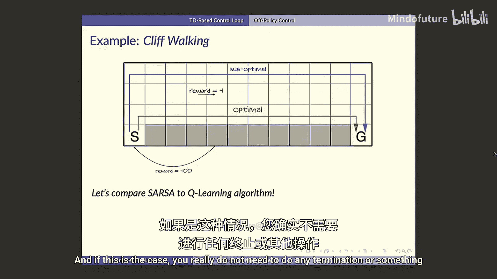

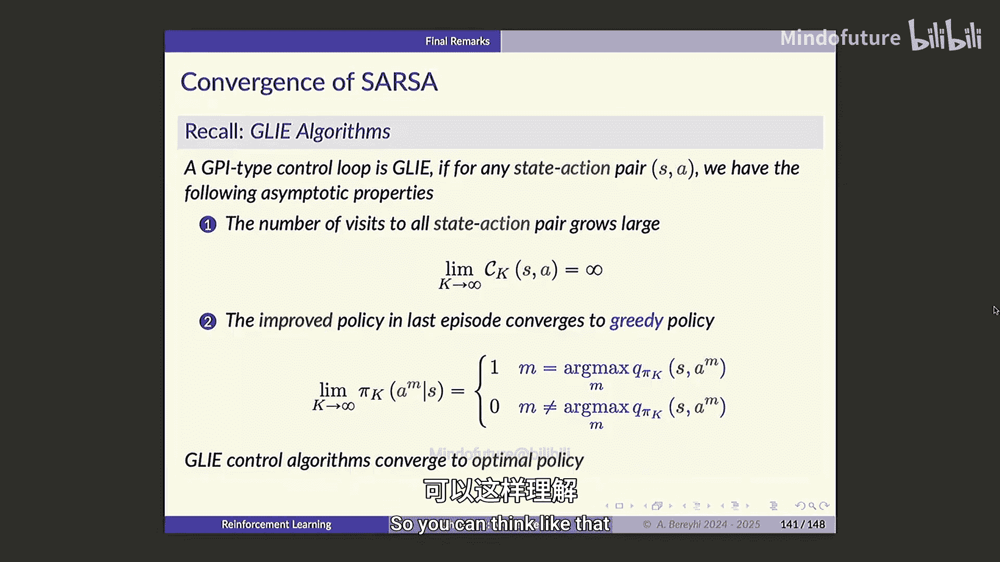

Which is， in practice happening in some problems， which is online control going on。

 And then every single time step that you get is one trajectory of size 1， right。

 And then based on this one， you are estimating， you're updating your Q values， right？ So。

 for example， this youre using eligibility tracing。

 And every single time you get from one estate to another。Date all the Q values you had， right。

 And then once you updated that， you update your policy as well， right。

And you keep on playing with that one， right？ So you don't really need to have a terminal。

 And whatever you said about number of episode should happen here as well， right。

 if the algorithm is glee， as time passes inly。 then you need to just see every action in state infinite number of times。

 And at the same time， as time keeps going， you need to get closer and closer to the greedy algorithm。

 right， So， yeah， so this is basically，The alternative interpretation。

 So you don't really need to have episodic environment every single time step。

 you can say think about one。

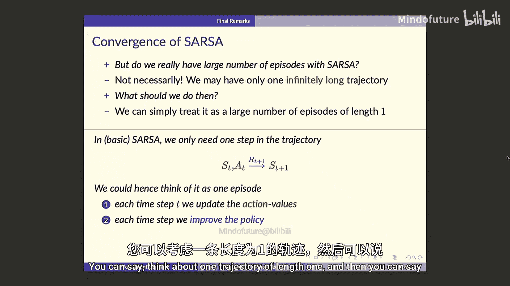

Trajectory of length 1。 And then you can say that G algorithm is eventually this guy， right。

 So the only thing that I have changed here， I dropped K。

 which was the number of episodes I replaced it by T， right， so。

Meaning that I don't really care about how many times I see something within different trials。

 I start from one state in action。 I keep playing。 And every time hopefully I see a new estate。

 right， as long as I make sure that I'm gonna see all state in actions enough number of times when the time passes。

Forever then eventually I'm going to conversege to the optimal policy， right。Everybody's clear。

Question。So this idea is the idea of the Gee algorithm。 So if you have this property， this property。

 then that is a glee algorithm。 that guy could converge。 That is good， but。Yeah， again， right。

 the the in the Sarsa case， if you want to just work with SArsa， this policy。

 you need to just scale that epsilon with time， right， Sam thing， right。

 You don't need to just scale every episode just every time you can just reduce it， right。

 But one thing else that you might ask me is that， well， say source or。

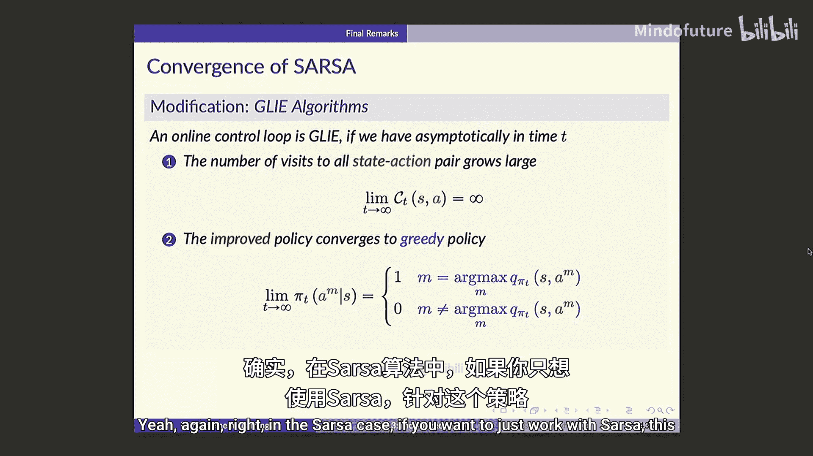

Being the algorithm is somehow。Telling us that this guy can potentially converge， right。

 by any specific condition that these algorithms are going to work's in。

And then there are also one condition。 and that is eventually on this factor alpha that you have in the algorithms。

 right， So just let me show it once again to make it clear。 So by alpha in this guy， this step size。

 which we shortly start to call it learning rate because you're gonna see that this epsilon alpha is really learning grade in the gradient descent right。

 But you don't see it mediator right now， you see it after we start with the function approximation。

 But this guy， this epsilon needs to have a bunch of properties。 So in practice。

 you are going to play with this guy over time。 do you remember what is what was the right choice of epsilon alpha when we started at the very。

 very beginning with the Monte Carlo approach。

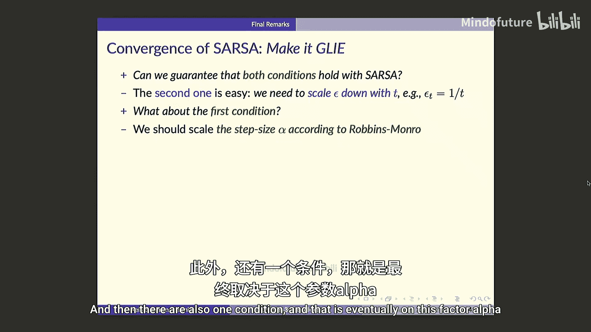

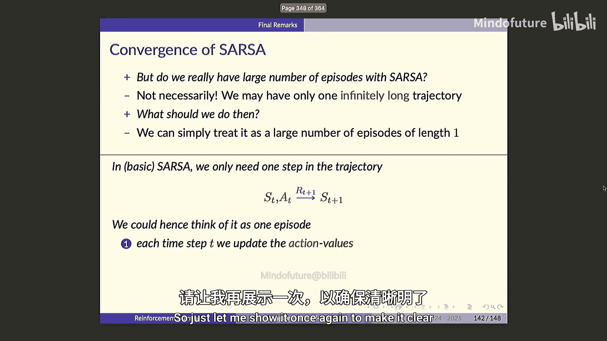

Yes。1 over a number of times， it happens， right，1 over K， for example， number of episodes， right。

If you remember， so this alpha was one over a number of samples you had， right。

 And we say more samples you get， you need， you need to just increase it。 But then we said， okay。

 maybe you can keep it constant as well。NowIf you want really in infinite time， this guy to conge。

 then you need to have these properties as well。 So the proof is not hard。

 but I'm not gonna keep bring it bring it here because there is no much information in that。

 The key point is that this guy should not drop so fast， right？ So if you add up alpha over time。

 they should just be infinite， right， And but they also should not be。

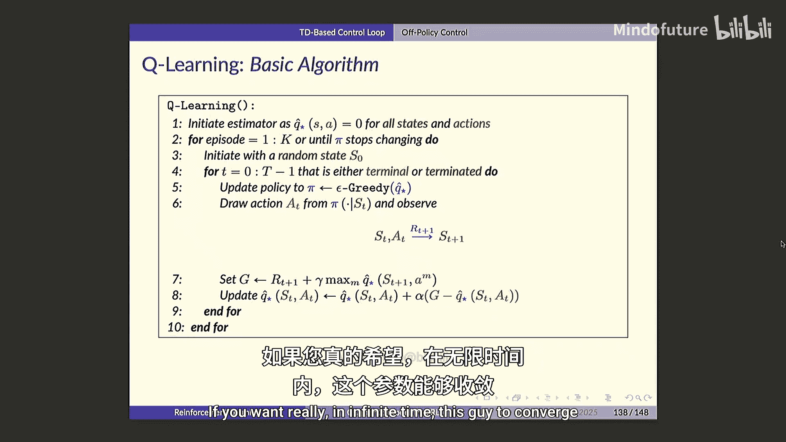

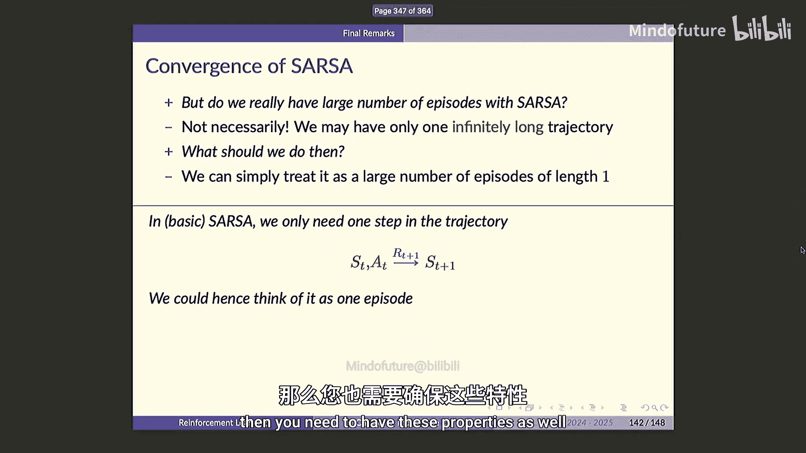

They should not keep up so large， right？ So if you keep them up very large。

 then says that their second momentum is or second sum， second order sum is， is infinite。

 Then you again， gonna have a problem， right， Now， do you know of any specific kind of sequence for this alpha that could have this property。

Any alpha T in time that when you add it up over time， it's infinite。

 But if you squareir it and then you add it up， it's not infinite。1 over T。 Yes，1 over n。

 exactly1 over T， right， So one over T has that property， right。And this is what you know， right。

 because when you started with writing down the Monte Carlo in the online averaging form。

 we saw that this alpha should eventually be one over k， right， And here it gonna be one over t。

 Yeah， if you choose it that way it's okay。 you can instead of one over t。

 you can use some other number， right， some constant over T。

 or you can do it that every couple of time。 you just drop it， right， you can do it as well。

 As long as you drop it in this format， this is going to have that okay。

So that's it regarding the convergence of Sarsa。 So if you have Saa and you keep the epsilon decaying in time and you get this particular learning rate to be a scheduled properly over time。

 then that guy is definitely going to converge to the optimal policy。 Okay now in practice。

 if you do not satisfy this condition。 I mean， condition2， you usually satisfy it。

 But you you're not sure if you are decaying it fast or or slow。 if you don't if you do it too fast。

 then you are going to end up with a suboptimal solution， obviously right。

 Sam thing gonna happen for one。 But since we don't know exactly how we can schedule it in many。

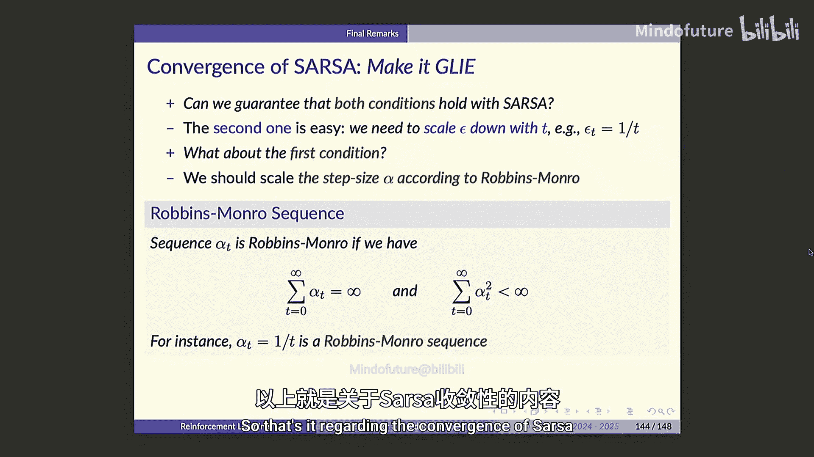

在。What we do in practice might be suboptimal， especially if the environment is very large， right。

 and that's what it is。 We can do nothing about that， right， yes。Some of the squares。

 because those great like these are gradients， error gradients， right， And then you don't want them。

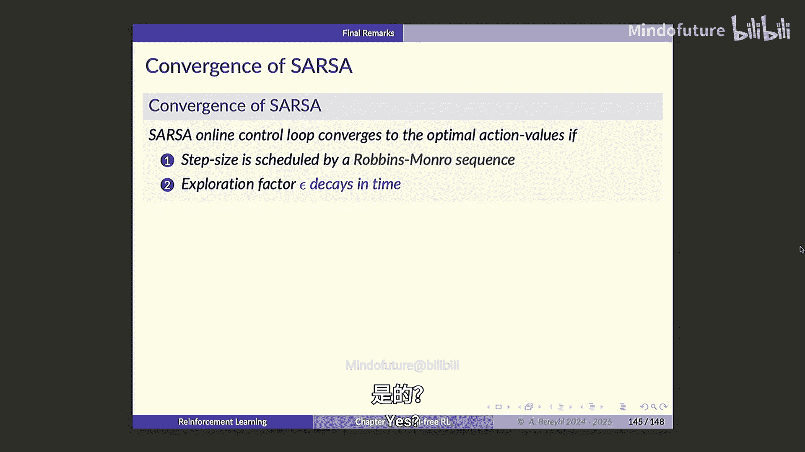

this is like a quadratic condition on the surface of the loss we are minimized。Somehow。

 you can think of it like that。 But it's not really literally variance。 but yes。

 variance of the gradients， right， variance of the gradients， you could say， right， Yeah。

 But we're gonna once we， I mean， it's not a very complicated thing。

 you see immediately that this alpha is showing up to be the learning rate， right。

 And then you don't really want to have that huge learning rate， which is averaging or yeah。

 adding to the variance of the gradient。The first condition is because yes， right， right。

 And the second one is that you're not dropping so fast that sorry， you're not dropping so slow。

 like not fast enough， that you somehow pass the say， local minimum， global minimum， right。

 something like that。 But this is because your model is linear。 you have a quadratic function。

 Then you're gonna the gradient is very simple。 then it' gonna satisfy this property。I mean。

 if you think about what we gonna see next in deep reinforcement learning。

 these conditions are useless then because you don't have a quadratic surface anymore。

 But if it doesn't make sense at all to you what I'm saying， it' gonna get me it gonna make sense in。

 in one or two sections from now。Questions。

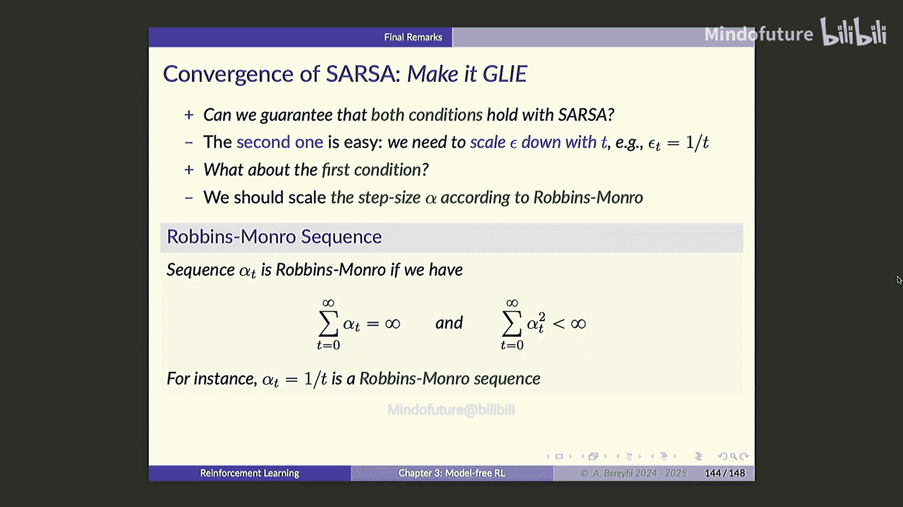

No question。 Okay So yeah， that was about Saa。 So in practice， what we do。

 Epsilon is usually a hyperparameter showing the assignment。

 I gave you this idea you can just decay epsilon。 and you're gonna see if you just play with the assignment。

 you see that this epsilon decaying the epsilon is very sensitive。 you can have it like。

 I don't know，0。99。 Then it's not converging。 Then you have it 0。9999。 Then you're gonna converge。

 Yeah， so it's gonna be extremely sensitive。 The main reason is because， well。

 you really need to somehow balance the speed that youre decaying with。

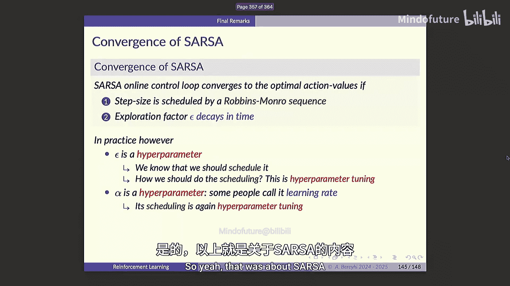

呃。The speed that you can explore the environment， the size of the environment， right。

 And this is the main reason。 So you need to really play with this same thing happens with alpha。

And we're gonna get more about alpha as we get into deeper reinforcement learning， because there。

 you're gonna see that this alpha is literally your learning rate。

AndThey gonna make more sense to you why we need to play with that。

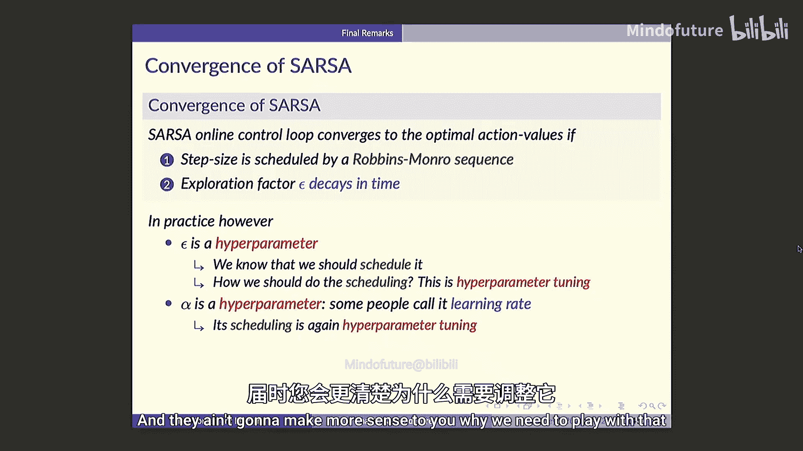

Okay， so regarding the queue learning， well， for Q learning。

 the conditions on the alpha is still the case。 You still need that one because that has nothing to do with the with the exploration right But the condition on the epsilon。

 You don't really need it anymore， right， So you just need to choose right alpha。

 And as time goes on， then you're gonna definitely get into the optimal policy。

 This means that you really you have less constraint to be worried about right。

 And this makes sense because you always try to learn the optimal policy。

 You don't care about the policy that you think you're off policy and that is the whole magic happening here right。

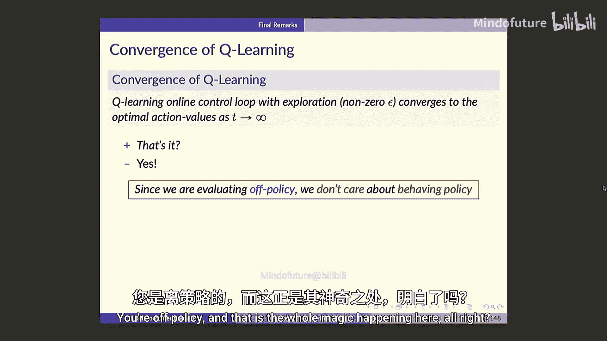

So。That being said， you might think that， well， Q learning is always better than Sarsa。 Well。

 to a kind of very broad sense that is correct， because Q learning is less restricting you to just。

 for example， play with epsilon。 But there are also。

 so Q learning in general has a minimal convergence requirement。 So this is very good。

 typically when you try it gonna converge faster， the main reason is again that you don't need to drop the decay the epsilon。

 right This means that you have the opportunity to just explore the whole environment much。

 much faster as compared to the Saa， right So that is giving you better convergence speed usually。

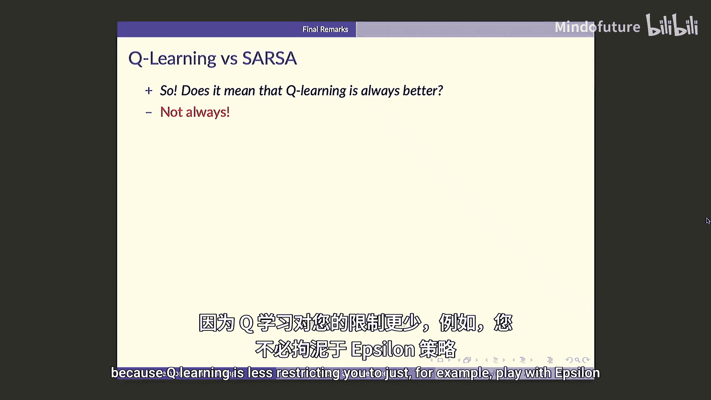

If you try to play with SArsSA， like you increase the decay inside epsilon side that it starts to converge as fast as Q learning。

 then you're gonna see that this could potentially get into a suboptimal policy because you drop it so fast that there are a bunch of state and actions you don't see because of that you get into the suboptimal behavior and well。

 it has flexibility has sample efficiency。 You're gonna see the sample efficiency。

 especially when we get into deepq learning there you can do experience replay that is great because basically we don't care about the policy。

 which sample the trajectory for us we can always handle that and that is the key point but it does not mean that SAa is not is not a good choice。

 I mean， just think about the real control problem where you don' you cannot say that okay I'm gonna stop and from no one。

I'm gonna simply use my policy， right， You want to keep on improving your policy all the time。

 and then playing off policy does not make sense anymore there right。

 because of policy is simply always taking the opportunity to explore right。

 whereas you want the policy that you' are working with to be optimal itself。

 and that is we like real online control problem。 This is much better to use SArsRSa。

The other thing is that it has lower complexity right。

 So you just deal with one single policy whereas Q learning， you need， as I said。

 you need to have the other optimal policy， The greedy policy in the background right And whenever somebody wants you to just play optimal then you need to stop whatever you are doing and take that one right。

 which is like in some practical situation might be a problem。 So So say is not totally off。

 but yeah， I mean， if you don't have those concerns， definitely Q learning is a better one。

 this is probably why old days people who do reinforcement， table or reinforcement learning。

 they would only care about Q learning right Q learning was the only thing people teach right at the end of the day because that was supposedly the best one。

哎呀。

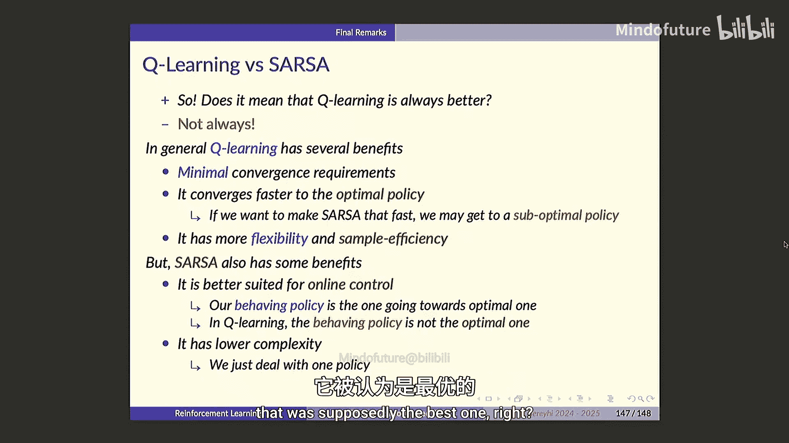

Questions。