# 【多伦多大学】强化学习 2025 ｜ Uoft   Reinforcement Learning   Fall 2025 p35 P35_讲座_34_为什么需要深度强化学习 -BV1D3F2zhEry_p35-

You know。

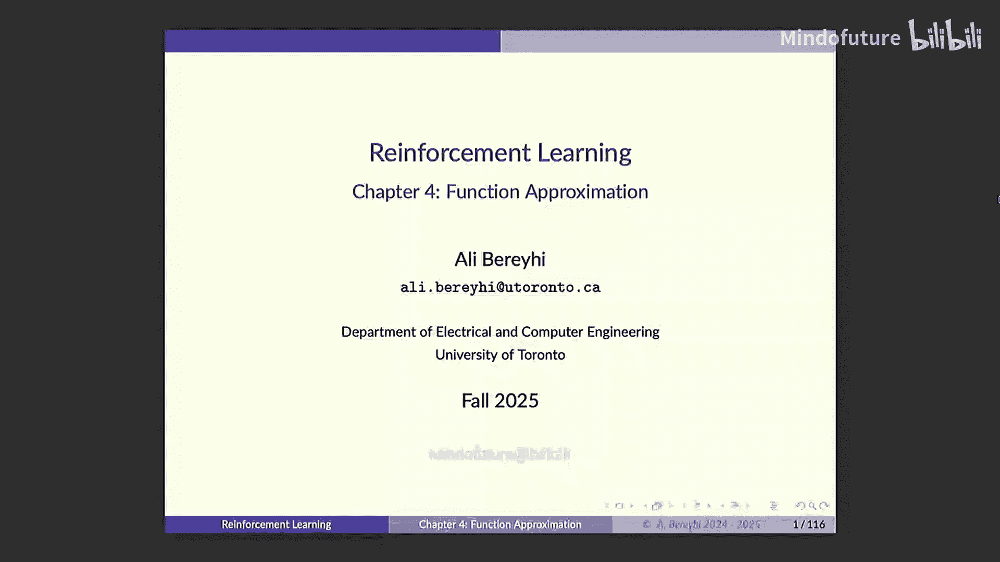

Science fictional things， as they were calling it， right。

 But then the whole idea of deep learning and its huge power started to help reinforcement learning。

 So one thing that I want， I hope that you get up to this point， essentially。

 we are doing some sort of learning。 But this is not the conventional machine learning that you knew in any sense。

 right， So it was basically。Trying to find out some sort of statistical。

Conclusion out of a probabilistic environment， right， which is still a sort of learning problem。

 But this is not the sort of computational learning that， you know。

 where you basically use the magic of machine learning to just predict something that you have never seen。

 you don't do it， really， right， for instance， if you want to know the value of one particular estate。

 you need to see it enough number of times， right， If you don't see it， it's not going to right。

 And there is no magic up to this point。 So magic is actually starting from here on， right。

 And this is what we call it the reinforcement learning。 What you see is that。

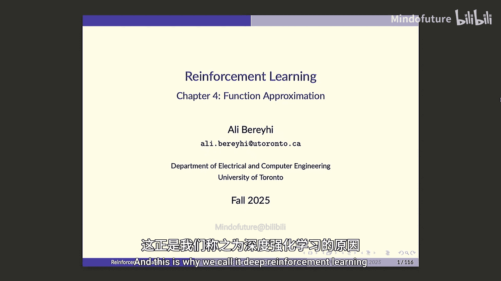

In deep reinforcement learning， the only thing that we do we just add up a neural network to the class the basic。

Basic estimation approach that we had。 And using that I want。

 we are now super capable of doing crazy things， which people did not think that is possible early days。

 so。There we talked about both of them。 So model base is over。

 This was helpful because it gave us the idea of Belman equation。

 this recursive property of the environment。And model3 is over。

 I think now the terms here are very clear for you， right？ So what is on policy， you know。

 what is temporal difference， Monte Carlo are learning of policy。

 You know what they are right And now the thing that we want to do。

 we want to answer the second question， because I told you we have two questions。

 The first question was that well， we don't know the environment， right， And then how we can do it。

 Well， we can estimate it， right？ And by estimating it。

 we basically did model model free reinforcement learning， right。

 That was one part of the the challenge， The second one is that what what do we do if we want to just。

If we are dealing with a larger scale environment， right。

 and this is what we want to do in this chapter， so。

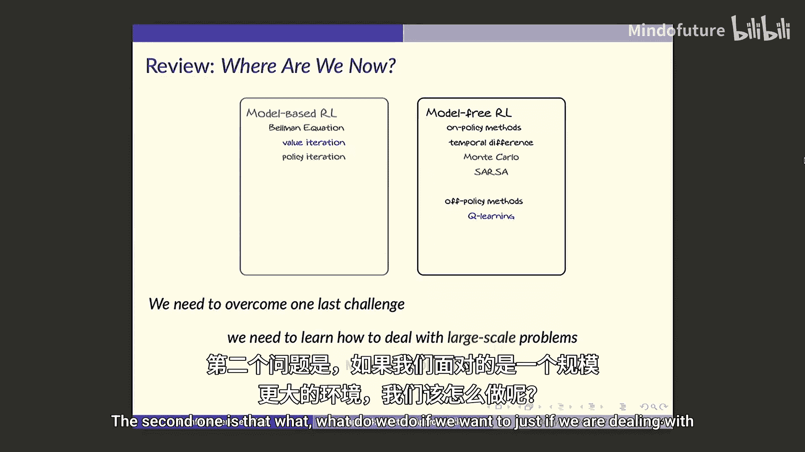

What we had up to this point is what we call a tableau reinforcement learning。

 and where does this word table or tableore come from is basically as you can think of those value or action value functions that you have as a sort of table right And the only thing that you try。

 you try to just estimate the values inside that table， you would say as long as I know that table。

 That's it right， So once you do， you。

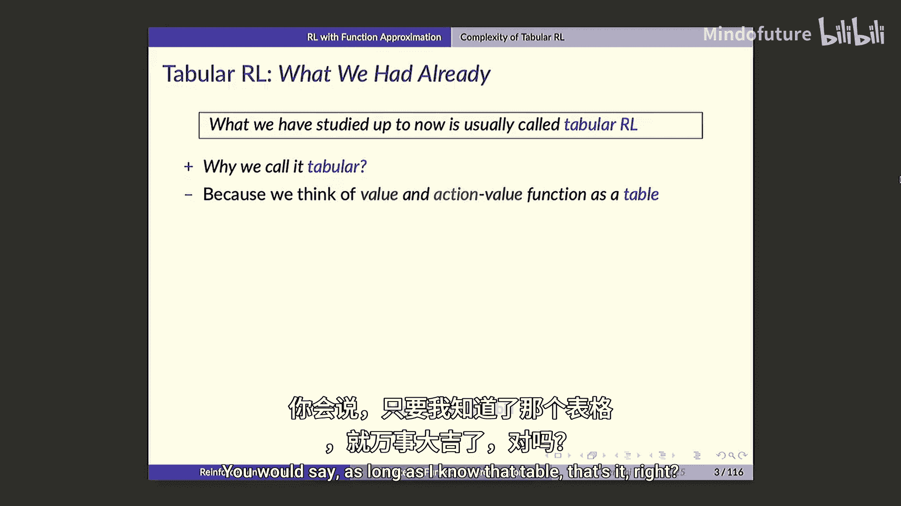

Now， for example， in all of those practical algorithms， you work with action value。

 right and then this。I actually one。St this table。St state and action， right。

 And you have M times n different pairs。 So your table has M times n different entries， right。

 And you don't know the values inside this entry you try to just do sampling based on those samples。

You try to estimate them， right once you estimate them， you look at those estimate。

 you take them for granted。 You just do the optimal policy， So that was the idea。

 This is why we call it tableau right， So if you look if you want to just visualize it。

 if youre just working with a value， then you have a value table right It would say my states are S1 S these are all possible states that I have right S1 S S n all possible states that I I could get to。

 And then I want to know what are the values。 Well， initially， I put all of them0。

 then keep on playing right And based on the samples I get， I try to improve the these values right。

 And hopefully this is going to converge to something meaningful， use that I want to just。

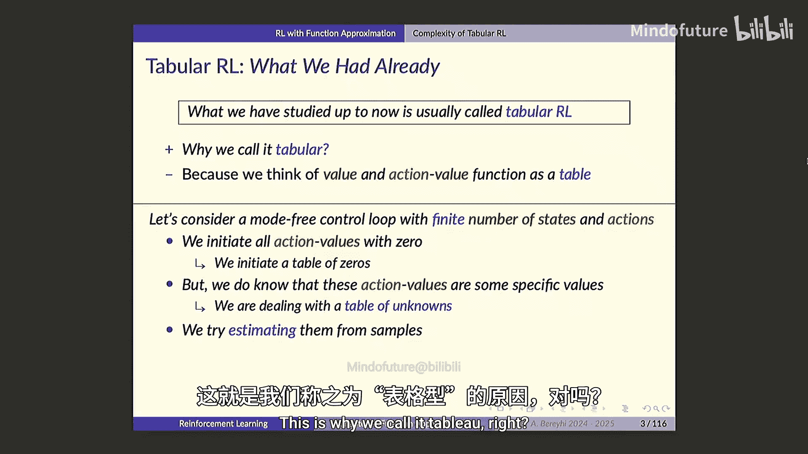

Decide my optimal policy。 or more practically， we usually work with the Q table， right。

Acutable is simply the same thing in two dimension。 Any state， any possible action。

 then what you do eventually again， you sample a trajectory in the environment。

 And each time you get into one of these cells， right， So you're in one state you do one action。

 and then you based on those samples， you just came up with some approach to estimate those values again。

 right。And if you can make this table very solid， like it converges to something low variance。

 then based on that you start to decide， right， That was the whole idea， correct。

 So this is why we call it tabler， basically， because we work with table， right， and this is nice。

 it gives us this results that， for example， this。Algorithm is going to converge。

 but the convergence always comes with this requirement that every single cell that you have here。

 you need to see it infinite number of times， right， not infinite， practically large number of times。

 right， And if you think about a realistic problem， that is pretty much impossible， right。

 So this is the whole challenge now。 The whole challenge is that what we did。Actually working。

 That is perfect。 The problem is that we cannot really implement it in a feasible amount of time。

 right so。

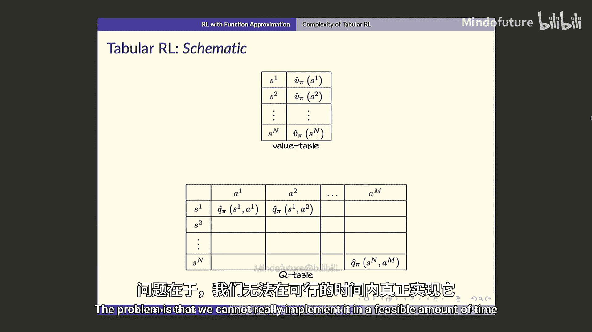

那。If you want to just use tablear， we can use temporal difference。 We can use Monte Carlo。

 It doesn't matter which of them we do at the end of the day。

 We need to see all of those estate action peers a number of times， right， So say for each of them。

 we need C different samples。 I don't know 1000 samples that you can trust on the estimate that you get。

 right， If you want then you need C times n times n different samples， right。

N times M is the number of peers that you have。 Each of them。

 you need to be there at least 100 times。 So 100 n times M is the number of samples you need right。

 And that N and M could be crazy at large right， So this is not happening。 So in practice。

 you never get to even cover all the possible pairs in most cases。

 right In many practical problem so。T or reinforcement learning。 that's nice。

 but the number is super simple inefficient。 So the number of required samples you need in order to to be able to somehow rely on the result that you get is eventually very。

 very large。 And this is not possible in practice， okay。

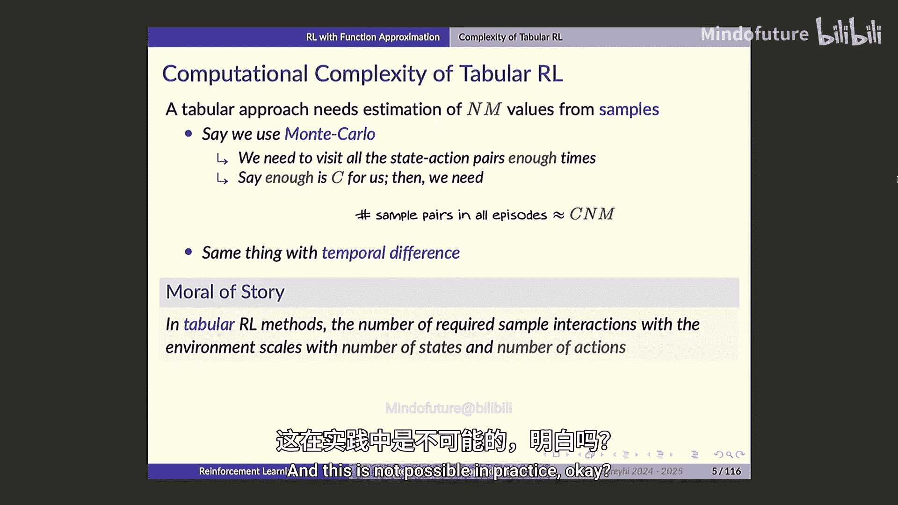

So you see the problem， right？ So just give I want to give you a couple of examples。 backga。

 you know that that works right， So each， you have different ways of playing it right and different ways of playing it。

 It means that you have different possible states。 So there is in total。

 roughly1 to power 20 different states， right， This is the number of ways you can play it， right。

 So this is the number of cases you， you can play。And say every time you have M actions。

 I don't care what M is。 I just ignore it。 I only talk about these states， right。

 and say that every single state， you can check it。Within one p or second， right。

 is a quite fast thing， right， You need to sort things out。 This is one estate。

And then this takes taking like one pick of thinking is pretty much impossible。 right。

 You store from that estate。 you play to get one sample， right， This is the idea。 If you do。

 for example， Monte Carlo， right。You again store from from another state。 you play。

 You again get another sample， right， Now， if you want to just get C samples for what each state and every action that you could do there。

 then this is the amount of time that you need in seconds。

 And if you convert it into the number of years that you need。

 So if you want to collect enough sample，3。2 times C times M samples you probably need to。To collect。

 right。Which is。Large， but you might say， okay， I am very interested in this game。

 I'm gonna take this much time， right， No problem。 Let's go for chess， right。

 I gave you this funny assignment。 You just saw how long how many cases are there for chess。

 right10 to power 20 was Shanons estimates， right So he said like the channelnon number says at least you can play 10 to power 20 cases。

 at least， But then that 10 to power  hundred20 was not smart in the sense that not all of the cases are a kind of cases you play chess。

 right， because many of them are dummy playing give chess。

 Then people started to just do this research。 So it has its own research。

 How many cases of chess is there， right And there is no concrete number。

 but there are better and better estimates。

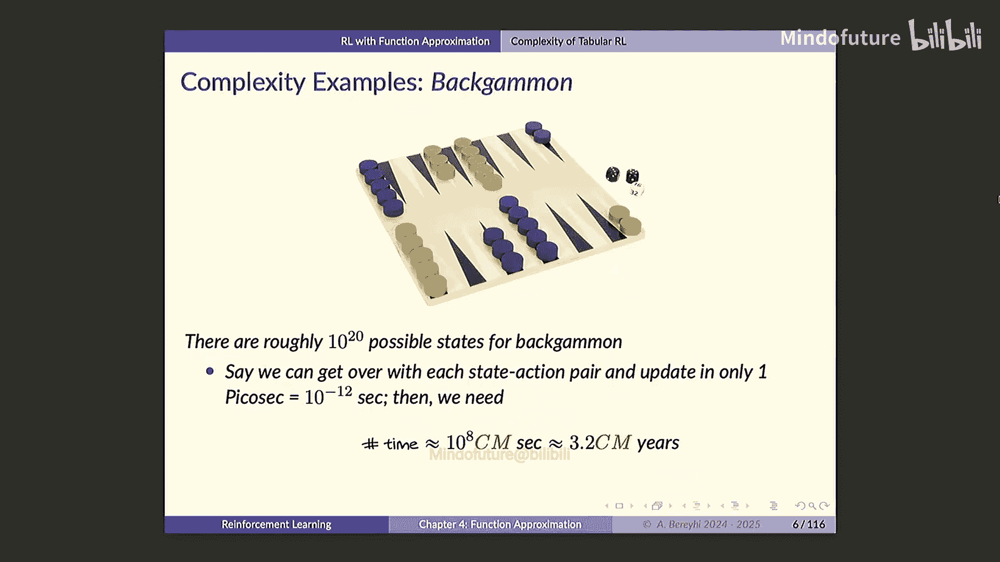

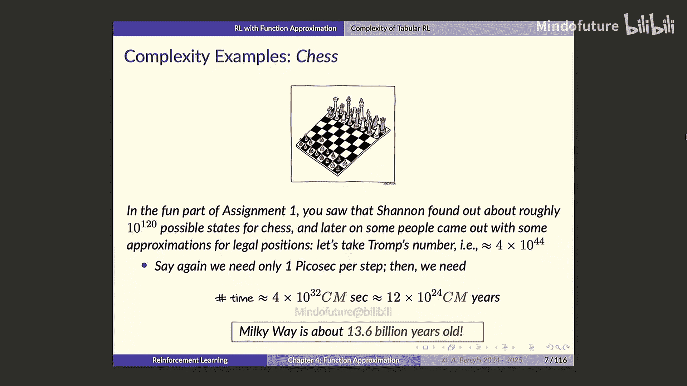

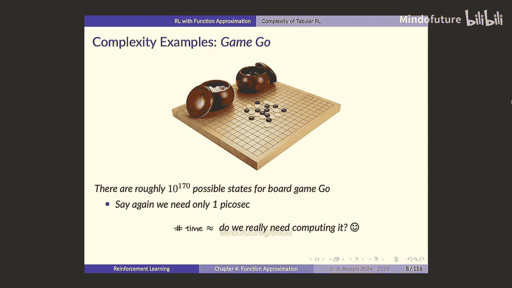

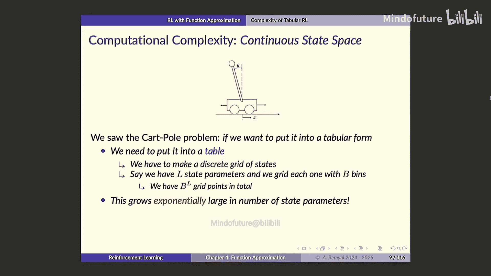

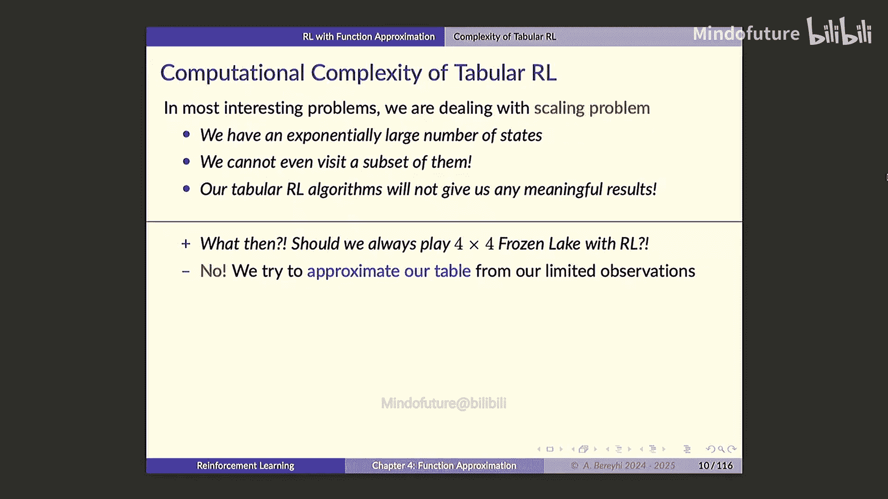