# 【多伦多大学】强化学习 2025 ｜ Uoft   Reinforcement Learning   Fall 2025 p36 P36_讲座_35_在强化学习中使用函数逼近 -BV1D3F2zhEry_p36-

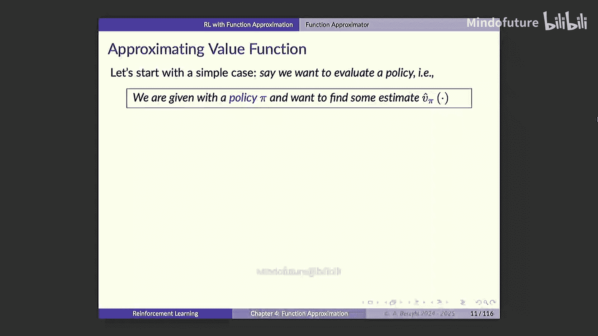

OK。So啊。Value function approximating the value function。 This is the first thing you can do。

 It's not the only thing we do。 We also are able to estimate the policy using a neural network or a function appromator。

 And then this is。When you just work with the value。Function， then is a value network approach。

 which is the classical one。 The most famous one is the deep reinforced deep Q learning。

In other case， I think someone wants to come in。The door is locked。If you can' open it， yeah， thanks。

Yeah， that's it。Okay， so thanks。This is one case。 The other case is that you just directly learn the policy。

 This is approach based on policy， and that is policy gradient approaches。

 And then you can mix both of them because in the policy gradient approach if you want to still train that policy network。

 you need to have estimate of the value and initially you do it by basic approach is like we did here。

 but later people said maybe we can have another value network that estimates the value that we want。

 So in that case you are doing what we call it actor critic right you have a policy network。

 which is which is acting and then you have the value network。

 which is giving you critic or estimate of the values。 Now。

 let's start with with the general framework。 So let's start with a case that we have one particular policy。

 So I give you one policy。 And I want you to just estimate the value of that policy right if you want to go on with tableau reinforcement learning。

That you。For the state 1 is B1， right？ I don't know what that guy is。 Val for a state 2 is V。

For state 3 is V and so on。 So you have n different values， right。

 And then you you estimate how you can do it。 If you do want to Carlo， you just go in one a state。

 you sample right， you sample enough number of times， you go for another stage。

 you sample enough number of times。 And then you average them。 That is your estimate。

 right But we do know this is not possible anymore in practice right what you can do instead。

 you can instead think of a function approxim。 Now what is function approximator。

 you always think of a neural network。 Okay， this is what we do at the end of the day。

 I use the general term function approxi， because maybe you want to do something but neural network。

 But in practice， you know that you don't do anything but neural networks。

 So you always think of a neural network。 So what is this guy， this F W and S。

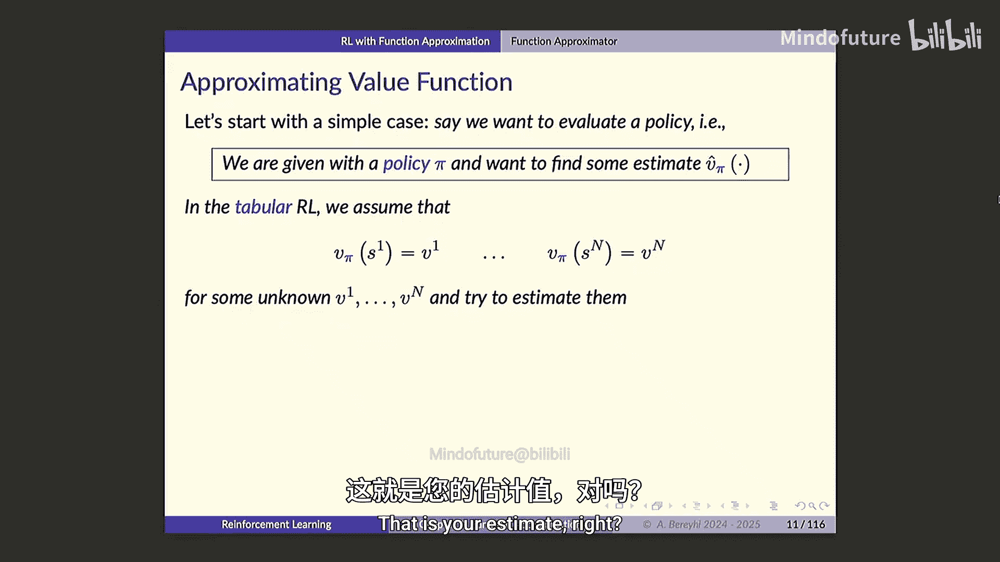

This is one function appromator， which is approximating this V function， right？ Now， what does it do。

 It has a bunch of weights in it。 W， right， These are the weights of the neural network。

 for instance。The state S goes in。 You might ask me， do we really get literally this state S into it。

 It's a number just right， We're gonna give right representation。 We're gonna talk about that。

 No worries。1 hot representation is the easiest one you can do， right？

 So we're gonna do that later on。 But you think that right now you're giving just the state into it。

 right， the state goes in， then you have a bunch of different value weight that you can tune inside this appro。

 right And then something comes out right Now what you hope for is that you can find the right choice of these ways side that this guy is exactly replicating the value function that you are looking for right now。

Does that which come true， Yes， because you have a neural deep neural network。

 and that is a universal function approximator， right。

 So it means that if you have a very deep neural network， that is able to show any function。

 including the value function that you are looking for， right Now。

 if you want to to learn this choice of W here， you don't really need to know or sample every single possible state anymore。

 right， you just sample as much as you could， you give them as samples inside your data。

 And then you try to train your function approxiator based on that data set。

 right So that is the big picture here。 So this is a function。 This is a neural network。

 It has a bunch of weights， bunch of learnable parameters。 And the only thing that we want to do。

 we want to just find out the right choice of these weights。 say that this is going to。

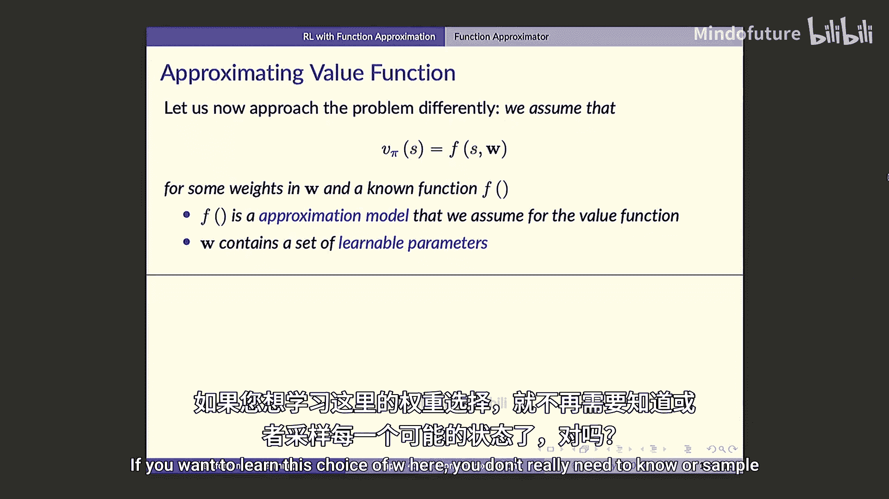

Fit the original value function that we want。 So one thing that you might ask me here is that this choice of function。

 right， this choice of the model that we are doing Ne network。 Does it make sense， Well， old days。

 people had to make a bit sense， right， look at the problem that they have。 Then they would say。

 okay。This is a continuous state problem。 The angles changing like this。

 Then the angles close to each other should have roughly close values。

 So this function should have this property that if I change the state slightly。

 then the values are also changing slightly， All right， So it needs to be a bit continuous。

 it needs to be differentiable。 It needs。Bh， bh， blah things like that， right。 No， it is。

 We don't need it anymore。 neural network is doing all of it， right， It has all good properties。

 It does not have bad properties is the best guy on the earth。 We don't care about it， right。

 So those things you can find is still in the textbooks， But you don't care about that， right。

 It makes sense。 That's it。 So now what you want to do， you want to find this right approximator。

 right， You basically want to find the right choice of the waste。

 And those choice of the ways are hopefully giving you the right estimator of your value function for the particular policy。

 right。

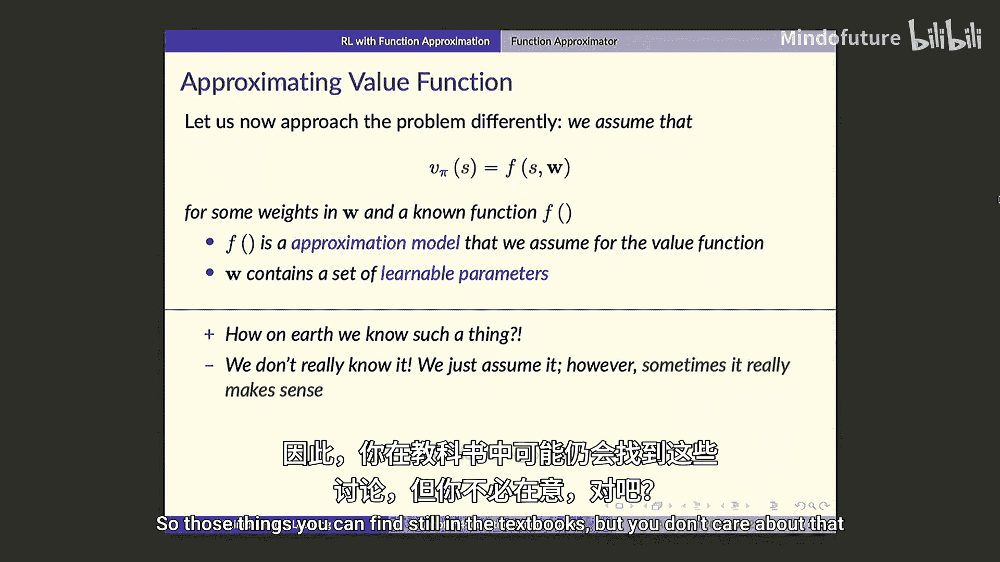

Now呃。Would that be better this， this estimate that you can get， Would that be better than tableore。

 I guess in terms of complexity， quite obvious for you that that is the case， right， Because say。

 for instance， I want to do the same thing with Tore， right？ This means that I could。

Inside the table， few。Get good estimate for them。 R of them， I'm gonna leave them alone， right。

 I don't do anything， right， And then they're gonna remain 0， right。Whereas in this case。

 when I train those ways for those particular states， right。

 So if I find a choice of a good choice of W， which for this state that I can see。

 it's matching the estimate of the value， right， then it's going to give me something about the other states as well。

 right， something。 I don't know if this is the right thing or not。 but， well。

 it's something is better than nothing that I had in the tableular case， right。

 So this is one thing you。

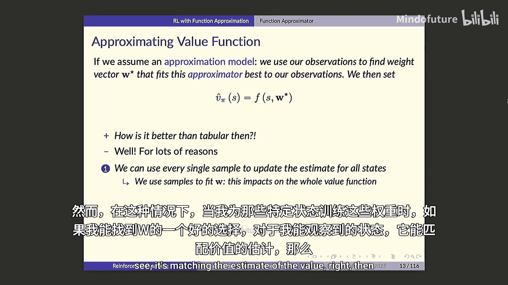

Actually， get something out of it when， when you train this model。

 because eventually this fitting of W to the data that you add is not simply giving you the value in the particular state that you have seen It's also giving you at this states that you have not seen。

 right， simply because this functional approach is somehow relating them together， right。

 So this is one thing。The other thing is that when you update the value of one estate。

 like when we did basic sourcea right sorry source algorithm。

 we had to do this eligibility tracing right and the whole idea was that well。

 if I get into this estate since I have seen lots of other states and eventually I have updated the value of those estate based on the value of this estate。

 which I am nowing maybe I should go back and update them as well right So we went over all of this trouble to just come up with the eligibility tracing。

 whereas you can directly do it here inside the neural network right because once you get a new sample and you update。

 you're not simply updating the value of the estate right you're updating eventually the value of everybody when one way changes inside neural network。

 it does not change the value of one particular input right any input going in is going to change at the output。

 So it's somehow propagating all the impact over。This says， which is a good thing again， right。

 This is what we want， because we do know intuitively that want to say value when the estimate is getting better。

 that should also make the estimate of the other values better， right。So this is the other thing。

 And the last thing is that somehow is going to capture the impact of this state on the value as well。

 right？ So if you have， if you train a neural network for again。

 you have lots of possible parameters for your state， right， Maybe some of them are useless， right。

Maybe some of them are simply redundant parameters。

 I'm recording them because I don't know whether this is a part of a state or not。

 right maybe some particular angle inside a robot， this is actually totally useless I don't need to know it to evaluate the value right but I don't know it in advance right if I want to do table R。

 then I need to just consider data state as well inside my state space and learn the value for that。

 then eventually I see that it is not impacting inside my table But here you don't really need to do it again because you do very well now from deep learning that neural networks have this capability to just ignore those parameters which are having no information So it' gonna to just focus on the features which information and that is a good thing again right So this idea in general。

 I mean， the whole complexity thing aside from information point of view， it also makes sense。

Because this kind of appximator is somehow acting as a kind of universal manipulator of all the values。

 right， whereas in the table art case， you just focus on one particular value。

 you play with that one。 and that is not the best idea， right， at least we see it in the environment。

 right， if one thing happens， if something happens in this particular。

State of the situation of of or or game。 Then we can probably have some idea what' gonna happen if we just slightly change this state。

 right， that roughly is the same。 So we probably need to go to totally different state， right， so。

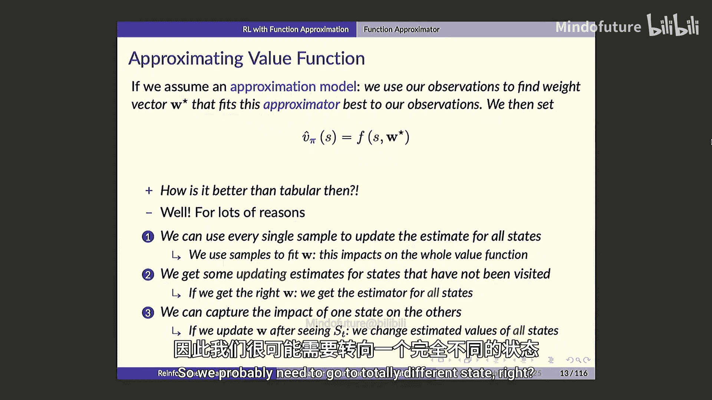

That's the idea。 What we can use as the approximator。 Obviously。

 we are going to always use deep neural networks。 There have been some other ideas like eigen transform。

 Fourier transform， wavelet transform people before。Deep learning， they used to do that。

 But nowadays， we don't do them anymore， right， So sorry。

 linear appm is basically what we did in the tableore case。 And I'm gonna show that。 Okay。

 I'm gonna show you that if you just put that。A function approximate to be a linear function app。

 Then you end up with exactly what you did before， right。O， now。So yeah。

 here we are going to focus on these two linear one。

 which we just want to get recap what we did before。

 And I show you that we are not just getting into a new environment。

 we are basically doing the same thing。 knowing a more general case。

 And then we get into the deep neural networks。 one thing is that one of the main reasons that we do it is because of these models being differentiable。

 So even in old days， people were more happy with linear models that compared to many eigentranss。

 And the main reason was that linear models are differentiable。

 you have weights getting multiply with things whenever you want to take the derivative。

 you just take the derivative with respect to any weight。

 That's a very simple thing right So they are better， but you gradually gonna see why they are good。

 yes。也。No， I mean， the value function is。Function based on the estimate of Q function you have。

 you can say what is your optimal policy， right， do action。You don't know it。

 You just get the estimates。 feel like what we did。The tell。Right， if I。

If I particular state in action， right， I can sample the environment， right。

 I just focus on one state in action。 I just sample so many times。 Then I average them。

 This is going to give me the estimate of that estate， right。哎。 yeah， Monte Carlo or TD。

 This is why we had it in the other chapter。 I do Monte Carlo or TD on one point， one estate。

 I do it in another state another state a few states， right。

 And then I try to fix fit my model into the value I estimated at this points。 Then I would say if。

The scene there is a kind of low dimensional behavior between all the states。

 Then this model is eventually learning what is the value of the other states。

 which I do not have time to go over right， If this is not really the case。 Well。

 this is the best I can do， right。Yes， but you know that we don't need to really do focus on policy。

 We can do off policy， right， We can do Q learning in Q learning， we can sample the optimal policy。

 right， And then based on that estimate， we can just know what is the optimal Q value in few action state cases right。

 And then you try to fit your Q network into those points。

 And then hopefully this is giving you a again。Right estimate for the other state in action， right。

 That's it。 So you really don't need to do GI。 You can do， you can do。

 but you don't really need to do it since you know， important sampling as well。开始。Or estimate。

 So it's in kind of noisy one， right， And it can hugely overfi， right。

 So all of those troubles are there here as well， right， And we can do nothing about that。国刑。

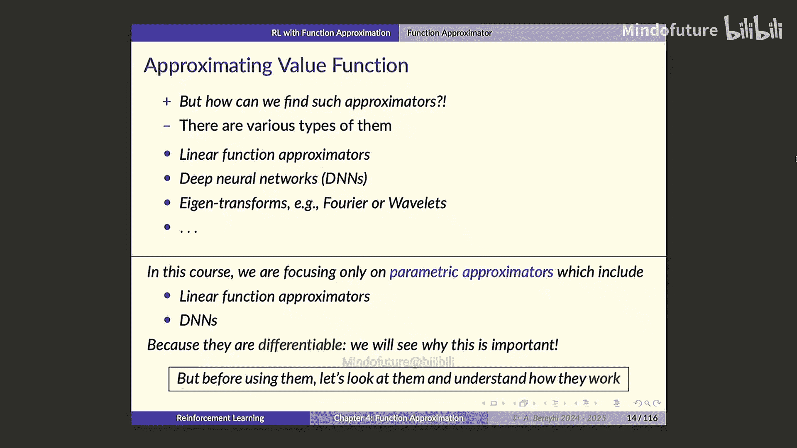

So the idea is clear right Okay， great。 So if you got that and clear。

 So I have just a few slides Last time I did it more and then people told me you can trust us。

 we do remember deep learning。 So I'm gonna do it just a few slides to recap and also give you the mutation as I said。

 I believe that most of you had some contact with deep learning it's good to recap one thing that I should mentioned here is that I am not going into like things like back propagation。

 these stuff are not going to be a part of the course but if you want to implement anything。

 you need to be able to implement a neural network and whatever I say here like in friends。

 I don't know model update， things like this should make sense to you right So you don't really need to know what is CNN to follow the course but at the end of the day。

 if you want to implement anything that I told you here you need to really use a CNN right and my personal experience。

as long as you don't， if you don't know really what is CNN。

 they' gonna be a bit hard to understand why this is going to work， right， But as I said。

 I'm not going to specify the model or anything in this course。 So if you're just。

 if you had it long time ago and you want to recap， that's totally fine。

 right as long as you have you're fine with these notions here now。How we do function approximation。

 Well， typically we get a bunch of samples here， right。

 These samples are the input to the function X is the input going into the function。

 Y is the output coming out of the function。 And then you have a few samples of them right So in our case。

 X is something that is representing the state。 we're gonna call it the feature representation of this state。

 This is something going inside the neural network。 Y is value right， action value。

 something like that right Now I can collect a bunch of them。 not too much of them。

 just a few samples， right， up to the power complexity that I have right And then this totally again。

 if I want to collect them， I should do something like Monte Carlo temporal difference。

 something like that right So it means that I start from one。

 If you think about the value function estimation。 I start from one estate just sample finished again。

 I start the same state I sample。

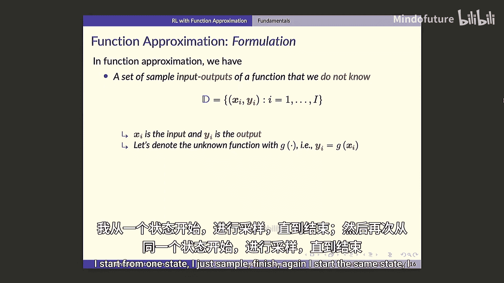

Fin， and I average all of their returns， right， This is the value of this estate， right。

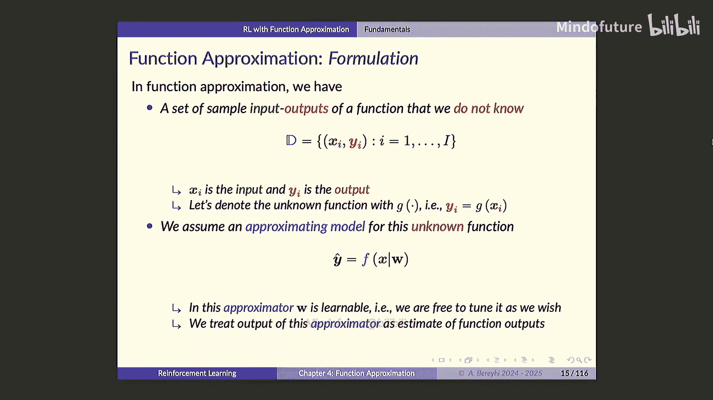

Okay， so。So that guy is more expressive， right， So this is one thing。诶。Now。

 this is the main reason that this works， right， universal approximation theorem。

 So probably most of you have seen it， or maybe you have heard of it， at least。 And what does it say。

 It says that。If you have one deep neural network， this is pretty much capable of just estimating any function。

 right， and by any function， it mean， it does not mean that it really does it for all the possible function on the universe。

 but it can do it pretty much for all of them with a good。With a good。Accuracy， so。Sorry， guys， it's。

Yeah， so it means that I should。Spend rest of today here， that's bad。But， anyways。Okay。

 so universal approximation theory and what it says， it says that any function that you have。

 you just choose it if you have a deep neural network。

 then that deep neural network is going to approximate any function that you want with a good accuracy。

 And if you want to improve the accuracy， What should you do。

 You just increase the complexity of the model。 You increase the number of neurons inside that model。

 right， and。As you go deep， the deeper you make the model is going to be more and more expressive。

 right， and the expressiveness is going to increase exponentially with the depth， right。

 So it means that if one model with with depth 1 can approximate， I don't know 100 functions。

 then when you make it up depth 2， it' gonna be 100 to power 2， right， depth 3。

100 to power 3 and so on， right， not exactly the same number to power 3， but like you get the idea。

 right， the scaling order。 And this is why we are happy with deep neural networks。

 they are perfect in sense of approximation。 And this is what we want to do today， right。😊。

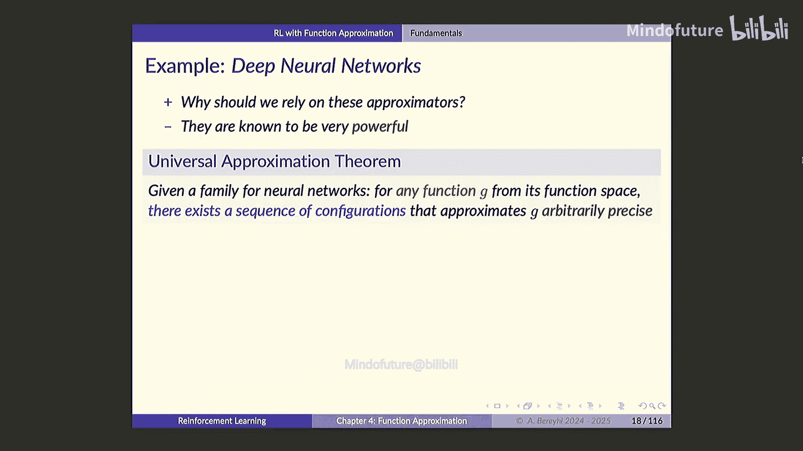

So， yeah， that is the idea。 So maybe I look here， that's better。So。Now。

 if you want to just do the training what you do， basically you just try to make the output of your model at every single data sample that you have matching the estimate that you have right and you hope that if you get a new data you're going to get a good approximation of the true function which you don't know right at the output of your neural network。

 this second idea is what we call a generalization， So you want this to happen。

 this is what you hope for and this is what you do it by training right So that is the idea of training。

 if you want to visualize the model， So this probably is going to help a lot thinking about the function appm。

 So what you can say， let's assume that x， the state that you have is a scalar number right and then the output Y is again。

 for example， value of that estate， which is a scalar number。

 So this is a scalar function right and you have a bunch of ways inside that function。

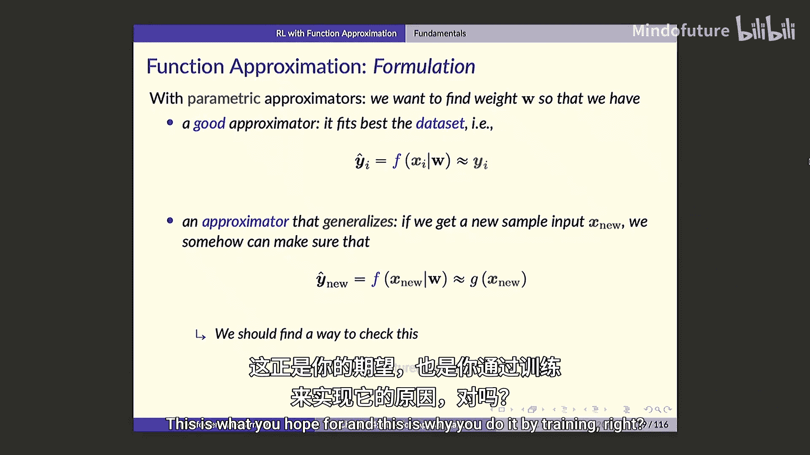

Which you can change。 So if you put some ways， it're gonna look like this。

 If you change the way you're gonna change。 and what you want to do。

 you want to just find the way the right choice of ways that is at least passing through every single point that you have inside your dataset set。

 right， And hopefully at the other points。 like， for example， you do know this particular point here。

 And you try to just tune your weights side that it exactly passes through that point or roughly passes。

Close to that point。 And what do you hope is that like the regional functions is smooth enough that when you pass from this point at the surrounding point。

 you're gonna be the same， right， roughly the same as what your model is giving。

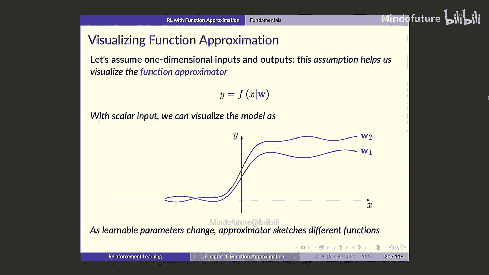

Okay， so。How do we train a deep neural network？Or any model。

We basically do empirical risk minimization right， So you have your samples。 X going in。

 Y comes out and then you pass your samples through your neural network。

 This is what you have as F of x given W right So this comes out this is not necessarily the same thing as you have inside your dataset right and you're just playing with your W to make it happen right And if you want to do that。

 you compute it sort of loss between these two typical loss that we choose here is going to be MSE right So whatever the output of my neural network is minus the estimate of the value I have squared right And if you just make that zero。

 If you minimize that that is going to at least pass through the same values。

 as you have inside your dataset set And then for the other point you're going be the same right So this is the empirical risk and then we do the training right So everybody knows that rights no。

questionestion on it， right？No question。 Okay， cool。 So if you got no question。

 one thing that I want to recap gradient decentcent， right。

 What is the gradient decentcent algorithm when you want to minimize this function。

 what do you need to do， You need to just start from one set of ways。

 These are the ways inside your neural network And then you keep on computing the gradient at every single weight right？

 And then you just move in the direction of the gradient， right。

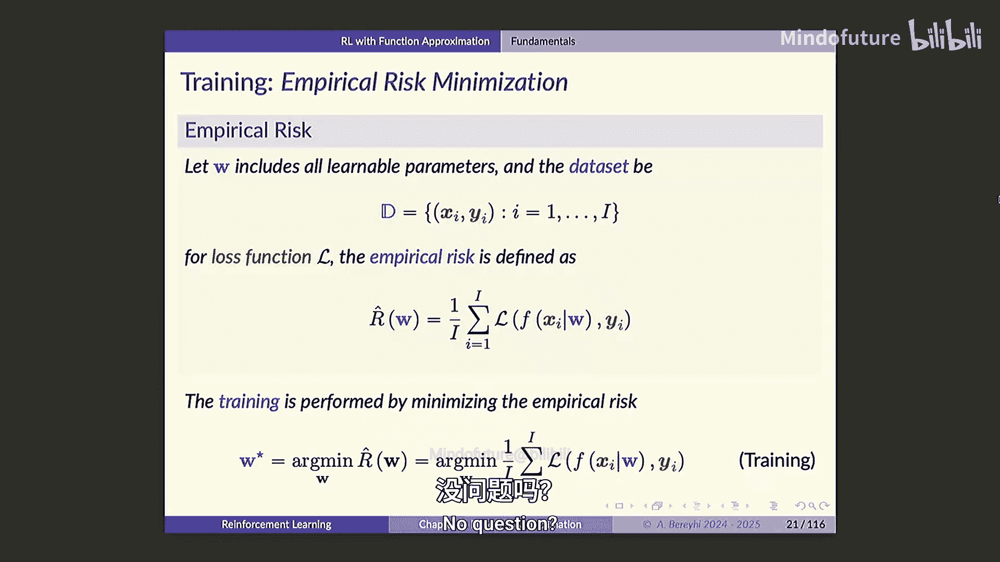

Everybody's cool， right。 And now if you want to compute the gradient。

 the basic gradient decent tells you that you need to compute the gradient。

Of the loss function at all the samples that you have inside your dataset set， right。

 This is why I wrote it down in this form in line4， you're computing it for one sample。

 So you send one single sample over your network。 You compute the gradient。

 What do you use to compute that gradient。Back propagation， great。 So you remember back propagation。

 you are going to use it to just compute this particular gradient。 And then you need to average them。

 right， So you do all the samples you have， maybe I different samples， Maybe you have000 samples。

 Every single of them that you collect。 Finally， you gonna average them， right？

 Add them all up and divided by 1000， right？ This is one the way that you do， But in practice。

 what do we use， Do we do this full batch training。😊，No， what do we do？

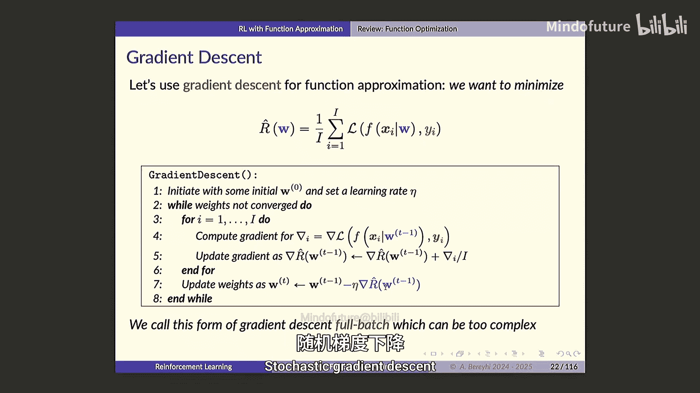

Ittochastic gradient we do mini batches right？ So we're gonna use mini batches right？

 So you're gonna just sample one randomly chosen mini batch of data from your data set and then you try to compute the gradient over that one and then you average over that one。

 You hope that this is a good estimator of the regional gradient and you keep on going right？

 That's it。Okay， everybody's cool with。Deep learning， right， Deep neural network， how to train them。

 These are things that you know， right， Great。 So if you do know that。

 then that's nothing more that you need to know about deep learning at this point to follow the course。

 okay。

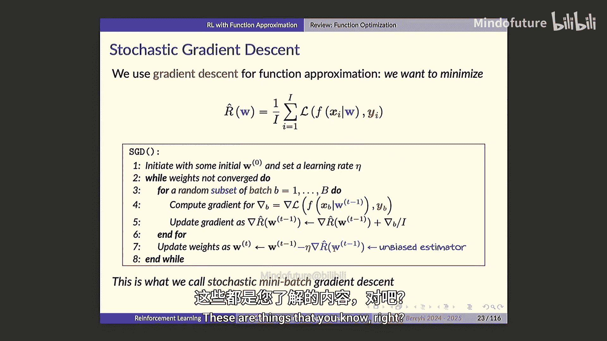

Questions。No question。 Okay， so let me just give you a simple setting where we do this model or sorry。

 function approximator or reinforcement learning with function approxiator。

 And then we're gonna start next Tuesday by doing it completely for the linear models。

 and then gradually extend it to the， to the general case。 Okay， so。Now。

When I have this particular value function。 So this， this value function the estimator。

 this guy is the value network or the appromator of the value function， right。

 So this guy that you see here。This guy is the approm of the value function， right。

 you you have no problem。 You feel comfortable that I put that W there， right。

 because that W is just representing the weights that I have in some my neural。

 Sam thing I can do for my action value， right， so I can show it with W。 Now。

 the things that I need to do。These are parameters because I have lots of ways。

 And the only thing I need to do is to just find those right ways， right， but。

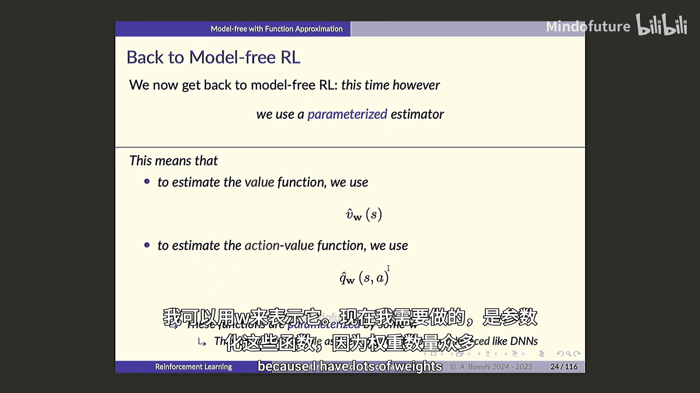

How we can use them in practice。 So I think I gave you a rough idea how you can do it。

You can do it at least in the prediction is quite simple， right。

 you can estimate a few particular sample points。 So you just choose few estate。

 you estimate their values right， and then you use that as a reference。

 you try to fit your model into that。Those samples， right。

 and hopefully it's gonna to work with the others。 When it comes to control。

 it gets a bit more complicated， right， because this story is different as you're changing your policy。

 right， as you change your policy。 Your value is also changing over time， right？

 And then this means that your value appxiator is not simply estimating one fixed function over time。

 right， This function over time is changing because your policy is changing， right。

 This is a bit of harder story， and we are going to just。Get a lot of hard time solving it right。

 But that is the key trouble that makes the whole story quite complicated。

 But let's start with the simple case just yeah this is just quick recall that the prediction is simply means that we have the policy。

 and we want to evaluate it。 That is not a big problem because we have a policy。

 if we have rest of the time， you can simply do enough sampling and by enough sampling。

 we collect some sample points， then we can learn the value function。

 right that is not a big trouble。 the main trouble comes when we we do control because we are very limited in estimating the value function。

 right， in time because we want to update or policy as well。

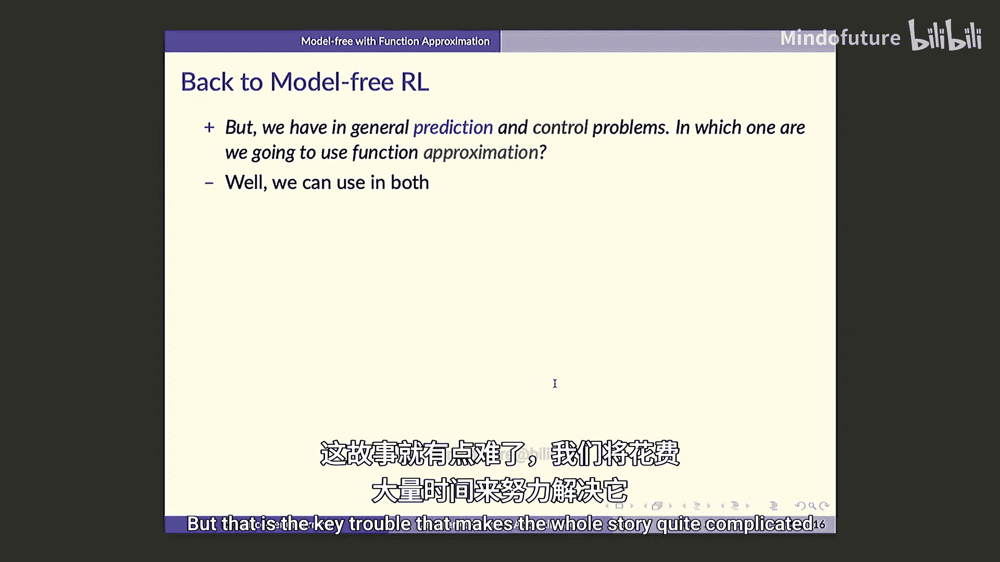

That is a bit more complicated。 Now， let's start with the prediction case。

 So the prediction should be quite simple for you to follow。

 The idea in the prediction is that we want to evaluate the policy and what we can do。

 we can put one neural network there right So this VW is the neural network。

 that neural network is taking this state as the input right And then at the output it's going to give you the value of this state。

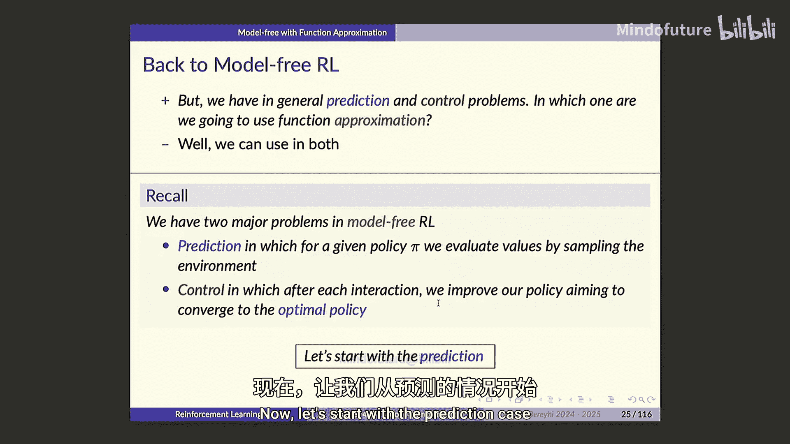

Right， everybody's cool， right？Good， so that's it。 Now how we can collect samples。 Well。

 I can start playing with my policy array， And then I'm going to see a bunch of states。

 definitely I'm not seeing all of them。 I see a very tiny subset of them， but that's okay。

 I just use those samples to estimate the value of those particular states right and using those value is estimates we start to。

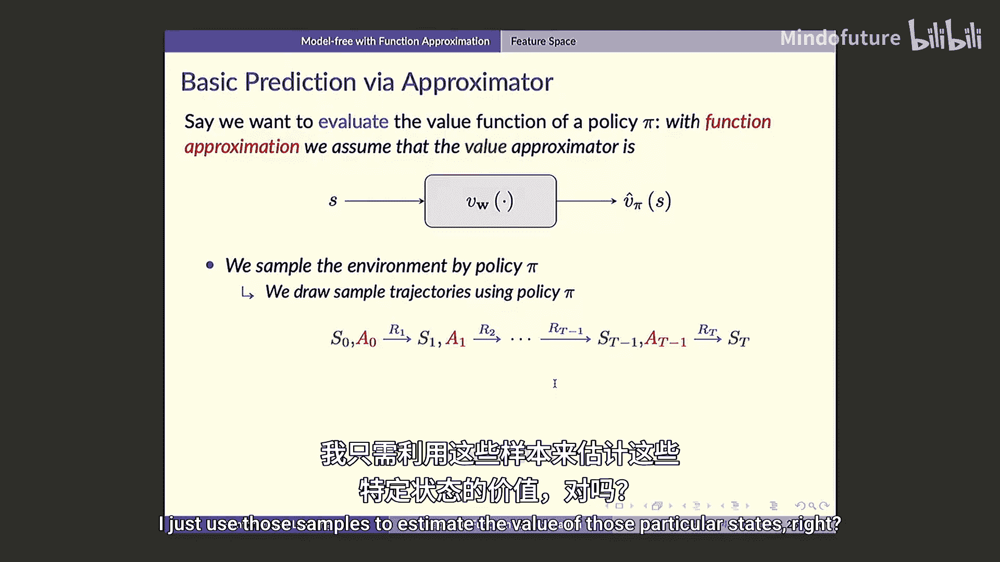

So we start to just make our model here to somehow fit this approximation。

 this estimation of those values， right。

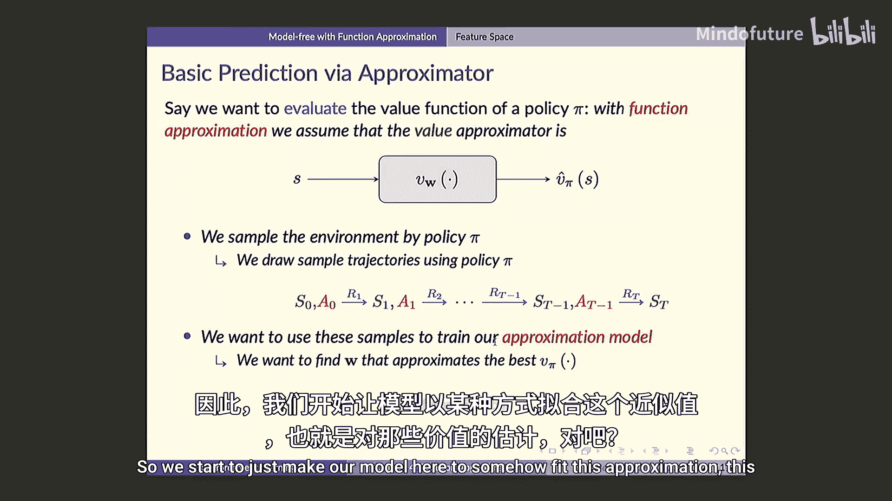

O， now。First thing， you might tell me， okay， give us one concrete example。 This box is nice， blue。

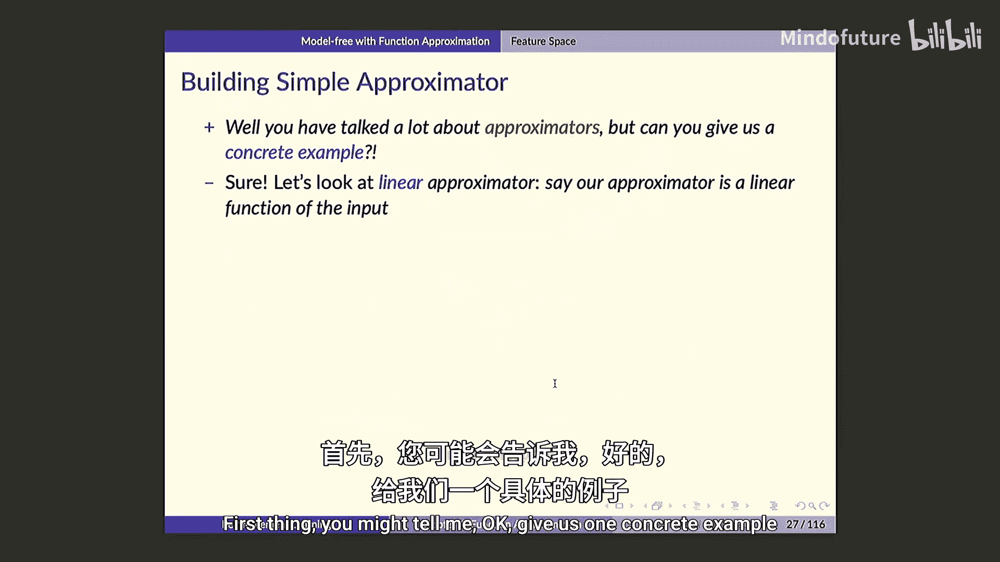

Very good。 But the issue is that you we don't see a explicit function appxi here， right。

 And then let's start with the linear case， the most basic one， what is the linear case。

 how What do you think the linear case would be here， Sa your state is one state。

 which is a scale or number， right。

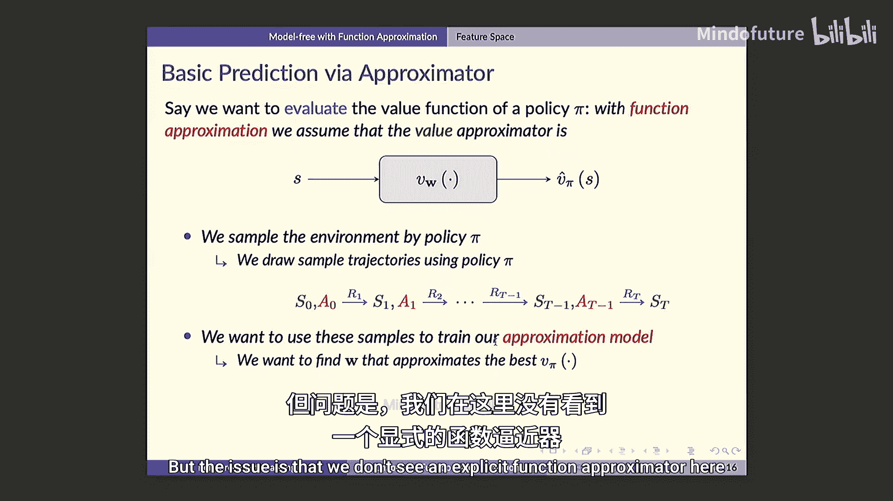

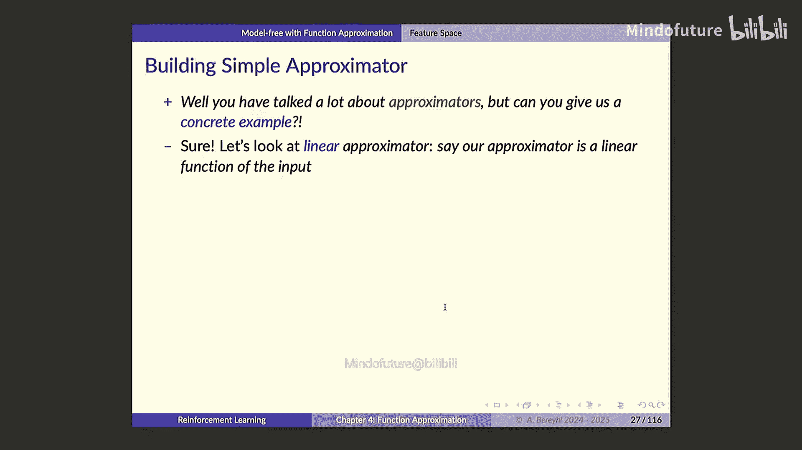

State 1，2，3 till it stay 10， right， How you can do that。What is the linear model， any idea？

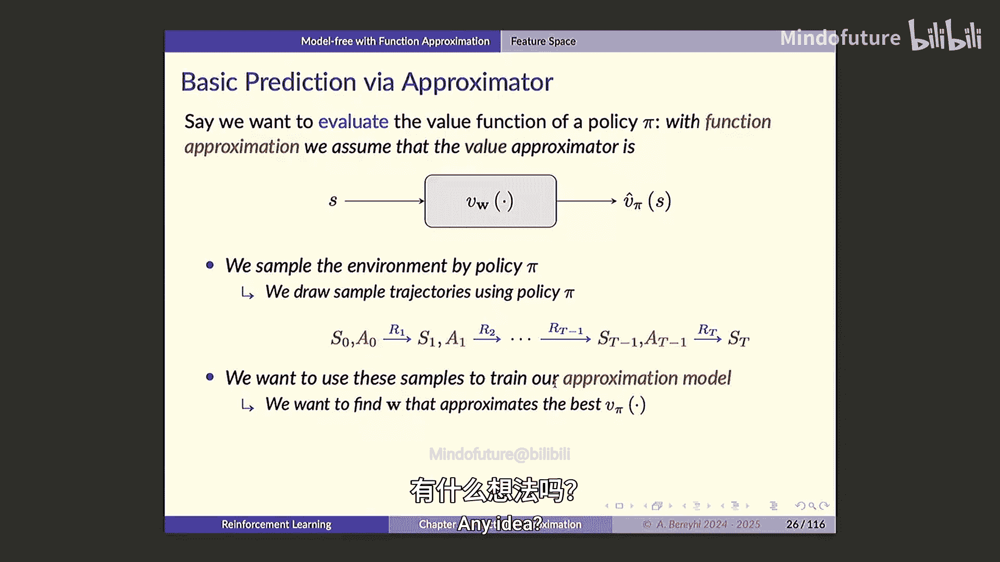

Okay， so。Let's say， yeah， we want to be very naive， right。I give this state。

 then it gets multiplied with some weight。 and then the output is the value， right。

It's not going to work obviously， right， You do know that， right？ So this is just a single parameter。

 I mean， I cannot really make it work。 Yeah， this is completely obvious for you。

 And this was not the case that we did when we were doing tableore， right。

 in the tablear case when we had n different states。 How many parameters did we have。

We didn't call them parameters。 We just called them empty cells inside the table， right。

 How many of them did did we have。If we have n different possible statess。

And different possible values， right， Each of them is a parameter。 We don't know it。 We'll learn it。

 right。RightSo we had n different parameters， right， We didn't have a single parameter。

 and then we need to somehow match it right， So the problem here is that we have not yet defined feature representation of this stage。

 which we need when we are doing function approximation So what is the feature representation So if you have one particular state。

 then the thing that you want to do is that you want to show it somehow to your neural network right And you can just come up with different ideas right so。

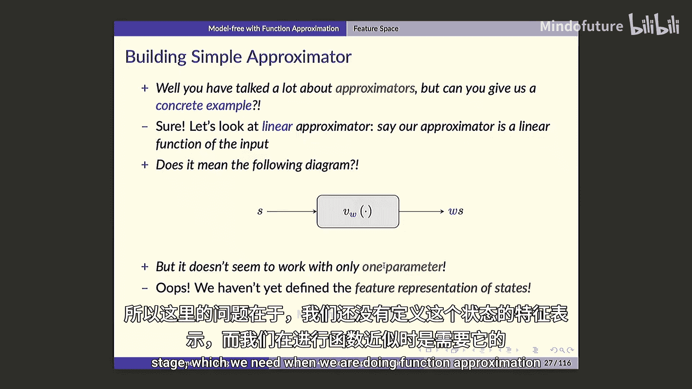

In general， what you can say， you can say， okay， I have any different possible states right for every single state。

 I give one representation and obviously you want this representation to be as large as possible because the larger it would be the more features is' going to carry right So the feature representation it means that you see one of the states that you have any possible and then there is one particular transform。

 which is just transforming that state into another value right So if we want to be dummy。

 we could say like， okay， I have a state1，23 till and then I can show every single state with this index right。

I have a grid world with 16 different cells， right，16 different states。

 I would say state 1 is represented by one。 state 2 is represented by2， something like that， right。

I can do that， right， But that is not a very good choice。 A better choice is this guy， right。

 This is actually the one which we have done up to this point， right。

 What we have done at up to this point。 we have actually used this one as far as representation or 1 hot representation。

 So we say， like， if I am in a state 1， then this is represented by one feature vector。

 which is of size N。Right， the the value for the first entry is one rest of them are 0 right is indicating I am in the state1 right。

 S1。 And then when I am in S2 same vector， everybodys0 second entries is one right and so on right now one thing that you see obviously。

 if you change this representation of your estate， the architecture of your neural network is going to change right。

 because your neural network in the first case is just working with one integer input right whereas in the second case is just working with an n dimensional vector right。

And if you think in terms of a linear model。The first one going to have only one weight right。

 the second one going to have n weights right， and those n weights are eventually those parameters inside the table that you try to estimate when we were doing tableular reinforcement learning。

 right so。

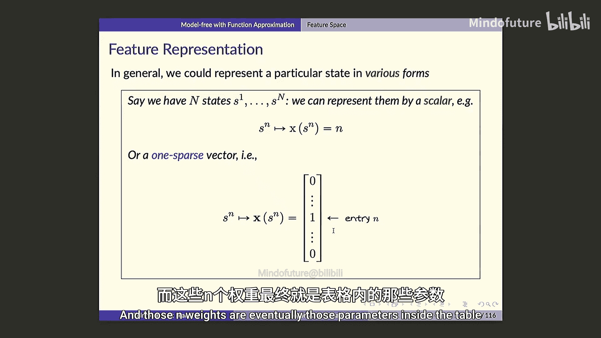

At the end of the day， you're going have one feature representation for some simple problems like dummy grid World。

 it's easy to represent that as long as you can make sure that you are not missing any information。

 that's fine for some more complicated problems， like a super complicated game。Computer game。

 then probably you need to just come up with a good feature representation right？

 Maybe the screenshot of the game in couple of frames is the kind of representation of this state right So you can collect different forms of data for one state right and each of them is one representation right and which one is the best one in practice when you do implementation in some new problem。

 this is also one of the challenge you need to find out right you need to figure out what one which one is the best one Now what we are going to assume from now one is that whatever state I have So I have one space。

 which is the space of all possible states right and this is n different states in the Dmmy grid world is quite simple is like for I don't know 169 different cases but in something like chess。

 this guy has 10 to power 40 different cases right and then you need。

You have a mapping where which whenever you are in one particular state。

 then you have one representation for that right， if you think in terms of chess。

 maybe the representation is you go up and take a picture of take a photo of the board right。

 that is one one representation right， This is the state that I am in， right。Okay， now。嗯。

When you want to get back to the whole stories that we have， we had before。

 you should always think in terms of this form。 This is what I I call it tokenization， not everybody。

 So please do not use it out of here because I don't want to be shamed of myself。

 tokenization is something else。 but it's pretty much doing the same thing right So it's like for every single possible state。

 you give a token。 And then you say that， okay， I have a giant vector。

 And one is representing this state that I am in right。

 but obviously this one is not practical in chestes right。

 because that vector should be 10 to power 40 dimensions， right， This is impossible。

 This is what you're gonna do。

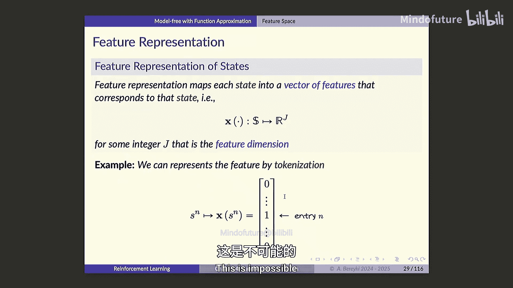

You' gonna find out a better feature representation， okay。So in more advanced problems， as I said。

 so you need to have a problem， specific feature。 and that is sometimes a bit of trouble。 But yeah。

 there are a bunch of examples here， for example， when you're thinking in terms of robot or may I or some any any entity which you want to train to just do a specific humanlike actions then well。

 these things could have could collect different values for the features of the state。 Obviously。

 one robot here in this room has one estate which is proportional to this location。

 but you can represent it in different forms。 How far away from the walls around it right and。Yeah。

 things like that。 or what is the direction that is' heading to right？

 So these are the parameters that are showing the state of that particular robot， right， Or。

 for example， if you're dealing with a computer game。

 a very typical thing is that you get a couple of frames。

 which are showing that very tiny part of the game being played， right。

 and that is the state of the game， right， So that is one other re。

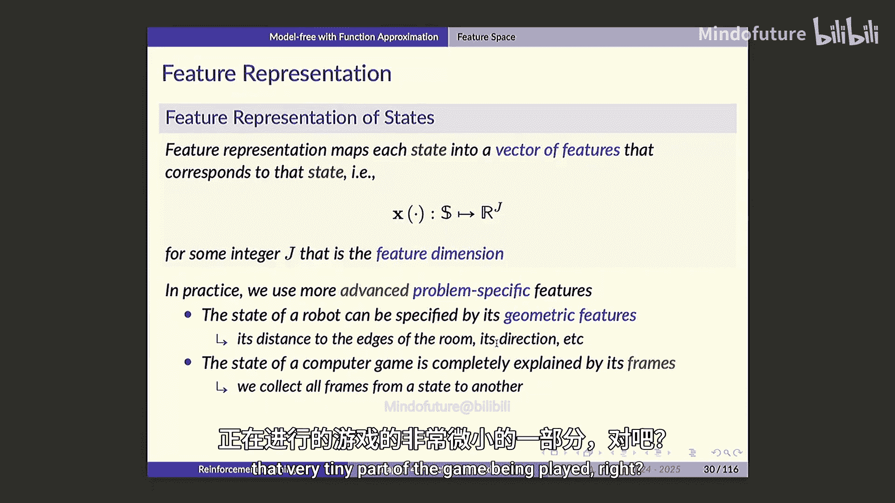