# 【多伦多大学】强化学习 2025 ｜ Uoft   Reinforcement Learning   Fall 2025 p37 P37_讲座_36_通过函数逼近实现强化学习的灵活性 -BV1D3F2zhEry_p37-

Let's just look into the mountain car example， just to get a bit of understanding and sensing about how we can use neural networks or in general。

 any model to just do the approximation。 So you have seen the mountain car example， right。

 So it's in gymnasium。 if you play around with the gymnasium。 This is one of the examples。

 how it works。 you have this car in the valley。 And then this guy could just accelerate to left or right or do nothing。

 right， So it's like you play the game。 You have either left or right or you have nothing to press。

 right， So these are the actions that you can do。 So the action state action space。 sorry， is still。

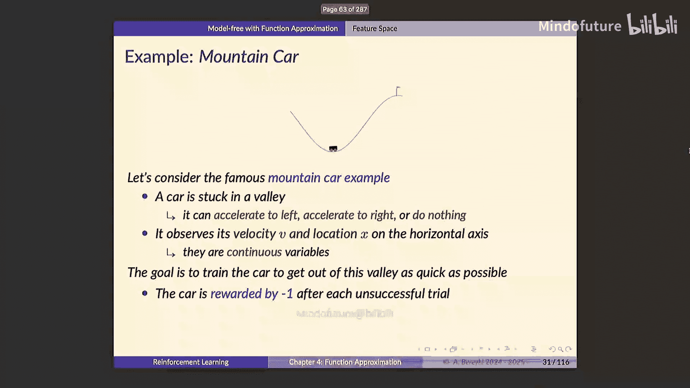

Dre， right？ So we are not getting yet to the continuous actions。

 It needs a bit of time till we get there。 So still， were thinking about discrete actions。

 So it's either left， right or nothing。And the things that you can see here in this problem are the velocity and the location。

 Now， what you want to do， you want to get out of the valley。 You want to get on the on top， right。

 And， of course， you just。😊，Probably you accelerate to left。 you go up。

 you come out come down and again， you accelerate to right。

 and you keep on going this till you get out of the， the trap， right， Now。

 the point is that the car is going to get -1， each time that is doing an unsuccessful trial。

 So at the end of the day， the car wants to get out of the valve with the。

 with the least amount of actions， right now。嗯。Here in this problem。

 the state of the core is actually where the core is right and then there are lots of things involved with the problem right。

 all the dynamics that is involved with this process， like the location of the core。

 the speed of the core， the acceleration level， the I don't know，Friction with the with the surface。

 all of them are are part of this stage， right， But you do not have access to all of it。

 What you see if you play with it， you see that you have only access to velocity and the location。

 right now。Your state is somehow represented with these two parameters， right。

 no one can say that this is the complete state， right？ I mean， of course， for the Dmmi game。

 this would be the complete state because the game has somehow designed with that， right。

 But in practice， this is not the only thing you need， right？ So this is just a representation。

 First thing。 Second thing。X and V， they are continuous， right？

 So if you want to think in terms of table art reinforce learning， how many estates do we have。

Like the capital N， we were always saying， okay， we have S1， S2。 These are the possible states。

 How many of them we have。Yes。😊，高 ahead。Lot of them， infinite， right？ Yeah。

 because they are continuous， exactly。 That's correct。

 So you pretty much have any continuous combination within the feasible region。

 This is what you can be there， right， being in， right， So X and V， both of them are continuous。

 And then you have infinite number of possible cases， right， Now。

 if you want to solve this problem by table or N learning reinforcement learning， What should you do。

😊，You need to quantize it， right？ So you would say， say， for example。

 X could be any number between A and B， right， And then I'm going to say， okay。

 I'm going have x1 x2 till some X， I don't know G， the grid points。 And then the first one is a。

 The second one is a plus Q。 The next one is a plus2 Q。

 and you keep on going till you end up with B right。

 So you greet the possible locations that you are in， right， same thing for the velocity。

 You would say， okay， velocity is between some v0 and V1。

 And then I would have the same story right So I'm going to just break it down into V1。Till V G。

 And then this is v 0， V 0 plus Q and so on。 till v0 plus， sorry， till V1， right。 Okay。

 this was not a good notation。 So say V， B V， A。 So here is B A。And then V P， right。

 So you're gonna agree。 Now， E sign is going to solve it after the reading week for you with both quantization plus reinforcement learning Tular reinforcement learning and the version of。

reinforce reinforcement learning， which you have idea by then。

 But the key point is that if you want to think about the number of states that you have， well。

 in theory， you have infinite number of stay。 in practice， say you have G grid points here。

 G grid points here。 you have G squared possible states， right every combination， right。

 like x 1 with V1， x1 with V2 all of the grid points， right。

 then x2 with the first grid point and so on， right， So you have G squared number of possible cases。

 right。So now what we can do if you want to just give it into a neural network。

 we can essentially or any model。 we can essentially forget about quantization or anything right So we can say that okay V and x。

 both of them are two parameters。 they are within one physical region。 So I give these two。

 So this vector x of a state。 V and x。 This is my representation of a state， right。

 This is the feature representation of this state。 And I give this V and x into the neural network right。

 So V is going to get multiplied with bunch of ways。

 X is going to get multiplied with bunch of weights。 they are going to add up。

 and then it might be more layers of processing Finally， I'm going end up with one value。

 which is the value estimate of the value for this velocity and this location right So this guy is much easier to work with as compared to。

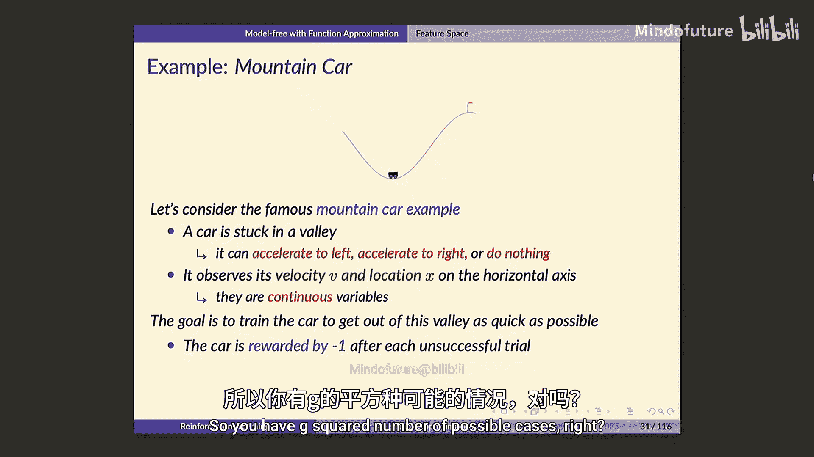

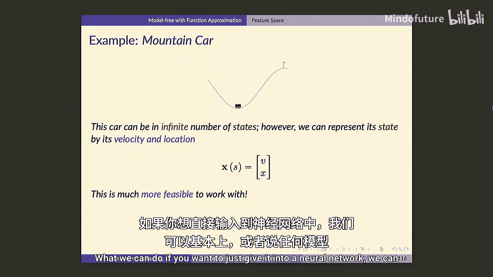

Quantization， right， you don't need to make that giant table anymore， right？

 And if you need too much complexity， you just add the complexity to your neural network， right。

 So here the story is much simpler because in terms of representing this state because you don't care about the fact that this guy has infinite number of cases。

 your neural network is a function， right， So whatever your input is。

 it's gonna give you some output， right， And as long as you make your output for specific points fine then probably for the other points。

 the output is also fine， right。

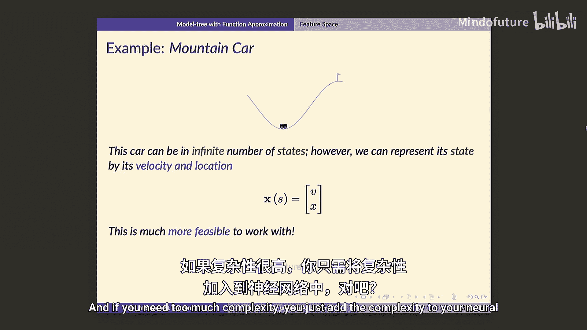

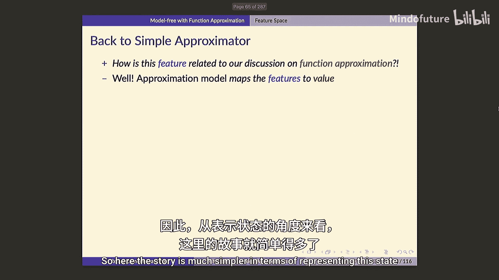

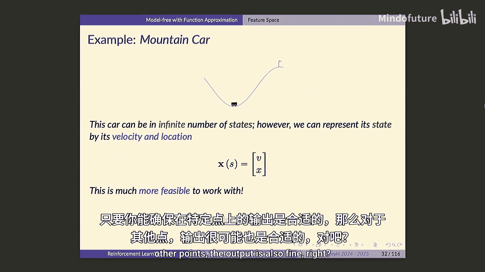

Okay。So， now。This is the way that we are going to approximate the value function。

 So if we want to just approximate one particular value function。

 then I am going to just give the the representation of the state。

 And I give it to my neural network。 that representation could be simply V and X。

 the velocity and the location of the of the agent。 and then what I want and the output。

 I want an approximate of my value， right， For now， we are just talking about prediction， right。

 We are assuming that we have one policy。 and we want to only evaluate how this policy works。

 we are using that neural network。 Okay now。

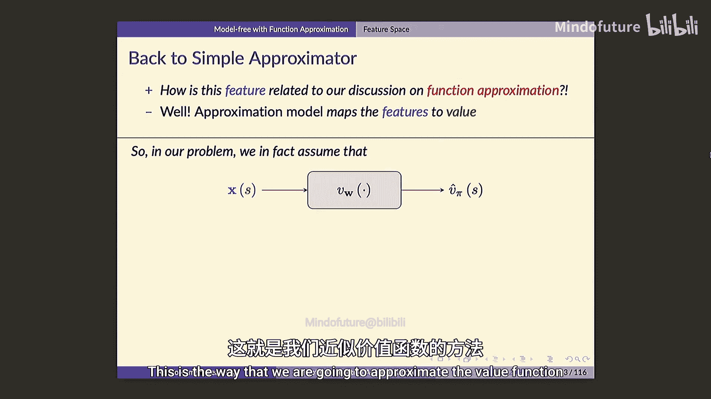

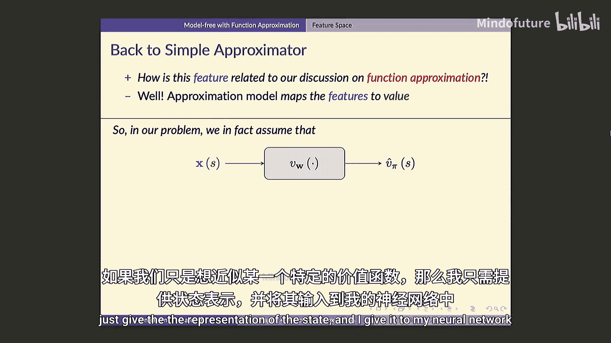

What can I put as this model， as the model， which is computing the value value for me。 Well。

 we can do linear approximation， right， we talked about this。

 and we're gonna get back to this today again to show you that this is actually the case when you are doing the table reinforcement learning。

 But this could be a simple linear。

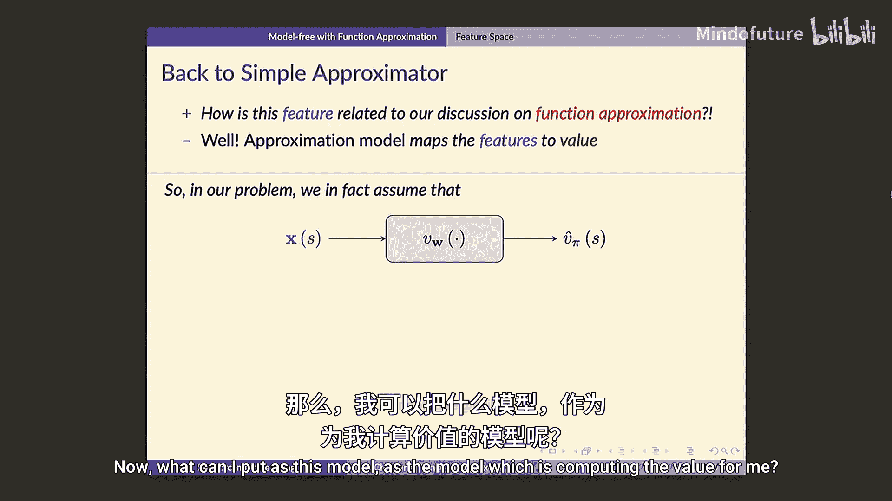

Model， right。 So whatever your representation is， every single guy is getting multiplied with its corresponding weights。

 And then it gonna go。But add up and give you the output， right。

 This is the simplest model you can think of， right。

 What are the parameters that you need to learn here。The ways， right。

 the ways that are getting multiplied with the features of this state， right， So， for example。

 in or or mountain car example， we could have like， we have two different parameters。

 Then we have basically two different ways。 And then you multiply those ways with this corresponding features。

 Then this is the value that you you， you get， right。

 So what you are assuming you' assuming the value of every single state represented by the velocity and the location is basically a linear combination of these two parameters。

 right。

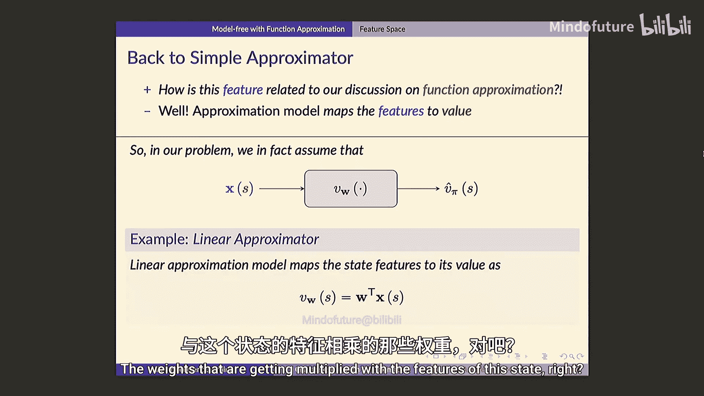

Now， what are those those linear weights that I need to know。 Well。

 I learn it from the samples that I collect， right， Everybody' is clear， right now。

Considering this one and then looking at this case， okay， in this case。

 I told you we have geo squared number of points， right？This means that say， for example， G。

 the number of grid points that we consider for velocity and location， each of them is 10。

 Then you're gonna have  hundred different。Quantize the states， right，10 for velocity。

10 for location。 The pair gonna be 100， right， Now you have 100。 If you consider the value table。

 how many entries you have in that value table。100， right， for every single quantized state。

 you have one value， right， And if you want to use tableular reinforcement learning。

 you need to learn all of these hundred values， right。And then this means that if for each of them。

 you need 00 samples， then you need roughly around 10000 samples， right。

 So you need 10000 samples to rely on that one。 whereas in this case， you have only two weights。

 right？ Well， this can be。Learn with much less samples， right？

I can just consider two different points， X V， X 1， V1， x 2 V2。

 I just tried those two different points several times。 I estimate the value of them。

 Then I try to find W1 and W2 that at those two points， it fits what I see， right。

 And then for the rest of it。 Well， I rely on that model， right， So this is the difference。

 But there is one obvious。Disad here。And the disadvantage is that I am just training two weights。

 right， Where there I am somehow learning hundred parameters， right？

 And this means that this guy could be less reliable， correct。😊，That's right。 But can I improve it。

Do I need really to rely on the Tore or can I improve this one。I can't improve that， how can I do it？

More layers， right， I just make the model more complicated， right， So I can， for instance。

 put one deep approximated deep neural network， right。

 So I don't really need to look at Xv and multiply it with weights。 and that' it， right。

 I can do multiple layers。 and I can just expand my hidden layers， right， I start from X v。

 then I go to one layer with 1000 neurons， right， And then out of that again。

 I do the processing on another layer with 1000 neurons， right， And then at the output of that。

 I compute one single output。 And that single output is my value， right。

 So I can eventually make it deeper and more complicated。 And by doing it。

 I am just increasing the weight that I have， right， And by increasing the number of ways。

 I am increasing the capacity of this model。 This model is now able maybe to capture the true value function。

 whereas the previous one was not able， for example， right。

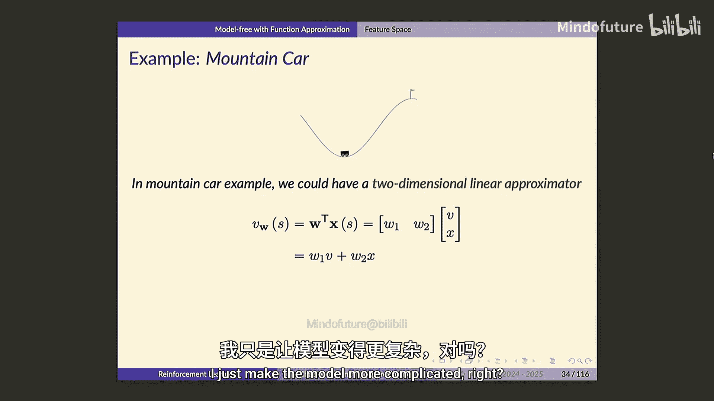

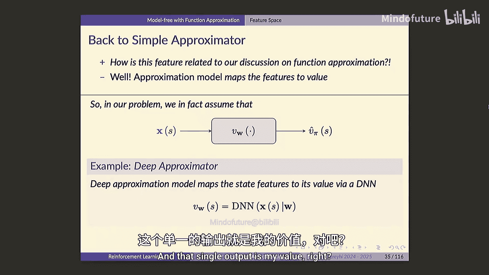

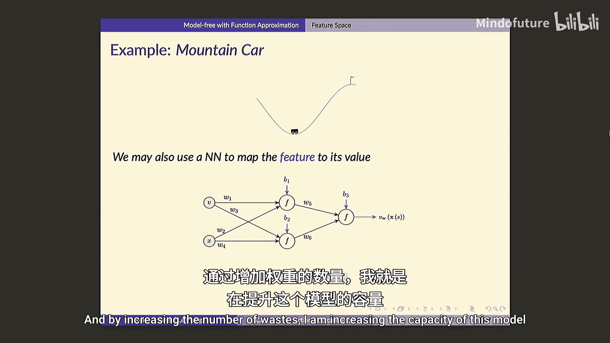

Yeah。Everybody's cool， right， You see this。 So the key point here is that actually， in this case。

 we are having more degrees of freedom， right， because we are able to just work with very tiny model。

 which has few weights。 and then we can learn them with few samples。 if we really have more samples。

 we can simply improve or prediction quality by increasing the size of model and doing better training on those larger number of samples。

 whereas in the in the Tar case， I cannot do that right in Tar case is only about the samples。

 Like again， more samples， I can rely more on my estimates， right， and there are a bunch of points。

 which I never see。 and then I have zero estimate for them like。😊。

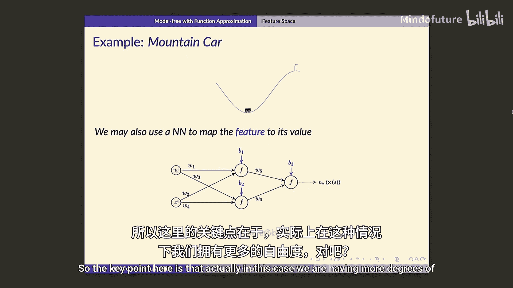

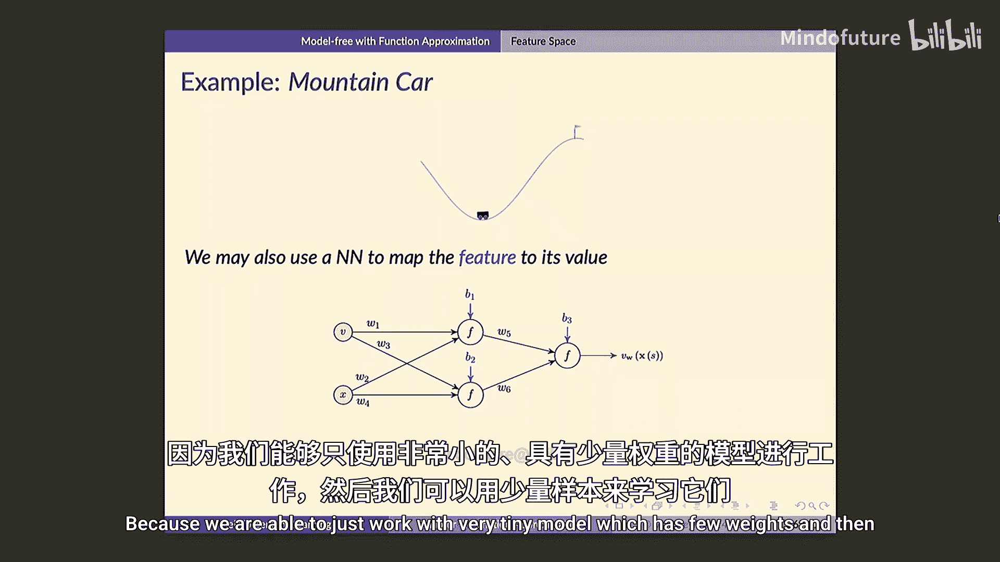

Totally unre estimate， right？

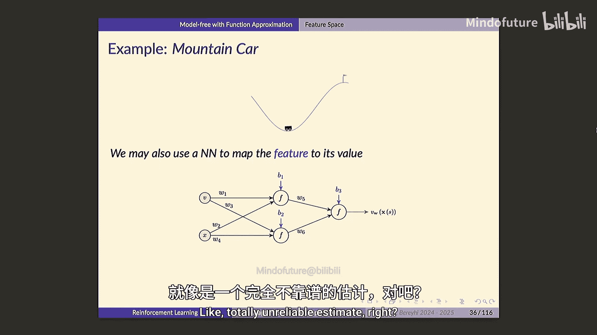

So I can do deeper networks。 And by that 1， I increase the weights that I have。 for instance， here。

 if I have three different neurons， then I'm gonna have nine different parameters， right。

 Each of them has his own weights and bias than I could have， say， nine different weights。

 It's more than two weights， which I had in the linear model， right。

 And then this guy is more capable of capturing the true value functions compared to linear one。

 right。😊。

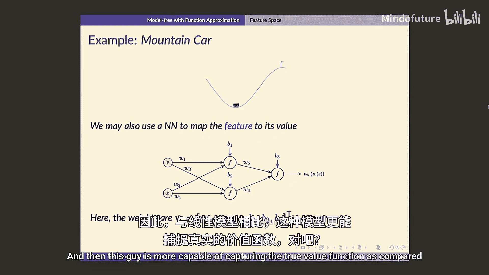