# 【多伦多大学】强化学习 2025 ｜ Uoft   Reinforcement Learning   Fall 2025 p38 P38_讲座_38_重回表格型强化学习 -BV1D3F2zhEry_p38-

Now that you have the idea what is how you can do reinforcement learning using function approximation。

 let's do one example and in this particular example， what we want to do。

 we want to get back to the tableau reinforcement learning in this new context， this new framework。

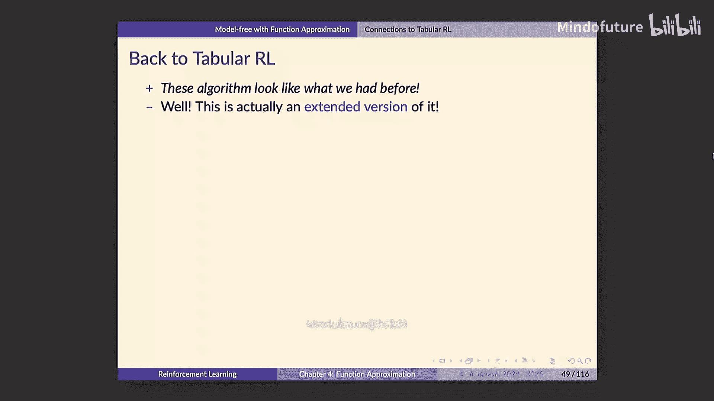

As I told you before， tableular reinforcement learning that we used to do is basically this same general framework with only special case。

 So the special case is that we are using tokenization for the future representation and my tokenization I simply mean this one right So it means that for every single state to represent that。

 I just use this corresponding one hot vector right。

 So obviously what you can see is that this is not an efficient representation especially when I have my state continuous right。

 because there is no one hot representation of a continuous state right。

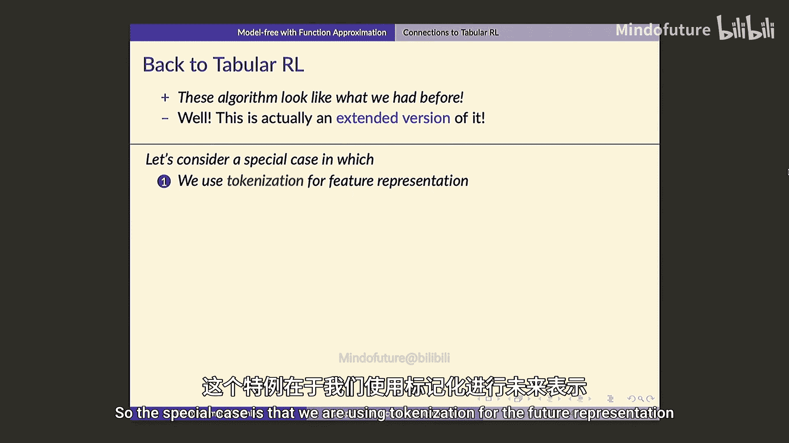

Continuous state could have infinite number of cases， right。

 So then you you need to quantize and things like that。

 But this is not the best representation you can have you can make for your state。

 But this is what we do in the table enforcement learning。 That's the first thing。

 The second thing is that you are using a linear model。 And what do I mean by a linear model。

 I simply mean that you have a bunch of weights。

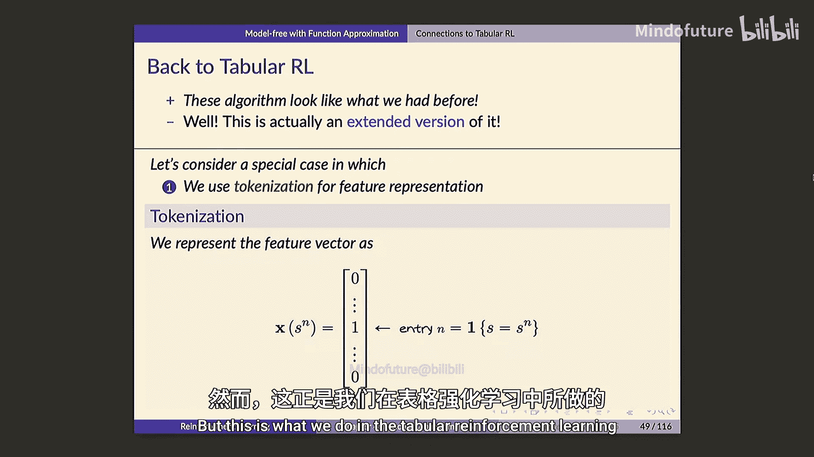

And your input representation is a vector。 So the number of ways that you have are exactly as same as the number of entries you have in your state vector right。

 and they get multiplied， added up right， now， do you have any idea， first of all。

 say I have n different possible states。 How many ways do I have。Say I have hundred0 possible states。

In grid world， we have four different states。 or in a grid world，10 by 10。

 we have 10 different statess， right，100 different cells。 How many weights do I have。Yes。Sorry。

100 again， right， exactly。 So I'm gonna have 100 different weights， right。

 So I have 100 different states。 I'm gonna have 100 different weights。

 What is every single weight showing in that case。Just let's do it together。 Yes， go ahead。Sorry。

 no every single weight。 Sorry， sorry， once again， sorry。おり越して。Not only active。

 but it gets multiplied， right， It's actually showing you the weight itself。 sorry， value itself。

 but I'm gonna show you。 Okay， so let's consider this case。 So say I am in one particular state S N。

 right？ So this is one of these possible stay。 Now my model， which is VW。 that linear model。

 is going to get this weight， multiply it with one hot vector， right。Correct。😊。

Now that1 h vector is 0 everywhere， it's only one when your state is SN right at the particular state。

 right？So this means that when you multiply this guy to this one。

 you end up with only the weight corresponding to that stage， right。

So you have hundred0 different states。You have100 different ways， right。

And then when you want to represent one of these states， say your first estate。

 you're going to show one as the first entry， everybody else is0， right。

 These weights getting multiplied to this vector， only the first weight survives， right。

 And that guy comes out。 This is your value estimate， right。

If you are talking about the second state， then gonna be 100 representation of your second state。

 which is 0，1，0，0，0，0。 And then the weight getting multiply to this one。

 only the second weight comes out， right？ So basically。

 every single weight that you have in this weight vector is。The estimate of the value， right。

 And you initially start with some random choice， right， or maybe you put it0， right。

 And then gradually， you keep on estimating like what we did in Tular reinforcement learning to change it。

 right？ So this weight vector is essentially building your table。 Do you see that。

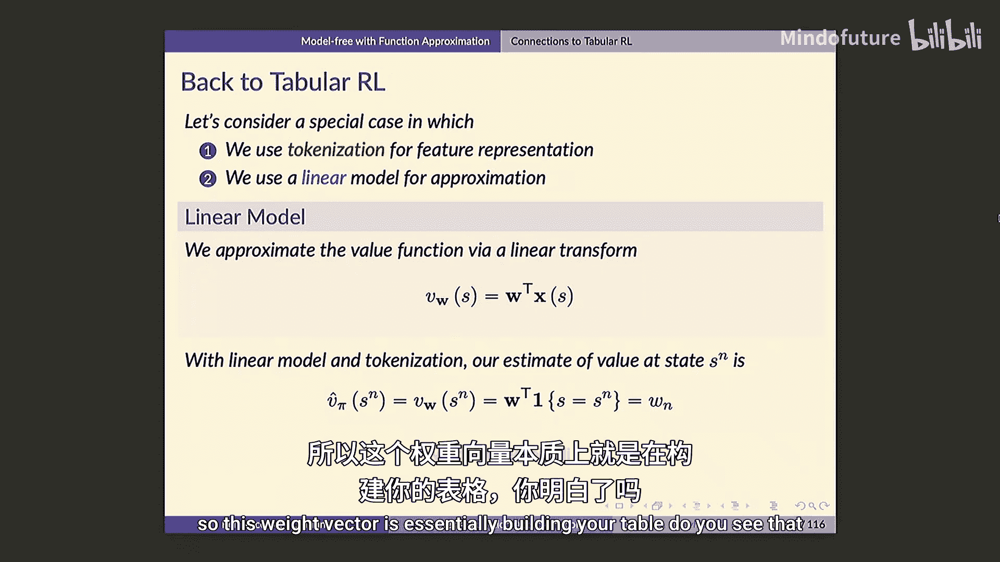

Right， so if your weight is some if you set this weight vector to be something specific。

 then for that specific weight vector， if you want to know what is the estimate of the value for a state S N。

 you need to just look at the weight number and this vector， right， And that is your estimate， right？

 And as you keep updating that， that estimate gets better and better， right， Sound sounds familiar。

 right， This is basically what we did before。 We initial sorry with no estimate。

 And we kept on updating them， right， So。

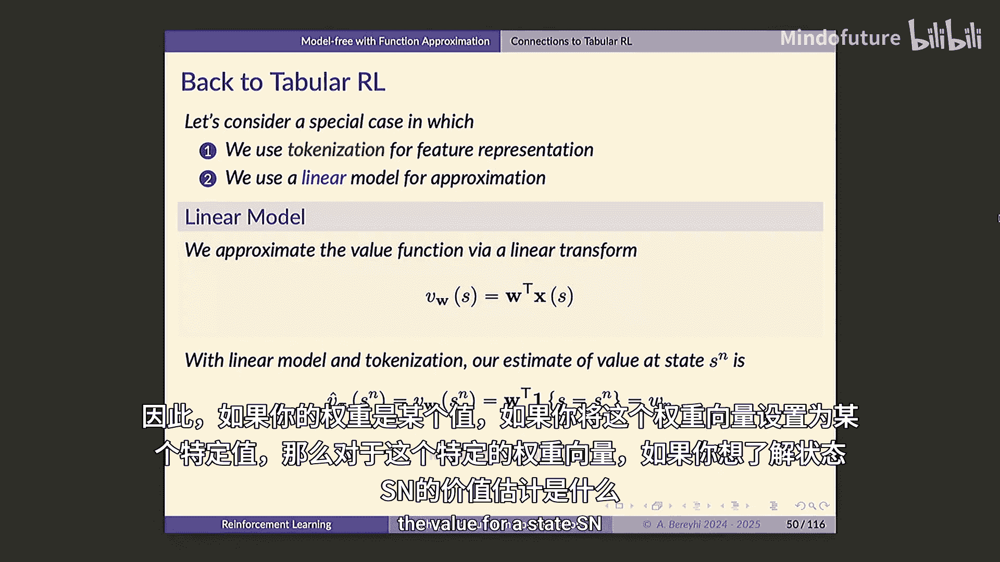

Now， one thing else is that the gradient of your value network， but in this case。

 the gradient is quite simple right， because looking at this expression。

 this value network or this value model， this is a linear multiplication right。

 If you want to compute the gradient easily just think of W and x to be scalrs right what is the derivative of V with respect to W。

😊，If everything is a scalar。It's X。 It's gonna be the same when you do vector， right。

 just in a higher dimension， right， So the gradient of B with respect to the weight is going to simply be X。

 right， And that x is simply one hot vector in this case， right。Everybody is cool。 Yes。

 so you see what we are doing， right？ So when we have a linear model。

 this is our gradient the sample gradient of the network。 that is the sample output of the network。

 And when we assume that the representation is done by tokenization。😊，Questions。

So if you got a question， then let's get this gradient and put it inside the loop that we found for training the the function approximator。

 So if I want to just do the training， what I'm gonna do， I'm gonna update this form， right？ say。

 for example， I am doing I'm doing a temporal difference。 So if I do TD， this is my estimate， right。

 my immediate reward plus the value of the next state。

 given by the neural network or the model minus the value of this state。

 the current state that I am in。 So this is the scalr multiply with the gradient， right。

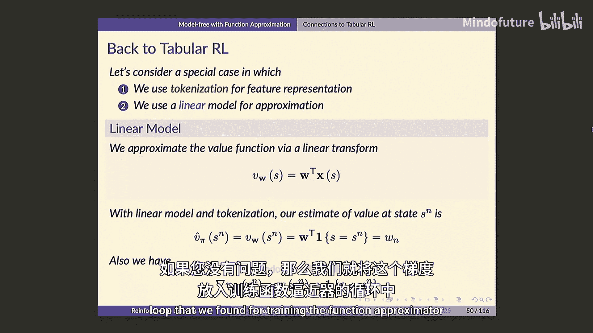

Now， let me replace every single body here。 So， first of all。This guy， this value。

 we talked about this， the value of the particular state is going to be the corresponding weight。

 right？

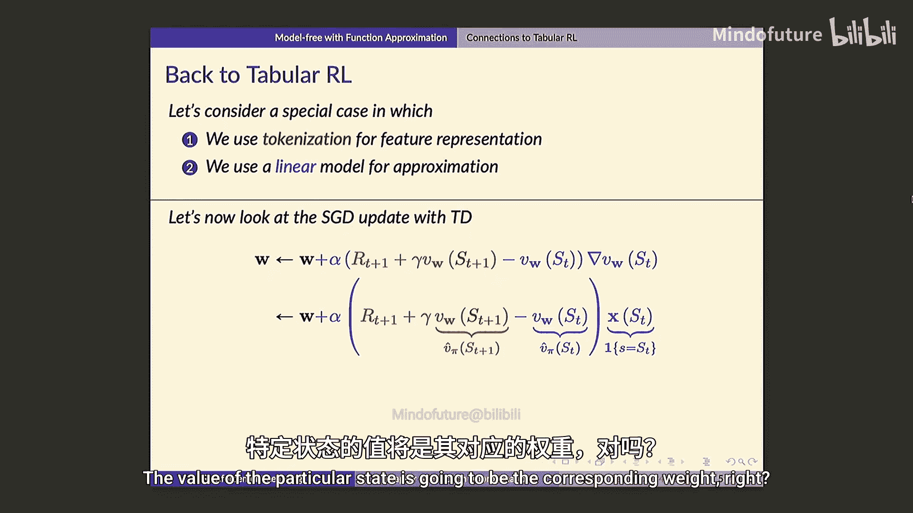

Everybody' is cool。 So this guy here， the value when you put one particular state。

 the thing that is coming out is the weight corresponding to the out state， right？Now。

 if you do it here， the value of your state S plus one is going to be the weight that is corresponding to that S plus1 right。

 And I show that weight with v hat of S plus1 because I am thinking of the table right？

 I would say the first weight is the estimate V hat of a state1 right？

 Second is the V hat of S 2 and so on towards the end right， You see this right， If you don't see it。

 I can write in on the board。

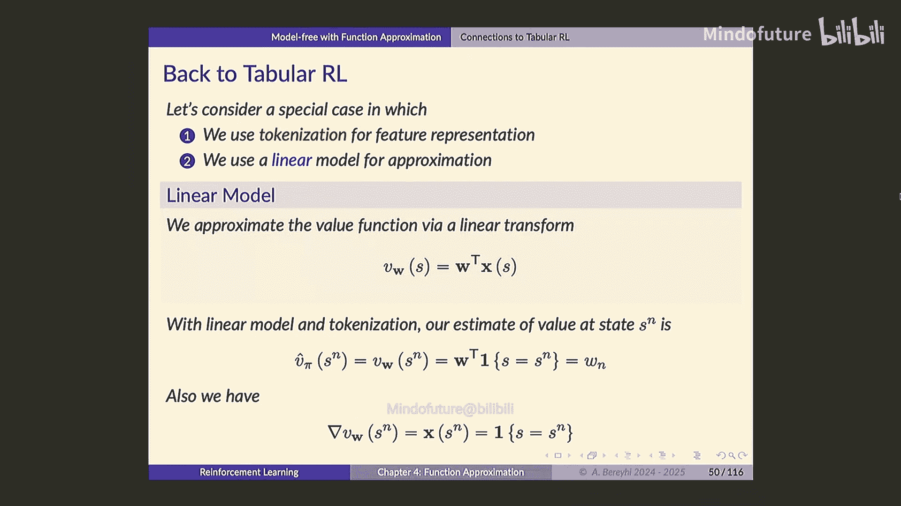

Everybody's seeing that？Questions。So you see why it replace it with VHt here。

 that is the corresponding wage， right？There's no shamem in asking， you know that。Everybody's cool。

 yes。Okay， so this one is also the same， right， This is again。

 the corresponding weight of a state S T， right， which is the estimate of state S T， right？

 So I am replacing these ones with the corresponding weight or the corresponding estimates。😊。

That is the whole entire thing。 And this one is basically my representation。

 which is a one hot vector， right， Now， if I do this update， if I do this update。

After multiplying this scalar with this vector， how does the the vector look like。

Its gonna be one vector。 Everything is0。 One of them is nonze， right。

 And that thing that is nonze is exactly this value， right。Everybody sees that， right？

 So now that vector is going to get added to this weight， right。

 Which entry inside this weight gets updated then。The entry corresponding to S T， exactly。

 that entry is going to get updated。 Anyone else is just getting updated by 0， right。

 so I can throw them away。 I don't need to update them anymore， right。

 So the thing that is happening is that only the weight of the corresponding entry， right。

 corresponding entry to S， if I assume that S is being state N， right， only weight of。That state。

 W N is going to get updated。 Anyone else is getting updated by 0， right。Everybody sees that， right？

So that one is getting updated。 and the update value that I get is this one， right。Ar is cool， right？

 Now， what should I replace with with what should I write instead of W n。

If you tell me that I'm sure that you got what I said。What should be WN？V hat， pi F。S T grades。

 So you're following。 that's school。 Okay， this guy W N is V hat pi of S T， right。😊，Everybody's cool。

 right， because I have N friend weights。 I told you these are the V hats， right？

 And then this one is the V hat of S N。 S N is S T。

 So it' V hat of that particular state that I'm seeing， right？ So what I can say。

 I can say W N is essentially V hat of S N， which is V hat of that particular state I am seeing at time T。

 And because of that， I am basically doing this update， right， This is my gradient decent update。

 right。😊。

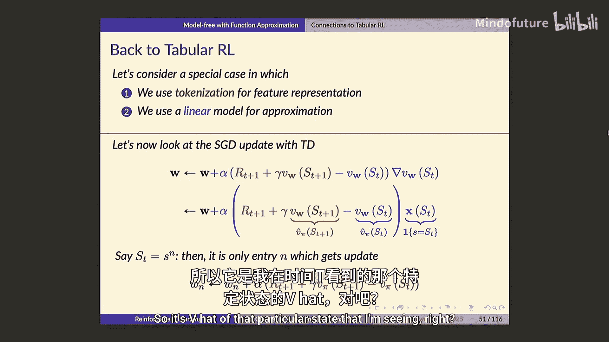

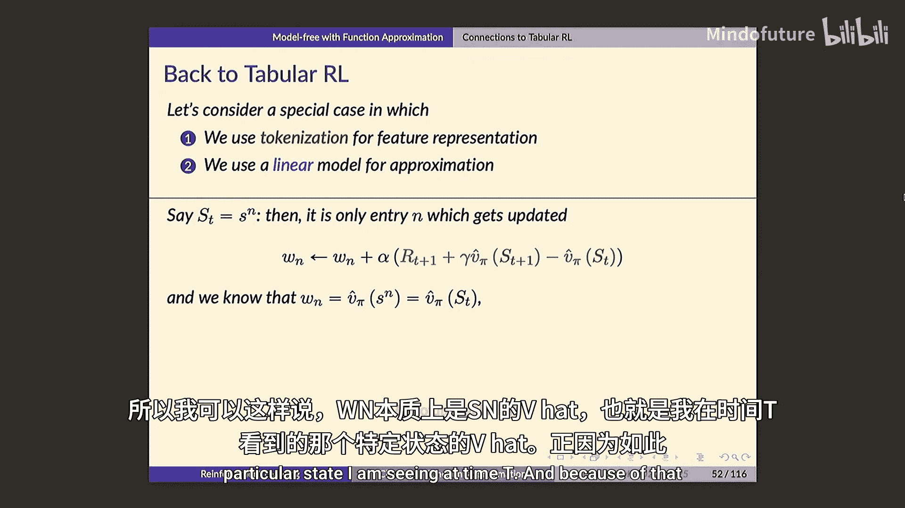

Everybodys cool， right？ And now this one does it look familiar。

This is exactly the DD update we used to do， right？And that point of time。

 I didn't tell you we were doing gradient decent， right， I just told you， well， this is an estimate。

 This guy， then I just want to update incrementally。 So I just add up with some alpha。

 And then I choose one alpha， right， And that alpha was essentially the learning grade。

 And this term that I was computing was actually the gradient of the。

Dummy or linear model I use to approximate my value function。Everybody's cool。

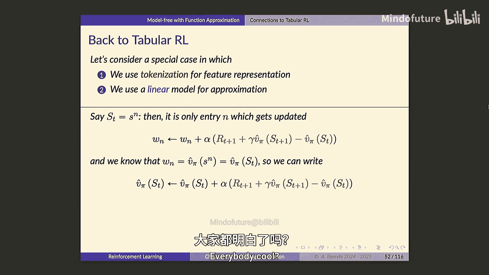

Questions。No question。 Okay， so that one is Tular TD。 And basically。

 you can see that all of those other approaches that you have done。

 if you do the same thing here with neural network is long when you put the state representation to be one hot vector and you put your model to be linear than eventually you're gonna end up with the exact tableular form right。

 But obviously what you know is that tableore is not working because this is not high capacity right So the linear model is not high capacity that you can capture all the details of the environment。

 So moral of a story is that tableular reinforcement learning is actually special case of what we are doing right is the special case of reinforcement learning with function approximation right and you can do better approach by just developing more complicated or considering more complicated models for function approximation。

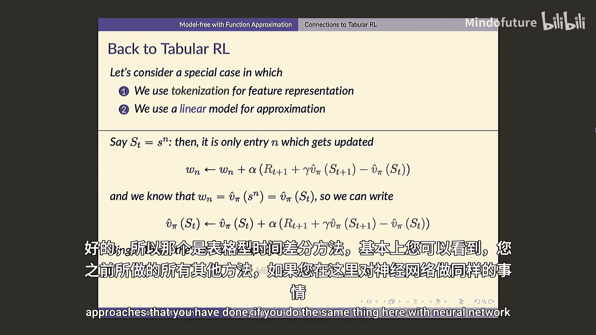

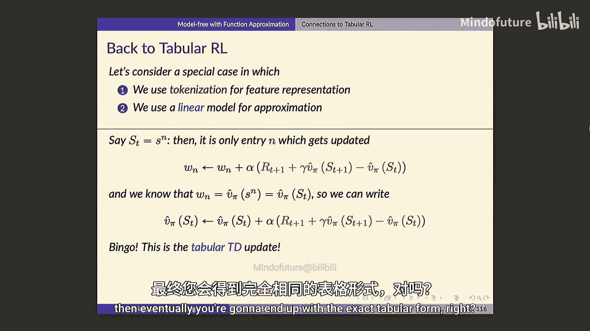

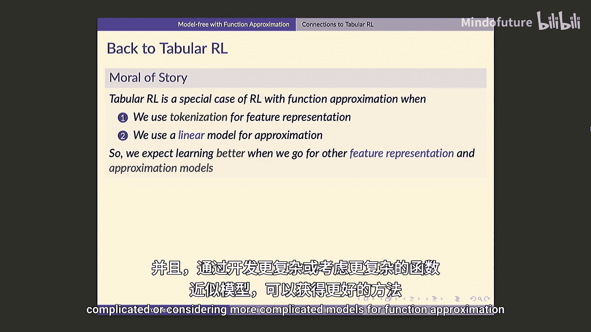