# 【多伦多大学】强化学习 2025 ｜ Uoft   Reinforcement Learning   Fall 2025 p39 P39_讲座_37_训练价值预测模型 -BV1D3F2zhEry_p39-

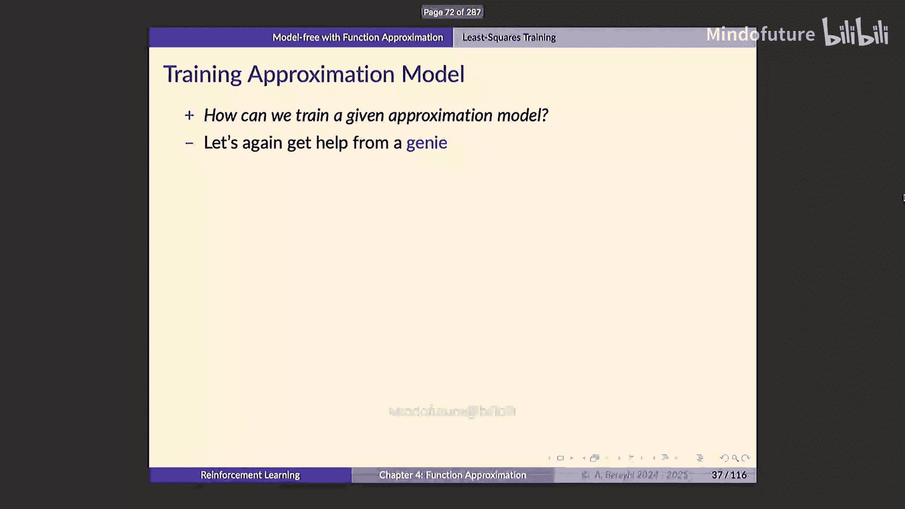

Now， if you got the idea。 So how does the function approximation play role in this whole process of reinforcement learning。

 Now， what we want to do as the first step， we want to get back to where we was。

 like in tableular reinforcement learning and try to repeat what we did there just the important ones using a function approximation module。

 Okay， we just want to replace our basic data。Depenent estimator or with a kind of neural network or a。

 say， a general model。Now， the first question that you might have is that how can I train my model right？

 So the point is that if I want to train that particular model。

 I need to really have a bunch of say label data， right This is the particular state going inside this guy。

 this neural network。 And as the value function， I need to know the value of that state right Now you might guess we can compute or estimate the value for some individual states because we can just do sampling right。

 And that is correct。 But let's start with a very， very basic case where we assume that we really have the value function。

 Well， we don't have it。 This is the final goal to find it。 But right now。

 assume that I do have value function。 at least I have it at some particular states。

 right So I give you one policy pi。 then there is one genie。 and then you can ask genie。

 what is the value of。

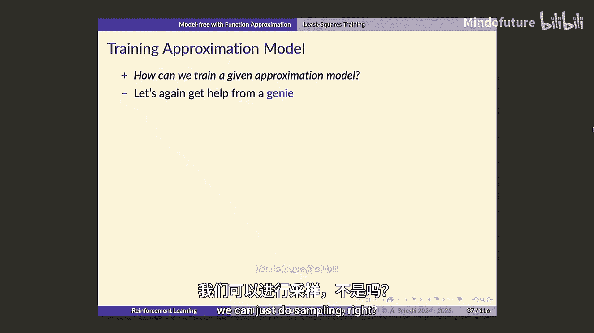

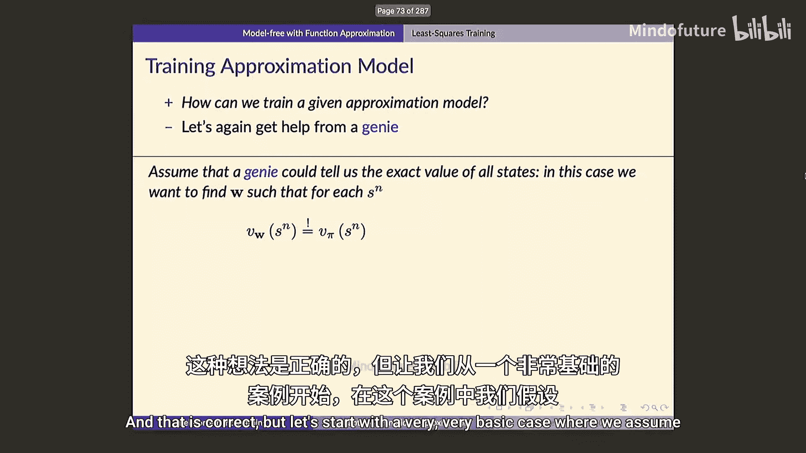

This policy at this particular state， that's given to you， right。

 If you do know all the values for all state， how do you train the neural network， I mean。

 I do know that doesn't make sense to train the neural network anymore because you have the value。

 but say you want to do it， right， If you want to do it。 What do you do。

 you basically want your neural network。 So this VW is the output of your neural network when you give as the input。

 the feature representation of a state S N， right， So you want for every single possible state that you have when that guy goes in right。

 and the output of the neural network， you see exactly the true value， right。This is what you want。

 Initially， you don't have it。 You want to play with the weight W。

 You want to train them using gradient decentcent size that at the end of the day。

 this guy mimics the other one， the true one， right， That's what you want。 Well， in other words。

 you want the difference between these two guys to be exactly zero， right， if you have one estate。

 it doesn't matter if you use your neural network or your genie。

 both of them are giving you the same value， right， So you want to do that， well， in practice。

 you cannot do it but you try to approximate it， but if you want to do it completely。

 then you need to have this summ to be0。 It means that not only for one estate。

 but for every possible state that you have right So all possible state that you have and difference they say you want the value function。

 computed by the neural network to be exactly the same thing as the true value function。

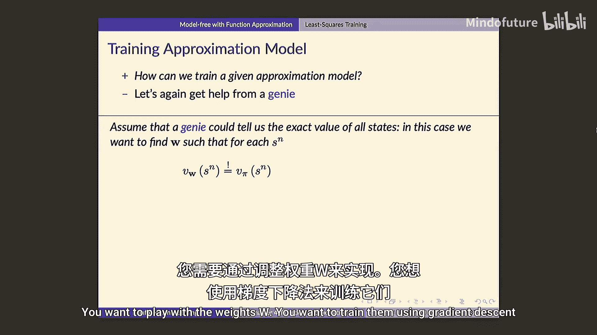

Right。In practice， you cannot really do that or make that sum to be exactly0。

 You try to approximate it to0， right， So it means that you are going to drop。Or minimize this。

 this residual term， right， So this is what we call it residual term for one particular state。

 This is。Re sum of squares。 And well， if you want to minimize it。

 like you can simply do do the least square method， right， or when you minimize it。

 you are basically doing least square method。 So what you do in practice， in practice。

 you want to find the ways of your neural network side that this term is minimize， right。

 Maybe you cannot make it0 exactly， but you want to minimize it。

 And this is something you can solve with gradient decent， right。

 So you just compute the gradient of this guy。

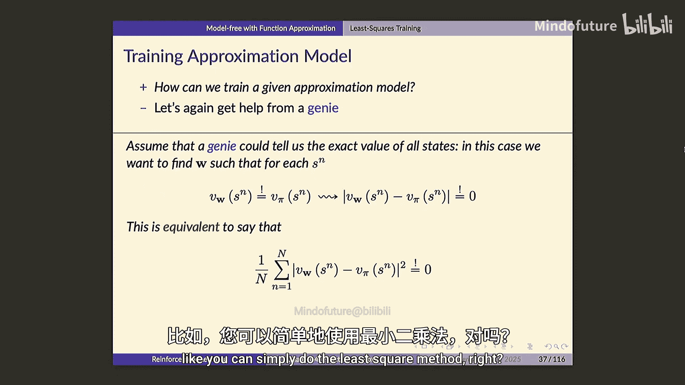

Right， and then you just move in the opposite direction of the gradient till you stop moving， right。

 And that point is a minimizer， right。

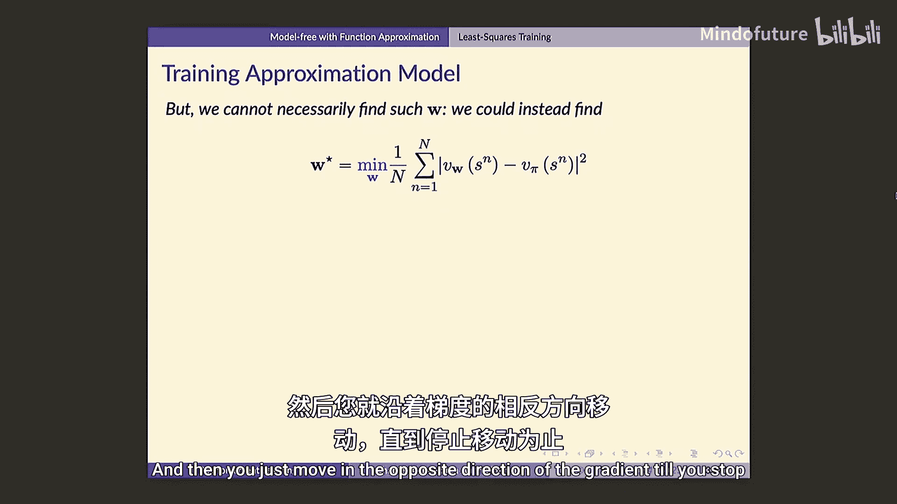

So。Now， one thing that might come to your mind is that， well， here I added up all possible states。

 right？In practice， this might be that if you play one particular policy。

 you're seeing one state more often， one other state less often。

 right and what you might be interested is that those estates which are happening more often are better suppressed or get closer to the true value as compared to those which are less observed right and what you can do instead of just。

Waiting every possible stay with one over n。 You can just wait every possible stay with its own frequency。

 right， So this P pi S N by this 1， I simply mean the probabilityty of being at a state S N when you're playing with policy pi。

 right。And in the top one here， this value is simply set to one over n for any style。 Like you。

 you assume you are uniformly seeing every possible state， right， But this might be not the case。

 right？ And if this is not the case instead of one over n。

 you can simply write down the probabilityty， right。And you want to minimize this guy， indeed， right。

Everybody's cool。Yes。So a we doing。Quantas time or estate time like like。I mean。

 time is always quantized， but， but the state could be continuous。 I。

 I still am considering this great， but in one line， I can get rid of that。 But obviously。

 you can see what I mean here。 I mean， if you have continuous estate。

 then this summation would be integral， right， So you integrate over all possible states。O。

Everybody's cool。 So now what is this term， What is this sum that you see。Can you tell me。

 is there any specific mathematical operation that is being？Done in this war。

Summation of probabilityty of something multiply with that thing， that function。

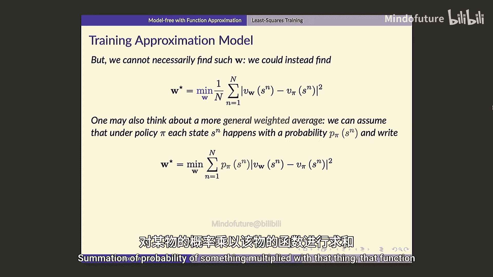

Expectation， right， so we're basically trying to minimize the expectation between the output of the neural network and the true value function。

 right， So randomly select one states， right， as the capital S is random now， right。

 And then you put it inside the neural network， you give it to the genie， you see the output， right。

 And then the average of these two difference of these two。 You want to minimize it， right， Well。

 it might be the case， It's definitely the case that I don't see all the states here， right。

 That's correct。 But this expectation。 Can I do it at least approximately。

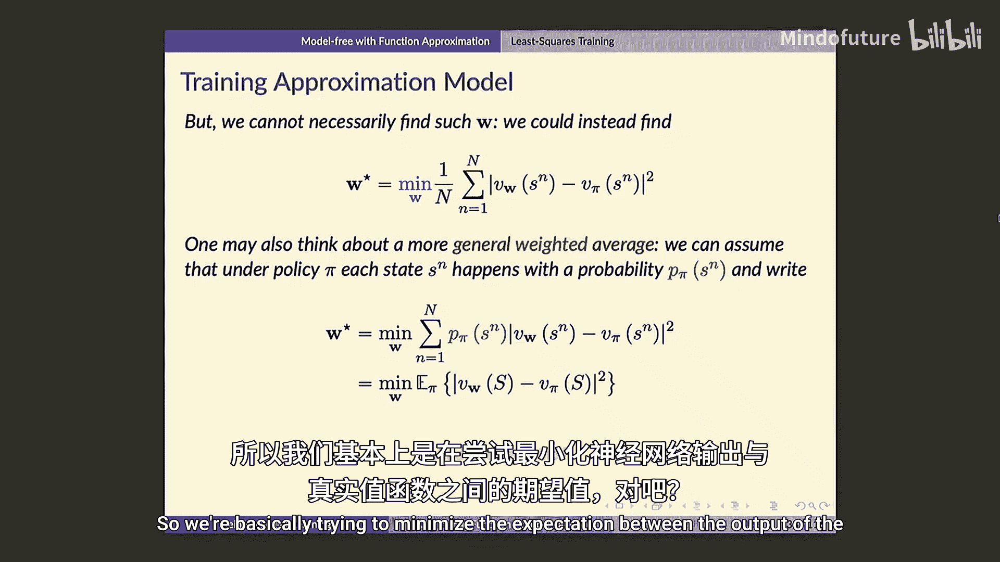

Yes， I can do sampling， right？ I told you before you should keep building this intuition in mind whenever you see expectation。

 you would say I can do it because I can do sampling from that environment， right。

 randomly go to one state， give the state to the neural network as the genie。

 and then you have one sample of that expectation， right， If you get so many samples。

 the average of those samples is roughly this expectation that you want， right， Law fl numbers。

 right。So at the end of the day， what I want to do， I want this expectation to be minimized。

 And this is basically the training that I am going to do。 This is what we we call it。

 Probably some of you have heard of it。 This is the minimization of the residual sum of a squares。

 This expectation is basically a residual sum of a squares。Some people call it mini squared error。

 right， of the output and the true label。 And then when you do this minimization， what。

 what we are doing is list the square approach， right？ But I guess for those who now deep learning。

 this is simply one last function which you want to minimize， right。A rice school， yes。

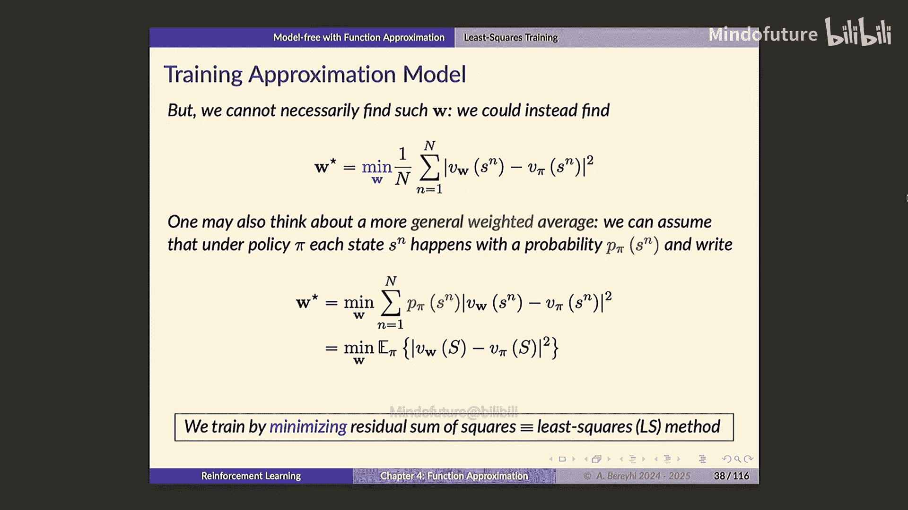

Okay， great。 Now what I want to do， I want to just minimize this loss function。 Yeah。

 so I want to I know this loss this objective， which is this expectation。

 And the thing that I want to do， I want to minimize it。

 So I am going to use obviously gradient decent right。

 And the only thing that I need to do gradient decent is the gradient， right。

 So those who know me from the other courses gonna get annoyed right away because he is again talking about gradient。

 right， but you know， any learning happening in deep networks is happening by gradient， obviously。

 right， And I'm gonna show you today that actually。

 without knowing you were computing gradient before， right I show you today to you。 So Now。

 basically what we are going to do， you we are going to use gradient decentcent。

 This means that we start from some initial weight， right， randomly， you initiate your network。

 you compute the gradient。😊，Say you can compute this expectation at least approximately。

 So you compute the gradient at that particular weight。 that is the gradient of the loss。

 Then you're gonna move in the opposite direction。 and you do it with some particular learning rate。

 Eta， right。Everybody's school？Yeah， okay， now first thing， let us compute that gradient。

 gradient of the loss。 Okay， I want to compute that one。 If I want to compute this gradient， let me。

 yeah， okay， let me first ask。 So if I want to do a compute that gradient。

 sayy I do know how to compute the gradient of the output of the value network， that V W。

 I can compute the gradient of the output。 If I can do that。

 how can I compute the gradient of this loss。Chain rule， right， I need to use chain rule。

 How does the chain rule look like。Its gonna be the derivative of the loss with respect to output times derivative of the output with respect to weights。

Everybody's cool。Should I write it down on the board？

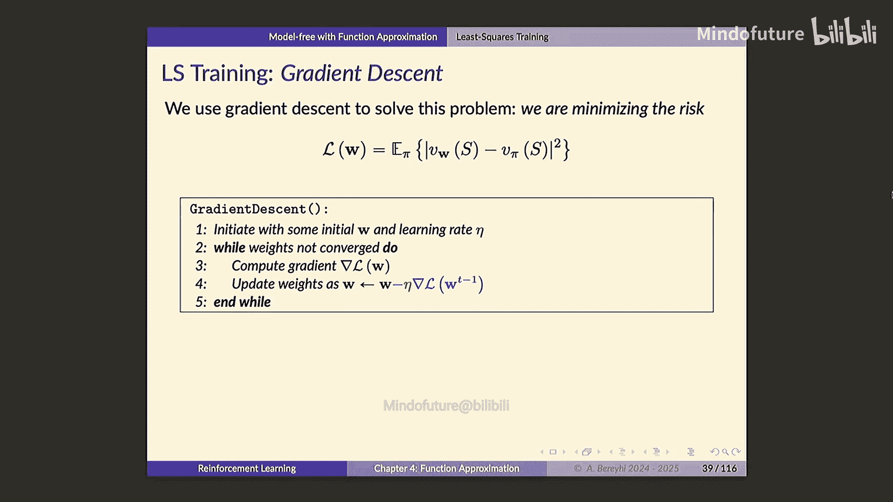

No， so I have it here。 So if I want to compute the gradient of the loss with respect to the weights。

The only guy which is showing up in that expression， which depends on the ways is the network， right。

 VW， right。

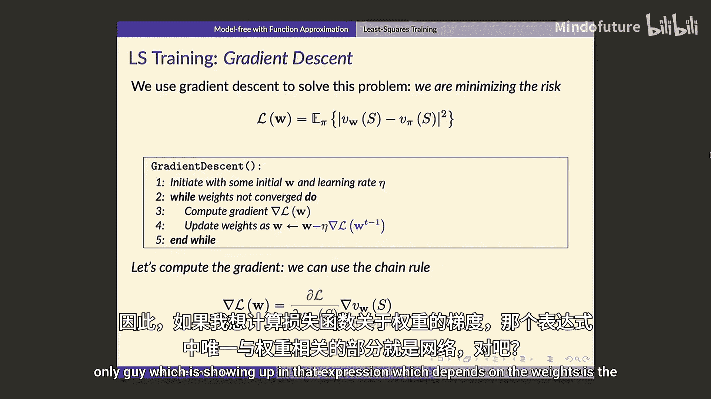

I need to compute the derivative of the loss with respect to that V， right？

I first treat V to be something constant， right？ So I take the derivative of the loss with respect to V。

 and then I need the derivative of V with respect to its own parameters， right？

 Everybody's cool about this， right。This is general， right？Okay， now next thing。

 can you tell me what is this gradient， gradient， sorry， this derivative。

 derivative of the loss with respect to the way to the value。Look at this guy。 That is very simple。

 Trust me。What is it。啊。Anyone has any idea， can you give a suggestion？Okay， so what is the loss。

 Look at the loss。 The loss is expectation of。Value， I mean。

 the value is obviously a scalealr number， right？ So instead of absolute value。

 I can just simply write bracket， right， value with the waste W at the particular point S。

 this is random minus the value。 the true value of the policy at that point， right。

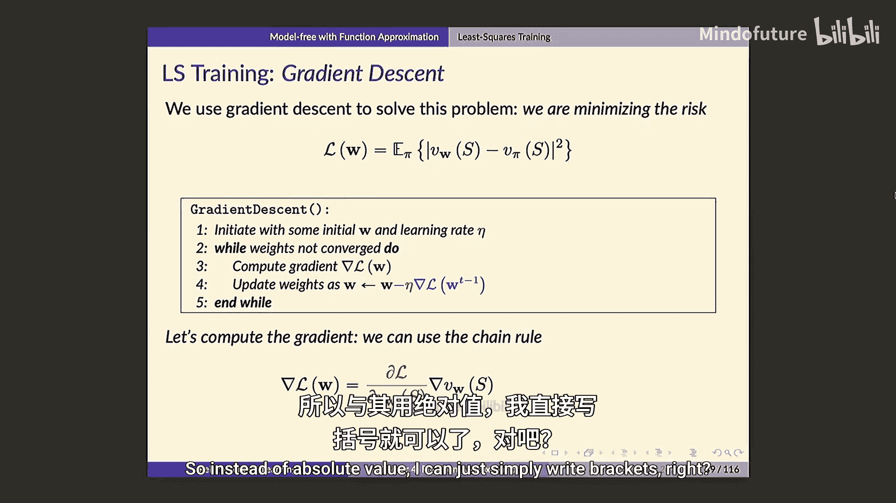

Squiirt， right， I want to take the derivative of this one with respect to this guy。

 How does it look like。Yeah go ahead。Exponent gonna come because you're derivative with respect to V W。

 This guy in goes inside the expectation， right， So the expectation is going to remain untouched。

 Then I go inside。 And here inside， when I take the derivative， what is it， what is it。

Two times this expression times the derivative of this guy with respect to V right。

 And that derivative is。One， right， so this guy is George Evaiff， right？Correct。Now。

 look at this guy， does it remind you of something？Just forget about this， too。

This guy is approximation， right。Difference between your approximation and the true value。

We had it a lot， right？And we're gonna play with it today。

 And you see that this is exactly the same thing there you computed before， right， You see it， right？

 Okay， so I can simply compute that gradient。 So that gradient， this one is simply2。

 I put two outside times the expectation， this expression， right。

 And you know why how I compute that， right， Now， and then this guy should get multiply with this gradient。

 Now， how do I compute this gradient。😊。

Make me happy， tell me the buzzword。Chain rule， yes， but how does it。

 how does the chain rule reflect on this network。Back verag， right。

 So you need to do back verification chain rule on the network， right。

 So this one has no problem for you， right， you can do it always。

 This is back propag on your network。 That's fine。 This was the only extra thing which we added to you。

 right。Everybody's clear。Okay， now。What I'm gonna do， I'm gonna put this expression。

 this gradient inside this gradient decent algorithm。 So this is going to be my update， right。

 So the new weight is the previous weight minus learning grade times that gradient that I computed。

 Now， my gradient had this factor 2 right， And then I put my learning grade Eta to be half some other learning rate alpha。

 right， No problem。 just to get rid of that2， right， And if I do that， then here instead of two Eta。

 I'm gonna have alpha， right。😊。

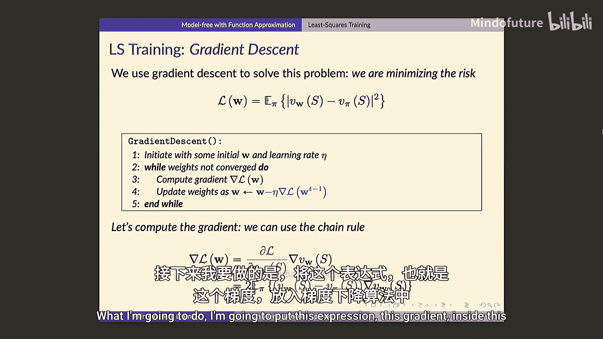

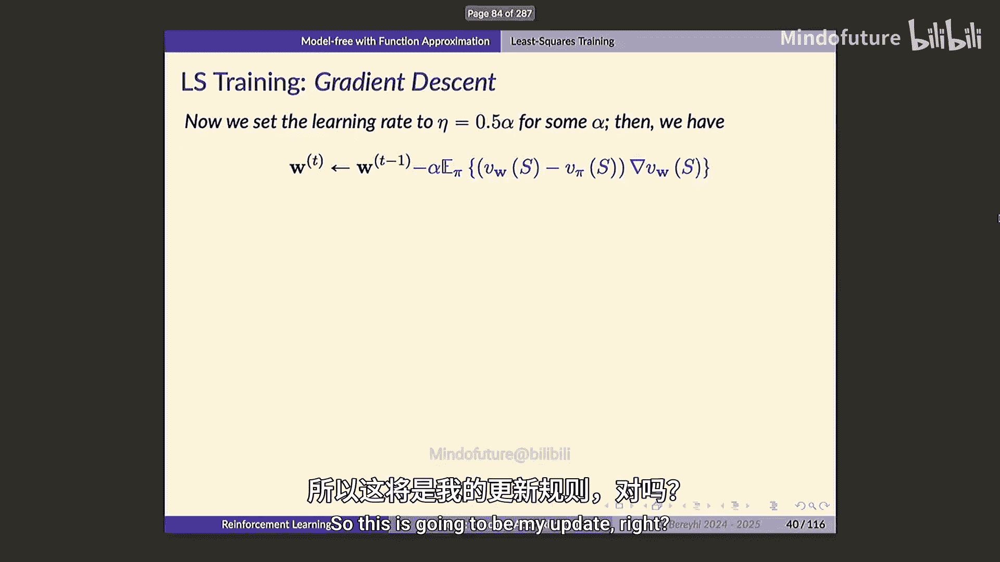

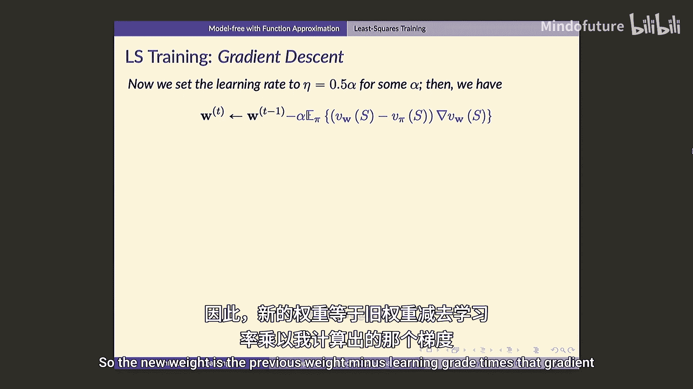

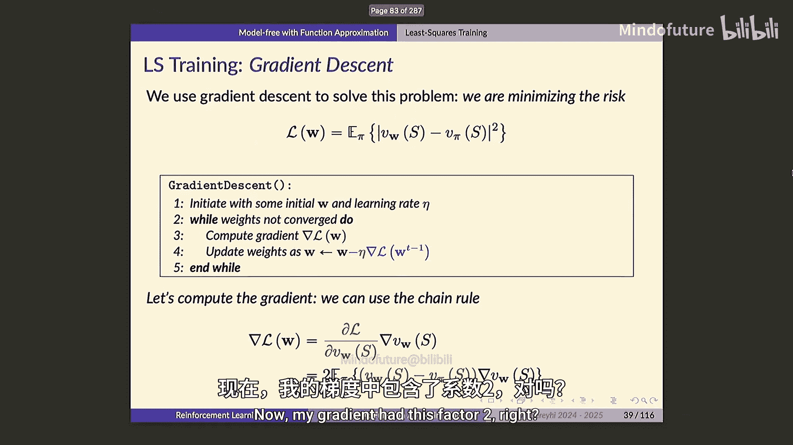

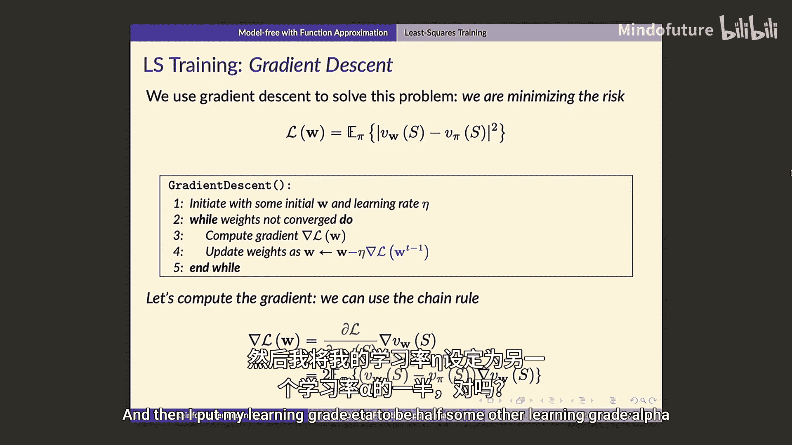

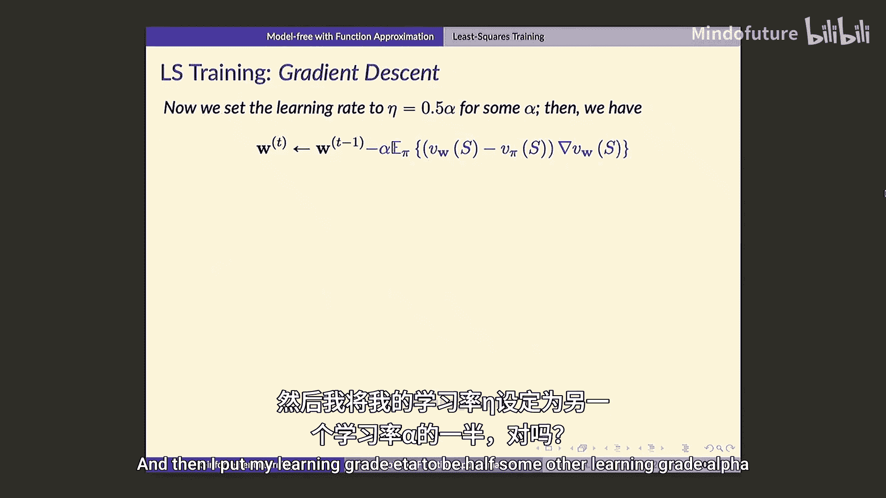

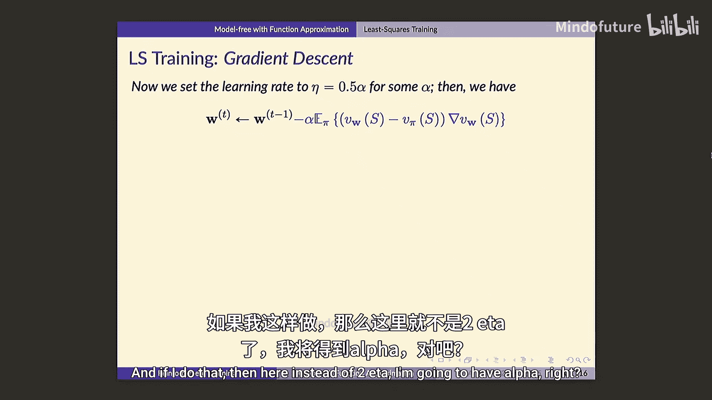

R school。 Yeah， right。 So this alpha is eventually the same alpha we had before。 And I told you。

 this is learning great。😊，Right， so basically， what I'm doing。

 I'm getting my weight updated with this expression， right， And again。

 this blue term that you see it here， can you compute it。😊。

Assuming that I have the genie who is giving me the value for every single state that I ask。

Can I compute it， I can。 I can do sampling， right， I randomly go to this state。

I just get the output of my neural network。 I compute this difference。

 and then I do multiple samples。 And for all of those samples， I compute that one。

 then the average is going to be this blue turn， right。Okay， so I can do this。 Now。

 one thing that Im， you might be interested is that you just show it in this form instead of minus。

 you do it plus， because if you remember in the tablear， we always had plus， not minus。

 So I'm gonna keep it plus。 And then I just exchanged the order， right？ So instead of V W minus V P。

 we have V P minus V pi minus V W， right， And then after that。

 this is going to be migrate in an algorithm， right， So the weights。😊。

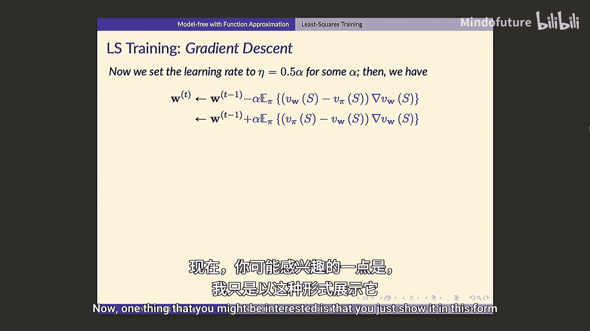

Of the neural network are going to get updated in this form， right。

 and I keep on going till the waves get converse to something， right。Everybody is clear， right。

 So if I do know the genie who is able to tell me the value this of any state I ask。

 then the training is quite simple。 It's just a mixture of different calculation and back propagation。

 right， That is quite simple。 Now the whole issue is that we don't know the genie， right。

 if you know him， just let me know， but we don't know him， right， And then what we need to do。

 we need to just build some way to somehow approximate this value function， right， the true value。

 And of course， you can guess that we are going to use the same thing as we did in the model for reinforcement learning。

 basically just sampling and estimating for few sample。 So the way that we can do it， for instance。

 we can do Monte Carlo approach。 So this means that I can simply start from one particular state。

 and then I keep on playing with my own policy， right， I am in one particular state as 0。

 I play with my policy a0。😊。

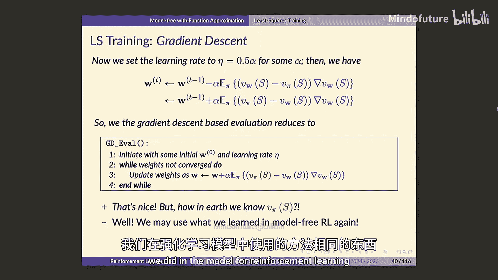

I'm sorry， action with my policy pi and get the action a0。

 I go to the next state and I keep on going till I end with a terminal state。

 hopefully right when I end up with the terminal state。

 Now I am able to just write compute this sequence of this state and they corresponding sample return right the sample return for a state S 0。

 What is it it's gonna be r1 assume discount factor is1 R1 plus r2 plus r3 cell till Rt right that is g0 right that is the sample return for state S 0 then I move to state S1 the sample return for S1 is r2 plus r37 towards the n and then you're gonna have till your very like your second last state right your second last state is just collecting one reward which。

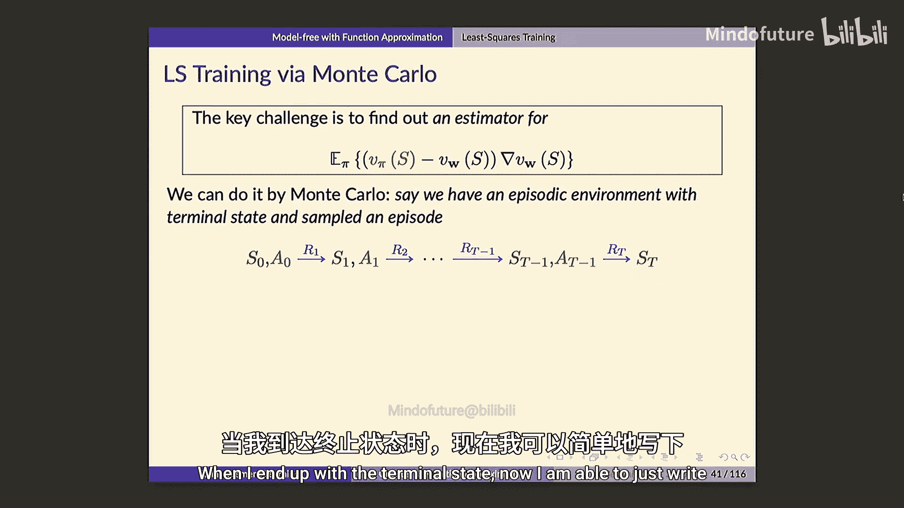

his R T that is G T -1。 And then the final state is also。Terminal stays。 So the this。

So I have these samples now， since I have these samples。

 at least for these specific estate S 0 S1 till estimate -1。

 I can have some estimate of the value function， right。

 So I could say the value of one particular state。 say， for example。

 one estate has shown up multiple times here， right， I just average those sample returns。

 And then that is my estimate of the value， right， So this is one thing that you can do。

 So basically what you are going to do。 You you're going to say that this value that I do have right。

 this is going to be approximated with the sample returns that I have collected right， and then。

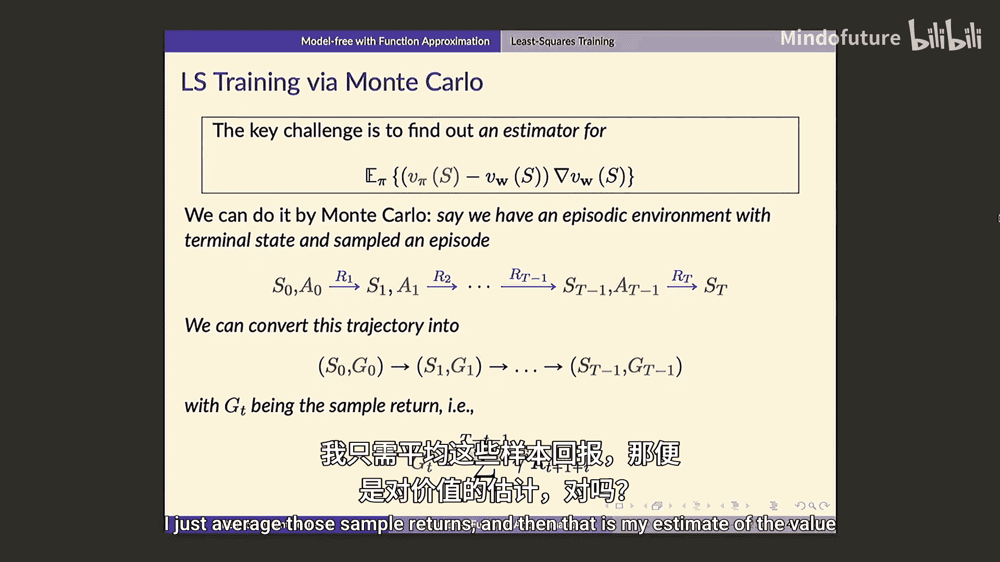

Divided by the number of times I have seen it。 Now。

 one thing that you might say you are able to write down here is that， well。

 I just need to compute this expectation with respect to any state， right？

 So I am not talking about the value of one particular state， correct。

That is state that you see inside this bracket here。 right， That is a random number， right。

And what you can say， you can say that， okay， the value of this guy。

 this VS is a kind of random process， right？So what is the sample of this random process That is the corresponding return。

 right？ So this state S 0， This was one random state。

 It went in went into the process and the value coming out of it is G0， right， G0 is a。

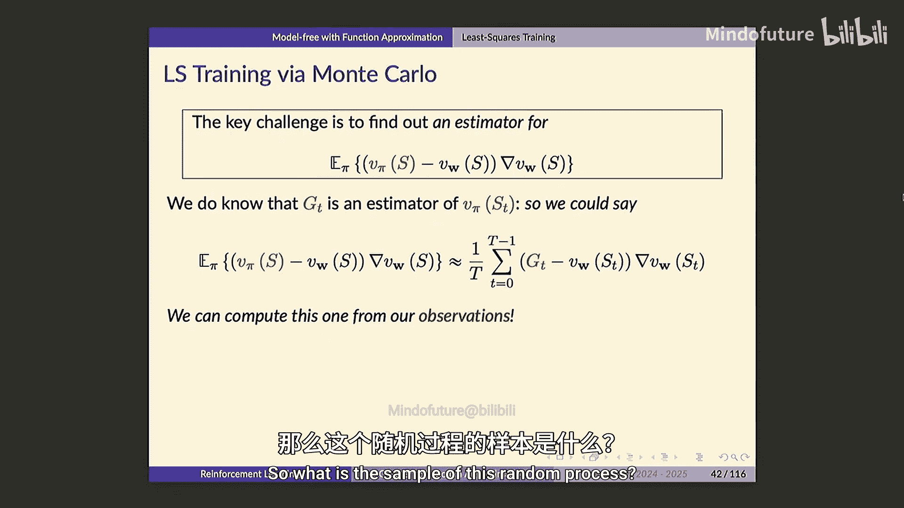

Is one estimator of the value of S0， right？ You might play with this S0 once again。

 and you get another sample return， right， and that one is another estimator， right， and so on。

 right， Now what you're gonna do， you're gonna replace everything inside this expression here with this estimator。

 right， meaningan that you really don't need to go inside and see how which state has happened how many times。

 right， for every single state， you can put the corresponding state inside your neural network。

 And then you would say， okay， I want my。

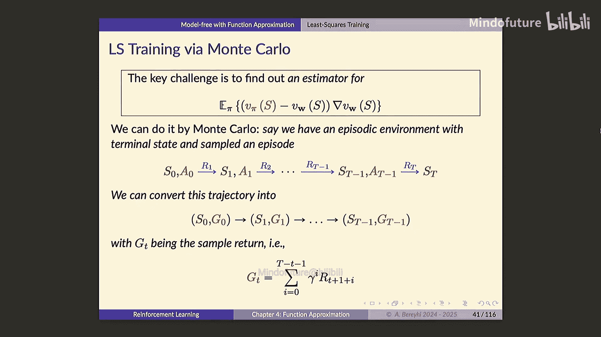

My my neural network to give me as the output for this sample， this particular particular value。

 right， Now if you average it over time by law of large number。

 you're basically computing that average。 So that's it。

 You don't really need to go like what we did in the tableular case and do compute every single G。

 right， or sorry， do compute every estimated estimated of V pi。

 So you can simply put G for every single of them。 So everybody sees them。

So I'm just dropping that expectation。 I'm replacing it with a time average。 And you see that， right。

Cool or not cool。Cool， okay， great。 So now one thing that you can one thing that you can do at home。

 if you wish， you can actually consider the case where you are only seeing the states which are within your trajectory。

 you open up that expectation。 you factor them out。

 You say like this one is divided by the number of times it happen。

 Second one is divided by the number of time。 that one happen and so on。

 But when you merge everything up， you gonna end up with the same expression。 Okay。

 so you don't really need that。 But if you want to make it clear for yourself。

 you can try that one as well。 But anyways， you are going to end up with this expression。

 So this guy is the approximate of the gradient that you need right And well in in real neural networks。

 when you are training like in supervised learning。

 you also do not average over the entire data distribution， right you just have a few samples。

 you just average over them， right So you're basically computing again。

 the same kind of estimator there。 your gradient is。😊，imp the estimator of the true gradient。

 and you are moving in that direction。 that one works。 This one should work as well。

Everybody is cool。

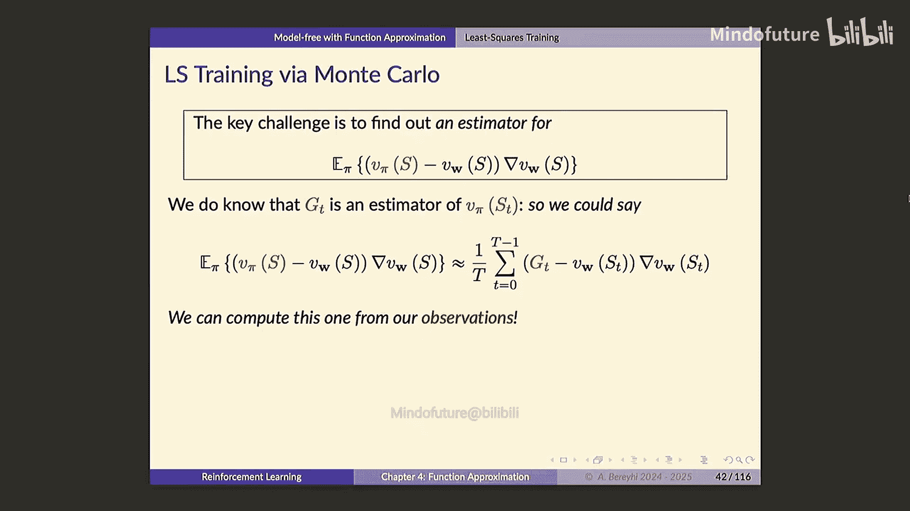

Okay， so this guy is going to be your estimator of the gradient。

 And then this is the simplest kind of say deep reinforcement learning algorithm that you can think of。

 So you basically start with with one initial network。 and then you start to go inside one loop。

 each time you just sample a trajectory， right， you start from one state。 you get one reward， right。

 you go to another state， you get another reward and so on， right。

 So once youre over with all the trajectory， you can build these samples， right， you would say， oh。

 I was in state S0， I collected sample return G0。 Then I went to a state S1。

 and then I collect a sample return G1 and so on towards the end， right， These are the samples。

 I'm gonna put it inside the expression for that expectation to estimate my gradient。

 right Now that I have my estimate of the gradient。 right， I just update my weights， right。

 and I go for the next。😊，I keep on eye trading like this till the W converges， right。

Everybody's school。Questions。So one question， do you feel fine with this gradient of the network。

 I do know I'm very obsessed with back propag， but I simply mean that do you see how it's happening。

How do you compute this particular gradient。So if you are in one particular state， S， okay。

 that estate has one feature representation， right？That is x of S T， right， for example。

 in the mountain core example， that S T is one random velocity and location， right。

 that random velocity and location vector representation goes inside your neural network， right。

It goes towards the end， right？ And then you back propagate。 you're gonna to have the gradient。

 right？ So you put that gradient here。 Now， the velocity and location changes。

 So you get another S right， And for that is again。

 that guy goes forward and comes backward on your neuraln network gives you the next gradient right？

 You see it， right。And each time you go forward， you also have this guy， right。

So every single of those time steps means one forward backward for you on your neural network， right。

 And then you average all of them。It's basically the same thing that you do in mini batchche learning。

 right？Everybody school？Great， so。This is the simplest algorithm that you can think when you are talking about deep reinforcement learning。

 One question， what does this algorithm do， Does it do control or prediction？It's doing prediction。

 right， So were still fixing the policy。 We just want to know what is the value of that policy。

 right。Everybody's clear， right？Great， so in practice。

 you obviously cannot wait till your weights are going to converge。

 This is not the case in any deep neural network， right， So you never get converged in in really。

 in that sense that you see your weights are not changing at all。 So what you do。

 typically in training of neural networks， you just give specific number of epochs right。

 And here you can also give it a specific number of episodes， right。

 So you just do the training for multiple episode 100，1000 episodes。 And then gradually。

 these ways are getting close to some specific configuration。

 which is giving you a good estimate of the values， right。😊，A high school。Great， so now。

What we have done here in this particular algorithm is that we have collected one complete episode。

 and then we after collecting the episode， we have updated or weights， right。

 but it might be in some environment as we talked before that this episode is very long right in time。

 or it might be that there is no problem with that because we are right now doing Monte Carlo。

 and we need any ways to wait till we meet the terminal， but this might be that well。

 if I want to compute this average， I need to do capital T number of forward backward propagations right。

 and that might be too much right from deep learning。

 you know that going over a big batch of data is not something we can handle with deep networks。

 right， So what do we do in practice in deep neural networks。We do。Mini batches， right。

 mini batch traininging。 How can I do mini batchsh training here。有か。Yeah。

 you just take a couple of samples， right， So you don't update at the end of every episode， right。

 within one episode， you do multiple updates， right， Basically， you just go first batch of samples。

 second batch of samples and so on right So you can do the same thing here。

 So waitinging once per episode to update might be too much because the episode could be very long。

 And this is too much for you to handle computationally。 So one thing that you can do。

 you can actually just break it down into mini batches。

 right So you would say I have two different samples inside my say batch of one episode。

 And then I just break it down into mini batches。 Now， your mini batch could be as small as one。

 right， you update after a single sample， right， And if I just replace。

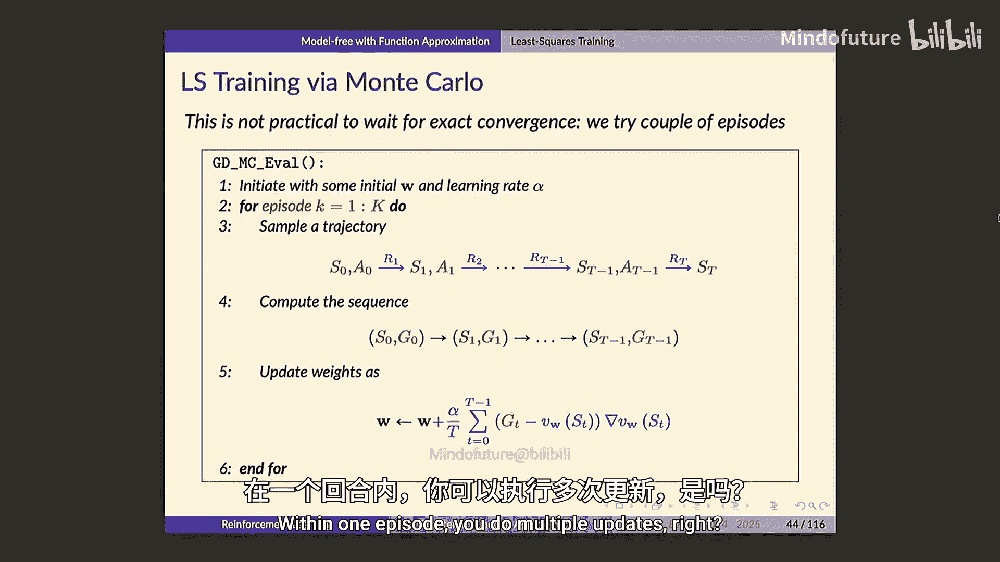

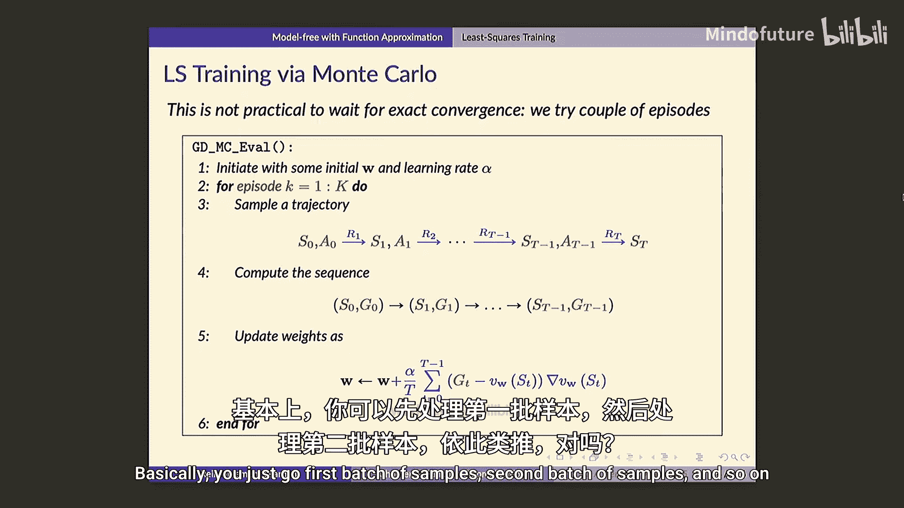

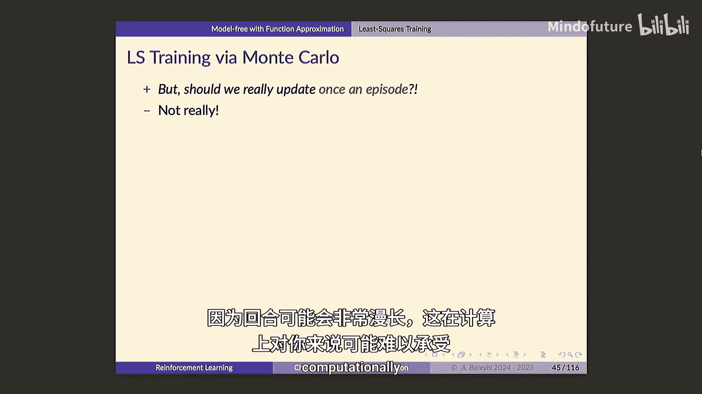

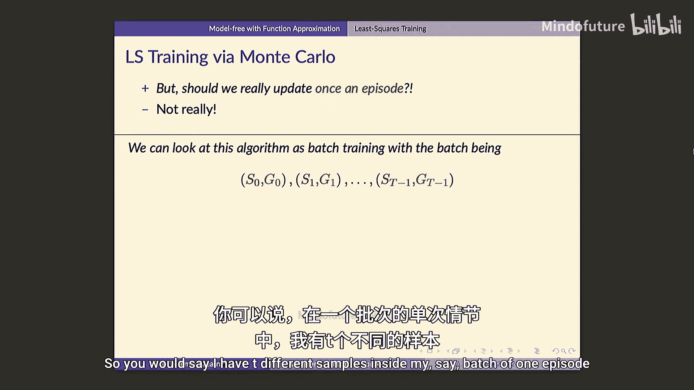

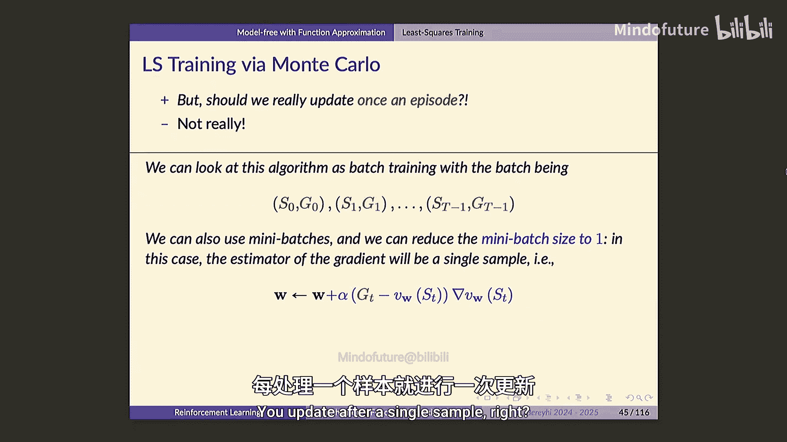

This capital T with  one， right？This guy is going to be my exact sample difference， right？

 This is the exact sample gradient I computed， and this is going to be simply alpha， right。😊。

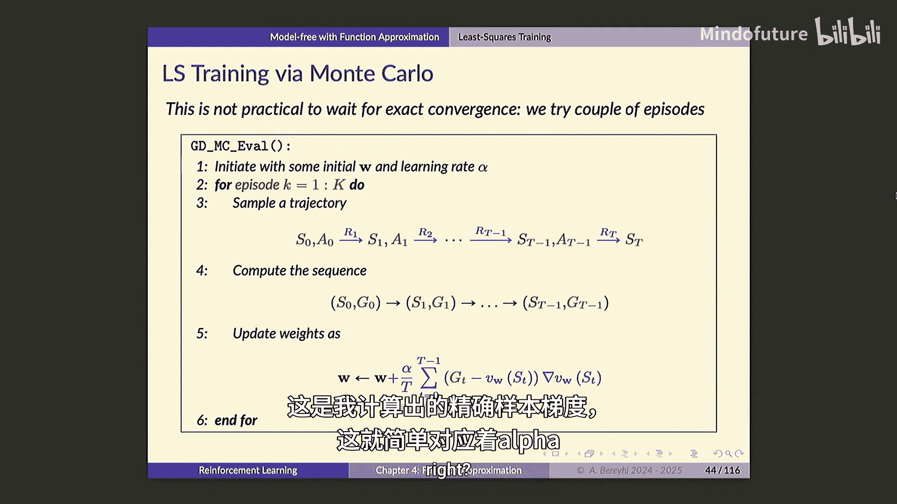

Everybody's cool。So if I set mini bias size to be one， then I'm going to end up with that expression。

 right。And does this expression sound familiar？Or seem familiar or saying it doesn't sound。

Does it seem familiar， You have a sample， right， a new sample， you subtract it from your estimate。

I have this gradient。 We didn't have it before。 right， I'm going to show you what does that mean。

But that was basically the same thing that we used to do right。

 or new estimate was our previous estimate plus alpha times difference right and that difference we could compute it using Monte Carlo。

 TD， anything right， But we always had such an update， right？ at that point。

 we said incremental averaging。 but that incremental averaging was essentially gradient indecent。

But since the model was extremely simple， that gradient decent could be derived without using derivative or anything。

So eventually， what you can do， you can actually update your network after every single sample。

 You don't really need to wait towards the very end because every single of those G T values and S T states they are。

Some sample value and a stage， right， One sample point for your neural network and your neural network can use that sample to train。

 right， So you can eventually do that。 And if you do that， you can end up with this one。

 So this is more practical as compared to the first one that I showed you。

 because now here you're actually updating your waste much more during your sampling， right。

 So you start with one stage， you keep on sampling， right。

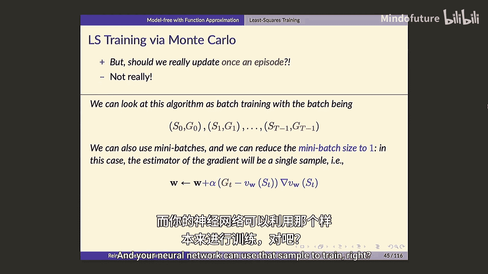

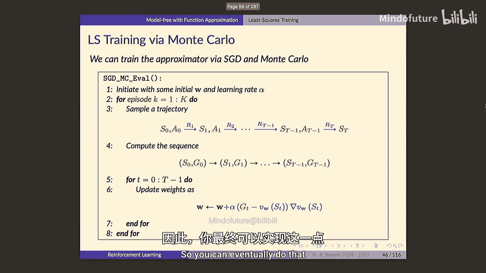

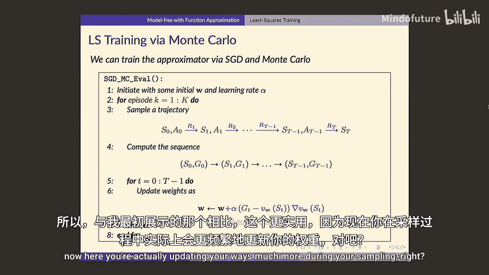

Towards the end。 And each time you can compute one sample return。

 you use those sample returns to update， right， Each sample return gonna give you one new update。

 So the weight are getting updated， right， Now， for one one trajectory， one episode。

 you are actually updating for T different with T different samples。

 T different iterations of gradient decent。 And if you do K different episodes。

 then it gonna be K times T different updates of the weight， now this one makes sounds more rational。

 right， makes sense like the neural network is going at some point to converge， right。

 or gets somehow meaningful impression from the environment。😊，Everybody's cool。

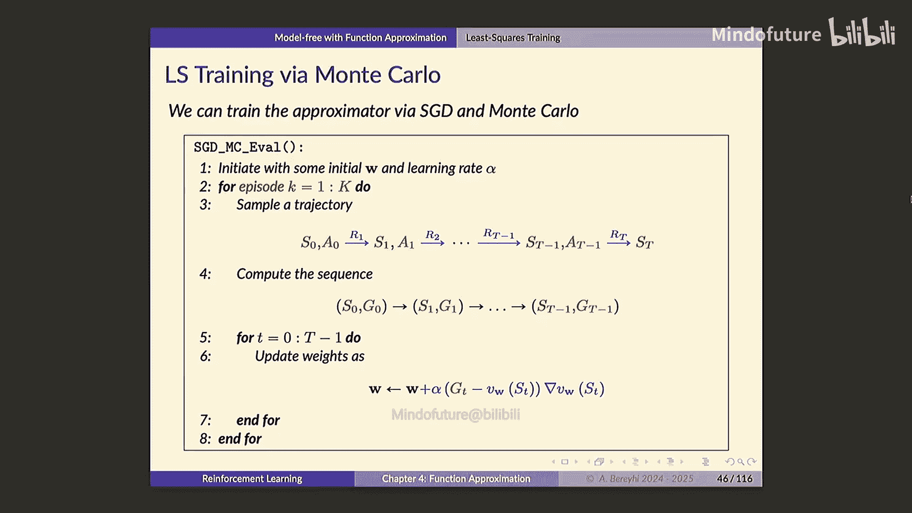

Questions？Now question。So this thing that I showed you had been with a Monte Carlo operate。 right。

 The only thing that is Monte Carlo here is essentially the calculation of those sample returns。

 right， those G values that you want to compute， You're just computing it by Monte Carlo。

 But I can simply do it by TD， And the benefit of doing TD is that I don't need to wait till end of my trajectory to update。

 right， because after seeing every single new state。

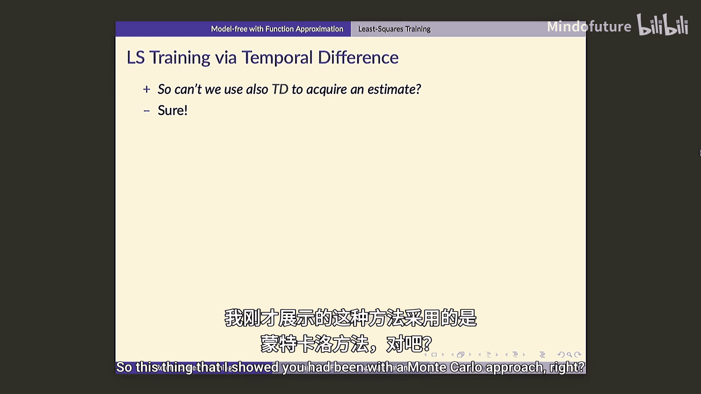

I can use Td to get one estimate of the value right and using that one。

 I can just use that one to just update， right。

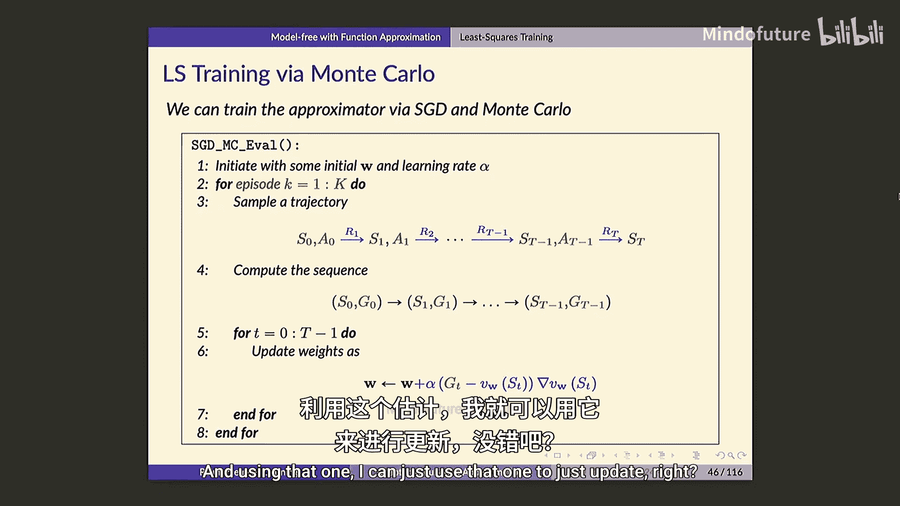

So this is going to be the TD case。 So you can basically compute your estimate or using temporal difference instead of Monte Carlo。

 And this means that if you， for instance， do TD 0 at every single time that you sample。

 you would say my immediate reward that I collect plus the value in the future， right。

 and the value in the future you don't have it。 So you use your same neural network， right？

 So you would say what would be the next。State， right， so you see the next state。

 you give it to the neural network。 That gives you one estimate of the value， right。

 You would say this immediate reward。 plus that value is the estimate of this state， right。

 and then you replace this estimate in your loop， right， So you can do the same thing as before。

 So this is going to be TD。 This is exactly the same thing as before。

 you start to sample a trajectory。 you go towards the end。

 every single state that you are in when you want to to get one estimate， you would say， okay。

 I am in this particular state。 I collected this reward。

 So this is the first reward I collected plus the value of the next state。 S 1。 Okay， I've seen S1。

 I give S1 to my neural network。 It gonna give me one estimate， right， that is bad estimate。

 but gradual is going to improve。 And I just subtract it from the value of the current state， right。

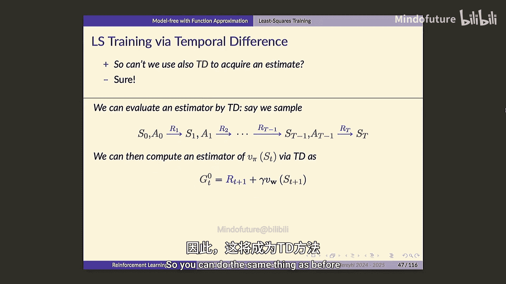

You see that， right？So this is the term that I need as the difference。

 Then I basically need this one to just compute the gradient， right。

 One thing that you should pay attention here。Here， in this case。

 you are not doing two back verifications， right， You see that， right。

 You're just doing one back verification。Correct， because you need one gradient。Right。

 so that other guy， V of S T plus one， because you might say， oh。

 I am calling my neural network two wise for update， right。

 for the next estate and the current state。 But first of all， these calls are forward propagation。

 right， You just put the sample state at the input。 it goes towards then end you get the value。

 You don't need to back propagate， right， you only back propagate ones， right？ And secondly。

 this V of S plus one。 you're going to use it next time， right？

 Because next time this V of S plus one is going to be V of S T， right。

So there is no complexity challenge here going on， right。

 So it's the same complexity as the Monte Carlo one， but it it's much more online。Yeah。

 but there is a bit of。Price you are paying。 And that is that this guy is now a bias estimator of your gradient。

 whereas Monte Carlo gives you on biasasestimator。 Well， we， we take it。 It's okay。

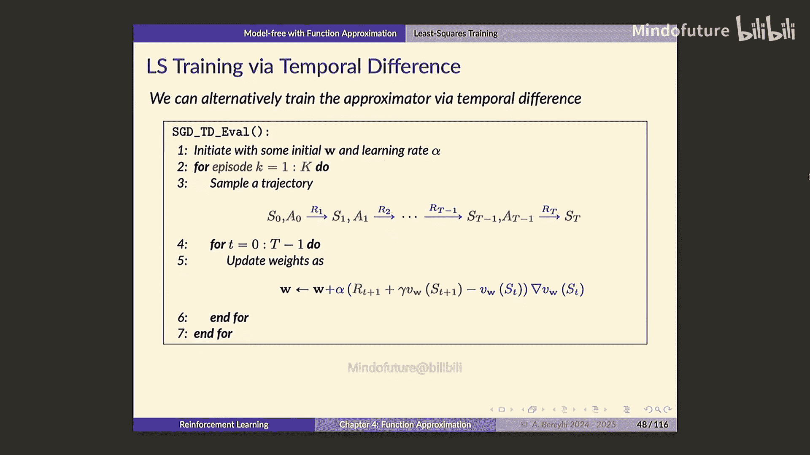