# 【多伦多大学】强化学习 2025 ｜ Uoft   Reinforcement Learning   Fall 2025 p40 P40_讲座_39_通过函数逼近学习动作价值 -BV1D3F2zhEry_p40-

For the next board， now you have know the idea that I have。

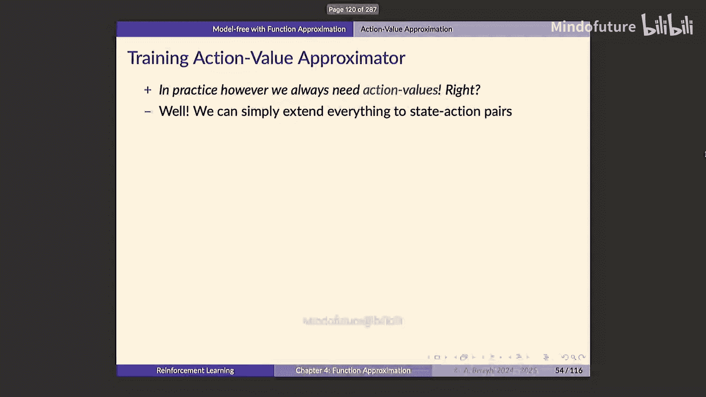

One policy。 And I tell you that just evaluate this policy， right， and what you know is that。

 for example， this data space is very complicated。 So you would say I can never do it with Tablear approach。

 So I'm going to choose one model for my value function。 I just try to train it。

 And if I want to train it， I basically do the updates that I told you here， right。Now。

 this is when you want to find out what is the value function。

 Can you do if you want to really use it， for example， to just build a policy， that is not efficient。

 right， because you need Q function instead of the value function。

 right Now the thing that we can do， we can extend everything that we have done here for the Q case。

 right， the case where we have a state in action right And again， there is no trouble anymore。

 because we are always running away from the complexity by using the neural network right So that is no problem anymore here。

 So what we can do， we can actually extend the same idea to approximate the action value function。

 the Q function here。 And if we want to do it， obviously we need to have a feature representation for for a state action。

 It means that any pair of state and action that you have， you need to represent it by one vector。

 right。

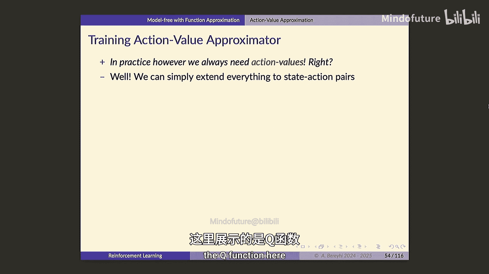

Clear， so one thing。 so this is basically the feature representation of your action state pair。

 So one state in action is going to be represented with one potentially high dimensional vector features。

 And the thing that is going to happen is that you are going to have this Q network so。

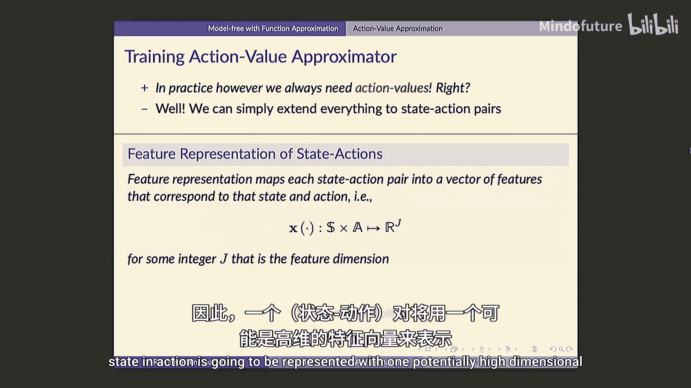

Given this day that you are in。You would say， okay。

 I have a bunch of actions that I can do for every single action。 I have one representation， right。

 that representation X is telling me what is this state and what action I am doing， right？

 And giving that to the Q network， that Q network is going to tell me what is the value that I'm going to get after doing this action in this particular state。

 right， That is an estimate of the value I'm going to collect towards the end， right。Revise clear。So。

Now， one thing that we typically do in practice， we don't really like feature representation。

 individual feature representation for every single action to be just separately given to the network。

 What we do， As I told you before， we are still thinking about discrete space of action。

 So you're still going either right， left up down， right， will later in two yeah， in two chapters。

 we're getting to the point where we can also work with continuous actions。 But right now。

 Im still think of discrete actions。 Okay and if you think about discrete actions， now。

 I could say that I am in this state， well， if I go this side。

 I'm gonna have the first representation。 if I go this side， I'm gonna have the other representation。

 if I go up， I have another representation。 If I go down， I have another representation， right。

 I don't like it， usually okay， what I can think， I can think that， well， I am in this state， right。

And when I am in this state， I have one representation of this state。

 This is the same thing we had in the mountain core， right， It was V and X， right。

 I can represent one estate with a bunch of features right， If you're playing some board game。

 that image is this state right now I can say that okay， out of this representation。

Out of this representation， there are M different representations， right？Let's say they exist， right。

 That first one goes to this same tune network， gives me the。Action value for the first action。

 right？ The second one goes to the same network。 Give me the action value for the second action and so on till the last one。

 right， Now， I can say that okay， all of these things。

 all of these M different copies of the same network。 I just consider it as a giant network， right。

That giant network only needs to know where I am standing， right， my state。😡。

And once it knows where I am standing， it's going to tell me what is the value if you do action 1，2。

3 to M， right？There。So I can think of this whole thing to be one neural network。

 And then that neural network is not giving me a single value。

 It's just giving me a vector of values， right， And that vector of value。

 the dimension of that vector is exactly the dimension of the actions I have， right。

 The number of actions I can do。Everybody's cool。So in the grid world， you give it。

 you give the network where you stand。 and then it're gonna to give you four different values， right。

 These are the values you're going to get if you act up， down left， right， right。A ra， right。

 So now one thing that I'm gonna So I am going to think about this whole thing is a giant Q。

 This is the reason that I'm showing it with capital Q just to distinguish between between this one and the Q。

 which is just going for one particular state in action。

 Okay and this Q W is containing one vector right， So it's going to look at the representation of your state。

 where you stand。 And it's gonna to tell you， these are the bunch of values you're going to get for the different actions you are going to do。

😊，Okay。Everybody's cool questions。Now， yes。I created。We yes， we are going to do the same thing。

 right， yes。So everybody's cool with with this notation。 Now。

 one thing that I'm gonna do from now on， whenever you see this vector， like this bold entry here。

 Okay， this a being bold， I simply mean the whole vector， right， I do know that at some point。

 you're gonna follow it simply because it doesn't make sense to look at one particular action for you。

 but for now， just to avoid any confusion。 If I really want to mention one particular action。

 I just show it is small。 sorry， non bold， not bold。 Okay， but whenever you see bold face。

 this simply means that I'm considering the whole actions， right？

 And this guy is a vector then right。Okay， so。

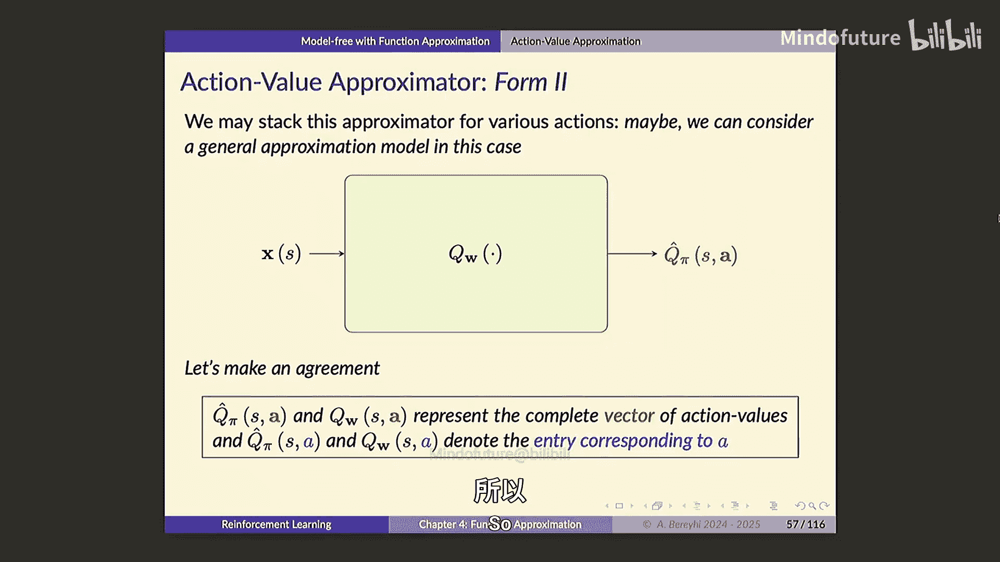

That's it。 And now if you want to do the training， you are going to do the same thing as before right。

 So if you are only thinking about prediction， it means that you have the policy。

 you only want to know what is the action value function for that policy。 Well， you can again try TD。

 Monte Carlo any any other approach to just estimate the value of one particular state in different actions right and then you give those values to your neural network and then you train right。

 So it's gonna be the same thing as before， you again end up trying to minimize this expectation。

 right the expectation between the output of your Q network。

 that action value network and the true action value function right you don't have that one。

 basically you just rely on the estimates right So if you want to minimize this one。

 you're gonna do the optimization using the gradient decentcent and the gradient de is going。

To end up again the same format， right， So alpha is going to be indeed half of your learning rate。

 And then this is the expression that shows up out of the immediate derivative。

 And then this guy is the gradient， which you can compute by back propagating over your whole network。

 right。😊，Correct。

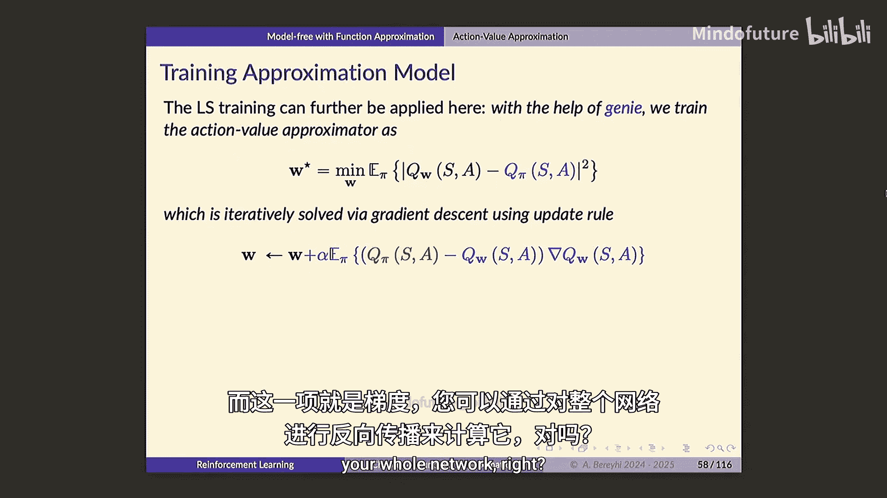

Now。Doing that， you can again use Monte Carlo or TD or anything to just find an estimate of this term Q pi。

 which you don't have。 And that's it。 That's exactly the same thing as before。

 only with the action also showing up here， right， So say， for instance， you have one。

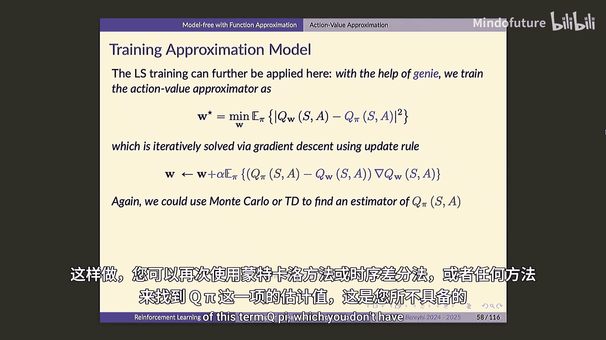

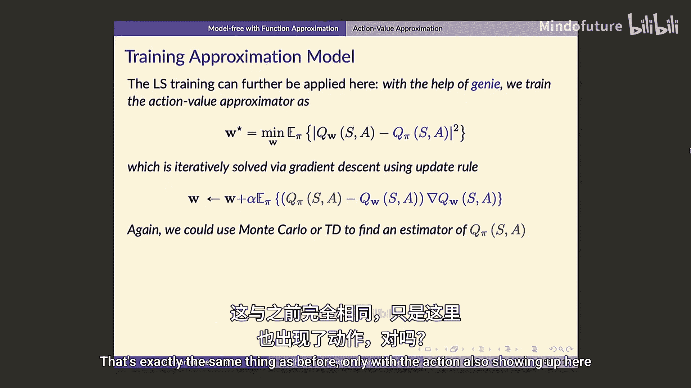

Sample trajectory， if you have this sample trajectory， how you can build your samples。Well。

 for the value network， you had state and the sample return， right， sayy you are using Monte Carlo。

 You had a state and sample return， right， No， you would say， okay。

 I have a state action and sample return， right。State action sample return。

 These are the samples that you need， right， And then you replace it inside the expression you had instead of expectation。

 you average over time， right， So that going be the case。 If you just do it with mini batch。

 this means that you just do one sample， right， So after every pair of a state in action。

 you get one sample right， This is the sample return。

 and then you subtract it from the corresponding output of your Q network， right。

 So your Q network is going to get the representation of this state。 it gives you M different values。

 You select the value， which is corresponding to action  A， right。Everybody's cool， right。

 You don't care about the other values because you have not done those actions， right。

That is what you try to estimate。 This is the sample estimator of your return。

 you multiply with a gradient， and that's it， right。And that gradient， again。

 is computed by back prop。 starts from A T output。 It just goes backward all over your network to give you all the gradients you want。

 right。Everybody's cool？Okay， so if you use TD， you replace that G T simply with this guy， right？

 So you would say that， okay， instead of G T， I would just collect the immediate reward plus the value that I'm going to collect from a state S T plus1 on。

 And how can I compute that V W。 How can I do it。Can I compute that one？

If I have just a network which is computing the action values， can I compute this V value。

 the value of this state。I can do it， how can I do it？Average over your policy， right。

 average your policy。 So your Q network is going to give you the action value for all actions right。

 And if you average all of those values with respect to your policy that is going to be your value right So you are able to compute this value If you are in one particular state and you want to know what is the value of that estate。

 Well， you have your Q network right that Q network is giving looking at your state and giving you the value of all possible actions right You just multiply them with the corresponding proities inside your policy。

 that is the value of this state。Is go。So with TD again， you can do it as before， right？

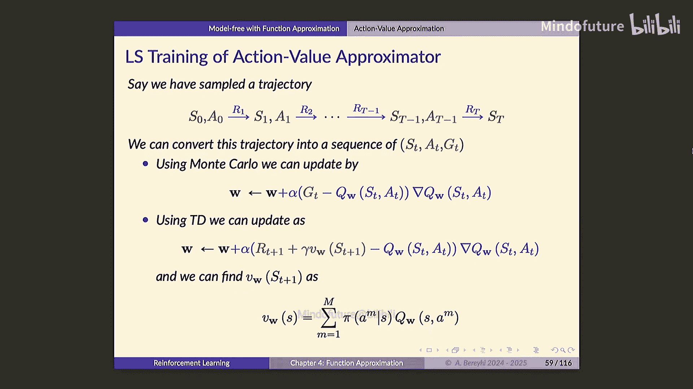

Okay， great now。嗯。Yeah， so I think I want to just this part。 Okay， so one thing that again。

 you can see here， I'm not going to do it again for you。

 but if you just put the representation to be tokenization and you consider a linear model。

 then eventually you're gonna end up basically doing tableular reinforcement learning for estimating the Q function。

 And now this idea that I told you that you can always extend whether you have done in the table or case to the case with function approximation。

 you can actually do it very easily。And pretty much for anything that you had before， okay。

I don't guess that many things that we discussed gonna be needed too much in future。

 but just to give you one。Sample extension。 I am going to go through the case where we are doing TD Lada。

 right， And I want to show you that this that idea of eligibility tracing that we talked before。

 Okay， that was essentially just doing the moving average on your gradient。And you might say， I mean。

 at that point， you didn't get it， right， why we are doing this。

 I tried to just connect the forward view to the backward view。

 But when I write it down here for you， you see that essentially。

 youre just computing moving average on your gradient with a corresponding lambda and why that moving average is going to help well。

 because it's going to just collect the impact of all possible states as well， right。

 It's going to improve your estimator of the gradient。So， let's do it。So what we did before。

 we just did we just track the eligibility of every single state in action， right。

 And then when we are in one particular state action and we want to update。

 we just propagate all of the impacts using that eligibility trace。

 right So when I get into a new state。 I do not simply update the value of that estate。

 I multiply that difference delta to this vector of eligibilityities， right， that one is updating。

 of course， that the value of that estate and the value of any state I have seen before， right。

 that was the case in the eligibility tracing。 So this was the algorithm， right。

 if you were talking about one the action value function， then you have one state action pair。

 then for every single pair， you had one eligibility value。

 you initially start with all of them being zero， right。

And then each time that you can see one state in action pair。

 you're gonna give e or add the eligibility by one， right。

 Then when you go to the next time of step first， you just。Multiply everything with this factor。

 which is a smaller than one， right。 So is you're just suppressing all the eligbilities。

 and then you add one to the newest estate in action that you see right， Everybody recalls that。

 right， Okay， so now let's see how this guy interprets in terms of function approximation。

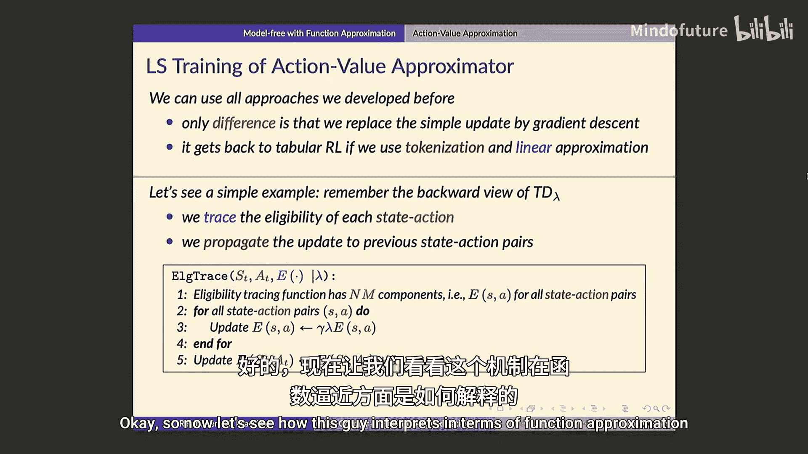

So keep this guy at the top and I told you when you are doing。Tabableore reinforcement learning。

 you're basically doing the same thing。 Only the difference is that your representation is tokenization and your model is linear。

 right。Okay， now。Let's now think that we are doing。 I mean。

 let's rewriteide this guy with these two things like the linear approximation and tokenization as the representation in terms of the components of a function approximator。

 so。If we are doing representation by tokenization in the state action pi。

 this means that my tokenization is gonna to look like this， right， for every single state action pi。

 I'm going to have one entry， right。So if I want to represent one state in action， then I would say。

 okay。This is one giant one hot vector。 iss one on the corresponding entry。 everywhere else is 0。

 right， And I can show that in this form， right， This is one hot vector。

 and it's one only when the state is S N and the action is A M， right。So this is my representation。

 right， byization。 The second thing is that my model is linear。

 So this means that my model is going to look like like if I want to compute the Q Q is going to be the weight times my x。

 right？ Now， if I want to compute the gradient of the Q at one particular state in action。

 this gradient is going to be simply X， right， we did it before for this day， the same thing here。

 right。Everybody's cool right So your x， your representation is this one hot vector and this one hot vector at the same time is the derivative of or gradient of your Q network。

 right。😊，For this。Okenization representation and linear model。 Now， if you have that one， now。

 let's look at this guy。 So what is happening here。 So in line 3， what I am doing。

 I am multiplying this eligibility right， by some factor。 Now， what I can say， I can say， okay。

 since I am doing all the。

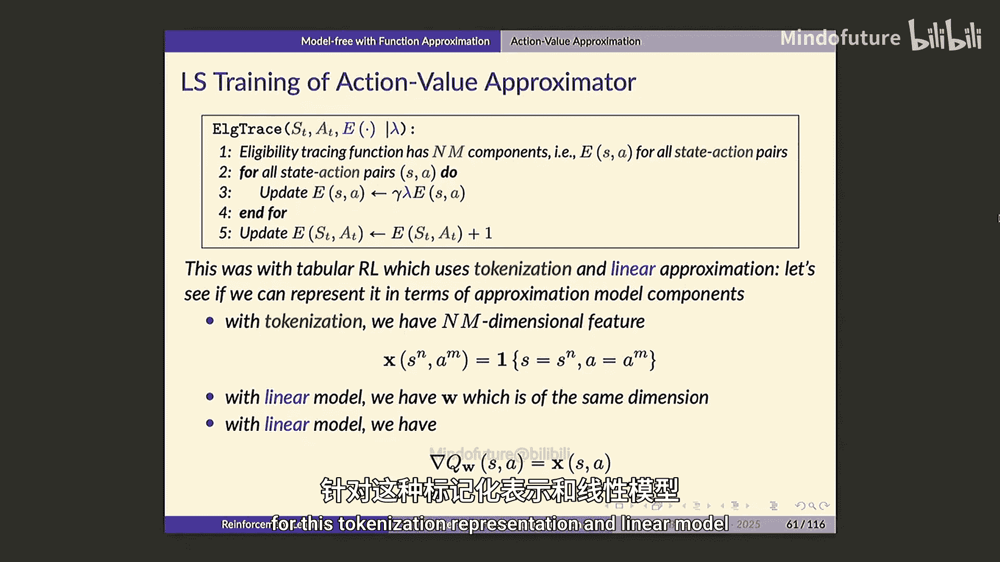

Estation using one Q network with parameters， W， the eligibility that I am seeing is also depending on the W。

 right， So because I am computing it with this network。

 So this is why I am showing it by E W E W here is what is the dimension of E W。

 What is the dimension of this vector of eligbilities in this case。N times M， right。

 because you have n different statess， M different actions。 So it has n times M different entries。

 right， So that is exactly what we do here， right， in in， in lines 2 to 4， right。

 Now the update that I'm doing in line 3 is simply I get that vector。

 I multiply everybody with this factor gamma times Lada， right。😊，Okay so I can say that in line 3。

 I basically get this vector， I multiply everybody and then add up to this one。

 right Now the next thing that I'm doing， what I'm doing in line 5， what I'm doing。

 I am just simply adding up one to the particular state in action that I am in right so I could say that I am adding up this whole giant vector EW with one hot vector right。

Everybody agrees。So I have this whole eligibility vector。

 but I am only adding onean to the particular state in action， which is happening at time T， right？

Right。So this means that I am adding up my eligibility vector with one hot vector， right？R school。

 right， What is this 10 vector in this setting。That is the feature representation of the state action。

 right？

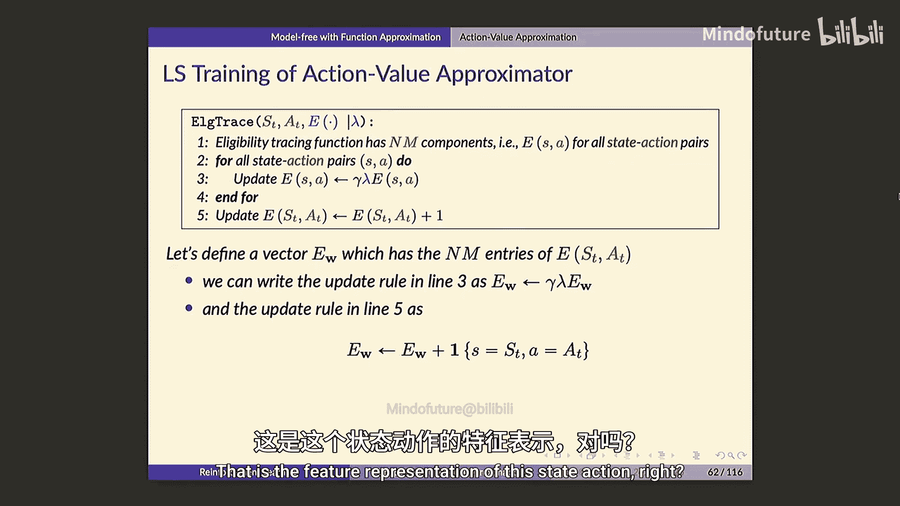

Here， we said that x of one particular state in action is basically 100 representation， right。

 So what is this guy， This is。

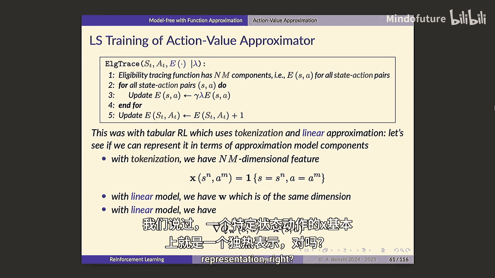

Feature representation of the state in action， which is state in action？

The state and action pi that I'm seeing at time T， right。

If I think about feature representation of data state in action period in time T。

 that is this one hot vector， right， This is 0 everywhere。 It's just one at the particular entry。

 right， which is S T80， right。Re school， right？ So it's okay that I replace this guy with X in this setting。

 right。A rice go。Because I told you x here is basically this 100 presentation， right， Now。

 what was x in terms of the Q network。

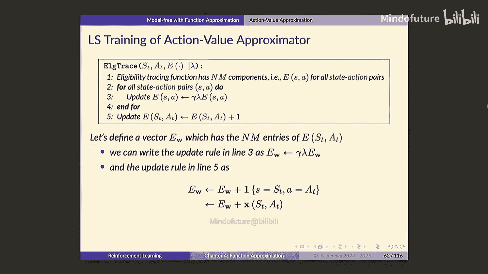

It was the gradient of the Q network， right， once again here。

Graadient of your Q network is your x representation because your Q network in the T r case is simply linear model。

 right， is gradient is simply x， right。A bright cool。Yes。Yes， basically， when you're updating。

 you're just updating one particular weight in the tabary case， right。

 And then that one is just getting updated with this coefficient。 So yeah， that's the same thing。

 Exact like the one we do with the value。 Now， you just extend to this。Action me。

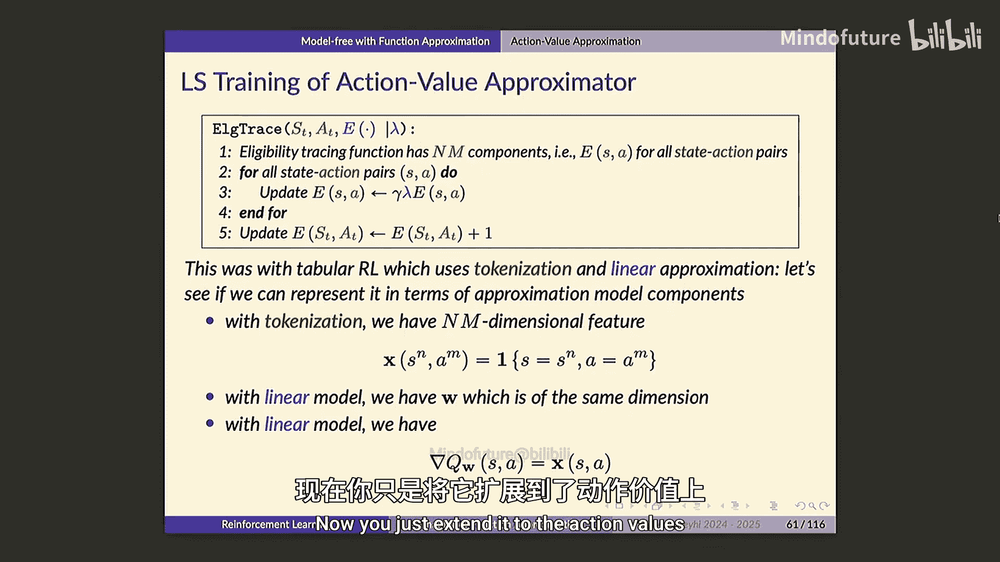

So everybody's cool that I just replace this one， this guy with this gradient， right？Yeah。

 in this particular case， I can just replace this one with this gradient， right？

So what am I doing now， when I am doing eligibility tracing， I start with some eligbilities。

 which are 0， right， That eligibility vector is of the same dimension。

Of my gradient or my feature representation here， right， But same same dimension of my gradient。

 right now。I start with a vector of zeros， then that is the same dimension as my gradient。

 and that each time that I go on and I compute a new gradient。What is it。Sorry。Sorry。

So each time that I go on I get a new gradient， then I just multiply this vector with some constant is smaller than one。

 right， and then add it out with the new gradient that I get， right。And again。

 I get this one next time I multiply this whole sum with a new scalar， smaller than one。

 ended up with the next gradient that I get。 What is it。It's basically moving average， right。

 It's like computing a momentum， right， when you are training a neural network。

 instead of using your sample gradients， you， you can compute the momentum of the gradients， right。

 This is what atom does， for example， right。Correct， so that's the same thing。 So you again。

 you basically did momentum there without knowing it， right。

 And that one made sense from a statistical point of view。 but computationally what you were doing。

 you were basically computing the momentum。 and by computing the momentum。

 you were somehow keeping the impact of the previous observations on your actual update， of course。

 because those gradients are still updating your your model， right。

 So the gradients of the time as0 and a0 are still updating when because you are keeping it inside your moving average。

 So what you can say， you can say basically this whole eligible is you tracing approach is nothing by computing but computing this momentum。

 this moving average， right， every time you get your gradient， you just。

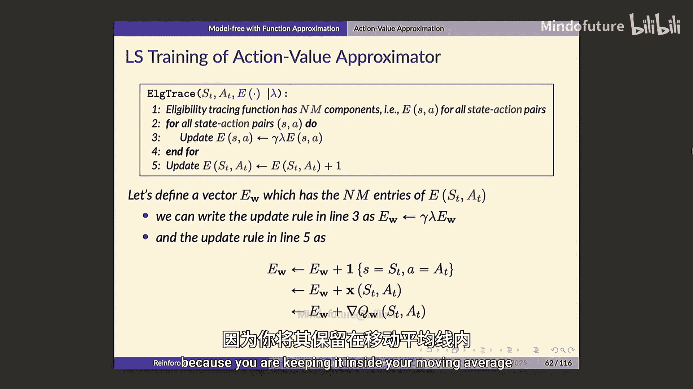

Scale it down， and then you add it out with your new sample of gradient right and you keep on going in time。

But the good thing about that is it's giving you this exact choice of data scaling。

 right or that momentum coefficient。This is exactly gamma times lambda， right？Okay， so。

Moral of the story， eligibility tracing that you're doing is nothing but improving the quality of your estimate estimated gradient。

 And yeah， you can simply use this one instead of the tablear eligibility trace tracing to put inside your your training group and then you train your neural network using eligibility tracing right So this is going to be the case when youre doing both eligibility tracing and function approximation with TD Lada right what you're doing。

 you start。

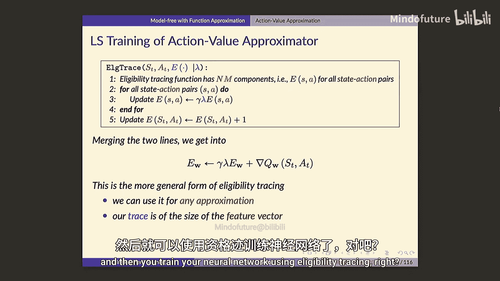

You start with your first episode， you collect one episode， one trajectory。

 And then each time that you you want to update at this particular point， say s0 a0。

 you only look at your next time right So at the next time you have this particular S1。

 So you get the value of S1 and out of that you can compute this delta。

 This delta is corresponding to your0 right， your td0 update。 Now you also compute this gradient。

 This gradient is the gradient of your Q network right if you didn't want to do eligibility tracing。

 you would not do this line 7 right， you right away go ahead and you just update your weight with this alpha times this delta times the gradient of your network right But now instead of doing that。

 you're just updating your eligibility tracing vector， which is basically a moving average of your。

Creient， and then you update with that moving average， right。This is a more robust update。

 this is somehow reflecting the impact of all previous time on your update。Everybody sees that。

Questions。Okay， no question。 So， yeah， this is the last thing Maybe I can show it before I arrive it out。

 So if you， for instance， do this mountain tracing。 sorry。Car mountain。

 if you do this car mountain with mountain car。 wow， mountain car。

 If you do this mountain car using tabley reinforcement learning， right。

 This is that you're eventually going to just greed your state， which is velocity in locations。

 right， And for that one， then you start to just estimate， right， And then if you do that。

 you're gonna end up with such an estimate of your value or action value function。 So here。

 what you see is the location。 What you see here is the velocity， This is the value， right。

 And then you need to greed these locations， because。😊，This is continuous， right？

 You want to make it discrete。 So you are going to greet and you are also going to greet here， right。

 And for every single。Small cell of this velocity location grid， right。

 you have one specific value right， just one specific value and you start to estimate by just trying over and over the same environment and see how many times you see that pair happening and you estimate based on either tD or Monte Carlo right Now if you do that。

 there are a bunch of locations there are a bunch of points here， which you don't see them right。

 if you do a finite number of samples you do not see them simply right because those particular locations or velocities are too extreme to happen right this means that they are going to remain zero。

 some other points are being seen more often right and because of that you get a better estimate right But at the end of the day。

 the value function you get is significantly spiky right is being like good at some points at some other points。

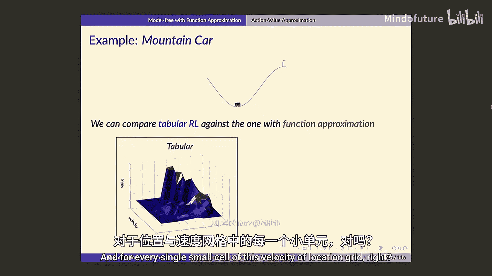

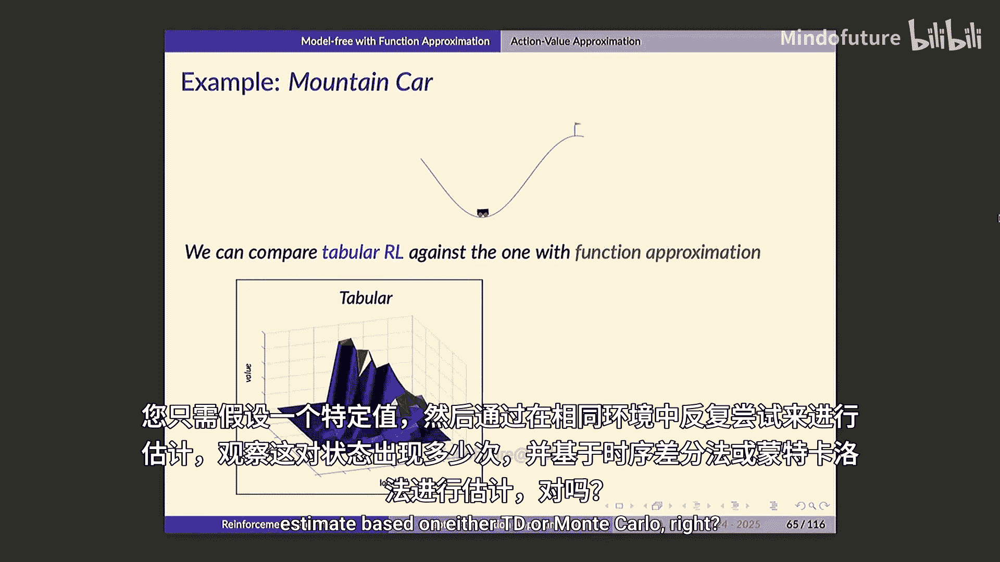

I absolutely zero because you have never seen them and you started from zero and at some point it is just randomly somewhere because you have seen just a few samples right。

 whereas if you do it using what instead of putting that linear model you just put a neural network right and you don't do this。

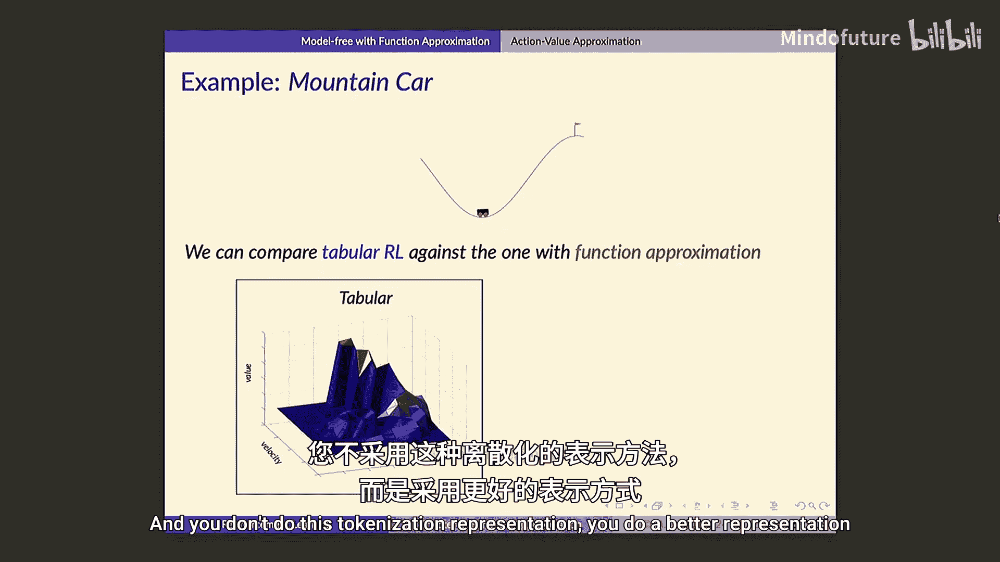

Tokenization representation， you do a better representation。 Then you're gonna get this one， right。

 This is a smoother function， right， because that function doesn't necessarily need you to see every single point to be able to give you some nonze value。

 right。It somehow matches the true value at some particular pairs of location and velocity and for the rest of it is somehow expanding given that architecture of the neural network right and hopefully that value function is not extremely non- smooth so this is sort of well defined function side that is getting properly approximated with this neural network right but this guy is a much better approximate as compared to this one。

 this even shows up more significantly when you do when you do the training when you do。

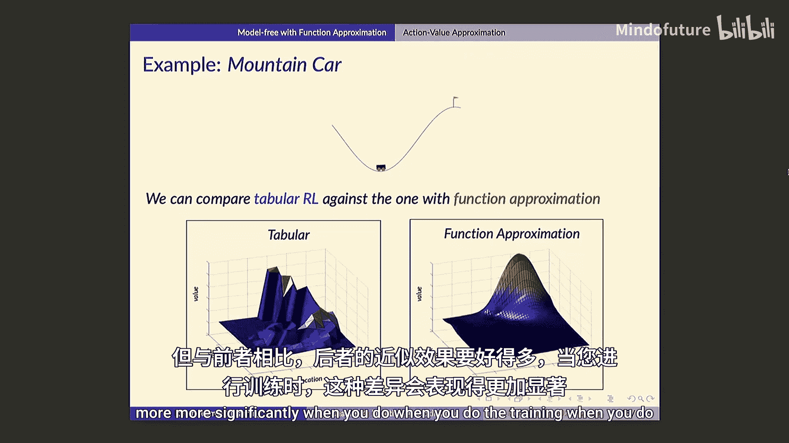