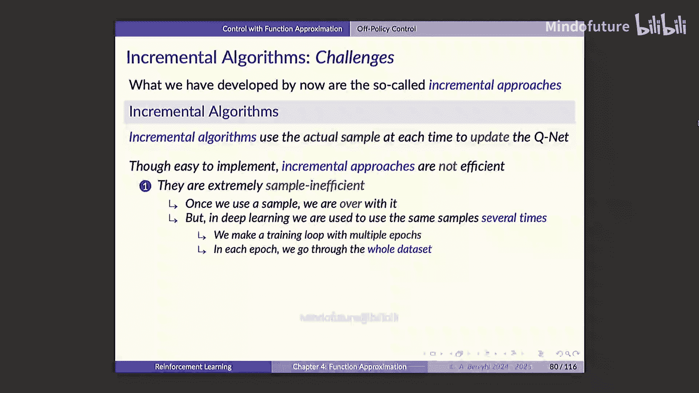
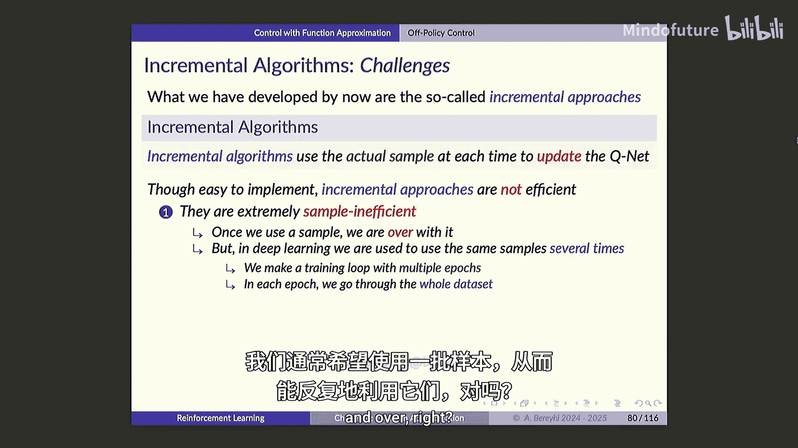
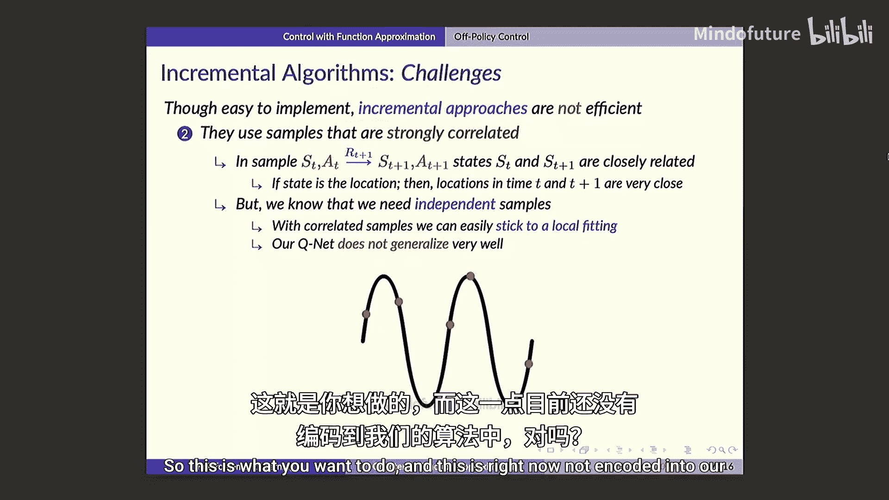
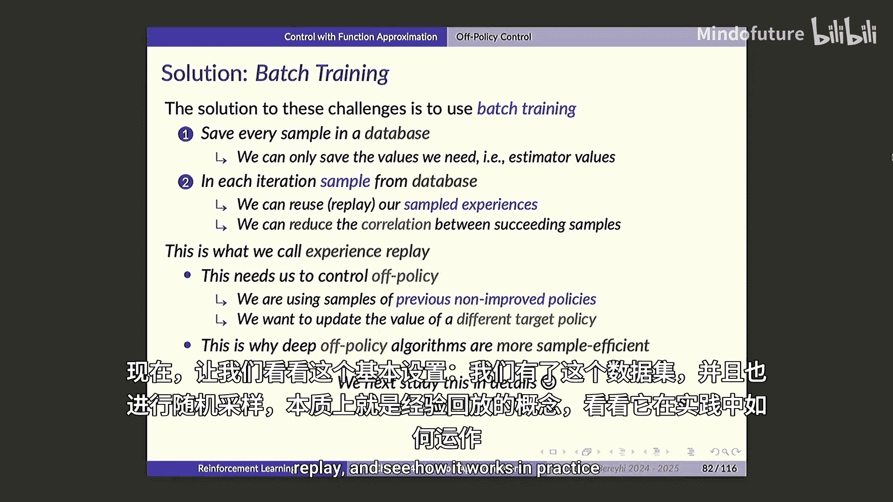
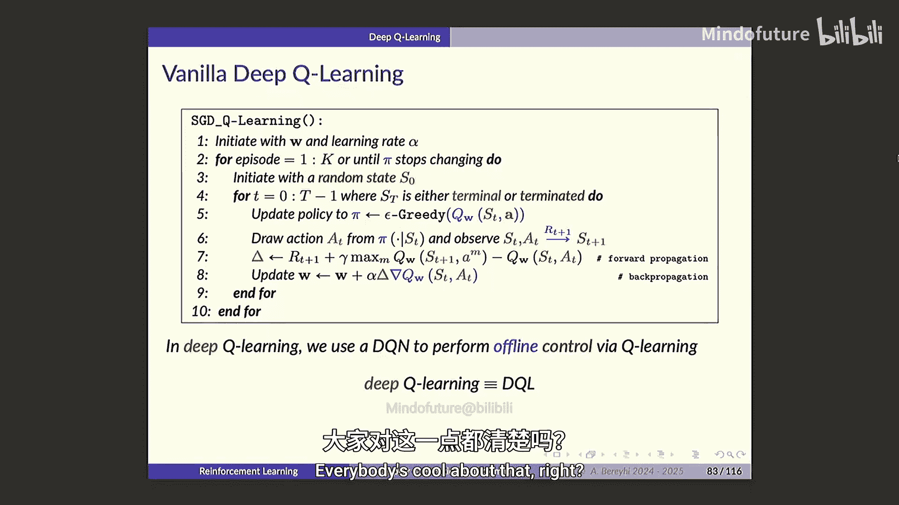
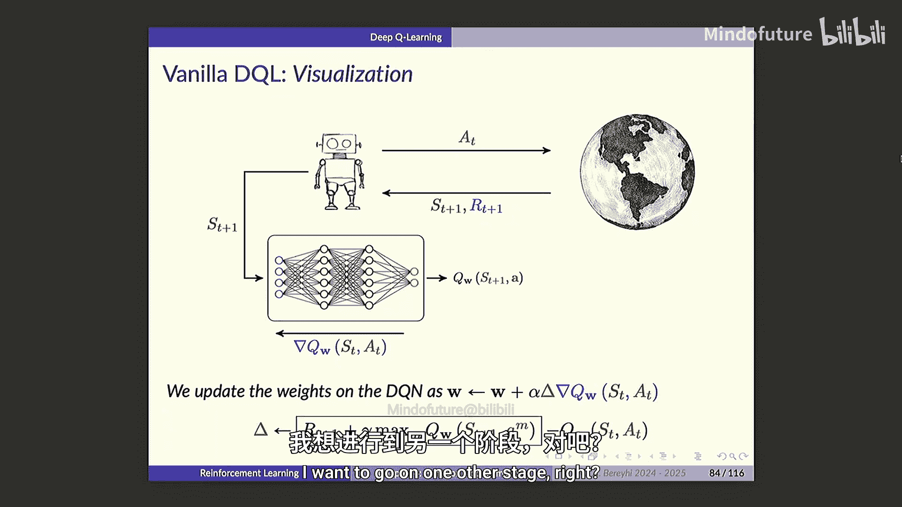
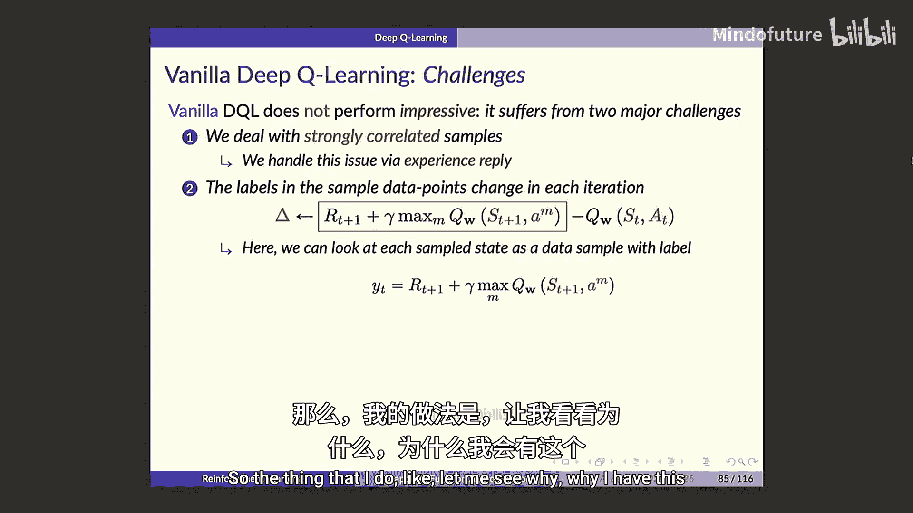
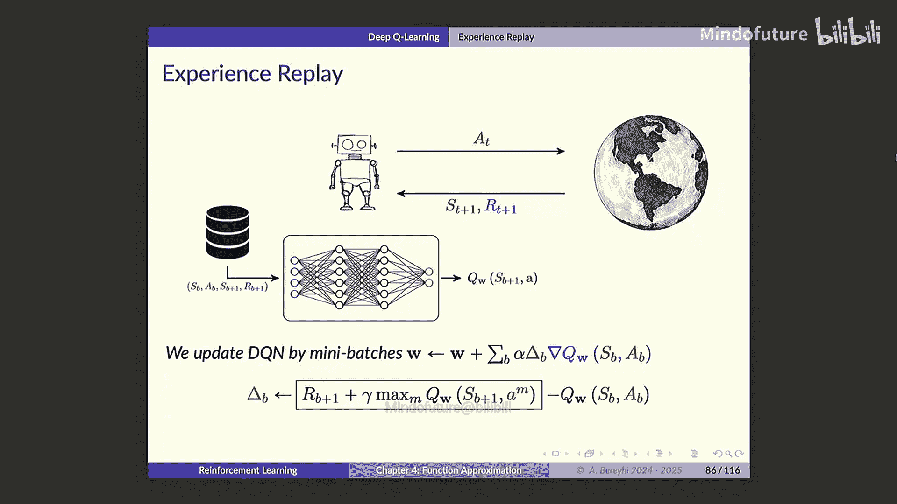
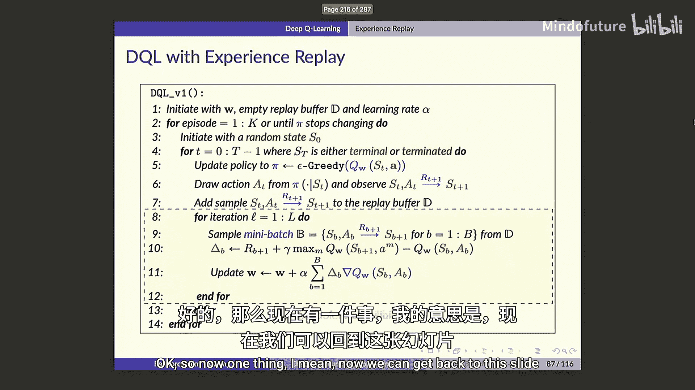
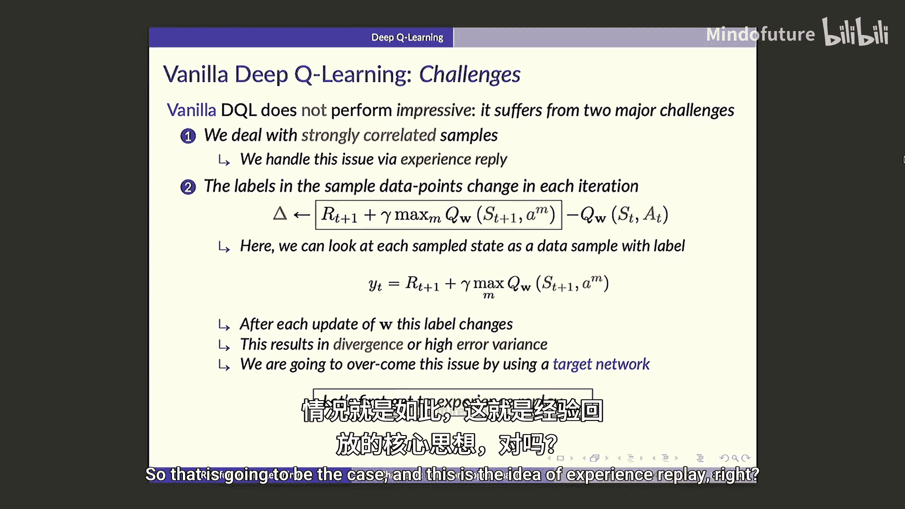

# 【多伦多大学】强化学习 2025 ｜ Uoft   Reinforcement Learning   Fall 2025 p41 P41_讲座_41_深度Q学习中的经验回放 -BV1D3F2zhEry_p41-

What we are doing here， we are basically getting every single sample。 and based on that single。

one gradient。 and we update， right， whereas in practice。

 we usually like to have a sort of batch of samples， right， You get a batch of samples。

 You average the gradient over that， and then you update， right。

 So these are the things that we want to somehow address here。

 So this approach that we are right now doing is not very sample efficient because we are basically using some samples。

 We take one sample。We update we throw it the away。 We go for an example and so on。

 We usually like to have a kind of batch of samples。 So we go over it over and over and over。

 right and this is a kind of thing missing here and the other point is exactly the one that I told you。

 So the samples that we are collecting are strongly correlated So what it means it means that if I have S right and then I do one particular action。

 I go to another state right And then this state could be very close to my state right if you're thinking about mountain car。

 this state is a location right this estate I do one action I go up right and then that new state is very close That's okay in terms of estimation。

 because the value of that estate is reliable if the。

Want to update I'm going start from this estate and look at the next stage right and the next estate is very close to the previous estate right So this is that you are going to tune your neural network So somehow match two different points to their label which are very close to each other right So probably if you just forget about the second sample。

 nothing going to happen right。Next gradient too much。

So this is why would say the samples are extremely correlated。

 So this is like this is your first estate， next estate， next estate and so on， right。

 And they are very close to each other。 So you are trying to fit your function into these points。

 right， But this function could get totally crazy out of these points， right。

Totally irrelevant to the true function。 whereas if you want to really estimate what should you。

 what should you do， if you really want to have a good label。

 good sample points to train your neural network。 What is the best idea。

 What What is the best kind of samples you can collect。Independent samples， right？

 the best idea is that you get someorative samples， right。

 like every sample is happening randomly and these。

 if you try to make your function somehow fit to this point。 this point and this point。

 then hopefully if your function is smooth enough is globally fitting the true function， right。

So you don't really want this case。 You really want this case， right。

 And this is right against something new。What we are doing。We are just looking in one state。

 We see what neus state。 we update here。 Then we go to the neus state， right。Now。

 we are in the N state， We gain。Use the state after that to update this one， right。

But updating this one is like， you're just。Fixing the point right next to your previous point， right。

 You don't want that。 You want rather this one， right， So I do update this state。

 Then I randomly go state and see what is the next state of that one that I I update my Q function there right So this is what you want to do。

 And this is right now， not encoded into our algorithm， right。

 So now in order to get rid of these issues。 So meaning that we can use whatever we had before。

 first of all， and secondly， to use them efficiently in the sense of。

Crelation between the samples。 The idea is to do something that we call it experience replay。

 And what is the idea。Just you get one database， right， once you are just sampling the environment。

 make one database。 and inside this database， whenever youre in one state and you do one action。

 you get the reward。 you see what is the next state， right。

 You collect this one and put it as a sample inside that database， right。

Then you go into the newest stage， right。Again， you do the one action， the next action。

 you're gonna get an immediate word。 You see what is the state after that， yeah。

Put it as another sample， right， So these are the sample one trajectory， right。

 You go for the next trajectory you。Update your neural network。 What you would do。

 you just randomly sample from that database， right。

 So this means that once you just try to update your neural network looking at the first point in your first trajectory。

Another time you just use to the middle point in your third trajectory to update， right， once again。

 you go back to your first trajectory， another point， right。

 So youre randomly choosing a states on these trajectories and these states are now probably independent。

 right， because you start here， you just moved and then you got here and when youre just randomly sampling once you get the sample once you get the sample。

 right， So that is the main idea。 you make one database。 And in this database， you are going to save。

Whatever you're collecting in your sampling， right， now you save them in the form of。

 you know tuples and these tuples basically tell you what is your care in the state。

 What did you get， what did you do as the action。 What did you get as the immediate reward and what was the next stage right And then you keep them as individual samples。

 whatever you want to train， you just go and sample from that one independently right。

 Sos like you randomly shake all of those tuples and start to use them right and this is going to give you some sort of independence。

 This is what we call it replay because you have already all of those experiences you have seen on your trajectory right and you randomly choose one of them to replay it right and you have this benefit。

Over it over and over， right。Finish with all of those saved coupleples。 I again go back， right。

 I would like to see my very initial sample that I had。

 How does it look like with the train version of my Q network， right？

 And I want to see whether I need to update or not， right， And I can go over it over and over。

 This is basically closer to what we are used to in in deep learning， right so。

So one key point here is that we can do this experience replay because basically。

 we are playing golf policy， right， Because every time that I want。

I don't care about the policy that I am playing， right。I'm only caring about my target policy， right？

 So each time， I mean， with with deep Q networks， it gets。

 I think is the most clear version of this off policy because with deep Q network。

 say you get your Q network and you go on with bunch of samples and you train， right。

 If you get back to the sample that you started it with， right， now that you want。

Estimate of the value for that sample。 You don't really need to know。state to your neural network。

 you look at the output。 You take the maximum 1， right。

You don't really care how you ended up with that stage， right？ So this is our policy， right。

That is the key point， right， So you can get back there again， you see， you see that， okay。

 in the next state， this network is telling me that the best value is this guy， right。

 So the greedy algorithm gonna work like this。 No。Whether my network is actually giving me the right value or not。

Train my network further， right。Everybody's go。Yes， but， but but it's okay right。

 because your network is not estimating the value of your policy。

 It's estimating the value of the optimal policy， right， the greedy policy， right。

 and that what you say， you say I was in this is state， say my state was one。And I went to state2。

 right now， first， your network is not trained。 So you multiple samples。 each time that you go。

 you would say this is my current state。 This is my nexus state， right。

 You give the neus state to the network。 You see the output。 you take the maximum value。

 You would say this is how the maximum Q value should look like。

 right And then you try to train your network to give that value to you， right。Now， you know。

 you again get back to the same sample， right。Last time， when you put。

Told you the initial state is one。 The next state is 2。

 right Last time when you gave state to your to your network and you collected the maximum value。

 right。Once you collected that maximum value and you added it to your immediate reward。

 you did not see the maximum value you would get in the state one， right， You did not see it。

 And this was the reason that you kept on training， right。Because your label。

 what is your label is the immediate reward plus。The maximum value in the next estate， right。

 What is your value is the value of the current state， right。You wanted to see this。

 You You didn't see this， right？ So you kept on training。 Now you get back， right， Now you are back。

 If that guy is properly properly trained， you should see it， right。

 You should see a better estimate， right， And you don't care that you collected this tuple using。

The another dummy policy， right， because you don't really need any information about that policy to do this evaluation。

 right， So you are basically doing off policy。 You don't care how you ended up at this point。

You're always thinking about the optimal one， right， because of that。

 you don't have any problem to get back again on the sample。 You might， you might tell me that， well。

This is not a perfect example， because if I really start from that point and play optimally。

 I would never end up here， right。But that's another story， right。

That's like this particular state is not some state that I would normally end up when I am playing optimal。

 right， but say I ended up。 Then I do know what is the optimal value， right？ That's it。

You get the idea。O。Yeah， so that is the idea of experience replay。 And as I said。

 you need to be off policy。 if you're not off policy。

 then basically your your evaluation depends on the policy that you're playing with。

 then it is not possible to do experience replay。And。When we do off policy， basically。

 we we don't care about the policy that we are sampling with。

 this is the key point that the the off policy algorithms are more practical and are more sample efficient because the same sample we collected with or duami sample initially。

 we can revisit， right。Okay， now let's just look at this this basic setup that we have this data set。

 and we also do the random sampling。 Basically， the idea of experience or and see how it works in practice。

 so。

That was the vanilla version of deep learning， right， deep P learning。 So we basically had it before。

 So we just do one action， right， And then when we we act。

 we are going to go into the next estate right in the very first version that I told you is not going to work。

 what did we do， we basically go on one complete tragedy。

To compute it gradient and update your network。Now what you can do here， Well。

 you can just do this right？ And then instead of going right away like here is the again vanilla version。

 But instead of doing this， you can randomly choose one other sample right This is the whole idea that we want to do。

 So this is why I'm going to write it down like this here。 So what we are doing。

 we start with one maybe random policy or something， then any time we get into a state。

 we draw one action based on that policy， we see what is the next estate。

 but when we want to update just line 7， we don't care about the policy right we just play with the greedy or think we are playing with the greedy policy。

 And then we get the sample for the greedy policy and we update or Q network right key points。

What we are collecting is a sample for the or a kind of sample label for our greedy policy， right。

 And our Q network is basically trying to give us the value or action value of the greedy policy。

 right。So two things， we should keep in mind。 Everybody's cool about that， right。

Okay， now that you have this。 now we want to just do experience replay， right。

 So this guide would be the vanilla one。 What is the vanilla one。

 You basically you're in one particular state， right， This estate， if you act。

 you are going to get one reward， the next estate， right。

 Now you can give your estate as well into the neural network， this is your Q network， right。没。

You are in one estate。 You give your estate into your Q network。

 That guy goes inside the Q network at the output of the Q network。All the action values。

One question first， if you are doing Q learning， this network is estimating the Q value of what policy。

So these values that you see at the output are values of which policy。The greedy one， right。

 the optimal one， right？ So what you think， you do know that this is yet not the optimal one， right。

 but you， you are just trying to make it give you the values of the optimal policy， right so。

Goes inside the neural network at the output。 You get the values of the optimal policy。 Basically。

 the maximum values you can think of， right， now， these guys come here。Right。

 and now you need to somehow， I mean， this， this network is not trained yet。

 So you need to build a kind of label that you make this guy looking。A T。

 and I don't care what policy gave me this， right。I don't care about that。

 I just do action N T out of doing A T。 Oh， sorry， Yeah， maybe I mentioned that one later。

 Maybe the order would be better this way。 So after doing action A T。

 youre going to get your new estate。You would say you would say， okay。If I get into this new estate。

 S T plus one， and I give it to this network， this network is supposedly telling me what is。The。

 the optimal values for the newest stage， right。If I take that one for granted。

 this means that if I take the value， which is。So I would get if I play optimally， right。Right。

 so that is going to be the maximum of the output of your Q network in the next estate among all the actions。

 right。Again。Once you play A T， you get S T plus1 R T plus one， right。

 you would say that the next estate is this particular state。 Now。

 what is the optimal value for this estate， Well， I give it into my Q network。

 that is going to give me， right because I do know it's not yet trained， But I assume， well。

 this is the target， right？ I assume that this is giving me the optimal values right？ Now。

 if I want to play greedy， if I want to play optimally， What do I do， I'm gonna do the action。

 whose value is the most， right？ So this means that I'm gonna take the Q value， which is maximum。

 right。Everybody's cool。 right。 So this Q value plus the immediate reward that I get is one estimator of what I should have seen here。

 right。这一。ItWas working fine when I gave it S T， I should have seen that one， right。

Everybodys everybody agrees。啊。So once again， I hope that you get it because I spent lots of time making this these animations last year。

It makes it more clear pseudo code， right， And I do understand it's too much of notations。

 too much of order， sometimes confusing。 but I hope that at least animation give you the main idea。

 So once again， So let's start from here， I am in one particular state right。

 And for this state assume that I am in one location， right。I assume that this network。

 if I at what is my state， is going to give me the optimal value， right。

 It means that this Q guy that I see。对。嗯，行。会。Action with the maximum value， right。

 This is your strategy of the optimal policy， right， So this means that if I do S T， right。

 and I get here， goes inside this one at the output of this guy， I'm going。Right。

 and the these values are the optimal values， right now。Say that I just choose to do one action and。

I just check them out。I just do it with one random policy， right， I randomly decide to go this way。

 Now， if I randomly decide to go this way and this network is working fine， right。

The entry here in this network， which is proportional to that action I have done。

 should be exactly that number， right。哎。It be the optimal value at the particular state that I want。

thatI， right。Everybody's cool。 So I want my network。Right now。 So， well， say that I do this action。

 If I do this action， I'm gonna get out of the environment， the next estate and the immediate reward。

 right， What does TD tell me， TD tells me if you get immediate reward added up with the optimal value of the next estate。

 right。The optimal value of the next estate， right， This should be the opt。Youre carrying the state。

 right。Everybody agrees。Right， so I use this to just build label for my Q network。I would say that。

 okay， if I give this new estate to my Q network。That Q network is going to give me one vector。

 and that vector is giving me the optimal Q values， right。Correct， no， if you want to keep on。

 if I want to keep on playing optimally， I should do the action whose value is the most， right。

Correct， and I keep on always playing optimally after that。

 And this is the value that I'm going to collect S T plus  one afterwards， right， Also。

 I do know what is my immediatetor word。 So I added up to that one。

 This is the label that I want to see， right。I wanted to see this guy when I was at time S T， right。

 but I have not seen that。 What should I do， I train my neural network to give me that value， right。

Everybody agrees。 Everybody sees what I'm saying。哎。Question。Once again， but if you want。

 you can ask once again， it's important。 It's deep learning。 It's not its random algorithm。

 Everybody sees what we are doing， right。So。When you are in one estate， you evaluate your state。

 right， This is what you get out of your Q network。 This is what you have right now。

 Then you are going to build a sort of label and how you build that label。

 you basically play your action。 you get your next estate and reward， give your next estate。

 see what is the optimal value for the next state。 you add up with your immediate reward。

 that should be exactly the thing that you were in right That is not So what you're gonna do。

 you're gonna update right You're gonna compute this delta Also you compute the gradient of your network at the particular state that you were right。

For updating your value in the state S T， right， So your computation gonna be here， right。

 once you just went forward， then you go backward and compute the gradient， right。

 And then you use that gradient along with this delta to update your weight。Everybodys cool， yes。

Questions。So， this is vanilla。Deep Q learning， right， The one which I told you is not going to work。

 right， in its very basic。Now， the only thing that I want to do in this。

Is that once that I did this update。In the next time。

 I don't want to go ahead and start with S T plus one， right。Go on one other stage， right。

So what I do here， I am going to just be that。Daabase that I told you， right， So the thing that I do。

 like， let me see why， why I have this。 Oh， yeah， So let me just skip this。 Let me go on the， on the。

 on the diagram。 and I get back to that slide。

What I want to do here， I just want to update this estate。

 Then I don't really like to update the next。Right。

 and then updating this one would give me no benefit， right。Because already after updating this one。

 my neural network has somehow fit to that data sites that this is going to roughly。

Properly estimate the next one， right， So I want to just randomly go somewhere in time。

 get somewhere else。IWas not there。 And I do the same strategy there。 How can I do it， Well。

 I can start doing actions， right， So I just start playing with one policy this， right。

 I do want action。 I get the nextexus state and reward， right， I again keep doing that。

 And each time I do that， I would collect everything into one database。 So I would say。Cllor state。

 I did， I did this action。 I went to the next state。 I get this reward。 This is the first sample。

That I was here。 I did another action。I got another immediate reward and got to a new estate， right。

 I collect that one。 Then I just did another action， and I got into a new estate。

 I collected an immediate reward。And I just。I keep on。Right， I just move。Get into。Now。

 I collected all of them。 Each of them is going inside this database。

 But when I want to train my neuron network word， I do not start from very beginning going on right。

 randomly choose one of them。It's like， I was here。 winter。 I get this reward， right， then randomly。

 I here， right， And I say， okay， I was here。 I went I got that estate， right。

 then random jump somewhere're here， right。I was here。I went there。 I got that reward， right。

 So this is what I'm going to do。 I'm going to randomly sample from that。That database， right。

Everys clear。 So those samples， this is why I'm showing them by S， B， A， B， S， B plus1， R B plus。喂。

One of like first time you sample， it might be your first sample。 The next time you sample。

 it might be some sample after。100 time steps。 once again。

 you sample it could be the sample at time step 5 and so on， right， And these are independent。

 roughly speaking， right， So each time you do that。

 you are going to give this guy to the to your neural network and you are going to the。Train。

So what you are going to do， you would say， okay， SB is my current state。 This guy goes here。

 I'm going to collect the value of this stage， right， first one which I'm going to keep here right。

 then I would say， okay， let's say that I I want I mean， this network is trained。

 then this means that if I give the next state， I should use TD and see exactly what I have what I've seen for SB。

 right。So I'm gonna give the next time step state。 I collect the maximum value。

 I add it up to my immediate reward。 I expect this one to look like this， right， if it's。

At then I train， right， I do want to step off gradient in decent。

 So I update I go for one minimum this day。 I do the same thing。Everybody's clear。Questions。Oh， yes。

 yes。 you， you have a bit of delay， right， But the point is that that delay is sort of fixed delay。

 And after that。As long as I can build my database。 So typically in practice what you do。

 you have a database with with a specific size， right， specific memory。 and you fill it out right。

 And then you start sampling from it。 But each time you sample right In addition to updating your new network also one action。

 right and doing one action， you get a new sample right， And you put that sample as a new sample。

 you just remove the old。AndYou keep on doing that。 So you're going to be a。That is online， right。

 So that wouldn't be a problem。Yes。Yes。Yeah， initially you usually play randomly。

You fill out maybe halfway your per， and then you start updating， right。

But the key point is that you should be able。 I mean。

 one thing that you can do if you want to be 100 percent online。

 you can start doing vanilla Q learning， right， once you see the offer is filled。

 then you start with your sample， right。You can do that。Questions， yes。Oh， that one， no。

 you don't necessarily need that。 So if you have a buffer， right， So you， what you typically do。

 you're gonna do the rate of sampling。 Yeah， like tune。

 the rate of sampling that you have with the batch size say that every single sample is being used couple of times and then thrown away。

We typically do that because in practice， as I said， you。

 you keep on training like randomly taking something from your dataset， right， And then once you。

 every time that you do one itration， one sample update。

 then you also do act on the environment and collect a new sample。And you have this new sample。

 you add it to your buffer， right， And the oldest guy is going to go out。Okay。

 and you are going to somehow。Or gonna or tune the rate of sampling from the environment。

And the ba that you use to train say that once youre， for example， you。First sample is going out。

 You have already gone through it a couple of times， or with high probabilityvol。

 you have gone through it two， three times。So this is a typical。I mean， theoretically， even if you。

Do it like you keep the buffer increasing right And just each time you randomly take a batch and do that。

 That should be no problem as well。 right So that's in theory， But in practice。

 it could make you like if you initially is like Q learning。

 if you initially have started sampling with some very random policy。 then well when you keep it。

 you might get your model getting updated at some points， which are not that useful for you。

This could be the problem。 Like it start to converge to a sort of。Sort of parameters。Questions。

No question。O， so。

Now， one thing， I mean， I now we can get back to this slide。 So in this slide， as I told you。

 So I I hope that this is now clear。 So what we mean by doing experience replay every single time you're just building such a label for yourself。

 right。You're making this label。 So you would say I am in this particular time S T， right， sorry。

 time T。 I'm seeing the particular state S T。And what I want to get is this label， right。

 based on TD， I want to see at the output of my neural network。

 the immediate reward plus the optimal value of the next stage， right？

 So that is the thing that I want to see， if it is not。I need to update， right。

And update my parameters。 Hopefully next time it's closer， right。

 And since I'm computing the gradient。 So it's just taking me towards a point where this difference is smaller。

 right。So that is going to be the case。 And this is the idea of experience replay， right。

Questions。