# 【多伦多大学】强化学习 2025 ｜ Uoft   Reinforcement Learning   Fall 2025 p42 P42_讲座_40_通过函数逼近进行控制与深度Q学习 -BV1D3F2zhEry_p42-

We can also recap a few things that we did last time again here。 And mainly， just first of all。

 let's just。

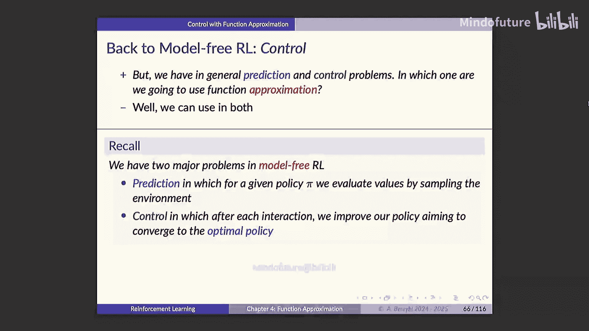

Recall that we have two different problems， right， We have the problem of prediction and the problem of prediction。

 We're somehow dealing with an offline setting， right， So we have your policy fix。

 You just sample with that policy， use that samples， those samples to just train your model。

 So this is。Less stress， less online as compared to the control problem。 So in the control problem。

 while you're sampling from your environment， you want to somehow build a kind of clue about the optimal policy。

 right， And this means that your policy improvement should be somehow merged into the loop of value estimation。

 This is exactly the same thing we did with Sars and Q learning in the previous chapter and we want to repeat it here using function approximation。

 so。

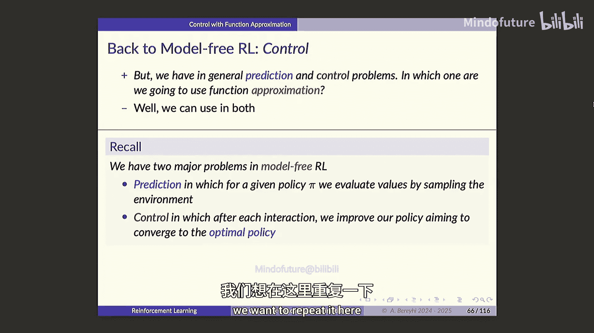

Let's get into the control part and in the control part， if you remember we had this， this loop。

 which was somehow extracted out of the general generalized policy itration， right， So in GI。

 we basically get start with a policy。 we just evaluate that policy。

 then we know how to improve that policy， then once we improve that policy。

 then we go back and again evaluate the new improved policy。We find the key values。

 We update again and we keep on going， right， So that was GI。

 But we show that if we want to just build GI kind of look。

 then we're gonna get into this trouble that we stick to one strategy all the time， right。

 because we are always doing greedy。 This is not a good idea。

Then we basically added this epsilent greedy here。 So instead of just being greedy every time。

 once you improve， then。Either you play your improved one or you just randomly。Go somewhere。

 And this going to help you explore the environment more。

 And one other key factor about the control loop was that now here we are not going to really evaluate the policy anymore。

 right， So you just update。Correct， so you just sample out of that sample。

 you're gonna update your Q function。And with this new Q function。

 you are again going to play Epsilon greedy， right， And basically。

 your Q function is getting updated with a single sample of that policy， But you don't care， right。

 because we talk about this that this iterative loop is robust enough that once we just go over all this states enough number of times。

 then everything is going to work fine。

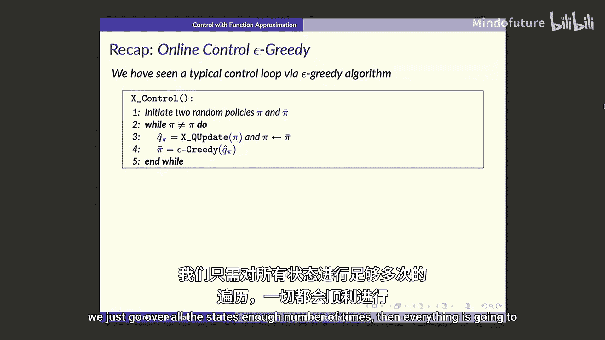

So we basically want to do the same thing here。 The only thing that we want to change is that。

 instead of。Estimating or policy or a Q function based on a table。 want to do it by a model， right。

 a deep model。 Now， which line here in this loop is going to be the line where we integrate the。

And you all network in。Yes， go ahead。Line 3， exactly。

 So this is going to be the line where we are going to put the function approximation， right。

 So instead of updating the table， we are going to update the weights of the model， right。

 we do it again the same way that we did in the tablelar case。 But this time， we just。

 instead of working with the。Table of values。 we are working。Proms。So。Now。

 let me just define Q network。 You already know what Q network is。

 because last time we basically defined that Q network。 But if we want to。

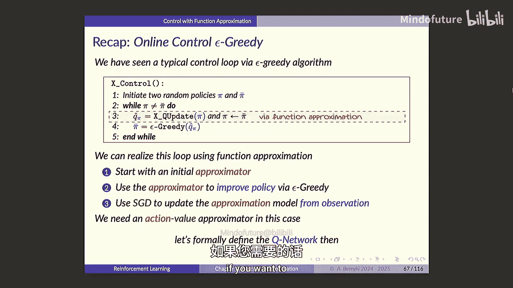

Now， a Q network is basically that network， which is going to look into the feature representation of one state。

 and at the output， going to give you the Q values。

 those action values of all possible actions at that state right， So you're in this particular state。

 you're going to give the feature of data state into your neural network right。

It depends how you represent that， but you're gonna give it to your neural network。

 That neural network tells you， okay， if you do this action， you're gonna get this value。

 if you go this action， you're gonna get this value and so on， right。

 So this was basically what we define。 So we say that well。

 if you think about a single pair of action and value。

 Then you're gonna have one representation for every single pair。

 And then they're gonna be M where M is the number of actions you have M different of them stack together。

 But you can look at the whole thing as one giant neural network。

 which is taking the representation of this state you are in where you are right now。

 And then it' gonna tell you。Is roughly the Q value for every single action that you want to do。

 right。So that is the Q network。 Well， this is not something new。 And usually people， I mean。

 when you put here a deep neural neural networks， then people call it deep Q network D Q N， right。

 So if you hear D Q N， that is basically this guy， right， Now。

 deep Q network is the one is the kind of value network that you usually use if you want to do any value based。

Kind of control。 whatever， you know， up to this point is value based， right。

 You always work with values。 Can we work without values， Well， you can， I mean。Practically and。Case。

 then you're gonna be policy gradient method， right， And then at the end of the day there。

 you again need a sort of value estimator which which ends you off with the a approach。

 No worries we're gonna get into that。 But what we have done up to this point is that always we work with values。

 right， When we want to control， we always estimate the values。 And based on those values， we decide。

 right， we never work directly with a policy， right， we don't play with a policy and say， oh。

 let me make it better， right。We don't know how to do it， right。

 We're gonna talk about it later because always we need the value to somehow understand how this policy works。

 so。Any action sorry value based approach that you do。

 it means whatever we have done after to this point。 you always need in the like a deep form of it。

 you always need to have a Q network for that。 And that is obvious because you're in one stay。

 you want to know what is the value of every single action that you can do， right， so。

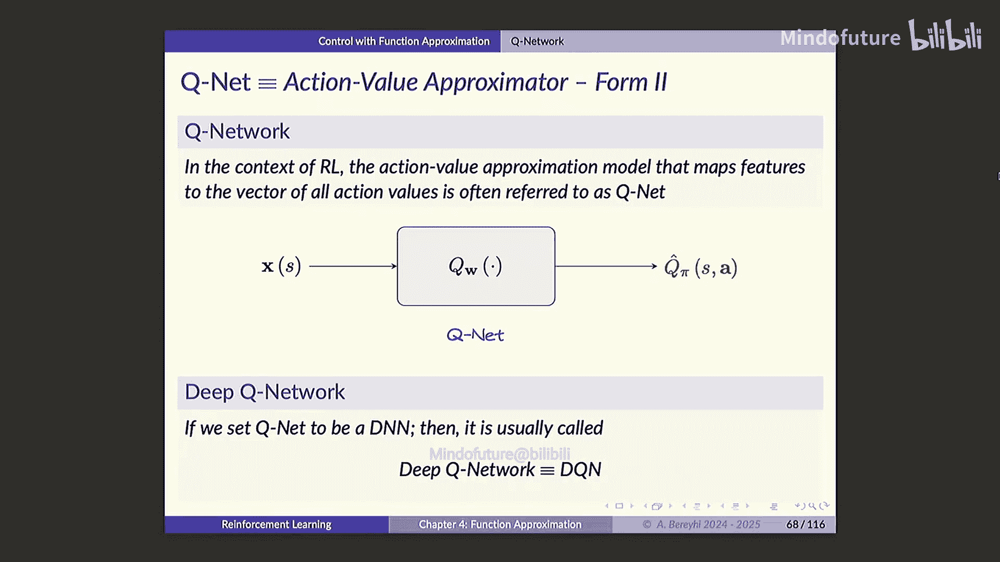

That is D Q N and D Q N， basically， it could be a simple MP。

 So here you have the feature representation。 This goes over the neural network at the output。

 you have exactly the same number of output as the number of actions that you can do， right？

 So if you're walking in。four different outputs， right。Given the state that you are。

 the cell that you are， it's going to explain you what is the value of going up down left right right for more complicated environment again。

 this is going to be the number of outputs。 You have one thing that you should pay attention here is that we are。

 as I told you， still talking about discrete number of outputs， right。

 discrete number of actions we haven't got into the case where you have continuous action space。

 that is the thing we're gonna do next， okay。

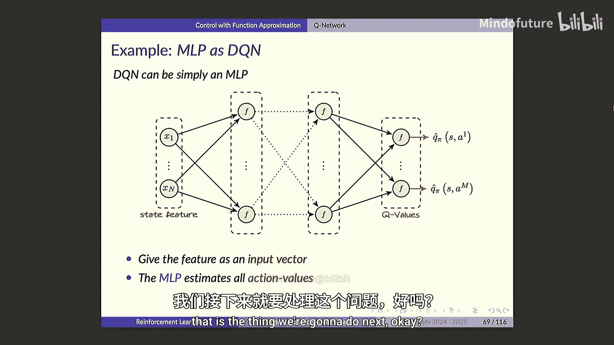

So now， I told you any。Value network， including。WorkI basically running neural network。

 And then it can take the， you know， representation of the state， right， For instance。

 if you are considering this kind of game， right。

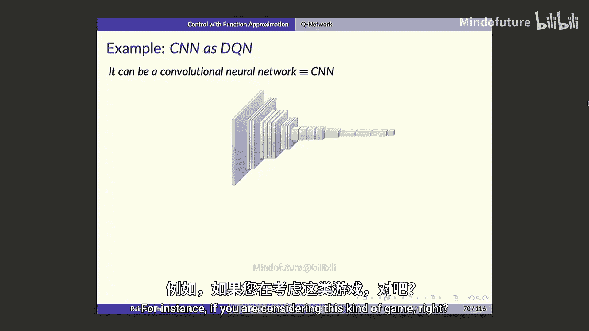

Then what is the representation of state that you are in。

 So this state is more complicated that a grid world。

 you cannot simply represent it with one hot vector or the location that you are in right there are lots of factors being involved here right And then if you're。

 for example， considering a computer game right And then the easiest way for you or the most practical ways that you say。

 okay， one frame or maybe multiple frames of the game is the state that I am in right So I'm right now playing chess。

 I take a photo of this just for this is the state that I am in right。

And you don't need to really extract anything out of it。

 You can directly give it into a convolutional neural network， right。

 It' gonna process that image for you。 And it're gonna give you at the very， very。A bunch of numbers。

 the number of outputs you need is exactly the number of actions you have， right， So in this game。

 you know， you have。Right left right， right So what is the number of outputlets you get here？2。

 right， So you get give this one。 Maybe you don't give just one this guy， which is an RGB image。

 Maybe we don't give only the first three channels。 Maybe you just consider a frame of like 10。

Fras stacked to each other， right， and then you get all of them。 So each of them has three channels。

 So it's gonna be 30 channels going inside this neural neural network。

 also you have two the also do have yeah， two values， right， And they are the value of every。

So here you have put a tense store， which is collecting the。Frame that you are playing right now in。

 and then at the output， you're going to have the action value。

 which is basically giving you the value of every single action you can do， right。

So we talked about this that when I represent here A to be a like with a boldface， a vector。

 I simply mean all the values， right， So it means that here a is right and left。

 So this guy is a vector up size2。Sorry， Q of that particular state acting one left Q Q of that particular state acting right。

 right。

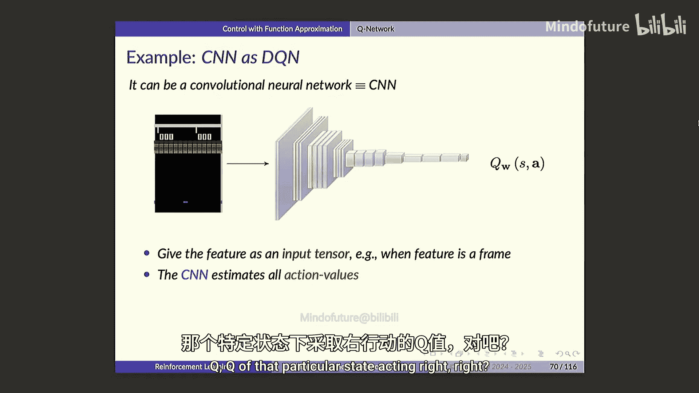

是。Now。If you have Q network， then the question is。To control。 And we talked about this。

 We have two different approaches for doing control。 One of them is on policy， right。

 What is on policy， It simply means that。While you're playing。

 you're improving the same policy that you are playing with to get better and better and gradually it converges to the optimal policy。

 right， So Sasha was the big example。 And then if you use DQ network。An approximation。

 then this is what you are doing as deep on on policy reinforcement learning， right。

 So you are on the policy， your。Just updating your neural network instead of the table of the Q values。

 And based on that， youre just designing your， you improving your policy。

 you keep on playing with the same policy always， right， And as you play with that policy。

 you you just train your neural network to estimate the values of that policy you are playing with right Now。

 you hope that your policy gradually get。Then that two network is going to gradually repair。好。Right。

 so this is on policy learning。But you can also do。Of policy reinforcement learning， Basically。

 you can do Q learning using Q network instead of。Instead of the on policy one， right。

 So in this case， are basically doing important sampling again here in this particular example of deep learning。

 you basically don't do that that kind of important sampling that we really think in general about。

 but。More appreciated when you are working with deep reinforcement learning。 Now。

 what is the reason for that， there are bunch of reasons。

 But the most important ones are these items that I have said here， basically。

 if you work off policy， you are more sample efficient。

 What is the reason you don't need to write now， now anything about how we do it， just。

Recall what is the difference between off policy and on policy When you are on policy。

 you're sampling with your policy and you are estimating the value of that policy， right。

 This means that only the phrase samples are valuable for you right a sample which you got long time ago is useless because it was done by a very bad initial policy right So you have to throw that away。

 right， but if you are playing off policy， you do know that you are not evaluating the policy that you are playing with。

 right， you are evaluating one other policy， but you somehow manage to use samples of other policies as well。

 This means that the policies the samples you collected at the very beginning with your worst policy。

Is it still valuable， right， because that。I off policy doing deep reinforcement learning is much more efficient because you can use the samples that you collected before again and again and again。

 right， And this is basically same thing that we do in different learning right in deep of learning。

 we are always limited in data right And then we want to use collect some data and use it over。

 right and。Off policy reinforcement learning going to let us do that， right， because of that。

 usually we are in more interested indeed。Of policy approaches。

 This is why you hear about deep Q learning， but you don't hear too much about deep version of Sarsa。

 Okay， so we're going to talk about that。 You don't get like。You。

 you're not supposed to understand these terms right now， like experience， replay and。

Sample efficiency。But youve got youre over with this part。

 and you get the idea of why deep pure learning is better， okay， yeah。Oh， definitely， yes。Oh。

 overfeeding， let me think。Or yes， yes。 that， that could。 Yeah， but then this means that your're。

 I mean， it depends on what you're doing。 But in this simple Q value network or Q network。

 this simply means that you're somehow getting stuck to one sub optimal solution because you're just。

 you， you just get a stuck to a sub part of your status space or action。

All this is more vulnerable to that， but。啊啊。I mean， at the end of the day。

 when the space of the like stage space is very giant。

 you eventually you're always dealing with overfeing， right。I。Dongch。Now。

 what do you mean by less variances？Oh， you mean in terms of the policy， oh yeah。

 because of like if you do off sampling， like here， if you think only about DPU learning， I mean。

 the variance does not show up that significantly， the reason is that， well in DPU learning。

 we are somehow bypassing all of the important sampling process。we， we's a bit cheating there， right。

 And because of that， we don't see that variance issue。

 But if you think about a general sampling and then you do off policy or on policy。

 it means that in the off policy， you really use important sampling， then that's correct。

But that is something that you see more obviously when you do policy gradient methods。

Because there again， you're doing one policy and you get one policy。

 you play with that and you collect one sample， but then you want to improve the same policy network。

 So you're going to use the samples with the previous policy to just update into a new policy And there you have nothing but to do exactly important sampling And when we do that。

 then potential important sampling can increase the variance。

 and this is one of the reasons that your model could quickly get or diverge or get into a like kind of very bad sort of local mini and how we can get rid of that we need to just restrict or trust region and this is basically TrRPO and then PPO algorithm。

 So we're going to talk about that later you could say somehow here is like lesser stressed right So usually what you see is simply because of this space。

嗯是。No question。 Okay， so now let'ss start with the。 o policies simply to just warm up a bit。

To just see how we can do this on policy there， because on policy usually sounds more。

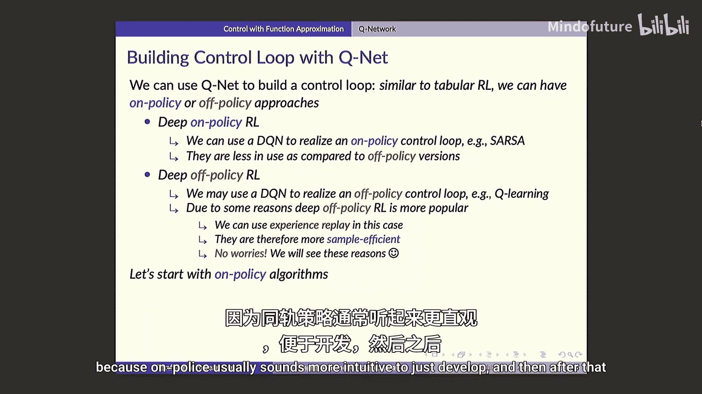

Intuitive to just develop。 And then after that， we're going get into deep Q learning。Now。

One thing you might tell me is that， I mean。I'm not 100% sure that this is anymore the case right now。

 but old days with less amount of information out there regarding this deeper reinforcement learning。

 people would ask this question like you talk about value networks and what are the value networks in general。

 I it simply Q network。 Well， Q network is one value network right， So you could have Q network。

 which is。Computing the Q function。 You could have the value network that I told you before。

 right when you want to do the prediction。 And then in that case， that one is again， a value network。

 right Any network looking into your state representation and computing any sort of value that is a value network。

 including the Q network。 But Q network is the serious one is the only one which we use in practice really。

 So yeah， just to avoid any confusion So when we when I say value network，99。9% of the time。

 I'm just talking about Q network Okay So that being said， then you might say， okay。

 is there any other kind of network， I already told you， there is something called policy network。

 It means that you have a neural network which is looking at your state in action and tells you what is the policy or what is the probability。

 And then we're gonna talk about that one as well。 This is the topic of the next two chapter。

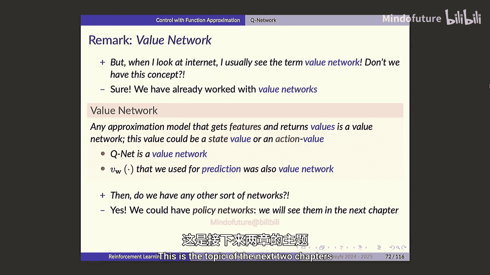

So。But right now， we are just working with the value networks。

 This means that we are just doing value based reinforcement learning yet。 And in that sense。

 then this is what like the very first version of the algorithm that we are developing。

 So this algorithm that you see here， this is basically what we did last time when we wanted to use or model。

So we wanted to train our value network， this value network， V。To predict。

What is how off one particular first day。 So we started to sample from the environment。

 get the TD estimation TD samples out of it。 is those TD samples to train our model。

 That was the idea， right， And then we started to write it down。

 So you we we could basically just do it for a Q network as well， right。

 So if you want to train a Q network， we just did the same thing。Replacing all these with Q。

 except this guy， right。 So let's just look at it and to recap and then just make it online or control1。

 So what we are doing， we are sampling one trajectory， this is the trajectory we sample from Now。

 once we are in one particular state。 say we were at S 0。 Now。

 we want to get one estimate of the value for this S 0 right， But how we do it。

 if we think about TD 0， for example， then we would say whatever the immediate reward is R 1 plus the value。

Right， and the value of Nax state is simply means that。I look at the next state。

 which is S1 right I give S1 to my Q network at the output of the Q network。

 I'm going to have a bunch of Q values。 I average them with respect to policy thevalue so and I use that V value added to this reward as the estimate of the value of this state as 0 right。

Cl so this is the estimate， the first term minus that minus comes from that that gradient， right。

 when we wanted to compute the gradient of the MSE or that least square term。

 then we had this delta times the gradient of the network， right。

 And this delta is the same thing as we had before。 So this is the sample that we have minus。

 This is the output of the network。The network for particular state S 0， is giving me this。

this kind of Q values。 I'm looking into one particular action。 So that is A T。

 So I am looking at the particular output of my neural network at that state， right？

 And then this is the estimate that I have。 I want to update it。

 So I compute this delta using the new sample I got， right。So you compute this delta。

 you multiply it with the gradient， right， If you want to do eligibility tracing， we talked about it。

 That one simply means that you are doing a moving average over your。Prorajectory， right。

 And that was。7 right so basically that eligibility tracing was nothing。

 but you get the gradient each time you multiply it with a number smaller than one and you add it up to whatever you had before。

 right and you keep on going like this right So that was the eligibility tracing。

 Now what you are doing， you are going to update you as a gradient decent again right this is your new weight for your model。

 So how you update it， you're gonna multiply alpha。

 which is the learning rate to your gradient right And this gradient is deelta。

 that is the first term inside the gradient。 The second guy is the gradient。

 the back perfect on your network right。So we are replacing that gradient the the sample gradient that we have with line 7。

 which。Or Q values of one for one particular environment， right， and one particular policy， right。

Everybody recaps， right。Okay， now how we can make it now online。 Well， if you remember in SArsa。

 we somehow got rid of this V。 We replaced it with Q。 What was the trick。What was it trick？

 So we said like， okay， we are in this particular。The word， we want。What is the next？

State and action， right， The nextus state is given by the environment for the next action。

 Well we update or policy first， we draw that action， we don't apply it， we just draw it， right。

 And once we draw it， we say， okay， we know the next action， right。

 And then instead of using the value of like the average one。

 we are going to just replace the Q value of the nextus state and next action， right。

 So we can do the same thing here。 So we would say。

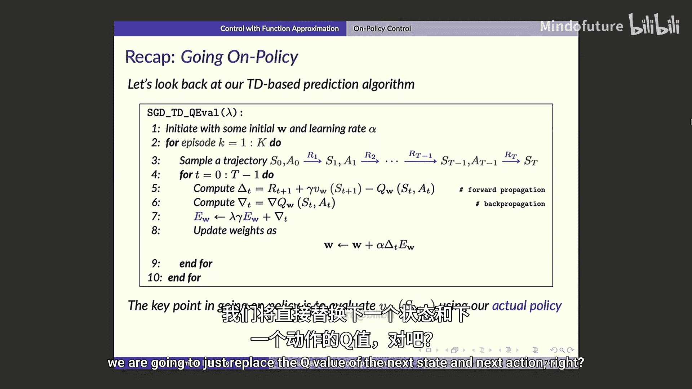

Next to state S T plus one is the average of the Q output over all possible actions。

 But since we have access。What we can do， we can just do work on policy， right。

 We just have access to that。So we can just。我谁。Action， just to reveal what is the next action。

 So we're gonna do that， we would say， okay， what is the next action for the first in the or what is the action when we are in the next state。

 Well， we have the Q network。 We do know how we are going to act。 So we are going to act， right。

 And this is the next action， So we are going to replace this guy simply by the Q value。Ex right。

Now SARSA state action， you get the reward， state， you do act， right， You know what is action。

 Then you replace that， right。Everybody's bleeding here， right。Okay。

 so that is the only trick that you need here to just make it on policy online control， right。

 And then you can simply have this on policy online control So what we're going to do。

 we are going to start with， with the trajectory。 And each time we do have the action of that time because we sampled it in the previous time。

 right。

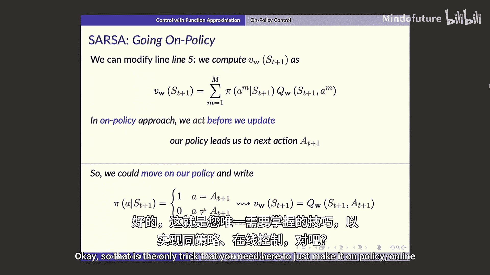

So we get that state in action。 We just act。 We get the reward， and we have the next estate。

 right now that we have the next estate， you can give that next estate to your Q network， right。

 And out of that Q network， you do know how to play ainom。Because you have the queue， right。

I give S T plus one to my neural network。That neural effort is going to tell me what are the actions。

 right， and then based or the values of those actions， sorry。

 and then I can just use Epsilon greedy based on those values to act right， I do act。

 So I'm going to sample 1 H0 plus one from that policy right。

 but I do not apply it to the environment。It for update， right。

 Now I have this complete project 1 is step project 3。 state action。 I get the reward， state action。

 And then when I want to update， I basically replace in line A。 You see this。Only set of V。

 I'm going to replace it with a Q of the next state and can， right。So that is going to be my sample。

 R T plus1 plus gamma Q S T plus 1， h plus1。 This is basically， I would say。

 what is the immediate reward I get。 And since I am on policy， I do know。 And that in the next state。

 I am going to action  to act 80 plus1。 What is the value of that guy。

 I'm going to add it up to my immediate reward。 This is my estimate or my sample estimator of the value right。

 for the current state right， I have the sample estimator。State action value。that work， right。

And then I update， right。Everybody's cool， yes。There's the label。Right。

The the label for you is R2 plus1 plus gamma Q S plus 1，80 plus1。That。The label。Somehow。

 you consider it the truth。 Yes， it's not the truth。 It's just an estimator of the truth。

 but you don't have anything else。So you take it as a。You're not。Like， taking the。Deling it。

You think that。Yes， this is the this is roughly the same thing， right， But。

 but the point is that you give it to the same neural network， right。

So you give it to the same neural network， but you say。You just do one action， right you get。

state right， next frame。 You give it to your neural network。

 And then this neural network gonna say that if you do action one or left or right。

 these are the values， right， And then what， you know， you would say， okay。

 I want to play Epsilon greedy， that this means that I would probably most probably go to act right。

担保 right。Randomly see what's gonna come out。 So you sample， it says go right， right。

 You don't apply right yet， right， But you know that once you want to play， you're gonna press right。

 So you're gonna use that fact。 You would say， okay， if since I'm going to go right。

 then the Q value is one approximated by the by the network， right， now I。My immediate reward， right？

 So immediate reward plus that guy is no an estimator of what you want to see right。

 as the value of of your previous estate， right。Right， so you this one。

 So this is basically your label， right， this red one。And then this is the guy who you want to train。

 right， So you you would say that my Q value at the the Karen state， given that idea this action。

 I want this value to be close to this guy because。发问。Nation。I am using this new。

 I am assuming that this neural neural network is eventually converging into something solid。

 This should be the value I would see。RightYeah， and this is very interesting that you sew this。

 you see it in form of label because we're gonna to have problem with label。 And yeah。

 this is a very good。 I mean， I'm happy that you see it like this。 So as your friend said。

 this red guy， I'm going to clarify more later， but you can think of this red one to be a sort of label right。

😊，So， youre。You do one particular action。You are building some sort of label for your Q network to so that using that label you can train your Q network right so you would say。

 okay， this is state in action go there then at the output I didn't have one label to just do supervised learning right and what is that label This is the estimate you get out of TD right but we're going to talk about it more later。

Okay， who would this look， right yes。Yeah， we talk about this。

 So the original one ingredient is this guy like Q minus this one。And we just flipped them。

 So it became minus， right， So you can think that。Maxxiimizing， so。So this is the deta。

 and then the Q。Propificationation over the network itself， right。 Now， one thing that you can do。

 you can obviously， I， obviously here， I'm just updating with my sample gradient， right。

 I can make it the momentum over the trajectory， which is going to be eligibility tracing， right。

 So you can do it with eligibility tracing。 This means that。

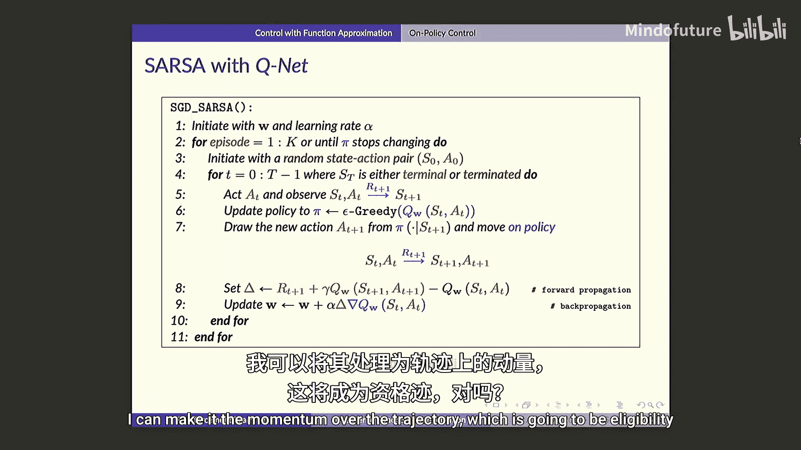

Say that。Every particular state in action that you are。 once you compute this gradient。

 you're going to somehow compute the moving average with whatever you have。

Qu is where you have seen one particular state in this trajectory， right， And then out of that。

 you can actually end up with the source control loop in the deep version， right。

 instead of using a table， now you're using a network， A Q network， right so。All the real to tracing。

 as I told you， it's basically nothing but computing the moving a sort of moving average on your trajectory。

The whole。Interesting point here is that theligibility tracing in the Tbolar case was a sort of moving backward and see where you had been。

 right？So at every single state， you were updating this trace of eligities because you wanted to say that。

 okay， I have seen this particular state couple of times。

 and each of them had been there and there and there。 right， Now， this is somehow connecting to back。

 right， like。P beginning over your tragic。Like you are going back and the deeper back the more back you like。

there， if you think， but basically， everything comes out of the map。Yeah。

 it's a kind of interesting connection。 Like in back propagation。

 you're just sending backward the gradients。 But now you're not only sending it backward over the network。

 once you sent it backward over the network and you， you got that gradient。Get this gradient you。我啊。

1 been before， if you had seen this estate， get this gradient and update， right。

 and then that gradient is going to somehow get a scale with the corresponding ways of。

ThisPart states， right， And this is going to impact the update of youre in the neuro network。

If you think in that sense， you can say think of like。

Stack neural networks in front of each other under trajectory。

 and somehow everything back and the whole giant neural network。But yeah， that's， as I said。

 it's just intuition， right， everything comes out of the math。

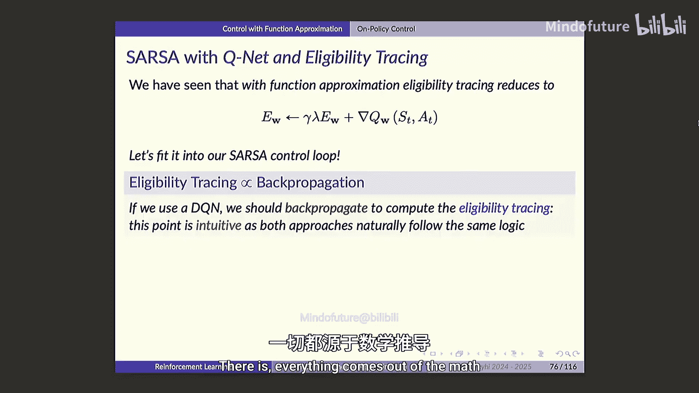

So doing that， the only thing that you need to change is basically this line 9， right？

So whenever you computed one sample gradient， then you are going to just update it with。他也也。也。

That you're moving， right and that。One thing。人。It's interesting that your friend also mentioned you should think of this red guy to be the label right It's like every single time you're building some sort of label for yourself to train that neural network and how you're building it basically used TD。

 right。TD plus your own network。Why， because you don't have anything else， right。

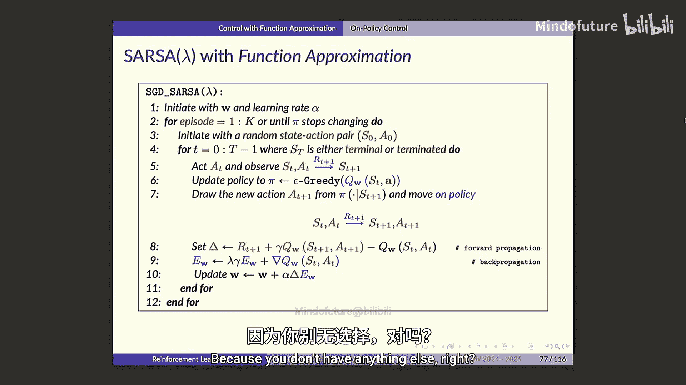

够。So that is the idea of SArsRSa， as I said， you can do it。

 It doesn't mean that no no one is using that， but this is less popular as compared to deep Q learning or deep off policy approach and the deep policy approach is basically using this benefit that since you are doing some sort of important sampling。

 you are not obsessed having。Examples of your own policy。 So in off policy， you're able to basically。

Evaluate one target policy pi or based on the samples coming from another policy pi。

Itless you that you play with one policy， right， But then you。EValue another policy， right。

 This is why we call it off policy， right， And then this means that whatever sample you get with any policy。

 you can always use it in this approach， right， because those policies again。

 are connected to the target policy by some ratio， right， importance ratio。 And this means that。

Samples you collect are not getting totally outdated， right， So you can go over them over and over。

 This is the whole idea of doing a policy in the deep learning， deep reinforcement learning。 Now。

 the most important one is the deep Q learning， which we are going to do。 And that one。

 you're gonna see that again， you can use。Your previous samples， you can do the experience replay。

 You go over them over and over to just train your network， okay。So what was Q learning。

 Q learning was an off policy approach。So same thing as the main framework。

 we had two specific policies， right， The target policy was what was the target policy。

The greedy one， right， the best one， like you don't do any epsilon， right。

 But with what was the policy that you play with。It was the absolute greedy， right。

 So you play with Epsilent greedy。 But each time you try to evaluate the greedy policy， right。

 And since you are evaluating the greedy policy， you already know what is your optimal policy， right。

 because。Greedy policy or evaluation of the greedy policy is giving you the best Q values， right。

 And out of there， you can always find out what is the optimal policy。

So that was the kind of update we do。 So we were pretty much doing the same thing as we did in SArsa。

 but in SArsa， once we want to know what is this value to build this label with right So this was the immediate reward then we need to have the Q。

At the nexus state。One particular action， right。 So in SAa， what we do， we act， right。

 We just sample from our policy。 We know that we are going to play 80 plus one。

 So we're going put80 plus one here， right。Now， when you are doing Q learning， you would say。

 I don't care my target is greedy。And what， what do I do in greedy。

 I'm going to look at the output of my Q network， and I'm going do the action。

 which has the maximum value， right？ So this means that you only need to know what is the maximum value of that。

Outward， right， so this。就。没因问。Next action， right， It only depends on the Q values， right。

AndBecause of that， you're not doing gun policy。 You're being off policy， right， Your next action。

 Well， it might be the maximum one。Right。So that was the idea of Q learning。

 And the only thing that we need to do again is to replace these guys with the Q network， right。

So basically， this guy is going to play the role of the label for us。This guy is the network itself。

 And you update with that， right。Everybody's cool。

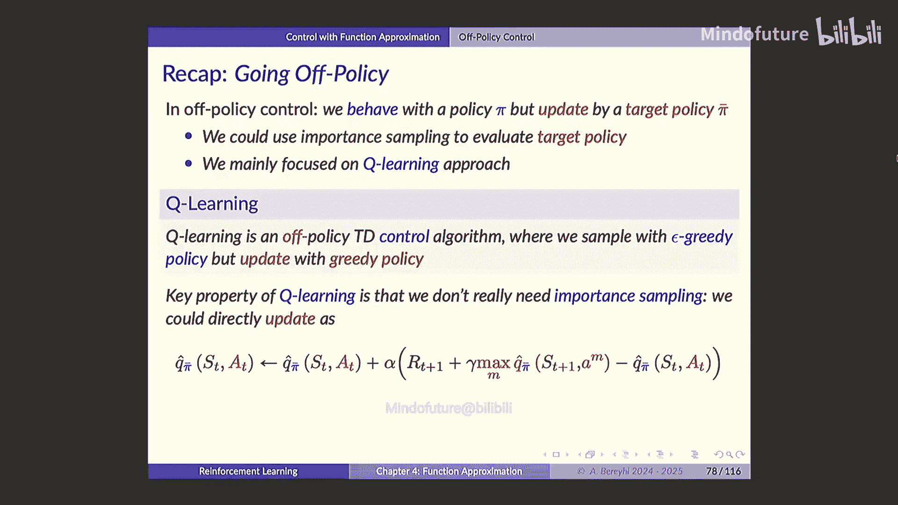

Okay， so this would be the case with， with a neural network。 So with a Q network。

 So what you're going to do， you go line 6， you go and you act action A T coming from this particular policy。

 Then once you。You' are in one particular state。 You're gonna get the immediate reward and you go to the next stage。

 right， You don't need to。Find out what is your next action yet， right， You just give the next stage。

It's going to tell you， well， these are。Get at this。 and you would say， okay。

 if I want to play greedy， it means that I'm gonna do what you see on line 7， right？

 So I'm gonna get the maximum。Of the。Output of my tune network， right。

 I'm gonna lose my tune network。 If I wanted to play greedy， I would do the action。

 which is maximizing everything。 And then the value that I'm going to collect is going to be that maximum value。

 right， So I'm gonna get this guy。I added up to my immediate reward。

 This is a sample reward for the greedy policy， right， So that is a sample for the greedy policy。

 My network itself is actually estimating the value of the greedy policy， right， So I would say。

 what is the value right now for my Karen estate in action。 Well， this is the difference that I see。

 So I'm going update with that one， right， So you compute the difference。 that difference goes。

Along with the gradient of the of the network， right。

 And then you can update the parameters of your network。Everybody's cool。So。

You don't need to do know your next action， right， You start from one estate。 You act。

 you see the reward， You look at the next estate， ask your neural network。

 what would be the greedy value。 Yeah you build your label。

 then you try to tune your neural network in a way that the value is coming out of it are somehow matching the sample。

 right， then in the next time， again， you act right， your action is not any more greedy。

 It's just epsilent greedy， right， You could be totally random， right you do one other action。

 And once you do the action， you're gonna get the Q values for that。 you see， sorry。

 the immediate reward。 And the next estate。 in the next estate， you have an estimate of the old。

Action values， right， Again， you take the maximum 1。 You would say that is what greedD would do。

 You build your label。 You try to tune again your neural network。

 that is matchinging this new sample， right， You keep on going time， right。

 every time you look at your next estate using like this off policy。Mechanism， you would say。

 what is the sample value I would get， right？ And then you try to play with the。

Ws of your network side that you see that value， right， You keep on going in time。 Grual。

 this is going to get。What you want。

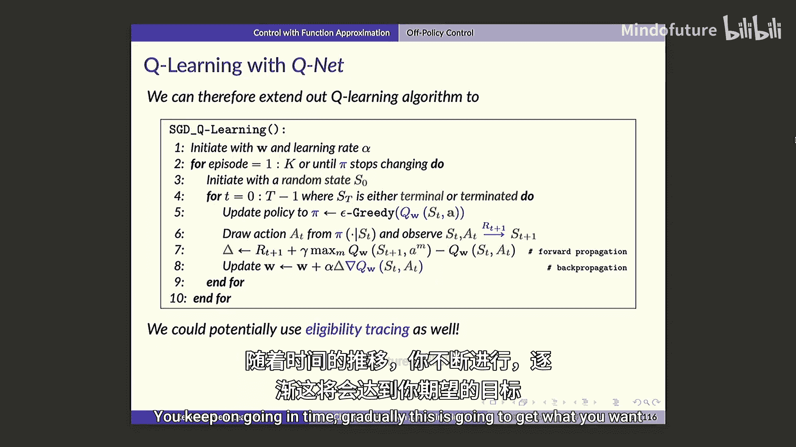

So。哎呀。Question。

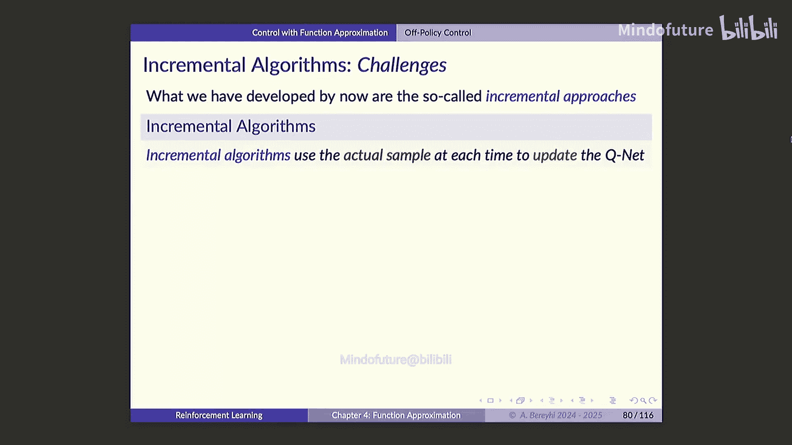

No question。 So this， this guy that you see this is the basic deepQ learning algorithm。

 but this is not going to work。 So if you implement this， it's not going to work， right。

 And there are a bunch of reasons for that。 One of them is that we are not doing experience replay。

 We are not reusing the samples that we have。 So we are actually getting super sample inefficient right and the other reason is that we' are actually using the samples which are coming next after each other。

 They are highly correlated。 They are not good for training。

 The third reason is that what is the third reason。I also forgot。 So I need to check the slides。

 The third is that we are using the same network for labeling and for training。 Okay， for evaluation。

 And then to get rid of that one as well， we need to define the concept of target network。

 So we basically copy one network to evaluate and we just update it once upon a time， right。

 So if you do these stuff， then it' gonna be that you know， breakthrough。

 which came up with the nature paper and everybody say， oh。

 neural networks can be used for reinforcement learning。 Okay， so maybe。

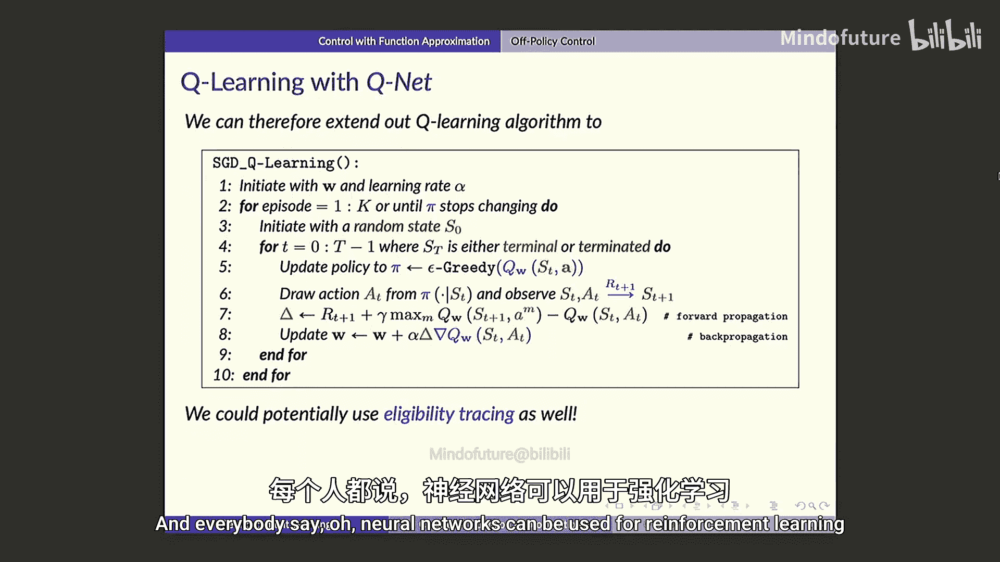