# 【多伦多大学】强化学习 2025 ｜ Uoft   Reinforcement Learning   Fall 2025 p43 P43_讲座_42_目标网络 -BV1D3F2zhEry_p43-

Let's just quickly recap what we did last time with deep reinforce deepQ learning and with deepQ learning we had this one right so that was the vanilla version of the deepQ learning just to quickly recap what we are doing there so this is basically Q learning but we are using our model to get labels right and labels are basically or estimate of the future or sorry the value that we have in a particular state so you remember this。

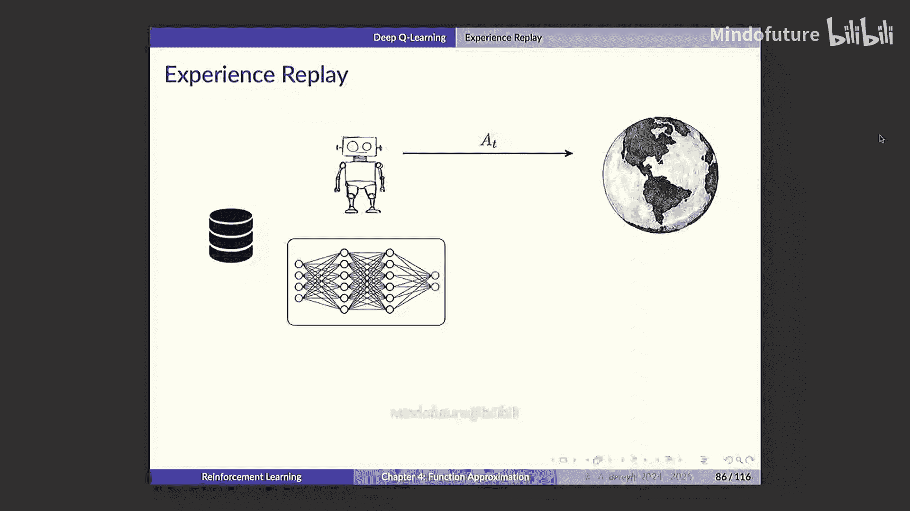

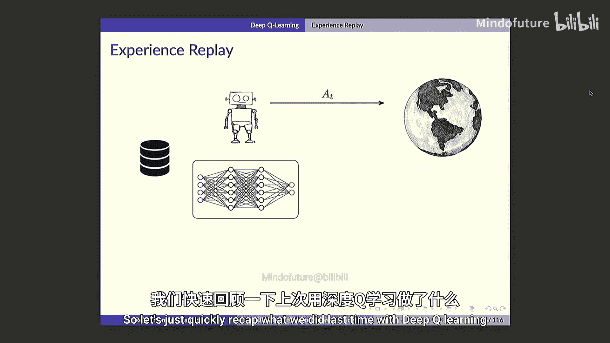

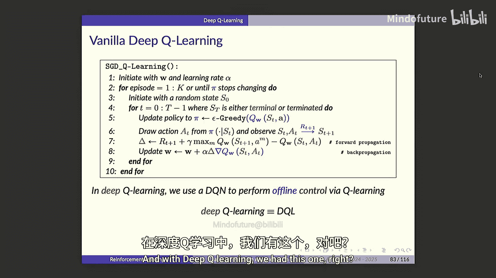

O。I guess it's a review， so it's fine if the voice is not recorded at all。 So you remember this more。

 right？What was the。C learning， so the idea of the Q learning was that you are in one particular to stay。

And now you want to get one estimate of the value。Action Valley of that estate。

That you use it as a label to train your model。 right What you do， you basically。T的把你6T的。Now。

to the agree？So this。I would say， okay， if I'm talking if this cue is really showing the。

That when I give this stake， Iee to this guy。This one should be the optimal action value。Very right。

So， this is。And then。If we are new。That supposedly is the optimal action value for state ST right。

 and then you would say， okay， if I mean the state ST。And I have checked my trajectory。

 I got R2 plus1。Then I go to S plus1， and then whatever。I don't care right， so here also I did。

Then how can I estimate the optimalum or how can I get a sample about the Q value at the estate S？

How do you do。We would say that， okay， this is a sample return that I get。哇了。

timesWhat is the guy here？The maximum， right， So you would say the maximum。Q。

And all possible actions。 and this maximum is over the actions right So this is the idea in Q learning。

 you would say my here in the state in action， if I am really estimating the optimal action value now。

Should look like this， assuming that this is a very good estimator， right in reality。Theoretically。

 I don't need this one。 I need the expected version of it， right。

 but I don't care about the expectation because I do not have enough samples to estimate， right。

 I just take the guy as the sample estimator， right， Now， this is what I want to see， right。现在也不。現場に。

How do should I do。If you look at my trajectory， so my trajectory also has the nexus stage， right？

I got the sample from the Enron sample reward。The next estate。

 I give this next estate again to my neuron。前。is going to give you something here， right？😔，会的でた。两个人。

I calculate this maximum one， I take this one as my。Optim action not。

So I would say if I am playing greedy， a his greedy action， then this means that。

My action value should basically look like this guy， assuming all of those。Work。Right。

So this is the label that I want to see but what I am seeing really in practice is the output of my neural network right。

 this is what I'm seeing。And what do I do？We tried to just train。We that to give me that。

For this particular。They're all that。But I tried all of them I mean this one。Yeah， okay。

 yeah I kiss you。不去。Okay， so。So everybody cool with that， right， So that is the。Yeah， those working。

 Yes， those working。 Yeah， thanks a lot。Okay。So that was the idea of Q learning。

 And we can simply mimic it using or。We can simply mimic it using our neural network。

 So this guy is the label that I want。 This is what I'm gonna get out of the neural network， right。

 state at time T state at the next time， right， And then I try to make this label to look like this one。

 How can I do it， Basically， I train my neural network by the basic idea of you know。

 gradient decent we talked before about， right？ So that is going to be the case with deep pure learning。

 right， and。

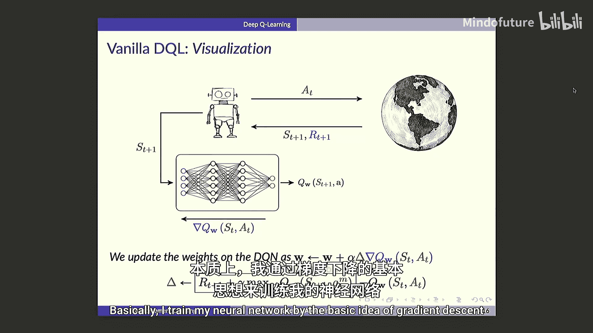

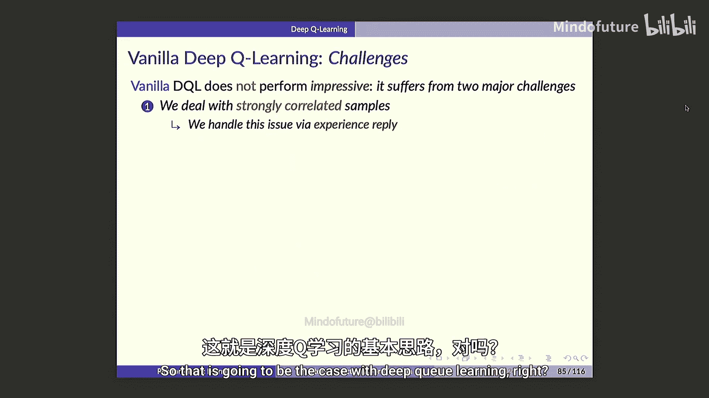

That was the。Whole idea， right？ So you get this difference。 You put it here。

 Then you have the gradient of your network。 You add it here。 You update your weights， right。

 and you go on every single。Sample inside your trajectory。 And then eventually。

 you're gonna get some update of your。Q network， right？ So this is the vanilla version。

 And then from the vanilla version， we went into a more advanced one。

 which was using experience replay。 Do you remember what was experience replay。😊，you remember， okay。

 so the idea experience is that you go and you start sample your， your environment， right。

 So you start sampling this environment， you collect those samples and put them inside a database。

 right， Now， what is inside this database。 Every single sample inside this database is this state that you are in。

 The action that you do， the state that you get into the reward that you get， right。

 So this is your single sample inside this data set， right database。😊。

You sort sample from that database， right， now， the key idea here is that since you are doing golf policy。

 then you don't really need to have samples of your own policy， right， And because of that。

 you can basically just take samples of any policy， right， So you can reuse these samples。

 This is the idea of experience replay。 Now， experience replay gives us two things， two benefits。

 One of them is that we can reuse the samples that we had before， There was one other thing。

 Do you remember that。Great， right， there was， they were less correlated， right。

 because those samples that you get S B is maybe one index B is time 1。

 The other S B is time 10 in another trajectory， right。

 So youre just randomly changing the time steps， right， And this means that states that you get。

 they are less correlated to each other， right， because in many environments you're carrying this state and your next state are very close to each other。

 right， So this was the second benefit you get out of this experience replay。

 And that was nothing more than that， right， So that was the whole idea of experience replay。

 Everybody is cool。😊，Yeah， I mean， I know we， we had weird time before， but again。

 we still have weird time。 I mean， reading week， I hope after the reading week， everybody's happy。

Yeah。So， but yeah。I appreciate responses。Okay， so。That was the idea of experience replay。

 And then at the very end， I told you about this issue， the issue of varying labels， right。

 So anytime that you do Q learning at the end of the day， you have this sort of label， right。

 You see what is the sri。We get the next Q value， right？You just take the maximum。

 You put it as the label， right。Each time that you update your network。

 it means that each time you update this value of W。

 you do one step of stochastic gradient decentcent。

 The thing that is going to happen is that your label is also changing。So， for instance。

 you are in one state and you look at the next say。 You just give it to your neural network。

 It tells you， okay， the action value should be this， right， And then you try to update by updating。

 you basically try to give the estimate of your neural network getting into this point， right？

 But the first time that you update only one step， right。This value goes up。

 but that W is going to also change this guy。 So this guy is going to run away， right， And again。

 you change this guy runs away。 So you are not catchching that， right。

 And this is simply a kind of it starts to get a sort of random update。 So because of that。

 this vanilla form without。Or with the same level of updates of this label and the network that you're using for estimate。

 this is going to fail。 Usually it gonna fail。 right， Now， what is the idea here。

 The idea is that you try to basically copy this network into a new network， right。

 And that is what we call it a target network。 so。

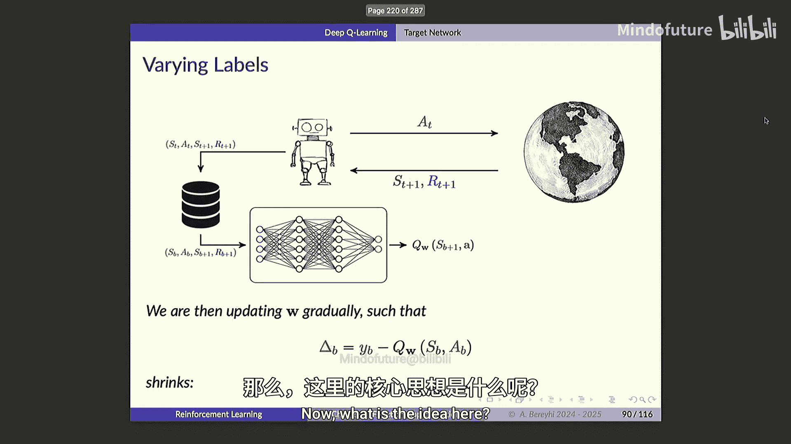

Very simple。 Sa you start with training。 So you have your Q network。

 That Q network is able to get one state as the input。

 And then're gonna return you the action values of all the actions in that estate， right。那。

You have this guy。At the very beginning， you are going to copy this guy into another network， right。

 So that is the next network that you copy here， right， Now， this is exactly the same guy。 weights。

 everything are the same。 You just copied it here， right， Now， now that you have copied this one。 No。

 you youre gonna get your sample， which is your parent state， your action。

 the next state and the sample reward， right， These two are the guys。

 the next state and the sample reward are the things that you're gonna use to estimate your label。

 right。And these two are the things that you are going to use in order to evaluate your neural network and training。

 right， Now， you're gonna give the current state to the up one， right。

 the one which you want to update。 and you're going keep this guy frozen。 You don't touch it， right？

 So this guy is going to give you one。Value for the next estate。 Now， in the very first round， both。

Nework are of the same thing， right？state goes to this one。 Next estate goes to this one， right。

 And this guy is going to give you something right So here I am showing it by W bar and the up one with by W。

 W and W bar at the very beginning of the round are the same thing right Now， the thing that you do。

 you are going to use this lower one to estimate your label， right。

 So you say whatever this frozen network is giving me as the value of the next estate。

 I use it to estimate the value of this estate， right you take that one。

 and then you try to update your upper network in order to get to this one， right Now。

 if you do that， this other W bar， the lower one。 this is going to stay here。

 because each time you update， you only update W right。

 you don't change W bar right And then it can gradually。

You might tell me this guy is not the right one。 It's okay。应开始。Please have some convergence， right？

 And then after each different rounds， maybe you you've done some， some rounds， H rounds，10 rounds。

 for example， then you're gonna copy whatever you got as updated one into this one， right？

 So now this is like。You have your target here。 You try to get there， and then you update that one。

 that one jump somewhere else， right， And again， you try to get there。 And gradually。

 the jumps in this one is source to somehow shrink。

 So you're gonna jump lower smaller and smaller steps。 And then you always get to it， right。

 And at some point， you're gonna just。Cumbert， right？So you got the idea， right。

 So you have this network， you just run it H rounds。 And in those H rounds， you keep this guy fixed。

 right。 And then you use this fixed network to get your label。

 This is going to give you a robust label。 you can train your network， right。 And then again。

 when edge is over。 You just copy everything back。Everybody school。Questions。Yes。Exactly， exactlyly。

 so sorry for not mentioning this。 So this guy is the one， which we call it the target network。

 right， So this is the Q network that you train。 This is the target network。 Of course。

 when the whole training is over， they are again going to be the same thing， right。

 because at the very end， you are going to copy this guy to this one。

 But during the training in couple of rounds， this one is frozen。 So it's going to be fixed。

 the other one is going to converge， right， and this benefits。With robust labels， which is。

Help you to just get a convergence。Aviseful。Questions。Always with two。Again。

 there is a chance to diverge。 It depends on your environment。 And， of course， the choice of age。

 all of them are like super。Say sensitive in some environments。This is really a hard thing。 I mean。

 I guess like even with the Tar one， which you have done the experiences experiments。

 you you see that it' sometimes very hard for R models to just get converged， really。

 it's a crucial thing。 So people were quite excited when they so this one works because finally。

 they got something converging。😊。

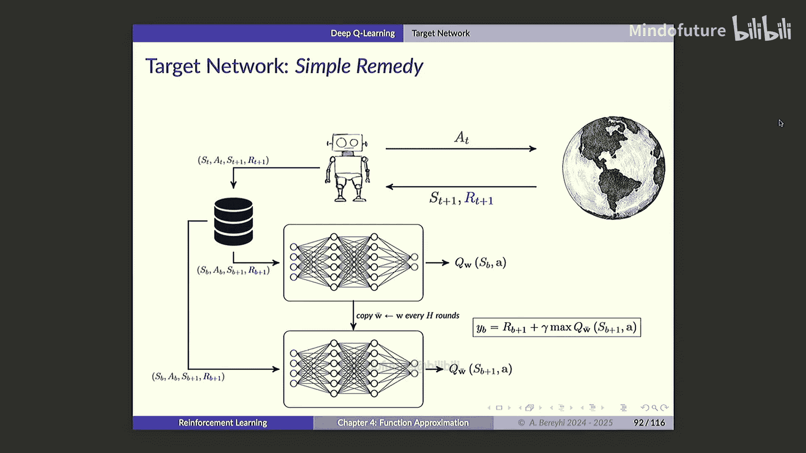

Qution。Now question。So this guy is now the deep pure learning algorithm in which everybody。

Considers as the as the baseline or benchmark。 So what is the idea there。

 The idea is that you're going to basically do experience replay。 So the experience replay is here。

 right， That is the one which we had in our second， like we had the original one in the original one。

 we had this box to be the label， right， And that in order to get。More sample efficiency。

 We said we do experience strictly。 This is this yellow box now。So what do we do。

 We just sample each time that we sample in line 5， each time that we sample， we do an action。

 and then we store that sample inside the buffer， right。

 So your buffer is just going time after time， right， So youre just exploring your environment。

 right， But then when you want to train， you basically sample your buffer， right。

 So you take a sample back need that from your buffer。That mini batch is， for example， of size B。

 Now， you get that one。 you use that mini batch to， to train your model。 But when you want to train。

 you use your target network。 W bar， right， and W bar is fixed。Okay。

 so you do it like usually that box that you see。 This is， usually we said L equal by one。

 We talked about this last time。 We typically do not do multiple rounds of or multiple its of gradient。

 but you can do that。 That's okay。 But once you are over with that one。 then again。

 you go and sample new mini batch and you train， right So this means that youre target network is frozen you train this guy。

 this guy starts to diverge from this one， right， It gets actually is trying to get closer to the estimates of this one。

 right But it going to have different weights， right And then once youre over with H rounds。

 then in line 3， as you see， you are going to copy whatever you got into the target network。

And again， you use this target effort to estimate your labels once again， right。Everybody's clear。

Questions。

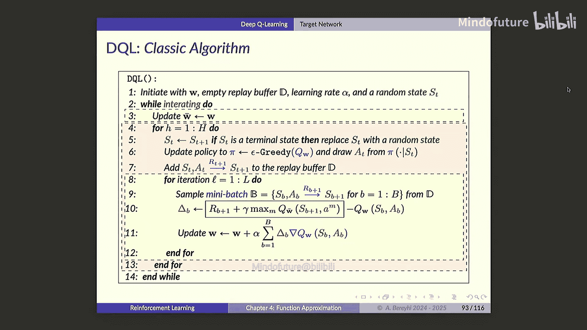

No question。So with all of these stuff， do you expect this to work really。Like when I。

 when I was a student。 So whenever I hear things like these， not not this one is specifically。

 but anything like people come over， we have the circuit。 and then we put this。So， what is that。

This diet here。 And we put that container here。 And then this is going to behave like a radio transmitter。

 right， And then what I had as a student， like come on。 It's not going to work。

 right So same feeling you might have about this one。 Come on。 you're just sampling。

 and then you take those samples as your estimate。 Then you just add a buffer。

 and then you add up the target network， these crazy stuff。 They should sound nice in。

 in theory about they do not worry。 So that was the main。Message of this paper。

 So it's a nature paper published in 2015 by those names that you see。

 So David Silver that I started the lecture with is also here。 These are the deep Min team。

 At that point of time， they were not the big team that everybody knows them right now。 So they was。

 it was just a small team talking about reinforcement learning。

 And then they showed that this is really working。 So basically this。

Breakthrough paper was just talking about deep learning。 It was showing that doing those tricks。

 you really can't play environments which are computationally extreme。

 And people before this thought that this is not feasible to do it in a feasible amount of time。

 So if you check the paper is almost 38000 times cited。

 I do know that as compared to many like deep learning papers， which are10。In000 citation。

 it's not too much， but in the reinforcement learning community， which is a small community。

 That was huge。Because like everybody was wondering， wow， it's finally working。 right Finally。

 we can design some intelligent agent who is able to play。 And the original paper。

 this one is only talking about the oy games。 I mean。

 this one is like the nature version of the original paper， which says， like。

 I put all of them in the course page。 So you can play by deep learning， by reinforcement learning。

 you can play oy games。😊，It's like the nature journal。Yeah， is it is it quiet。

 well known like not everybody can get there， right。Okay， so that was， that was the the。

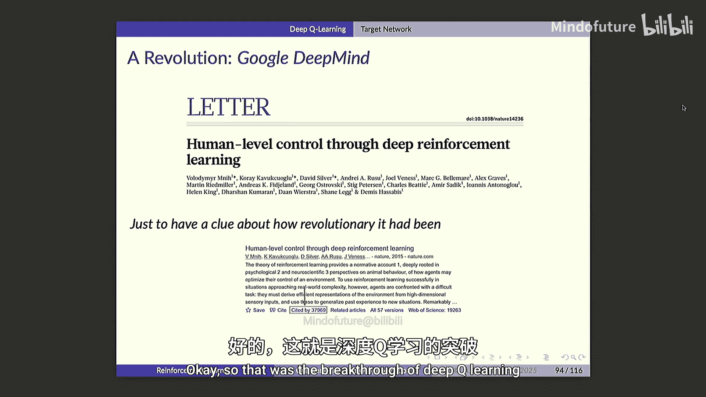

Breakthrough of deepq learning and deepq learning was basically the first algorithm in deep reinforcement learning。

 which worked。 And finally， people started to somehow look into it right So it really worked fine。

 So here if you click it's a link， then you can go to the YouTube page of Deep Min。

 And then it's like about 10 years ago， roughly the time they was proposed。

 and they showed that they can play this breakout game using deepq learning。 well。

 for you it's now feasible because you are actually studying deep deep reinforcement learning。

 But at that point of time that was something。Okay， now。

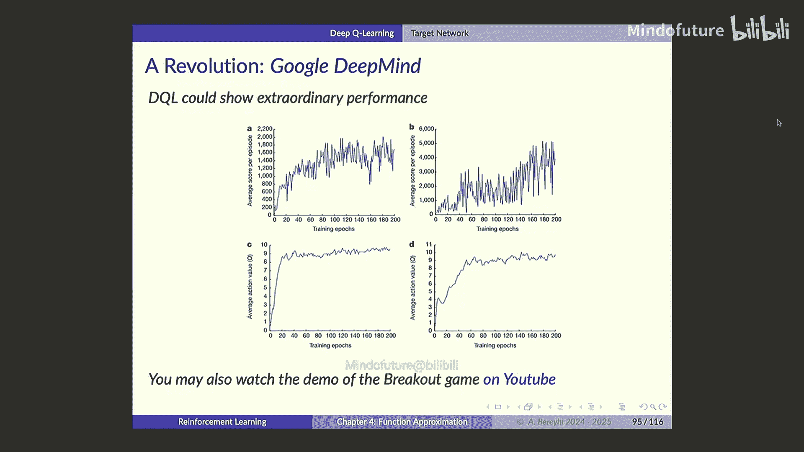

This is the result that they show in the nature paper。 So， for instance， they show that， okay。

 before DP learning， they were using linear learners， basically linear models。

 And this gray one is linear model， whereas the blue one is show showing dipP learning。

 And as you can see， for most of the games， these are utter games。 And for most of them。

 almost all of them， just few of them， not the case。 DP learning is just doing better， much better。

 right。And this was， this was a very sophisticated result。

 And especially the point was that like they could。

 they started to hit more and more games above the level。Like with linear models。

 there were a few games where your linear model can play better than human。 But with deep learning。

 it was much more。

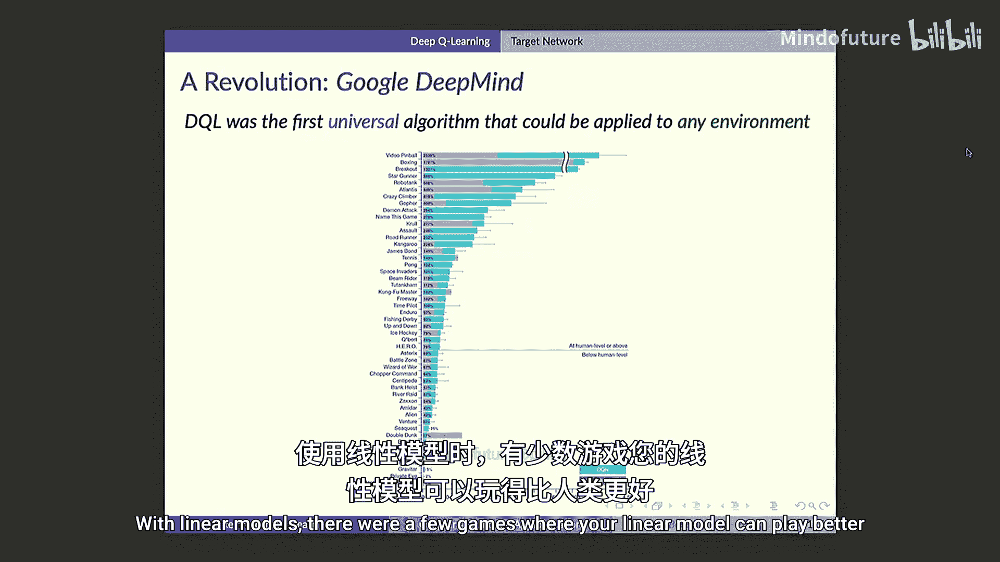