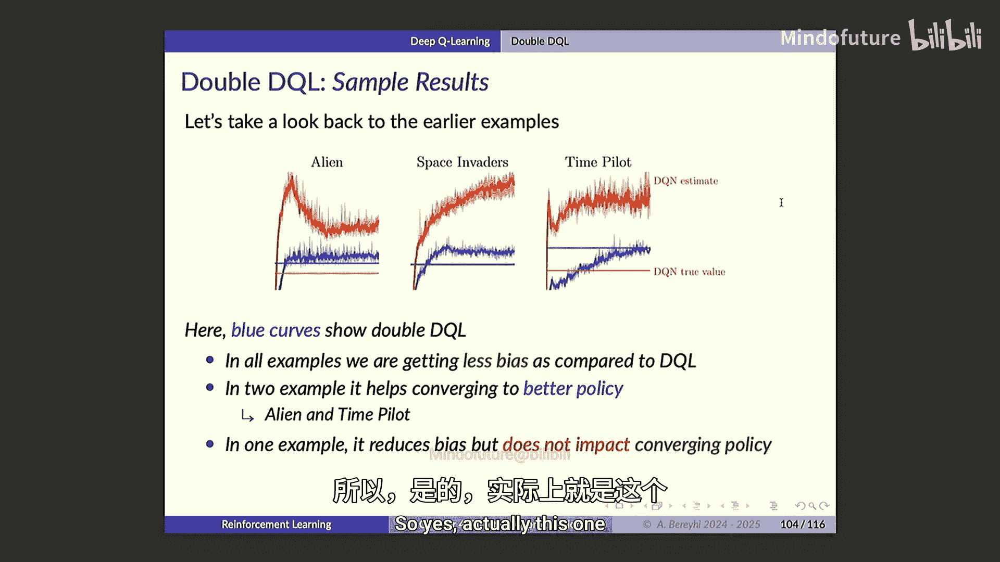
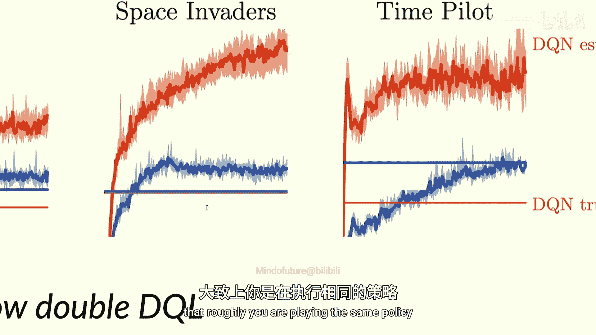
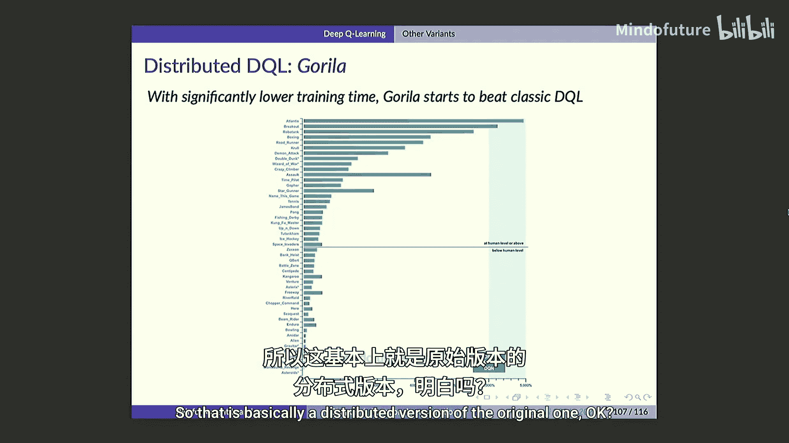

# 【多伦多大学】强化学习 2025 ｜ Uoft   Reinforcement Learning   Fall 2025 p44 P44_讲座_43_双重深度Q学习与Gorila架构 -BV1D3F2zhEry_p44-

Right now， I mean， that DQL that I told you， that is the only thing you need to consider from DQ learning。

 okay？That is the main thing that you you need to have。

 I dont want to give you just the flavor of what kind of other extensions you might see。

 because you might start。Doing some project。 And you see people are talking about A，B，C， D， E， F。

 G variant。none of them is something sophisticated。 They are based。

You always play with some details there。 For instance， this double Q learning。 This is one idea。

 So what is the idea here。 So when they tried the D P learning algorithm just a few months after that。

 they wrote the paper and they said a deep Q learning is showing extreme biases。

 And how do they know that the bias is extreme because。

This yellow curve that you see Okay that yellow curve is what you get when you are training， right。

 And then when you are training， what does that mean。

 that means that you start to first have bad values， right？ And then gradually。

 your value is going to converge。 So that converge value， if you just play enough number of times。

 at some point should be constant， right， And that is。

 that should roughly be the value that you get out of the optimal policy， right， That's correct。

 So this is the idea。 So this curve that you see the yellow curve should show you the。

The value in the conversion level， right， It should give you the value when you play optimal with optimal policy。

 right， But now what they do， they， they do the training， They get into this one， right。

 Then they start the training。 They get that neural network。 That neural network is。The Q network。

 which is giving you the Q values， right， And those Q values you can use just play optimally， right。

 Now， they get that Q network and play optimally， but they do not estimate。The value is using TD。

 What they do they do to make sure it's unbiased。Monte Carlo， right， So start playing。

 but they estimate with Monte Carlo， right， They can do it now because they have the optimal policy。

 They only want to evaluate it， right， That is feasible。 So they are going to do that。

 And that line that you see this is what you get out of evaluation of the optimal policy。 Now。

 the question was that， well， you're seeing this huge difference for now。

 forget about that blue curve。 Blue curve is what we want to get into。

 But the yellow curve is what they got out of the Q N right， And then they say， okay。

 when we are training， then we get into this one， which we keep on playing with our。

 we believe that this is the value because this is coming out of our Q network。

 But if we evaluate the same Q network， we are getting significantly different value here。

 And what is the reason why this is happening。 Any idea。Why we have values？TD can give bias， right。

Bas， that's right。 But actually， the bias was much more severe than TVD， right。

It was not TD simply because TD should not give that。There a couple。But they were using S。啊。Some号。えき？

There was much more important issue that was。The issue was with this maximization that you do when you do you make your label。

Now， just to give you the idea why this max is making the the， the bias。

 just let me give you one simple example。 Say I have two computers， computer A and computer B， Okay。

 computer A， if I give a program to it， it' gonna take 8 seconds to run it。

 If I give it to computer B， then you're gonna take five seconds。

I want to know which computer is taking more time， right？ So obviously， a， right？

 But the point is that I don't have access to those 8 seconds and5 seconds。

 So there are the true values But what I get is just a random time， right。

 And then random time is simply because my computer starts in different situation。

 My measurement is inaccurate。 and I get two different values， right， Now。

 the values that I get that X hat for any computer either A or B doesn't matter is a noisy estimator of the true value。

Okay。Now， the question is that if I do multiple samples。

 So I just run the program on computer A multiple times， and I just record the time。

 every time that I I use that computer， I record it。 and also I do it with computer B。 Okay。

 I record that one as well。Then how can I find out what is or which computer or what is the maximum amount of time that I need to run on either of these computers？

就这。すける。The way that you might say。So the ultimate ultimate goal is to just find out what is the maximum run time between these computers。

 But you are using noisy samples， right， And if you do that， this is something like this， right？

 So I run same program on both computers K times， right。First time I get X， A 1， X。

 B1 from both computers。 Second time X， B， X， A 2， X， B2 and so on。 right。

 So these are the samples that I get。 What is the maximum time if you want to use these estimators。

就是。Take the maximum 1， right？ Let's take the maximum1 out of them。

 But one thing that is obvious is that if you think about these guys in this form， right。

 that epsilon， that error， sometimes that is more than one0。 Sometimes it is less than 0， right？

 And if you do so many samples， definitely among them。

 there are some cases where epsilon is more than 0， right， is a positive value。

 then your estimate is more than the true value， right， So this maximum one that you take out here。

Is somehow is somehow more than like this is in probability。 But as k increases larger and larger。

 that probability is higher and higher， right， if K is large enough， then you would say definitely。

 I'm pretty sure almost surely there is one guy there has positive noise， right。

 positive noise component。 And this maximum one is more than the true one， right。

 So there is obvious bias is between them， right， And the more you do your experiences。

 like the more you sample， the larger this gap could get， right。

 because the you get more chances that your maximum value。

 like maximum noise component is larger and larger， right。A rice school， right。So that is the issue。

 So when you use that maximizer， of the estimators， then you are going to overshoot。

 overestimate the value of the maximum time， right。

 And then that was basically the issue happening here。Because it shine that， you didn't look at the。

Action values for different actions。 You're getting noisy version， right。

 And you take the maximum for your label。 And that maximum is definitely larger than the true maximum。

When you think statistically， right， And then this is going to make sort of dinosa。

So your model is somehow trained to get a biased version of the of the true value。 right。

 So that was the observation。 And then the question was how we can resolve that issue。

 because this is not coming from TD。 If it's coming from TD， we can do nothing about that， right。

 That's environment。 That's not our problem。 But with this one， you cant resolve it。

 And the idea here was that you just use this， you know， double sequence processing。

 So you have one sequence is the top one， right？ So if you look at the top one。There are some。

There are some samples from， right？The maximum guy here。 So among in this sequence。

 most probably the one who is coming out is。The sample time for computer A， right。

 because you know computer A is the slower one， right， it has higher time。

 And then if you have so many estimates， it's very highly that that time is added with some noise。

 right， is the large one。 And that one is most most likely more than the largest one for B， right。

So for one particular sample， it might not be the case。 but when you have so many samples。

 it's very likely that sequence 1， the guy who is coming out of this is going to be computer  a。

 right。Now， if you want to know what is the time computer A takes to run the program。

 you don't use that maximum value you got。 You just look at another sequence。

 which is independently sample and take that time， right。Then it is a random time of computer A。

 right？ But this is not a maximum in the sequence， right？

 And then this is going to just kill the the bias。 So the idea here is that you just do this samplings。

 So you， for example， run exactly same thing on one computer to wise independently。

 And then these samples that you see， theyre coming now independently。 Now。

 you find in the first sequence， you find the guy who is who is maximum。

 But when you want to use the value， you use the second sequence， right。In sequenceequ a noise。

 which is not。コization？So we do not hear about it。The noise added to the second sample or the second sequence is independent of your true value。

 right， Now， if you average this guy， this guy， right， which is on the second sequence。

 if you average this guy over time， like you do this process 10 times and you average it。

The bias of this guy is 0。But if you do it on the on the one we had before， like maximum1。

 the one coming in the， in the first sequence， then that is。A higher value。Okay。

 so if you have heard of the notion。T。Out the lot。 O， finally， I'll learn。Okay， so if， if this is。

 if you have heard of extreme value distribution， this is basically that right。

 If you have a sequence of random variables， they are independently generated。

 If you look at their extreme value， like the maximum 1， the minimum one， the second maximum 1。

 the second minimum1。All of them is not distributed as the original guy anymore， right。

 because obviously， you're， you're generating lots of things， but you only take the maximum one。

 right， That is different。 That one is very strong in the tail and that one is bias。 Okay。

 so this was the trick。 And the same people who did D Q L。 They try to implement this one on the。

 on the D P learning。Moreoverral of the story， you just get two different sequence of realization。

 You use one of them to select which guy is the maximum 1。 And then to just keep it unbiased。

 you're going to just use the second。And。Sequence， yes。不好意思呢。This is why they call it double QM。

RightSo they have go。One of them they use in order to get the index of the action Who has maximum value。

 right， And then they use the other one to estimate the value of that action。You get the idea。

 So this is the idea of double Q learning。 So you have two networks。

 one deep Q Q network in order to find out which action has the maximum value。 you have a second one。

 which is going to evaluate the value of that action state here。And then that， that estimate。

 that evaluation is no onbi system or of the true action value。Every school。So， now。So this way you。

 you are going to get rid of the bias。 One thing that I want to indicate here。

 And I tried to show it also in the examples we started with is that。If you have on biased。

 if you have a bias estimate。Action value function。

 It does not mean that you are not learning optimal policy。 You could have biasas estimator。

 and you still learn optimal policy and I。Now， after we have gone through all of this is more clear for you what I'm talking about。

 right， because that Q value that you see at the output。 when it's biased。

 it means that every value that you have is somehow shifted， right， It's different from the true one。

 right， with some margin。 Now， if that margin is fixed for everybody， for example， right。

 then you want to play with the one who has the maximum value and it's not going to change the the index of the guy who has the maximum value。

 right， It only impacts。 If one of them goes up， for example， the other one goes down， right。

 and then it flips the optimal action， right。Averse school yeah。这。That means that dropping the bias。

 it does not necessarily mean that you are going to improve。 potentially。

 you can improve because you get less。Confused， you get less error。 And obviously。

 you get closer to the true one， which can help you improve。 But it's not a necessity。 Okay， now。

 that is the basic idea of Q learning double Q learning。 So what you do。

 you basically have one Q network。 You train this Q network is exactly as before what you do here。

 But then you're gonna look at the output of this one。 And you select the action， which is。Maximum。

 right， So this is the action that you want。 Like， this is the maximizer here， right。

 But you do not care about the value of that action anymore。 You just find out which guy has the。

 which action has the maximum。And now that you found that， then the next thing。

 you just put one other network。 That guy is getting trained independently from that one。

 So that guy has his own buffer。 It's gonna interact with the with the environment independently。

 it's going do exactly the same thing that you do with the normal cure learning。

 So it's some guy going in parallel with your online network， This one。

 and this guy is going each time to select once you select this one。

 you give it to the other neural network， right， You would say that guy has the maximum value。

 Give me what is the action value for that guy， right， So that guy again looks at your state。

 gives it to your neural network right and then look at output with action values。

 but it's not taking the maximum one。 It's going to take the one whose index is given by you right by this network。

Right， and then doing that， you are going to have this label， right。

 So this label is the output of your。Evaluation network at the particular next state that you have given to it。

 But now you are having。The action， which is maximizing。

 But that action is maximizing the selecting the P network， right， the online Q network。

A rice school。So this is what we call a double queue learning。Right。

 and this is helping to remove the bias。 Now， as you can see now， the blue guy is the。

Double Che learning。 And when you look at it， would you see a smaller bias。

That jigly curve is getting closer to the line， right。

 The line is what you get out of evaluation by some unbied approach like Monte Carlo。

 The jigly one is the one which you get out of your training， right。

 And then that one is closer to this one， right。A basically school right。 Now。

 the point here is that， for example， in the middle1， space invaders， When you look at this one。

 this yellow guy is much different from the true value， right。You see that， right。嗯。Bが。

When you look at it。Whi is coming out of double learning， this is much closer to your true value。

 right。So，Trump， right， But the point is that both would work the same here。Simply because。

The bias is shifting all the values to a higher value， right， but it's not changing the choice of。

Whereas in these two other ones， T pilott and alien， this， these ones actually it plays much better。

 And this is because the bias there is really changing the choice of optimal action。 So obviously。

 blue curve， which is for the double Q learning， is showing less bias。

 but it does not mean that it necessarily helps， right， So in those two。Edge cases。

 alien and time pilot。 This is going to do much better。 but for， for the middle1 space。

Is not really changing。And anyone has any idea how to can see that both。

 both approaches are ending up with the same policy。C的。

What is different in the middle curve as compared to these curves。I mean。

 the training curves that we have are different， right， in all of them， right But in both of them。

 the in the middle1， the both lines are on each other， right。

 And I told you both the line is the value you get when you play your optimal policy， right。

 So when you play your optimal policy， you get same value in both cases， right， So no change。

 You see it， right。希 want。So those lines are coming out of evaluation of your optimal policy。

 And when you get the same， roughly the same evaluation for two policies that you got。

 this means that those policies are very similar， right。Every school。Questions， yes。一直交。Right。Yes。

 or what is the value of that state in action。Oh， that 1 I cannot explain， I guess。

 So is that it's really behind the scene。I mean， obviously， you are shrinking the bias。 Obviously。

 because you see this yellow curve sorry， orangerange curve is much different from the line as compared to the blue 1。

 right， the blue 1 is closer to the to the line。 And line is the true value。

 This is what you get out of your evaluation and then your network。

 when training is getting close to that， which says that your estimate is very close to the bias。

 right， sorry， to the true value。 So you have a small value。 That is okay。

 But why this bias is not impacting the choice of optimal value。 Op action or optimal policy。

 I don't know。 really， is's just because of the problem because of the environment。Right， right。

 But what you what you when you look at your Q network and you want to talk about the value。

 you're gonna to say much more larger value as compared to the true one。

 But it does not change the fact that you're still acting optimal。

You're just having a illusion about how much you can get。Allian and time pilot。Installed it。Right。

Where。Y打。Yes， yes， exact。 Oh， you don't see it。 I like sorry， Yeah， because I'm close。 I can see。 So。

 yes， actually， this one。

行呀。Both of them， yeah both lines are here， right， makes sense。So when you evaluate them。

 both of them giving you the same value， this means that roughly youre playing the same policy。

Okay。Okay， shall we go on。Okay， so now there are bunch of other versions of Q learning。

 And we are not going to cover them。 I mean， obviously， you can check them。

 All of them are like minor extensions。So doubleq learning is what we talked here。

 You have dual link queue learning。 And then that dual link learning。

 We are going to talk about the concept of it， which is the advantage we need it when we get into the policy gradient。

 but basically it uses advantages， and then you have a priority sampling。

 So you would say if I have a buffer， I can just randomly sample from the buffer when I'm doing experience replay or I can。

So maybe some， some samples which had been collected at the beginning of time， right。

 I should start using them more because at some point， I should get rid of them， right。

 So I use them。 I get rid of them。 Then I give higher priority to what is closer， right。

 So that is also one approach You can do it。 Also， you have distributed versions。

 and the distributed versions are。Additionally， they are。5。Usere still learning。

A realistic environment。And the most famous one is Grrilla， even though the name is quiet。Harsh。

 but that is not that harsh。 So generalized reinforcement learning architecture。

 I don't know where it comes from， but they just like to call it gorilla， right， because it's Grilla。

 can just solve huge problems。 And basically， what it does is again get pure learning。 Okay。

 just wanted to mention that。 So you don't get like if you hear about this。

 you don't think that you're missing any point。 So basically what it does instead of just having one player which is sampling the environment and using that to train the neural network。

 you're gonna have multiple of them， right， And each of them is just sampling。

 and then it's just training something。 Then they're gonna share it with a center， right。

 that center is going to update the original。啊。The central。9年。So that is the main idea。

 So you do parallel actions。 You can just sample in parallel。

 That is going to boost a lot in terms of computation， and you can store the data you know。

Distributed fashion。 A good thing about this in a realistic environment is that your environment is giant。

 right。 And then this means that， for example， your environment has different areas， right。

 if you have one agent， that agent start to play here and gradually go other places to just experience all the states。

 right But if you have multiple agents， then each of them could start sampling one part of the environment。

 right And then they are actually going to cover the whole environment much faster。

 And the whole idea and just realize that basically you try to write down everything in parallel so that those sampling and updates are running all in parallel right And then in one shot update。

 your。😊，Main neural Q network is going to get idea about the whole environment。Okay。

That was the idea they could use it to massively make parallel computing in Q learning。

 And then they wrote same kind of results as the original Q learning。

 And they said that you have seen how well Q learning is working。

 So forget about it because we have Gilla now， right， then these are numbers you see。

 So that is basically distributed version of the regional one， okay。😊。

