# 【多伦多大学】强化学习 2025 ｜ Uoft   Reinforcement Learning   Fall 2025 p45 P45_讲座_44_为什么需要策略网络 -BV1D3F2zhEry_p45-

it was Q learning， right mainly， I mean， we did SARSa also say in the deep fashion。

 but that was less popular。 Q learning。 deepq learning is the most popular one。 Now。

 what do we do in all of these approaches， we just follow the main idea of value iteration， right。

 We're gonna compute some sort of value right， and that value is given by your network。

 that is a value network， mostly Q network right， you look at that value。 You decide for your action。

 right， This is the most basic version of deep reinforcement learning。

 This is the value based version， right， And if you want to do value based deep reinforcecement learning。

 then you are fine， as long as you don't want to deal with continuous actions。

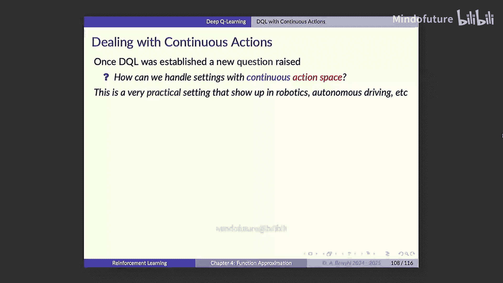

If you want to deal with continuous actions， then you're gonna get into trouble。 Now。

 why we could have trouble when we have continuous action。

And this is happening in most practical scenarios， right， in robotics。 Well。

 the angle that one arm can choose。RightAnd in many other things， right。

 So realistic problems that we have are really continuous。

 And then the question you might ask me is that why it's a challenge， right。

 The key point is that when you want to do Q learning。

 you really need to maximize your Q values against the actions， right？

 So you want to find the action， who is giving you maximum Q value， right。

 And that when it's discrete， that's easy。 You have a neural network。

 you just enumererate the output right， and take the maximum one。 But when it's continuous。

 what can you do right。If it's continuous， this is a continuous function of a， right。

And how you can show the continuous function of a when neural neural network， right。

That is the question， right， So that is the trouble， so。

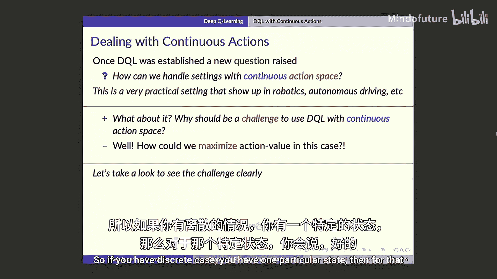

If you have。Drete case， you have one particular state。 Then for that particular state， you would say。

 okay， if I do action 1， I'm gonna get this value， right。If I do action 2。

 I'm gonna get this value and so on。 You can replace everything by a Q network， right。

 You would say all of it is a Q network。 And every single output of this Q network is my action value。

But the problem here is that if it is continuous， I mean， if you want to really do it， you need to。

 for example， if you want to do greeting， you need to greet your actions， right。

And if the space of action is very large， then you need， for example，10000 grids， right。For example。

 right， or even if the actions are much more。 For example， a robot arm has multiple joints， right。

 and each of them is continuance， right， And then how many of that you can get， right， right。

 So say I just greet 1，1 joint with， I don't know 100 grid points， right， If it has 10。Poins only。

 then gonna be 100 to power 10 grid points， right， And then you have a neural network with that much of outputs。

 right， You cannot do it。 Its impossible， right， So this is not really possible to do that。

 You might ask me this question。 You might ask me that。

 why shouldn't we just think about one neural network。 And this neural network really gives us。

 we give it the state in action as input。 and it gives us the value of a state in action， right。

 That sounds feasible。Not this one， but that one sounds visible。 right， What do I mean。

 I mean that I have my tune network to be of this form， right。

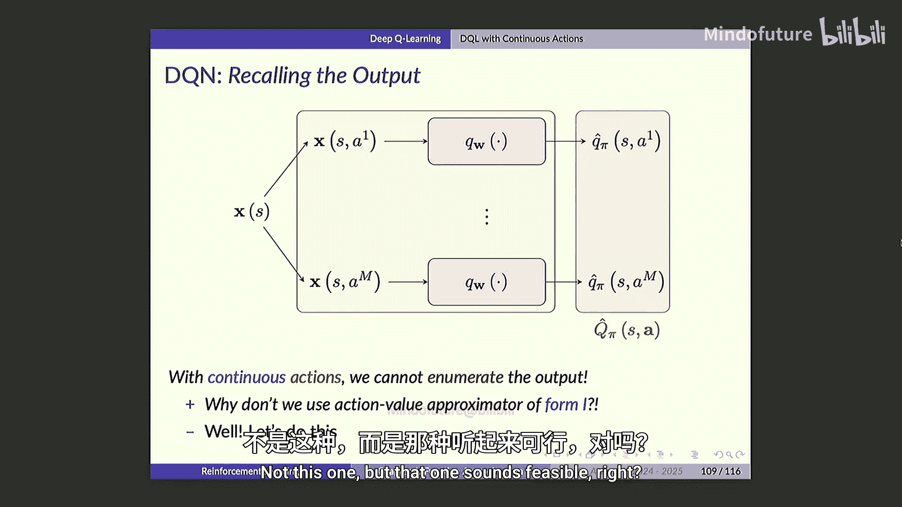

I would say， this is the representation of mine。State in action， right。

 And now tell me what is the value for this state in action， right。

That one is feasible because this has only one output， right， that I can view。

 But the problem then is that how you want to do just maximization here。Because in。

 in deep deep learning， you always need to find out the。Value for the。

 or the maximum value among all actions， right， So this is the。Lookop， when you do Q learning， right。

 And in that one， you always have label here， right。

And this label is looking into the maximum action， right。

But this is not the only place where you are doing the maximization。

 Is there anywhere else that you do maximization。That one is indeed， much more complicated。

Do you see anywhere else in this loop in this algorithm that we are doing。

 We are looking into the action with a maximum value。Yeah， go ahead。Yes， when you want to update。

 right， because you want to find out Epsilon greedy， right， You need to know what is the action。

 which has maximum value Again， you need to maximize it， right。

 So if you compare this one to the continuous one。 It means that I don't think like I have this new。

 right， I just give the representation of my state in action。

 And then I want to just know what is the maximum1。 I need to find the representation of the action。

 which is maximize， right， It's against the same problem in terms of complexity。 You cannot solve it。

 right， I hope that I'm just conveying this message that this is not possible when your state is crazy large or is continuous。

 right。

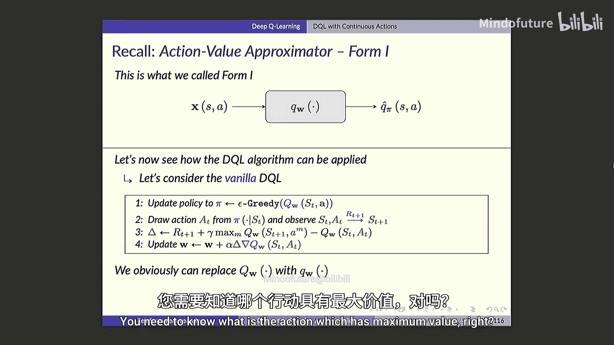

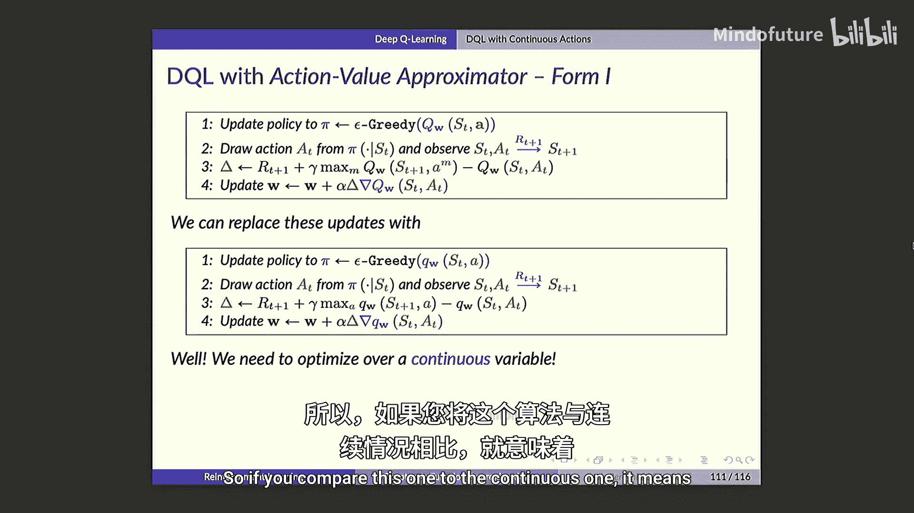

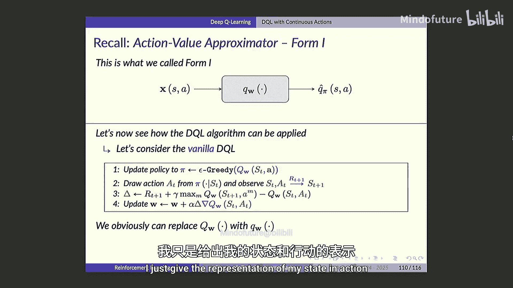

So since this is not possible， the question is that， what should we do。

 Should we just limit or framework to。Disre actionss。And if that， the answer was yes。

 then we should say bye bye today。 and then everything was over。 But this is not really the case。

 And to be honest， this is not like after deep reinforcement learning。

 the idea of policy networking and policy gradient is much older。

 So the base algorithm and reinforced was proposed much earlier， like 1980s。Okay。

 so that idea was simply to handle this issue of continuous action， so。As I said。

 in both update of your policy here in Q learning and also taking the label for both in both of them。

 you need to know the max the action which is maximizing the value。

 And then this is a optimization problem， which is quite complicated， so。

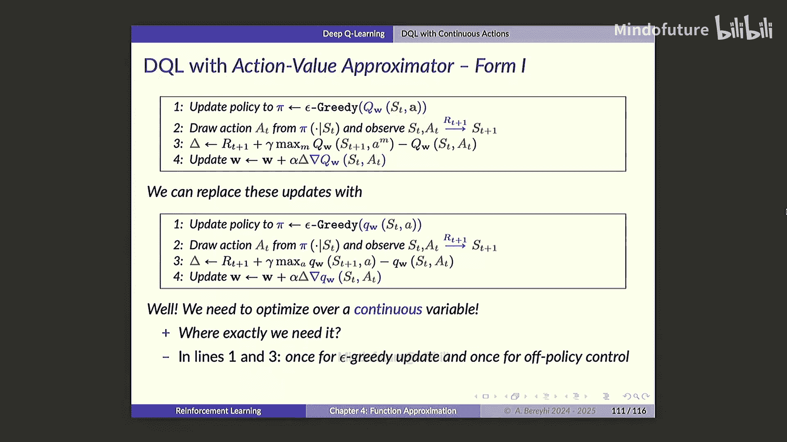

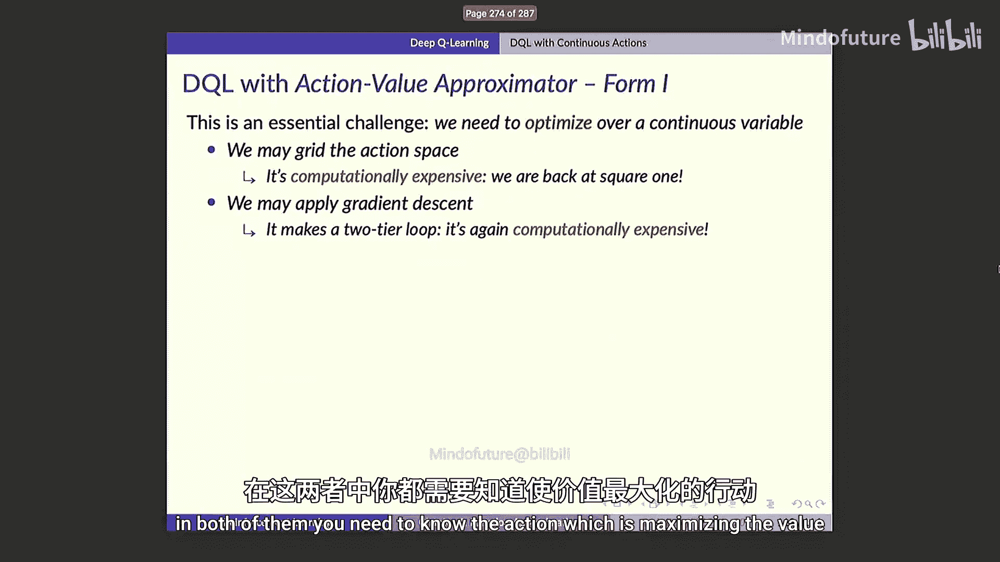

Greeding。Does not work。One might tell me， okay， let me just find out the gradient with respect to the action。

 right， and try to just maximizeim it， maximizing it， maxim it using， well。

 I have written here gradient decentcent， by， I mean， gradient essence， right。

 gradient decent of the name。So just I use the greedy approach。

 like gradient based approach to maximize it。 That one， if you do it naively。

 it's gonna be the same complexity as the first one。If you do it intelligently。

 you're gonna to end up with policy networks。Okay。这。Moreover of a story。

 basic approaches are not going to work， but it does。 It's not impossible， like。You can really do it。

 And the whole idea here is that you think about the problem differently。

 So just to give you a quick idea what its。

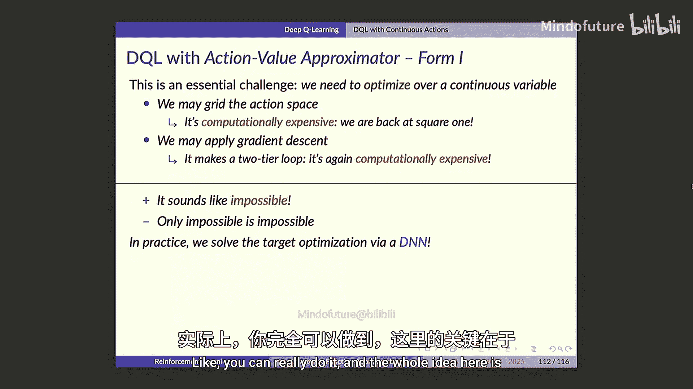

It looks like， and you' gonna explain what we're gonna have in the next chapters。

The main idea here is that， well， I have this network。

 And what does this network do for me If I give it one representation of my state and action， right。

 if I give that one， then that network is going to give me the value。

 the action value for that estate action， right。But the issue is that。

I cannot maximize it over a anymore， right。 Now， if I have this network and it works fine right now。

 say I figure out a way to train this guy， right， and it works fine。 Now。

 the only question is that if I look at one particular state。

 how do I know the action which is maximizing the value， right。

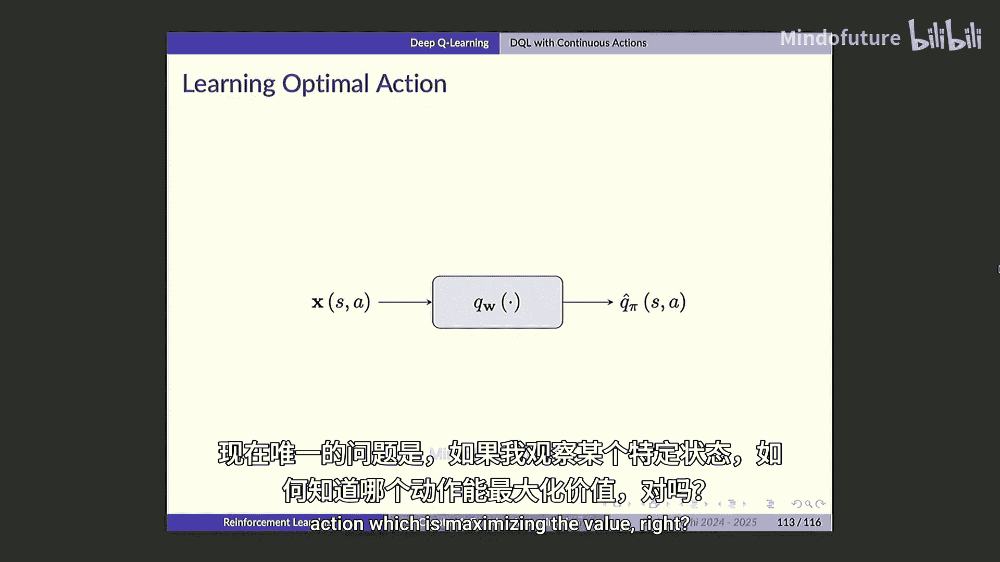

If I do have another network。那问你。没有。Looks at this state only。 It doesn't care about the action。

 right， It just looks at this state where I am right now。 And it's gonna tell me that， well。

 I don't know what is the value。 But I do know to do this action， this particular action A star。

 then you're going to get the maximum value， right， So you gonna give。hich is maximizing my value。

 Then I can get that action。 I do have this state。 I give both of them to this other network。

 and it' going to give me the maximum。Value， right So I am going to get this term this label once again。

 If I do have that extra network， right。Everybodys here。So now， don't ask me how we can do it。

 This is what we're gonna do risk of semester。 But the question is。

My point is that if those networks。Are there。 And given that we are doing deep learning。

 we can always do that。 So if those networks are there can does it work。 Yes， we work。 It works。

 right。Now， look at that top network。 What is that network， Can anyone tell me。

It's a deep neural network。 fine， But in terms of your R。Framework。What components are framework。Yes。

Polic as you said So that is basically a policy， right。But what kind of policy is that？Well， optimal。

 if it's really giving me the optimal one， but。That is a deterministic policy， right。

 It's not a random policy， right。Obvious。So this guy is basically a deterministic policy， right。

 This guy is basically doing determin。 It looks at your estate， and it tells you what is the action。

 which is giving you the maximum value。 If it's right， then it's the deterministic optimal policy。

 If it's not right and it's doing a mistake， it's just a deterministic policy， right。

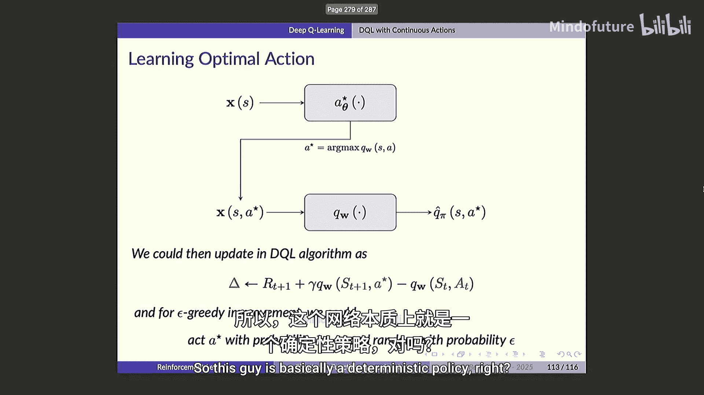

Re clear。 So you have this policy network here。 That is a policy network。 looks at your state。

 gives you the action。 You have a value network here。 is it looks into your state in action。

 and then it gives you the value。 You have the value you can update， right， and you keep on going。

A I premierer。So this is like the most generic form of。Of deep reinforcement learning。

 you have one network， which is。Taking care of the policy， you have another network。

 which is taking care of value， right， And up to this point。

 we only worked with this this value of this Q network， right， We did not use the policy network。

 And if I would， if I told you initially， you would ask me， why should I have a policy network。

 right， If I know the optimal value that's over。 But the point is that in order to find out what is the optimal value。

 right， you need to know the optimal action indeed， right。

 And this is where the policy network is going to help you so。This is the most generic version。

 This is what we call it actor critic approach， right， So you have a policy network。

 This is your agent， basically， right， It looks at this state。 it decides to act once it acts。

 it gives it gives it to a critic， which is the value network。

 That value network is going to tell you what is the value of the action。

You can start interacting with each other till you convert， right。

 And this is the most robust form of deep reinforcement learning。

 So the whole purpose of this course is that at the end， you have understanding of this one。

 And if you have understanding of this one， you can use it in practice。

 if you don't do actual creating most practical scenarios。

 unless you want to just play basic computer games is not working with basic your learning。 Okay， so。

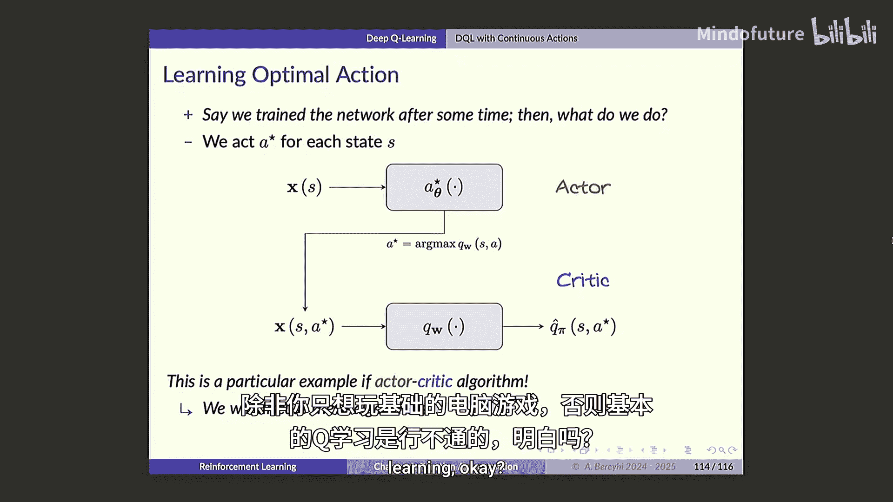

In order to get here， we basically need to first understand what。

 what is a policy net or how we can train a policy network， right。

 And this is what happens in the policy gradient method。 So as I told you。

 this guy is basically a deterministic policy。 you might tell me that， well， why should we。

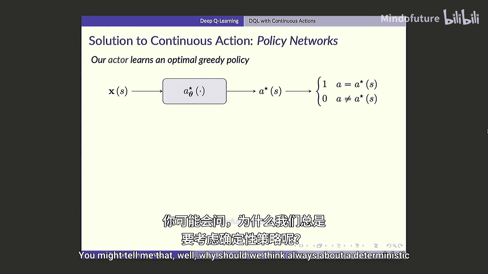

Think always about the deter asset policy， right， We could indeed have a general policy， right。

 and that general policy。Takes action value， for example。 And for or this sorry。

 takes state and action。 the particular state and tells me what is the probability of every single action。

 right， Now this guy， even though you might say that， oh， I need to know A。

 you really don't need to know a anymore。 because you just give x of S to this， right。

 you just give this state to this。 then this is going to get tuned to the corresponding probability。

 you sample from it， you get one action， right， you basically do the same thing at the top one。

 but you do it with a deterministic approach， right So if this guy is， for instance。

 a gatian distribution， which is triggered by your state， you give your estate。

 then is a goian distribution， you just sample from it， right。

 And then this is going to give you one action， correct。Alright cool。 So this is the policy network。

 Now， the thing that we do next is that we learn how we can train this policy network。

 And there when we are training the policy network。

 we assume that we can somehow have access to the value of every peer。 Now。

 you might tell me how can I know it。 Well， you can just do basic table or estimate。

 This is what people used to do in old days。 we can later you're doing the last chapter at your critic。

 meaning that we just get a value network as well， right But before we get there。

 I try to just discuss this one alone。 because that is much easier to understand。

 Like you assume that you have this network， you get this state。 you sample the action。 Now。

 you have a way there is one way to give you the action value， right， you forget about that。

 the only question is that how I can train this guy。Once you understand that one。

 the only piece left is that you replace that value guy with a value effort。

 And that is going to complete the whole puzzle， okay。So that is the whole idea， so。嗯。Now。样。

As I told you before， you might have asked me why we need a policy network， but basically。

 get I guess now it's quite clear for you that policy network could really help。

 And this is what we're going to talk about how we can train a policy network。

 this is basically policy gradient approach and to be honest。

 this is the most complicated part of the reinforcement learning。 But don't worry。

 we have done our mid termm， right，So there is no worries about that。 So this is quite complicated。

 I try my best to break it down as simple as possible。 I do understand at some point it hard。 I mean。

 even for me myself first， it was very hard to follow some details。 but no worries。 I mean。

 once you get the idea and you use it， you gradually start to get feeling about that。

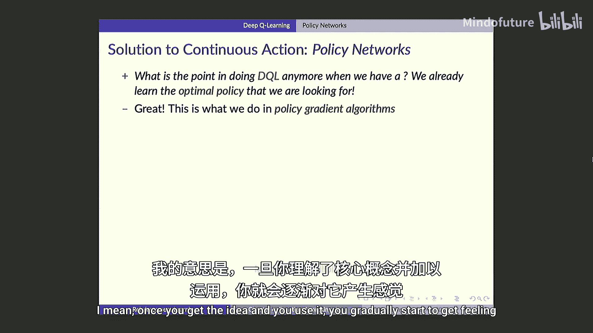

Yeah， so that's the whole plan for the rest of this。 So policy gradient is the next topic。

 which were going to talk about in the next chapter。 And after that。

 we are going to talk about the action critic to just complete the whole puzzle， right。

 then you have the whole the complete network， which is just looking at the data and trying to train to。

 to learn the optimal policy question on that。So my estimate was not that bad。 right。

 That concludes that。对对。

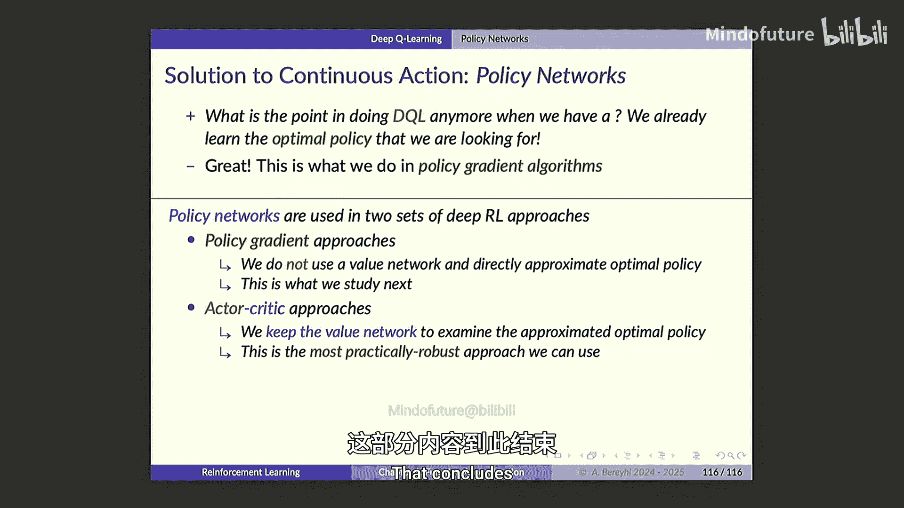

So。