# 【多伦多大学】强化学习 2025 ｜ Uoft   Reinforcement Learning   Fall 2025 p46 P46_讲座_46_通过随机梯度下降训练策略网络 -BV1D3F2zhEry_p46-

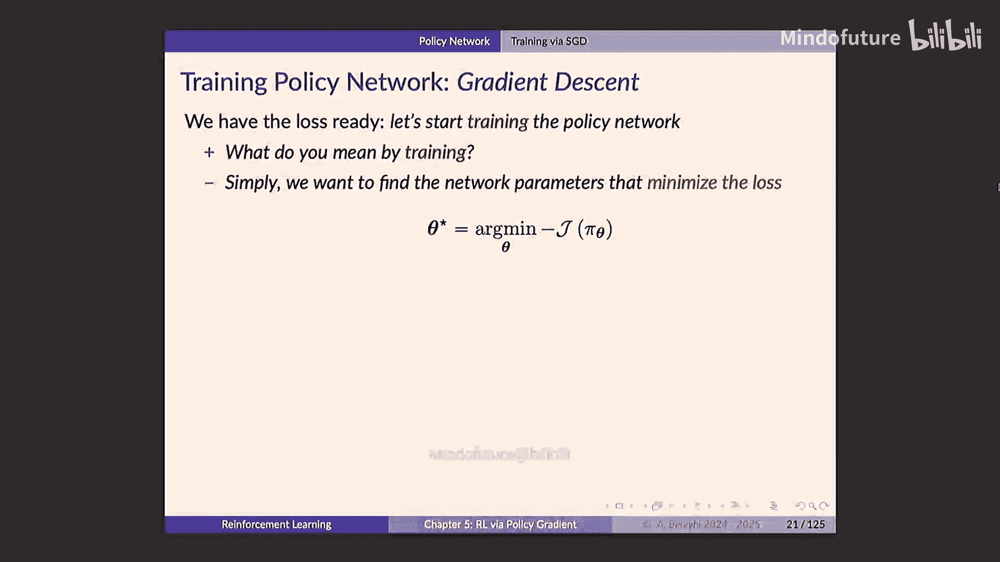

Okay， so now what we want to do next， we do know what is our objective， this J function。

 and what we want to do we want to maximize it or basically want to minimize this negative， right？

Well， if you want to maximize the objective computed in terms of the output of neural network。

 what you do， Well， you have no way but using a gradient based approach， right。

 basically gradient decent。 So what you're gonna do， you're going to start by gradient descent。

 So it means that you start with some theta。 This is the parameter。

 You have you compute the gradient of this objective。

 And then you just move in the opposite direction of the gradient since your objective is already minus that J it's gonna be plus。

 So this is what we call it gradient essence， not decent right。

 you move in the direction of gradient itself， not the negative one， right， Okay。

 so we want to do this。 So the only challenge here is that we need to figure out a way to somehow estimate this gradient out of what we have in practice。

 right， out of the policy network， the environment that we can only sample from and so on， right。

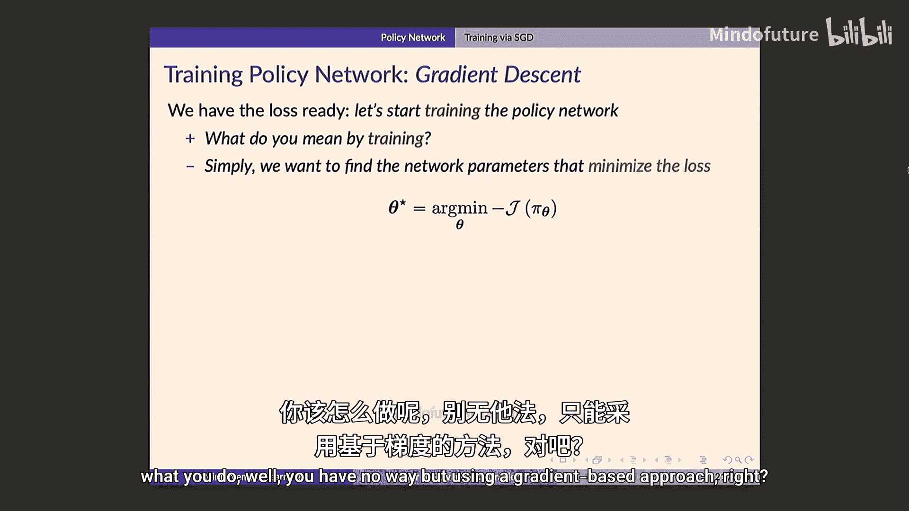

So that is the whole challenge that we have here。 So we want to do the gradient accent。

 and we need to know that gradient， right， Okay， so let's start writing down the gradient。

 So we talked about this。 This J was， let's get back here。 J， this objective function。

 This guy is the expected sample return。

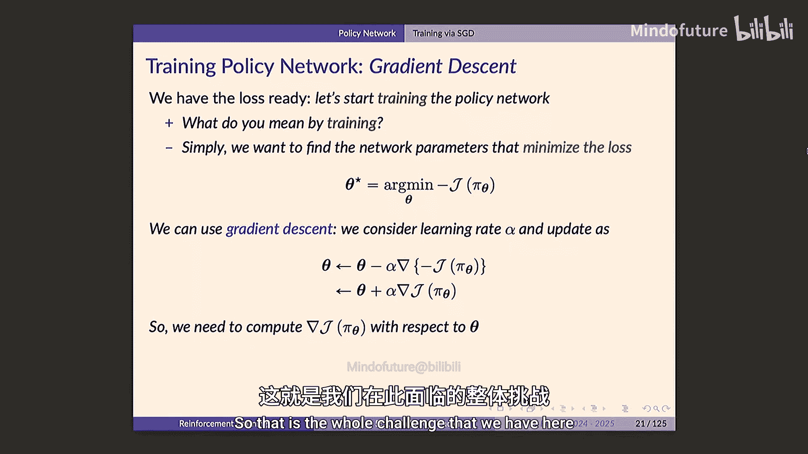

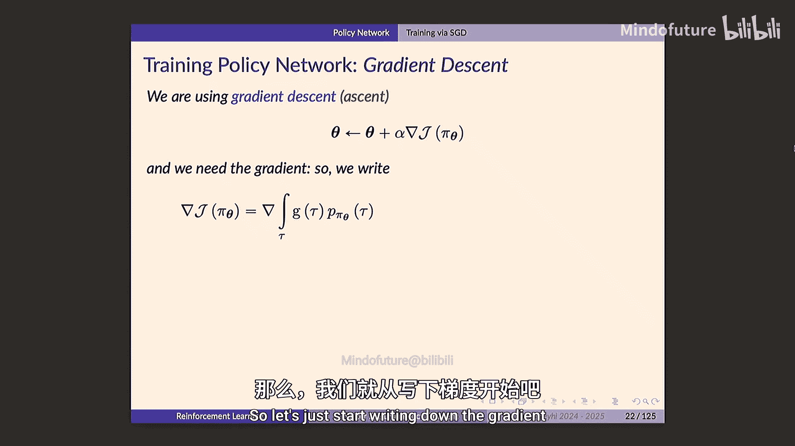

On the distribution of the trajectory， right， And that distribution of trajectory is explicitly given to us in terms of the policy。

 Okay， so we're gonna go on that one。 So we want to take the gradient here。 Now。

 if I want to take the gradient， where does gradient go。

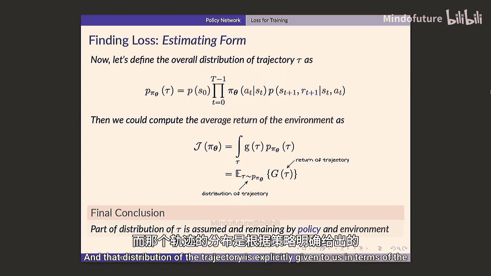

In these terms。The P1， right，' gonna go to the density term， right， because the G term。

 the sample return does not depend on that one explicitly。 So this is going to be my gradient， right。

 Everybody agrees， right， Now， if I want to write that that guy down。

 then this means that I should take the gradient of all of this product， right？

 And it seems a bit complicated， right， But there is actually a very efficient way to do that， right。

 So。We can do it much easier by a simple tree。

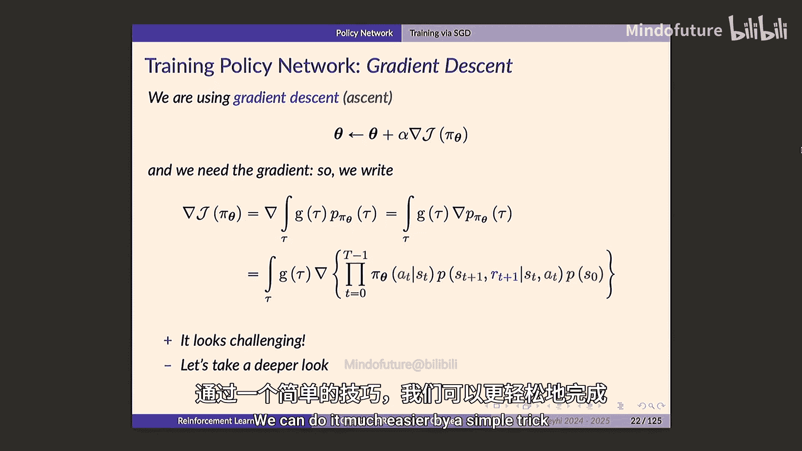

The simple trick is what we call it lot derivative trick。 I mean， it's not a trick really。

 It's just a high school math， so。Just to。If I have this function， F。If I have this function F。

 which is a function of x， Okay， and I want to take the derivative of this guy with derivative of F sorry with with respect to X。

 What can I do， I could say， okay， instead of F， I compute the derivative of log of F， right。

What would it be？What is it derivative of log of F is one over f times the of F， right？

 So it's gonna be one over F itself。Times derivative value of f with respect to x， right。Now。

 I'm going to take this guy。I write it down here， right？

So derivative of F is F itself times the derivative of it。 It's log， right。It's basicsing that。

 right， You can do it in multi dimensionsional case instead of derivative， you just put gradient。

 right， Okay， so that's just the whole derivative trick。

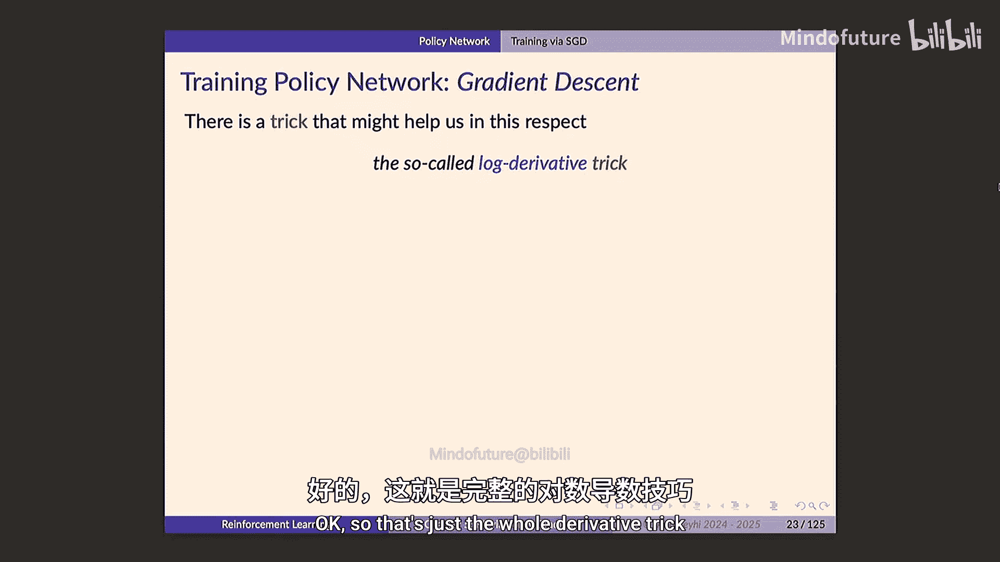

So if you have a function of parameters theta， then the derivative the gradient of the at function is basically the function itself times the gradient of its log。

 right， And you can guess what I'm looking， what I'm looking for log。

 One basic reason is that my F is multiplication of lots of pi terms， right， If I take log。

 then it gonna be a summation。 But this is not the only reason。

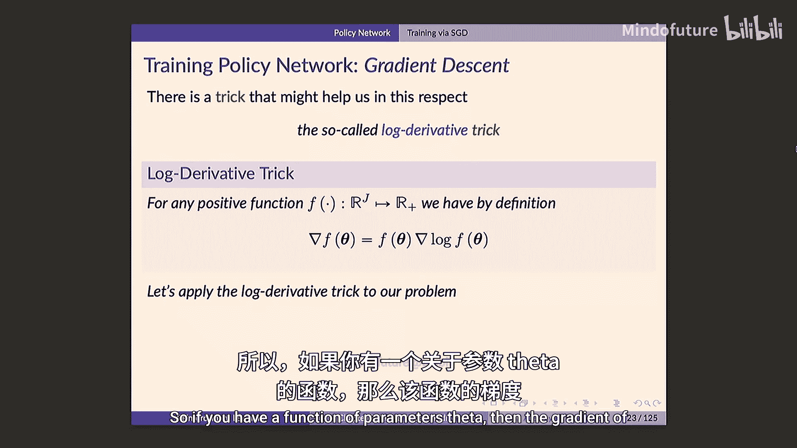

Right。Okay， so I can do that， and then I can take this one and use it inside my expression。

 So I wanted to compute this。

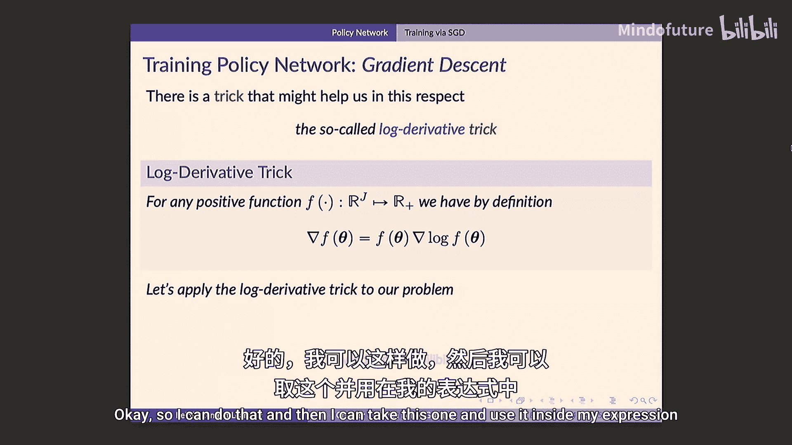

Graadient， right， the gradient of P， the densityity of that trajectory。 Instead of that。

 I'm gonna write it down as the gradient of the trajectory， right， sorry。

 the probability of the trajectory times gradient of Lulugarithm of the trajectory， right。

A high school？And now I can just sort things out， it's going to be this one。

 now you look at the final expression， what is that？Is this any specific operation？

What operation is it。Is they gain expectation over。Trajectory， right， perfect。

So this is expectation with respect to this P of trajectory， right， because you have one term。

 which depends on trajectory times the probability of that trajectory。

 and you are integrating over that， right。So this is basically expectation of your。Sample。

 so is G and the sample return times。Gradient of the logarith of that pi term right。

 expected over the trajectory now。It's true that computing this integral is complicated。

 But what about this expectation， Can I have any computational way to compute that expectation？

 And for now， say that I do know what is log of P。I， I do know what is that gradient。 Can I do it。

Let's go ahead。Perfect， right， you just sample lots of trajectories， right。

 You're expecting taking expectation over trajectory， right。

 And the only thing that you need to do is you just sample with the same distribution。

 This is not a hard thing， right， You just sample with one and start distribution for your state。

 And then you play with your policy。 Then you're gonna get one trajectory， right。

 That trajectory is coming from that distribution， right， This is one sample。

 So this is one of those G and that you want， right， You just sample lots of them。

 You average them by Monte Carlo。 This is estimate of this expectation， right。Okay。

 so we are getting to the point where we can estimate things， right。

 So this is the expectation that we want to compute that one。 I mean， this integral in general。

 if we think of a general case for， like giant massive。tree。

 This is really hard to compute computationally impossible。 What this one， we can estimate it。

 We have a way to estimate it， right， Okay， that's it。 Now the key point here is that you might say。

 okay， that sounds nice。 But what about this log of pi， right？ This guy is also。😊，Problematic here。

 because it depends also on this P value， which depends on our environment transition function。

 right， that that P of pi theta depends on your transition in the environment as well。

 So let's open that guy up as well。 So what I want to do， I have this guy， right。

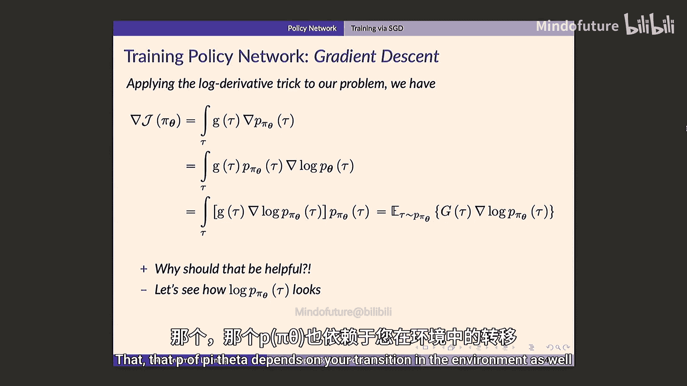

This term that I have here is basically the term we collected as the density of the trajectory。

 The chance of you start you start with S 0， then。Pi， the policy that you play action A1， right。

 and then the transition。Then again pi， again， transition and so on towards the end。 right。

 So this is a term that you have。 If I just apply a log on this guy。 what's gonna happen。

Log is like the magic wand， right， It's gonna just break everything into summination， right。

 So I'm gonna have log of P0 summation of log of all of those pis， right。

 and summation of log of all of those。😊，P transitions， right？Everybody cool？Now。

 this guy depends on theta， the middle term， right， The psi terms， they do not depend on theta。

 correct。If I take the gradient with respect to theta， what's going to happen？

These guys going to be zero， right？

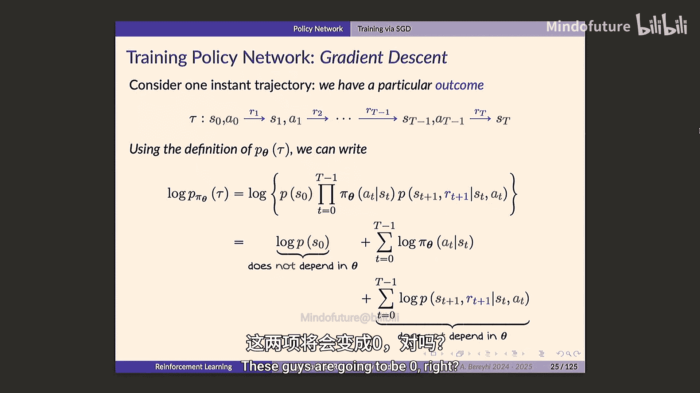

And this is basically what I need， right？ I need the gradient with respect to my parameters。

 I do not need the log itself， right， So what I'm going do， I'm going take the logarithum here。

 This guy is going to be 0。 This guy is going to be 0。 This is the only guy that is going to show up。

 right。

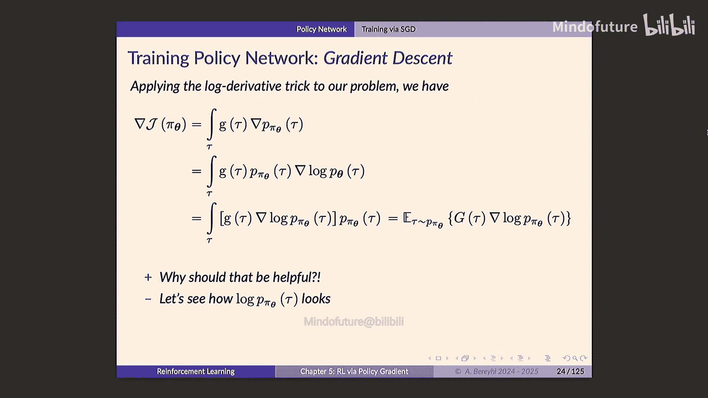

Can I compute this one？What is pie？My policy network， right， I have access to this right。

 I can compute those values， right， Pii theta is my neural network。 right， I cant work with that。

So I can compute that。 I didn't know these terms。 I don't care anymore because they are not showing up in the gradient right So the thing that is going to happen。

 the gradient of my log provolty of the or log likelihood of the trajectory is basically going to be sum of all of these gradients。

 log of the policy over the whole trajectory right So you need to go over your trajectory。

 you say okay I started at s0 and I did action a0 right then you put s0 and a0 in the input of your neural network right it's going go and compute your pi right once computed your pi。

 you just back propagate I mean， first you compute log of course。

 and then you back propagate then you're gonna get the first term right then you just put S1 a1 again you go over the neural network you get the output。

 you take log back propagate second gradient right。

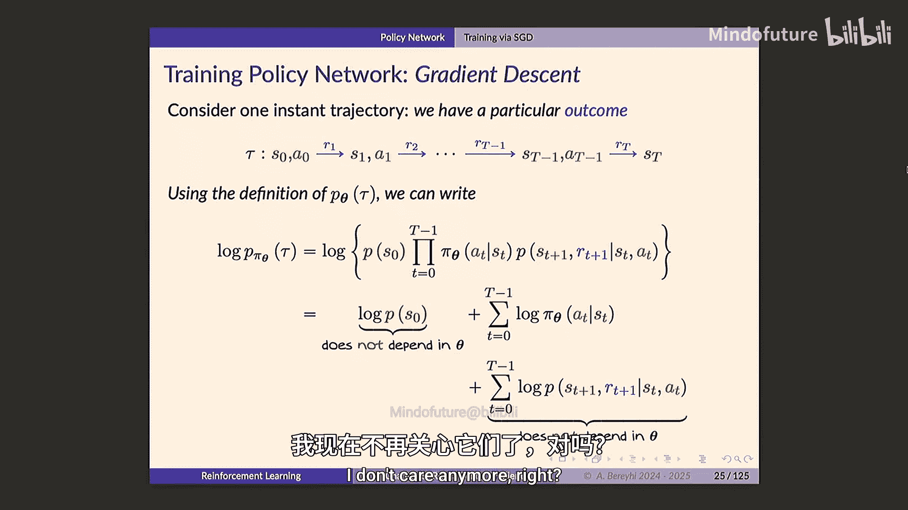

So until the last one， right， So this one， you can definitely do with computationally， right。

And then if you just complete the loop。Then I mean， the whole gradient term that you want。

 you can actually compute it。 So now don't think about one particular trajectory。

 sayy I have a random trajectory。 So I randomly sampled one initial state and play with my policy。

 Then I'm gonna have this gradient term， which is again random。

 And the reason of randomness is simply because of the actions in state that I have randomly， right。

 So this is my random gradient term， and then I replace it here， right。

 So this guy is the sample return。 This is the sample sample look likelihood or gradient of the look likelihood of the trajectory。

 and I can compute both of them， right。

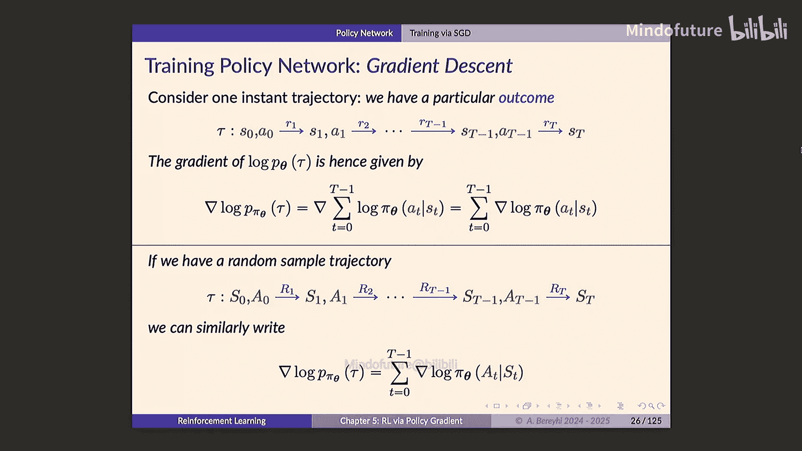

Everybody's clear。Now， this guy is no computationally feasible because the terms here inside。

 I can do it by back propagation。 and then this expectation， I can simply approximate it。

 estimate it by sampling， right， So this means that I have a way to estimate the gradient of my objective。

 Now I have the gradient of my objective。 I keep on moving in that direction， right。

 and my policy network is going to get trained to optimize or maximize the expected value。

 hopefully is going to get to the optimal policy。

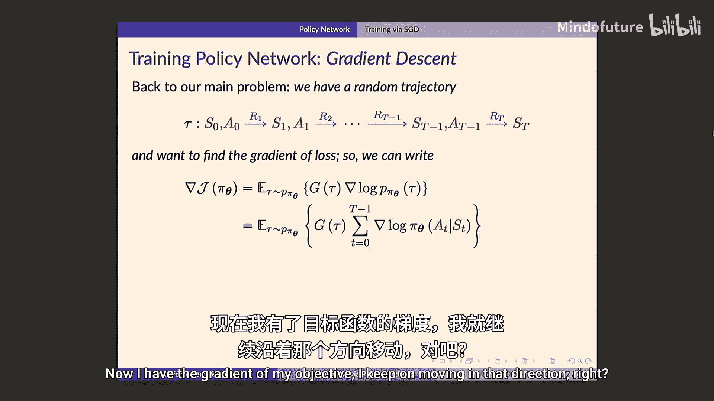

Everybody's familiar here？You got the idea。So that's it。

 So this sample return is what I am going to sample over my trajectory。

 This guy is again given my by my policy network on the trajectory。

 and I just need to sample multiple trajectories using use Monte Carlo to average that right And this is going to be the policy gradient approach。

 right So。

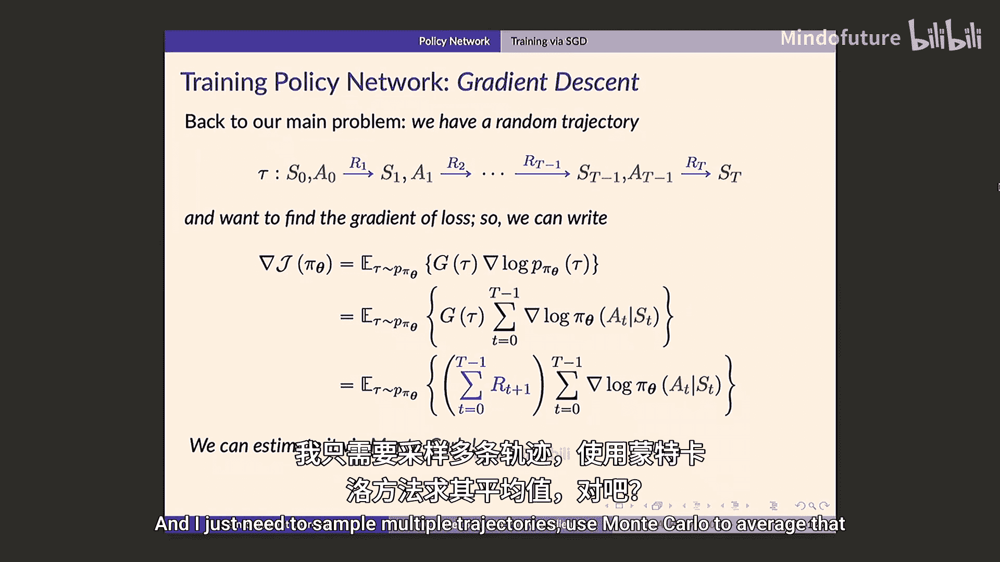

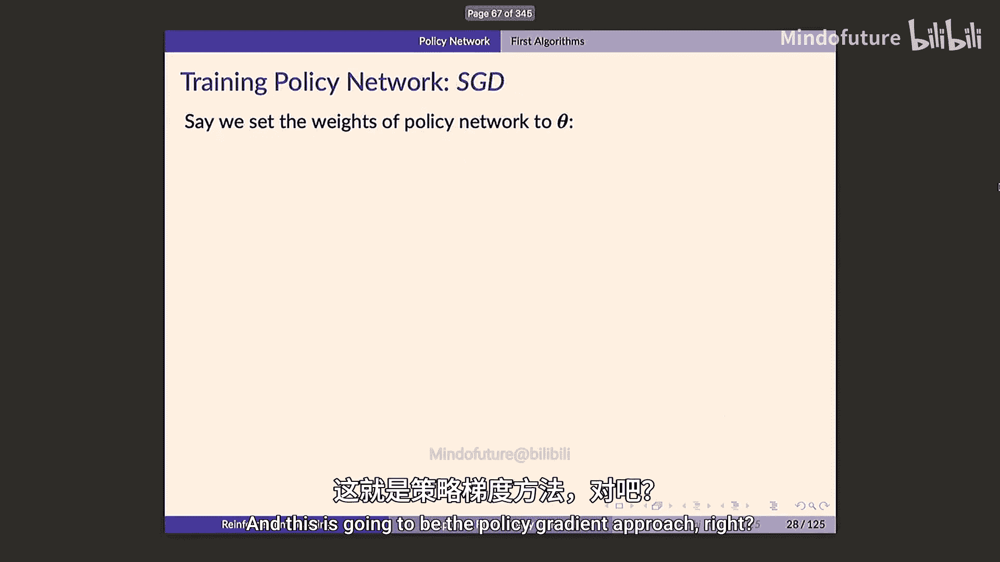

If I have this particular trajectory， then I can just sample k different samples from it。

 And then for every single sample， I do have the sample return， right。

 What is sample return on the trajectory， I simply add up every guy here， right。

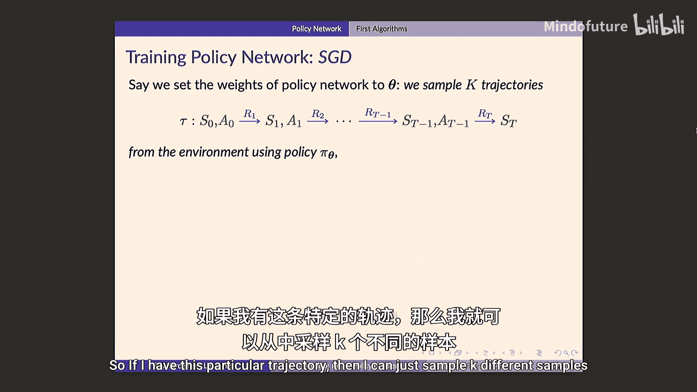

That is a sample return， right， I have this one。 and then I just， as I told you。

 I give s 0 and a0 to my policy network。 I do back propagation。 I get the first gradient， right。

 S1 A1 back propagation second gradient。 And so on until the last guy。

 So I'm gonna have all of these TD frame gradients， right， and I add them up right。

 now I have this sample gradient， I have the sample return， I multiply them， and this is one sample。

 right， And if I have kd frame samples that I'm gonna average over those different K samples。

 this is an estimate of the gradient that I want。

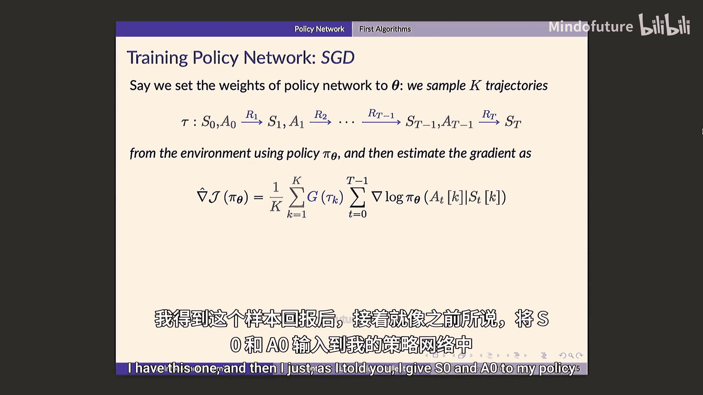

Now I update my parameters with these sample or gradient estimator right。

 so I'm going to say that whatever the guy was， I just added up with some learning rate towards that direction and I keep on updating。

 right。

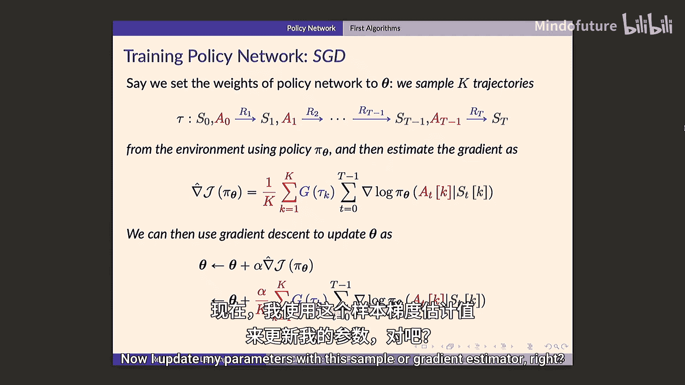

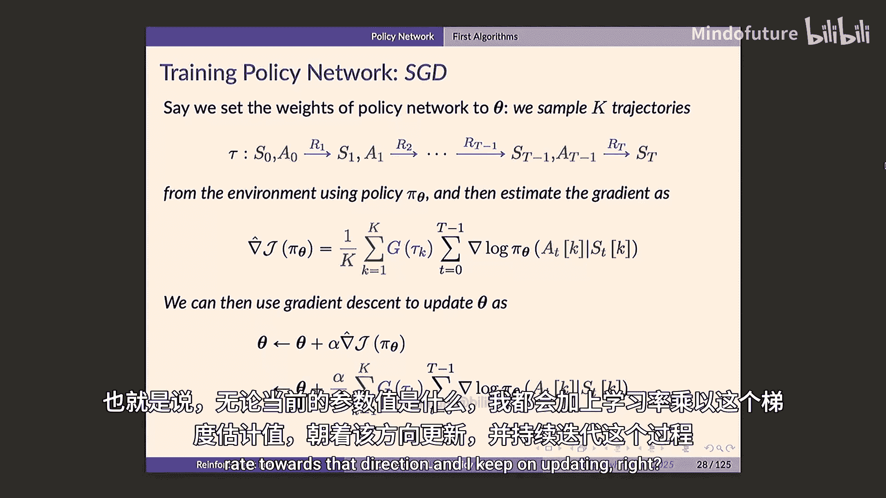

Everybody's cool。So。That is basically the most。Say naive or simple version of the policy gradient that you can do right So here。

 as you see， basically in this particular case where we are using Monte Carlo。

 you don't really need to know the value network at all， right。

 You just work with your policy network， correct， You have a policy network。

 you sample from that policy network。 you build trajectories。

 you get Monte Carlo estimators of those trajectories， those G， right and using that。

 you just update your policy network。 You keep on doing it。 If you do it forever。

 then eventually this guy is going to converge to the optimal policy。

 If your network is complex enough to be able to learn the optimal policy。Questions。No question。No。

 because what average you be this average？😡，This effort， no。

 I don't do that because when I am sampling， that is going to happen by itself， right？

When you are using Monte Carlo， if you have a random variable， for example。

 a binary a random variable， right？And and say one happens with probability 80%，0 happens with 20%。

 right， You would not wait anything when you want to do Monte Carlo， right， You just sample。

 but if you sample 100 times 80 times you just see1，20 times you just see 0， right？

 And then you add up add all of them up， it's gonna to be 80 divided by 100 is 0。8 right。

This is the same thing happening， right， This tao Tau K that I show here， right。

 This guy is happening more for the trajectories， which are more likely is happening less for trajectories that are less likely。

 right， So you have only two possible trajectories， right。

If one of them is happening with probability 80%， then this means that when you sample 100 trajectories。

80 times you're gonna see the first trajectory 20 times you see the second trajectory， right。

 So you don't need to weight anything， right， You just sample enough and then you average that。

 then law of large number tells you that this is going to be your expectation， right。It's clear。Oh。

 again， you can guess that we really need a high number of samples， right。

 because we have giant trajectory space， right， It's not only state space， action states， right。

 space。诶。The whole trajectory， right， It's giant， but then we're going to get into ways that。

Handle that issue。 right， by the end of the day， you cannot rely， right。

 You just randomly sample something， Use those samples to just update。 You hope that。

The model is complex enough， and the environment isn is like simple enough that they're gonna match at some point。

 right， It's exactly like deep learning， right。Because your， for example， image space is giant。

 right， You never have enough number of data to really approximate the distribution of that that stage。

 right， that sorry， image space， right， you never， you can never， even for amnis。

 we can never find out the right histogram， right， because it's giant， right， but for。

Goal of classification。 You cant collect enough information from those few samples that you do the right classification。

 right， So here is the same thing。 I mean， definitely。

 we are not able to explain the whole trajectory space that is beyond or ability。

But maybe finding out the optimal policy is not that complicated。

 So it does not need the whole information， right， And you can think about that， right。

 Like if I want to get to the door， right， like this space is giant， two dimensional space， right。

 number of state that I have is infinite， right， But finding out the optimal policy to get to the door is not a very complicated thing。

 right， Every time I just take the shortest distance， right。That's it。Questions。No question。Okay， so。

Obviously， this guy is Monte Carlo。 Monte Carlo is not sample efficient。

 It means that if I want to do this， I need to wait 4 k different trajectory samples。 And after that。

 I should update， this is something that we do not like。 What do we do， We do not do anything。

 We basically just update after every single sample， right， This is what we do， because。

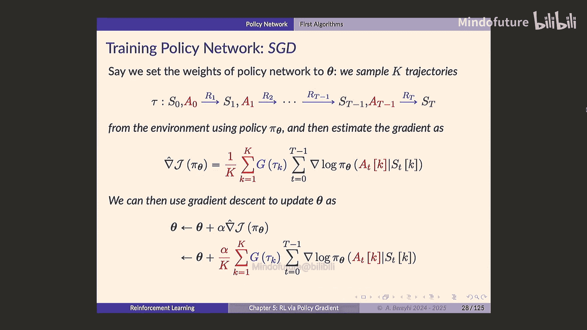

That's it。 right， We can do nothing about that。 So we basically use。

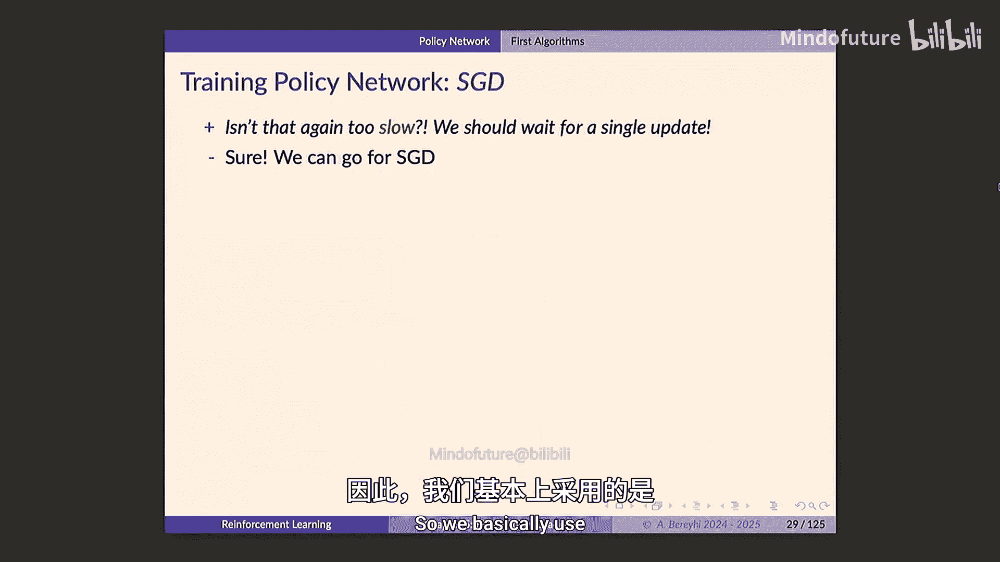

Sttochastic gradient decent and how we can do it basically just we sample one single trajectory。

 we compute this guy right， and then we update with that single sample right。

 So you update sample level right And the main reason is that well。

 sampling is complicated enough that you cannot wait for multiple samples， right。

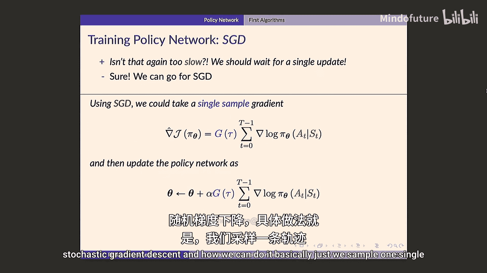

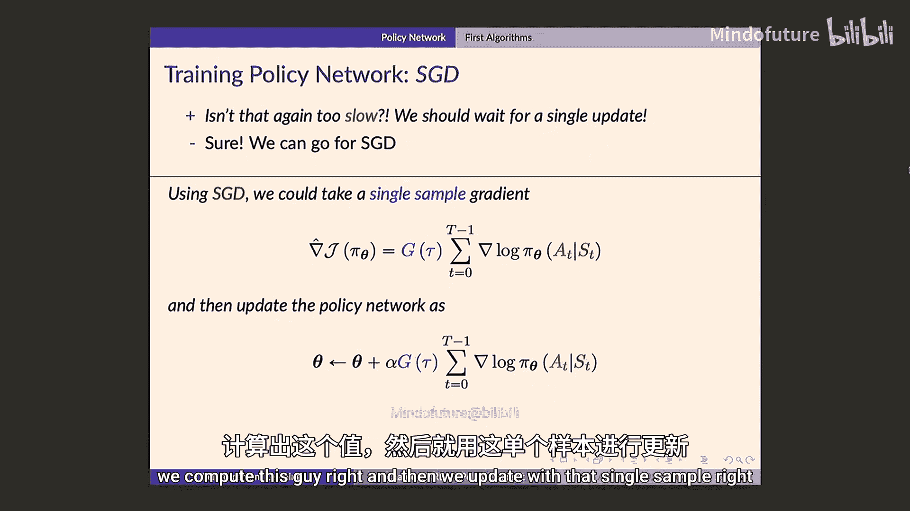

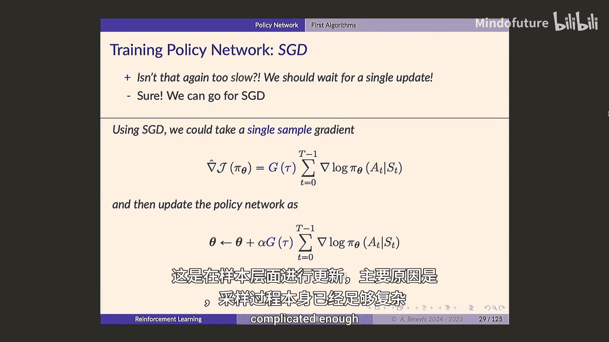

So。That's going to be the policy gradient， version1。

 the most simple policy gradient that you can think of if you want to just train one policy network on your environment without using anything else。

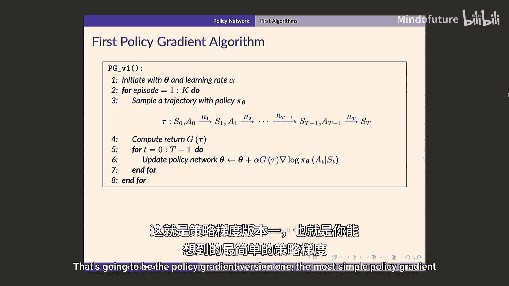

So what you're gonna do， you're gonna start with one sample， right， you just sample one trajectory。

 Once you have the trajectory， this guy is containing enough information that you can compute or estimate some gradient。

 right？ So you're gonna compute the gradient of logarithm of pi here， right。

You're gonna compute this guy。 This G is simply the sum of all of the returns you get。

 If you have a discount factor。 Of course， you just include the discount factor as well。

 It's just a sample return。 And then you update with the sample。 You go on for the next time。 right。

 Sorry， next sample trajectory and so on。 each time you update your theta。

 and hopefully it's going to。Converge， okay。Now。This guy， does it sound like something new？

It's actually not new。 Okay， so this is。Moified version of what we know it as reinforce algorithm with this guy。

 Williams， do you know Ronald Williams？You don't know when。What？😮，Ronald Williams。

 you should know him， just check his name， okay？Just check who he is， right。

 he has done lots of contributions。This is reinforced algorithm basically。

 and was established in 1992。

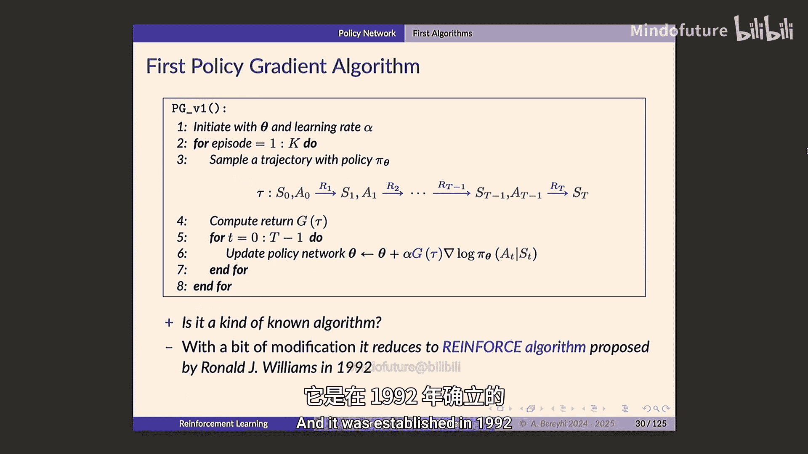

So it's not exactly the reinforce algorithm， the reinforced algorithm is this guy。

And can you detect this is like this test in the magazine， Can you check the difference。

 how many differences you can find？

Now， okay， just look at it here and then compare it to this one。

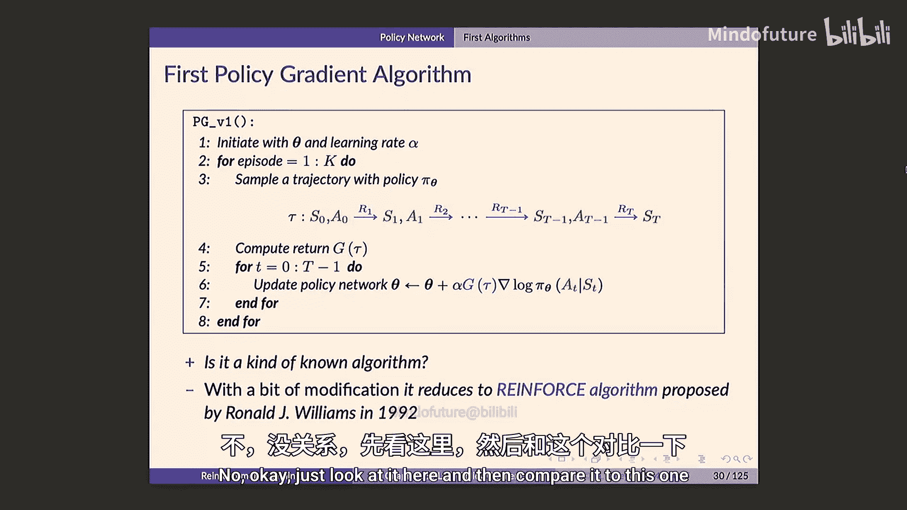

I mean， one line is just dropping， right， Just tell me what is the difference now。It's G， right。

 the sample return。Here I'm just writing GT。😡。

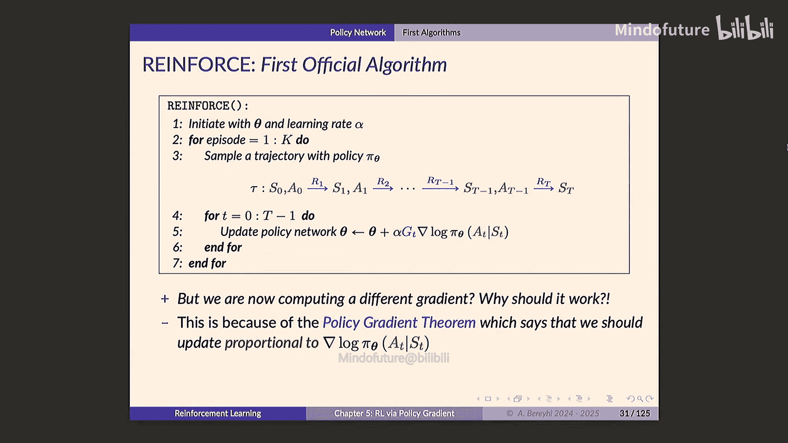

Here I'm just writing the whole。Return off the trajectory， right？Why do I have it here。

 Because in our analysis， we always work with a complete trajectory， right。

 that was what came out of our analysis， right。

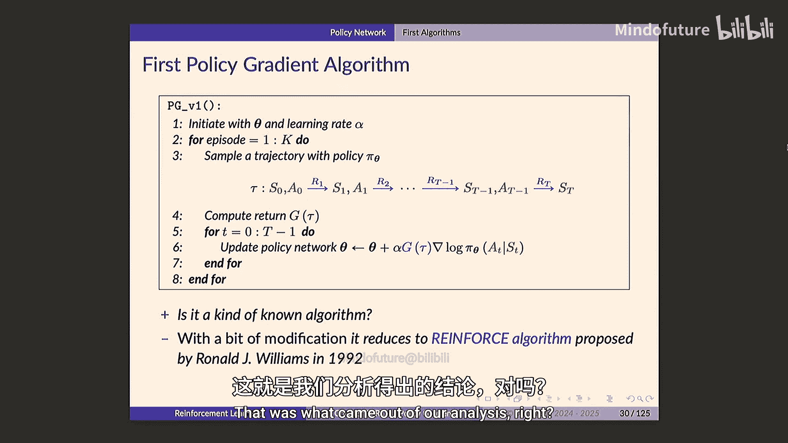

But then if you implement it with this one， this means that at every single time。

 you don't use the complete one。 You just use the sample trajectory of that time。

Like when you get a time 1， you do not add up R1 anymore， you just start from R2 going on。😡，Okay。

 that is the only difference。 If you do this one as well。

 this is going to work and actually it's going to converge a bit better。This was what William showed。

And you might say why this is happening。Well， the key point here is what we call it the policy gradient theorem and the policy gradient theorem says that that G you see there。

Even if you replace it with a lot of other things， it's not going to really impact too much。

 The thing that is very important there is that you need to have the gradient of logarithm of your policy。

Or grade end of to look like it。啊。This is。Radient policy theor， so it says that。Whatever you want。

 whenever you want to update your policy network， whatever you use， right。

 Whatever algorithm you use， how complicated you do with， iss not important。

 The thing that should show up here， which is going to update your parameter。

 should be proportional to the gradient the lot likelihood。

And this is one thing that I want to just show next。

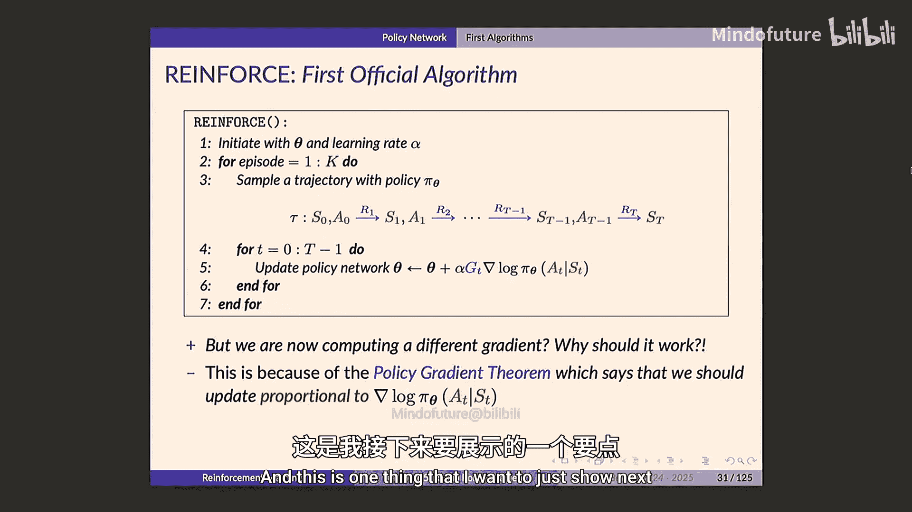