# 【多伦多大学】强化学习 2025 ｜ Uoft   Reinforcement Learning   Fall 2025 p47 P47_讲座_45_策略网络及其学习目标 -BV1D3F2zhEry_p47-

Basically want to get the idea of policy network， how we can train it。

 and we learn basically this policy gradient theoryorem。

 which let us work directly with a policy network。 So one thing before we start with this chapter is that in this chapter。

 I always assume when wherever I need， that I have a way to access the value。

 So it means that if I have one particular state in action， I can get the Q value。

 either perfectly or an estimate of it。 Now， how can I estimate how can I estimate it， of course。

 you do know that we are going to do it with another network at the end， right， But for now。

 we do not deal with that network， we assume that that guy is given to us。

 And this is why I'm just focusing on policy gradient。Once we learn how we can do policy gradient。

 then the last thing is that we need to replace that estimator right and that is going to be another network。

 which is a value network。 you have a policy network， a value network， which gives you the value。

 and then this is actor critic right So you have the actor， which is the policy network。

 you have the critic， which is the value network。 So we're gonna talk about that later。

 but my experience is that when we think simply about the policy gradient because you can do policy gradient without using a value network as well。

 which is oldfed， but still you can do it， once we understand that I want that going to make understanding of actor critic much easier。

 So let's start with this one。 So what we have， we have a policy network。

 So what is a policy network， It's gonna look into a representation of the state and action。

 So that X is the fi representation for your state action。

 Now it's not anymore more like the value network where you just represent。

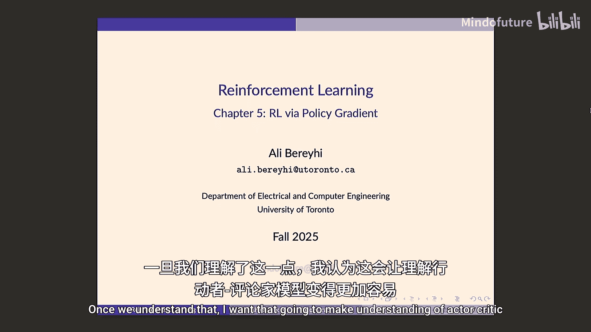

Instead you represent both state and action with one vector。

 And that guy is going inside the network。 The network gonna to give us the policy。

 What is the probability or what is of every single action that you can do。

 given the state that you are in right So this is what we call it a policy network right。

 And now if you want to work with a policy network。

 We can work with them using policy gradient approaches。 This is what we do in this chapter。

 This means that we're solely working with policy network。 we don't have any value network， right。

 So we just try to train this guy to behave like the optimal policy。

 we want to find out a way to do that。 This is the basic policy gradient approach。

 we can do a critic， as I told you。 So you can get this policy network。

 And then when you want to train it， were gonna see that we need estimates of value sometimes and you can use another network。

 a value。Network， which looks into the state and gives you the value of that state。

 right And in that case， you are just doing a critic。

 This is the most practical version of deep reinforcement learning。

 We are going to talk about it in the next chapter。

 And the next chapter is going to be rather short because the whole complication comes from the policy gradient part。

 I mean， once you know this completing the the whole diagram or puzzle is not a very complicated thing。

 So this policy network is mainly using these two different kinds of approaches。 And in this part。

 we are basically focused on policy gradient approach。 So a policy network basically， as I say。

 is a neural network taking one representation for your state in action and gives you probability。

 right Now this guy cannot be any network Can you see it right。

 So not any neural network you put here is a policy network right， obviously， because if that guy。

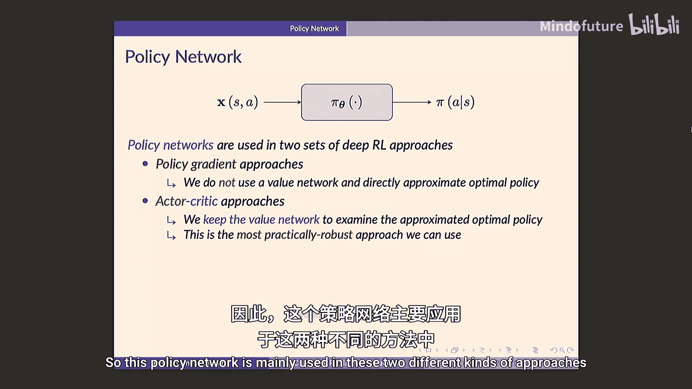

Is a policy network， what kind of property the output should have？It should be positive， right。

 It cannot be negative， right？ I cannot put any linear model， right。

 because I'm talking about proities， right， This is one thing。

 The second thing is that when I look at the output and I add things up over the actions。

 then it should add up to one， right， It's a distribution， right， So not any network can sit here。

 of course， I mean， you need a bunch。One specific network， which is representing a distribution。

 right， So now those of you who have some experience with generative models。

 you already know that there are lots of models like this， right。

 So there are lots of models which you can theyre parameterized and then they simply represent a data distribution right。

 and all of them are okay。Okay， but if you want to just build some intuition。嗯。

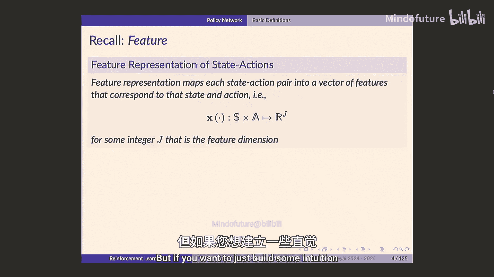

I'm going to give you a couple of examples So how you can build this， right？

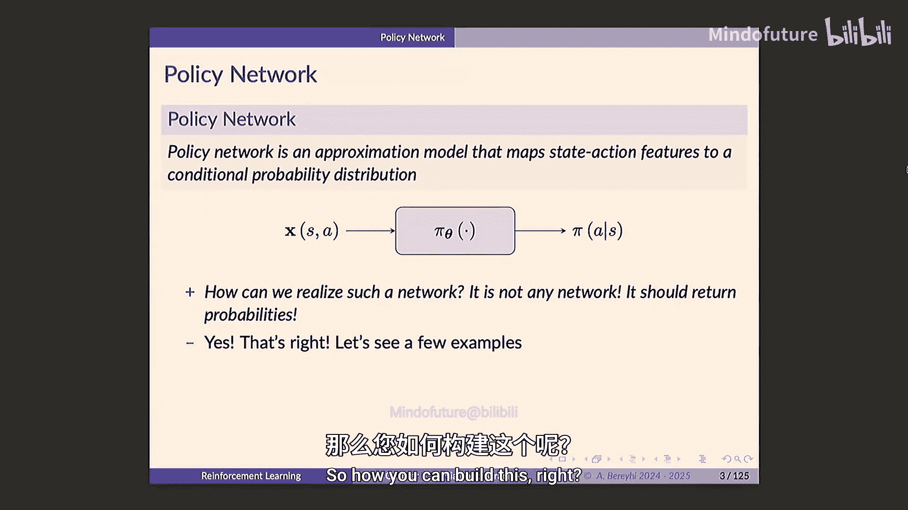

Okay so that is the policy network。 So yeah， this is just a recap what we mean by this state action representation。

 So we talked about this before if you're in one particular state and one particular action then you can take these two and just represent them with a feature vector right now again。

 in the case of this great number of action or space of actions， state of space。

 that is quite easy to think about that because you can always represent everything with one hot as we do it in the Tar case。

 but if we have a more complicated setting then here this guy could be like if we have a continuous setting then this representation could really save complexity for us。

So。Now， one thing that I want to just indicate here from Ne on， I assume that this state or action。

 I mean， up to this point， we always felt that the actions are discrete， right， But from now on。

 were assuming that state or action， both of them could be continuous。

 So this means that this a variable， which is representing the action， this a space。

 could be essentially， for example， real axis。 It could be。

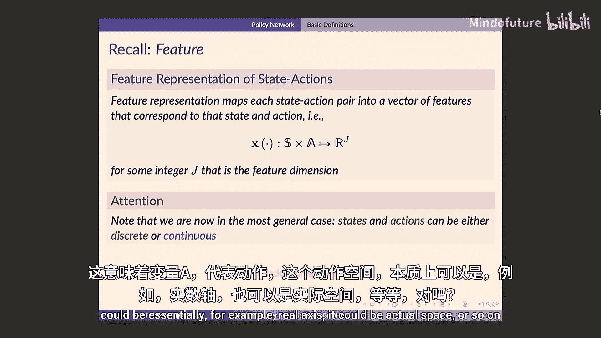

Show space or so on。 Okay now。One example， for instance。

 for the representation of the state in action， this is one example that we're going to talk about later。

 so say I have this environment， so this is this space like a two dimensional space。

The green guy is a particle， and this is moving， right And this guy could just move in any direction。

 Now how you can represent that or how you can say。

 explain the state in action at every single point for this particle。

 you can have such a representation， right you could say that the particle is located at the point X Y。

 and it can just move in the particle direction a right。

 And this a could be the angle that is just moving towards right， if you have more information。

 for example， you do know what is the velocity in that direction， you can write that down as well。

 if it's accelerating， you can include it as well。 So all of those things you can add it up here。

 right， And then this is going to be the representation of this state means meaning the place that the particle is located and the action。

 the direction that is just deciding to go right Now your actions。😊，Space could be disc。

 It means that， for instance， you have only three possible angles to move in every single point。

 right。Every single point that the particle is located， it could either go straight up。

 it could just go right or left， right？For example， this is one case， right？

 So the state of the actions are discrete but the state of or the space of state is continuous。

 right， it could be that your you know， direction is also continuous。

 So you can move in any angle right， And in this case， the state of your actions is also continuous。

 right， Now， when we talk about pi， the policy network or the policy here。

 here this guy is a provoling mass function， right， it's going tell you。

 given that you're in the location X and y， what is the chance that you go up。

 what is the chance that you go right， what is the chance that you go left。

 And if you add up these three chances is going to add up to one， right。

 This is the case when your state is discrete， right But when you have a continuous angle。

 like you can move in any direction from0 to two pi right if。Can。Do that。

 Then the distribution here is not anymore a mass function， right？ Obviously。

 it's a density function， right， It could be， for instance。

 truncated Gasian distribution between 0 and two pi， right。For instance， right。

 so it could be any distribution that is density。 you don't care， right。

 The key point is that you have a density which explaining the chance or the likelihood or the density of your actions in every single direction。

 right。

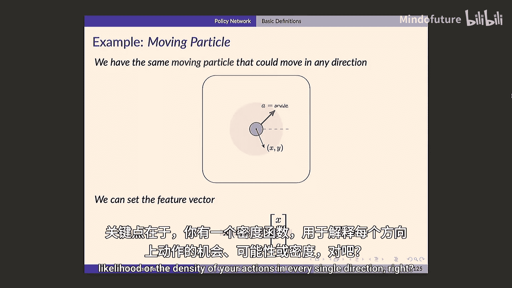

That's about the representation。 One thing that I'm gonna do from no on in the slides。

 because it's gonna make life much easier for us is that I'm gonna to use this notation。

 So the notation is something looking like integral， but I simply mean marginalization。

 So I write it down marginalization over a of whatever is under that operator。 So F A。

 and what do I mean by that。 I mean that if a is discrete grid。

 then I simply add up everything inside F， right。But if a is continuous。

 then I integrate over that space， okay？Everybody's cool， right。

 So this notation here is going to make life much easier for us because first of all。

 we get rid of the differential term that's that's gonna just simplify the notation。 And also。

 we do not need to just always indicate how does it look like when we are continuous or disc。Okay。

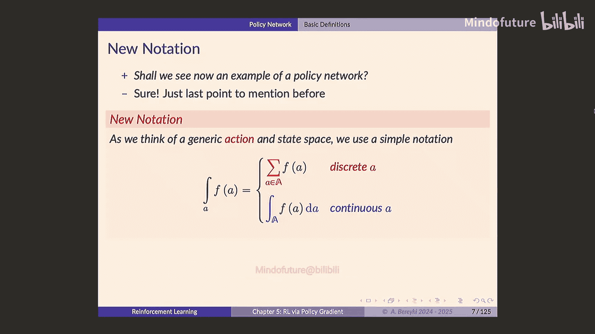

Cool， so now regarding the network。 So shall we have any network for policy。

As as we discuss right now， we cannot have any network， right， For instance。

 if I just put the policy network in this form， this is。

 if we assume we think of the example we already had， this is not necessarily a policy network。

 right， Because， I mean， if you think of a general theta， three dimensional theta。

 Every single of them is getting multiply with a corresponding entry inside your representation。

 that number could very well be negative， right So how can I convert this guy into a probabilityvol distribution。

I think this slide says soft next， right， I can always do soft next， right。

 especially if my action space is。😊。

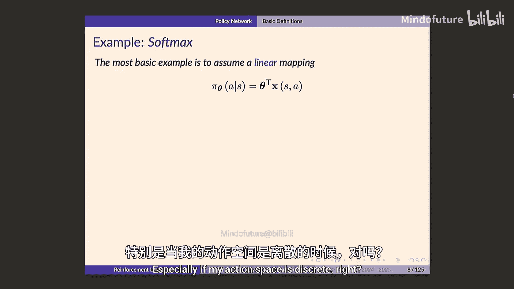

This great， right， So I can simply use softmax because I want this policy network to add up to one。

 so I cannot simply put that linear one。 If I want this to happen。

 then I need to really restrict the choices of theta， which is not a very good idea。

 I mean gonna make the problem super complicated。 instead of that。

 we easily just convert this linear form this linear transform into a provolted distribution using softmax。

 right， So I can just write down the output。 So the pi theta is looking like this。

 So this is softmax of that operation， right， Oh yeah， this is just a weird notation。

 I don't know why I initially try to use it， but trust me， I'm not going use it anymore。

 So it's just for this slide。 So I'm gonna get my linear model here， right。

 And then I just take it to the exponent， divide it by the marginalization。 then this is definitely。

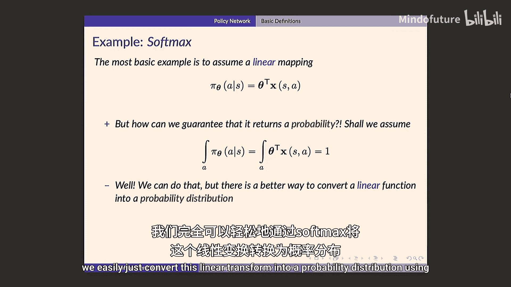

And if I add it up over all the actions， it's going to add up to one， right？

So this is one possibility， right， especially if your actions space is discrete。

 This means that you have a neural network in the very last layer， you just activated it by a softm。

 right， And then youre gonna give you as number of actions as you have different proities， right。

 And then you treat it as your policy， right， everybody school。Okay。

 so this is one way that you can do it。 So you can put your pi your policy network to be the softmax operator。

 That's easy。 And this is going to satisfy the constraints that we need positive adding up to one。

 this is one case。 The other case is that well， maybe we have these action space to be continuous And then talking about softmax is not always simple because then you need to integrate that e2 power something in terms of all the parameters inside that。

 if the parameters are simple， you can simply do it。

 if the parameters are not simply related like it a deep neural network。

 then you cannot easily do that。 How you can do it。 Well， you can think of a continuous distribution。

 You do whatever you want， and then you get that， you put it inside that distribution as a parameter。

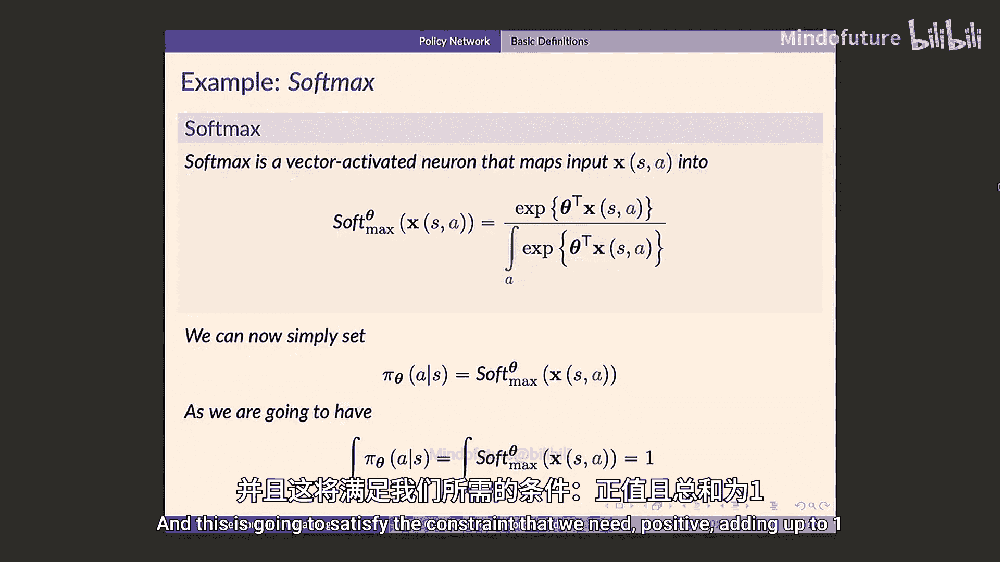

For example， the Gasian distribution， say I have the Gasian distribution。

 and I want to simply just represent my policy at every single action in terms of my representation by a linear model。

 but still I want to just work with this continuous stateta space of actions， How can I do it。 Well。

 I can look at the state representation actually， I do not need to think about the action anymore。

 right， state representation of every single point。 it means only x and y。

 I don't care about a anymore， right， And then I say what is x and y， I just linearly transform it。

 So this theta times X S is going to give me one number。

 then I treat that number to be the mean value of a Gasian distribution， right。

So this means that I've put this term theta times x inside this expression。

 This is the gatian distribution， right， And then I treat this whole term to be my policy。

 the density， right， This is obviously giving me one density over a， right？ It's positive。

 adds up to one。 and it depends on the stage， right？ This is all I need。 Well。

 is it a perfect model I don't know。 but at least it's a model I can use， right。Everybody's cool。

 yes。So。That thing is your policy network here。 And again。

 your policy network obviously depends on A and S and then。

You can simply train this policy network for theta， or you can train it for theta and sigma。

 I mean you can treat sigma also to be a parameter here， right。

So your policy is not simply depending on theta only theta n， for example， Sigma， right。

 So it could be only theta theta n sigma squared， right。Everybody's cool？Questions， so in this case。

 what does it mean， It means that every point that you are in this if you think about that particle example。

 every point that you are in this space， then depending on that point right。

 you're going to compute one mean values。 that is theta times x， right。

 which x only depends on your location， right， you get your mean direction。

 So the average direction tells you you should go this direction， right。

 And then you just move in that direction randomly， right， with Gasian distribution。

 means that your peak density is gonna be exactly that direction。

 but you can take with the Gaussian distribution anywhere around it， right？

 And the far you get from the main direction， the lower would be the density， right。Everybody's cool。

Yes。Yes， it is。You can。 Yes， I mean， if we think about a as we had in that example。

 then this is not the best idea because a was truncated between like 0 and two pi or minus pi and pi right。

 So that is not the best idea in that case， but you can do it uniformly。 You can do it as you wish。

 right？ Sometimes you can even put it one distribution， which has， again， a bunch of parameters。

 So I just want to give you a bit of intuition。 What does it mean that we have a policy network。

 right， You had a question。Right。Oh， no， we're going to talk about training。

 That is more complicated。No， A is not this is the point of。This is the point that I want。Right now。

A is not the。Output of the network。 Sorry for that。A is not the A。A is not the all sorry。

The density of is the alduct。But you need to， you need。 this is what I want。Right。

 you need to be able to sample from。know the distribution。So， right now。We are， we are just。

With the value of defense。Ex example how。How。Okay， so this point that your friend ask，ep。

 just go ahead。Well， state。非た。So Theta， Theta is a bunch of parameters， a bunch of weights。

 for example， that you， you want to learn them， want to train them。一牛肉。

It is the waste of the deep neural network， for example。 I mean， here we have。

 we do not have a neural network。 It's just a simple linear model， right， But instead of that。

 you can give X into a deep neural network with waste theta plus waste。 And then the output。

 you give it as a mean value here。 Again， you can do that， right。makes sense。Okay。

 so one thing that you friend us。 and that is very important。

 And you're gonna to see it gradually in this chapter that the important thing about this pi。

 first of all， this pi is not giving you the action。

 right So you are not seeing exactly the action you are getting the density over the actions right you are seeing which action is happening with what likelihood right and then you should be able to sample from it。

 This is very important， like this guy， you can sample from it by your computer， how you can do it。

 you give x into your neural network。 it's going to give you as the output the mean value right。

 then you write one line of code that I have a Gaussian distribution with this mean value and variance。

 give me a sample right and then your computer is going to sample from it right Now those who have some experience with geneative models Now that sampling in general is a very complicated thing。

 So it's not necessarily。The case that you can easily sample any given distribution。

 That is a big challenge。 If you open any textbook on data science and。Machine learning。

 you're gonna see one chapter about sampling algorithms， Gibb algorithm， La of dynamics。

 those are algorithm which are developed to sample from a distribution。 They are complicated。

 But now worries， we do not get into those complications here。

 because typically we are just working with distributions are well which are well defined。

 You can simply sample from them。 Okay， this is not a problem here。

 But you should be able to sample from that distribution here， you can do it right， with softmax。

 you can again do it。 Why， because when you give it to softmax。

 you get a probability vector at the output， right， how you can sample from that vector in Pytorch。

ItsR in Python in general。That is a categorical distribution， right？

Ask it to sample from a categorical distribution， right。

 What is happening underneath inside your computer wall。 Your computer is doing something else。

 It is sampling from a uniform distribution。 and then it' passing it through a transform。

 then it ends up with the distribution， which matches the sorry， a sample。

 which matches the distribution you said， and it does it with you know， pseudo randoming。

 not real random processing。 But those things are somehow handled by computers nowadays for us。

 So we have no problem。 The only thing is that we are able to sample from there。

 I can get one sample A， whenever I want， okay。

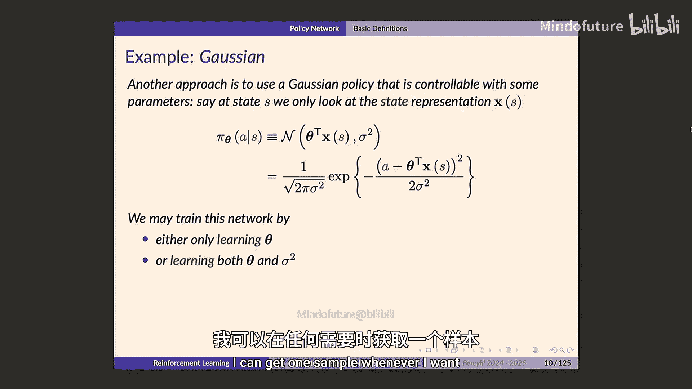

That's it。 And in practice， we usually do it by a neural network。

 So we typically pass our state or a state action representation through a neural network。

 And then we're gonna put one last layer in a way that the output looks like a distribution， right。

 if it's continuous， it could be simply a Gasian distribution or something like that。

 if it's discrete。 We typically use softmax。 That's it。 right， So this is one policy network。

 And the policy network is looking into this state。 and action that were giving to it。

 And it's going to tell us what is the density of that particular action。

 given the state that we are in， right So。

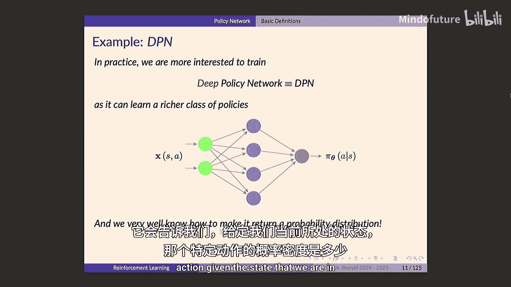

That's how the policy network is， but the question here is that how we can train this guy。

 it means that how we can make this policy network to just get closer to the optimal policy right So if you want this guy to be the optimal policy。

 what should we do？What is the property of the optimal policy？The value， yes。

 the value at every estate is the maximum value， right？

So this means that when you look at the value at every single state。

 as compared to all other possible policies， you're getting the highest value， right。

 So this is the property。 And we want to build based on that one training a strategy。

 which looks at this pi and tries to update those parameters theta to improve the policy network。

 Okay， so。That is the idea here。 So say I have the policy pi theta。

 This is the policy that is described by my network right and then what I want to do。

 I want to compute its value as I told you for now you do not care how I can compute that value。

 were going get into that later but now we assume that well we have one algorithm for example。

 we have the whole time in the world to just value of that policy using policy itration or something like that。

 So I'm going to give this policy pi into my algorithm， it're going give me the value。

 So it's going to give me the value that every single state and how I can find this parameter theta well I want to just tune the parameter theta that whenever I get into one state the value that I see is maximized right so it means that if I change theta then the value that I get at that state is going to be lower right。

Then this means that。This。Policy network is at least approximating the optimal policy， right。

 to its best power。Clear。Okay， so this is what I want to do。 But if you look。

 if you look at this problem， is it a simple optimization problem by simple。

 I don't mean that can you solve it or not。 Is it just a。

One optimization problem with a single objective。I want this to happen at every single stage， right？

Is it a single optimization problem？Well， Theta is。Come on between all the states， right。

 because this is the parameter of my policy， right， But I want it to happen for every single state。

 This is indeed not a single objective problem。 This is actually a multi objective problem。

Just to break it down for you。Okay， first of all， we typically do not work with a maximization。

 We work with minimization。 So you just need to negative the one。 Don't care about that。

 This is not real important。 But the key point here is that we have so many states and we want this to happen for every single state。

 right？ so this means that this guy is actually multi objectiveive optimization problem。 For example。

 say I have any different estate。 So we， we do not have continuous system。

 sayy we have a discrete state space。 Okay， now。

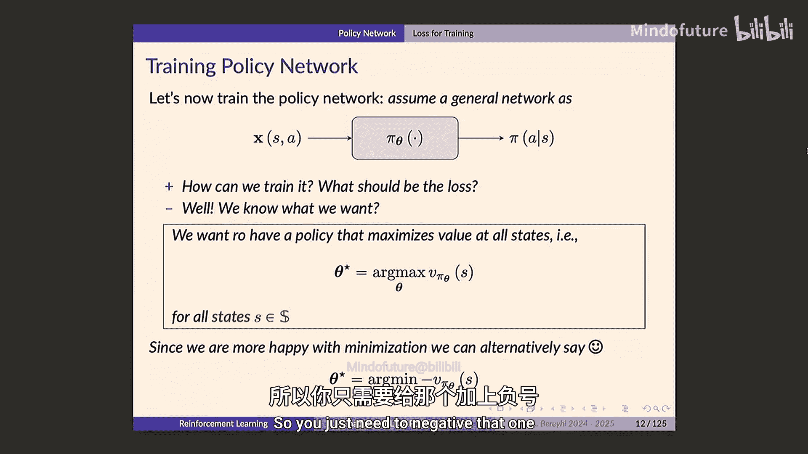

I have S 1， S 2， S 3 till S N， right， And I want the value function。

 and every single of them to be maximized， right。And this means that I want this to happen， right。

 The value function at this state S1， the first possible state。

 the second possible state till the last possible state to be maximized， right。

But the key point is that theta is common between all of these objectives， right？

It means that if I change theta for S1， then it might make the value function maximum for S1， right。

 but it might be not maximum for S 2， right。Then I go for S 2。 I try to optimize it for S2。

 but then I might lose the maximum at S1， right？ So you see the problem， right。

So it is not a single objective。 it's multiple objectives。

 And I want to find a sort of trade off between all of them。It means that obviously。

 what I do now is that I am not going necessarily to find one theta。

 which is max maximizing my value function at every single state， right。

 because it might be the maximum of two states is not happening for the same theta， right。

 Then I need to make a piece between these two states， right。Any idea， how can I do that。

What can we do？Just average， right？ So average over states， right？ So what you can do。

 you could do what people call it。 So you can think about it in two different ways。

 One way is to think in terms of optimization。 If you think that way， then people call it scization。

 So this means that you have two objectives。 I have function F。 and I have function G， Now。

 I want want to find the variable， which makes both of them maximum。 Now。

 obviously thing F is is getting maximum at one point， G is getting maximum at another point， right。

 Obviously， that x that makes both of them maximum exactly， does not exist， right？

 the question is that how can I make a trade between these two， I can give a weight to this guy。

 give a weight to this guy， add them up。 Now， I maximize this weighted version of both。

 right And the point that I find is somehow giving some priority to F。

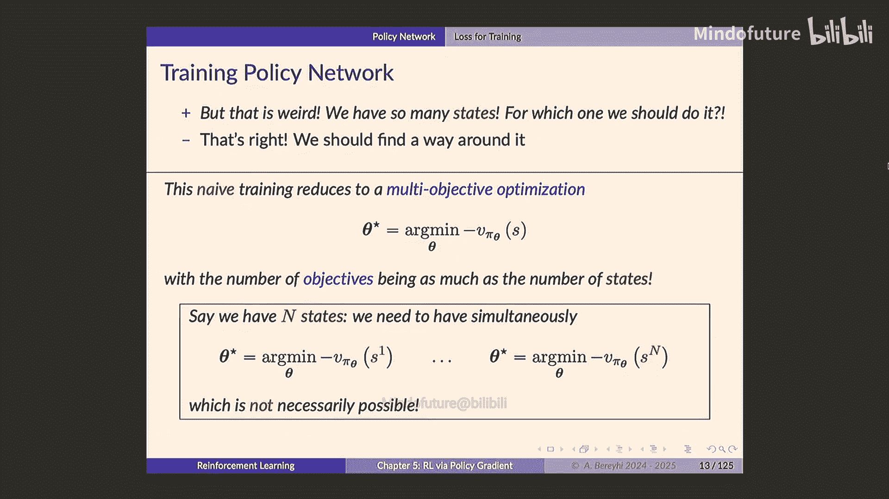

SomeP to G。 and then find a point in between， right。 So this is how you do it in optimization。

 If you want to think statistically， which is more appreciated in machine learning。

 the idea is that you would say， okay， state S1 is happening with one provol PS1， right。

 So it's very likely that I am in a state S1， right， but state N is not very likely。

 The chance of that happening is very low。 Now I just multiply the probabilityvol of every single possible state。

With the value of that it's there， and then I average it out， right？

The expectation with respect to a state， right。So。This is how we can do it。 So basically。

 the thing that we want to maximize is to just maximize this term， right。

 It's the value at this state S， I multiplied with its probability P S， and I want to maximize it。

 right。And then this simply means that I want to just maximize this expectation right。

 So I think about the random states。 and then the average of value over all possible states is the kind of objective that I want to be maximum。

 right， So I want to find my policy in a way that this is just maximizing this term。Everybody's cool。

So you're okay with this objective， right？ So this objective now only depends on your policy network。

 right？ So if you change your policy， the value function is going to change。

And the average is going to change as well。 right， Now， you want to find the parameter theta。

 which is going to maximize this guy， right。Questions。No question。

So the rest of things that I want to do today is to somehow give you the idea how you can actually maximize that objective。

 And this might sound a bit complicated。 And to be honest， is a bit messy。

 But we try to just do it a step by step。 And finally。

 we end up with what we call it policy gradient theoryor， right？

 And that policy gradient is actually the basis of all of these approaches。O。

So what I want to do now， I want to see， how can I maximize that， that objective， right？

 So I do know my policy network。 I have fixed my policy network， for example。

 one network with a softmax at the output and know what I want to do。

 I want to compute that objective。 That is my loss function somehow， right。Everybody's cool， yes。

Great， so。Now， the first thing that we need to answer here is that how we can find or how we can define this P。

 What is the probability of one is。Should I just give it a？

Can I assume one provol in distribution for the states。Yes or no， yes。

more based on whatever a problem is。I don't know for a free world。对。

When we just start with like an even one for every single。Yeah， this is the start point， right。

 but this is not telling you this is the very first estate， it says probabilityvolty of any state。

 right？啊。We were。So your answer was halfway giving the answer。 actually， So you're in the grid world。

 You can randomly start any point， right， But let's say that my policy that pi theta is like this。

 Where you start， I'm gonna go left， left， left， left left till I get hit the wall。

 and I stay there forever then。The parvolity of the guys happening on the left wall。

 Is it the same as the parvolty of the guys on the right wall。Itll be it'll be 100 west。

It's not necessarily 1 hundred because you could randomly start from right wall， right。

 So that could happen。 But wherever I start， I， I always go to the left wall， right。

 So if I think generally about looking at the at the board and see where the particle or my play。

 my agent is。The chance of being on the left wall is higher than the right wall， right。

 So right wall is only going to happen when I start on the right wall， right。收。

Is what you're saying that our probability of our state depends？Exactly perfect， yes。one蚊三。It's not。

 I mean， we are not necessarily playing with with a specific policy。 No。

 we do not yet play with the epsilon greedy， actually， right， because， I mean。

 we are playing with pi theta。 If pi theta has epsilon greedy， then it's okay。

 but we are not necessarily playing with that。 So it's any distribution， right？

 So it could be epsilon greedy。 It could be something else， right？ So， but the answer you gave is。

Correct， so this pi S P S that we have。 It depends on the state that we start with， right。

 and it depends also on our policy， right， So our policy somehow integrated somewhere inside this P S。

 right？ So this is why I have this answer。 So what is P S I it something that we assume or we should compute。

 So neither in both because we can't assume one random start point star distribution。

 But the rest of。Time is simply specified by the policy， right。

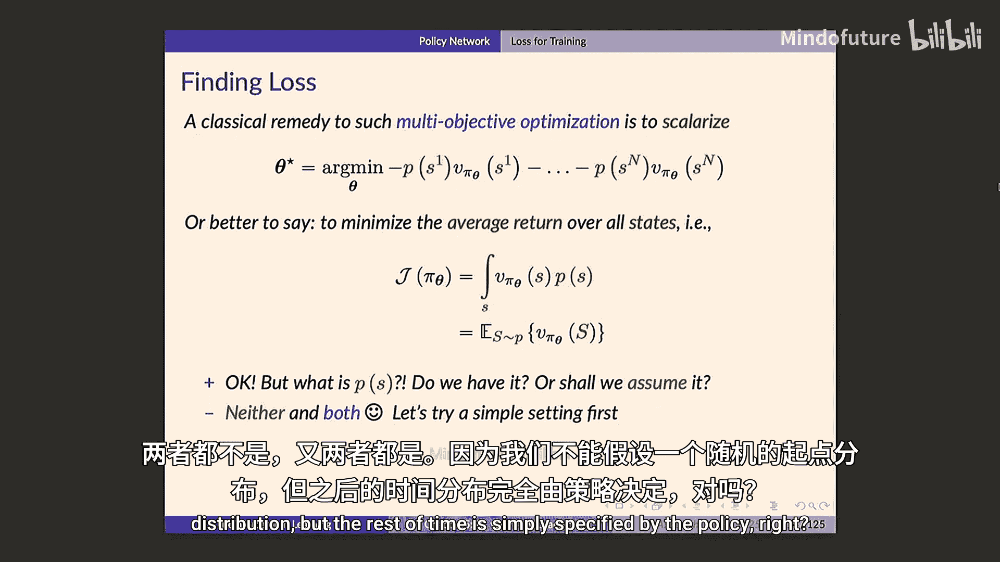

Let's look at this together。 So now let's assume that I have one particular trajectory， okay。

I have this trajectory。 and first of all， this trajectory。

 what policy is sampling this trajectory when I have a policy network？Py theta itself， right？

So that policy network that you have is sampling this guy， right， Every single state that you are in。

 you're giving that stay to your network。 Your networks has this ability to compute the policy。

 the provolted distribution。It's going compute that and' going randomly sample one action and gives you the action of that particular time step。

 right， You do that action。 The environment gonna to take you from one state to another， right。

 You get into another state。 You again， give it to your policy network。

 It' gonna sample you another action， right， and you keep on going till you hit the final state。

 right。A rise cool， yes。So this thing that you see here is， is just sampled by the policy network。

 And this is why I told you you need to be able to sample from your policy network。 right， Now。

 you sample this guy， this random trajectory has happened。 Now how we can compute the value。 Okay。

 let's first just write down the definition。 first simplicity right now。

 assume that I have no discount。 Okay， discount factor is 0。 sorry， one。 discount factor is one。

 So this means that my。Policy， my， my sample return at time 0， it's gonna be G 0。

 which is essentially whatever I collect after state S 0， right， R 1 plus R T towards the n。

 And this is going to be the value of my initial stage， right。고。

So this guy is the value of my initial state。 right， Now， let's say that I want to just。

Compute the expectation of that guy， right， What we want to compute as the objective is the expectation of this guy。

 right， When I average over my initial sampling stage， right。A why school。Okay， let's do it。

 I' gonna get clear。 So this is my trajectory。 What I do here。 I am going to fix the initial state。

 So now I do know what is my initial state。 right， So I have selected。

 I want to start exactly from this point， right， that is at 0。

 This is the reason that I'm showing it with a small phase， right， It's not capital。

 So I start from this state。 Now， I start sampling from my policy。 I do one action。

 I go to another state and so on， right， So my actions and my states， all of them are random， right。

 because the actions are coming from the policy network， random。😊。

The change is coming from environment。 Its again random， right。

 So everybody else is random by my initial state fixed。 I fixed it， right。

 So this is what I show it by tao S 0。 This is the trajectory with the initial state S 0， okay now。😊。

If I have this guy， then what can I say， I can say the value at this state S 0。

 like the value starting at the initial state S 0。 What is it by definition。

 This is the expectation of whatever I'm going to collect after I start with S 0。

 and I play what by my policy， right， That is the definition， right， so。What do I collect if I play？

Say I have one realization R 1 R2 till R T。 So this is the sample return， right。

 The dimension that I show you， there is no discount here because within discount is one。

 This is what I have， right， This is G0，1 realization，1 realization of that， right。Now。

 what should I do here， I should average this guy， correct？😡，Average， but I should average over what。

R1， r2 till Rt， right， correct？Now， how can I find out the distribution of。

Or how can I write down the party of the next。Rewards that I get。

Let's start with the very first stay， if I amian state as 0。I play with my policy， right。

 Every single action a 0 is going to happen by my policy， right。

 This is the density of every single action， given that I started at at a 0， right。Everybody cool。

 Now， I if I do action a 0， and I am in a state as 0， then I'm going collect one reward R1。

 and then I I'm going go to state S1， right？ So if I added or integrate this guy over R 1。

 I am averaging R1， right。😊，But what about R2？What should I do？Again， I go further， right。

 So if I get into state S1。How do I， how do I act next， I'm gonna game play with my policy， right。

 I'm gonna look at S1。 I'm gonna sample from my policy， which is pi of a1 given S1， right？

 And then when the action is a1， and the state is S1， I'm gonna。Transit to the next state。

 which is P of S2 R to given S1 A 1， right？ So in every single time when I am oh， oh， the typo here。

 So actually， I thought I double check to avoid typo。 But here here before this80 -1。

 There is a pi here missing。 Okay， so this is the policy， right。

 So the policy or the density of the action 80 -1， given this state that I am in。

 and then the probabilityvol that I transit to the next state， right。And I get the next rewards。

 right， Everybody's school。 Now I have this guy。 This is one sample。

 one possible outcome of this trajectory， right， And now I am multiplying it with its density， right。

😊，Correct， now what should I do， I should。Marginalize it over the values， right？

What should I put here for integrating， for example。Over definitely I should do it over R， right。

 I am averaging over R， right， What else。😡，SD， all of them， except。Is zero， exactly。 what else？

Actions， right， all the actions are also random， right， So I need to have these integrals， right。

 Everybody's cool。 Everybody sees there。Questions。So I just started with my initial state。

 then I randomly played。 Now I said this is one possible outcome。 This is the corresponding density。

 And if I just integrate or marginalize over all possible values of actions next to states and the reward。

 the rewards， then this is going to be the value at state 0， yes。You getous。嗯。

So everybody's cool with this？So this is basically taking expectation of your R sum of R。

 given that you're in a state S0， and then you do action A1。

 then you go to S1 and get reward R1 and so on， right。You just write the whole trajectory down。

Questions， everybody's cool。 Yes， okay， now， if you've got this clear。 now。

 one thing that I'm gonna do， first of all， I mean， obviously， I can simply do it in this form。

 right， This is always the policy of doing one action at time T， given the state at that time， right。

 And then you transit to the next state and reward， right。A bicycle equal， right， with this one。

 And then you multiply it from 0 to t -1， right。That's it。 Now， one thing that I'm gonna do。

 I'm going write this marginalization here， which is over all the states。 action rewards。

 I'm going to simplify it and route it down marginalization over the trajectory of a state as 0。

This is just a notation。 Okay， and this is a very typical notation when you read the papers or on that。

So this means that I initiate my first estate。 and whatever happens inside this trajectory is random。

 right？ And then I am going to。Integrate them， right。

 I'm going to just marginalize them to get rid of them。A why go？Great。

 now the value of my policy at a state as 0 is this expression， right， And obviously。

 this guy depends on my policy， right。If I change my policy， this value is going to change， right。

 And what I want， I want to find theta， which is going to maximize this weird。My see expression。

 right？OK。Now。Let's do a bit of more simplification。 So you have this summation here， right。

 This is the summation of all next rewards that you get， right， or it's basically your。

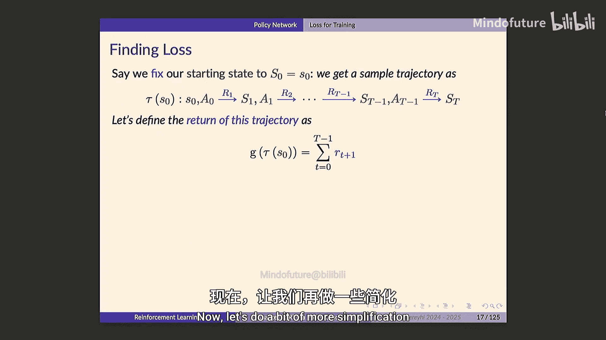

Sample return for initial state as0 on the trajectory， right？Now。

 I'm gonna define it to be G of that particular trajectory。 So I would say。

 what is the return at a state S 0 When I start the trajectory with the state as 0。

 This is basically the summation of everything next。

 And then this guy is one realization of this random variable， right。

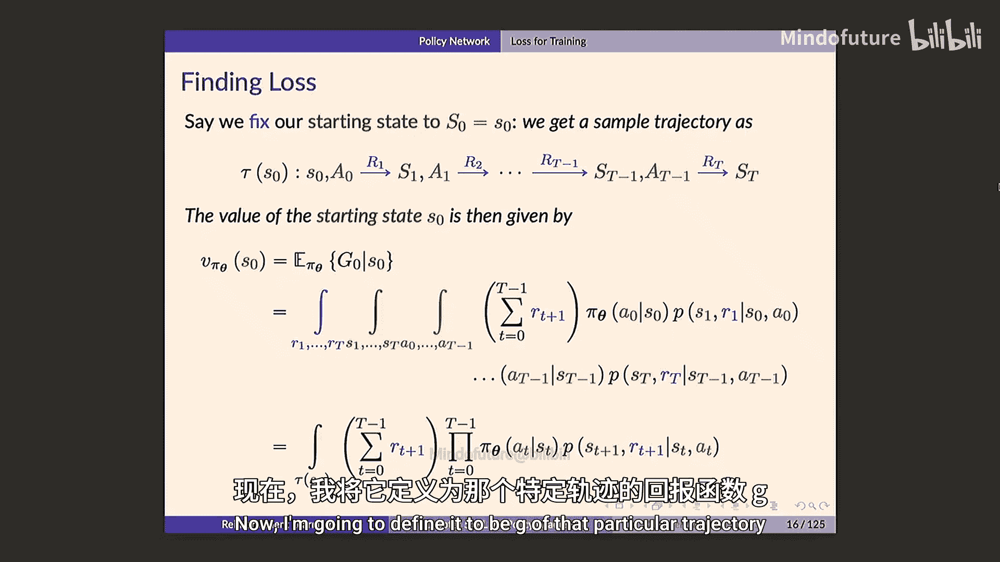

And what I want to do， I basically want to compute this integral， right， instead of that sum。

 I am putting that G here， right。Everybody is clear。 So this is the summation that I have。

 This is a distribution that I have， which is depending on theta。

 and I am just marginal marginalizing over the trajectory， right， Now。

 this guy here is basically one expectation， right？ no magic here。

 we start with the definition of expectation， right， So what we are basically doing here。

 we are just taking this expectation。 So we say let's say that we start one trajectory with the state S0。

 and then you're going go on right， So we play with our policy and our policy is going to randomly do actions。

 right， and those actions are going to change us to different states。 And every time we change。

 we're gonna get a random reward， right， we add up all of those rewards。

 This is one sample return that we get。 Now we want to know what is the average of this sample return。

 given。😊。

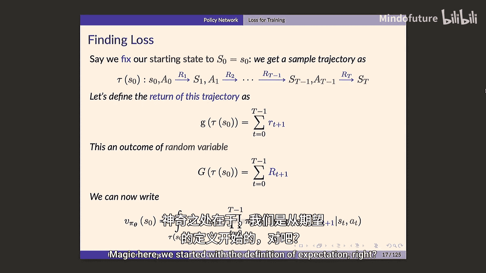

That we have this particular trajectory or the distribution on the trajectory。

 And what is the distribution of the trajectory is basically that weird expression。

 Because that expression is telling me that you start from S 0。 Then you're gonna act a 0。

 You're gonna go to S1。 Then you act a1。 you go to S2。 you act a 2 and so on， right。You see that。

 right？So this value that I want to compute at point as 0 is the expectation of the sample return in the trajectory。

 And where is the policy showing up， is's showing up in the distribution of the in the density of the trajectory。

 right。Everybody's cool。Questions？No question。Okay， so。So initial conclusion that we can say。

 we can say that if I have a given state as0， all the next estate。

 or basically the provol of the trajectory probability of the state in general is described by the probability of the trajectory。

 which depends on my policy。 This is exactly the same example I started with。

 If you have this grid world。 if I tell you where you start。

 And you do know that your policy to always go left， right。

 Then you can explain what is the probability of every single other state， right。

 the probability of any of is simply zero， right， is now going to happen because your policy is taking you always left。

 The probability of everybody on the left is nonzero， right。And the highest probability I mean。

 is to be like at the very end， because you are going to get to the left wall and you stay there forever。

 right？ So after a couple of time steps， whenever you look at the grid world。

 you're on the left wall， right。That guy is happening with the highest pro voltage。 Then again。

 if I tell you， okay， you start from this other point。

 then you would say anyone on the left is going to happen with some provol on0。

 Most of the time I am on the left wall and anything else is 0， right？

 So once you know the start point， everything else is described with your policy。

 And since your parameters are inside your policy， your parameters are the one who is。

Specifying that probability， right。That probability the distribution。 So if S 0 is given to me。

 then the distribution of this trajectory is the one which is describing the whole value function。

 And this distribution is obviously depending on our policy， right。Everybodys school。Yes。Right。

Exactly。Because if I start here。I could go up。 I could go down， right？

 It depends how my sample looks like， right？ but if my sample has higher probabilityvol here。

 I'm gonna be most of the time up right， less time down。

 But both of them could happen Now if I go here， then again。

 I have a trajectory after that right that one again depends on the sample that I see right and I again keep on going like that。

 every single of them is happening with one probabilityvol is like a giant tree right。

 and then you only know the root of that tree， anything else is just randomly happening right now you just look stand on the root。

 and then you say anything after， okay， that is a random thing right So I could be on any branch ending up to the leaves right And any of them is happening with one probabilityvol。

 What is the probabilityvol of the particular trajectory towards the leaf is the probabilityvol of every single branch that I am getting out right And then okay if I multiply all。

that I know this trajectory is happening with this provolty。

 this other trajectory is happening with this proty and now if I could write down all of those proties。

 I need to average the sample return I get from all of these trajectories with respect to those proties and this is going to be the value that I get at the root stage。

Right， right， right。So you can think like this。呃。You can think like this that this is your S0。

And now you start to just act based on your policy， right， So you do based on your policy。

 you do one action。 This is a0， right， or maybe I do it。 Its a0 because it's rain， right。

 Then you get here。 Now， when you get here， you could have。You， you have S1， right。

 But this one is random because it could be any value， right， Now， if you think about possible cases。

 like you were thinking about the。Backup diagram， right？ So you would say， okay。

 I could have a1 happening。A2 happening。A3 happening and so on， right？Till A M happening， right。

 And now when I get here， now I could have different states， right， So I can change to state S 1。

 I can change to a state S 2。 I can change to state S 3 and so on， right， till S N。Correct。

 now when I am in one other state now， this is your this S2， for example， is your state at time1。

 right， Now， again， at this one， you are going to act based on your policy， right。

And then this means that at this point， you're again doing any of possible actions with some probabilityty。

 right， A2 and so on， until A F， right。Right， and then you get into another state。

 This is now stay sorry， you get into this point。 Now， if you do want action again。

 you can just transit to any。Stake， right， S1 S2 till S n， right？And then at this estate。

 this is now your state at time too， right？And again， you keep on playing with your policy。

 right Now， what is going to happen if you just random one trajectory， What is the trajectory。

 That trajectory is basically。That trajectory is basically that you start here and then， for example。

 you come here right and then you go here and then you act like this and then you come here and so on。

 right This is your trajectory。 What is the chance of this trajectory happening。 Well。

 is basically the paralty here， multiply with the party here。

 which is this here is coming from your policies。 This is the environment， right。And then again。

 you get here， which is again your policy and so on， right？Now， this is one trajectory。

 and you have massive number of them， right， Each of them is happening with one pervol。

 What you would say， you would say the value。Of my policy， pi theta at this particular point as0。

 what it is， it is basically the expectation of whatever I' am going to collect。

 This is basically I go on this trajectory and I add up every reward that I get right。

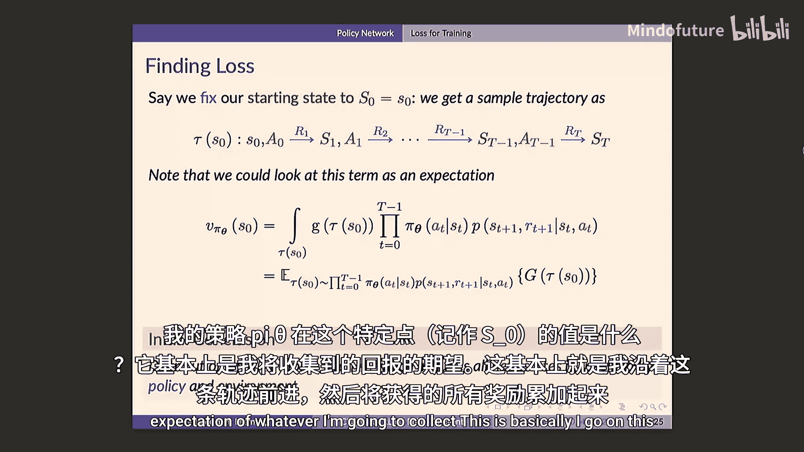

To， that is the expectation of the return I get from my particular trajectory。Starting from S0。

 right？ and then you have it。 But what is the expectation or what is the distribution that you are sampling from。

 That is the distribution of moving on that guy， right。

So this is going to be the distribution of your cow as 0， right。

 What is the chance of every single trajectory that you have。Right。And now that probabilityty。

 how can I write it down， this is basically this term， right？Here is pi 0 at time 0。

 your policy at time 0。 Here is your environment changing from time 0 to time 1。

 Here is your policy at time 1。 Here is your environment changing from time 1 to time 2， and so on。

 right。Everybody clear。So you can think of as01 estate that you start with and then a giant tree after then。

 right， and every trajectory on that tree has one probabilityvolty， right。

 if you know the environment and your policy， you can explain what is that distribution， right。

I mean， it's very hard to write it down。 It's computationally massive。

 but you can do it and theoretically， and then you just want to take the expectation over that。

 right。Yes。Tient oh， yes， right now we think like that。

 But then I'm going to get rid of that because I write it down terms of expectation。

 And then I do it by sampling。To computer， we do need to know the。Yes。

 this is what I just said you you right now we think we know it。

 then later I'm going get rid of that expectation by sampling。 I just replace it by Montecar right。

 So right now， assume we know it right， but then we're gonna get rid of that。Questions。

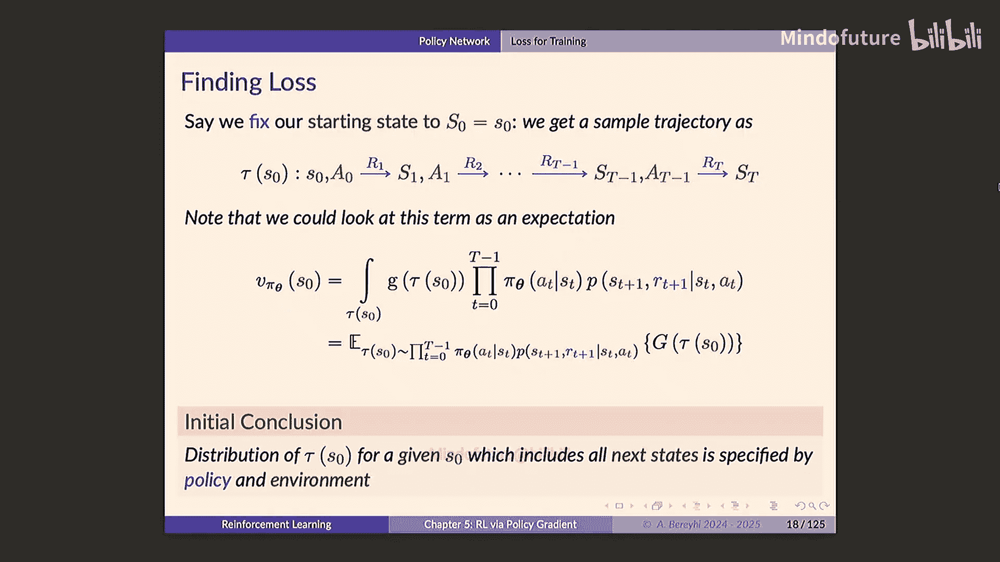

No question， O。If you got no question， then what I do have， this was my objective right？

 The objective for my policy was that I was thinking about any state right and then any state I want to average my value over that right？

 So it means that I randomly start from one point and then I go on one trajectory towards the end right now starting from one point as0。

 I'm going to get this expression， the sample return times the probability of the trajectory marginalize over the trajectory and then I need to also average it over as0。

 the start point right now what about the start point。

 the very first estate that I start with What is the chance of that。This is my choice， right？

 I could say I start anywhere with same probability。

 Maybe I say I want to just start from this point， right， This is my choice， right， so。

The key point here is that， okay， I can say that now I have a random trajectory tau。

 So in this random trajectory tau， I'm not specifying the start point anymore， right。

 So you randomly start from one point with pro voltage P 0。 and then you go on your policy， right。

 towards the end。That is the probabilityty of the trajectory， and。

You have one sample return on that trajectory， which is basically the addition of all of the rewards。

 And this is the provolty of that trajectory， right。

 and you're basically averaging it over the provolty of the trajectory right So now one thing that we can say here is that I mean。

 I'm going call this guy from now on， starting the probabilityvolty of starting at S0 and then going on on the trajectory。

 I'm going to call it the probabilityvolty of the trajectory itself。 The tau is one trajectory。

 state 0 is something action 0 is something。 state1 is something again， action1 is something。

 And then if I want to know what is the chance of this trajectory happening。

 I just go on my environment and my policy and my initial assumption on the state。

 And then I put those values inside this distribution。

 this is going to give me the density of that particular trajectory right So this is the distribution of the trajectory。

 and my objective is basically the expected return。 when I average it。

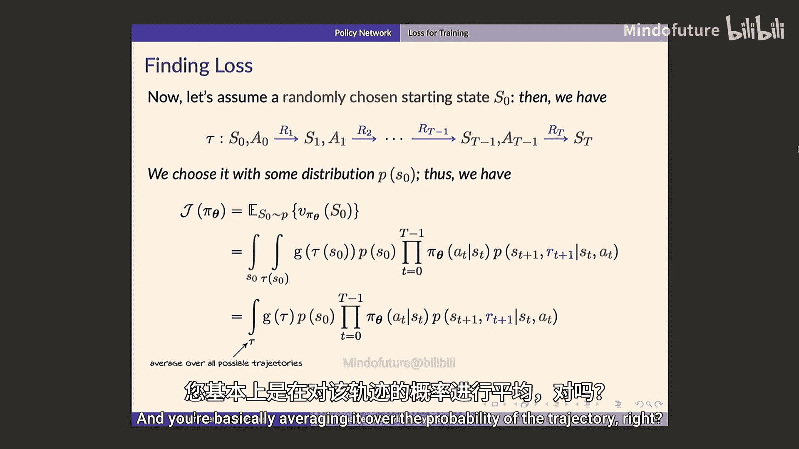

Or this viewer distribution， right？Rightrrect， because look at it here。

 everything that you see this term from P 0 towards the n。

 this whole thing is basically the parvalty of my trajectory， right。

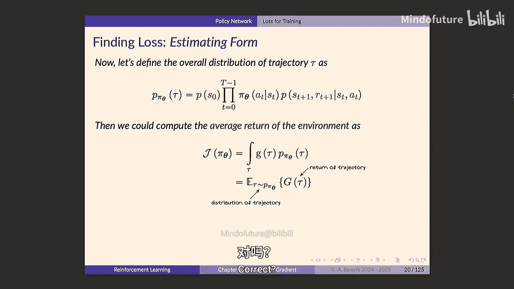

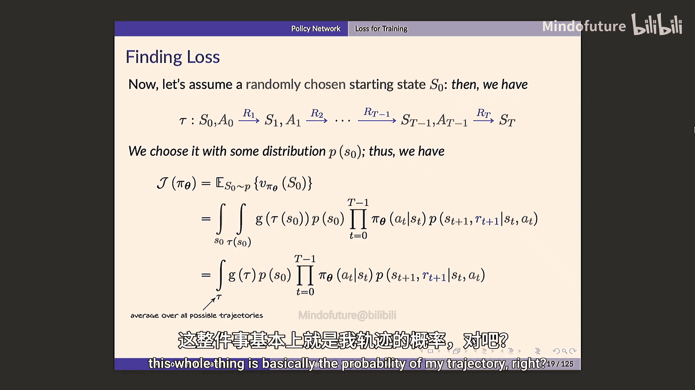

And then what I'm doing， I'm just writing down the sample return G of that trajectory times the probability of the trajectory。

 right， That is expectation over trajectory， right。

So it means that what is the return of the trajectory， I'm going compute the expectation， right Now。

 my objective， I can write it down in this form。 And the key point here is that my policies showing up inside the distribution。

 It's not showing up inside the term that I'm taking the expectation， right， and makes sense， right。

 because the policy is not directly impacting your reward， right。

 It's just doing actions with some proities and those actions are impacting the environment。

 giving you different rewards， right， So it's just showing up inside the distribution。

 It's not showing up inside the term。Every cool？Questions。No question。 Okay。

 so moral of a story here is that your objective， you can write it down here and your policy is showing up inside the distribution。

 And that distribution is only。Arbitrary in terms of the start state， right。

 once you start one state at' random， when if you assume one distribution of your star starting state。

 then anything after that is basically specified by your environment and policy， right？

 And now our job is to somehow find a way to maximize this guy， right。

 which sounds a bit complicated， but we can actually do it very efficiently。Questions。

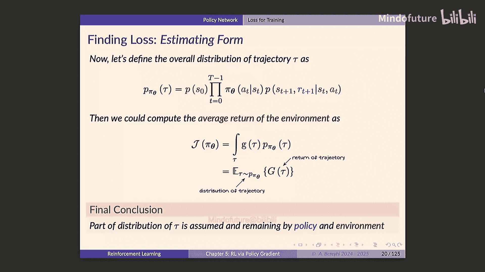