# 【多伦多大学】强化学习 2025 ｜ Uoft   Reinforcement Learning   Fall 2025 p48 P48_讲座_47_策略梯度定理 -BV1D3F2zhEry_p48-

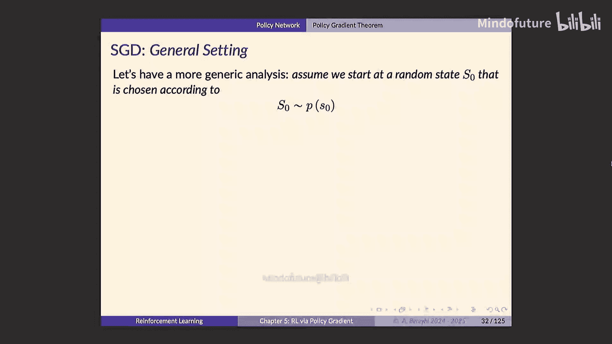

The main idea is that as we tell class time， we want to just。Train or policy network。

The key point was that the policy network is looking at the state that we have and you got to sample one action for us。

 right， So it' gonna give you a priority distribution on the actions， right。

 And you can sample from those actions。 So that was what the policy network do。 and。

The thing that we wanted to update was we wanted to maximize the value， right。

 So we said that if we want to have an objective， we could say， okay， this policy in E has a policy。

 this policy is gonna to give us a value， right， that value is be a pi theta。

 That is depending on the state that we are in， right。

 And then we say we want to just maximize it for every single state。

 but we cannot do it for every individual state， because it might be that we maximize it for one state。

 and then for another state is not simply maximize。 So what we're gonna do。

 we're gonna just maximize the average。 The expected value over all possible state。Now。

 we did this together last time。 So I guess you can just remember。 But let's put it that way。

 Let's say that we start with state as 0。 and our initial state is totally play random， right。

 So I'm gonna start randomly with some distribution P0， for example。

 uniformly in the whole environment with one state， okay。

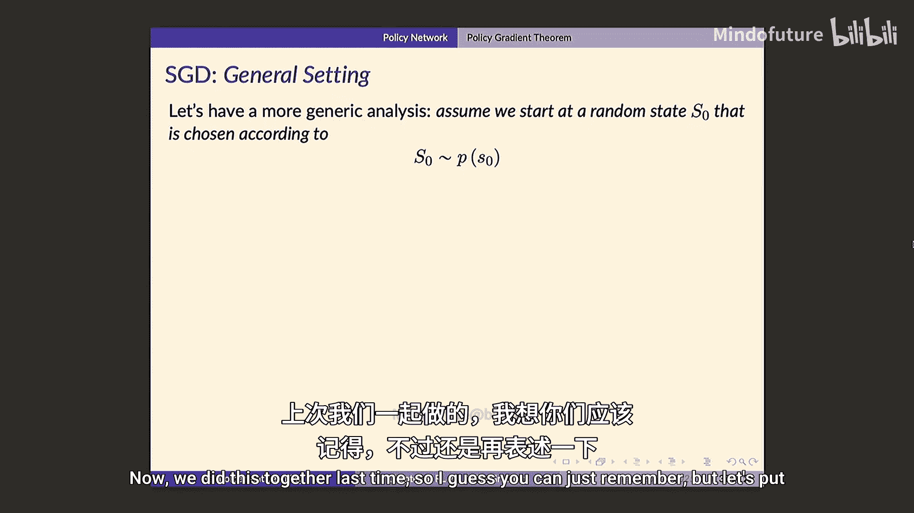

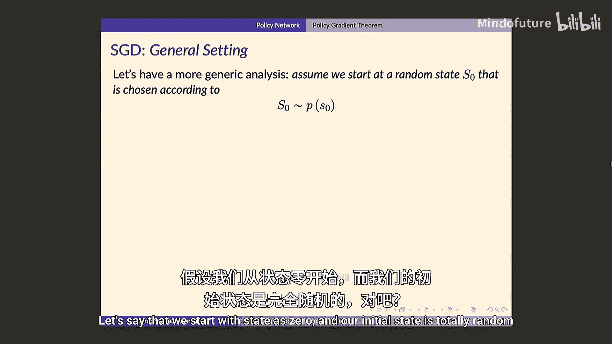

State as 0， I start with randomly。 Now when I just。Start with this state。

 I can give my state to my policy network。 My policy network gives me a distribution on the actions。

 and then I can just sample one action， right， I going say， okay。

 randomly choose one action based on that distribution。 This is going to just sample one action。

 Now that I have my state my action。 I just act in the environment。

 The environment gives me back one reward。 and I'm gonna change my new state S 1， right， Now。

 what can I say， I can say， okay， the value at this particular state that I started with is S 0。

 right V of S 0， right。

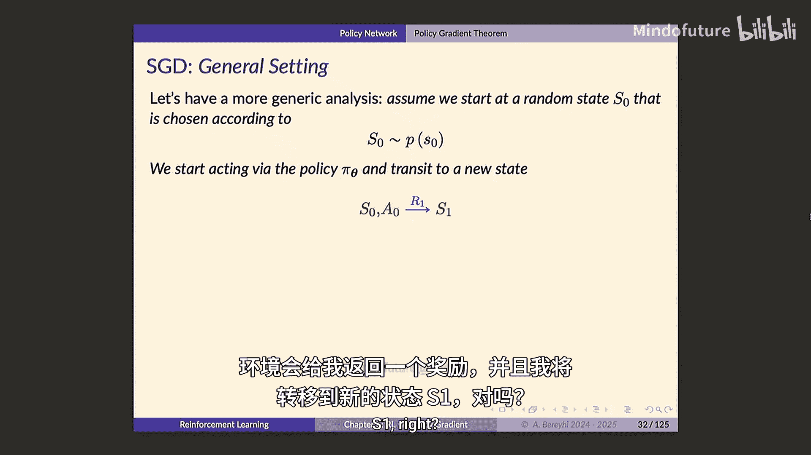

And this view of is 0 is。Including whatever is going afterwards， right， it's like the average。

 the expected return that I'm gonna get when I saw at S 0， right， Now。

 if I average over all of this S0 stuff， then I am going to or as0 state that I am going to eventually get my。

Objective that I want。 So it gonna be the expected value。

 given that I started S 0 and S 0 is obviously distributed with the initial distribution that I consider。

 right。So。I want to maximize this guy。 This means that I need to compute the gradient of this guy I start with one initial theta。

 So this is my initial network。 Then each time I compute the gradient of this guy。

 I add that gradient to this theta， right， And this is going to be my updated network。

 and I keep on going till it does not get updated， meaning that this guy is maximize。

 So if I want to do that， this means that I need to somehow maximize this term， right。

 because this guy。

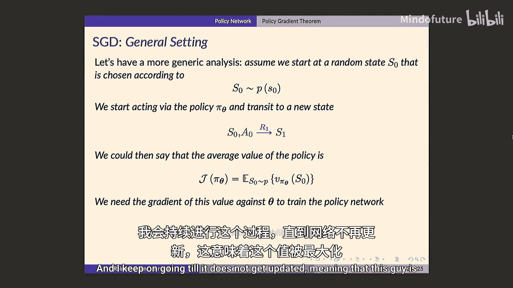

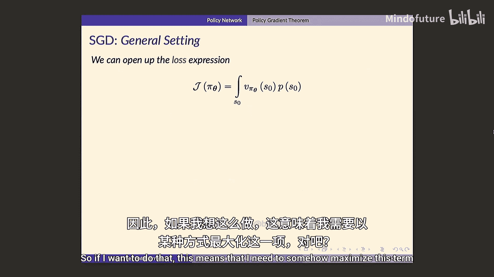

Is an expectation。 So if I want to compute this 1， I need to just get the term inside the expectation。

 multiply it with a probability and then marginalize it， right， So this is going to be this term。

 right。

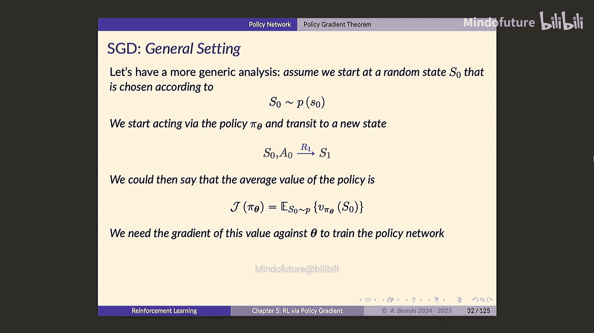

And just as a reminder， there is no typo here， right？

 So you remember that notation I defined last time， right， that notation， which looks like integral。

 It's integral when S 0 is continuous。 if S 0 is。The this great。 then this is sum Asian， right。

 So I just marginalize over that。 And there is no， I do not show any more any different differential term。

 okay。꼭。So this is the term that I want to maximize。

 So I essentially need to compute the gradient of this term。We did it last time。

 but we did last time by thinking about， you know， taking expectation over trajectories。

 But now were just。Using the basic definition， right， the definition of the value， which is V。

 and it's the expected return。 And we just average over the initial states。

 So now if I want to take the gradient of this guy。 So this gradient。

 I want to take the gradient of this term。 And I guess this is quite obvious for everybody that this gradient is going to just impact the value term。

 right， because your initial state is just random， you just chosen your state by yourself。

 So it's not important really， right。Okay， so it' gonna be the expectation of this gradient term。

 essentially， right， Now， I want to compute the。Gradient of the value function at one arbitrary state point at 0。

 Okay， this is what I need to compute。 So I need to compute this gradient term。

 And then I just take expectation of that。 That gonna be my。

Gradient of the gradientient of my objective。 That makes sense， because it means like randomly。

 you have different states。 You just know what is the value of them。

 If you have gradient of all of them， that the average of that is the gradient of the average。

 right now。The key point is that I want to compute the gradient of this guy， right。

 And if I want to compute this one。Okay， I just play around with the definition that we know from chapterer 2。

 so。

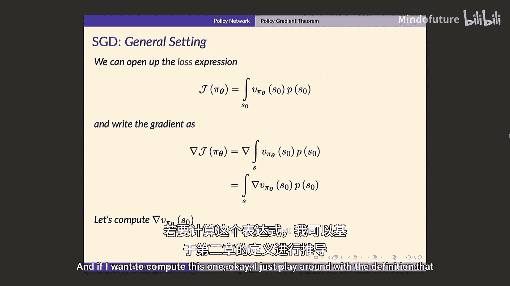

I can write down the value at one particular state to be the average of action values when I play with my policy。

 right。Correct。So we had this couple of times。 So V at any stage is basically Q。

At that estate and any action multiply with the provolty of the action， given that estate。

 which is basically the policy average， right。这。That is the relation between value and action value。

 So I do have it here。 And I want to take the gradient of this term。 So instead of that term。

 I'm gonna take the gradient of this term， right， But now inside this， I have two terms， right。

 One of them is。Easy， the term， which is pi theta， because that is my policy network。

 I have access to。 If I want to take a gradient， I can just use back veragation。

 The other term is Q of pi theta， right， And that Q of pi theta I don't have access to， right。

 So I want to manage a way to somehow compute its gradient。Or at least estimated。这。

Let's open up that term。 So if I want to open that term， what should I do。

 So the gradient goes inside the integral， right， So this gradient goes inside the integral， right。

 And then when it goes in， you can simply use chain rule， right。

 gradient of the first term times the second term plus gradient the first term times gradient of the second term。

 right。

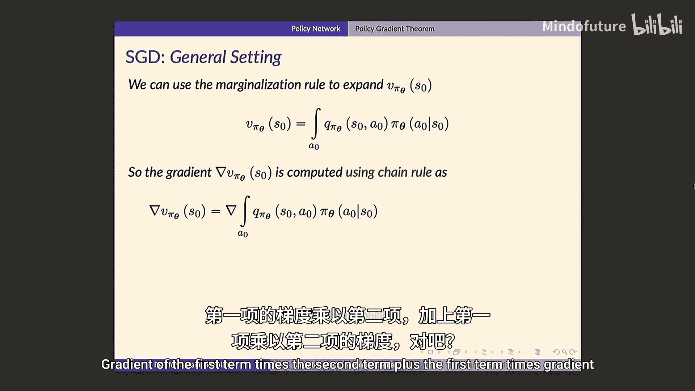

So this means that you can write down this guy as the gradient of the Q function。

With respect to theta， the parameters of your network， right。

Times pi plus Q itself times gradient of p， right。Everybody school。Now， if I have access to Q。

This second term， is it easy to compute or not。And assume that I want to do it with sampling。

Can I do that。Yes。I can do it。You remember that we can write down this gradient by log tree， right。

 We can write it down as log gradient of the log times pi。 And then it simply an expectation， right。

 So this guy gonna be an expectation。 We had it last time。 I'm gonna show you again。

This is one expectation。 So I can compute it as long as I know Q， right。But for this term。

 I have a bit of trouble， right， because the gradient of this guy with respect to parameter of my network。

 I don't really know that， right。It's not something obvious。

 It's not backproagation simply because I don't have access to Q。 I I have access to my policy。

 right。Allright， yes。It's not estimated， but this is evaluating that policy， yes。But， but right now。

 I don't assume that I am estimating anything。 So I assume that like Q is the exact Q。

Assume that you have infinite computational power。 You can compute that。

 So this means that if I give you policy pi theta。If you do know what is the environment。

 for example， you can simply use policy itration。 Actually， not policy iteration。 Sorry。

 the dynamic programming to just compute what is the Q function for that policy， right。

 If you don't have access to the MDP of the environment， you can simply sample from the environment。

 Then you use Monte Carlo or TD or something to just estimate it， right， So right now。

 we don't think about that。 We assume that we get access to that one。

 Now we want to know what is the gradient， right。A I school。Okay， let's go ahead。

 let's go and compute this one。 So this term， as I told you， this guy is not a big deal。

 We can handle it as long as we can come up with some solution to find out what is Q。

 You might guess probably at the end， we're gonna use Monte Carlo or something like TD to estimate this one。

 So there is no problem。 The issue here is this gradient， right。

 So let's go ahead and compute this gradient of the Q function with respect to the parameters of the network。

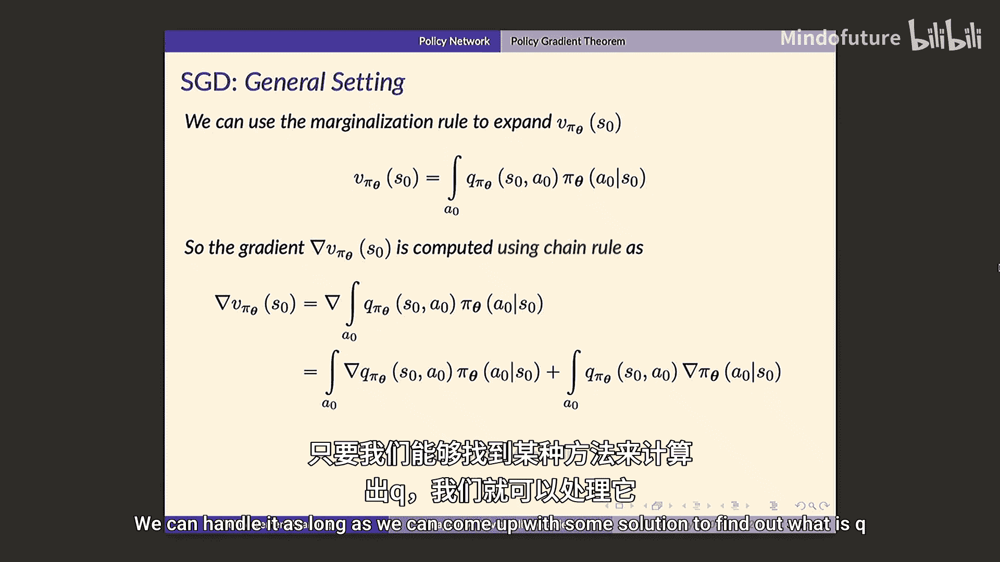

Everybody school， right？ O， so how can I do it， Any idea。Q。In one estate and one action。

I can connect it to the other states and actions by。Belman equation， right。

 So I can use Belman equation。 Maybe it' gonna make a way out。 So I'm gonna use Belman equation。

 The Belman equation。 What does it tell me， It tells me that。Whatever your state is。

 whatever your action is， your immediate reward， your immediate average reward。

 This is the first term， right， plus discount factor times expected future。Value， right。

 So this is the。Future value， the value at this state S1。 And what is this1。

 S1 is the state that you are going to transit to， given that at time 0， you're at state as 0。

 and you do action A0， right。Now， in this equation， first of all， this P of S 1， given S 0 and a 0。

This guy， what is it。Who gives us that。That's the environment， right， This is。Yes。

 this is a transition distribution of the environment。 You're gonna tell you youre at S 0。

 You do action a 1， a 0， You're gonna go to a state S1， right， So that one is the environment， right。

 This guy is， again the value function。 The same value function we started with， right？

 But the difference here is that you are now computing it at another point。 S1， right？

 And now you want to know the average value。 It means that you just think of S1 being any possible state Then you average over them。

 right。What about this term， this immediate reward。

 Does it depend on anything inside my policy network。No， right。 So if you remember the media。

Reward after doing one state in action after doing one action state。

 it does not depend on the policy， right， It tells you you are in a state as 0， right。

 and you do action a 0。 You don't care who gave you that action A 0， right。

 You already have done this， right？ You just want to know what is your immediate reward。

 This only depends on the environment again， right， So it does not depend on your policy network。

 correct。Now， I wanted to compute the gradient of this Q function， right？

 So if I compute the gradient of this Q function， this is going to be a gradient of the right hand side。

 Now， inside this right hand side， the first term， does it return any gradient。No。

 it does not even on policy， right， The second term， who is giving me the gradient。

Only the value function， right， And the value function is the same guy we started with， right。

So again， we got back to the value function the the recursive behavior。

 This is something that we always see in report。Right， Belman equation， dynamic programming。

 you always have this recursive property， right， because we assume infinite time and every time is like the previous time just change in the in the state。

 right。If you take the gradient， this guy is going to be obviously 0。

 This gradient is going to go inside， and that is the gradient of yourq function。 right。

 Now I'm gonna take this gradient。 put it back inside my original term that I started with， so。😊。

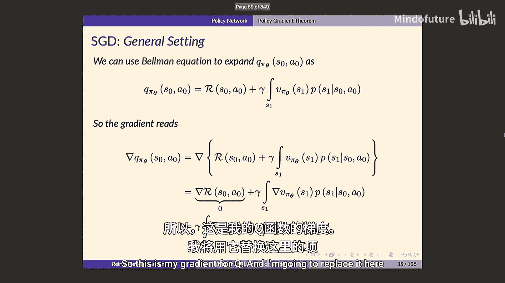

This is my gradient for Q。 And I'm gonna replace it here。 So I wanted to compute this gradient。

This gradient， the gradient of my expected value is。The average of the gradient of the values， right？

 and the gradient of the value。 So we started with some chain rule。

 And then when we wrote the chain rule， we had two terms。 One term was here， right。

 which was the gradient of Q times your pi your network， right。

 And the other term is Q times gradient of pi。 We said that the second term has no problem。

 The first term is the only term that has the challenge。 the issue， right？ Now。

 if I replace this term， this guy here。

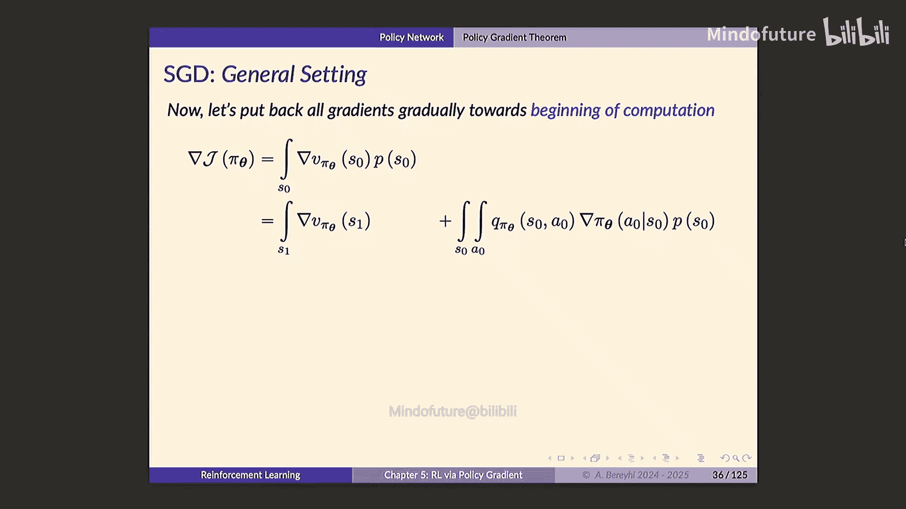

For gradient F Q， this is going to show up here， right。

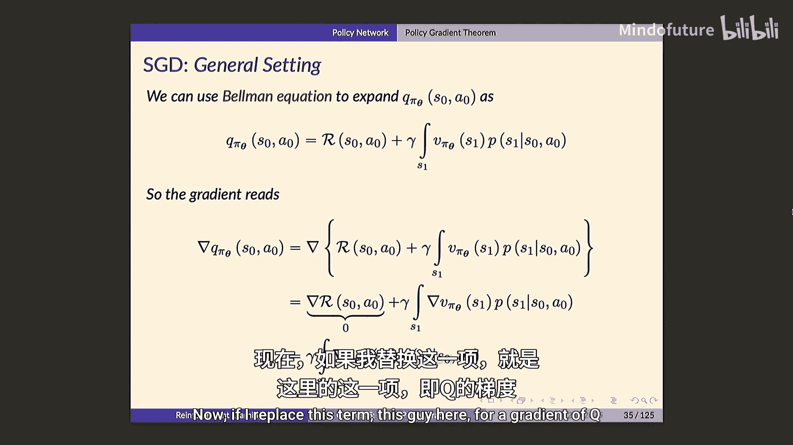

Clear。And then there are a bunch of other terms， right， What are those other terms。

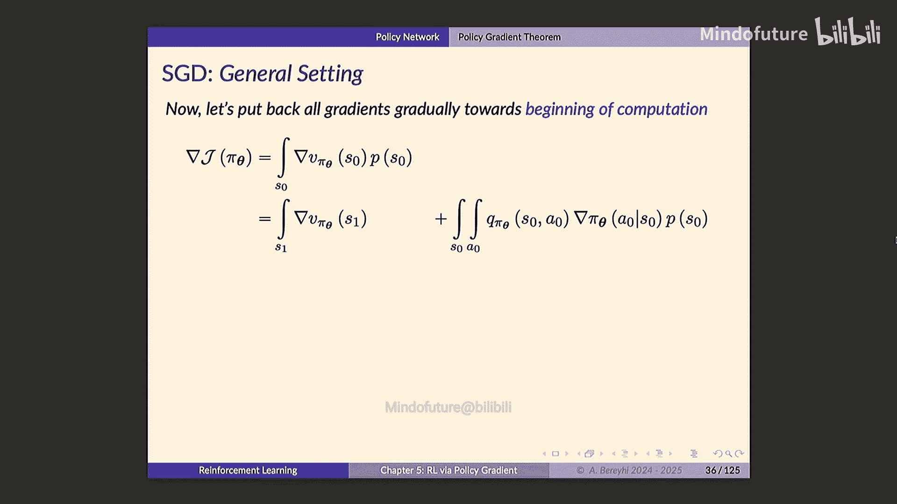

Can you tell me， So， of course， one of them is this guy， right， PS1 given S 0 and a 0， right。

 What else I should have。I get this term， right， and put it here。

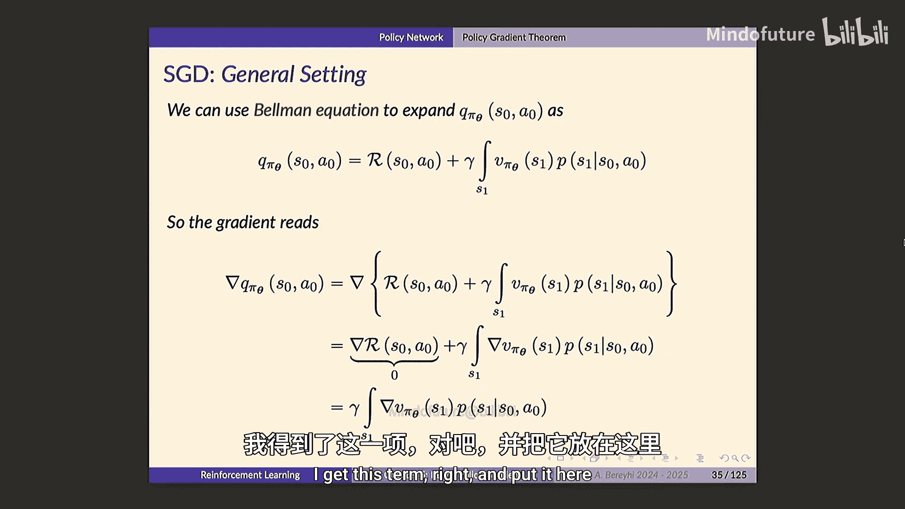

Put it inside replace it here， right， Then this term is going to also show up， right。

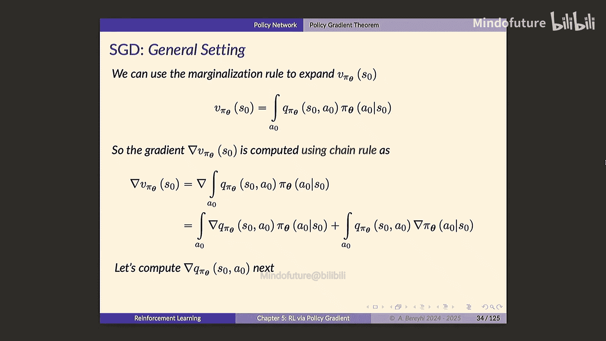

Correct。So if I get this gradient， sorry。If I get this gradient， right， this is gradient of Q， right。

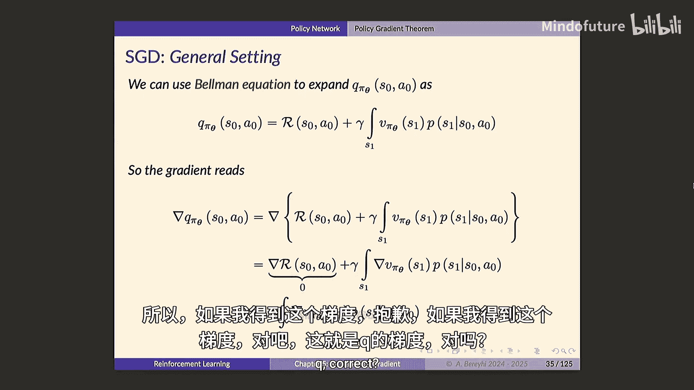

And I put it inside this term here。 gradient of Q。 This is going to be gradient of my value function in the Nus state。

P of the environment， right。Times pi， correct。Now， if I， again。

 this is the gradient of V at a state as 0， right， And now what we are computing。

 we are computing the average of that guy again。 then there is， again，1 P S0， right。

 So I don't want you to remember every single term。

 The thing that I want you to notice here is that those terms left after this gradient of value at S1。

 all of them are distributions， right， PS1 given S 0 and a 0， right， pi of a 0 given as 0。

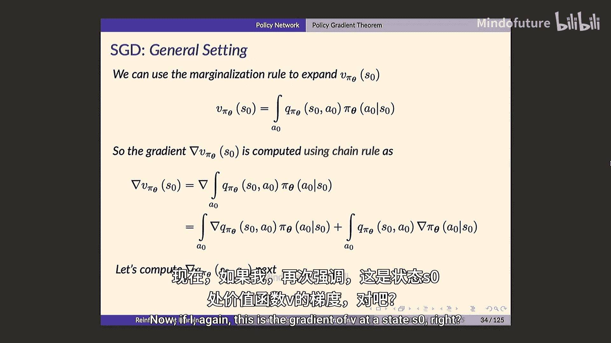

P of S 0， right， These are the terms showing God there。

 So this is going to be the terms that you have here， right， P1 given S0， a 0 pi a0 given S 0。

 P of S 0， right？ And then you are taking integral inside this with respect to everything， right。

 S 1， S 0， a 0， right， So what does it mean。It means that you have that gradient with respect。

 You S1 left there。 And inside that， you have S 0 and a 0， right， Now， look at this term。

 What is this guy。So you start with this state as 0， right， That happens with some chance， right？

 Then you you do action a 0， doing action a 0 again happens with some chance， right。

 What is the chance of that， given that you are at s 0， That is a 0 given pi of a 0 given a 0， right？

 Now， this two terms together is just simply the probabilityvolty of a 0 and a 0 together happening。

 right？ And then you multiply it with this probabilityvolty。

 This is the chance that you are at s0 and a 0。 And then your environment takes you to s1， right。

 Everybody is clear。So this term， all of it together is the chance that you start with S 0。

 You do action a0， and then you transit to S1， right。But then you are marginalizing over S 0 and a 0。

 right， So you're getting rid of S0 and a 0。 What does it mean。Is the provolty of S1， right。

 It's a distribution on S1。 It's giving you the probabilityvolty of at time1 being at S1。

 given that you randomly started and you played with your policy， right。Everybodys cool。Questions。

So now， when you look at this term， this guy depends on your policy， right。

 This is not like your initial state anymore。Because it's true that you randomly start。

 But getting into S1， it also depends on your policy， right。 What did you do， right。

You need to know what action you have taken。And then you go to this one， right。

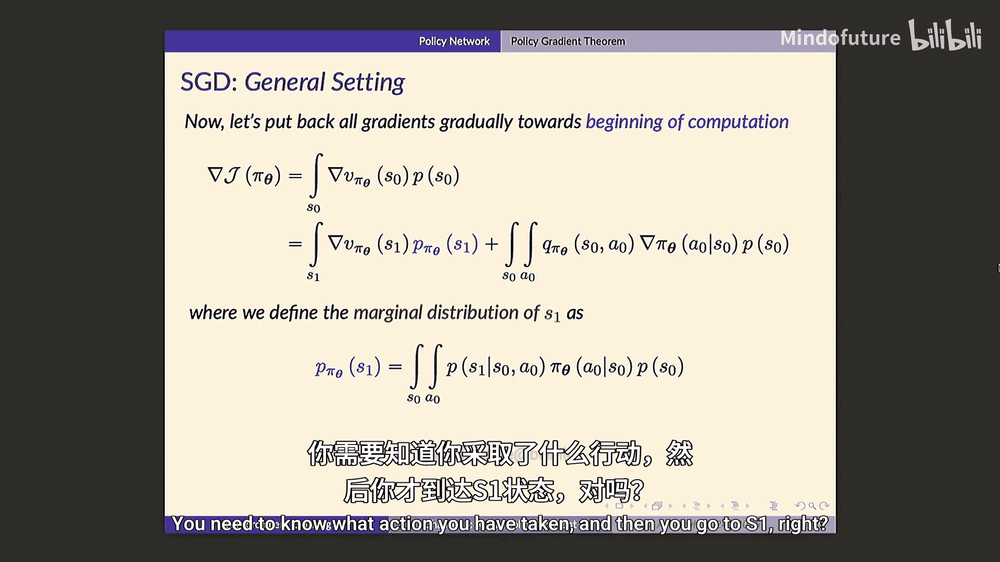

So this per distribution depends on theta as well， right， on your pi theta as well， on your policy。

And if you remember did roughly the same thing， but with trajectory last time， right， And I told you。

 if you fix as 0， then the trajectory is completely explained by your environment and your policy。

 You know， you see it from another perspective。 here is a more general perspective。

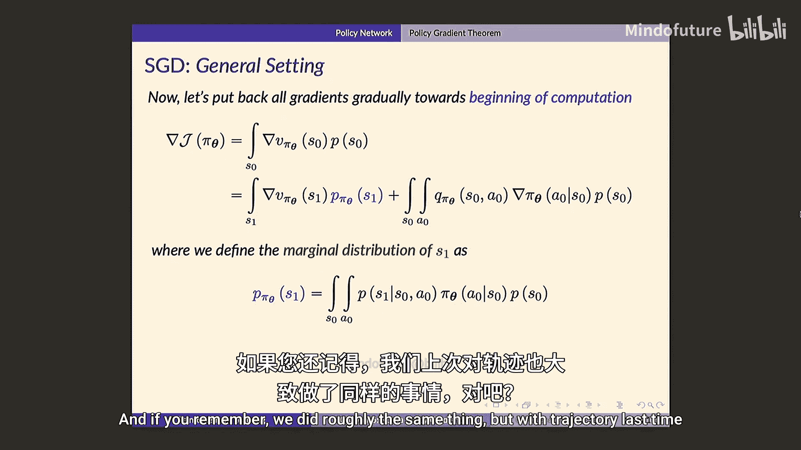

Everybody's cool。我现。啊。Yes， the gradient here， when we start it right。

 when we wanted to compute the gradient of value at0， right， And then we just use this expression。

 Then we take the gradient inside。 So gradient of first term times the second one plus。

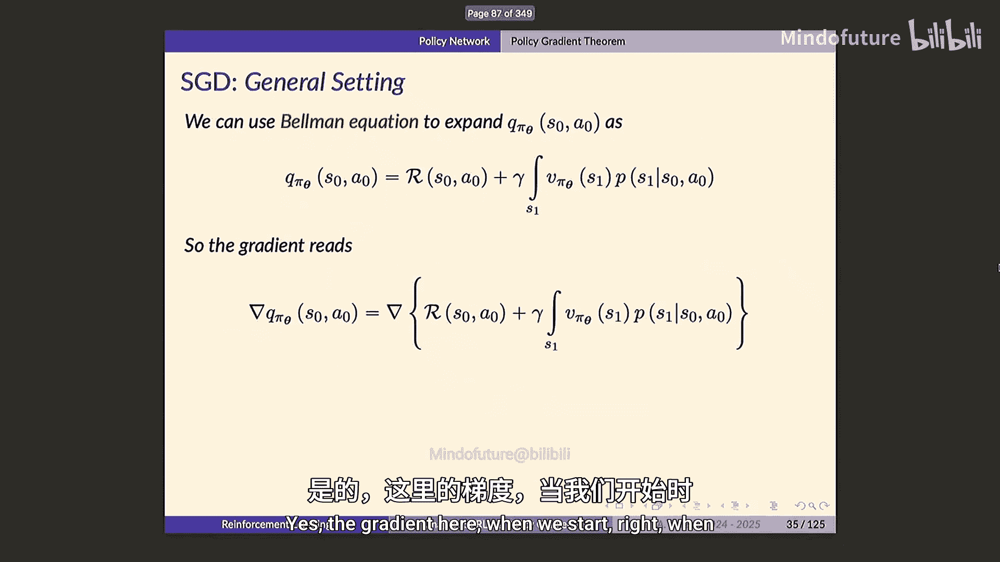

First， turn times gradient is the second one， right。Right。Yes， now you want。

 you want to compute this guy， right， We just computed this one。It's this guy， right。

So this is the expectation sorry， Yeah， average or marginalization over S1。

 say integral over S1 gradient end of the value at this one， right， times the。

Distribution of your environment， right， Now， you take this integral completely， right。

And you put it。Here in this term， right。In that term， they gonna be the integral with respect to S1。

Right， gradient of the value at this one。Per environment， right。Yeah， so you have P F。

 your environment， your pie also showing up and the gradient of your value this one， right。Now。

 this is the gradient up as 0， correct， value as 0。

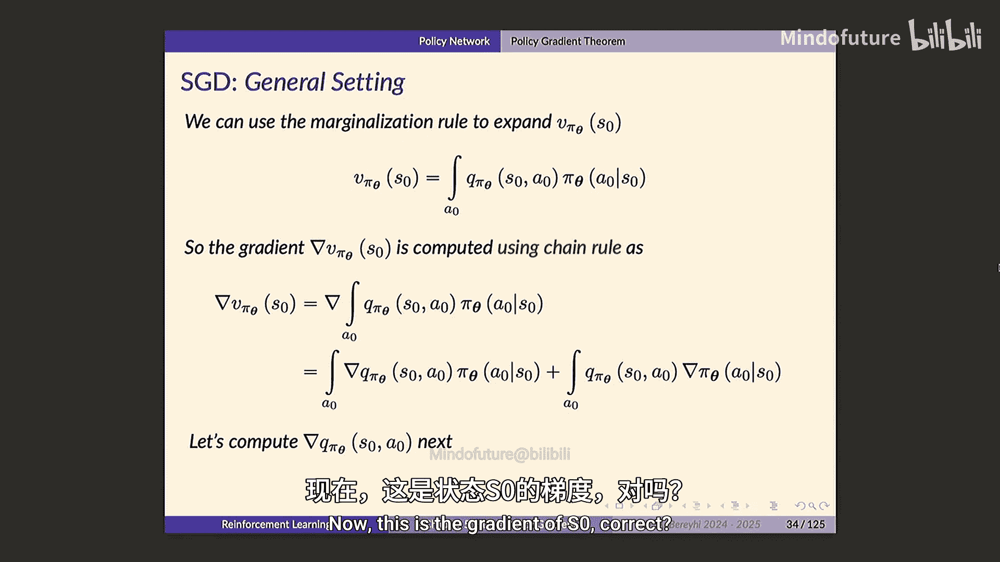

Yeah， now we come here。 So the gradient of the value at as 0。 forget about S 0 right now。

 So you're gonna be this gradient times those two terms， right。

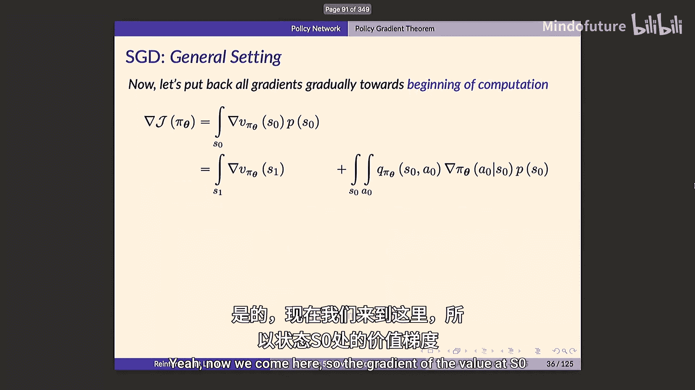

Yeah， that right term is the second one here， this term。So I kept it as before，Okay， okay。

 And now finally， you get integral over S 0 as well。

 Like your average over your initial state as well， right， And this is the last integral here， right。

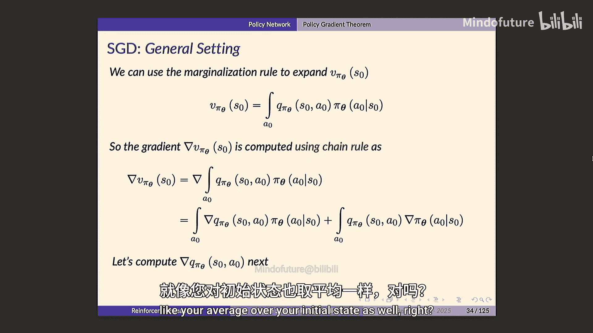

Yeah， which is showing gu also here。Questions。So， a school。Oh， this。 you're right。

 There should be a gamma here。 I'm missing that。 Yeah， it's a typo。 Just always set gamma 1。 Okay。

 we had them full of typo。 So I always say gamma。 Yeah， you're right。 Here should be a gamma， so。

Okay， so。Aro school， right， So this is going to be the gradient of the objective that we want to compute。

 right？ And now the thing that you can do， you can do a bit of trick here。 What is the trick。

 So I could say that that P of S 1 and P of S 0。 They are two distributions。 One of them is on S 0。

 one of them is on S1， right， But if you integrated over this state state space。

 it gonna be always one， right， because it is a distribution， right， Now what I'm gonna do。

 I have these two terms， right， This guy is just taking expectation with respect to S1。

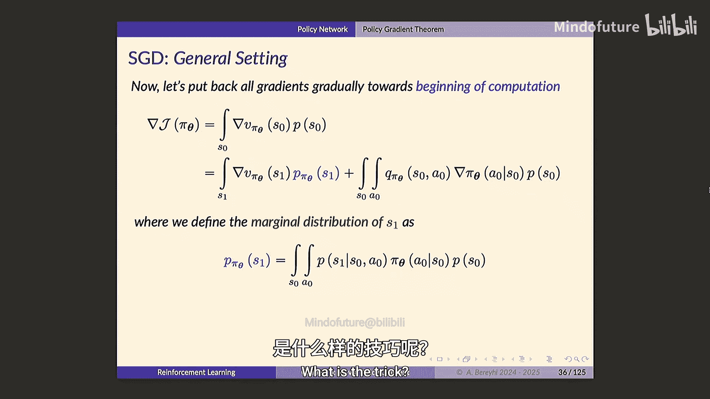

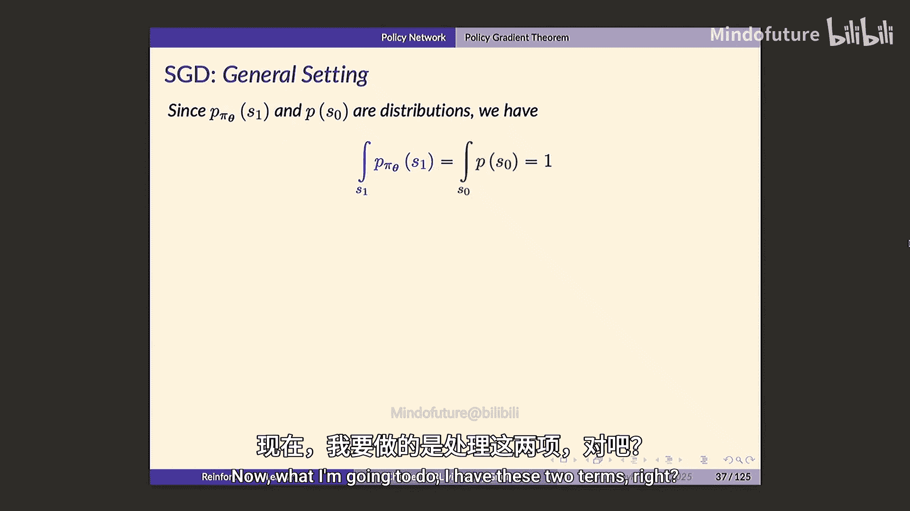

This guy is taking expectation only with respect to as0， right。I'm going to add。

Integral over P F S 1 to this term and integral over P of S 0 to this term。 Okay。

 it's not going to impact anything because that integral is simply one， right， So what I'm going do。

 I'm going say the first term does not have as does not have a0， right。

 So I'm going to put that marginalization over P0。 That term is is simply1， right， the green term。

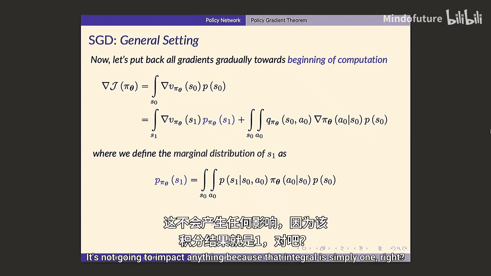

So if I multiply it or not， nothing going to happen， right。Same thing for the second term。

 The second term does not have S1。 So I'm going put this。Margiernization over PS1。

 That is a gain one。 If I multiply it， it， it does not impact anything， right。

But the thing that is going to happen now is that you have this term。

 and then this term is expected here is expectation over your first estate sorry。

 your initial estate， your first estate。 Here is again。

 expectation over your first first estate and initial estate， right。Now。

 if you just so things down up a bit， like you take integral completely out。

 you just look at the objective。 if you factorize everything。

 you're gonna end up with such an expression。So what is the expression here。

 You have the marginal distribution of your estate at time one， right。

Marginal distribution of your initial stay。Then， you have your。1 gradient。In turn the。

 the gradient of your value function。 And then this term here， right。Everybodys cool。 You see it。No。

This gradient that I want to compute。 Like， I told you， this gradient is no problem， right。

That is totally fine， right？This is Q function， assuming that I have it times gradient of my policy。

 I have my policy network。 I can compute this this gradient。Okay， this term is okay。 Again。

 this term is a problem， right， But if you want to compute this term， what can you do。

Let's get back in this slide。

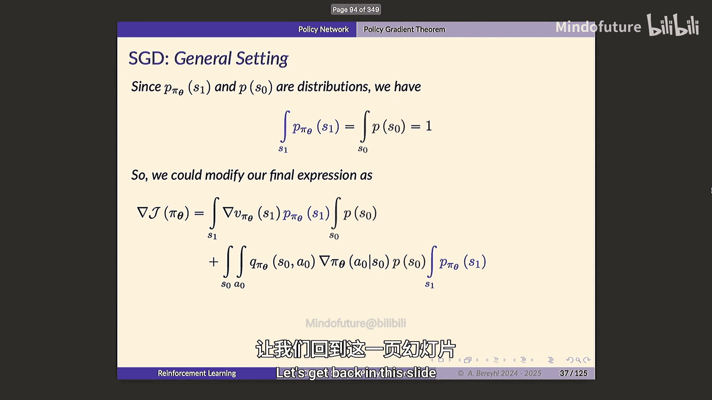

I wanted to compute。

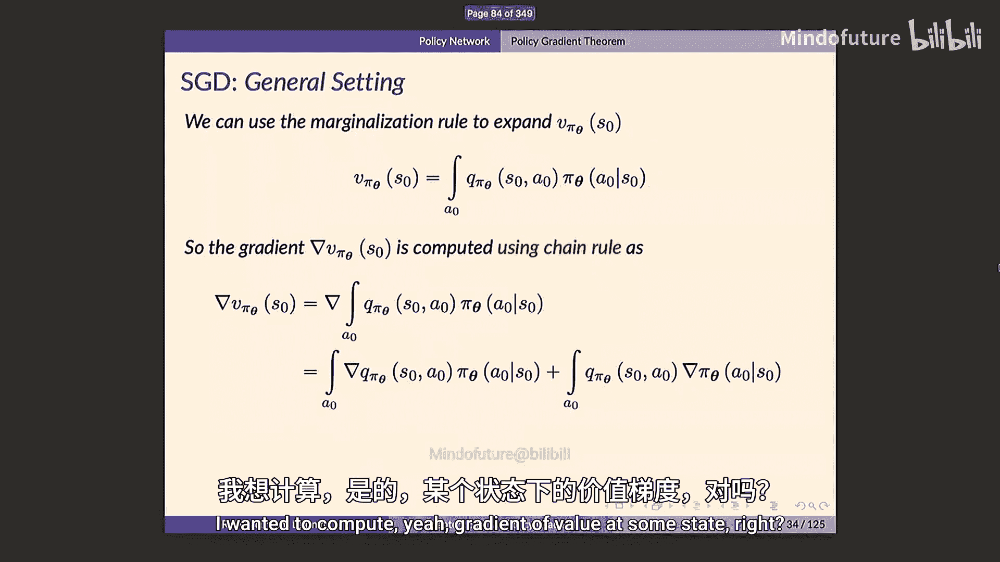

Yeah， gradient of value at some stage， right， All we did is basically to compute that gradient of the value at at one stage。

 right。Advise clear。So we started computing the gradient of value at S 0， right， And then we compute。

 computed， computed。 We finally ended up with this term。 And this term。

 it has the same thing that we need at point S1， right， with another term that we can。

 we can already compute， right。

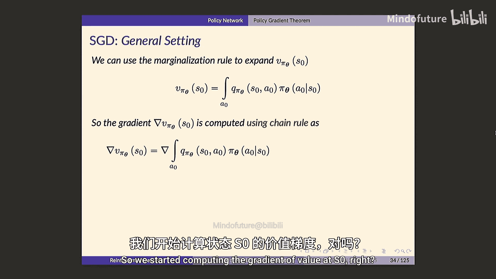

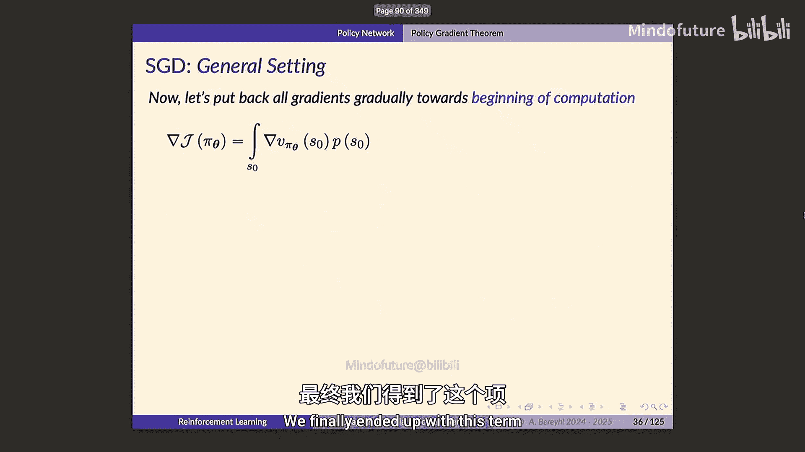

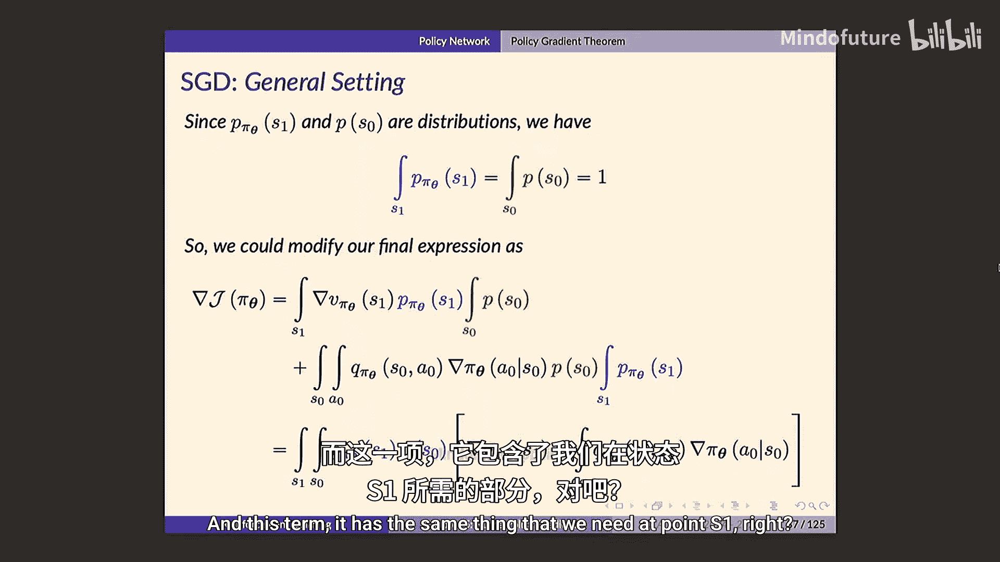

Everybody school。You see this recursion here？Okay， now， what can I do then。

 I can again repeat the same thing。 I can say that as I start from point S1， and then I again say。

 okay， I am going to transit to S2。 And then when I transit to S 2， I have the environment。

 So I first act what my policy， then the environment gonna take into S2。

 And then I do exactly what I did up to this point， right， And then I'm going to end up again。

With the same term as this one here， I'm gonna have it again here for S 1。Right。

And then another gradient， which is for gradient of the value function at the point S 2， right。

 And I keep on going like this in time。Then as time goes to infinity。

 if you do not do any typo and you keep the the discount factor， that term is going to vanish。

And you're gonna have exactly the same term getting copied over and over and over。

 The only difference is that it's calculated at different estate points。Okay。Now。

 I don't want to make it more complicated by just giving you more and more equations。

 So if you do that is the the main contribution Sutan did in 1992。

 then you're gonna end up with such a term。

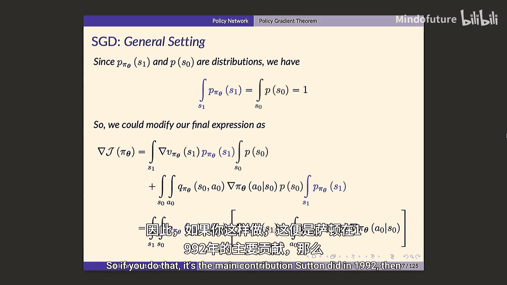

And this term， even though you're going infinite in time。

 this is just converging to a kind of fixed point。So what is this term， you would say my gradient。

 this term that you see here， This is exactly the term we have here， right。

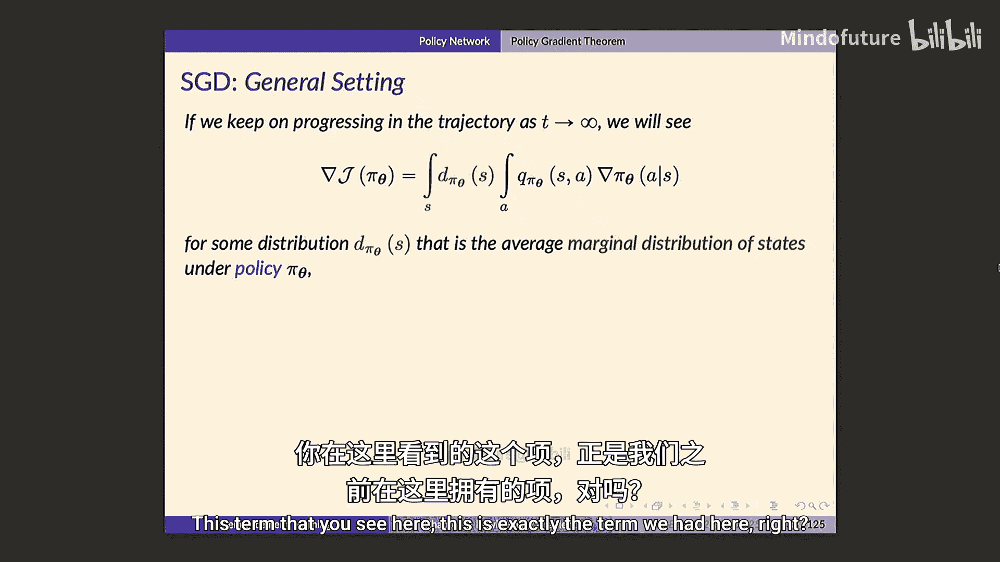

The integral or the expectation of this Q term， right。

 the marginalization of Q times gradient of my policy， right。

 And this term is again this guy at point S 1， right， plus something else。

 that something else is again， same term at point S 2 plus something else， right。

 and you keep on going like that， right， at the end。

 you are going to get rid of this term when S goes when t goes to infinity， right。

 and you remain same thing copied over and over。 And then you can simply use the fact that S inside itself is a random thing。

 right， And then you end up with this term， right。

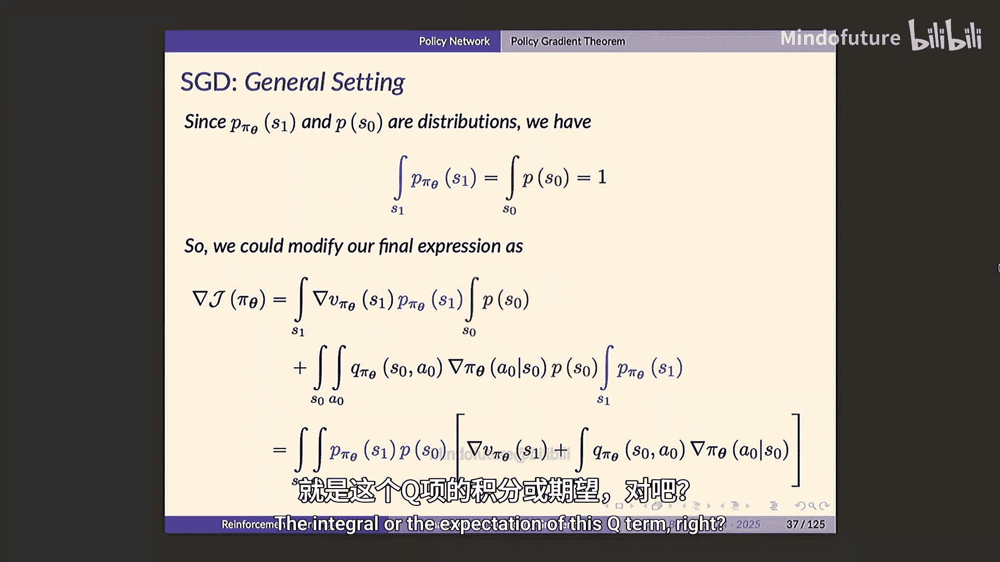

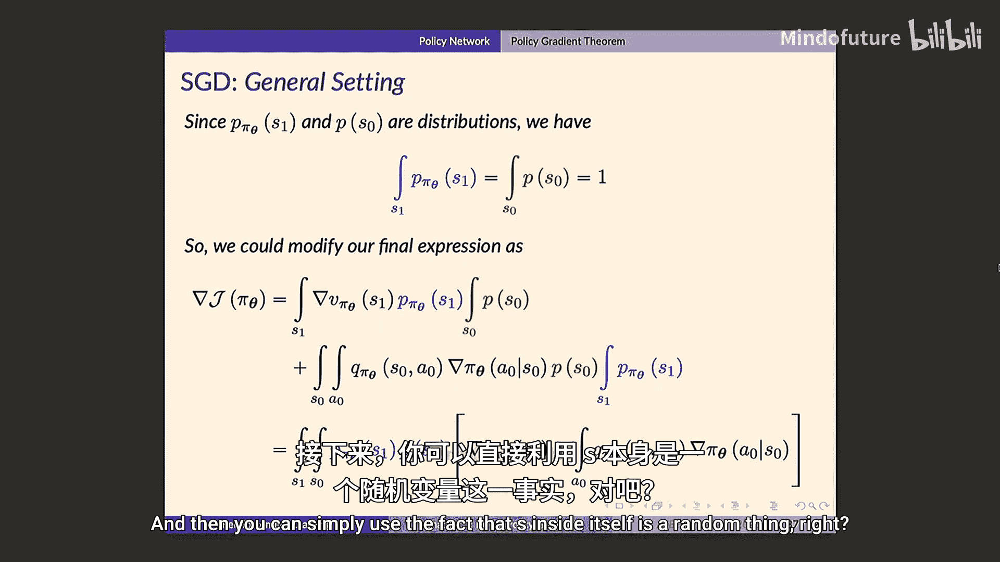

So what is happening here inside this term， This Q function that you see is the Q function of your policy pi。

 okay。Its it's computed at one particular point as。And one action A。

 And then it multiplied to this gradient。 That's okay。

 And you're gonna get rid of the action by taking this integral， right， The thing that comes out。

 it only depends on the state， right。The the term that comes out of the。

 the inner integral is going to only depend on the state S， right。Everybody cool。And now。

 the thing that you need to do is to just average it with respect to that is state S， right。

But what should be the distribution that you are going to average with respect with。Well。

This was the whole trouble that we started all of those trajectories with， right。

 And then by doing the approach I told you， you're gonna end up with one term like D pi Theta。 Now。

 I'm not showing exactly how does it look like because it's not important at all。

 at the end of the day， we are doing it by sampling。

 But just to give you a kind of idea what that guy is。

 is a sort of average of all marginal distributions。

So you have your initial marginal distribution is PS 0。You have your first marginal distribution。

 PS1， PS2， PS3， and you go on， right， But when you look at the term here。

 they you don't really need their joint distribution， right。

 you just get multiplication of their marginals， right， And then these this term。

 If you just do a geometric averaging over them。 then it' gonna give you exactly the de term。

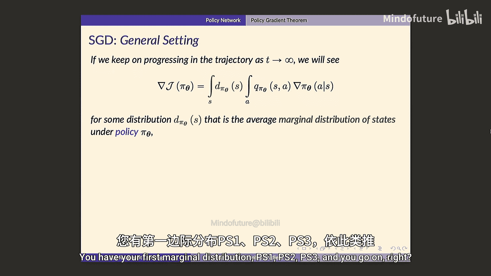

So this was the contribution by Saan that he showed， okay， this guy， there's one distribution。

 That distribution is essentially the average of your marginal distribution at every single time。

 And then that distribution， if you know it， then the gradient that you are looking for。

 is this term。

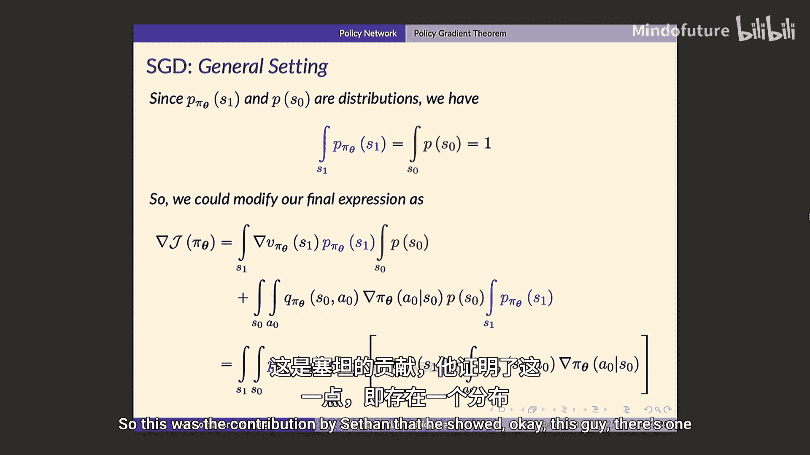

Average over that distribution， right？ now， why I am not showing it here。

 because at the end of the day， we are not going to average over that distribution。 You can guess。

 We are going to just do it by sampling， right， We are going to estimate， right。

 the only key factor here for us is that this guy is a distribution， right， And some this state。

AndIt's coming from average of the distribution you see when you play with your policy， right？

 So you you start with your policy at one state。 then you're gonna take you on different states。

 right， and this policy is going to give you somehow one distribution for every single time as a state right？

 But you can sample that one。 But just starting from some random state and keep playing right。

 when you play， you have one one sample of every single time， right。

 and you can do the same thing again and again and again， you're gonna collect lots of samples。

 right， So that is not really important。 If you want。

 you can check the paper by sudden you see the the exact expression that he has right， But as I said。

 you're not going to use that expression， The only thing that we use is the fact that we are actually doing the average of this term。

 right？ And now this might somehow recap what we did last time， because last time。

We ended up having some term here， which was the sample return G。

 And you can guess that that sample return G was an estimator of this one， this Q term。

 and then gradient of the look likelihood， which we got it out of the lock trick。O。Everybodys clear。

So I do know that the math behind it， it might be a bit。Messy to just catch immediately。

 But I hope that you got the idea。What is going on here？So the key idea is that you just。

 if you want to know what is the gradient of the average value。

 you basically need to compute average of this， this inner integral。Okay。

 and I'm gonna use that inner integral to just build different loops。To optimize my policy effort。

Questions。I question。Is it no question because it's。Obvious， or is it no question because it is。

Not worth。I ask him question。Yeah， I totally understand。 I mean， as I told you。

 the first time I studied this one， I personally， I was wondering like。How did。Why he， I mean， you。

 you do all of the math。 But still when it's over， you， you have a bit of confusion。

Why this is useful， right？ But then when you get into building the loops。

 then building the training loops， then you get， you you still understand appreciate this。

 this result。 But it was a very， very sophisticated work in 1992 by Sa that he understood this。

 right。

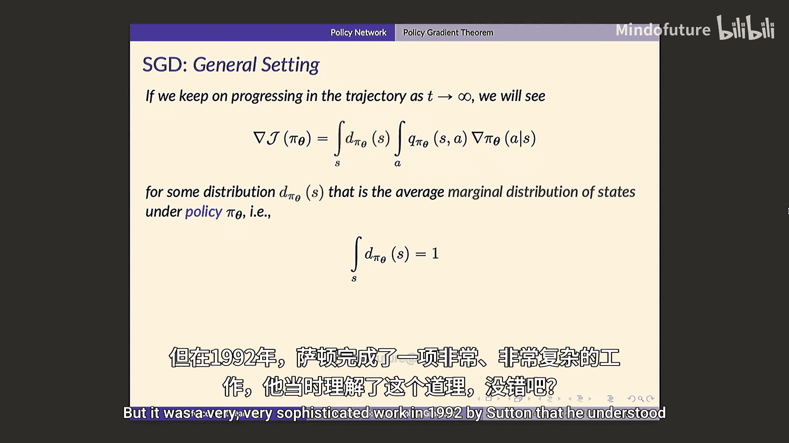

Okay。So I hope that is 50% clear what we're doing here。 But if you had a question， just ask me。And I。

 I mean， what we do next is going to get less attached to this result。

 But I wanted you to just see the result。O。O。So， moral of a story。

The gradient that you are looking for， the gradient that is useful for updating your policy is going to be essentially the average of this term。

 right， So it's a Q term over one state and one action。

 What is that is state in action is a random state in action， right， random in time。

 random initially random action by your policy network， right？ So that is state in action。

 This is your policy of that action and state。 And we wanted to compute the gradient of the policy。

 We talked about it。 there is the log trick， right。

 So you write the gradient of the policy to be the policy times gradient of the log， right？

 and that is what the whole thing that you need to compute the gradient。 Now， if it was a bit。

Hard to catch the details。 It's， as I said， it's totally natural。 I totally understand。

 Just take this at this point。 Okay， and forget about everything before。So this is the。

 the most important result that you need to consider。Now。

 let me just write it down a bit more compact and then gonna make more sense to you。

 So this guy is the term that we calculated said， well。

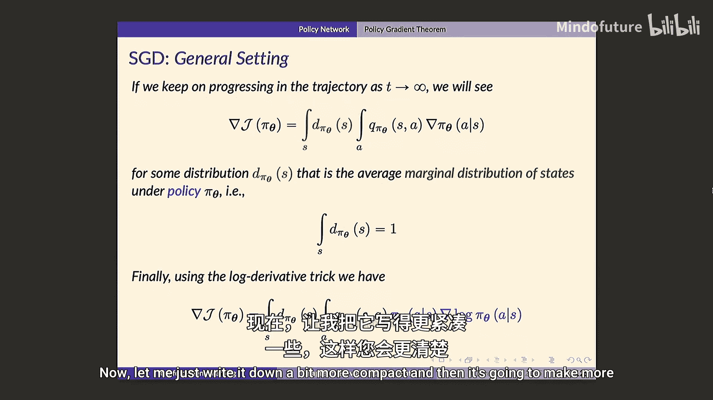

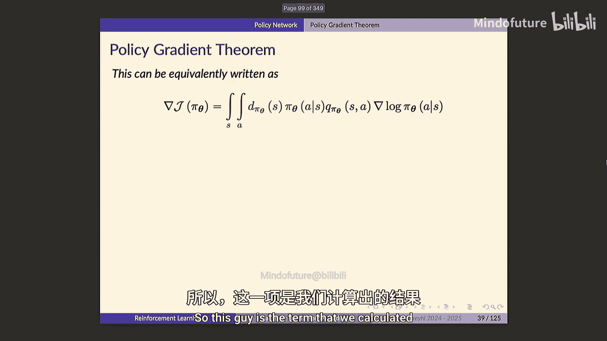

This D of pi theta is a distribution over the state， right。Correct。Is it。

Density function over this data space， right， giving you some density for every state。

 adding integrating it， it' gonna be one。 And then pi a given S is the conditional distribution of your action given the stage。

 right， correct。Then what you can say， you can say that， okay。

 this whole thing is one giant distribution， the distribution of state and action action here and what you're computing is basically is an expectation。

 right， So the gradient that you are looking for is the expected gradient or the expectation of the Q value at one random state in action multiplied with the gradient of the logarithum of your policy effort。

 right。

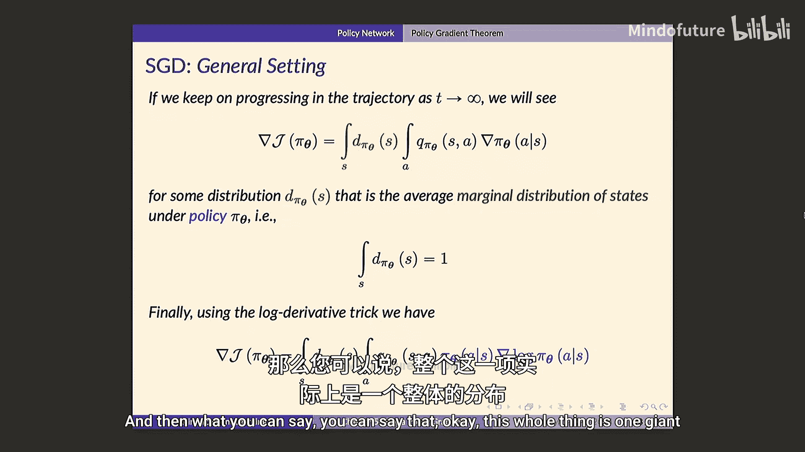

And this is why this result is important for us， because you can use this result by sampling to somehow get an estimate of the gradient you are looking for。

 right。Everybody's clear。Whattion。Sorry。D P theta expression。 There is one distribution。So。

 for example， say Gasian distribution， right， how that distribution is computed， as I say。

 is the kind of average of the marginal distributions。 If I start particular state as 0。

 I start with some distribution。 I random uniformly start at one point， right。

 And then when I do that， then I act by my policy。 And I get into another state， right？

 this new state。 again， I have a distribution。 What is the distribution as of that guy。 Well。

 this is not necessarily the same uniform distribution I started with， right。Because if my policy。

 for example， tells me， always do action 1。And then my environment， on seeing action 1。

Regardless of what this state is， is's going to take me to a state， too。

 Then the distribution of a state in the next time is simply。Hot one hot vector at a state， too。

 right， I'm going to only be at state too。 I'm not going to be at any other state， right。

 So it depends on my policy。 It depends on my environment， right， now， but you can， if you in。

 in a imagine world， if you know what is the MP， if you explicitly know what is your policy then and you are able to do the computation。

 you can。Compute， what is that density function， right。Now， you're at this estate。 again。

 you play with your policy， right， and you do one action。 You get into another state， right。

 And in that estate， again， that distribution of this estate。Is different from distribution。

 And the first first time is different from this distribution you started with， right。

 how you can compute it again， if you know the policy， if you have the computation， if you know MP。

 you can compute that one as well， right you can keep on going all the trajectory towards the end。

 right at every single time， you have one marginal distribution on that state， right。

 So these distributions， if you combine them， you do not really need to know the join distribution。

 just the marginal distribution， you multiply them， then you do geometric。The term that。Again。

 a distribution， right， It means that if you integrate it over this state。It's going to be one。

 It's always not negative， right。So that is a distribution。 That is a super duper， weird。

 complex distribution， but it's still a distribution， right， And it's somehow telling you。

 in average。 So it's like you think， okay， I randomly started some time。

 So like I had the whole trajectory。 And I just randomly choose the time。initial state。

 And then I play with my policy and get to that time and see what is the distribution， right， now。

 what is， in general， the distribution of this random variable。

 which is the random state at random time and one random trajectory。Yeah， that is the。ok。

It's a bit complicated to just put it in a very simple words。 I do understand。

 But somehow you can think of if you do not constrain your estate to initial state or last estate and you do not constrain your state to to be like on one specific trajectory。

 you're just thinking about one random state happening in this environment， right。

 when I am playing with my policy， then that distribution is deep。I we say， all right， now。

 this is simplifying the whole story because when we started。

 we had to work with the complete trajectory， right， And that trajectory could be infinite， right。

But here， you just need to think about a random stay。Right， and then you need to just see what gonna。

Be the action。 if you just play with your policy， and then you can compute that term， right。

If you do know the distribution， right， well， I do not know the distribution， it's okay。

 I play with my policy so many times。 And every single state I get into is one of the samples of that distribution as well。

 right， And then I average over them。 right， So you say is's a huge reduction in complexity。

 It's gonna make the computation of the gradient feasible。Questions。Was is clear。Okay。

 so moral of a story， the gradient that you need is this year。Okay， so， yeah，1992， Richard Sutton。

 I mean， you need to really appreciate him。 He， I mean， before him。

 reinforcement learning was not really is。Like separate branch of machine learning。

 So he was the one。 when he wrote his book， people started to treat it serious。

 But like he did a huge， huge contribution。All of the literature。

 So he put my single handedly just develop all the literature early literature， at least。

 So that is what he called it policy gradient theorem。 So he said。

 if you want to know what is the gradient， which is useful to update your policy network， Basically。

 you only need to know what is the gradient of the logarithm of your policy。

 the gradient of the look likelihood。 right， That's the only thing you need to know， the rest of it。

 you can do it by sampling， right， and you can get this guy multiplied it by Q。

 if you want to be precise， right， if you don't do that you're still getting a bit of maybe bias。

 a bit of variance， but it still that is a good gradient， right。

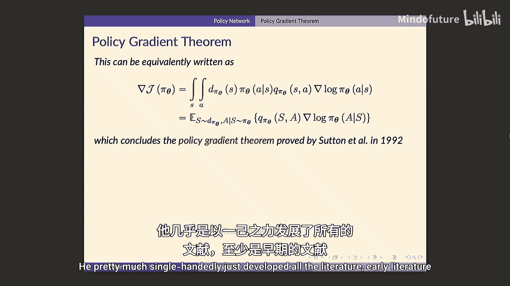

It's not a bad gradient， right。Everybody's clear questions。

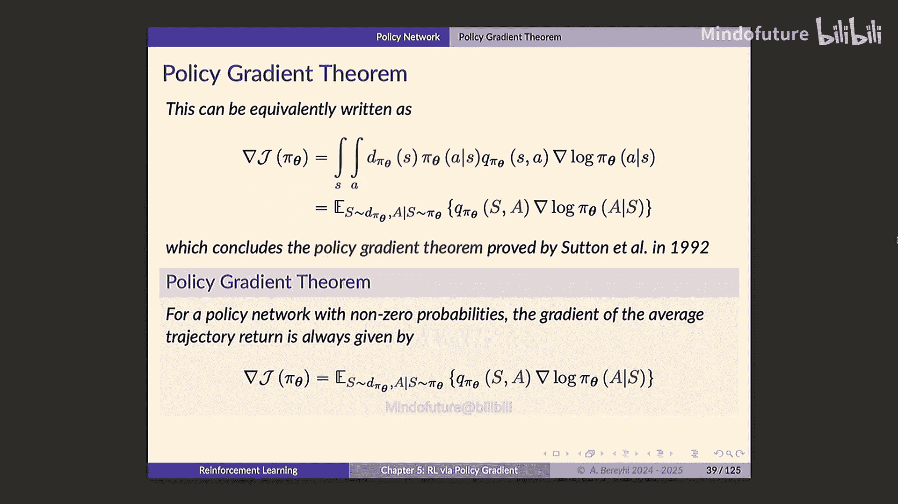

O， so。If there is no question， then。Let's呃。Let's try to start using this to develop the policy gradient method。

 So as I told you， this is the basis of all policy gradient approaches。

 you might tell me what is specific about it， Well， I try to explain hard。

 but I do know is a bit a bit of details into it。 But the key point that you should take from this result is that gradient of the log likelihood is the main thing that you need to compute your your policy network。

 Okay， and you might say， okay， why why you are so surprised with that。 I'm not surprised by that。

 But the key point here is that like if I initially tell you， I have a policy network。

 I want to make it。Trained side that it's optimal policy。 Which direction should I move。

 Which direction should I use to update my policy network， right？

 So how do you know this should be the direction of the gradient of the logarm of that policy。

Who knows， right？ Why shouldn't it be the gradientduct E to power that。

Why shouldn't it be the gradient of some polynomial function of that。Right， Who knows that， right？

 Well， if you know a bit of maximum likelihood， you， you would say， okay， a log likelihood is is it。

Good choice， right， But what is the reason， Is there any concrete reason for choosing that。

 Then yeah， this result says yes， there is a concrete reason for doing that。 Just do that， right。

 And it's not only saying that it even gives you this Q term。

 which says if you put the Q term exactly， this is going to give you the right。The right estimator。

 right？Okay， now we could have had much more complicated term for the gradient。 but yeah， were。

 we don't have。 I mean， it's a good thing。 This is why we can train a policy network。

 And that's the key point here。 So now。

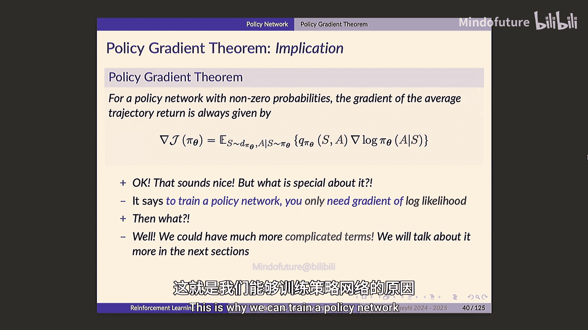

As I told you， this guy is the main。Component of all policy gradient methods。

 whenever you want to update one policy network， you're gonna sample something。

 And every time you try to just estimate that term inside the the expectation。

 So you forget about everything like this expectation with respect to whatever it is。 right。

 So you're gonna remove everything。 you just think of an expectation。

 And then you try to estimate it， right， this is the only thing that you do in policy gradient method。

 But well， though it sounds simple， it's gonna be complicated when you do it。

Because it' going to get honesttable and we tried to just find it out。

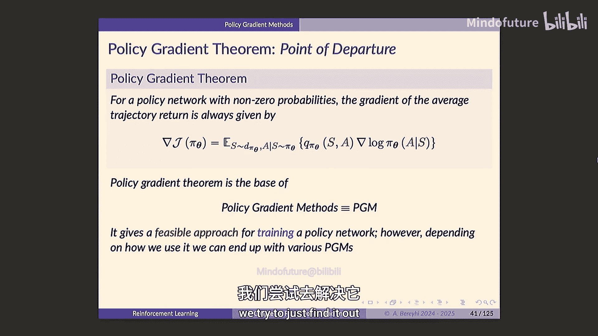

Okay， so。Now。I'm gonna give you just let me finish this one。 Then we're gonna have five minute break。

 So if we think about the policy gradient methods。 you can use this result to design your policy gradient method。

 They are in practice three major versions of policy gradient methods and remember。

 we're not yet talking about actic approaches。 Okay， Just forget about them right now。

 policy gradient method， It means that you have only one policy network。

 and you want to just sample the environment。 find out what is the right direction to update that。

 You keep on updating it。 You hope that eventually it gonna converse to the optimal policy。 Okay。

 so this is what you want to do。 you can do vanilla policy gradient method。 How you can do it。 Well。

 you randomly sample the environment。 You compute this gradient。 You compute this Q term， right。

 a sample of that。 And then you just average those terms， right， using Monte cargo， for example。

 This is going to be the vanilla。Policy gradient method。

 basically a reinforced algorithm that we talked last time is is a vanilla policy gradient method。

You can do baseline。 We're gonna see today， and we see why we should do baseline。

 because vanilla1 is usually very unstable， simply because of， you know， the shift invari of your。

 your gradient term， the term inside the， the expectation and。

But even if you do that by doing the embarrassing trick， I mean， the the baseline。

 you still get into stability trouble。 You don't get that a stable result。

 And this was somehow left as a kind of nice result but not applied result for a quite some time till 2014。

 I guess something like that。 that the idea of policy gradient with tro region came out。

 That one is really interesting right， And I I know that you would say， okay。

 if I say a really interesting。 this means that is。No， but that one is really interesting。

 right So that that trust region idea was the very interesting result that they started to understand why this is unstable。

 And interestingly， this is simply because of some sort of implicit。

 important sampling that the policy gradient method is doing without us knowing that。😊。

So we're gonna to talk about that and that。

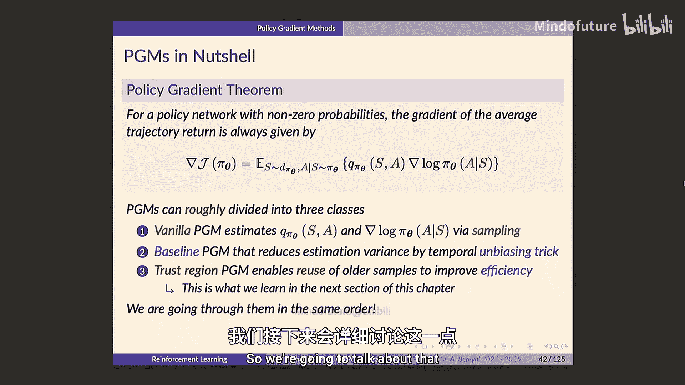