# 【多伦多大学】强化学习 2025 ｜ Uoft   Reinforcement Learning   Fall 2025 p49 P49_讲座_48_原始与基线策略梯度方法 -BV1D3F2zhEry_p49-

Now， the very first approach is just the。

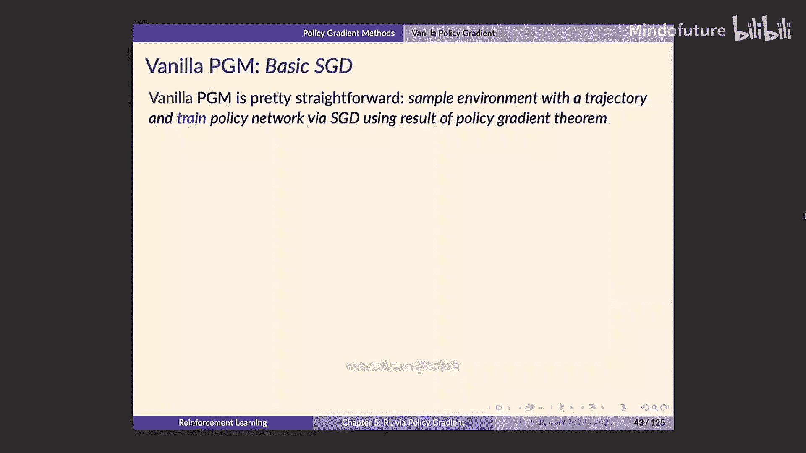

Van PGM， or just you do basic e stochastic gradient decentcent using the gradient estimator that we have found。

 right， so。

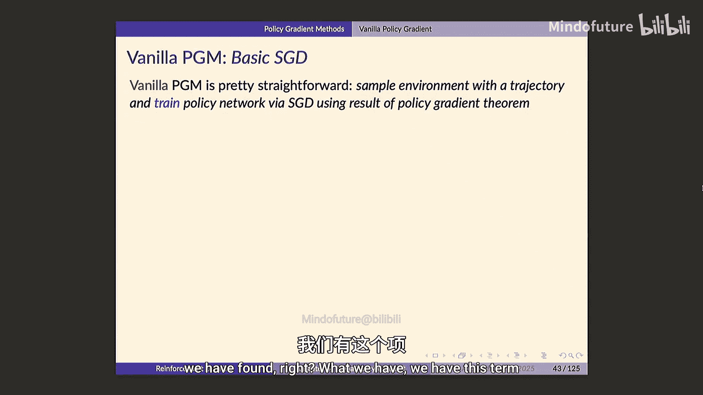

What we have， we have this term。 So this expectation。

 the expectation of this Q times the gradient of the policy network is lot lot likelihood。 actually。

 that term is the estimator upwardward gradient。 we can just sample from this， right。

 I can start from one initial state。 And then I keep on playing with my policy network。

 each time you gonna take between new estate by doing some actions。

 So I have the trajectory of these states and actions and also sample returns， sample， sorry values。

 sample sorry。Sample rewards。 So I can estimate this guy。 I can find oneestim makeator of this guy。

 I can。Compute one estimator of this guy， one sample of this guy。

 And then I can simply use that inside my training group。 So what does it mean。

 It means that I want to update my policy network。 So each time I need to update it by some gradient。

 right， And that gradient， I do know how does it look like this is the the way that my gradient looks like。

 And since I do not have exactly access to those distributions， I cannot compute that expectation。

 I am going to just simply estimate it， right， So I would say if I am I am having this trajectory。

 I'm going over time this trajectory。 then when I am in one particular time， right。

 at that particular time， the estimator of my gradient is simply the estimator of my Q function。

 how can I estimate my Q function at one single point， say I am a time 1 S1 a1。

 How can I estimate my Q function at this point， S1 a1。

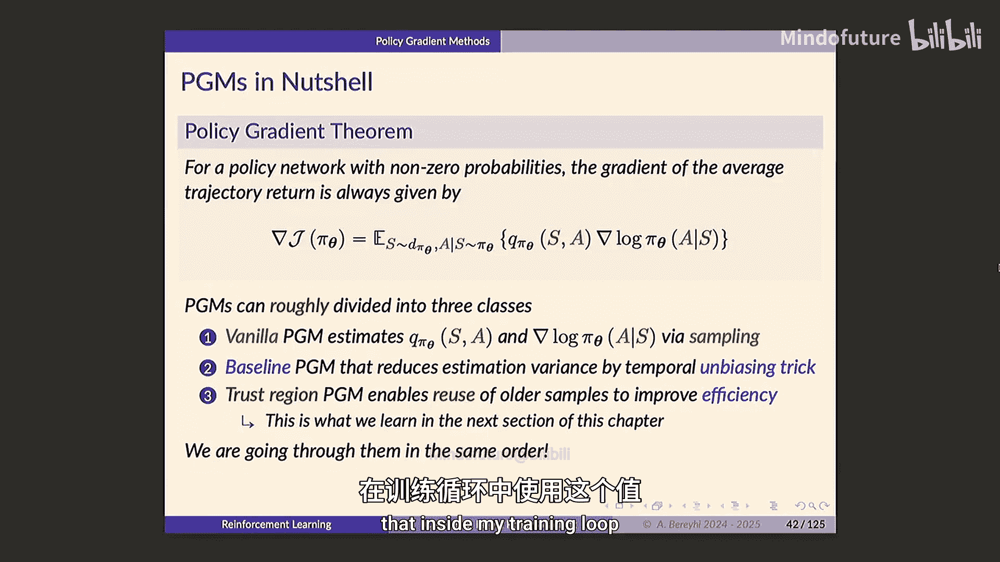

You just sum up whatever you get after that， right。So I am in state 1。 I do action 1， right。

Say my state1 is this location， right， and my action is to just go right， right。

 And then I keep on playing towards the end。 The game is over。 Now， I just collect whatever I I I。

 I just add up whatever I collected as reward from this go this point on， right？

 That is one sample return， right， And that sample return is given this fact that I was at this point and I did action right。

 correct。So。That one is one sample of this Q function， right。

 at the point as being exactly my location， A being the action right， right。

And you can keep on doing it again and again， right， You again come here。You just do action， right。

 And then you keep playing， you collect whatever you got。 That is another sample， right now。

We are going to get one single sample。 So the best thing I could do was that I do multiple samples。

 right， and I average them。 So that is going to be a better estimator of that guy。

 But the problem is that， well， we don't have access to so much of samples， right in practice。

 So I can just simply use one sample， right， like a stochastic gradient descent with batch size 1。

 And you do know that that one is also going to eventually work， right？

 So I'm going to do the same thing， So Im going to get my single sample here than what is my how can I compute this little earthan then。

this gradient， then。I have my policy network， right， pi。

 and that policy network is going to get the representation of this state that I am in， right。

 It going to give me one distribution over a， right。Correct。Now， what I do。

 I just add one logarithm at the output of that policy network， right。And now， I give this day。

This is going to compute one。Policy， right。I also sorry， give this state an action together， right。

 And you're gonna give me what is the density at the particular action when I am in the state as。

 right。Just remember， for example， the Gasian distribution we talked about， right。

So you remember the Gasian distribution。You that one with help？あやし。O。

So you remember the the Gasian example， right， We said that pi。Theta of one particular action， A。

 given a status。 This is a Gasian distribution with a mean。

 So this was this guy was a Gatian distribution。With some mean。

 which was computed from the representation of S。By parameter of theta， right， say theta times X。

Right， and some variance sigma squared， right， for the moment， say， the variance is even one。Okay。

This is a gatian distribution， correct。And then the mean value of that Gaussian distribution is computed from your state from its feature representation。

 for example， my state is this point and its feature representation is the coordinate， right。

 the coordinate of this point。 times theta are the parameters， right。A rice school。Okay， now。

 if this is。If this Gasian distribution is my policy， then I can write down this policy， right。

 This is going to be one over square root of two pi。Times e to power minus。A。

 the action that I have minus the mean value， which is this guy， Lita。X， S， right。Squired。

Divided by2， right。That is my policy effort。Correct。A rice school。Questions。What is the。

This is mean value up there。Yeah。What do you mean， Sorry， I didn't get your question。当。I just。

 it was our example。 I mean， if it is easier for you， say I have one neural network。 This。

 this is a neural network， okay。And this neural network has parameter theta。I give a state S to it。

 It's gonna give me some F theta of a state S。Okay。And I put the mean value here to be F D to F S。

Okay， now this is going to be simply。啊。Beta of S， right。Avisible。Now。

 if I want to compute logarith of this guy， log。Of this guy。Okay。

 this is going to be a log of this term， right。Lung of thisster。

 which is log of this plus lu of this， right， correct。 What is luck of this guy。Exponent， right。

 So it's gonna be a lot of this term。Mineus that right。Correct。Avis school。

So log of pi theta is going to be a log of this term minus that exponent， right？ Now。

 I want to compute the gradient of this guy with respect to theta， right。

 gradient of this guy with respect to theta。 What is it。0， right。

 So I need to compute the gradient of this guy。 So minus comes here。

 gradient of this guy with respect to theta， right。

How can I compute the gradient of this guy with respect to Theta。I use Cha rule， right。

 So I'm gonna write it down。 So let's think about computing this one。 This is going to be -1 half。

 First， I'm gonna compute the derivative with respect to F， right。Greatect。So that is going， I mean。

 the minus is going to disappear。 It's going to be a minus F theta S， right。

 times gradient of F theta S， right。Everybody sees what I'm doing。啥人。One of works two is here。

it disappear sorry， two times that， right， right， sorry。OK。Everybody clear。So gradient of this guy。

 gradient of this one， which is two times this term times -1。

 So it's going to be a times that one without minus。 This is the term。 And this is the other term。

 right， the gradient of the Indian term， right？ How can I compute this guy。Say the magic word。

Back verification， great。 So you're gonna do back verification on this guy， right。

 So you put your estate here。Right， your state goes through the neural network。

 It's gonna give you some F， right， Then you're gonna back propagate over this guy。 gradient of F。

Eta ans， right， This term is given， right。Also， you do know what is your action， right。

 because you act， right？ So you have a。You have also F D task， right？ So you computed that term。

 Every cool。 You see what we are doing。This is possible， right， It's not just science fiction。

 It's really happening， right so。When we。When we sample one trajectory for every single point。

 we can do that， right， So this state that we are in。

 would you just give this say to our neural network。 It's gonna go to the output。

 Then we do back propagation。 Then we are able to compute this gradient， right， There is no problem。

 right。What about Q again， for the Q， we can simply， as I told you。

 take the sample output to be sample。 sorry， sum of yours to be my you know estimator of the Q value。

 right， And then I have this guy。 This is one sample estimator of the term inside the expectation。

 I simply update with that sample， right， and then I go for the next time， right。

 I go for the next time again， I'm gonna say， okay， let's see what I have collected in the future。

 Then I take them add them up。 This is a sample Q。 What is the gradient forward backward。

 This is the gradient。 I put it there， I update right， And every time I go in my trajectory。

 I can do one update， right。

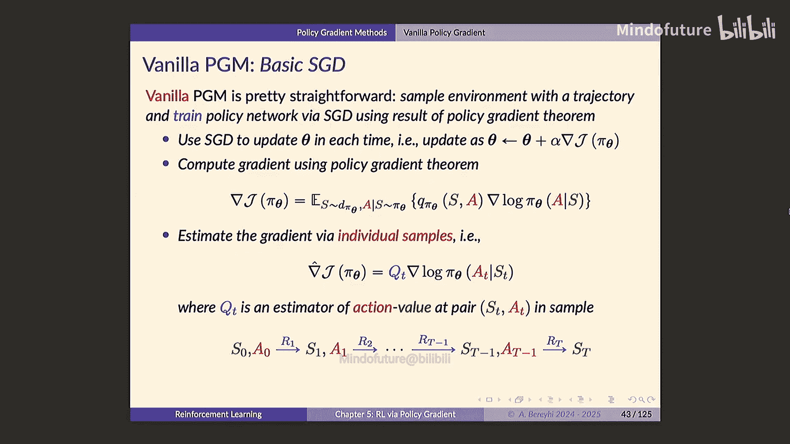

A I school。So this is going to be the vanilla version of the policy gradient method。

 So you basically start with。1 trajectoryies， this is your trajectory。

 And when you go inside the trajectory， every time you get one Q estimator， right， now。

 I'm writing here Q estimator because I don't want to specify the way that you are estimating it。

 right， Maybe you come up with your own idea。 The most simple one is to just， you know。

 do Monte Carlo， right， but maybe you come up with some weird idea。

 not that I I believe that you should come up with some weird idea。 No。

 because we are going to replace it later on with the value network。 So we're gonna have one network。

 which gonna do this job for us。Okay， later on， when we do act a critic。 But right now。

 I don't want to talk about that， right。 So I'm gonna say that let's assume we can do some estim。

 right， And if I get this estimator， then I'm going to update using that estimator in this form。

 This gradient。 This term is something that I can simply compute by back propagation on my policy network。

 I do not have to do any trick。 And this is the most important thing。

 I have some way to compute gradient。Questions。Okay， so if you think of this one。

 this is basically what we had in the reinforce， right？ The reinforce algorithm that I showed you。

 when Ni show started with the trajectories。 we ended up with one expression for update。

 Then I told you randomly that okay， instead of that term summation of G G of the trajectory just replace G T。

 the sample return。 And then it's still going to work。

 But the reason is simply policy gradient theory。 because that G T is also an estimator of Q T。

 right， G T is sample return tells you that time T。 Whatever you get after that， right。

 That is one estimator for your Q value at that is state and action， right。

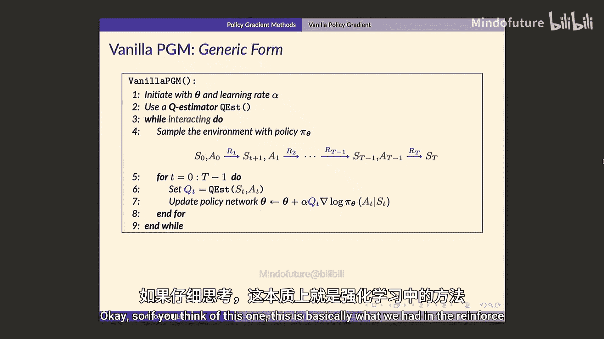

And you simply use that G， T inside your algorithm， right， So G。

 T is not the best estimator necessarily。 That's correct。

 but it's better than the estimator we had initially， to be honest。 And because of that。

 it's going to work slightly better if you replaced or P G version 1 with reinforce。Okay。

 so this guy is the most basic version of the。Policy gradient method。

 So reinforced was the first policy gradient method。

 PGM was born after the introduction of the reinforced algorithm by Williams。And now。

 people started to say that， well， it's a very cool idea because you don't really need a value network or value model anymore。

 you are actually not working with the value directly， you simply have one model for your policy。

 and that model is just getting updated from samples。

 that's cool right This is what we think when we think about reinforcement learning， right。

 I have one one agent which is having one one policy， one strategy to play。 And each time we sample。

 we tell it just change your strategy to that right， and it's gonna update is strategy， right。

 we keep on updating till it's playing with the optimal strategy。

 This sounds more like intuitive reinforcement learning。

 as compared to the Q learning and other things where we work with the value network right or with the value model。

 we try to estimate the value。 and then out of the estimate a value。 we say， okay， we play。

 for example， Epsilent greedy or greedy right is。Moreated。 But the issue with this one。

Is that when people started to work with this one， there was a bit of challenge here。

 So there was a bit of instability。 And this was。The reason that PGM was quiet。

 not very trend or state of the art for some long time。 like for some long time。

 especially when it was simply about linear models and tableau reinforcement learning。

 people were only working with the values because that was stable。 P GM was not necessarily a stable。

 Okay， one thing that like you might ask me is that。I just showed you the Monte Carlo estimation。

 right， And you expected me that the next slide would be TD， right。

 But I'm not doing TD because I'm very。Kind person。 I don't wantan to take more of your time。 No。

 this is not the reason we have a bit of problem with TV here。 Okay。

 and I'm gonna explain it a bit in in a bit。 Okay， but TD is not very straightforward when you are working with the policy。

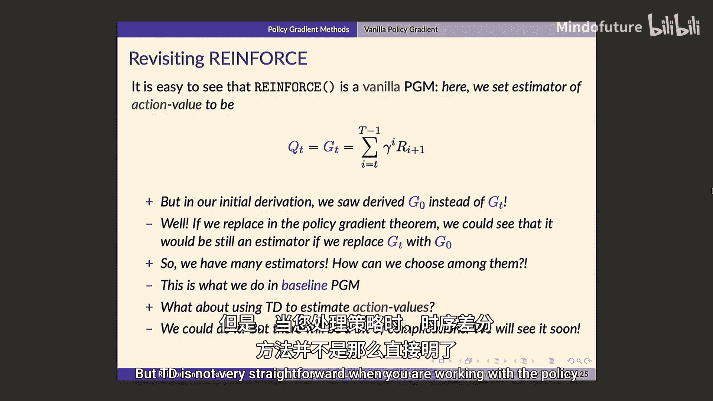

Okay， let's go ahead and see what is the trouble that you might get when you do reinforce， right。

 Say that yeah， you take your time， you。You're very patient person。

 So you listen to me for a long time。 and you believe me。 you try to implement your force。

 They want to try it on this algorithm。 Okay， on this environment。 What is the story here。

 You have this particle。 Okay， and this particle is able to move in in any of these three directions。

Okay， now what it wants， it wants to get to the top of the， of the bottle or whatever that is， right。

 So this particle wants to go up。 Okay， and then at every single location that this particle is。

 it has one of the three choices。 Either goes straight up or right or left， right。

 slightly right or slightly left， right now。I want this guy to get this particle to get to the top in the fastest way as possible。

 right， This means that I want to make it understand that it should just move up， up。

 up up all the time， right。What I want to do with by reinforcement learning。Because I am， I'm sick。

 I don't know。No， because I wanted to see whether my algorithm is working or not， right， So now。😊。

What' gonna happen if I start with some random policy。

 So I start with this policy that is just moving in any direction with the same probability。

 The length of those errors is showing the probability that your policy is giving you。

 So now the policy tells you just go any direction with the same chance。 Now， if you do that。

 you might just move like this。 This is one trajectory that you would get。 you might do like this。

 This is another tra that you could get。 if you keep on playing， you get lots of other trajectories。

 right， So always you're gonna go some way up， but it's not the trade going up， right now。

The thing that you can do is that you're gonna define a reward function， right。

 And that reward function at every single state is going to tell your particle how much word you got so that your particle is somehow inclined to just move directly up。

 right？ So this is one valid choice of the of the reward the rewarding system。 So what is that。

 That X is exactly the x axis， right？ So you start from。Here like that， that direction。

 And you go in that direction， right， Now， this is x。 I don't do anything with y axis。 Now。

 this is x axis。 And my reward is simply this one， right， Every point that I am。

 I look at the x value of that point， right， And then I'm gonna give the give the corresponding reward。

 That reward makes sense， right， If I am on the edges， I'm gonna get reward-1， right。

 If I am exactly at the center， I'm gonna get reward plus one， right。And anywhere in between。

 I'm gonna get something in between， right， So it's gonna make my particle to stay in the middle。

 right， Since it starts at the middle， it means they always try to stay in the middle。

 The only action that is。Sensible， in this case， to just directly go up， right。

 You don't move right or left。 right， Everybody's clear。

So that makes sense if this guy is really trying to just maximize his return with respect to this reward system。

 it's gonna learn that you should just go walk， right， Now。

 one thing that you should pay attention here。 What is the value when I am in the， in the corner。-1。

 right？ What is the value when I am at the at the center， It's one， right。

 So it's a symmetric value between -1 and 1， right。The reible， right， It really sees that。Cool， now。

 if you try that， you start with reinforced。 This is your itration 0。

 So your policy network is giving you uniform distribution every direction。

 But you keep on sampling and every single sampling， you use that sample to update your policy。

 right。once you keep doing that， then after a bunch of its。 say， for example，900 its。

 you see that the probabilityvol of going in any direction is roughly 0。

 And you are just going with probabilityvol 1 right up， right， This is what you want。

 reinforceinfor is working， right？ Co， perfect， that's nice。 But now the next thing that you do。

 you would say， okay， let me just change this scale or the bias。

 the start point of my rewarding system， right， instead of giving -1 when I am on the edges。

 I'm gonna give 10。😊，And then when I'm in the center， I'm gonna give two 12， right。

 still in the center， I'm getting more reward。 so。One intelligent particle is going to concentrate in the center。

 right。A clear， right， It's the same thing。 Even this scaling is the same。 I mean。

-1 to1 is same as 10 to 12， right， doesn man， I only shifted everything， right。Now。

 if I do that and I start doing alters， then you see that。

Your algorithm or your distribution is not really symmetrically going down towards the distribution that you want。

And it starts to just behave， Just jump between， right。

 So is it start to give more way to the left Then it just changes。

 itss fine to give more way to the right。 It does not mean that the center central。

The the main action is not getting higher chances。 It increasing in the probability。

 but it's increasing in the probability much， much。

 much slower as compared to the case where you have between 1-1 and 1。Every clear？Questions。Yes。

Is there I here？哦， no no no。Yes， yes。 yes。 because it wants to just be in the center， right。

 So it's gonna take it in the center and then it goes up， right？ Yeah， But， I mean， in this example。

 I assume that we start exactly center down always， right。笑。Questions。So you see the problem here。

 right。So if I change my rewarding system simply by shifting it。

 then the reinforce algorithm is start to just struggle finding out the right policy。 Now。

 the question here is that what is happening here。 So what we see obviously。

 is that vanilla policy gradient method is getting impacted significantly in terms of convergence when we shift or rewarding system。

 right。

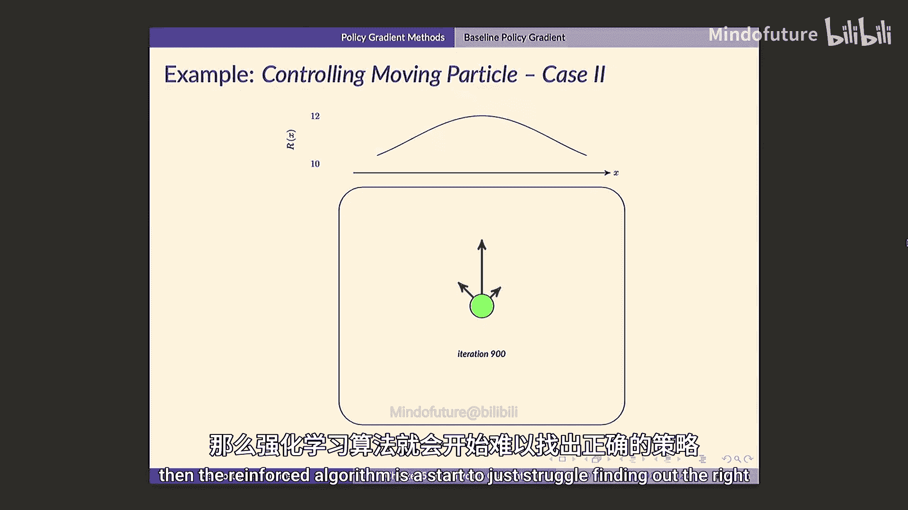

And。Where is the problem， If you think about the reinforced algorithm。

 or if you think about the general vanilla policy gradient method， where should be the problem。

Which guy is making the trouble for us？How many terms we have when we are updating。Two terms， right。

 One of them is the estimator of Q。 One of them is the estimator the the gradient of the log likelihood。

 right， Which term is the guy who is impacting now。Ce， right。

 because the policy network is not changing in that sense， right。

When we change the warning system is only Q， which is getting impacted， right？ So obviously。

 the problem is this guy， right， this Q。

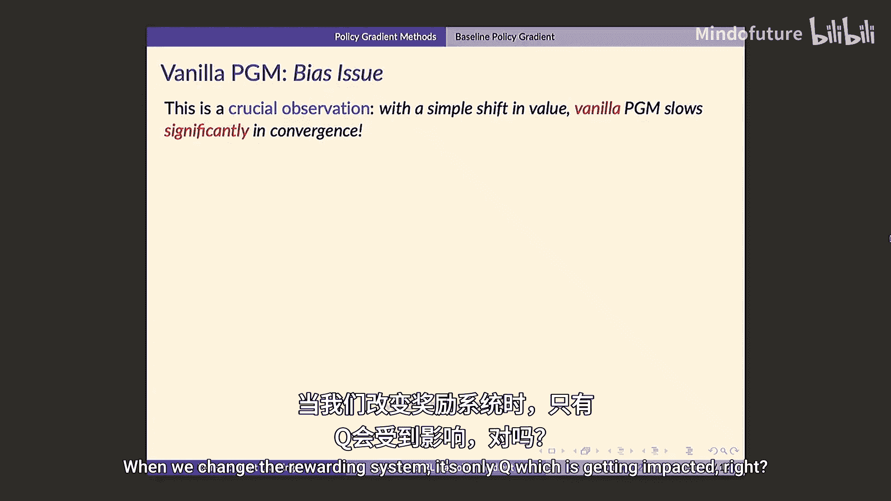

見セットほ。Motivation， of course， ingredients that we don't want。Work with value。Hes。Yes。

We cannot get rid of that。 The key point is that we can work with these estimators， right。最多的这个。

Oh yeah。 But by this1， I can work with the continuous actions， right。by， by simple cu learning。

 I cannot do that， right， race， right， is is a big motivation， right， exactly。

So you see this trouble？So the Q trobble is the Q term， right， So now。

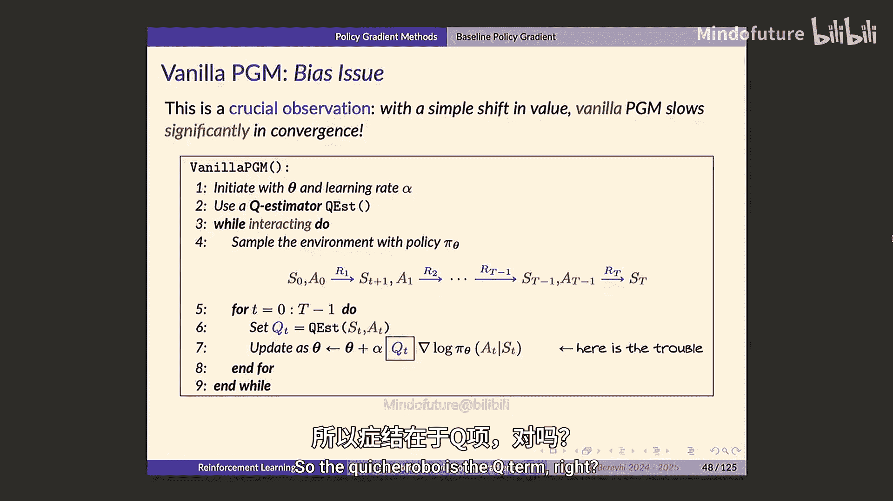

Let me now just take a look at this term， right， and see what is happening here。

 So you see this Q term， right？ And then when you have this Q term， you are just sampling from it。

 right， This means that every time that you sample， you get a sum bunch of rewards， right。

 in this example that I have， when I have the system-1 and1， right， In this case。

 When I start with the uniform distribution。 Now， probably my particle ones goes like it goes to left and then goes up。

 right， the first trajectory。 Now here it gonna get some some minus and then gets to one， right。

 If I add them up all， is' roughly around 0， right。

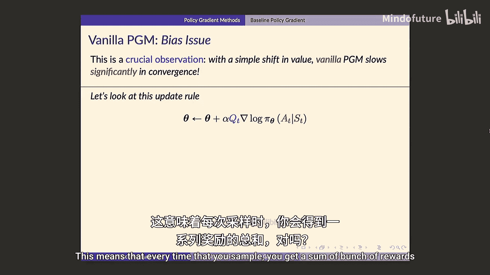

Again， if it goes right and then goes up， same thing is going to happen， right？

 So this means that those samples that I'm collecting are going to be around minus around concentrated around 0。

 right。Correct， so theyre concentrated around 0。 The value that I'm collecting as a sample is concentrated around 0。

 randomly sampled around 0。 And because of that。This Q value that I have is。Small， right。

 is around 0。 But when I change my system to this guy， what gonna happen。If it goes any direction。

 for example， in one of them， it gets hundred in the other one， it gets hundred50， right。

 So it means that the samples that I'm taking are still changing in value。

 but they are concentrated as around the higher value， right， a higher average。

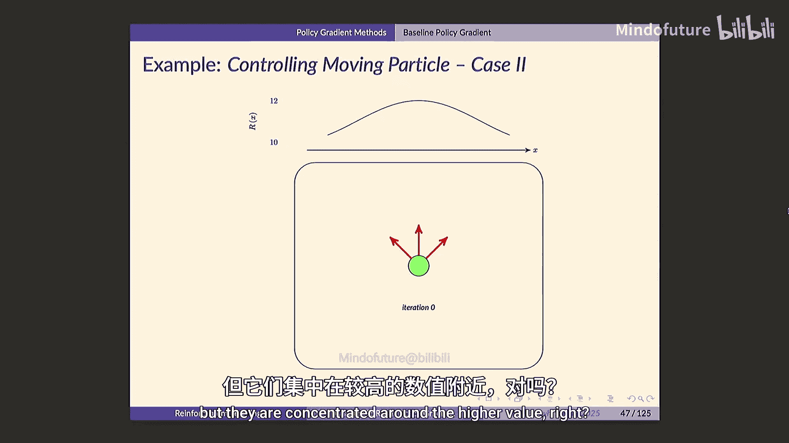

Correct， so this is how it's gonna show up here， because this Q that you get when it's concentrated around a larger value。

 every time that you sample， you're gonna get a larger sample， right， when you have a larger sample。

 then you're gonna get more sensitive， right。

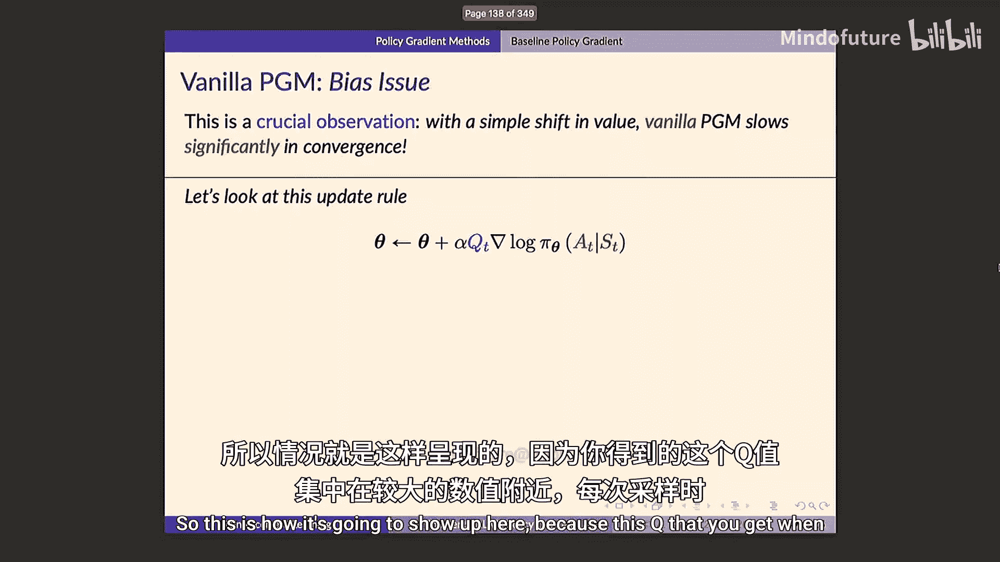

It means that。Your gradient of the policy tells you， oh， maybe you just move a bit here。

 but then the Q gonna you know， smash it， Just take the gradient， make it like huge， right Again。

 your gradient of the like Q tells you， just go a bit that direction。

 then the Q gets multiplied and just hugely change it， right， So if Q， for example。

 if  Q is significant or large and it's not concentrated around 0。

 the thing that happens if this gradient is， for example， negative， right。

 then any entry which is negative， is getting multiplied with a huge number， right， a large number。

 And this means that。The value of theta is getting significantly changed， right？嗯。

If that is the case that。This guy is slightly positive Then those that Q is going to get multiplied and a huge change again in the value。

 So the value increases a lot。 The parameter increases a lot， right， Now。

 this is one of the very first things that you can observe and it' gonna help you understand later on the trust region story because the thing that is going to happen here is that when Q is very large。

 then the gradient itself， that gradient of the a lot like。 that term it might be a small。

 but the Q gets multiplied to it。 And then it gonna to change significantly the value of theta。

 right， And then the problem that is is making is that theta is not directly connected to your value。

 right， theta is specifying your policy， policy is specifying your value， right。

It's true that you like to have an intelligent policy， right， By the end of the day。

 the way that you evaluate your policy is by using value， right。

 And you don't really know exactly how change of theta is going to impact your value at the end of the day。

 right， It's just impacting policy。We're gonna talk about it more when we get into trust region。

 But this is somehow telling you that your policy network is more sensitive to the change of parameters as compared to a value network。

 right， And this is a very general behavior you always see with policy networks。O， so。

If we keep Q concentrated around 0， then probably we're gonna have a better behavior in your or vanilla vanilla policy gradient method。

 right， So this means that if I had that rewarding system 10 to 12。

 I already just subtract everything from 11 first， right， So I concentrated around 0。

 then I work with that system， right， And this is eventually going to work better as compared to the。

System 10 to2， right， Everybody agrees。 Everybody sees what I'm saying。

 so the key point here is that we need to just keep this Q。

 this estimator to be concentrated around 0。 But if I want to keep it concentrated around 0。

 maybe the rewarding system of my environment。 I mean， it's not in my hand that I always designed it。

 right？ I mean， the dumb example we had， I could do it。

 But maybe this is coming from a natural environment， right。

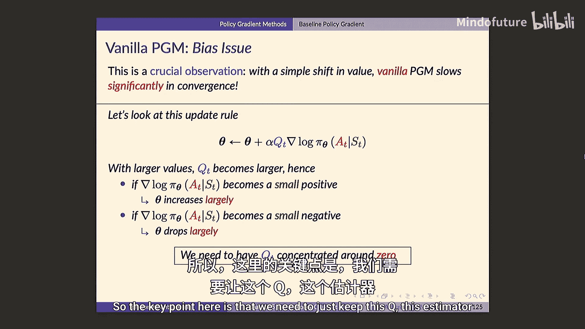

And then。In the policy gradient result that we had， the policy gradient theory。

 we really needed to have this estimator of Q， right， We really need it need Q term， right。

 because it's Q who is showing up behind the gradient of the log likelihood， right。

 you might say tell me， okay， if I want to just。Concentrate Q around 0。

 This means that I should get my Q and subtract it from something else， right？

 So I am just shifting it。 I am adding a bias to it， right。And I'm not working anymore with Q itself。

 I'm working with a bias of it， right， A bias version of it。

And how you can guarantee that the policy gradient method is again working if I replace Q with a shifted version of it。

The key point is that you can actually show it。 Actually。

 you can show that whatever you do as a shift is not going to impact your gradient。这。Now。

 let me just try to make it clear for you why you can shift your rewarding system as you wish when you are working with a policy effort。

 So let's say that we have this gradient term， which is coming out。 So I have this policy polytheta。

 and I am playing with this in my environment， okay。For now， say that I have a genie。

 This genie just looks at my state。 My action is gonna give me the Q value。 Okay。

 you don't really need to estimate anything。 Okay， everybody's cool。

The thing that I'm going to do now is that。I'm gonna get this Q。 So whatever my state is。

 whatever my action is。 Okay， I'm gonna give that one。 I'm gonna get from the genie Q value， right。

 This is the term here。 And now I do one thing else。

 I do not look at the action that I have done with my policies。 So the policies aside。

 The only thing that I do。 I look where I am。 What is my state， right？ And I have one function。

1 arbitrary function。 U， I just give this state with that function， it's gonna give me one value。

 right， So that value， that term U， that bias term， say is depending on my state。

 but it does not depend my action on my action， right， So it means that if I am here， right。

It doesn't matter which direction I go。 Always， I'm gonna get the same value for U。

 But the value for a Q is going to change。 if I change my action， right， again， I come here。

 the value of U is changing from as compared to the previous one。

 but it does not again depend on the action that I do， right， Everybody's cool， right。

So U depends on this stage。 Q depends on both state in action。 And I built this Q prime。

 which is not Q itself， right， is's a bias version of Q， right， I'm gonna use this one。 Now。

 instead of using。Q inside my policy gradient theorem。 I'm gonna use Q prime inside that。

 and want to see how my gradient of the objective， the gradient of the J that we initially calculated。

 How does it change。Okay， everybody's clear。

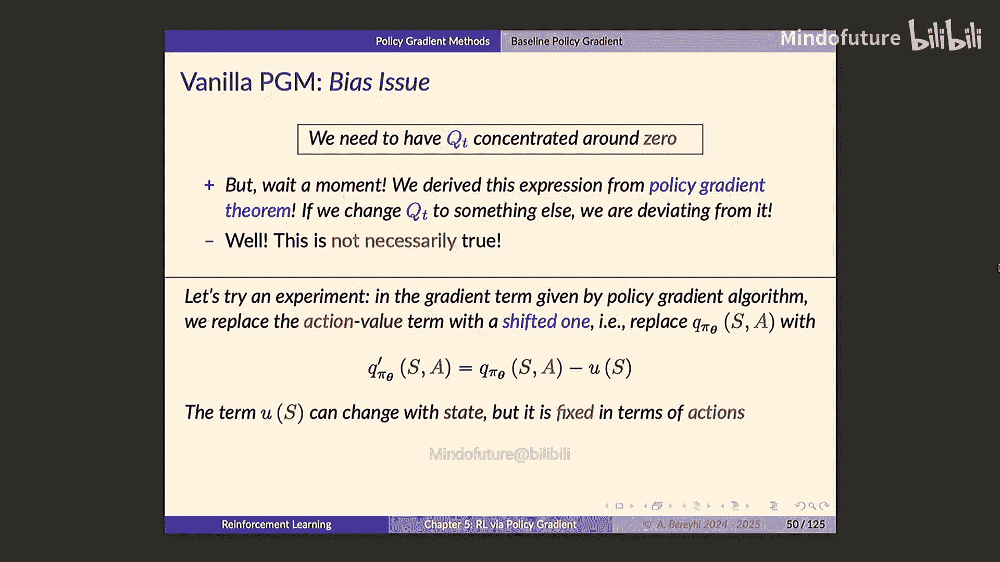

Good， so I had this expectation， right， the expectation。 I guess I， I'm not getting rid of no， okay。

The expectation， just ignore whatever you have as subscripte right now。Now， instead of Q。

 I am replacing Q prime。 and then I have gradient of my lock like Q。Everybody's go。Now。

 let me just open it up。 So Q prime is Q minus U， right。Q depends on the state and action。

 U only depends on the state， right。Everybody clear。Okay， now next step， well。

 I am going to open up this， this expectation。 The expectation。 look at the second line。

 The expectation is first taken with with respect to a， given the state that I am in， right。

 using my policy， And that is the expectation with respect to a state itself。

 using my weird distribution D， right。Right， so I can do this expectation step by step。

 So I can say whatever term I have inside。 I first take the expectation with respect to a。

 This is what is inside。 And then whatever I get， that is only depending on my instead。

 I then take the expectation with respect to state。Everybody's cool。Questions。I mean， I trust me。

 it's gonna be very simple now。 it's gonna get like gonna just magically， everything gonna disappear。

😊，Now， next thing。This term that you see inside the brackets。 So I have brackets Q minus U， right。

Correct， so Q times the gradient。 I have it， right。U times gradient is the next term， right。

A was clear。Questions。O， now。The first term is Q times gradient of log expectation with respect to policy。

 expectation， with respect to a state。 That term is simply the term you had in your policy gradient theorem。

 right， That is the right gradient that you need the blue term that you see is the gradient that policy gradient theorem tells you is the right gradient to use if you want to update your policy network。

 right， But what you have is that blue gradient minus the second term。Everybody's clear。

 So what is the second term， The second term is U times gradient of your log liveli， right。

The expectation is taken first with respect to the action， then with respect to the state。

 When I take the expectation with respect to action， does you get impacted。

What is the expectation of US。With respect to a。Its US itself。

 What is the expectation of one with respect to a gasian distribution。Is one， right。

 A constant number is coming out of the expectation， right。

 So this is why I put you outside the expectation with respect to pi， right。You see it here。

 So U does not depend on A。 This pi is only distribution of my action， right， So it's gonna come out。

 right。AR call now。What I am computing here is the expectation with respect to a state U。

 that bias term， this other expectation with respect to policy。

 Let's go ahead and see what is this term。 Okay， so this is what I wanted as the gradient。

 This is what I am computing。 If I replace my Q with Q prime。

 If I shift it to just make the rewarding system concentrated around 0。 And in this case。

 I am going to have this extra term， okay。

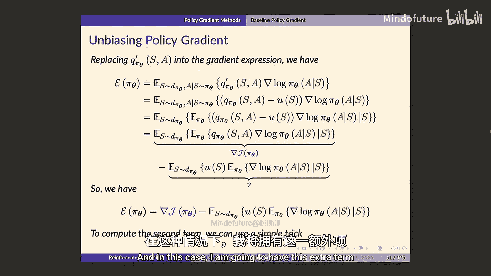

够 now。Let me do that。So let me just clean up everything for you right now。

 And let's you just work with random variables， basic random variables。 Okay， I have this X。

 which is distributed with some distribution P theta， okay。

What is this P theta is actually my pi theta， right？

 But I want to just make the notation easier right now。

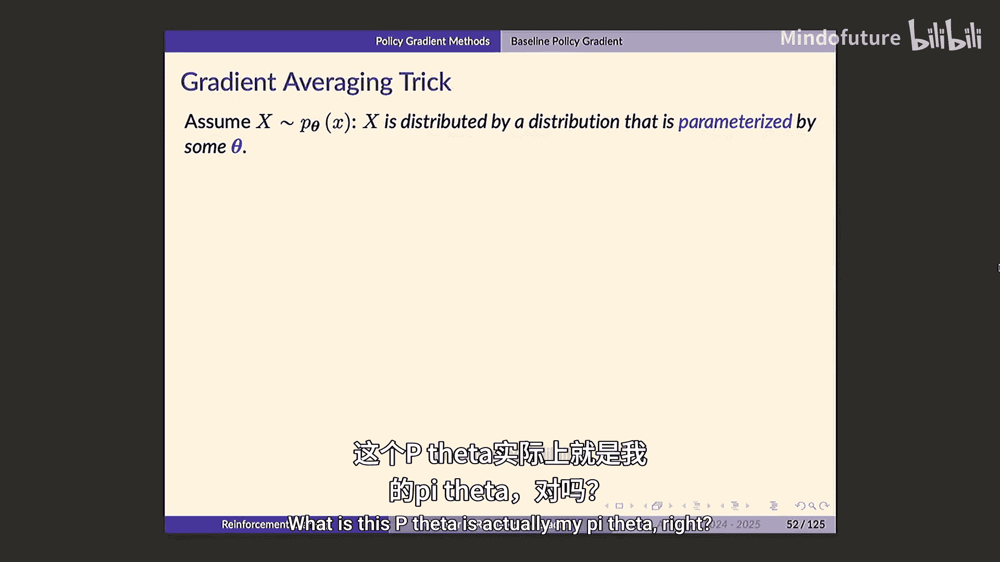

And now what I want to compute， I want to compute the expectation with respect to pi theta this gradient of the log。

 right。So if I want to interpret it into a simple problem， I can write it down in this form。

 I can say I have X。 It distribution。 itss distribution is P Theta。

 And now I want to know what is the expectation with respect to P Theta of the gradient of this log probabilityvol。

 right。

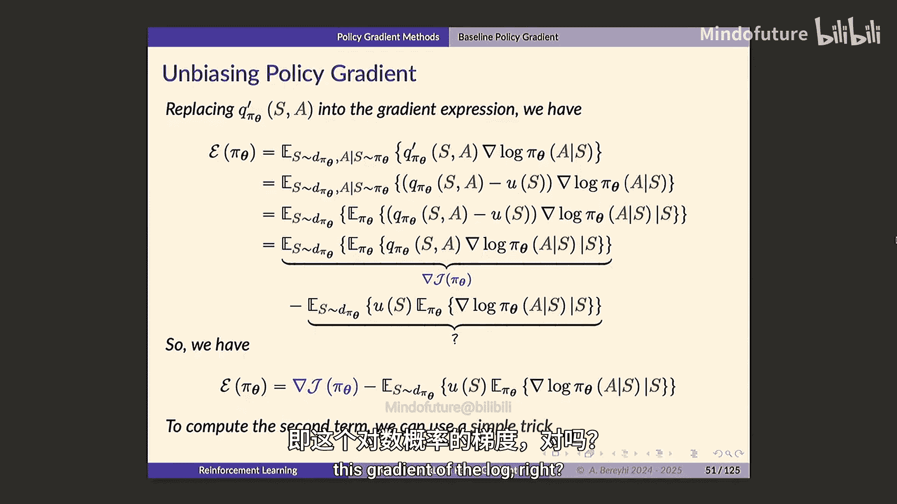

I's the same thing If I replace P theta with pi theta given S， right？

 I didn't want to have that given S。 Maybe that makes。A little bit of help in terms of mutation。Okay。

 so look at this problem。 I want to solve this problem。 Okay， Everybody's cool with this problem。

The thing that I want to do， How can I compute this expectation。 What should I do。I get。

 I get the term inside the expectation。 I multiply it with。P theta。

 And then I marginalize over over what。X， right。 Everybody sees that。So， this expectation is simply。

this guy multiplied by P theta。Average over x， right？ Now， let me first write down this gradient。

 I am actually getting back to what I did in in log trick。

 So gradient of log P Theta is gradient of P theta divided by P theta， right？ Now。

 the next thing that I do， I multiply this guy by P theta。 P theta gonna cancel out。

 This is going to be the gradient of P Theta， right， average over x， right。😊，Now。

 what is the gradient term。The gradient term is taken with respect， too。Theta， everybody sees that。

 right。You can't ask question， you know。Everybody sees what what I'm doing， right。

 The gradient is with respect to theta， right， What is the integral with respect to。I it。Everybody。X。

 right？ now， can I change these two guys。Can I do it。Yes or no。不是。First， do the integral over x。

 then take the gradient over theta。 Can I do that。Yes， okay， perfect。 Okay。

 so we are on the same page。 so I can simply change them， right。😊，Correct， so I can simply change。

 at first take the integral with respect to x。 Then I take the gradient， right。

 What is integral of a distribution over its argument。1， right， doesn't matter what is theta。 No。

 then what is the gradient of that guy。0， I told you I know magics。 So this is zero， right。

This means that the second term you had is。0， right， so。This， this expectation is simply 0。

 This means that that second term that we have expectation with respect to pi theta of that gradient of log likelihood is simply 0。

 right。Aise call。

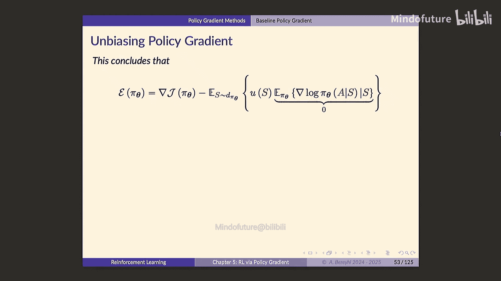

So what does it mean， It means that if you replace your rewarding system with any shifted one。哎。

And you use the estimator of the action value from that one。

 You still compute the right gradient of your policy network at the objective， right。

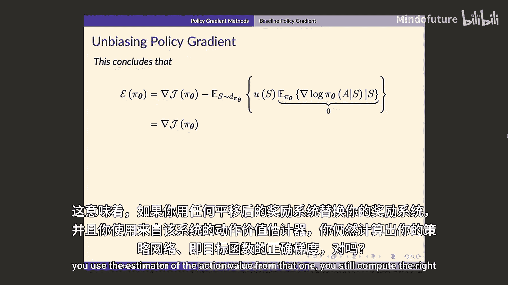

Anybody clear？Questions。No question。 So moral of a story。

 you really do not need to work directly with the Q estimator。

 You can work with a shifted version of Q estimator， right。

 And this means that you can work with  -1 to 1 instead of 10 to 12。

 and you are actually not harming anything in your training， right。

 You are still computing the right gradient。 The only difference is that this one might be computationalally more stable。

Questions。No question。So if you got another question， then。One thing that is left here。

 You might tell me， how can I find that you， I'm gonna talk about this later。

 This is what we do at the end to get advantage， right， What no worries， no rush。

 we're gonna get there。

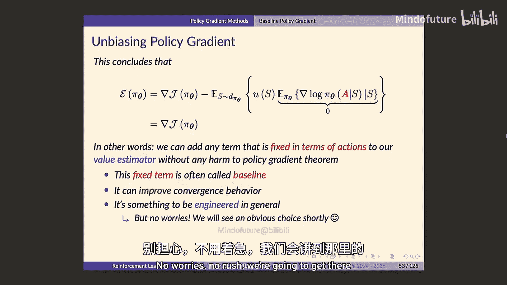

是。This is the more general version of the policy gradient theory。 So what it says。

 it says that if you want to really have the gradient with which you are updating your policy network。

 Well， take the expectation of this guy。 your Q minus sum U。 You don't care what that U is。Times the。

 the gradient of the log likelihood is still， you're just working with the gradient of log likelihood。

 right。But that term that is getting multiplied， you now have this degree of freedom to shift it。

 as you wish， right。There。So you can shift it as you wish。 And this is what we call it baseline。

And this U term is what we call it baseline。 It's like you look at your Q。 and then you would say。

 okay， I'm going to put the baseline right， in the example we had or Q。

 when we are working with a system of reward between 10 to 12， we put the baseline to be 11， right。

Then the Q estimator that we get is around the 11。 It' going tell me how much different this is from the baseline。

 If I am around 10， I am below the baseline。 I'm gonna get something negative， right。

 If I am around 12， I'm above the baseline， I'm getting something positive， right。

 This is still giving me the right gradient that I want。

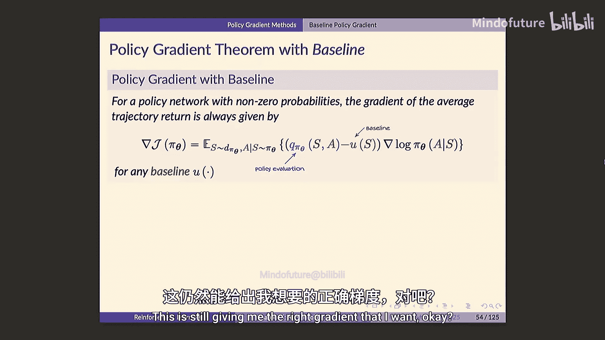

Okay。叫。That means if you want to just play with your policy gradient method。

 you can add a baseline simply to it。 So when you are sampling one trajectory。

 then say you are doing some estimation。 Monte Carlo， whatever you get your estimator of Q。

 Then you can't have one baseline。 And that baseline could change from one point to another， right。

 It's not important。 The only thing is that your baseline should not depend on your action， right。

It can depend on your estate， right。 But as I said， no worries。

 I'm gonna tell you what is the right choice of you。 Can you guess what is the right choice of you。

I did every single state。The value great， right， because value is the average action value， right？

 And then you want to know how your action value is different from its average， right？

 So you just concentrated from its own around its own value， right， so。

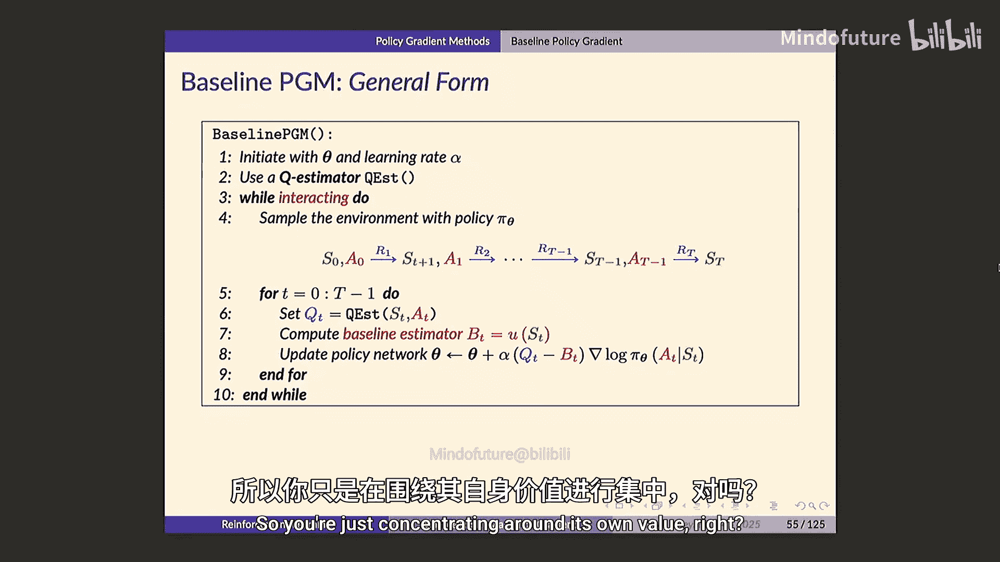

That is what we call it baseline。 So the obvious choice is the value。

 You might say why this is obvious。 Well， simply because the value at every single state is giving us the average action value。

 right， So it's gonna tell you， if you're at this point， right， you can do this action， that action。

 that action， in the average， you're gonna get this value， right。

 Now you want to compare your action value with a baseline。 So the base。

 the best baseline line is that average value， right。So this means that in practice。

 you typically put your baseline to be this V。Itse， right。

 and this difference between the action value。At action A and value and state S。Where。

The value of this state， This is what we call it advantage。Okay， we want to see。

If we are in this estate， every single action that we do。

 how much advantage it gives us as compared to the average value we get。Yeah。It clear。 Now。

 my apologies， I have a very bad notation here。 U is again showing up here， right。

 but this U is not the previous U， right， This is the difference。 I'm sorry for that。

 Don't get confused。 This U is the difference between these two， right。

 because I showed this guy by you initially。 But yeah， it's a confusing notation。 I accept。

 So this is the difference between these two。 okay。Is a Q prime， right， right， is the Q prime。

Everybody's clear questions。No question。Okay， great。 So if youve got no question。

 just let me give you a bit of。Visualization about the advantage。 What does the advantage mean。

 Say this is you are in one particular state S， right？ And in this particular。

 you know that if you do the first action， you're gonna get this much value。

This much expected return。 if you do your second action， this is the value you get third action。

 fourth action， right， And then what is the average value。 Well。

 this is the sum of these guys divided， for example， by 4， right。

 If you assume that every action is happening with the same chance， right。

 And then the average value is， for example，0， right， So then here in this example。

 your advantage is exactly the same thing as your。Action value， right， because in average。

 you are going to get 0， right。嗯。The value you see for every single action。

It simply tells you how much better than 0 you are going to do。 right， If you do action 2。

 you're gonna do very， very worse that。Average， which is 0。 If you do action 1。

 you're gonna do much better than the average， right。Right。Now， but if you have such a case。

 like every single action that you do， youre going to get a positive value。

 But some of them are more。 Some of them are less， right， The average value is no。More than 0， right？

 And then the only thing that advantage does is just centralize everything around this new value。

 which is not 0， right， So this is going to be your advantage， right， It's gonna tell you。Okay。

 doing action1， you're going to get this much better than average。

Doing action2 this much better than average and so on， right？ So obviously。

 your advantage should always have some negative values as well， right， So for some action。

 it is negative for some action， is positive。 and you're going add up to 0， right， average to 0。

Everybody's clear。

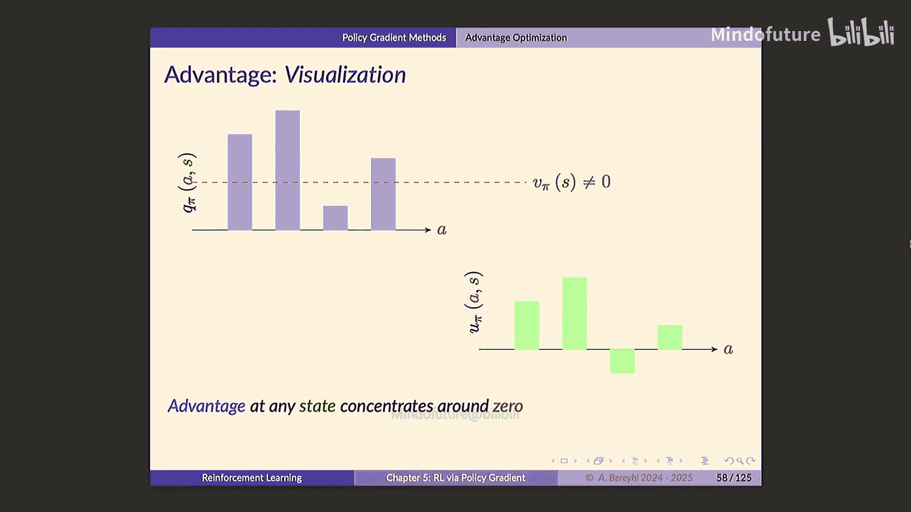

Questions。Now question。Okay， so this is the one which you find in the textbooks。

 they call it like policy gradient with advantage。 It simply is the 1 I showed you with baseline for the baseline。

 you just put the value function， okay。So this means that when you are sampling with your trajectory at every single state in action that you are。

You just estimate。The action value， you estimate the value， you subtract them。

 This is your advantage。 Then you update take。Questions。没有 question。Once again，Advantage。

 is always advantage。 Average is to0， right， because the。

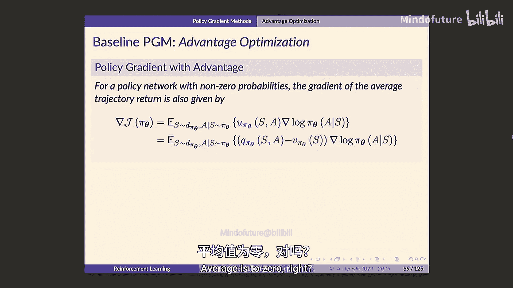

If you look at it， the expectation of this guy is value with respect to a， right。

 So if you average the advantage with respect to a， your actions is' going to be 0。

If you are average it with respect to action。It means that you multiply everything with your policy。

 and then you integrate it over a，No， for every single action going be zero。So， for every state。

 for every single state is going to。So at every single state that you are in the environment。

 you're gonna say， what is your average value in this estate。 And then you would say， okay。

 how much advantage I get by doing different actions， right。Average it should be 0， right。

 because some of them give you positive advantage。 Some of them give you negative advantage。 right。

 It should be always the case。

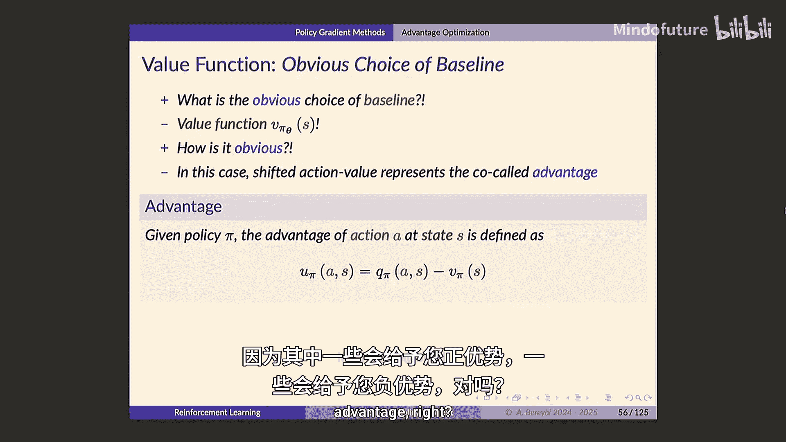

So everybody's clear questions than that。

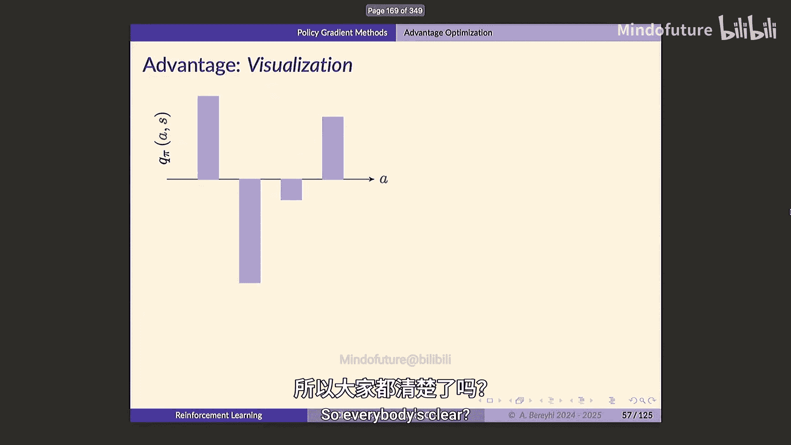

No question。Okay， so。Yeah， now， I think we are out of time。 so I cannot not really。

 I think there is not so much left here， right， right， yeah。It's just actually nothing left。 Okay。

 so this is the case。 This is the final algorithm。 sorry， So this is advantage PGM。

 So in every single time， you're going to compute the value， youre going to estimate Q。

 and then you're going to just compute the advantage， right， Now， one thing that is。

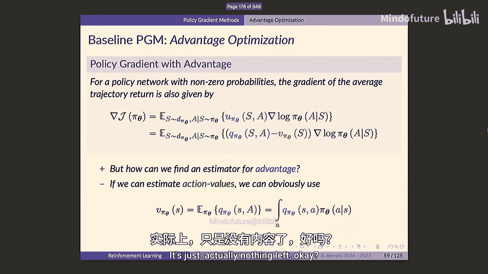

Here a question。 you might say that， how can I compute the value， Well。

 since you have your policy network， right， you just need to average your action value with respect to the action。

 right， with respect to policy。 And that is not a problem。 You can do it。

 But we're not going to do it at the end。 It' gonna help us a lot。

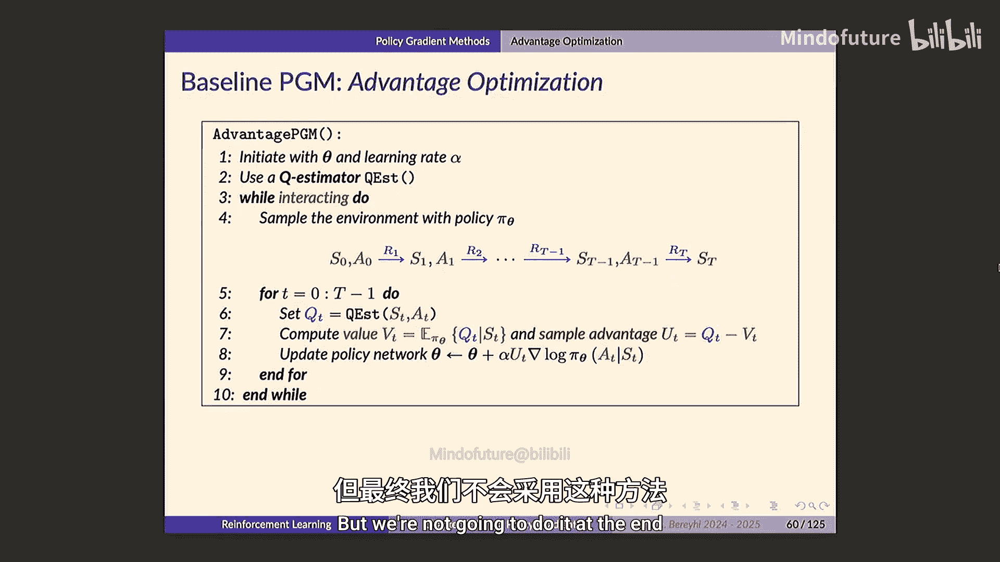

Just to give you a quick hint here， this Q term， if I will write down the。

If I write down the Belman equation for it， how does it look like。

The immediate reward plus future value， right， V， not Q， right？ You remember that， right now。

If you think about that， this is going to be the immediate reward， plus。啊。

Next value minus your current value， right？So you actually do not need to work with the Q at all。

 You can just simply work with value， right。I see。So you need to work with estimates of value。

 indeed， you don't need to work with。

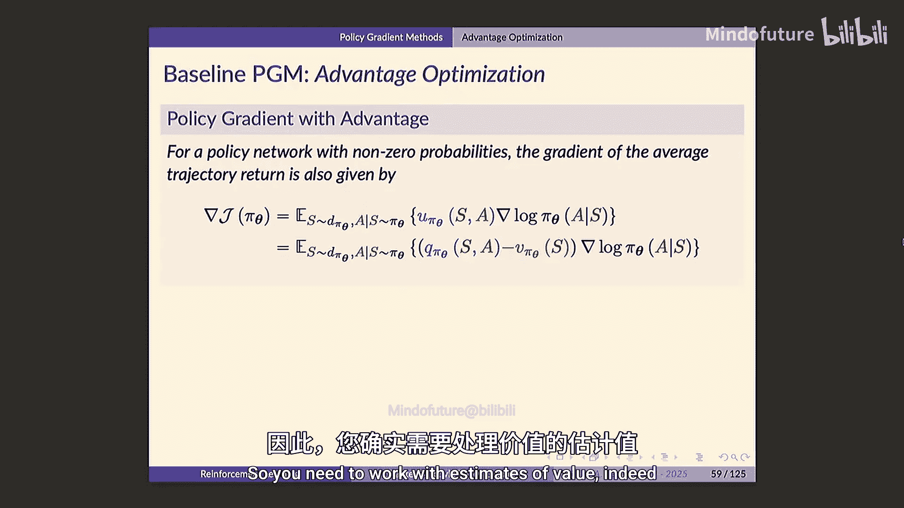