# 【多伦多大学】强化学习 2025 ｜ Uoft   Reinforcement Learning   Fall 2025 p50 P50_讲座_49_策略梯度作为序列代理优化 -BV1D3F2zhEry_p50-

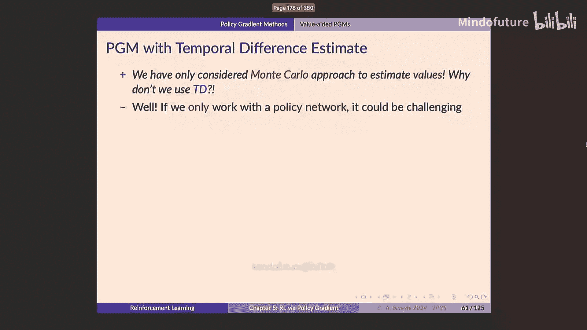

One like I open this brackets here because right now you have a bit of idea how you use PGm and I just want to open this brackets here that we are actually whatever we are doing here we are still a bit unable really to just implement like if you really want to implement this guy you can only rely on the sample returns right so if you want to estimate Q value how do you do this Q estimate well you're gonna say that this is the pair that I have as0 and a0 and whatever I collect after I'm going to sum them up。

 this is one sample Q value right one sample return that I get now if I had so many samples so many sample factories and I see one particular pi a couple of times there I can average over them right if not which is most of the time the case then I just take that particular sample right so this is basically Monte Carlo now。

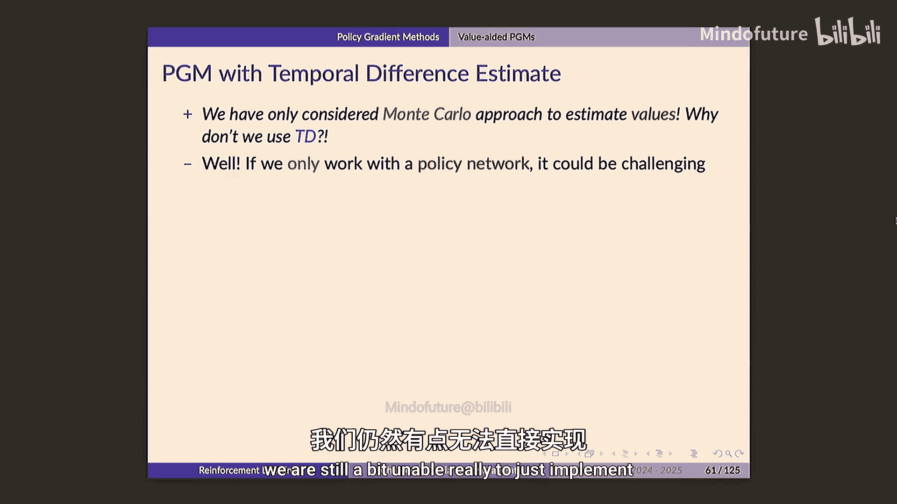

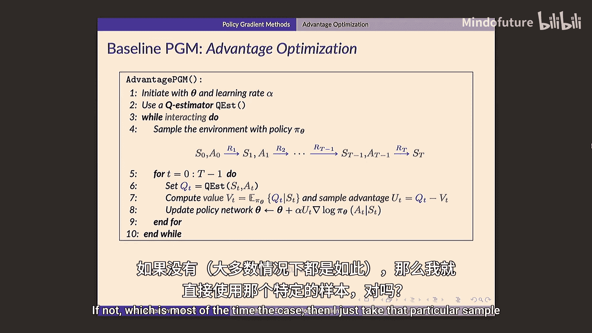

You might tell me， okay， why aren't we using TD， if we were thinking only about policy network。

 we are a bit limited in using TD， Why， because say I have one particular time。

 so this is particular state action then I get the reward and go to the next state and if I want to use TD。

 what should I do。I would use the beman equation right。

 So the beman equation tells me that the estimate of your Q value at time S T and action A T is the immediate reward that you get and the value of the next stage。

Correct， so if you want to compute the value of the current state。

 you need to know the value of the next stage， right。Now， how did we do it in learning？

How did we get the value of the next state？We get the next state。 We give it to our value network。

 right， It goes over the network。 We'll look at the output， right。We can do whatever we want， right。

 If we want to average it， we can average if one， the maximum。 We can take the maximum。

 We had a value network， right， And that value network was giving us this term， right。Correct。

 everybodys clear。 Now， do we have it here if we are only working with a policy network？No。

 we don't have we don't have this guy， right？Correct， we don't have it。

 We cannot just choose one random state， give it to our neural to something。

 And then it gives us back the value。 We don't have it right When we are here at the particular state in action。

 Well， if we like everything afterwards， we can do basic estimation， right。

 like what we used to do in the T R case。 This is not efficient。

But this is the only thing you can do if you just want to use the policy network。

 you don't want to use the value network， right。

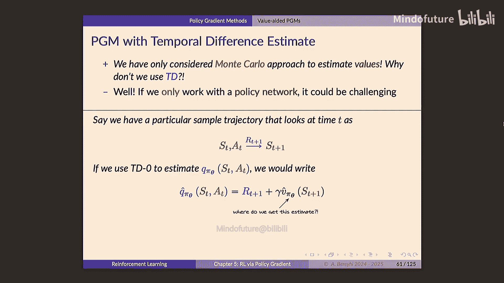

Every guy is clear。So we don't have it。 We cannot do it。 So this was how we do it in the other cases。

 So when we are doing tableular network Rl， we usually have a Q table and in that Q table。

 we have the values right and those values， we start， for example， with all of them being zero。

 and then we gradually update。 They get updated。 every time that we want to know what is the value of one particular state。

 we go in the table， we take the value of that state right If we are doing deep reinforcement learning with value networks。

 then we have a value network。 we give this state。 It' gonna give us。The value， right。

 But in this case， when you are doing pure policy network， you have neither of them， right。

How can we handle it， So basically， we cannot handle it really in practice， right， So you can。

 this is why you don't have a pure policy， gradient method or deep policy gradient method in practice。

 You always have the ac approach。 So if you want to think about it。

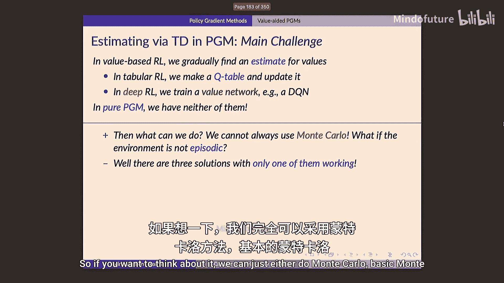

We can just either do Monte Carlo， basic Monte Carlo。

 this is basically what I try to explain here up to this point。

Just think you are doing one estimation， right， And then with that estimation， I say。

 just take the sample return as theestator。 well， this is Monte Carlo， right， with a very。

Few samples， just one sample， right？This is obviously not very efficient because， first of all。

 this is not sample efficient， right， You just use the whole trajectory for one estimation， right。

 This is not a very efficient thing。 And the other thing is that well。

 it cannot handle the episodic environments。How is there any other way theoretically that I can handle this issue？

 Well， yes， if I had this capability to evaluate my policy。 So I had this， say quantum computer。

 which looks at my policy and immediately evaluate its value at the given state。

 right If I had this quantum computer， no problem。 I use it whenever I want， right。

 So I do know how to evaluate a policy， the issue is that this is computationally hard for me， right。

 So again， if I could evaluate a policy in every single ittion。

 then I could again use the pure policy gradient method that going work。

 there is no problem with that， the issue is that this is not computationally feasible。

 How can we handle it， This is okay， this is basically going to be the ac approach。

 And I guess now you have a better understanding， what do I mean by a critic by a critic。

 I mean that you have your policy pi theta， your policy。

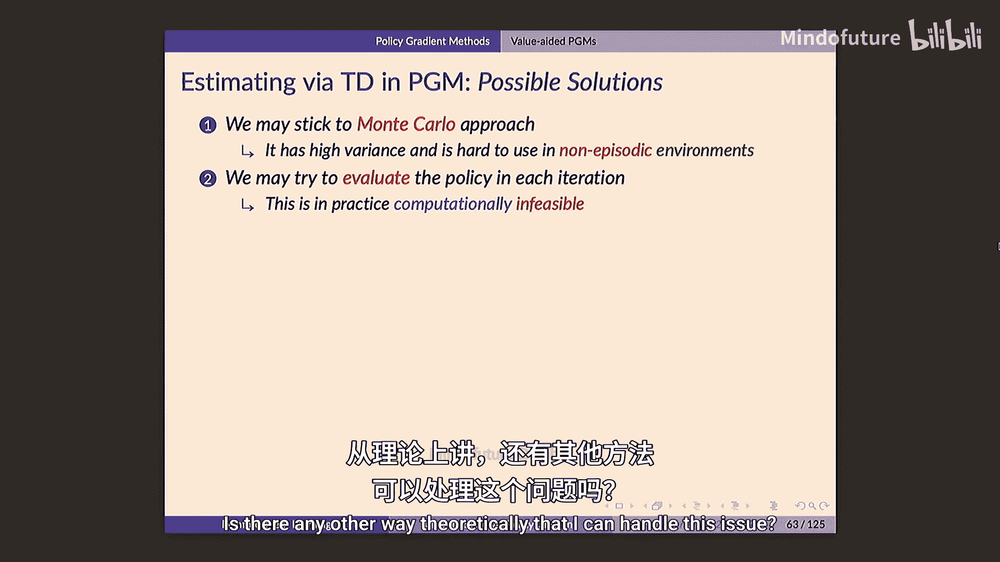

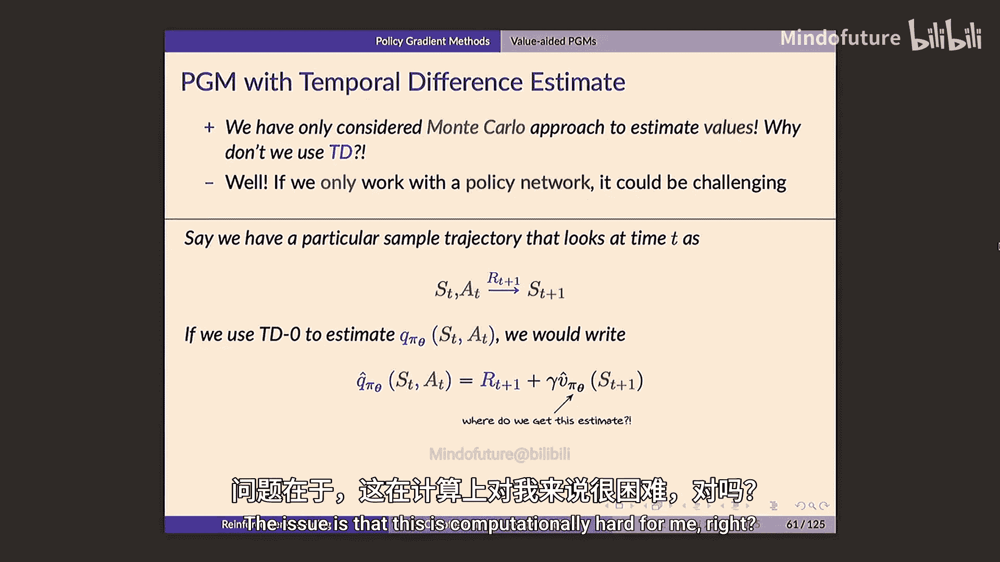

tAnd you have another network。 that network is maybe V。I don't know，5hi V， some， some other variable。

 right， It has its own parameters。 And what you do every time that you have your policy updated。

 then you're gonna just update your value network as well。

 And you hope that that value network is actually evaluating the policy that you have in that particular iteration。

 right， Then you use that value network to estimate all of these V and Q items。

 you see your algorithm。Everybody's coming here。That value network is the critic。

 is the one who is criticizing the action of your。Policy， right， And the policy is the actor。

We're going talk about this later。 So whatever we do here。

 we're gonna just extend it to the case where we have both neural networks。

 But by the end of this one， the whole， you know， hard time is going to be over because whole complication is in the policy gradient part。

 in the value part， you are not really。Too much complicated。

 because this is the basic thing we did in the last chapter。Everybody's clear。Questions。Okay。

 so moral of a story， this act critic is the one which is practical。

 We are going to talk about it in the next chapter。 This is roughly a simple。

Somehow a simple extension of what we are doing here。 But what I am going to do here all the time。

 and I I'm going to do it more confidently from now on is that I always assume that I have this。

 you know， genie who can evaluate the value function for me right And who is that genie。

 gonna be a neural network later on， right， But right now， I assume that I have that one， right。

 So I just wanted to give you this kind of illustration， you don't get confused。

 that wherever you see this value from Ne on。 I only work with value from now on。

 that' are gonna be easier。 And what I do mean， I mean that there is someone who can evaluate or policy。

 theoretically， you can do it if you have a giant computation resource， right。

 but this is not in practice practical。 So we are going to handle that later on。

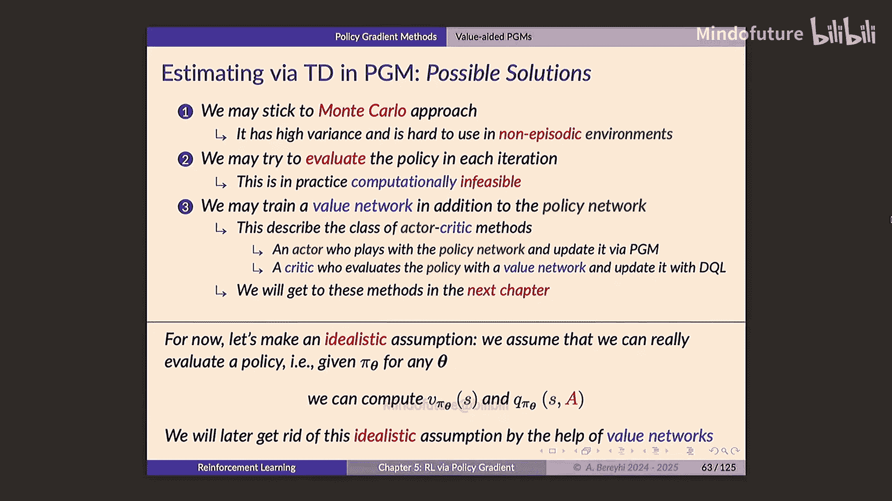

Okay， so doing that。 now I'm going to give you this version of the advantage PGM。

 So this guy is probably the one which you see in the textbook。

 I don't know if there is a textbook with that。 But probably in the papers。

 you're gonna see this one， like the available implementations and papers。 So the way that you do。

 you just collect the sample returns。 then you evaluate your policy right。

 at the particular state in action。 you evaluate the value of the same policy at the particular state。

 This is going to be your sample advantage。 So difference between the Q function and the value function。

 And then you're gonna update， right。Everybodys school？Questions。No question。

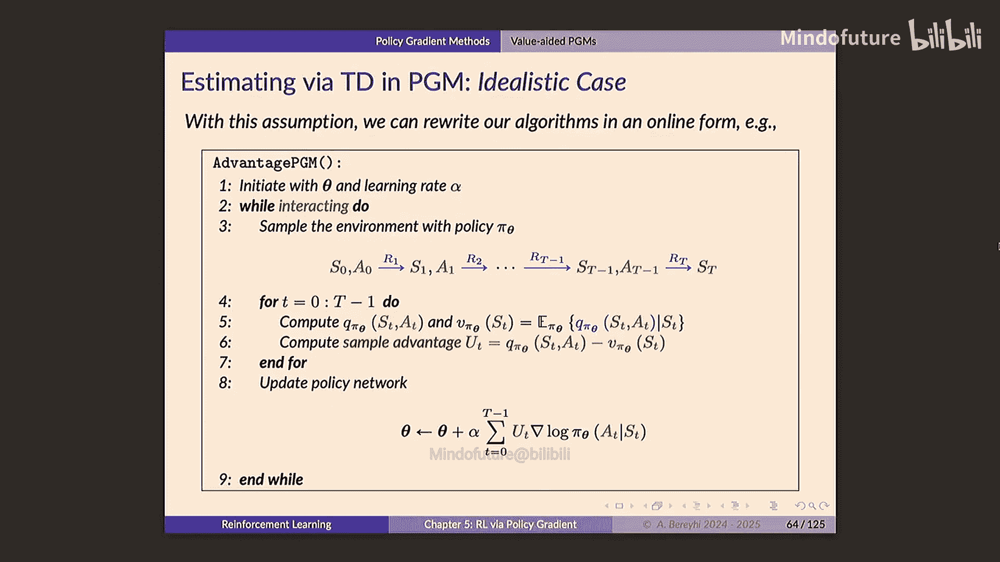

Okay。So。Now， this guy， the advantage， is interestingly， somehow related。

 The term advantage is somehow related to the。Temporal difference that we used to compute when we wanted to just update everything in a tableau form。

 So how can we do how can we see it， Just look at this term here， This is the advantage， right。

 I show it with capital U because this is a random estimator， right。

 It means that I have one particular state on my trajectory。 one particular action。

 They are just generated randomly。 And then I'm computing this guy， right。

 This U itself is a random rival， right， Everybody school， right。Okay， now I have this view。 Now。

 let me just use Belman equation。 What does Belman equation say， It says that， well。

 the Q value at this state S T and action 8 T， This is the immediate reward plus the expected next value。

 right？ This is the beman equation， right， You get rid of all the expectations。

 because we are talking about a sample estimator。 So the sample estimator you had is essentially。

The immediate reward plus the value in the next estate minus the value in the current state， right。

Correct， so does it remind you of something， did we have it before？In the tablear all L。

 when we were updating more value， right， we were when we use TD 0， we basically compute this one。

 right， We go on the trajectory each time we just say， okay， what is the next value minus。

We compute the estimate minus or current and value or current and estimate。

 and then we update or estimate right So we get this guy basically plus multiply by some alpha some learning great right And then we added it to our current estimate。

 This is basically the same thing。 So we were somehow working with advantage without knowing it right。

The it's not a magic， right， Youre all every time youre somehow thinking how you're deviating from the estimate that you had a point。

 right， Now， doing this， some people started to say that， okay， this is TD 0。

 Maybe we can go for TD N， right。

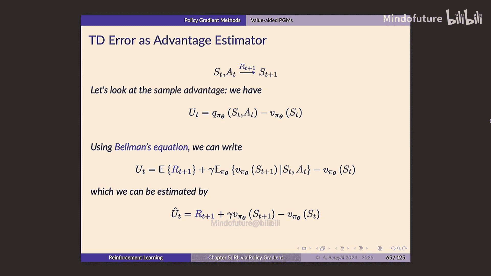

So you could have a TDN version of it。 This means that。Yeah， well， this is the TD0 version。

 So you are computing Q directly based on the value network。 sorry。

 the value of the next estate in the current state。

 One thing that you might pay it and might might see here is that essentially in this version of the advantage。

 you basically do not need to know the action values， right， The Q is not needed anymore。

 You basically can do everything using the value of the next estate。 And of course。

 you can go also for TDN， right， So you can say that， okay。

 I'm going to do the same thing as before exactly， I collect this guy。 I compute the advantage。

 I update using that advantage， right， But when I want to compute the advantage， I don't do TD。

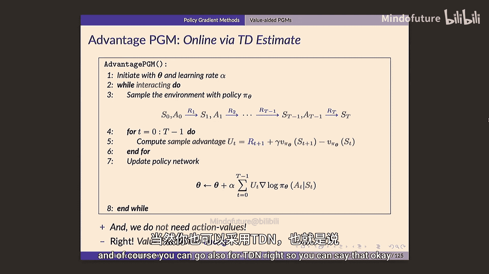

0， right， I do TD N。 I would collect， say n different immediate words， right？ And then after that。

 Im going to look at the state and T plus n plus one， right， The next state after all of them。

 So this is what I'm gonna get as the estimate when I butha strap longer， right。

 And then I just subtract it from my current value， right。

 This is another estimate for the advantage。Is it good again。

 this gonna bring us that bring up that kind of， you know， bias variance rate， right。

 This guy is probably more biased， but is's going to have less variance， right。

 The other one has no variance， but it's going to be more biased， right。But yeah。

 this is something if you really want to implement it in practice。 But as I said， we are going。

 we are not really going to do this even， so。It's just。Let you know how you can。

Use the advantage to build a policy grading method。Questions， everybody's cool？

Now if you do this version and。

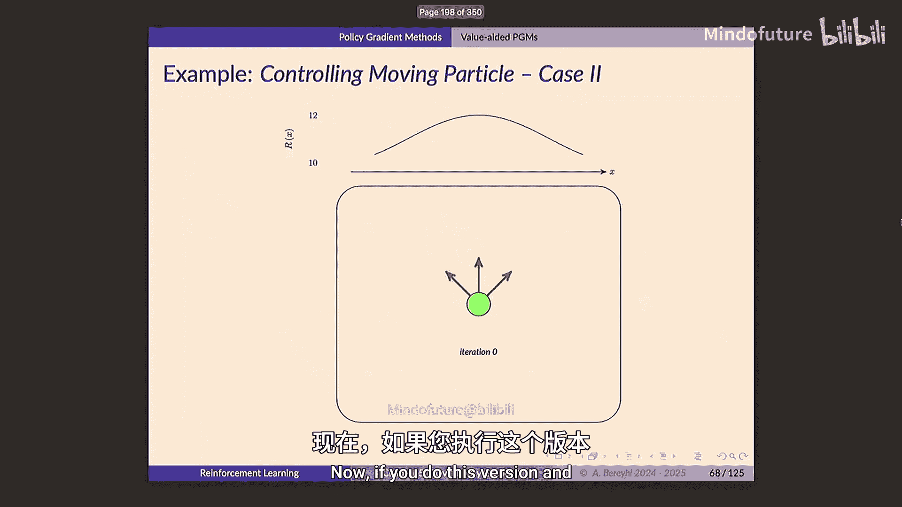

You can try the advantage and reinforce the algorithm。 all of them。

 you can do it for this particular example。 I guess if you check online。

 you're gonna find some basic implementation of this problem because this is a known problem and if you try that one then you can see the difference really So if you use the same rewarding scale as you remember we had this 10 to 12 And then when you put it 10 to 12 since everything has shifted then we had this issue that we could just you know move to the size quite a lot right and were not going to converge as fast as the case where we have minus-12。

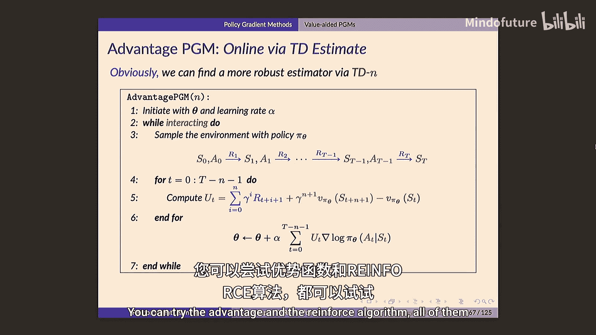

One， now， if you use advantage， you do， I mean， you might say that， okay。

 I need to see the behavior of， you know， having。Perfect convergence， as in the。

Scenario with the rewarding system -1 to1， but you're not going to see it really。

 but you're gonna to see less variance。 So you're gonna to see maybe something like this。

 graduate is going to converge， but the convergence of speed is going to be less still right。

 because it's just everything is based on samples， right， based on those samples。

 you're still doing a bit of， you know jiggling up and down。

But it's going to do much more stable training as compared to the reinforce。

 the basic reinforce algorithm。

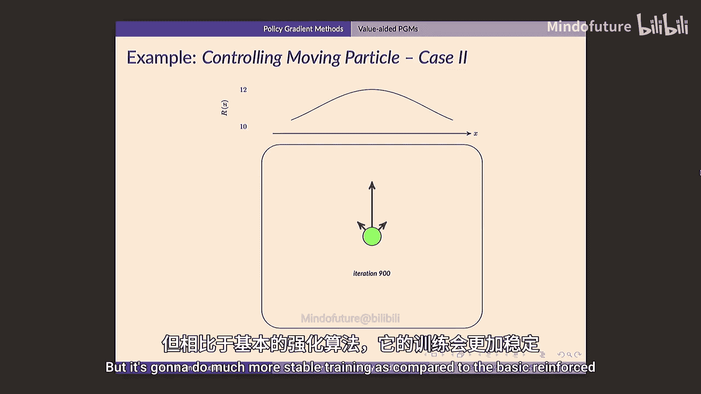

Okay， so now the interesting part of the policy gradient methods start here when people started to talk about the trust region。

 so somehow they started to see what is really happening underneath all of these policy gradient theorem updates。

What is the idea here is the。If you try your your PGM algorithm， I mean。

 this is a very wellknown issue。 PGMs are essentially sample inefficient。

 Why they are sample inefficient， because you just take your policy， you sample the environment。

 you update your policy， right， then you're gonna throw away that sample。 You never use it again。

 right， and then you again， you take your new policy。

 you sample the environment with this new policy again。

 you update your policy and you throw that away， right， So this is an issue。

 PGms are very sample inefficient and。You can。In a very general sense。

 you can do nothing about that because at the end of the day， you are always working with one policy。

Wwhich is getting updated right And if it's getting updated， well。

 the new policy is changing right and you cannot simply use samples of an old policy right So this is the issue in DQL。

 we did not have this issue。 We had experience replay right So we sample with one very dummy policy。

 but later on we use it pain to update our Q values right What was the key trick there。

 What was the reason that we could really do this in DQ learning。有。Reclaim world。あの上で。Yes。

 they they were from different policies。 But why did Q learning Let us use those samples of the different policy。

It was off policy， right， exactly。 So it was off policy， right， It was somehow inside。

 It was using important sampling， right。

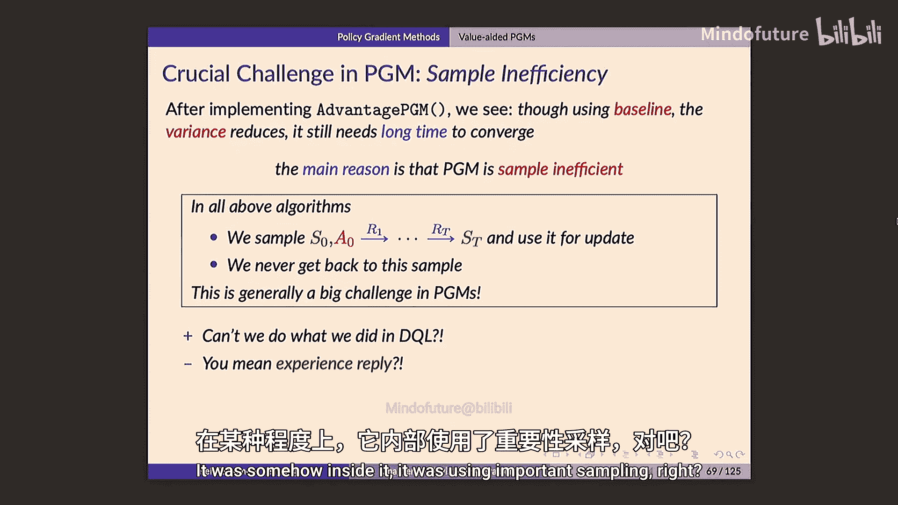

And other policy is given to you， you use that to know how does this policy work。

 right Q learning could do it somehow magically because the target policy was always the optimal policy that was easier for it to do it。

 but in general you can always do off policy right。

So this was enabling us to use the experience replay。

 Basically keep the previous samples in a buffer and use them over and over again。

 Here we cannot do it because basically what we are sampling with is the policy itself， right。

 we are playing with that policy。 Now， if I。

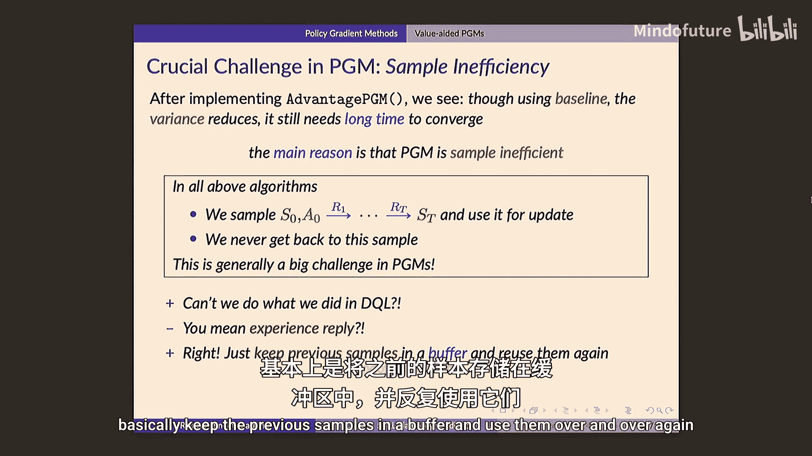

Have one trajectory sample with my previous policy in a couple of iterations before。

 Then that trajectory is given by a policy which is already old， right。

 That is not the policy that I'm playing right now with， right。

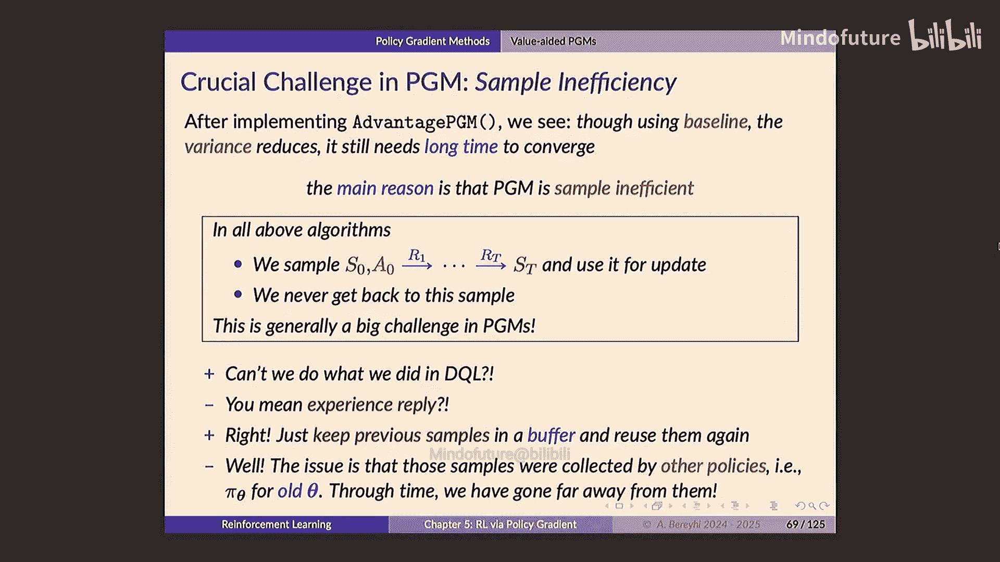

Everybody's clear。Now， the thing that you might tell me here is that， okay， let's go off policy。

 What does it mean， It means that I am playing with my own policy。

But given that I do know what was my policy couple of itrations before。

 I use important sampling to use that sample， that particular old trajectory。

And then I just used the important sampling coefficient to somehow transform it to into a sample of my current policy。

 Well， that is a valid argument。 But the issue is that when people started to implement this naively。

 it didn't work。And then the question was， why it's not working， what is the problem going on？So。

This， if， if we are able to just go off policy， we are going to get sample efficient。

 And if we want to do it， we need to use important sampling， right。

 So just as a kind quick recap of what was important sampling， you remember that， right。

 I have this X。 This is distributed with part distribution P， right。

 that distribution is something different from distribution Q， right。

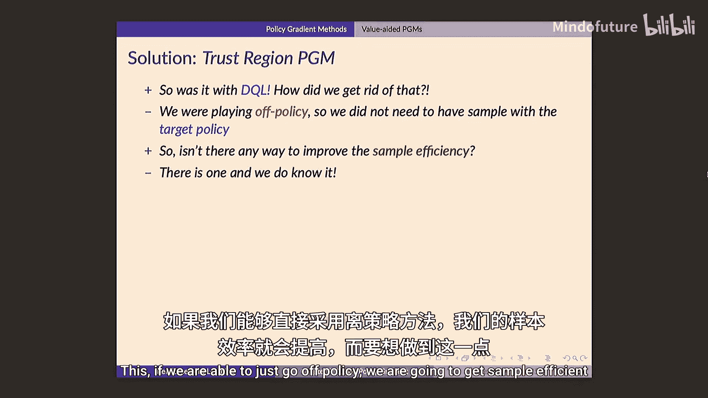

Now， if I want to know what is the expectation of x with respect to distribution Q。

 how should I calculate that， Well， I would say this is the average with respect to  Q X times  Q X。

 right？ And then I started opening up this as  Q by P times P， right。I school。Q by P times p。

 Then this is， again， one expectation。 The term inside the expectation is x times Q over P， right。

 So this is expectation with respect to P X times Q X over P X， right now， once again。

 as I told you before， when you are doing important sampling。 First of all， you are able to。

Estimate or average with respect to P。 Maybe you are able to sample P， right？ If you can sample P。

 This means that you have samples from P， you can average them。

 So you're able to estimate these average， right， Maybe you cannot sample Q directly。

 so you cannot directly compute this or estimate this one， but you are able to estimate this one。

 Another thing important is that you need to know Q and P both of them。

 You need to be able to evaluate them at particular points， right？ This is again。

 possible in our case， because this  Q and P are basically the policies， right， pi。

 we are able to evaluate your policies or neural network。

 we just tell it what is the state in action。 you're going to give us the policy value， right？ so。

This was the important sampling argument， so we did it before。And people started to say， okay。

 I have this policy。 I played with it right， and I collected some sample。 I just on。

 now I am at another time， my policy has changed。 but I do know the previous policy。

 and I know the current policy。 so maybe I can use that sample again。

 but this time I just convert it into the sample of the new policy by using the important sampling right。

 maybe we can do it， well， if you start doing it， they start to see that。 well。

 this is going to work to some extent right， but one very typical behavior that they say they see is that as the policy starts to converge somewhere。

 and then you start to somehow get the peak reward or peak return。

 then your algorithm starts to jiggle。

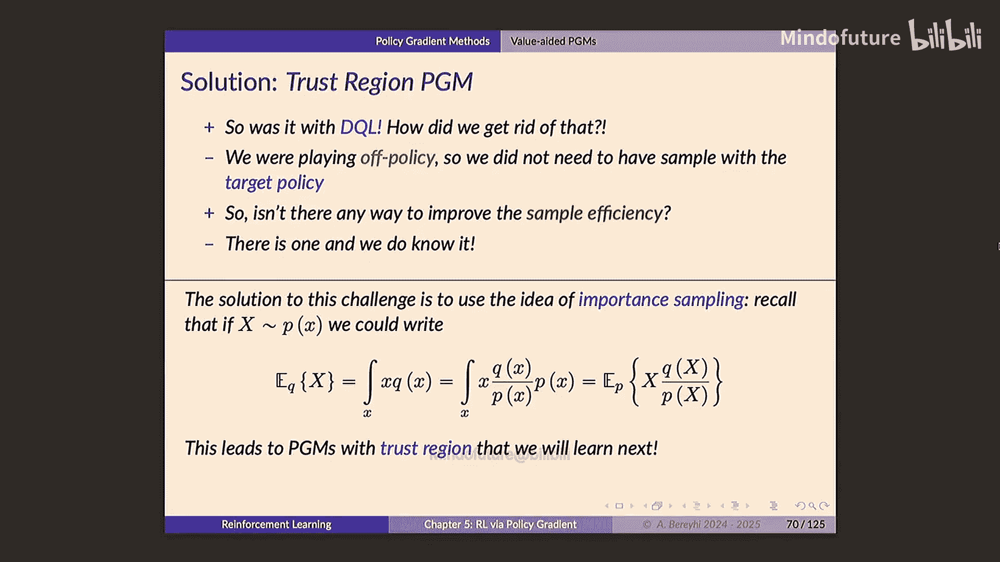

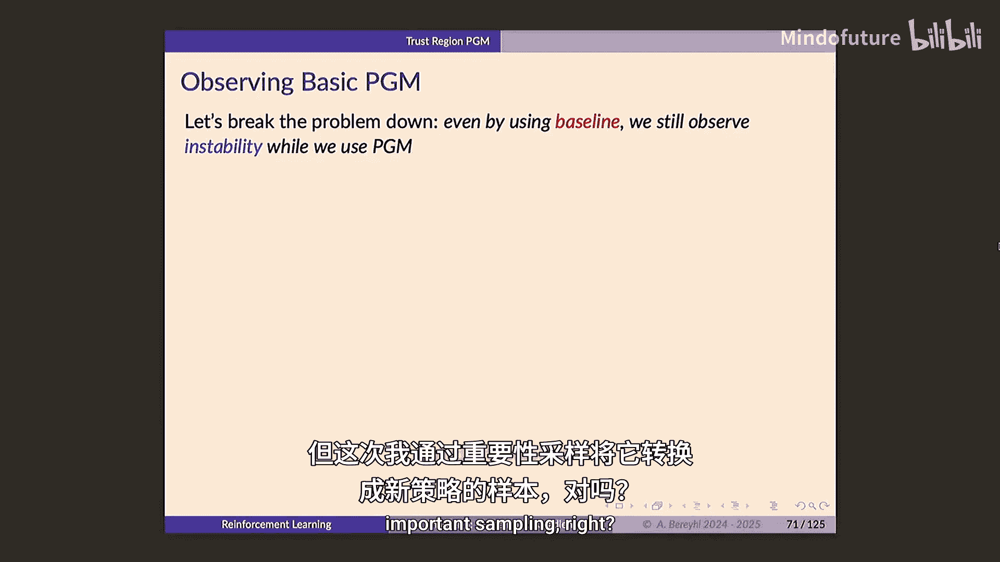

And then at some point， if you keep on a bit updating your policy。

 your policy is going to just drop significantly。 Like your policies start to lose whatever it found。

 It， It doesn't go up anymore and。Well， this was a bit of typical behavior。

 So they started to try it over and over。 It was happening over and over。 And then the question was。

 what is the reason for that， right， Any idea what could be the reason for this problem。 And for now。

 don't think about important sampling or。PGM or anything。 Just think about deep learning approach。

We are doing the whole training using， you know， gradient， stochastic gradient decent。 right。

 If you see some inconsistent behavior here， what do you expect。

What is the first explanation you can give that describe the reason you're just。Getting lost。

Any idea。Yes。Because I'm sorry。Overfitting， it's not really overfitting because we're not fitting anything here。

 right， We're just playing the environment。 And then we start to just play it worse。

 like we update and our update makes our policy worse as compared to what we had before。

 So what could just take us， like if were really always moving in the right direction， right。

 if we always go towards the right direction of the gradient。

 were we are supposed to always get better， right， So what is the issue。I schedule。

Learning grade it might be。 it might be a learning grade， perfect， another thing， yes。Or policy。

 or policy is random， but we are not learning a random policy。

 We are learning the distribution of the policy， right， So that supposedly is something fixed， right。

Variance of your gradient， could it be an issue as well。

 Like if you have a huge variance in your gradient。

Could it be that it's just taking you towards the wrong direction？Could it be。It could be， right。

 yes。So I mean， you should take it from me now， it should be， right， right？

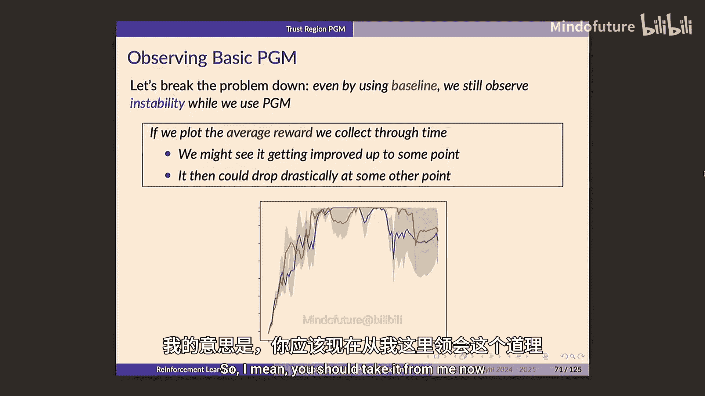

Yeah， but people， I mean， they did not listen to my talk for five minutes。 They spend a lot of time。

 and then they concluded maybe this is the issue， right。

 The issue is that we are actually having a very bad estimator of the gradient right or maybe as your friend said。

 the issue is with a learning grade s。 maybe we are getting bad updates like or gradient should be in this direction。

 but each and we're sampling， were getting something like this right And then since we have only one sample every time that we update。

 instead of going up， we is going this direction and maybe we use a bad learning grade。

 So were is taking us so far away。 we are not getting back on the track right So maybe that is the issue。

 this is the basic computational challenge we might have。 and then they said， okay， yeah。

 we basically cannot trust this particular sample， but we need its expectation， right。

So it means that we need to have so many samples that the average of those samples is somehow reliable。

 right， This is what we do in deep learning。 We usually do not work with a single sample， right。

 We use with a mini batch of samples。 and then we compute the gradient on on the mini batch。 Okay。

 that's fair。 So maybe the variance is too high here and maybe what we should do。

 We should just take more samples to estimate this expectation more efficiently。 Okay。

 what can we do。 We can just go for mini batch。 Then at some point of time， they said， okay。

 this behavior is becoming a trend。 Maybe we can spend more computation。

 and try it on some particular examples to see whether this is just simply coming from this bad gradient computation。

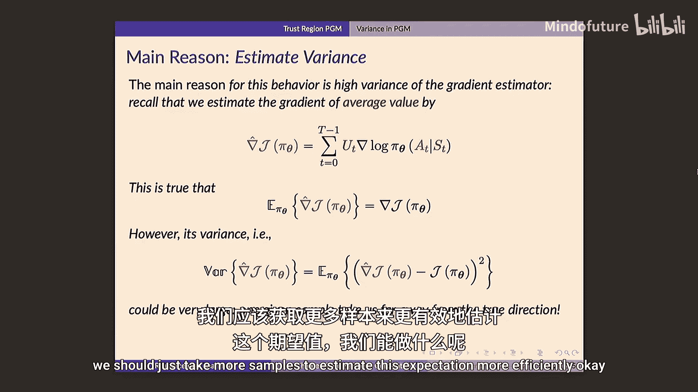

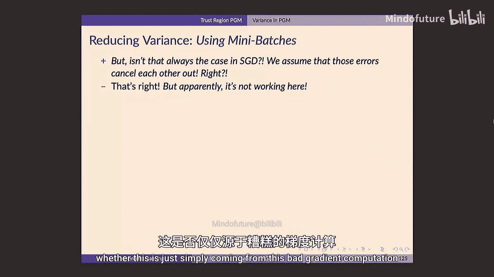

So they started to do mini batches。 It means that you get your policy。

 You sample multiple trajectories， maybe B trajectories， right。

 and then you compute your sample gradient on every single trajectory。 and then you average them。

 right， So B trajectories， you you compute the sample gradient on each tra。

 and then you average them， right？ supposedly this is a better estimator。

 as compared to the original one， right， How does the variance should how does the variance drop here。

 It's gonna drop with the number of samples you have， right。

 So the variance is going to drop by one over B。 if you have large B， large enough number of samples。

 then the variance is a small enough that you can rely that movement， right。

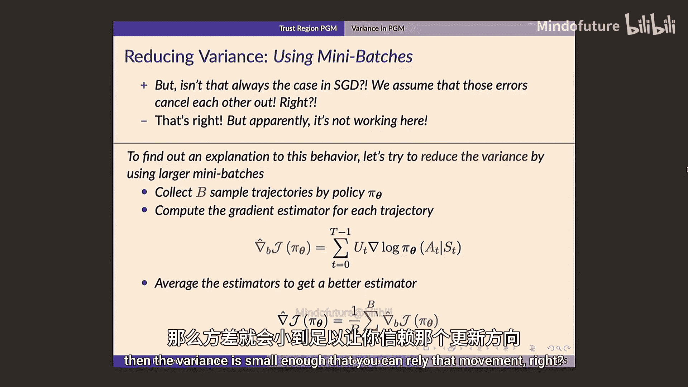

Well， they did that。 So basically same algorithm as before。

 Now they are doing a mini batch of size B。 So every time they compute one sample gradient。

 this is computed based on the advantage policy gradient method。

 And then once you have this B different samples， you average them and then you update your theta with those be different samples。

 right So it's going take much more time because every time you want to update。

 you to you need to use policy network B independent times and then you update。

 but they just wanted to find out whether that this is really because of。

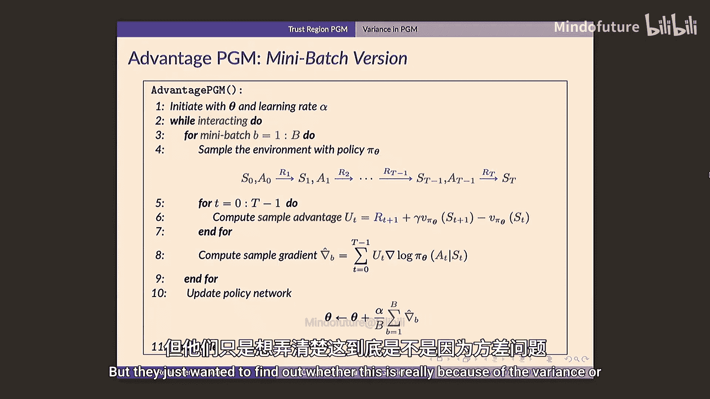

The variance or not， right？ And then the key point was that they didn't see so much difference。

 I mean， the variance in terms of jiggling up and down in different seeds， it was dropping a bit。

 but that behavior that it somehow started to grasp some， some pattern。

 and then it just loses that pattern。 it did not go away。

 And the conclusion was that this is not simply because we were just computing some sample gradients that we are averaging it over a few samples。

 right。If we do it， even with larger samples， we still have this problem。

 So there is something more crucial to all of this policy gradient method update that we are doing。

Okay， everybody sees the problem， yes。Oh， this is just， I got it out of one paper。

 which was trying to explain this， but it's just， I brought it here for inspiration， right， Yeah。

 So I guess one of them was for vanilla， PGM， The other one was for advantage。

 And they were not changing too much。 Yeah， but it was， I I。

 I guess I got it out of one survey paper or something。 So it's just for inspiration。

 So it was for very simple example。Yeah， it's pretty much the same image。 Yeah。

 this one is the same image， right， I put it like same thing as before， right， But in the paper。

 they were putting this one。 and then they say， like， after doing this， we。

 we don't see any just minor improvement in the variance， right。Questions。So you got the idea， right。

 You got what is the challenge now， The challenge is that when you just update using that whatever PGM you're using policy like the vanilla one or baseline one。

 the advantage one。 whatever you do， you are not seeing that your policy gradient is really going up all the time。

 right， and it somehow starts to lose what it learned at some point， right。

 especially when the problem gets more and more complicated。

 If your network gets more larger and larger， this is going to be more and more obvious behavior。

 Now， the question was， what does make this problem happening， and there had been a very interesting。

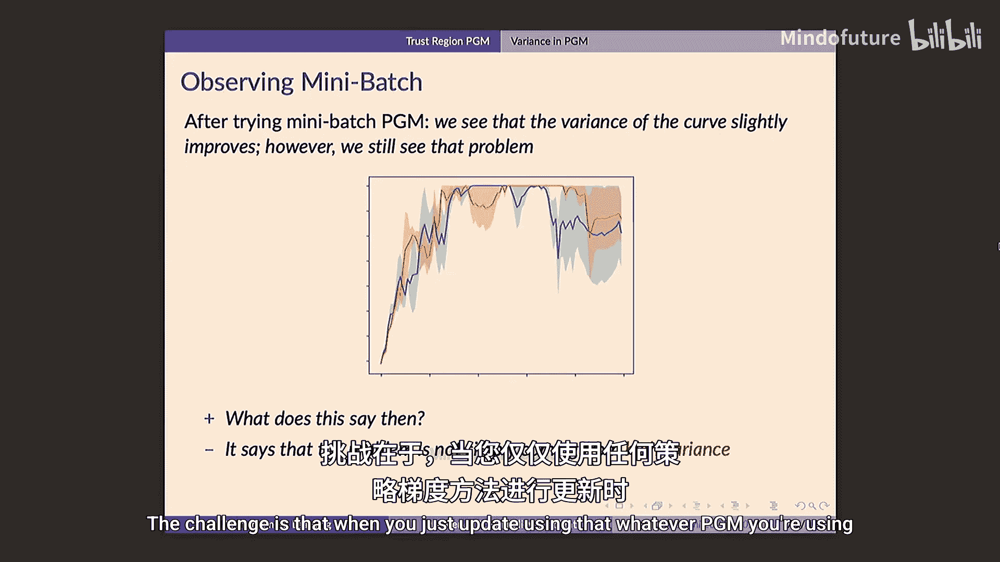

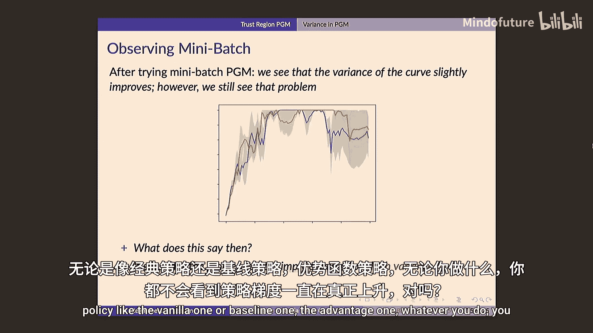

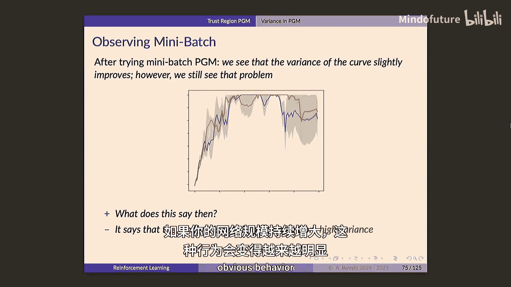

Way of understanding this now。When I explain it， you probably also say that well is very smart way of understanding this。

 just as a， I don't want to discredit those who have done this。

 but this is a kind of conventional way of studying the。The dynamics of， say。

 iterative algorithm like gradient Decent。 So they tried the same approach， which is based on， say。

 surrogate function optimization。 They tried the same interpretation on this algorithm。

 And then they found very interesting connection to important sampling， which helped them to。

Explain what they what is the issue， right？ So now I am somehow presenting the problem from end to the to the beginning。

 So I'm not starting from beginning， going to end。 So I'm first giving you the equivalent interpretation。

 And then I explain， how you can interpret this as important sampling。 The original work。

 I think they do it in different order， but this is much easier to understand。Now。Yes。

 let's go on now。This is the guy who we compute as the gradient， right？ So if you think about all。

 if you forget whatever I have said from very beginning of the course up to this point。

 the only thing that you might remember is that in every single itration。

 this J pi theta this was the expected value， right。

 This was the target that we wanted to maximize because we said we have the policy we want that the expectation of the value function in all states for a given say distribution。

 this guy is maximize， right， And then the whole thing that we do。

 we tried to compute the gradient of this guy， right And then policy gradient method was giving us the expression for this gradients。

 right， So it was telling us you basically need to get。Some unbiased version of your Q function。

 We chose to have advantage times the gradient of log likelihood， right。

 So this is the way that you you can compute your gradient。 Now， go ahead。

 do sampling or something else to just update， right， to just estimate this and update， right， Now。

 one thing that you can do。 one thing that we can say， we could say that， okay。

 let's forget about all of estimation problems that we had there。 Let's think。

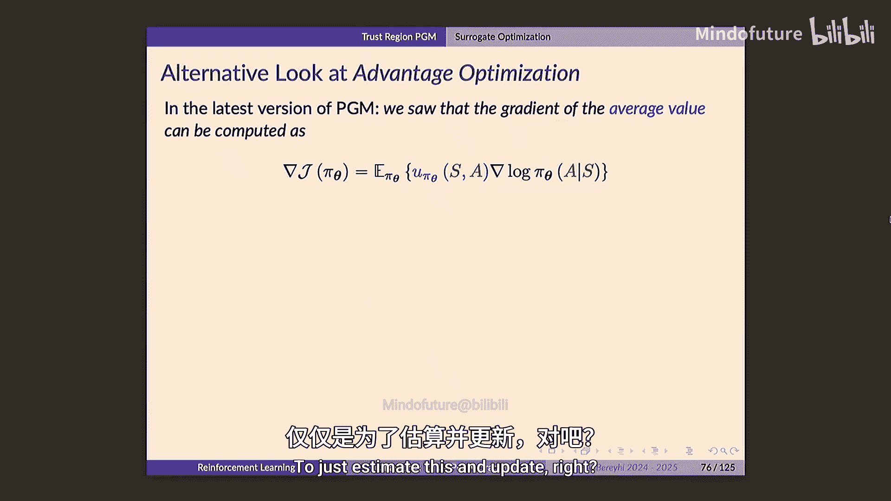

For the moment， ideal。 let's say that I am really able to compute this expectation。

 So if I give you a particular theta， then you have your policy network。

 then you are able to exactly compute the expectation with respect to that policy。

 sayy you can do it。 Then what would be your gradient of the objective at the particular point theta K。

 Well it' gonna to be the same thing as we had here。 just you set theta to be theta K， right。😊。

It means that you put your parameters to be theta in your policy network， you compute。

 you evaluate the advantage， right， meaning that you evaluate Q， you evaluate the value。

 you subtract them， this is the advantage。You compute log of policy， right， You take the gradient。

 and then you set theta to be exactly theta K， right。

 If you are able to compute this guy and you are able to take this expectation。 So， for example。

 you open up the integral and you write everything and magically， you can find it， right。

 if you can find this guy， this is going to be the gradient of your objective， right。😊，Correct。😊。

This is the gradient of the objective。 You get the gradient of the objective。

 you just move in the direction of your。Gient to just maximize it， right？ So this is the， say。

 high level gradient decent algorithm that we are always doing， right。

 The only thing that we are changing， we are changing the way that we are estimating this expectation here。

 right， and there are different approaches we try。 Now we want to see where the issue is coming from because what we have observed is that the problem is not with our expectation。

 simply， right， The problem is not simply because we have a bad estimate of this expectation。

 The problem is somewhere inside this this this algorithm。 So。

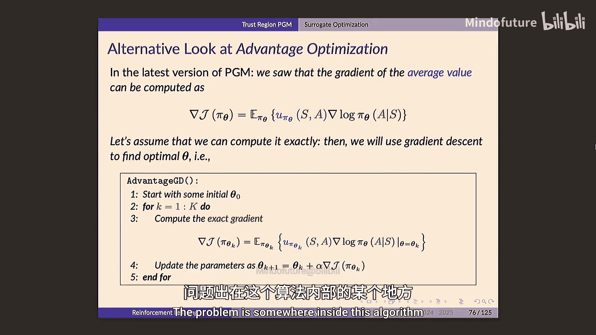

The way that people do it did it was that they started to define a surrogate function。

 So as I told you。To you， it might sound a bit new thing。 Like why they define this kind of function。

 But this is a kind of typical approach to study such like algorithms gradient decent algorithm。

 at least。 So what you say， you would say I have this function。

 And this function is what we call it surrogate function。 Now。

 I'm gonna explain why we call a surrogate function。 But in this function。

 the thing that you should pay attention to is that this is a function of pi theta， right， basically。

 if you think about the neural network is only a function of theta， right。Correct。

 now this function of theta depends。 Or theta just appears here inside the nominator。

 You see it here。Its onlynominator， which is theta， the denominator， and also the advantage。

 both of them are calculated at one given point theta K， right？A rice school。

So this means that this surrogate function。 If I change theta K is going to be the same function。

 but computed at some different with different weights， right。

 This is what I have the index K for the function， right。

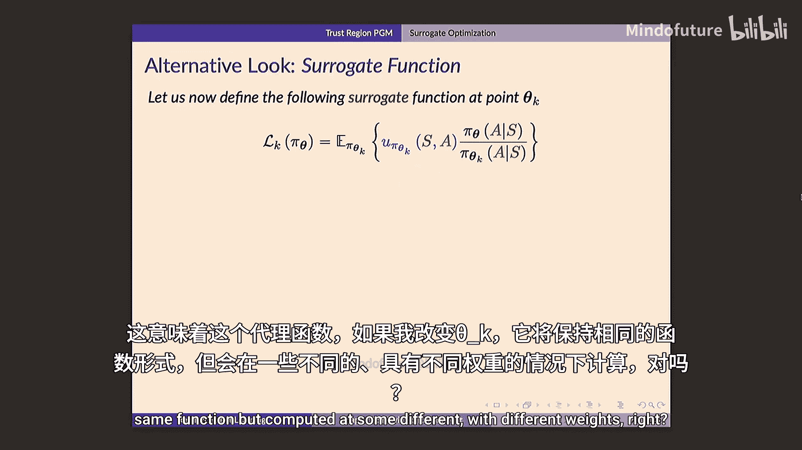

Everybody sees that。L K pi theta is a function of theta， but it depends on my choice of theta K。

 right？ Now， if I want to take the gradient of this function with respect to theta。

 which term is going to show up。Or which term is the one which I should take the gradient with respect to。

Go ahead， yes。We sure here， if I want to take the gradient of this guy with respect to Theta。

Only this guy， right， Theta K is constant。 You see it， right， Theta K is one， for example。

 sayy I have only one parameter。 that parameter is 1。 I put it1， right， Now here the guy is one。

 Here is U of theta being one。 The only guy which is a function of theta is that guy。

You see why I'm showing it by L K of theta， right？Now， there are two key factors here， the first one。

Is that we have a sequence of serogate functions。When we are doing gradient decentcent。

 every single dime we update， right？Correct， every single time we are going to update。

 And when we update， we get a new theta k， right， we put that theta K inside this function。

 this expression， it's gonna give us a function of theta， right？

 So that function of theta is something like this， for example， right？

 So your original function that you wanted to maximize was the yellow function。 Now。

 what you are doing， you are doing gradient decent， right。

 And every single time you just compute one theta K， you update it。

 you hope that this update is going to take you to the maximum point on the on the yellow curve。

 right。😊，You could say instead that I am building some surrogate functions。Maybe under this function。

 right？Now， when theta K is the first value， I get this lower one because theta K here gives me some coefficients。

 which make this function somewhere there， right。And then if I go on the maximum of this one。

 then I'm going to jump， I'm going to get a new theta k right。

 I use that theta k to change these values， and then I get this new surrogate right So every time that I change k。

 I get a different surrogate right and I can just go on all of them right。Everybody's cool。

 You got the idea of what is the surrogate function。 I don't want you to know how you want to use it。

 I'm gonna explain it next。 But right now， you get what I mean by surrogate function， right。Okay。Now。

 this is the surrogate function that we have。 And one thing that is important here is that only term that is showing God Theta is the nominator。

 right。Anything else is simply fixing every single iteration， right？ Okay， that's cool。

 Let's go ahead。 We have the surrogate function。 Now I want to take the gradient of the surrogate function at a particular point at a general theta。

 And then I put theta to be exactly theta K。😊。

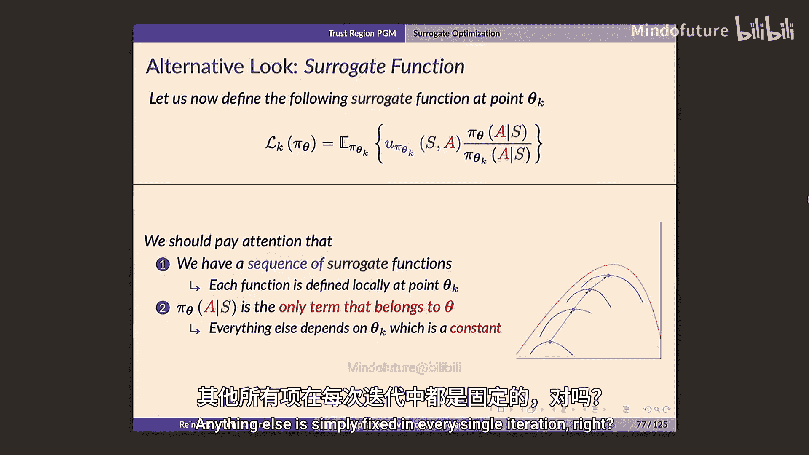

Everybody's clear。So if I take that， what's going to happen， where does the gradient go？

To thenominator， right， So this is going to be the gradient。

 If I take the gradient of this guy and I want to know its value at theta K。

 I would just take this gradient inside this guy。 And after computing the gradient。

 I'm going to set theta to be theta K， right。A high school。Now。

 if I do that this term that you see gradient of pi divided by pi， if I compute this gradient at 0。

 theta k， what is that term gradient of phi divided by pi is basically gradient of p logarith， right？

So this gradient term， have you seen it before？This is exactly the gradient that we are computed to do with the gradient descent by policy gradient method。

 or policy gradient theory。Everybody's cool。Eace is there。So what is happening here？

The thing that is happening is that you're building one surrogate function， right。

 And this surrogate function has this property。The way you compute this gradient at the particular point theta okay。

 it gives you exactly the direction that you want to go， right？Everybody's cool， yes。Yeah， I。

 I do know that it sounds a bit weird。 This is why I always ask everybody's cool。

 But if you don't see something in between， just let me know。

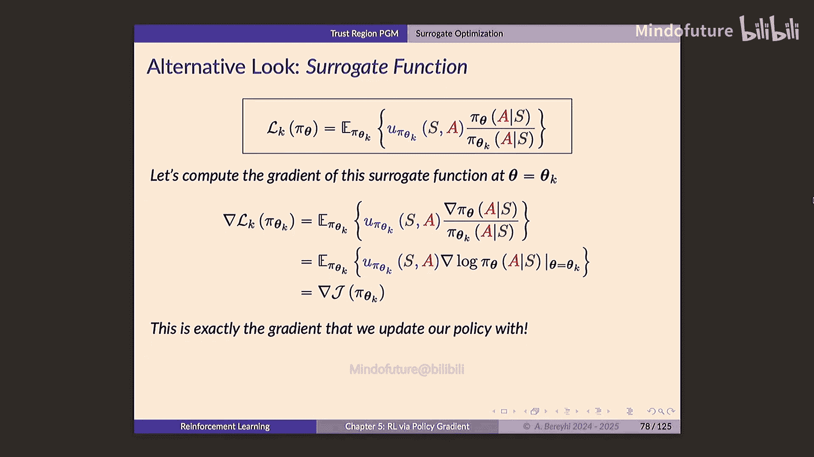

Okay， so。Now， one thing that I'm gonna do。 So I had this， I had this loop， right？

 This was the gradient decent loop that we had， right？

 every single time we compute theta K and we updated using the gradient of this objective at the point theta K。

 right？ Now one thing that we have seen is that if we replace that guy with the surrogate function Lk right。

 and we compute the gradient of that Lk。 that surrogate function at the exact point that we have we have the same thing。

 right。😊。

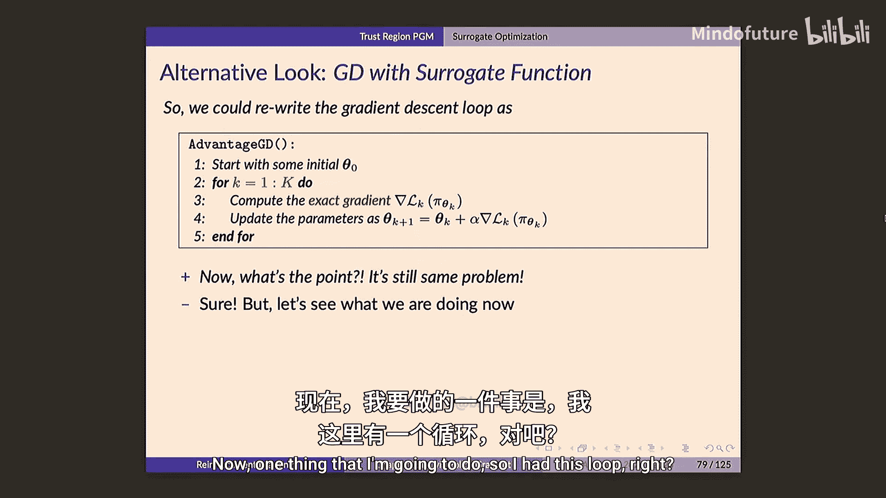

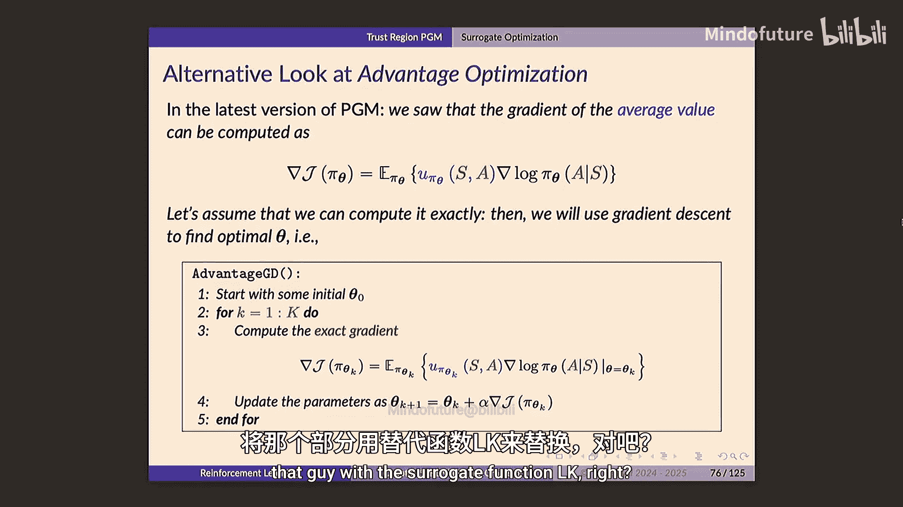

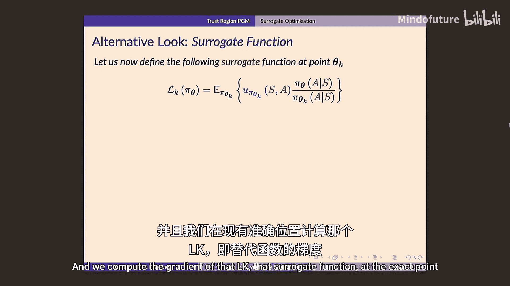

Correct。We have the same gradient。 So the thing that I'm going to do is that I'm going to replace the gradient that I had before with this one。

 right。

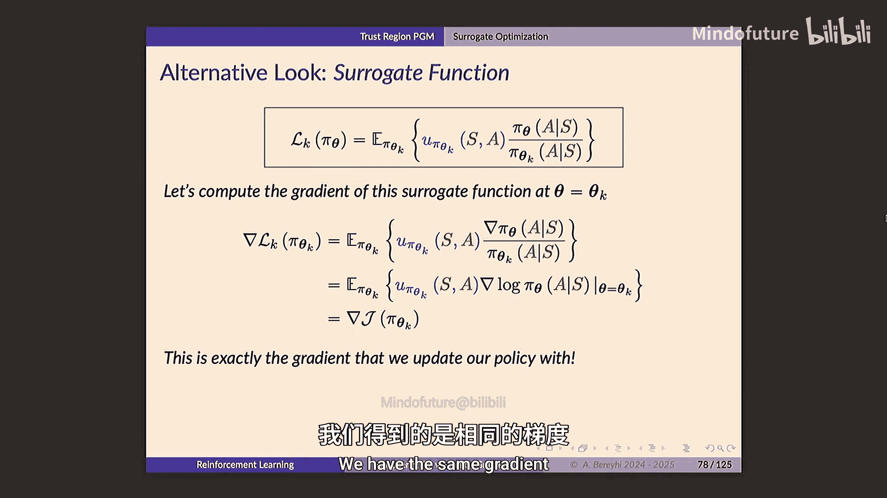

So I previously I had the gradient of the objective J。

 No I just put it the gradient of the surrogate function as long as I'm computing everything at 0。

 Theta K， nothing is changing right， Same thing as before， right。😊，Now。

 you might tell me what is the point here。 What can we do with this one now。

 The key point here is that when you have a surrogate function， which is this property。

 Like at every single time that you want to compute the gradient。

 you are computing the gradient of the surrogate function。

 One thing that you can do instead of computing the gradient of the surrogate function。

 you can just find the point which is making the surrogate function maximum。

 So instead of updating with the gradient of this surrogate function at point theta K。

 you might say that I have the surrogate function。 And my next point， theta K plus1。

 is not simply theta K plus is gradient， it's the point which is maximizing that surrogate function。

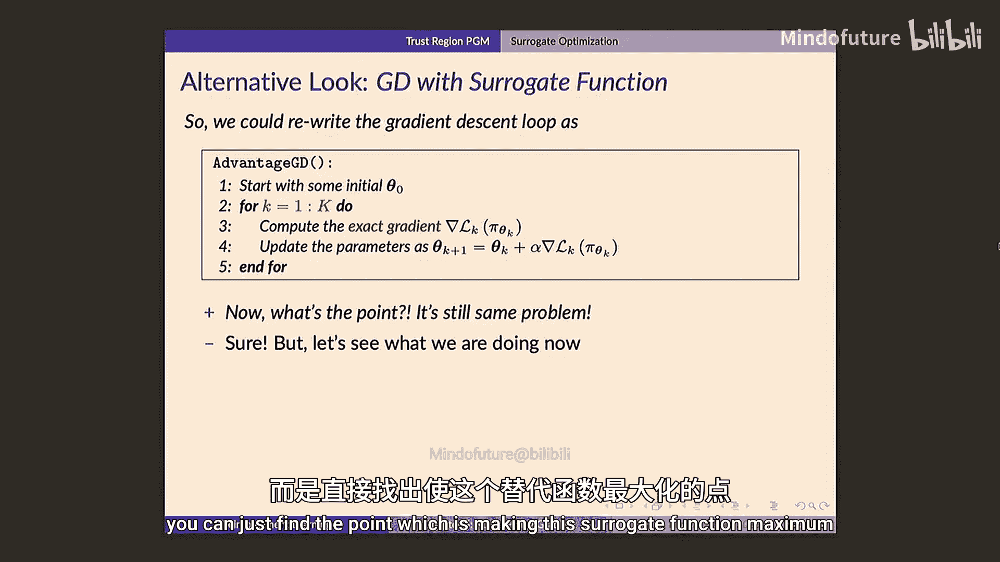

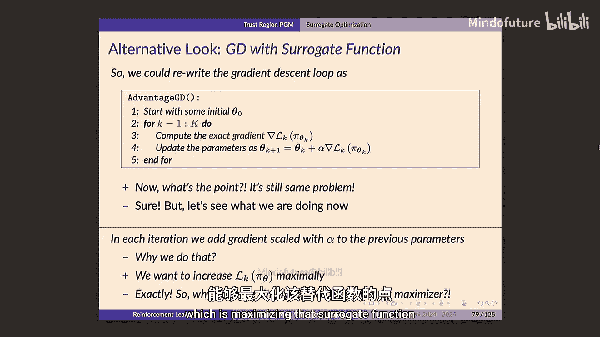

So back to this image that I showed you， this means that you do know that somewhere somewhere this surrogate function is touching the other function。

 And that point is exactly theta K， right， at that point， they have the same gradient right？ now。

 if you choose that gradient， you move in that direction。

 which is going up on the on the original objective right？ But you might say。

 why should I go up in this direction because if I want to go up in this direction。

 I should also know this step size， the learning grade， right， I don't do that， right。

 instead of doing it， I just go on the surrogate function， find the guy which is maximum right。

 I take this one as my new point right， and then。I compute this new point。 Then again。

 I compute the new surrogate function。 That new surrogate function again has this property that if I look at the particular point that I had before。

 the gradient is going to touch the gradient of the original function。 I again， maximize that， right？

 And I keep on going on the maximum， right， So it's like you make this hills under your original mountain and you jump on the hills。

 right， and you go up。😊，This idea is something people call it majorization maximization。

 So M M algorithm。 So if you are interested， you can take a look at that。

 this is a kind of very efficient way of numerical optimization。

 especially if your function is not very smooth and comeve。

 So this is going to help you because it might be that this yellow function is very you know。

 going it's very unsmth。 So it's going up and down a lot。 but it might have an envelope。

 which is smooth， right， And if you want to get to the maximum， really。

 you need to walk on the envelope， right， but then you can make a surrogate function。

 which is very smooth， right， and then you jump to the maximum of that again。

 you jump on the maximum of the next one and you so on you get to the top。 right Everybody's cool。😊。

You've got the idea what I'm doing here。Okay。Yes。供个啊。

One of our sub functionss that touches the original。Yes。

 I guess it would have been better if I put the pictures to at least at this point somehow touch here right。

 but this does not really need that really touch each other right。

 The key point is that at one point they have same gradient， right。

 They necessarily do not have same value， right。But they are。It's like theyre。Right， right， right。

 right。 exactly。 So at this point， for example， say this was the point that we had it before， right。

 And at this point， the gradient is in this direction， this one is exactly the same direction。

 So you have the same gradient。 Then instead of just moving in that direction and get somewhere here。

 you just jump to the maximum of this guy， right？ Now you make this maximum， Now this guy is again。

 this point on the next surrogate， right， and this surrogate， you have the same slope， right。

 But then instead of just moving in that direction， you jump to the maximum of this guy。

 Then if you look at the maximum of this guy and you go up again here， you have the same， same slope。

 right， you see。😊，Okay， great。Questions。No question。 Yep， go ahead。ゆビ？没。S。Somehow。

 or somehow you get rid of the learning rate， right。

 which could somehow send you towards a very bad direction， right。

 because you don't know exactly how you should schedule the value of the learning rate， right。

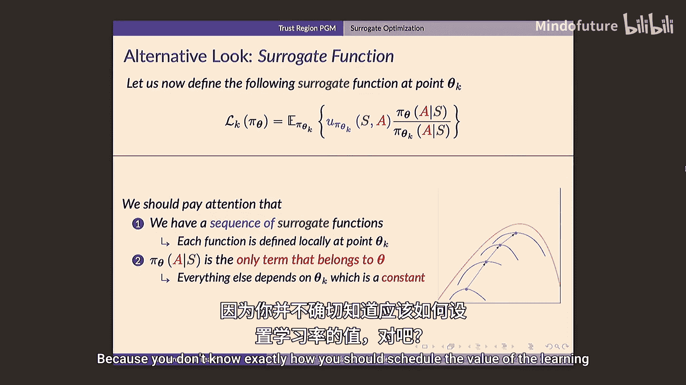

Okay。Now， if everybody got the idea what I said， now I want you to just help me。

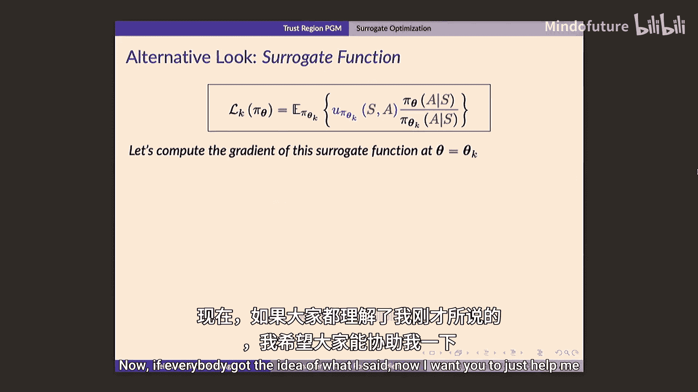

So。You， I want you to help me somehow change this algorithm with one modification to use instead of the original function and gradient decent on that one to just use the surrogate function。

Functions that I'm building。 How can I update my theta at every single itration of this algorithm。

 if I want to replace。Or I want to take the the approach I told you every single itration。

 I want to take the maximizer of the surrogate function。 What should I do， What should I change here。

 Obviously， I should change line 4， right。What should I write online for？Anyone， any idea。一高兴。

Max of L K would be your next theta， right， perfect。 Yeah， you got it。 exactly。 That's the one。

 So what you would do， you just compute the surrogate function。

 And then once you have the surrogate function when you want to update instead of computing the gradient of the surrogate function。

 which is the original function and then move in the at direction with one step size， you would say。

 okay， I go on the maximum of the surrogate function， right， What is the property of this guy， Well。

 next time this is going to be again showing the same slope at the point theta K plus1， right。

 and the original function， and I can again build another surrogate function and I maximize it。

 right， Since I'm always going up up up I'm not going down anymore， right。😊。

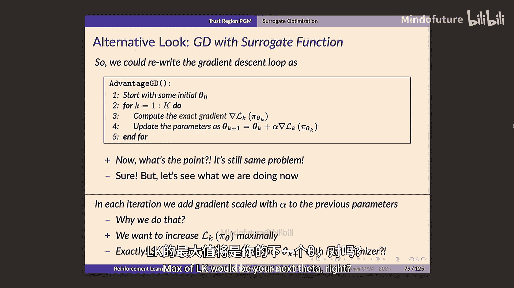

Everybody's cool， yes。You've got the idea。So the whole thing could change is only this minor change。

 this four， you just write it down。 every your new parameter is the maximizer of your surrogate function。

 And do I have a good surrogate function。 Well， I showed you， right。

 I showed you this surrogate function。 This one， right。😊。

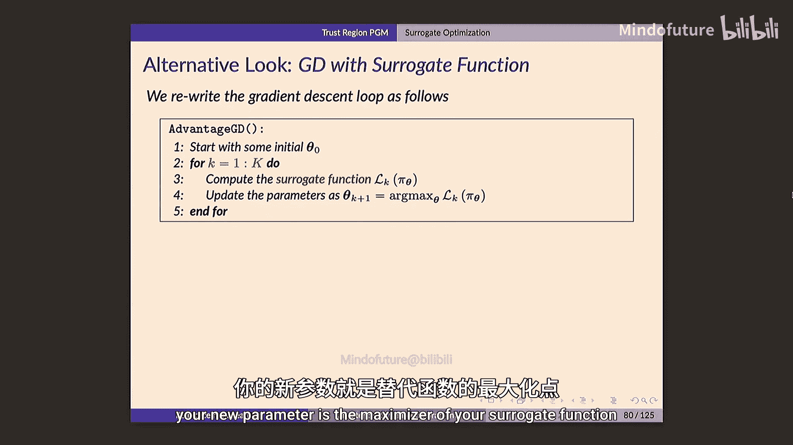

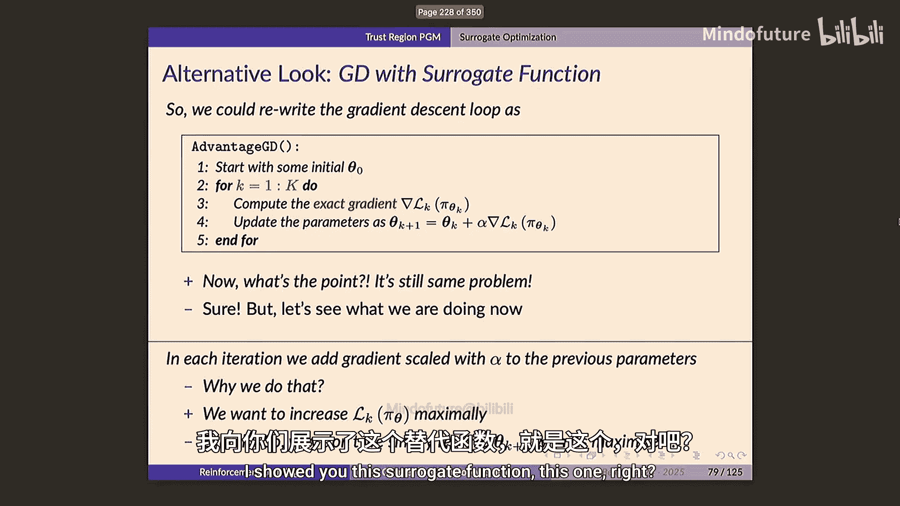

This is the surrogate function that you have。 This is actually showing that property is this tangent to your original objective。

 right。Because the gradient at the point， theta K is exactly the same thing。

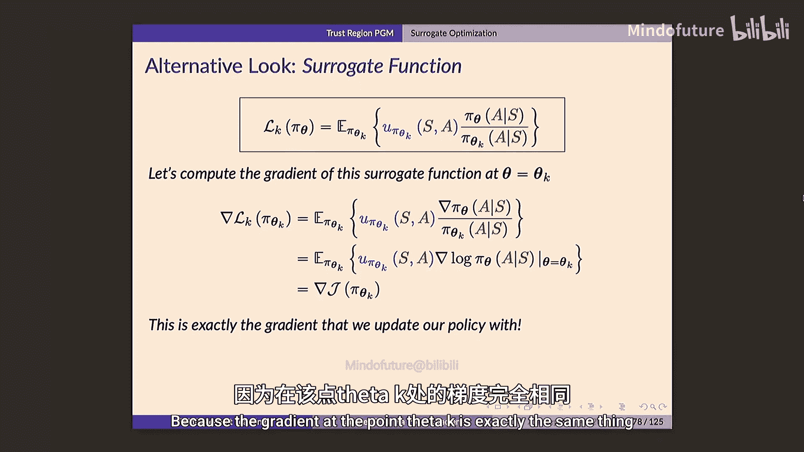

So。That's it。 And if you do that， this is going to get you rid of learning grade。

 This is going to guarantee that you're jumping up， right， you're not going down。

 So if you do that one， then your learning grade， obviously， well， sorry。

 your behavior should be improving always。 It should not get worse， right。Yes。maximum on。

Look at thatYes。

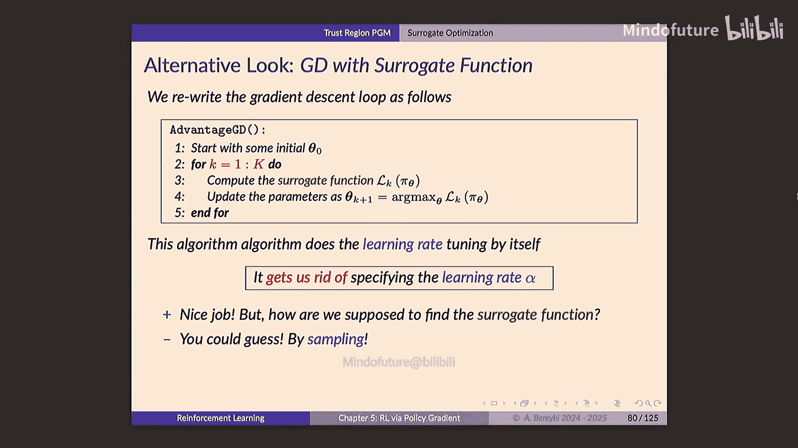

そでま。No， not necessarily like this one， you mean， So say， for example， here is theta 1， right。

 So you maximize this one， right， And when you maximize this one， now， you get your new point。

 right This is theta2。 then out of theta 2， you build your new surrogate， right。

 that new surrogate is just moving in this same direction， right， So it should like at this point。

 you should go up right， on the original function， But then you just don't simply go up。

 you just go and hit the maximum of the surrogate， right。

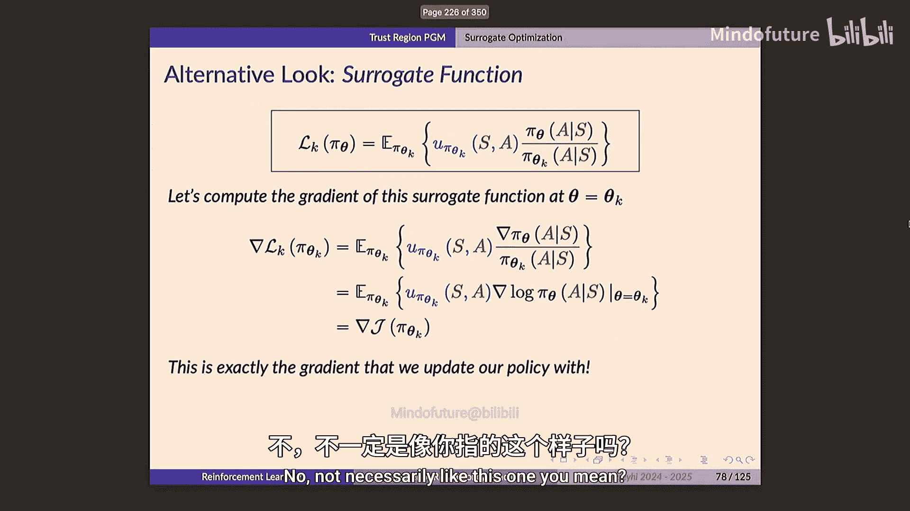

Yeah， but once we get like。Thank。Once we get past that maximum。Oh。

But then you have this property that when your surrogate function is going to like。Sacheur ray。like。

 if you get here， then your next surrogate function， next surrogate。

 all of them are going to be the same。You're going to hit each。

 They're going copy on each other because the gradient is going to be0， right， And because of that。

 your surrogate function is going to locate。 So it's going to be something， some cop。

On the whose top is exactly on this on the same to the original function， right。

 So it could not change。 So you're changing here using the fact that this guy is having a gradient nonze。

 right， at that point。 But here， that point is not going to have any。

 So that is going to copy on each other from at some point on。 But you're gonna see that we use this。

 And then we extract some more efficient algorithm update for gradient decentcent。Y。Yes。

Similar question， could you repeat why is it guaranteed that we always going up？Yes。

 but when your gradient decent， for example， converges， say you hit the maximum， right。

 when you hit the maximum， that maximum is going to have a gradient 0， right。

 And then when you build that， that what is it， the surrogate function， right。

 the surrogate function on that one is。Showing you is is having the same gradient， right。

 So its maximizer is again the same thing， right， When you maximize it。

 your next point is the same thing， right。Youve got my point。

Say say you build this last surrogate function right？ And then what is the property of this one。

 The gradient of this guy is going to be gradient of the original function at the point that you computed it right。

 Theta K。 So gradient of your original function since that is maximized is 0 right。

 So this means that the gradient of your surrogate function is again 0 right。

So that point is also the maximizer of your surrogate function， right。

 So you update you're going to be the same at the same point， right。

 and you keep on just getting same surrogates over and over right。Questions。

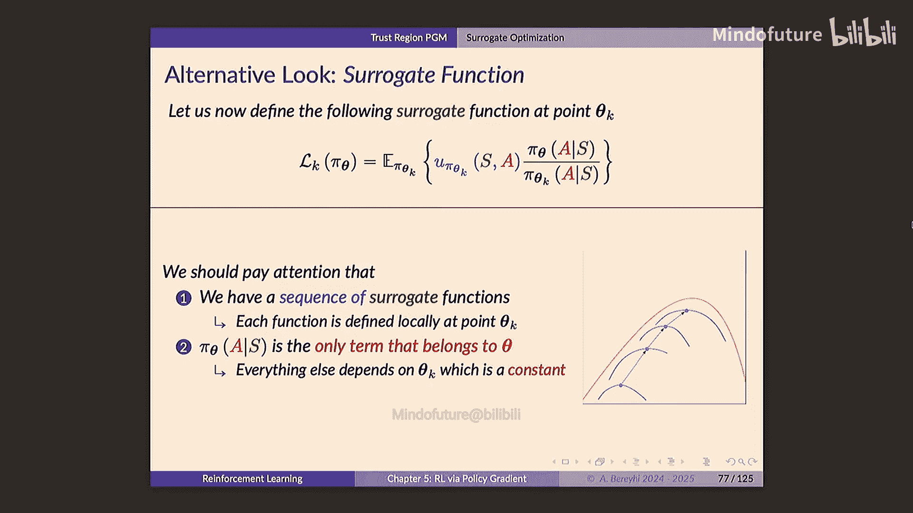

No question。Okay， so。That is going to be the way that were going to update the parameter。

 if we want to just do the surrogate function， this is going to help us get rid of the learning rate。

 And now the question is that， okay， if every problem is with learning rate and estimation。

 so maybe we can put this one instead of the original one。

 And then we would see that when we are updating over and over。

 then the algorithm is going to improve right， the policy should improve it got to converge the to the optimal policy。

 So。

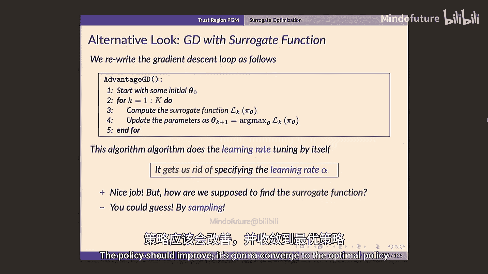