# 【多伦多大学】强化学习 2025 ｜ Uoft   Reinforcement Learning   Fall 2025 p51 P51_讲座_50_信任区域与自然策略梯度方法 -BV1D3F2zhEry_p51-

So， now。

What we are doing。 So as we said， if we want to just have get rid of the learning rate。

 we can use the surrogate functions every time we just optimize the surrogate function。 and now。

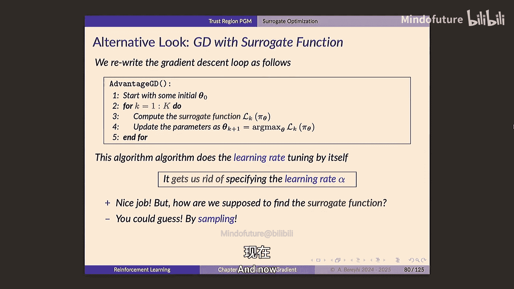

Let's look at the surrogate function itself。 How does the surrogate function look like It was this function。

 right？ So u is the advantage is one variable times pi theta is pi of the parameter theta。

 and that theta is the one which we are going to maximize。 And then the other one is pi theta K。

 Theta K is the parameter of the policy network。 and the previous itration， right。Correct， now。

 looking at this expression， what is this expression。

 Does it remind you of something specific we talked today about。This is a。

Important sampling argument， Do you see that？So what is this， you have you， this is the advantage。

 you compute that advantage with or you take this advantage with the policy pi thehita K right。

 so you had your current policy， you played with it and you just computed your advantage right？

Now now you compute this one， you want to take the expectation of this。

 but not with respect with your current policy， with respect to your next policy， right， P Theta。

That theta， which is a new policy that is different from theta here。

 Hopefully you want to just find the theta， which is maximizing this。

 this important sampling argument， right， Everybody's clear。So this is basically important sampling。

 so you assume that you're collecting samples of advantage using your current policy。

And then you use important sampling to average it with respect to the policy pi theta。

 which is the next policy， right， Okay， now， since this is the argument。 Now。

 the question that comes here is that the answer that people started to say was that， well。

 this important sampling argument is essentially the whole reason that the policy gradient method is not。

Sttable， so let's put it that way for you。 So the policy gradient theorem that we use is somehow doing this surrogate optimization that we talked about right now。

 if you efficiently choose the learning grade， then at the end of the day， you are doing this right。

 And if you are doing this， this means that policy gradient method。

 even though it computes the right gradient for you， it tells you， okay。

 every single time or every single itration， you are going to update by the average or expected value of the advantage。

With respect to your next policy， the policy that you are going to land on right？

 But since you never have that policy， you're updating to get that policy， what you can do。

 the only thing that you can do is to do policy important sampling with a policy that you have right now right So that's nice。

 That's okay that makes sense， but the issue is that looking at this guy。

 people started to say that this is the main reason of the whole and a stability。

 like there is a variance into that， but this variance is not simply coming from few samples。

 So what is the variance coming from， the variance is coming from the difference between your next policy and the current policy。

 and this is something missing in the original form of the policy gradient theorem。

 So to give you a bit of understanding about this。 let's say I have this x。

 this x is distributed with distribution P， now x， this green x。

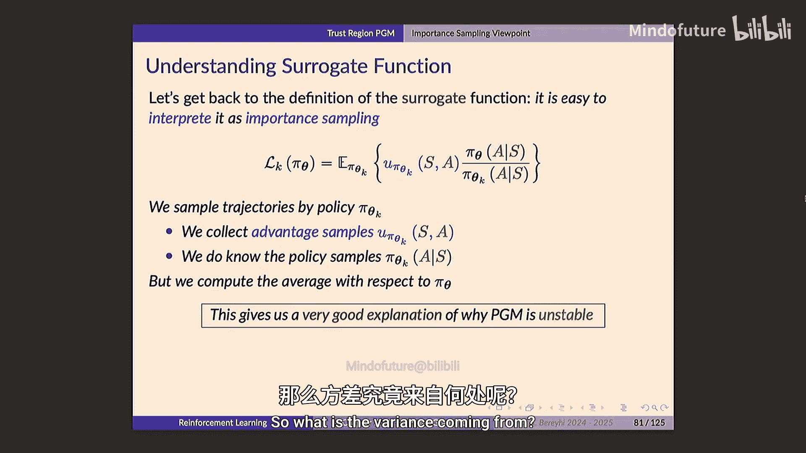

This guy is distributed with distribution Q。 Now， if you do important sampling， this means that。

You can compute the expectation of this random variable with respect to distribution Q。

Using important sampling with。Distribution P， right？

 So the expectation with respect to Q is say this is mu。

 Then you can simply do the important sampling。 It means that you take x。

 you multiply it by Q x divided by px， right， And you take the expectation of this guy。

 This is going to again， be mu， right？ This is the important sampling that we talked about up to this point。

 But I did not tell you the whole story。 I somehow mentioned it in chapter， I guess 2 or3。

 But now this is the next part of this story。If I compute the variance of x with respect to Q。

 what is the variance of x， this is basically x minus its mean。Squared。

 then you take the expectation with respect to Q， right， So it means that you get this guy。

 Maybe you compute this one， right， X is squared minus mu is squared。 Say this is sigma squared。

 right？ This is the variance that you get out of the distribution， Q， right。Everybody's clear。 Now。

 say that you are doing important sampling。 It means that you， instead of using P。

 you are going to use。sorry， instead of using Q， you're using。

 you're going to use P to compute all of your expectations。 What youre gonna do， You're gonna get x。

 and you replace it by x times  Q over P， right？ What is the variance of this new variable。

What is the variance of x times  Q divided by P？Well， I can say this guy is squared。

 I take the expectation with respect to p minus mu is squared right and you can open off that term。

 This is integral x is squared Q is squared p is squared times p right the P innominator and the P and Dnominator are going to cancel right So this is going to be the expectation of Q over p times x is squared times  Q。

 and then you can write that term again in terms of expectation with respect to Q。

 this was your original distribution right of this term minus mu squared right。

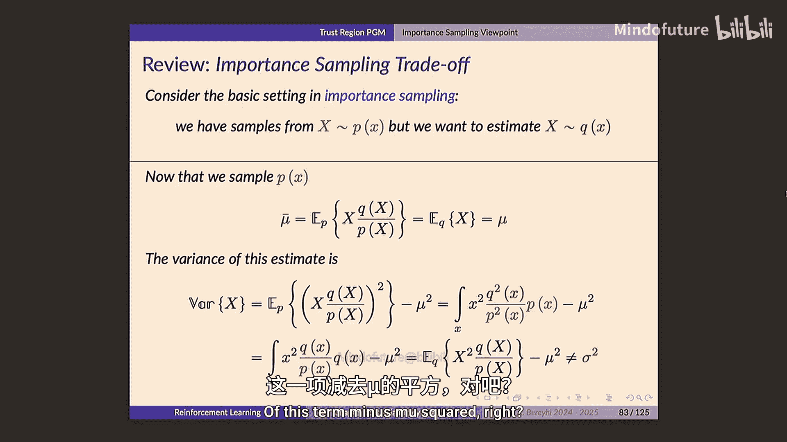

Back to the previous slide， expectation with respect to Q， your original distribution。

 x is squared minus mu squared。 This was the variance that you had right Now what is happening here when you change。

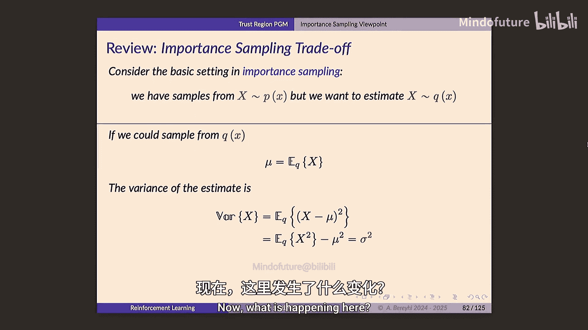

To the important sampling argument， you're going to compute this one expectation with respect to the target distribution Q x squared times this guy。

 right， This is not the same variance， right。What does that mean？Let me put it in。This table for you。

 Look at these two guys。If you work with the regional distribution Q。

 if you have the target distribution， you're able to compute exactly the mean value。

 you're going to compute exactly the variance right， but if you are doing important sampling。

 it means that you ignore Q， you work with P， right that the mean value that you're going to compute is going to be the same mean value。

 but the variance that you're computing is going to change， right。How does it change， does it go up。

 does it go down？It depends on this ratio， right？Q over P， right？

What is the ratio of the regional distribution that you have？

Or you want to youre targeting to compute the expectation with respect to divided by the distribution that you have in hand。

 right。If this ratio is1， it means that Q and P are exactly the same thing。

 then both terms are the same thing。 No， no surprise， right， You have same distribution。

 You're doing important as sampling is doing nothing。 If p is slightly different from Q， it's okay。

 that value， that Q over P for some choices of x is going to be 1。

 something for some choices of x is0。 I don't know 9 something right。

 And this is a small change in the original values。

 So this term is going to remain in the same range as。Sigma square is the original variance， right。

 But if you have some particular entries of x， outcomes of x where Q is significantly high。

 but P is significantly low。 what going to happen。Then the variance is going to boom up， right。

 It's gonna just get very， very high。 And it doesn't matter what you do。

 As long as you keep on sampling with this distribution P， you're going to have that high variance。

 right， there's nothing you can do about this， right。

 So it's not simply about the number of samples you're collecting because the variance is essentially different。

 right， you're getting totally different variance。 you're not getting the last variance。

 the previous variance。 So it doesn't mean that if you sample more。

 you're gonna get rid of that issue， right， The variance essentially is different from the variance that you want。

 right， the only thing that you can make is that your expected value is the same thing。 Well。

 you can rely on that as an unbiased estimator， but that one is potentially carrying a huge amount of variance。

 right？ especially if your。Target distribution is very different from your original distribution。

 right？Everybody's clear。So。I do understand this is too much details。 I hope that you get the idea。

 what is the issue， right？So back to our problem。 So important sampling is going to just scale the variance and this variance is proportional to the ratio of the distributions。

 Now if we get back to our problem， what we are doing。

 we are computing an important sampling argument here。

 right And this guy is essentially the expected advantage with respect to policy pi theta。

 but we are simply doing it using the important sampling with the。

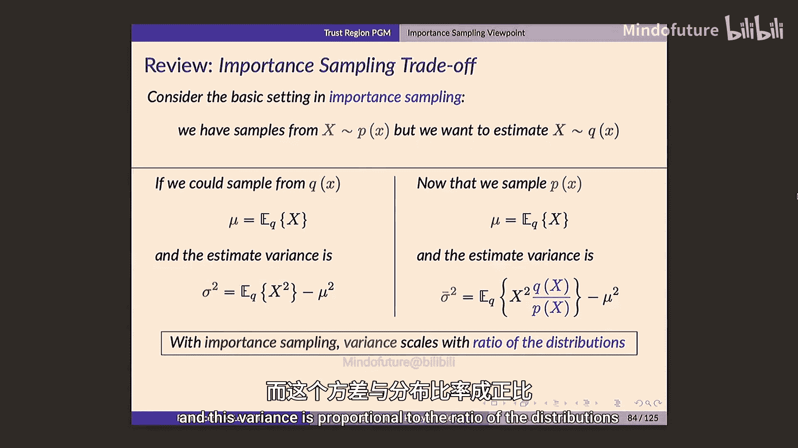

Policy that we have in hand， which is pi theta K。Now this guy could be potentially very high variances。

 right？Especially if the new policy that we are going to land。Is going to be much。

 much different from the policy that we have right now， right。

 If there is one particular state or action at which say， one particular action at which or policy。

After update is much larger as compared to the previous one than this guy is going to just increase the variance。

 It doesn't matter how much we sample， right， is's always having this giant factor with it， right。

 which is going to make the variance very high， right？ It's not shrinking simply shrinking。

 It means that I am going to converge to the variance of this new term， right。

 But the variance of this new term is again large， right。Everybody sees that。You see the problem？

So if you see that problem， do you have any suggestion as a kind of remedy？Should I do。

 I don't want any math formula right now， Any idea what should we do or what kind of behavior we need to impose or on or update。

When we are updating this policy， pi theta， when we are updating theta from theta K to theta K plus1。

 what kind of。Constraint we should impose on this new update that somehow we make sure that this important sampling argument is not too large。

Or too high invaris， I mean。Close by， right， I need to just make the policies close by， right？

 The next policy is somehow like the policy that I have。 It's not too different from that， right？

 This is the idea of trust region。 It means that search for the maximum of theta， right。

 The theta that is maximizing this arogate function。

 but don't search for the theta that is absolutely maximizing it。 search for a theta。

 which is maximizing it within a trust region， a region where your policy is not changing too much。

 right。Arise clear。So。The main idea here is that the variance that you would get on this surrogate function is essentially proportional to the ratio of the policies。

 and if you want to make sure that you are not getting too much a variance。

 you should somehow make sure that the policy after making the update is not being essentially different from your original policy。

Everyvis clear？This is the idea of trust region。 I want to say within the trust region the trust region means that the region where the policies is still roughly the same。

 right， It just improves slightly， right， not too much。

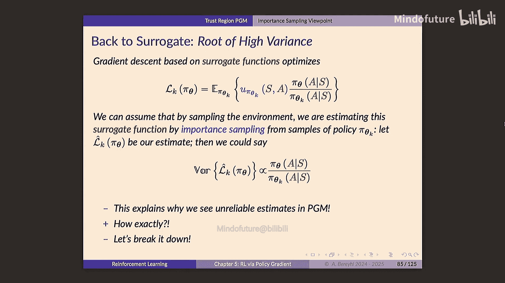

Okay， so that's the idea。 So we want to get into a policy。

 Theta K plus one say that this policy is rather close to the or original policy。

 or we want to stay within or trust region。 Now， the point here is that you might ask me。

 weren't we already doing this like if I choose very small learning rate， right。

 Then every time that I update theta K plus1 should not be too different from theta， right Theta K。

 correct。So if I just choose very small learning rate。 this guy。

 the difference between two updates could be very small， right。

 You might say that shouldn't we get fine when we have very small。Learning grade。 Well。

 this was the issue that people all the time were thinking。

 The issue is that we're not talking about theta itself。

 were talking about the policy network the policy right。

 the distribution that is described by those parameters right and you might change slightly one of the waste inside your neural network。

 but the policy completely changes。Who knows？ I mean。

 is the neural network is a very complicated function， right？

 Who knows changing one tiny weight inside the neural network。

 What' gonna to happen after doing that to your whole policy， right。

 So we want the policies to be the same。 We don't want the parameters to be the same， right？

 And people started to do experiments， they see that right？ I mean。

 when you see that bad behavior essentially by changing a tiny bit of theta。

 Then your policies start to usually change， right， Now。

 they were able to explain why this is going up， up up and then start to lose it。 Why。

 because it just goes up up to some point， you're updating theta and change of theta is not changing too much or policy。

 then you get into a sort of saturated。

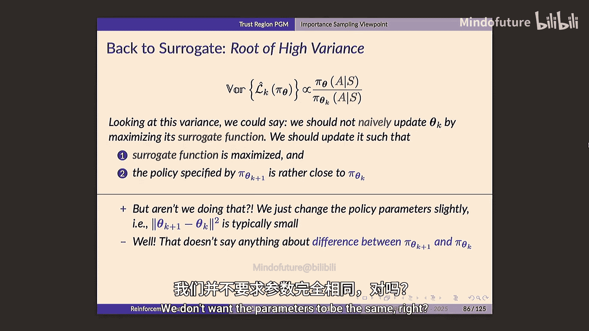

The state is， and that status is some ways become more important， right？

And if you train any neural network， you usually see it like when the training goes on at some specific epochs。

 you see that there are some specific ways just getting updated， right。

 The other gradient values are0， mostly So those weight are just getting more and more important。

 And then at that point， you're just updating that。 You just make a small change in in those weights。

 And then the policy suddenly changes significantly。 And you get totally out of your trust region。

 You get a policy， which is totally different from the previous one。

 And then any more update of gradient decent is not able to put you back on the right track， right。

So isn't that beautiful， I think I said this is a story for some of you。

 So those who had been another lecture with me。 We had one professor who was teaching one old fashioned course。

 it was called electrical measurements。 And nobody like the course。

 I think some years after our graduation， They just changed it。

 they got it out of the course course mandatory courses of the program。

 but I was like a very old course， but still in the program。 So we had to take it。

 And then he was teaching it very well。 but it was telling at the first session that well。

 I know this is not any more kind of practical course。

 but its interesting to learn it and just motivate yourself。 look at the beauty of the details。

 right， And every time it was teaching something complicated。

 He looks back to the lecture and the students and said， isnn't that beautiful。 Now。

 isn't that beautiful。 you see it here。 right But I mean， it's like a。😊。

The case of a study that ended up people understanding this one， right。

 And then if you just spend like too much time on something， eventually， you find a way out of it。

 right。So given this beautiful result， this was the very interesting explanation of why this policy gradient method is not really following what we expected to see。

 right， So there was no problem with the original result of of policy gradient theorem。

 The issue with the policy gradient theoryorem was that it was working with the with the important sampling。

😊，And although it was correct in terms of the expectation value， right， it is very high variance。

 right， And since it's very high variance， then it could easily lose the right track of， of update。

 right， And now the idea is that， well， what can we do， we can just do the same thing as we did。

 So we just do optimization based on the surrogate function。

 the only extra thing that we do is that every time we want to update。

 we don't say that find the parameter， which is maximizing the surrogate function。

 we say that find the parameter， which is maximizing the surrogate function。

 subject to this condition that this new parameter， is not changing too much the policy network。

 right。The policy pi theta and policy pi theta K， they are both the same， right。

 not too different because if they are two different。

 then our surrogate function is going to be very high variances。 and we can easily get lost， right。

 We don't want this， right。So this is what we call it the trust region， right， the the feasible set。

 the set of thetas， which are very close to theta。 Okay， this is the trust region。

 The reason that we can trust to update our policy network。Questions。No question。Okay， sell。Right。

 now。How can I make this to I I just spoil the the interesting part。

 How can I check the closeness of P Theta and P theta K。Sorry， pi thehi and Pyth， okay。

How can I check that， How can you compare two distributions？

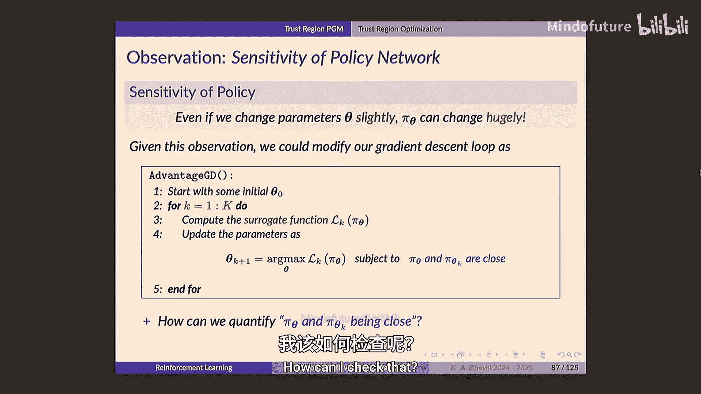

You can use k divergence， right， You can use any other divergence that you want。 That's possible。

 But K is the best one， of course， because it's not that strict。 It's， it has nice properties。

 So we are going to use k divergence。 So you have two distributions。 One of them is pi theta。

 The other one is pi theta K。 you want to keep them close。

 This means that you want to have their k divergence to be。Close， right。

 it it should not be too large， right？ Now， just recap about the definition of the K L divergence。

 What is K L between P and Q， So you're gonna just divide P by  Q， Take the logarith。

 And then you take the expectation with respect to P。 always thenominator， right。

Expectation with respect to P It means that you write down this expression。

 you multiply it with P only。 and then you take the integral， right。Now。

If we want to compute the k divergence between or policy pi theta and a given policy aration K pi theta K。

 the thing that we can do， we can just take the expectation with respect to whatever is inside this guy。

 So it's expectation with respect to state expectation with respect to action。

 log of pi theta divided by pi theta K， right， Now the expectation that you are taking is with respect to pi theta。

 right。Pi theta itself， right？Because its innominator， right。Everybody's clear， right。

 any problem with this definition？

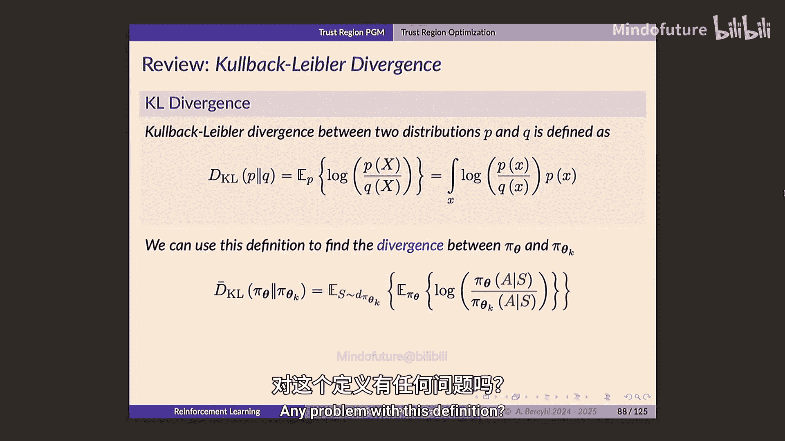

Now， what are the properties of the kL divergence， Well。

 if you have the same distribution like KL between。P and P is going to be 0， right。

 Any distribution is in zero dirgent from itself， including K L diversions。

 The other property is that it's always not negative， right。

So it zero when the distributions are the same。 If the distributions are different。

 something positive， this is what we call it Gis inequality， right。

 and probably you had it in some course as an assignment or something， right。

 favorite assignments of many people。So。Now， one thing that you might。

Is good to have in mind always is that K L divergence is a divergence。 It not a distance， right。

 It means it's not symmetric。 So K L between P And Q is not K L between Q and P， right。

 They are different， but it's no problem。 I mean， both of them are positive。

As long as P and Q are not the same， right， it is not going to harm。

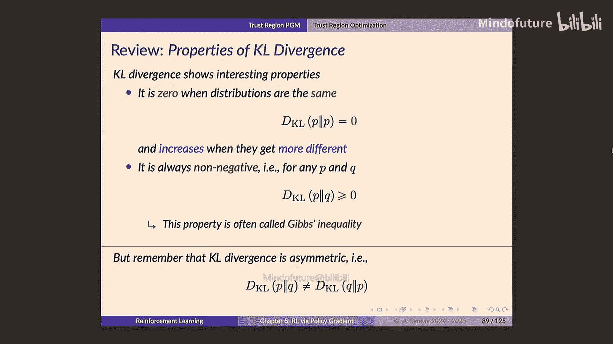

Now。The way that we are going to do that。 So we are going to just maximize this surrogate function。

 Now we're going to write down that condition more concretely。

 So we say that condition to this constrain。That the new policy pi theta。

Is at most in DMmX scaleL divergence of the current policy right so when you update the policy is not changing too much in terms of k divergence。

 right？This region is again or trust region， as I said。

 And this way of doing the policy gradient method is what we call it by trust region。

 So it's basically again， using the。Policy gradient theoryorem， but using it in a constrained form。

 So every time they wants to update， it makes sure that the update remains within the trust region。

 sorry。Okay。Questions on that。No question。

Okay， so。If we， if you got another question that now the whole thing is that we can do basically this loop here。

 the only thing here is that how we can solve this problem。

 Any idea Anyone knows how how I can solve a constrain optimization problem。

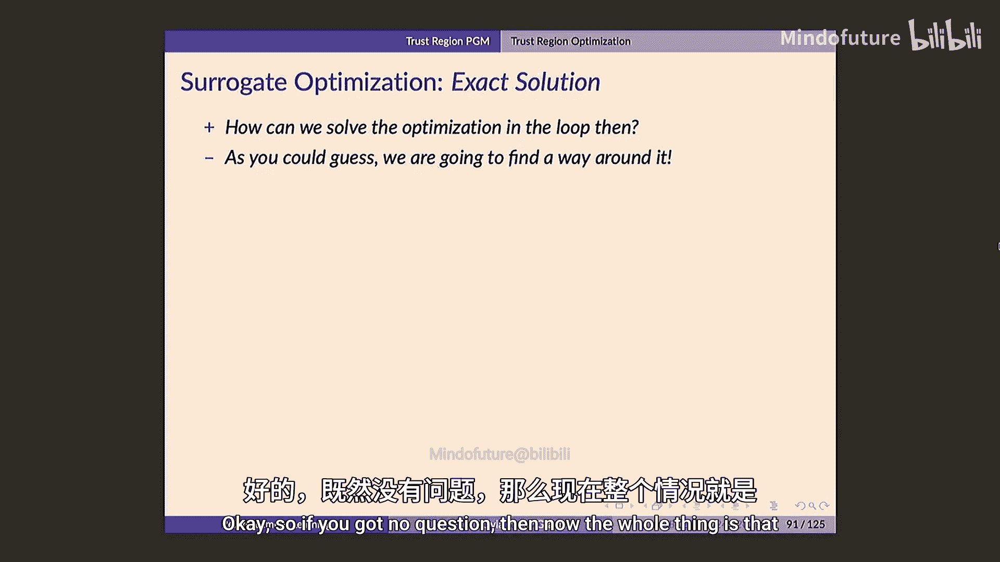

How do you solve a constrain optimization？

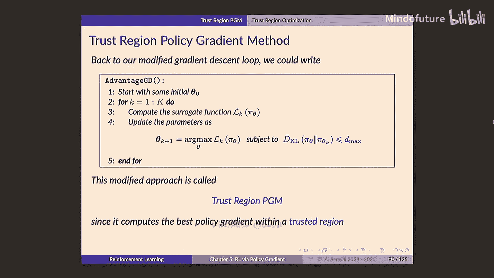

We can， for example， regularize it， right？ You could say I have this objective， right。

 and I have this constraint。 So I'm gonna add this constraint in a way that if I just violate this constraint。

 my objective is getting small， right。How can I do it。 Well， I can do it this way， right。

 I can get my kl divergence。 I multiply with some positive beta。

 I subtract it from my original objective， right， If Kl is too large。 then that term in in brackets。

 The blue term is going to be a large。 It' gonna get subtracted from that guy。

 It' gonna make it small。 So it's gonna lose the chance of being the maximizer， right。

 The classical regularization or Larrange multiplier approach。 So you can do your update in this way。

 So this means that you find some beta， typically you said beta to be the one which minimizes the whole thing。

 but no not important in here， you choose some beta， for example。

 and then you add your constraint as a kind of regularization term to your objective。

 Now you try to optimize the whole thing with respect to theta， right。

Okay now if you want to solve this one directly， this is obviously a very complicated problem right because pi theta。

 who knows how it depends on theta right， is crazy complicated。

 It's a neural network right and now kl divergence of the neural network as compared to its previous version and then this other term。

 which is therogate surrogate function， it doesn't seem to be something efficient， but good news。

 you can actually do it very efficiently， So you can simply approximate everything into a form of very simple quadratic function。

 So how can we do it。 well we start with the tailor expansion。

 I believe everybody has heard about this。 So how you can write the taillor expansion at 0 x。

 So it's gonna be to center one other 0 x0 So f at that 00 derivative times x minus that x0 and so on right So you can do taillor expansion。

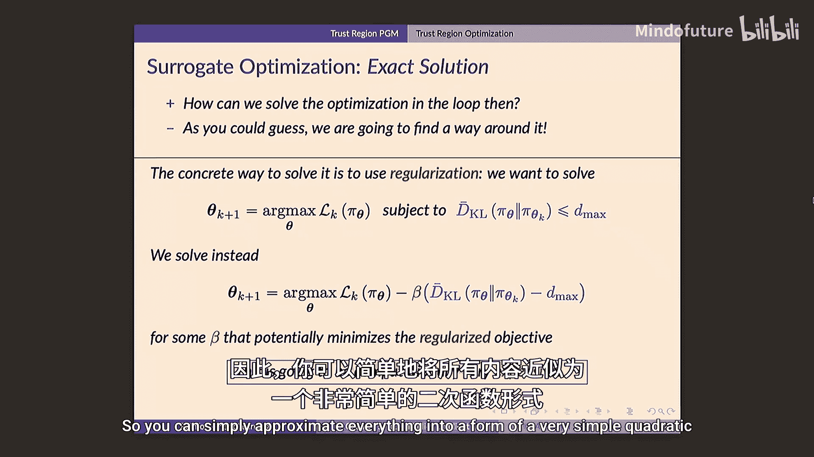

And typically， if you are just thinking about somewhere around x 0。

 then is enough if you take the first few terms， right， and the rest of them， you can just ignore。

 you would say they are very small， right， because this is going to drop with the difference between x and x0 to power。

2，3， and so on， right。Next terms， as long as your function is well defines， going to be very small。

 right。Good， now we can do it with the surrogate function。

 So we have the surrogate function at point。Theta， right。

 so I'm going to write it down as the surrogate function computed exactly at theta K。Plus。

 the gradient of the surrogate function computed at theta k times theta minus theta k plus some extra terms which I want to ignore。

Everybody's cool with this Tayloror expansion。Questions。这样。If you do assignment 3。

 you're gonna see that this first term is going to be 0。 And trust me。

 it's not a very complicated thing。 It's a very simple way to show it now。You show that this guy is0。

 So your surrogate function is basically one gradient term multiplied by theta minus theta K plus a bunch of extra terms。

 which we ignore， right， Now to just make things easier。 I'm going show this gradient by Nala K。

 So this Naa K is my gradient at time K at itration K。 Sorry。

 then I multiplied with theta minus theta K， right。In terms of theta， what kind of function is it。

Linear， right， It's a linear function in terms of theta， right。

 because this theta this gradient is computed at theta K， right It's a fixed vector， correct。

 The only function that you have or only only variable that you have Theta is here， right。

T take a is something fixed。 Everybody's cool， yes。

So this is going to be an approximation of of your surrogate function。

 a linear approximation of your surrogate function。 Like this is your surrogate function。

 You know that you're working at this point。 you just。Put it just tangent the plane around it。

 And then at any point， you just walk on the plane。 And instead of walking on the surface， exactly。

 right so。That is going to be your linear approximation of the surrogate function。 Now。

 the next thing that you're going to do， you're going to again use tailor expansion for the kL leverages。

 right。

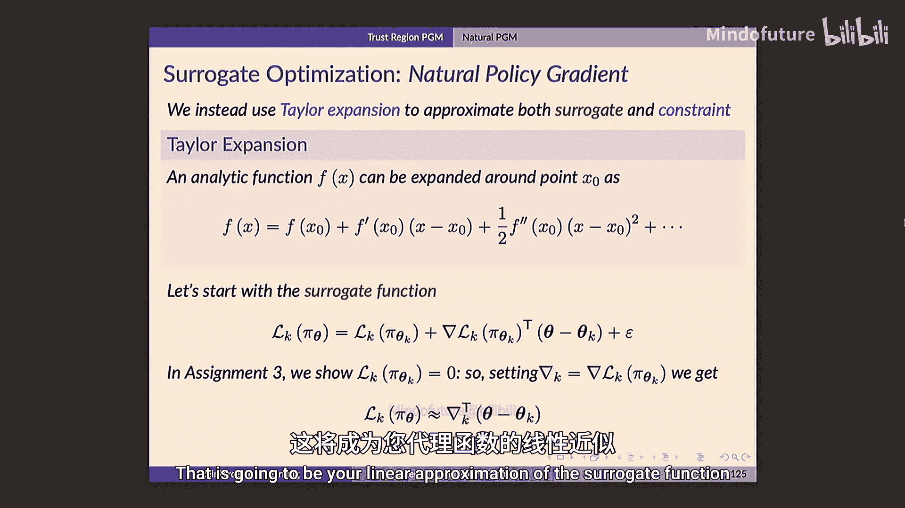

Now， how you can do it， Well， you're gonna put the terms like you would say， okay， Theta。

 once I put it equal by theta K， now I have this guy， right。KL divergence。

 P Tte K and P Tte K plus gradient of this guy with respect to theta。

Times theta minus theta k plus1 half theta minus theta k squared because it shows up both both sides。

 And then here is the gradient squared is's basically the Hasian matrix， looks scary。

 but it's not because what is the first term， Can you tell me。The first term is zero。

 what is the second term？Well， after doing assignment3。

 you're going to see that I1 is also zero right， and then everything is much easier now， right？

The rest of terms you're going to get rid of now here in between this term that you see。

 Nala squared， this gradient is squared that you see in the center。First of all。

 is it a function of theta anymore？No， it's computed at the 0 theta K， right？😡。

What kind of object is it， Is it a number， Is it a vector， Is it the matrix。Its a matrix， right。

 What is the dimension， say that your model parameter Theta is dimension D。

 What is the dimension of this matrix。D by D， right？ So I'm gonna represent it by H case。

 So this is the Haian matrix of your K leverages， right， And that one， again。

 you can compute because， you know， theta K， you have everything on on hand。

 So you can do the computation。 though a bit like。Computation a complex task， but you can do it。

 and if you do it， then you basically have your kL divergence approximated with this quadratic term。

Okay。So。Srogate function approximated with this linear term， K dirgence。

 approximated with the quadratic term。 The thing that you are going to do。

 you just put these approximations into original optimization problem。 If you do that， then you want。

 you want to optimize this linear function， gradient times theta minus theta K subject to having this。

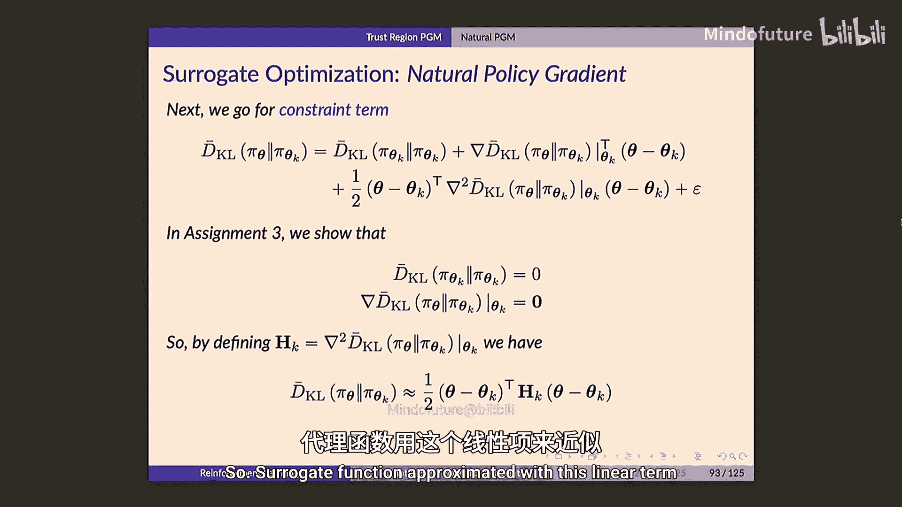

This quadratic term being a smaller than or equal by D max。 Now question， can you solve this problem。

If， if you have her or if you have worked a bit with optimization， probably you know the answer。Just。

If you don't know it's totally okay， I mean， just you need to have some experience with optimization。

 But anyone has any idea。 can I solve this optimization problem。Yes or no。I can， yes。Why I can。

 because this is is a pseudoline program， right？ So you're optimizing a linear function。 Its a line。

 right， subject to one quadratic constrain， right， And this means that this is a convex set。

 a linear function on the it's very easy to optimize it。 right。

 There are very efficient algorithm to solve that。 Okay， Actually， you can solve this one。

 explicitly。 So if you just go ahead and solve this one。

 You're gonna see that the optimization solution is going to be this guy， right。

 And this is what my colleagues have made in the kitchen before like this like this cooking program。

 So they show you the final product， right， So if you just go ahead and solve this problem using the basic linear programming。

 then you're gonna end up with this one。😊，You need to know a bit of details about that。

 but it's not really necessary for this course。 So you can just take it from my side。

 This is a kind of textbook kind of optimization， right， And then when you solve it。

 you're gonna end up with this expression。 So here in this expression what you see you have still your previous theta plus some guy here and this guy is now computed based on the gradient right。

 This gradient is the same thing that we had in the policy gradient theorem， right。

 But this one is now modify with。This term right and this term is somehow trying to play with that gradient direction to make sure that that gradient direction is not taking you towards the point which is potentially in a very far distance from the original policy that you started with right？

Questions。

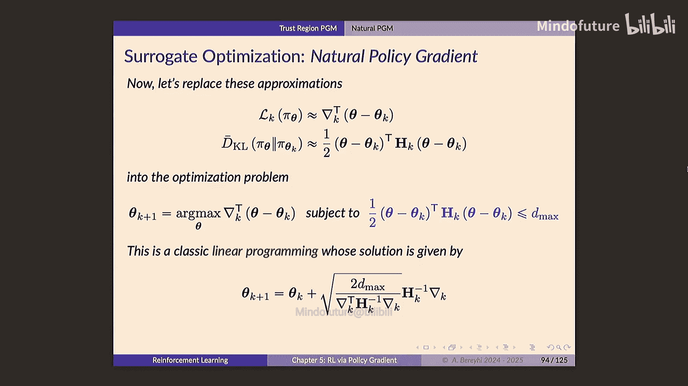

No question。 So this is what people call it natural policy gradient theoryorem right So you have the gradient policy gradient theoryorem where you just use the gradient that not like。

 And now you're just doing natural policy。 So you're adding that extra term and that extra term is going to make sure that youre not running away from the trust region。

 Yes， you had a question。はいい。嗯。The Hasian matrix has inverse that is not a problem。

 but the problem that you might ask is that computing the Hasian matrix itself and also taking its inverse is a computational hard task and that is correct。

 we are going to get somehow rid of that like if you look at this term here you have Hasian inverse times。

Gaddient， right in denominator。 again， you have hessian inverse times gradient， right。

 If you define it as a new vector， then you basically need to only work with that vector， right。

 and how I can find that particular vector。 well， I can use can you get gradient algorithm。

 This is something else。 I'm gonna mention it later。

 But then you can reduce the complexity of calculation here。 But that's true。

 This is much more complicated as simple gradient based algorithm is basically in this naive form is just a second order optimization。

So questions。No question。 Okay， so let me just wrap it up here。

 So one thing here is that if you go ahead and do the update like this one。

 you might still see the behavior that we had seen before。

 It' gonna to reduce significantly as compared to what you get out of the direct policy gradient。

 but you still might see it。 And the reason is simply because you' are using approximation right。

 you're using， I mean， this terms that we developed here。 Both of them are approximations， right。

 as long as those approximations are accurate， you're fine， but if they get inaccurate。

 then you are not fine。 So this is a key point here。

 So it might be that you still see a bit of inaccuracy here。 and because of that， you might。

 for example， update with the natural policy gradient。 but after the update。

 you still see that this new policy is not within the trust region is simply because you just approximated everything right。

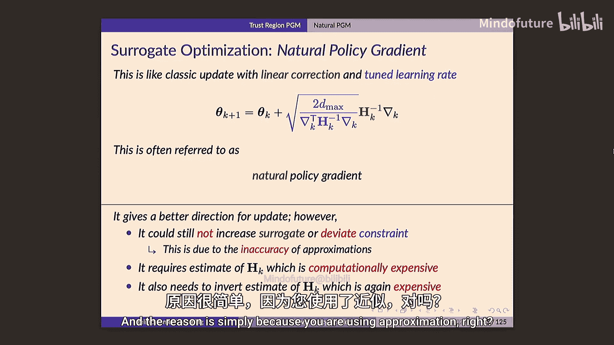

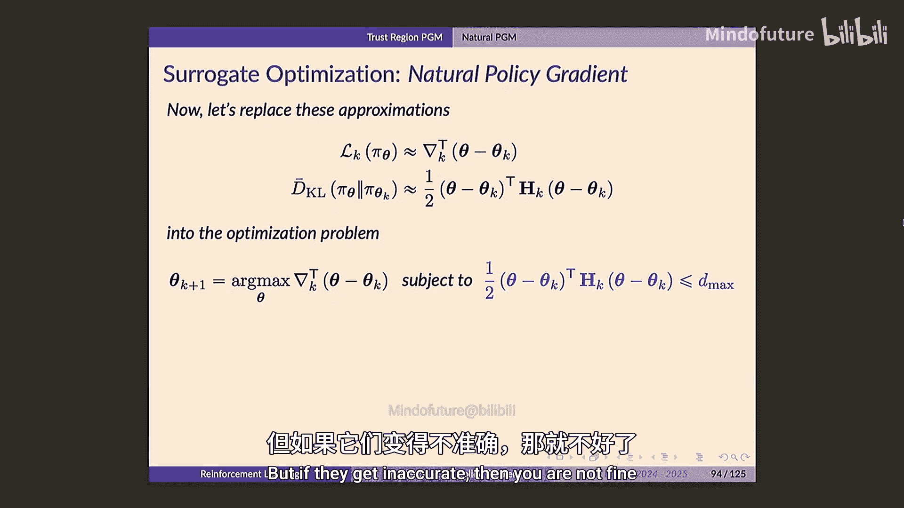

So this is one thing。 The other thing is that H K itself is computationally expensive。 One question。

 how can you compute H K the sessionian matrix。

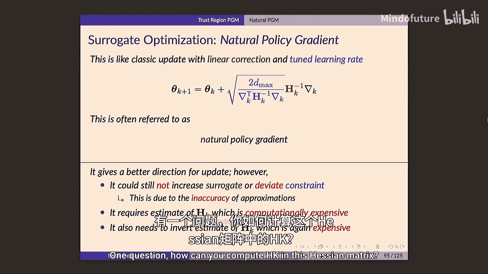

Let's get back here。

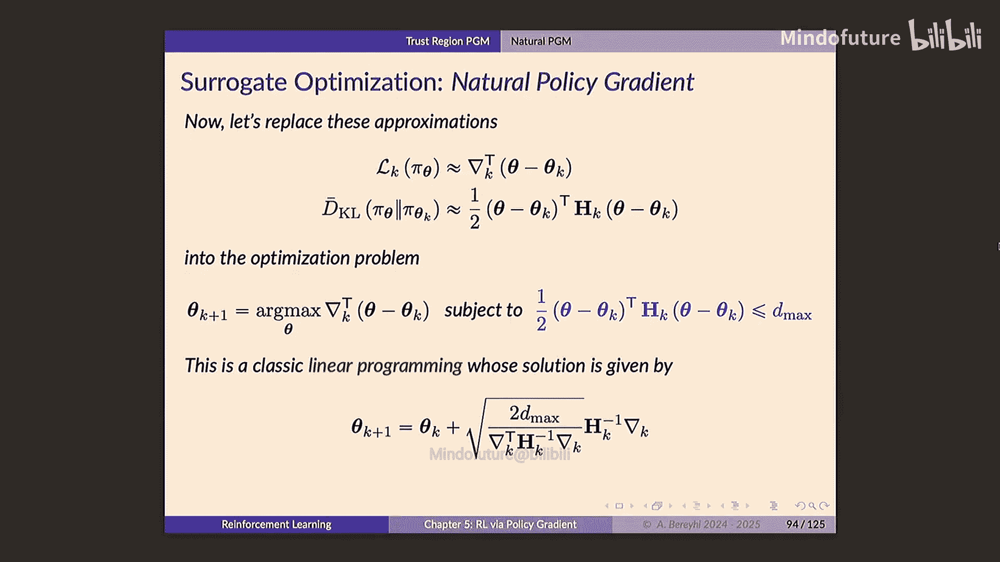

So。That was Hessian， right， Hasian is the gradient or hesian of this K L term， right。

How can you compute it algorithmically， I do know that you should go ahead and compute derivatives。

 But how do you do that。My favorite algorithm。Back propagation， right？

But can you do it with just one back propplicationation？If you have pi Theta， right？

This is the output of the algorithm， right， sorry， your neural network。 Now you have pi theta， right。

 If you do back replication， you are going to compute the gradient of pi theta， right。

 What should you do if you want to compute the hesian。

You need back to back propagate on those gradients， right， So it's the second order back propagation。

 right every single gradient that you had， you would again back propagate to get the second order gradients。

 right， So this guy， you can theoretically compute it because policy network is your neural network。

 You have access to it。 You can just go over it and back propagate， right。

 you're just back propagate2 y， not too wise。 like in order too， And by doing that。

 you're going to get all the second order gradients。

 But this is going to be computational or very expensive， right。

Because if you think sequentially about everything。

 then one Mac propagation is going to give you the output for every single like one gradient vector。

 Now， every single guy， you should again back propagate， right， for every single one， right。

 is a higher order of computation significantly， right， So if you do computation of order N。

 Now you need to do a computation of order N squared。 This is much more。

 So computing this Haitian matrix is expensive， really in practice。 So we need to get rid of it。

 There is a bit of trick for that。 And one other thing is that we need to just。

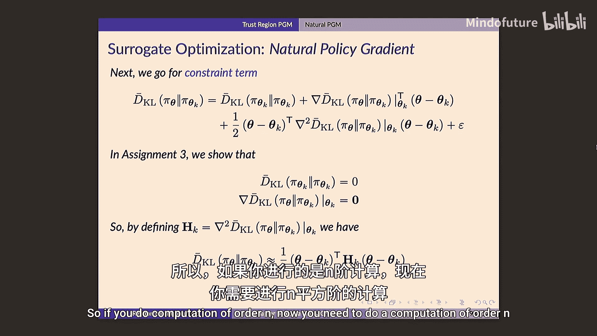

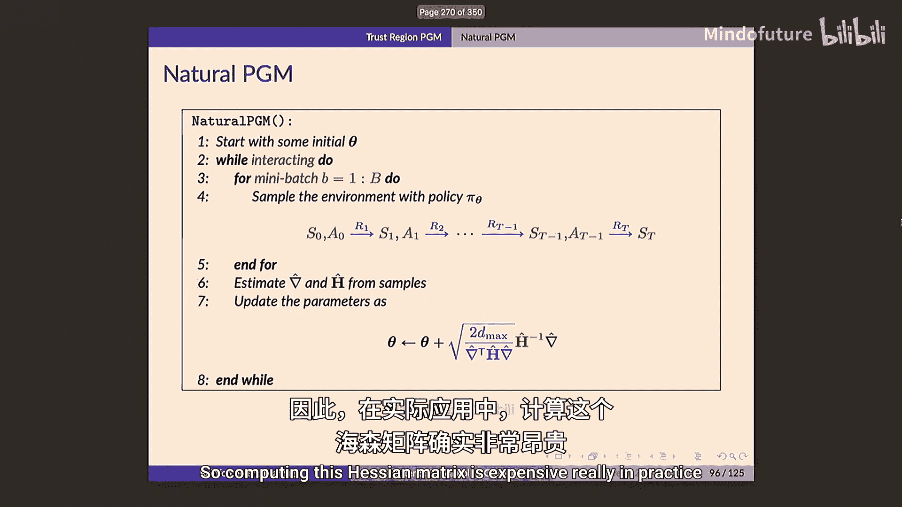

Compute the。Inverse of the Hasian matrix and computing the inverse of the Haian。 I mean。

 computing inverse of a big matrix is a very complex thing when it comes to algorithmic approaches because it's cubic right。

 or 2。4。 I don't know。 I mean， you cannot beat that one anymore， right。So that's the main issue。

 But if we could do all of those things， then we essentially end up with this expression。

 So this is going to be the gradient or policy gradient method using natural policy gradient。

 a typo with。

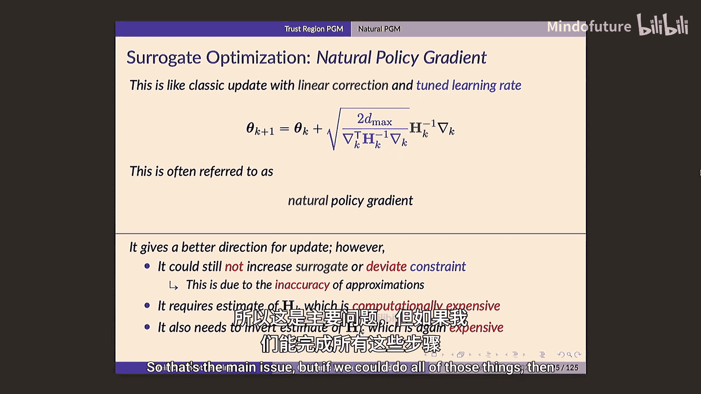

Sinceinrest apologies。 So here is H hat inverse， right。Not H hat。 Like we had it H hat inverse there。

 right， So it was my typo， sorry。Everybody's clear， so youve got the idea。

🤧咳。So。We roughly have been over the main challenge， like the hard part of the chapter。

 So I guess were， we are cool now。 So were， were going to have only TPO and PPO。

 And they are basically algorithmic approaches to handle this， this algorithm。 Okay。

 so let me just wrap it up as a。

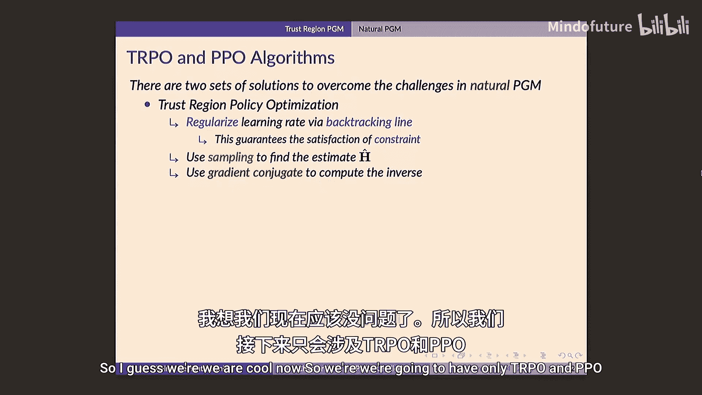

As a total and then probably this is the only thing that you need to keep in mind from this part。

 So the main idea is that you start with a policy gradient method。

 you end a policy gradient theory and that tells you how you can compute the gradient but the issue is that if you use those the basic form of the policy gradient method。

 then you're gonna start seeing this property that at some point when the policy starts to somehow con you something then it gets lost right and the main reason for that is that you're not restricting your updates to be within a trust region and a trust region is simply that update my parameter say that not only the parameter itself is not changing too much。

 but the policy itself is not changing too much as well now you might ask someone might ask you why the policy should not change too much。

 the reason is the whole trouble we have gone today over right the whole reason is that you can see or you can interpret policy gradient theory。

As this important sampling argument and when you are doing important sampling argument。

 if your distributions are changing too much， then the variance of your your update could be significantly high and that high variance。

 you can do nothing about this right if I tell you or if anyone tells you this one without any background then it's gonna be some you know blah blah。

 no one understand what is going on right but since we had all of the details now。

 we have a good understanding right hopefully I can justify all of the trouble like that right。

A guys cool。So， now。now that we had， we know this issue， how we can handle that。 Well。

 one app approach is to just modify our gradient in this form in the policy gradient method。

 This is the national policy gradient method now。

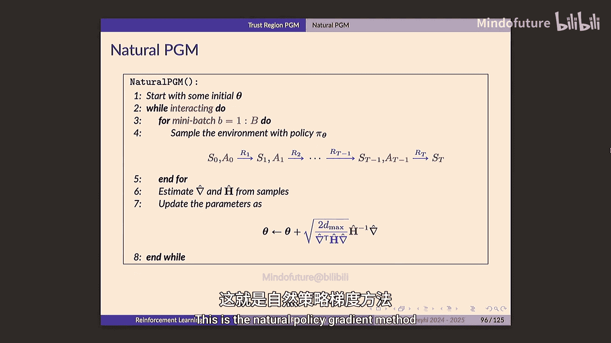