# 【多伦多大学】强化学习 2025 ｜ Uoft   Reinforcement Learning   Fall 2025 p52 P52_讲座_51_TRPO算法 -BV1D3F2zhEry_p52-

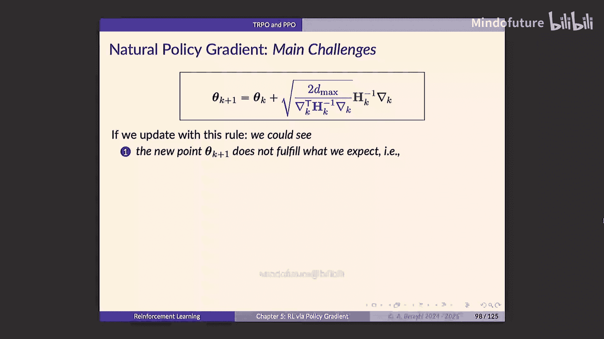

The key challenge is that we have。 The first one is that there is no guarantee that if you do this natural policy。

Graadient than。You necessarily satisfy the constrain that you want。

 What does it mean means that you might update by this one。

 But the new parameter that you compute is either not improving the expected value。

 This is the objective that you want to maximize， right， You want your policy to always do better。

 but it might be that your new policy just does worse。Or it might be the case that after update。

 you still get out of the trust region。 It means that your new policy。

 P T T K plus1 is somehow far away from your previous policy more than the maximum tolerance that you have。

Right， and the reason for this happening is simply because we solve the original problem like that solution you see at the top。

 This is an approximate solution。 This is not the exact solution。

 The exact solution is very complicated。 we cannot compute it。

 This is approximate based on the tail or expansion and other things。

 So there is no guarantee that this is going to satisfy the constraint that we want， right， So still。

 even by updating like that， you need to double check this， right， So this is one point。

 one challenge that we have still。The second one。So as I said。

 this is the main reason that we have solved the problem。 approximately。

 we could not solve it exactly。 And the second thing that we had。

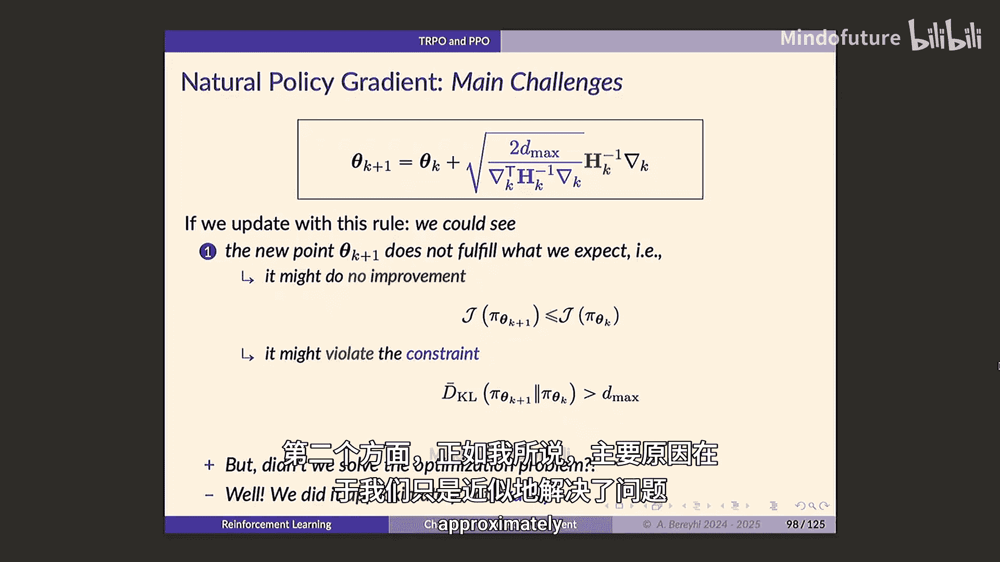

Is the problem of computing the Haian matrix， right， If you want to compute the Hasian matrix。

 you basically need to compute the gradient with respect to the outputs of your policy network。

Not only the gradient， the second order， derivatives， right， And this is computationally very hard。

 So if we want to just think in terms of back propagation。 So say， for example。

 you have resnet and Resnet 50。 and this guy has in the order of 10 to power 7。

Proraomes right Now if you want to compute the heian。

 then you need in the order of 10 to 14 different derivatives because they are all the second order derivatives。

 And this is some sort of you know as I told you two tire kind of back propagation because you have the output。

 you need to back propagate to compute all the gradients and again， for every single gradient。

 you need to back propagate over the network to compute the second order gradient which you can do in parallel。

 that's right， but is computationally heavy So this is not a real really something a computational efficient。

 So as you might know， we never really do second order optimization in deep learning。

 if we need to do that， we usually approximated by some quasi or pseudoneton approach and we need to do something like that here as well There's one other challenge here and the challenge is that we need to deal with the inverse of the hesian matrix we do not need hesian itself。

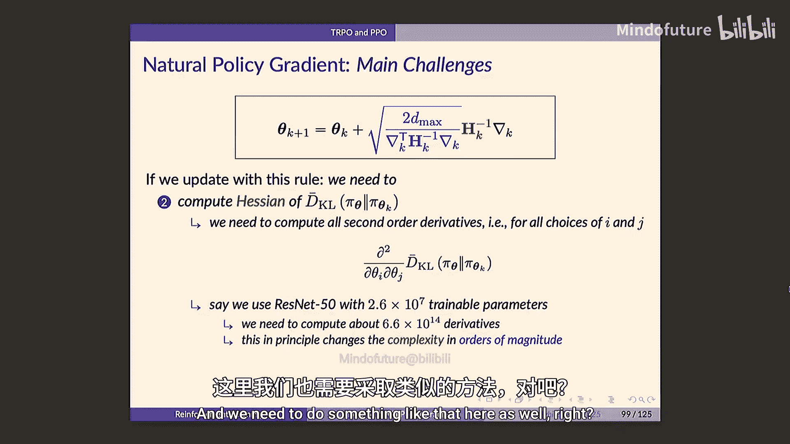

We need this inverse， right， And this is extra computation again， because classical。

Approaches are cubic in terms of dimension， like。Dimenssion of your model， cubic， right。

 That's too much。 If you do like super efficient algorithm， you might shrink a bit like。

But you are still quadratic， at least right， more than quadratic， definitely。

So that means that you still have a lot of computation to go on， right， and you cannot afford it。

 right， You really， with deep learning， you cannot really go。So much beyond linear computation。

 So that means that this is， again， not very efficient。 You need to handle this issue as well， right。

 so。

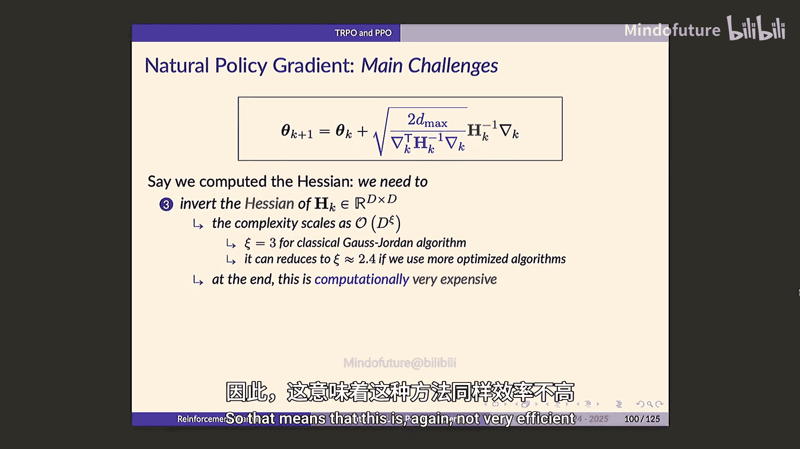

There are two basic approaches to solve that issue。 The first or this set of issues。

 The first one is trying to exactly follow this approach that we derived last time and resolve every single issue step by this is what is what is called TRPO trust regiong policy optimization。

 So actually this was the original work， which started to see all of this or explain at least all of this trustreion requirement of policy gradient update。

 and was a kind of say pseudobo in reinforcement learning environment because people for a long time they had the feeling oh PGM is nice but it's not stable It's not going to work。

 and they somehow decipher decoded what is the issue here and what you need to do。

 So somehow develop this idea and then they obviously see the complication that they have in practice。

 So in order to be able to implement。

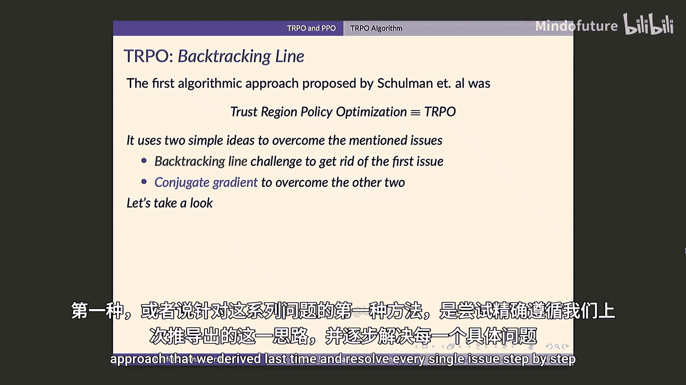

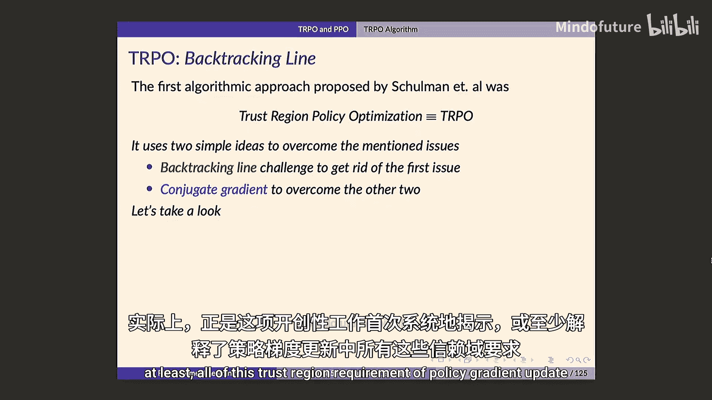

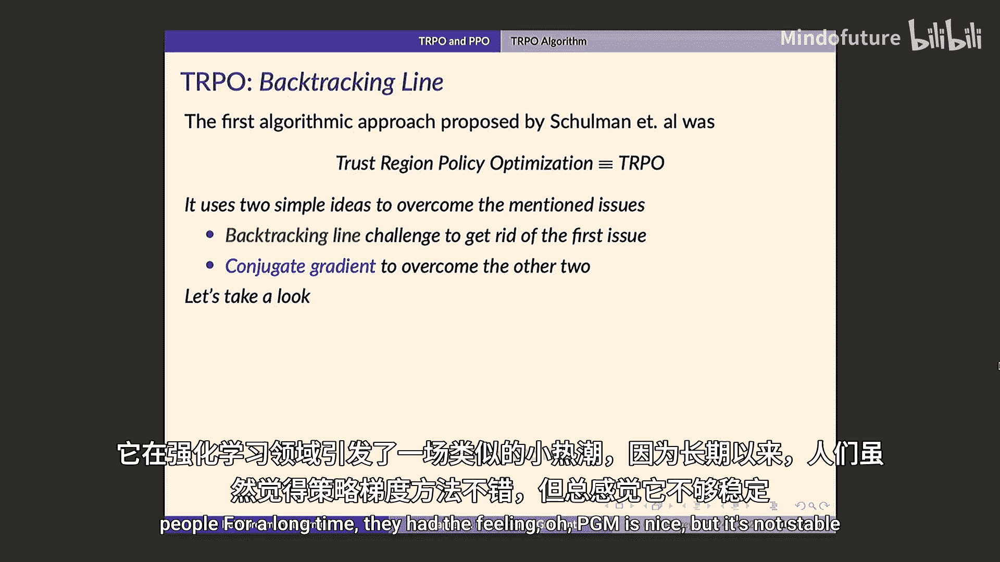

Region approach， they somehow develop the TRPO algorithm。 So basically。

 for the three issues that I told you， for the first one。

The first issue was the problem of guaranteeing the satisfaction of the constraint within the trust region。

 They somehow could。 they came up with a bank backtracking line。

 and they could show that this is enough to just backtrack on a line。

 that you get a feasible solution。 it's not necessarily the best， but you get a feasible solution。

 But the second one， they somehow came up with the idea that well。

 computing that gradient is not that necessary。 you can simply estimating using the feature information matrix。

 by sampling And then the last thing was that if you want to compute the inverse。

 you can do it efficiently by can you get gradient approach。 And I'm gonna explain these things。

 I don't。

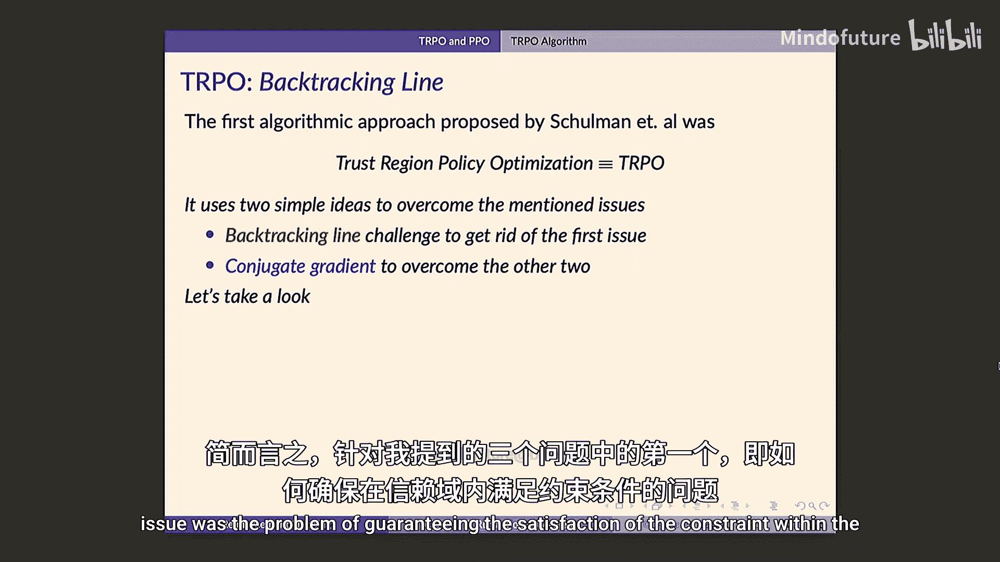

I don't think like conjugate I don't give the details of conjugate gradient or something。

 but I just explain for you why you can solve it by that。 And then that's gonna be TrRPO。

 But shortly after that one， they published the PPO paperximal policy optimization and they said like T RRPO was the first version that was great but it was computation hard。

 now we just attacked the problem once again， the trust vision problem。

 but this time we do it in a greedy way and by doing that they could reduce significantly the amount of computation they need。

 it was working and this somehow made PPO a kind of state of the art。So。Now。

 let's start with the TRP algorithm。 So basically， we want to solve those three challenges that we have with the trust region policy approach and。

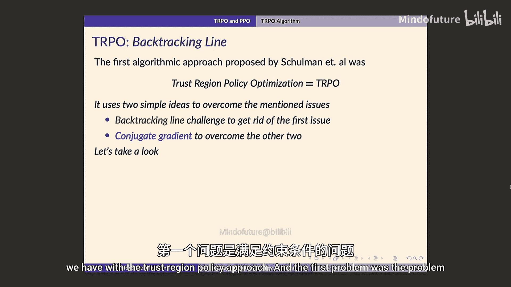

The first problem was the problem of satisfying the constraint， right。

 So you might have did like this， but then you see that your new update is actually not satisfying the constrain that you want。

 It means that you could either。Make the policy worse， or it might keep the policy as good as before。

 but or even better。 But it's just deviating the constraint， right。

 the trust region constraint just makes the policy significantly different from the previous one。

 So what was the idea。 So they said like， well。Probably the direction given by the next national policy。

 it means that that update， the whole thing that you add up to theta K。

 that vector is probably in the right direction。And getting out of the trust region is probably simply because we are just shooting too much right So how can we do it。

 We start to just look at that guy If the constraints are satisfied。

 then it's okay if they are not satisfied， we start to just shrink it right a bit And then again we try and we keep on doing that But what is the best shrinking。

 it's good to just backtrack on a line， we start with like the vector itself。

 then we multiply it by alphas and factor is smaller than one if it is still having a problem Al squared。

 Al cubic and so on right And each time we check right。Everybody's clear。So that was the idea。

 So you just make a line which is 0 to one。 So one is the longest use you can take0 is this like you do not update at all。

 And every time you just exponentially go back on this line and this is quite simple right So if you want to just make sure that you are satisfying the con。

 you start with I being 0。 So alpha to power 0 is simply one。

 It means that you're just updating with the natural policy gradient right So you don't have any factor here。

 This is exactly the same term you have here right So you're gonna have this guy。

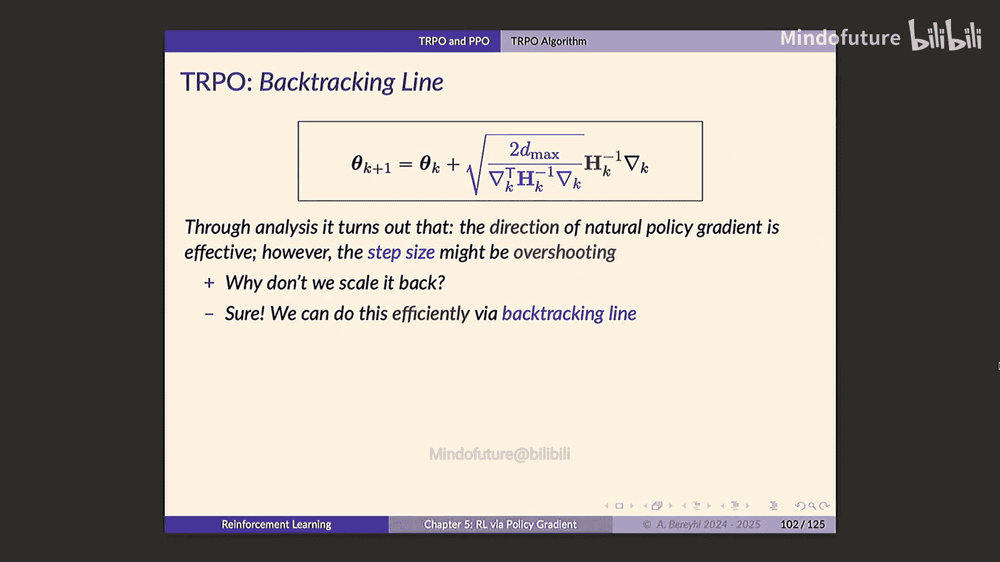

And you're gonna update。 But then when you， you update it。

 then you're going check the K divergence between the new policy and the previous policy。Okay。

 and computing that T divergence is not complicated。

 You can do it because you do have the policy network， right。

 It's not like you're sampling the environment or something。 You just compute the。

The k dirgence on the policy that you have， you can do it， right Now you check this guy。

 if this deelta， which is the difference between your new policy and your previous policy。

 if that guy is exceeding the maximum D that you considered in your algorithm that you are going to just shrink it by a factor or alpha。

 right， you increase I， you shrink it down， right， and you keep on doing that， right。

 So it's a very basic。Greedy approach， right， the rise school。 But there is one problem here。

Do I check all the constraintstrain that I need。I mean。

 I make sure that this is within the trust region， right。

 But do I make sure that it's improving the policy as well。 No， I don't do that， right， well。

They could somehow show that you really don't need to do that one。

 So this is the kind of interesting contribution they did。

 So you just need to make sure you're within the trust region。

 And this natural policy direction somehow make sure that you' are improving。 I mean。

 it's not a magic， right， somehow in the direction of the gradient， right？

 So you expect that when you move in the direction of gradient you improve， right。

 But they could just confirm that you can do this。 So essentially。

 you don't really need to check the policy improvement。

 you only need to make sure you you remain within the trust region using your national policy gradient direction。

 but maybe this scale version right。So that is not going to make significant harm。Every cool。

 So that was quite easy just updating the making sure guaranteeing that you'll remain within the trust region。

 The next thing that they had to do was。

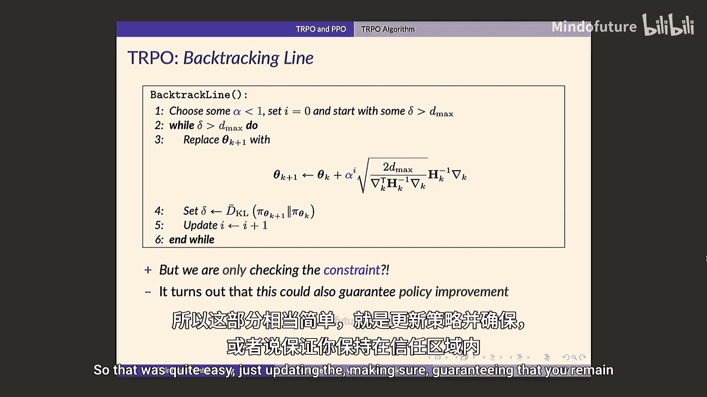

嗯，就。

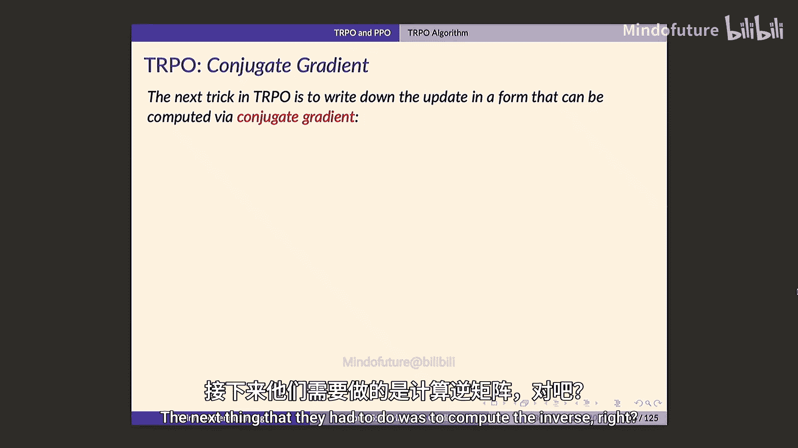

Compute the， the inverse， right， So if you want。To work with this update。 Well。

 say you found the right choice of I。 then you have your policy updated。

 and that policy updated is within the trust region。

 But if you want to do this computation or you want to do this update。

 you essentially need to compute this H inverse， right。

 And even assuming that you have somehow managed to compute the heian， still。

 you have this problem that you need to invert it， right， and that is very computationally complex。

 Now， the key point here is that you actually don't really need to compute this directly。

 because of the nice form you have in this equation。 just to show you this。

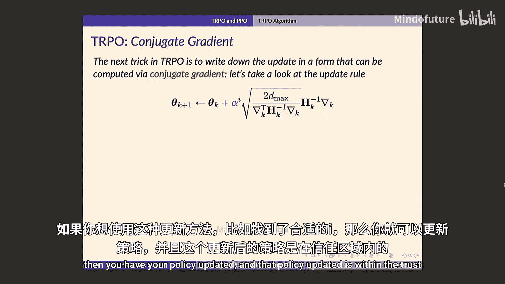

Let's say。That I have this Y。 What is why， Y is essential this H inverse multiplied with。

The gradient， right。 So the gradient， I can compute it。 Now I have H inverses， which I， okay。

 say I have not yet computed that。 But if I could have had it， I could compute Y。

 And then I can write everything here down in terms of why， right？ How can I do it， well。

The nominator is simple to be written in terms of why， right， that ancientverse。Grariient。

 that last term that you have in the update。 that is basically Y， right。

 The only other place that you have H inverse is in the denominator。

Can I also write it down in terms of why。How can I write it？ Well。

 I could say this is a deelta transpose h inverse sorry， Nala transpose h inverse Nala。

 And then I can use the fact that I can simply add one identity matrix here， right。

 It's not going to harm anything， right？ It's an identity matrix。 Now that you have identity matrix。

 What you can write as identity matrix。 I can write H times H inverse， right。

 identity matrix is simply H times H inverse， right。Now you look at this expression。

 you have this guy。Nola transpose h inverse。 You have the other one。 H inverse times Nala， right。

The first one is your Y transposed。 The second one is your Y self， right。

 So you can write it down as Y transposed H Y， right。Everybody's clear。 so what I can do。

 I can replace this denominator by this one。 No， I don't have the inverse， right， I have H， correct。

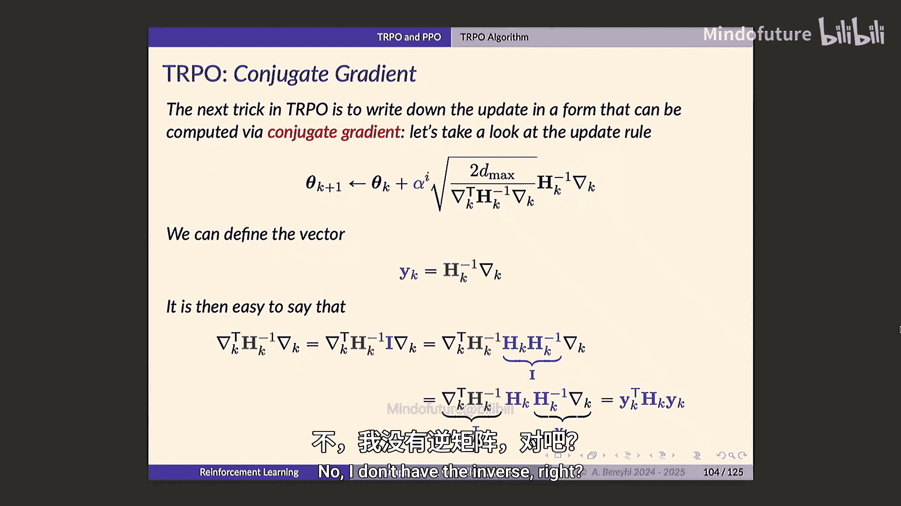

And then the final thing that I have is in this form。 So if I have。Why。

 then I don't really need anymore the inverse of。HN matrix， right。Everyway school。Questions， you got。

 you got what I did， right。Okay， I have this expression。

 The only thing that you I need to know is that。How can I find why？ Well。

 I could say that Y is ancient Vzstein's Delta Nabla， Sorry， I keep today saying this deelta。

Then I multiply both sides by H。 Then it simply means that if I multiply Hasian matrix with y。

 then it should be the gradient， right。Correct。So I have that guy。

 and that why that you see inside the update， this is essentially the solution to this system of linear equations。

 You see that， right。So if I have only H， I do not have H inverse。

 I need to solve the system of equations， right。Correct。And by solving that for why， like I have。

Graient I have the Hsian matrix。 I put y there as an unknown and try to solve this problem right If I solve that problem。

 obviously the solution is h inverse times gradient right but if I solve that problem with any other way that does not need direct computation of the inverse。

 then I can get that y out of it。 and then I put y here。

 I get my update right So I can bypass computing the H inverse as long as I can solve this linear system of equations right。

Now， this linear system of equation has one a specific property。 What is the property。Nabla。

 the gradient guy， is the gradient I computer at the parameter theta K， right。

And what is H is the Hasian matrix at the same point， right？

 It means that this is the gradient of the gradient vector， right。

Everybody' school is the second oric gradient， right。Second order derivative。

 So if I get the gradient， which is the derivativeri with respect to every single entry。

 and I take the derivative the gradient of every single guy inside that vector。

 then that's gonna be another vector， right， And that vector is the second order derivative， right。

 I just fill out all of them。 Then this matrix is my Haitian matrix， right。Every cool， right so。

Age is the derivative of the gradient。And Nala is the gradient itself， right。Now。

 let's just replace it in that linear system of equations。

 So I have gradient end of g times y equals by G itself， right。Now。

 one thing obvious here is that y is supposedly not depending on your theta directly， right。

 so you can somehow write it down in this form。 You could say that I have G。

 which is getting multiply with y。 there is an obvious mistake here。

 I guess because you cannot simply I mean the product here should be somehow generalized So you cannot simply do that。

 but yeah， assuming that you can somehow generalize the product。

 then you basically are taking the gradient of this guy together right now you have the system of equation。

 if you think about G Y， everything there to be numbers right or functions right then this is a simple。

Differential equation， right， You have derivative ir of the function。

Multiply with something equal to the function itself， right。

And then you simply need to solve this differential equation。

 but not for a general theta for theta K， right， exactly theta K。Everybody gets the idea。

So this is a kind of functional equation。EDifferent equation that you need to only solve it in one singular point。

 And this is。There is some algorithm for doing that， which we call it conjugate gradient。 Okay。

 conjugate gradient is significantly simpler as compared to the。E direct inversion。So what you do。

 you write down your equation in this form， and then you give it to the conjugate gradient to solve for you。

 Now， if you want to take a look， how does it work， I have this one。 This is a link。

 You can click on it。 You can take a look at one tutorial， which is on conjuate gradient。

 It probably gives you some idea。 and it might be that for many of your。Other projects， it comes。

Andy， because it's helpful to know how you can solve such problems efficiently。 Okay。

 but at that point of time， like， if you even read the T R P of paper or any other paper in that domain。

 you're gonna see that they ended up。Like this。 And they say， okay， this is the conjugate gradient。

 We don't need to do anything further， right， and then give it to the algorithm to solve it。

 right So the key point here is that you can actually solve this problem efficiently and then the whole problem of updating gonna reduce to such a problem。

 So you first estimate your gradient， then assuming that you can estimate your Hasian matrixes， well。

 you're gonna solve this problem or solve this equation using the conjugate gradient algorithm And once you solve that。

 you get why and getting why then you simply update using the update rule I showed you， right。

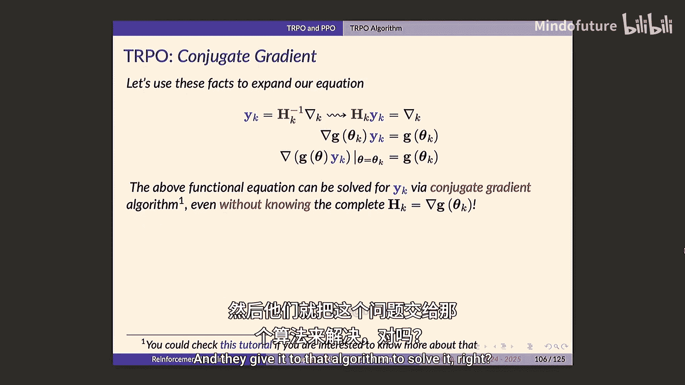

Everybody's cool。Right。Right， right。Oh， as I said， I think yes， as I said， when you do this。

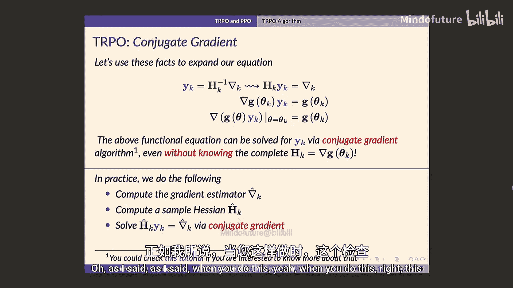

When you do this， this check， then there is some result。

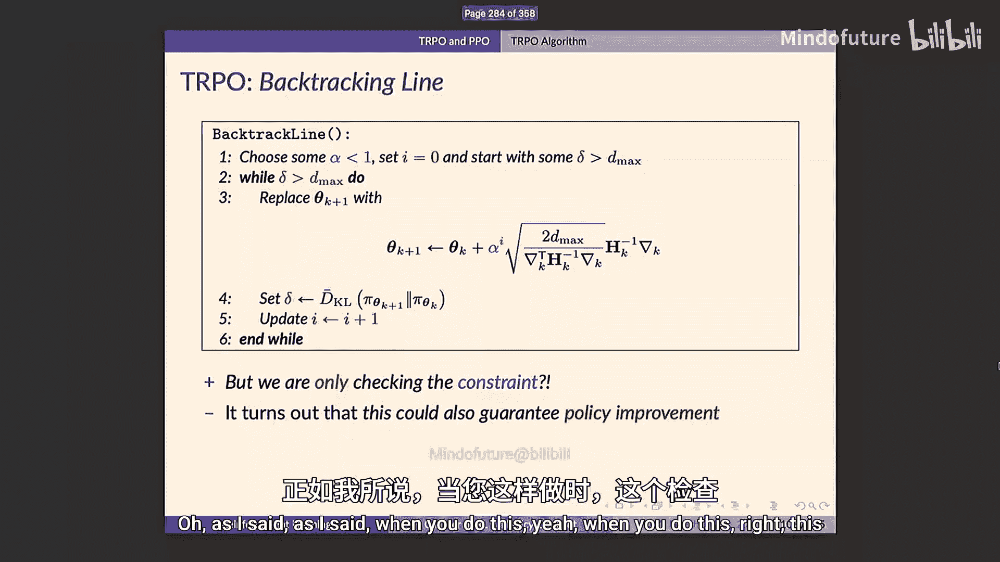

That you don't really need to check the improvement anymore。

You can somehow guarantee that it's going to improve。

 The reason is that the national policy direction that you found。

That one is good enough that when you are updating within the trust region。

 you almost surely get improvement。Is doing both， right， right。

 So this was a kind of tiny contribution did in the paper So that they said like， okay。

 you don't really need to check everything。 You just check that， that particular one。Yeah， our。So。

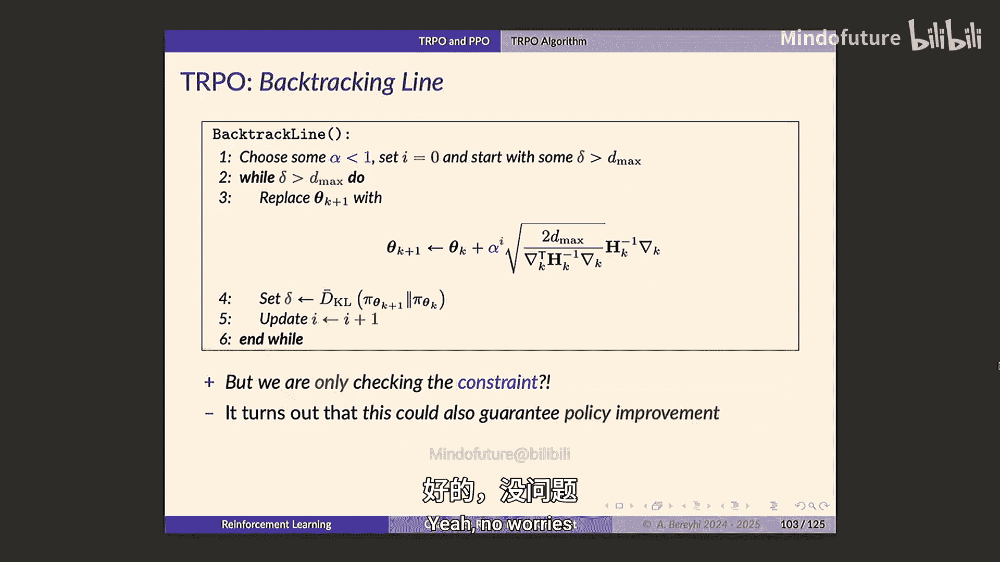

Quest。This guy is also clear， right？

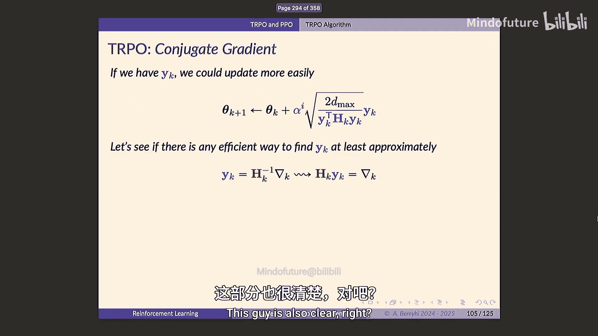

This part， right？ So you basically just need to do cut gradient。 Now， the key point here is that age。

H is the derivative of this guy at the same point， right， You're using this fact to solve this。

 right。If you don't have that property， then you cannot use that。Inverse of the Hasian， right。Yes。

 I'm going to explain you next。So assuming that you can estimate it， right， I mean， in practice。

 you don't have really neither the gradient nor the Haian， but some estimate of that， right。

 by assuming that you have， you can solve this equation using conjugate。Questions。No question。

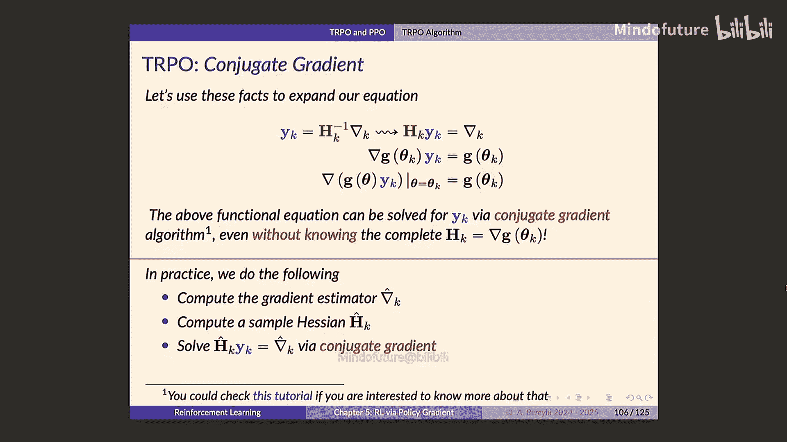

Now。You have the backtracking。 you have conjugate gradient。

 You can actually efficiently do your RPO update。Saying efficiently， it， I mean。

 yourRPO is still one of the very complex。 the reinforcement learning algorithm。

 because with all of this simplification， it is still heavy in terms of computation。

 This is why we go for PPO。 But now it's feasible。 It's tractable。 You can do it in practice。

The only thing remains is how you can compute the Haian matrix。 And obviously。

 this is a very complicated thing， especially if your policy network is very complicated， right。

 is very deep now。Some other say materials or implementation references。

 they are working with simple models。 And there you can do compute Hasian matrix。

 but then you're gonna add extra burden， you can handle it， that's okay， right。

 But really in practice if you want to do it。 The idea is to use the fact that this Hasian matrix is。

Estimator of what we call it fier information matrix。 Now， how we can do that。

 I'm going to just show you the final result here。 So I guess in in your assignments。

 if you have started right now， you have seen that we have the first two derivatives computed。DKL。

 the K divergence at the particular point， which is obviously 0。

 If you take the derivative and play around with that， you're gonna see at the point Theta K。 Again。

 that guy is 0， right， The only terms remains is the second order derivative of the K divergence。

 right， And if you start computing that， you're gonna see that。This expression。

 you can write it down in this form， right， So you just need to open up the term inside the K divergence。

 You take the derivative with respect to theta。 You play around with this lock trick。

 And you're gonna end up with this guy here， right， So what is this guy here。

 This is the distribution of the stage。 We don't care about that， right。

 We always do that by sampling。 That is not important。

The only thing that is important here is I have this term， right。

 And I want to take the average of this term。 Now， if you look at this term。

 I have one gradient of log，1 gradient of the policy itself， right， Now， if I use the log trick。

 I can write down the gradient of a policy as。Policy times gradient of log， right？

 We did a couple of times previously， right， If you do that。

 then you're gonna end up with something like this， right， This blue term。

 I'm gonna open it up term as gradient of log policy。 I have another gradient of log policy here。

 And then the policy also remains here， right。Now， the first term D that you see here。

 that is the distribution of your state， right， pi A given S is the distribution of your action given your state。

 right？ So multiplication of both of them is your distribution of a state in action， right。

So how can I write down this term， This is an expectation， right。

 What is the term that I'm taking the expectation with respect to。The sample Al product， right。

Correct the sample out of product。This is the guy， right。So it's like I have my policy network。

 I take the log of the policy。 I take the derivative of that。 That's it。 right。

 I don't go for the second order。 I get that derivative。 That gradient。 that gradient is a vector。

 right？ I consider the gradient。 I multiplied with its own transpose This is one rank1 complete matrix。

 right， The matrix is squared， It means it is complete right if you have d model parameters。

 then your gradient is up size D。 then this outer product is D by D， right， but it is rank1， correct。

But when you take the expectation， it is not anymore more rank1。 It's going become for rank。

Because it average of lots of those guys， right， and all of them adding up together。

 it gonna be a full right。 Now， the key point here is that。

H N matrix that you look for is the gradient of your log likelihood times gradient of the log likelihood transpose。

 right， Now， if you have one random vector X。And you compute X， X transpose。

 and you take the expectation。 What is that guy， Have you ever seen this， Have you heard of that。

If you have a random variable。X， right， what is。The expectation of x times x。Xa squared。What is that。

It's a random variable， not a vector， another matrix。What is the expectation of x is squared。

Say the mean value is 0。Is the variance， right。Right，If the mean value is not 0， what do you call it。

Is a covariance， right。What is this guy， Have you ever seen this。

 You have a vector multiply by its own transpose。 Then you take the expectation。

That is what we call it covariance matrix， right。Right， so this guy that you see here。

If you think of this whole gradient as a vector， which is random because your state in action。

Or randomum， then this random vector multiplly with its own transpose。 This is one sample covariance。

And if you take the expectation， this is going to be the covariance matrix。 right。

 What is the moral of the story， The moral of the story is that your Hasian is。

Covariance of the log likelihood， right？ Well， you don't really need to compute Haian directly。

 You can just compute this covariance matrix by sampling， right。

 You just sample multiple trajectories， right， These are different A's and S， right。

 And then you compute gradient of the log likelihood。 You multiply it to its own transpose。

 This is one sample covariance， right， You just。Sample multiple of them。 You average it。

 This is going to be your sample H N matrix， right now。This idea， this。

 this identity is a quite wellknown result， right， It's not given in T P or something。

 Any of you who had any course on estimation or something like that， you probably have heard of it。

 And this matrix that you see here， this is what we call it the fier information matrix。

It's a very important matrix in machine learning， in a statistical learning。

 It' gonna to give you always minimum error that you could get， okay。This。

Resolve is quite well known， but you can hear we， we only need to use it here for estimation， right。

 Now， I do not really expect you to use that to understand all the details。

 The key point here is that。You can simply write H in this form。

 And given that this is a sampling term， you can simply compute it by one level of back propagation。

 right， You really do not need to do the full to tire back propagation。Everybodys clear。

Because this guy， this gradient of v， is one backrification， right。

And this guy is the same thing transpose， right， You don't need to do the thick and back proification。

 right。Everybody's cool， bother。You happy。嗯。Do you know for sure？Do you know Ronald， I guess。

 for sure， you have never heard of him。Really。The father of modernist statistics。

Just take a good look，He did a great job， I mean， in terms of his statistics。嗯。

It was one of the first guys who just， you know， established all of the， you know。

Stistics somehow was started to become a kind of。Establish domain after his work， right。

 He did great contribution。 I mean， you probably should。

Haveve heard of him somewhere in these documentaries about， you know， human progress。

Anyways。呃。Right， so that's gonna be the T RRPO then， right， So how we do the T RRPO。

 we basically do one minibank sampling。 Now， in the previous versions。

 I did not really show you the minib sampling。Mainly because the previous versions were versions which we are not really using in practice。

 but this one might be some something that you look into in practice。

 So if you want to really implement it， so you're gonna。Sample a mini batch of trajectories， right。

 So you're gonna get your sample trajectory。 This is one sample。

 You do B different sample trajectories。 This is one mini batch for every single guy inside this this trajectory。

 you can somehow estimate your advantage， right， and how you estimate your advantage。

 every single time， you're gonna say that what is the immediate reward plus the value of the next state minus the value of the current state。

 right。This is your advantage， right， And then once you got this guy， then your sample gradient。

 this is the gradient that you compute based on the policy gradient。

Theorem is going to be some of those advantages times gradient of block， right。Everybody school。我宣。

Now， here in this algorithm that I have written up to this point。 If you want to implement it。

 is there anything that you might miss。Is there anything that you are unclear how you can do it。Yes。

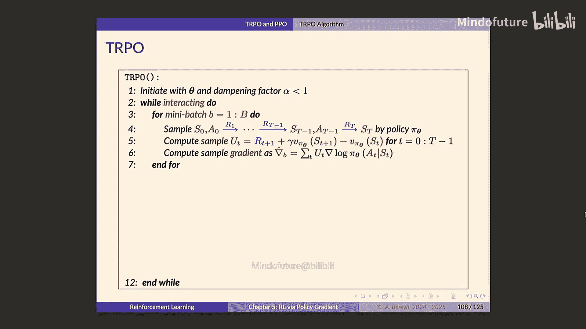

啊，有。Is the gradient the complete transpose。Yes， yes。 gradients of the weight。

 That is the gradient with respect to theta。And you computed it exactly at 0 decay K。

So your your policy， when you say if you think of the policy in in the form of the network。

 for example， you implement it in assignment 3， then your policy is going to give you the probability of every single action at at its output right？

 And then if you have a sample action， you have just one particular action， right。

You start from that on， you compute first the logarithum and then you back propagate， right。

 it' going to give you gradient of that guy with respect to all weights， right。That is this vector。

This vector multiplied by itself transpose out of product。

This is one matrix of the size of your gradient times your gradient， right。

And then if you have multiple of them， you average them。

 this is an estimator of the heN that you want。

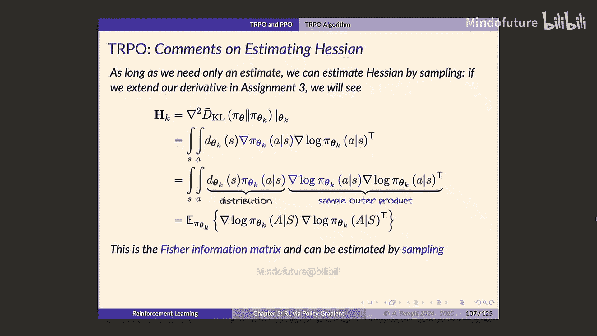

Got the idea。So， now here。Do we have everything that we want if we want to implement this。

So youre sitting behind pietorch。You're trying to implement anything that might be unclear yet。

The value function， great， right。 So if you want to do line 5， if you want to estimate the advantage。

 if you want to compute the sample advantage， U T， right。

 you need to compute the immediate reward that you have。 You do know what is your next stage， right。

 But you do you need to be able to estimate the value of the next and also the value of the here in the state。

 This is what I told you before。You can do it by。Monte Carlo， yeah， but that is not very efficient。

 We're gonna do it by another network in the next chapter， right， So we haven't talked about it yet。

But assuming that you have this magic neural network。

 which looks at this state and gives you the value。Then you can do that， right。The vicee clear。Okay。

 now that you do this， you're gonna have multiple samples inside your batch， right。

 And for every sample， you are able to compute the gradient， right。

Then the next thing that you're gonna do， you're going to start doing。

You're gonna to start doing the。T RRPO， right， So you would say， okay。

 I can compute one estimator of the gradient that I want by averaging every single gradient that I computed。

 right， I had multiple sample gradient。 I just averaged them。 This is going to be my sample gradient。

 I can also compute the hesian estimator， right， I get those gradients。 I multiply。

 I compute the autoer product， right， I average them again， right。So nola1 times nola1 transpose。

 This is one sample， nula2， times nola 2 transpose another sample and so on， right。

 And then you average them as well。This is one outer product。 This is easy to compute。

 So you can estimate H as well。 right， Now you have the estimate the next thing that you're gonna do。

 you're gonna do conjugate gradient， right。You're gonna say that， okay。

 my problem is that H hat times some y is supposed to be the gradient Nala， right？

 And I want to know what is y。 And I do know that this H supposedly is the derivative of Nala， right。

 is's the Hian matrix。 So I'm going give it to the conjugate gradient algorithm。

 I want to it gonna solve this for me for y， right。

 So the conjugate gradient itself is an iturative algorithm。 So it's gonna do a couple of its。

 but the itration are quite fast。Okay， now at this point， you have Y， right， You have Y。

 You have the estimate of H。 The only thing is to just move in the direction of the national policy。

 If that does not violate the constraint， then you stop if it's violating you're going to shrink。

 right， you backtrack on the line。 and you keep on doing this till you see no violation， right。

 So you start doing that。 So you go on this line， you start with I0， you move in this direction。

If the new theta prime is giving you the。A， deviation。

 less than the maximum D that you have or you consider， then you're gonna stop。 If not。

 you just increase I。 and again， you try。Every clear。Questions。Now， now that you have done this。

 you have the right Cta prime， right， you have the next update， right。

 and the thing that you're gonna do， you're gonna take this as a new point as a new parameter for your policy effort。

 and then you go again， right。You go again。Here， and then you just repeat this guy over and over。

 right。Everybodys cool。So this， you can implement。 This is not a very complicated algorithm to implement。

 as long as you have that V pi theta， right， If you have some function that is able to look at this state and give you an estimate of the value。

 then you can implement this， right。And it's not hugely like， it's not out of the reach。

It its complicated in terms of computation yet， but it's not out of reach， right， You can do that。

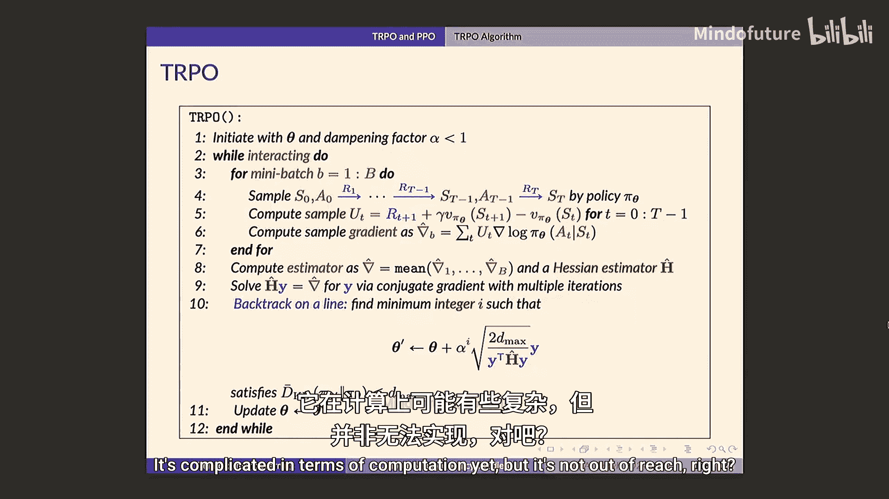

OK。