# 【多伦多大学】强化学习 2025 ｜ Uoft   Reinforcement Learning   Fall 2025 p53 P53_讲座_52_PPO算法 -BV1D3F2zhEry_p53-

Let's get back to the。Idea of doing trust region， policy gradient。 But this time。

 instead of going the way that we went last time。Ending up with yourRPO。

 we're gonna do a bit of simpler approach。 So what was the idea。

 So the idea there was that actually what we do in policy gradient method is that we start from one policy network one choice of theta。

 then we somehow implicitly our computing one surrogate function。

 we go in the direction of the gradient of that surrogate function。

 And then we get the new point right again， another surrogate function。

 moving that direction and so on right So that was the idea based on the surrogate function optimization。

 And then we said why we need to search for it right learning rate。

 the best thing is that we replace that learning rate by or that update by simply update maximizing the surrogate function itself right So you start from one point you have the surrogate function。

 So you get to the point on the surrogate function。

 which is the best the maximum one right And once you got here then at this point you have the new。

One， you start you go on the original loss function， loss surface。

 you just make the next surrogate function and you optimize that one and so on。

 you go up right So that was what we were doing if you didn't want to do any trust region right but doing that。

 it could end us up with a bad update because simply when we update theta even though the new theta is not far away from the previous one。

 the policy is changing too much So then we added this constrain right the new policy after update is exactly is very close to the policy before update right And then we wanted to find out what is the closeness。

We said maybe we can do k divergence， right。Correct， so that was the idea。 But no。

 the question is that， are we really supposed to use scale divergence。

 Is it really worth it because it's really making too much complication， right？

 So the next idea was that maybe we can try to be a bit dumb and then try some dummy things， right。

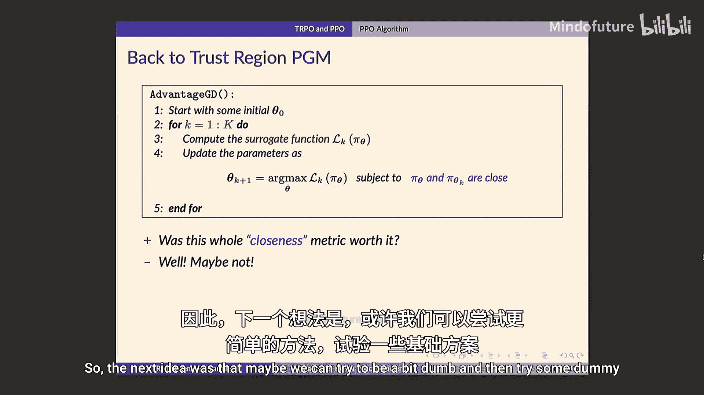

Now， this was the。Serrogate function， right， The surrogate function was your。

Avanage times the policy at the new point theta divided by the policy at the previous。Prorameter。

 right， And we said that this， this guy， this expression here is a important sampling expression。

 It's like the expectation of the advantage with respect to pi theta， right。

Because you have your advantage sampled by pi theta K， right。

 then you multiply it with the ratio of pi theta。With pi Tta K， right。

 P T decay K was the sampling distribution。 P Tta is a target distribution。

 That guy at top is an important sampling argument for finding the advantage with respect to the。

Next policy， right。So that was the thing。 but the issue here was that if we do that guy。

 then we're gonna to have a variance。 We talked about this。

 You're going have a variance which is proportional to the ratio of these two different policies。

 right。The new policy divided by the previous policy is going to specify the variance of that top estimate。

 right。And that was the reason that we wanted to keep pi theta close to pi theta K because if P theta is too different from pii theta K。

 that ratio is potentially very large。 And then the variance is going to be a large。

 regardless of how fine we do the sampling right， because that guy was something essentially original for the important sampling。

 It was not simply。Love large numbers that we can get rid of by more sampling， right now。

The question here is that we wanted to keep that pi theta class close to pi theta K。

 And we came out by K L。 Now why we should do that。

 Why we don't just look at that ratio itself as a kind of closeness， right。

Maybe we can just find a theta whose pi theta divided by pi theta K is not that large， right？

No k dirgence。No problem， no complication， right？Just， just this ratio is as small。

 When that ratio is small， supposedly， the variance is as small。

 then that important sampling is working fine。 and we are fine。 We are within the trust region。Okay。

要。How we can do that。 Well， maybe we can be a bit dummy， as I said。

 and we can just think about some sort of clping function， right， We could say。

 say I have this function， C。This is one function。 It looks at the input。

 If the input is within the range of one close to one。

 it's gonna send it out If it is not close to one。 It somehow damp it down， right。

 Some make it close to one， right。Most basic idea is like you have around one。

 It is exactly giving you the same thing when it's too much larger than one or too much smaller than one。

 it's gonna kill it to one， right or something close to one。So if you have such a function。

 which is actually limiting the argument that is going inside it。

 then we can simply update in this form， right。

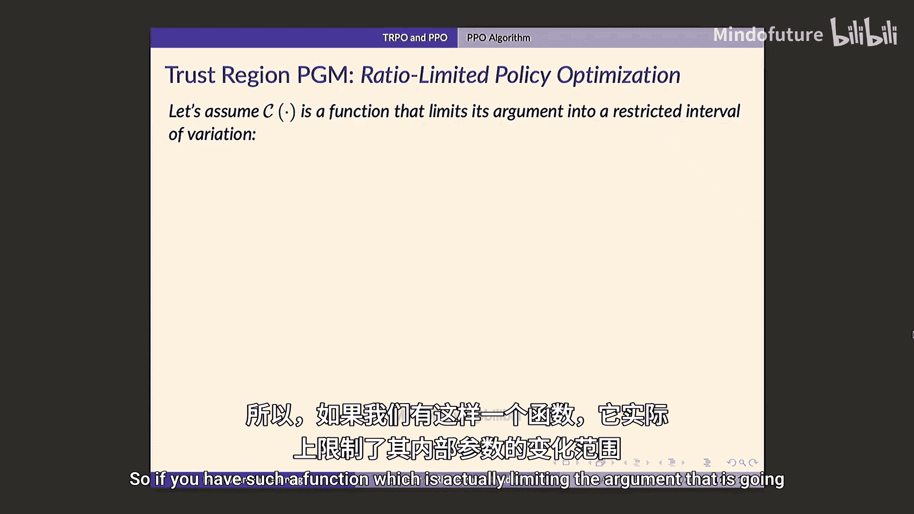

Or we can compute the surrogate function in this form。We would say， we have。Utility function。 sorry。

 the advantage function， U， right， And we multiply it not by pi theta divided by pi theta K。

 but by C， right， C of that ratio。 Now， C of that ratio is going to be limited in in value， right。

When this is limited in value， suppose。Supposedly it's going to reduce the variance as well， right。

 It' gonna limit the variance as well。So that was the very basic idea。

 We are somehow clipping this guy。Or in other words。Let's put it that way。

 We are making our update to make sure that even after clipping that ratio is not changing too much。

 this means that the ratio itself is a small enough or close to one enough。

 This means that the important sampling is not making the variance too high， right。So。

 we are not really。Directly keeping pi theta close to pi theta K。

 But we are pro doing that by simply just making that ratio to not， you know。

 get violate or getting out of the out of the out of control extremely， right。

This is why they call this idea proximal policy gradient or proximal trust region control。

 So you're not really working by the pi theta directly。

 You're not making pi theta close to pi theta K because that is a policy right is a distribution。

 You cannot talk about just a single point of it right but you somehow put one function there that this function makes sure this ratio is not getting crazy out of range right And since our training based on this function。

 you want to have the argument also close by right And this somehow indirectly implicitly makes your ratio small I'm going to give you the exact example of that C function。

 which is used in practice and you're going see it more clearly。So that was the idea。

 They said like no constraint here， right？ I don't want to check that pi theta is close to pi theta a anymore。

 The only thing is that I compute the surrogate function right， But then I'm gonna oh， this is kill。

 right， there's a mistake here is a typo in line 3 that you'd have。If。 So I am going to compute the。

The mod surrogate function。 So this is a kind of restricted surrogate function where that important sampling term inside it is enforced to remain close to one。

And then I try to maximize this new function， right。If I maximize this guy。

 I find the best theta say that that ratio is not crazy large。 First thing， Secondly。

 is just improving the the surrogate function， right。

 So I am somehow implicitly still within the trust region。And I'm improving my policy。Provis clear。

Okay， now this is what we call the PP PO proximal policy optimization。

 And now the key point here to know this algorithm is how does this C function here。

 How does it work， Okay， now， the way that they did it in the in the original paper is that they said this alt is essentially a clipped version of your original surrogate function。

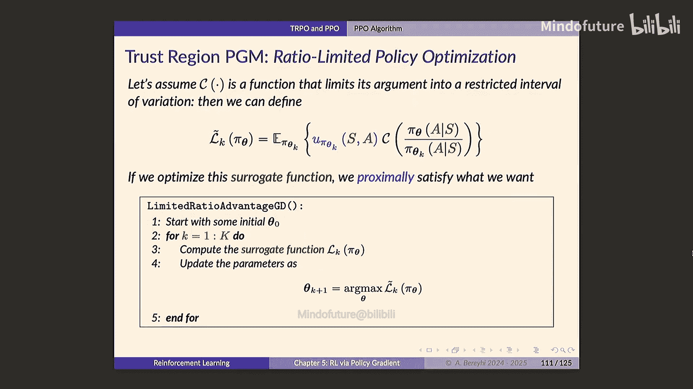

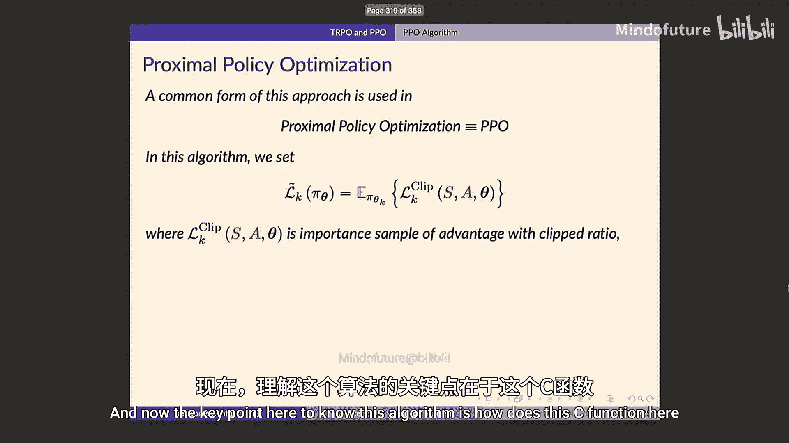

And how is this clip version defined， This is defined in this form。 I'm gonna give you the example。

 You're gonna see why this is really clipping the。Cling the。This。Sample。Advantage sure， so。

First of all， let's look at the expression。 So this clip version， this guy that you see here。

 this is an advantage at the previous with the previous policy， right， the important sample of ratio。

 This is the basic surrogate function that we had right Now this other guy is one limiting term L epsilon and what is that L Epsilon。

 This is this guy。 So what it gonna do。It's going to look at x。 if x is positive。

It's going to give one plus epsilon that x， right。So it means that you going to slightly increase。

Increase it as compared to its value， right， So slightly one plus epsilon， slightly larger slope。

 right， If x is negative， it's gonna make it slightly smaller。 So 1 minus epsilon。

 And that epsilon is a quite small number。Okay， now you have this guy。Here， right， now。

 every time that you want to or if you want to compute it at a particular point theta。

 you're gonna look at the original surrogate。 You're gonna look at this clip term。

The one which is minimum， you're going to take that one。O。Every school。

Youve got what is the expression。Now， the question is that， why should that expression。

Reduce that ratio or keep or pi theta within within a range where the ratio is small。

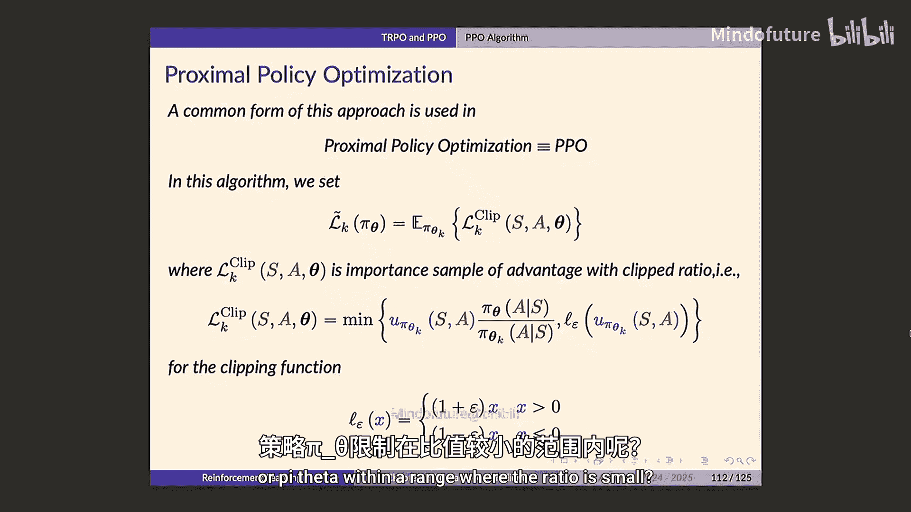

So let's look at this guy。So the term itself is a bit complicated。

 but we can actually understand it by thinking about a very simple example。 What is a simple example。

 say that you have just one state， one action。 So this is just a single trajectory and then you compute this term you want to compute this term。

 So let's look at this， see how does it look like now first of all， when you compute that term。 Okay。

 when you want to compute that term， you have this sample right， you do know what is your advantage。

 meaning that you have your trajectory， you have your state at this time。

 action immediate reward next state right， you can compute the you can compute the advantage right and you have sample this trajectory by pi theta K right This means that that advantage is the advantage of pi theta K right write cool about that right So that one I can compute there is no problem with that When I have my sample right next thing。

The thing that could happen is that this guy， this advantage could be positive when it's positive。

 it means that the action that I have done is better than the average action， right。

 It could be because the advantage is positive。 The action value is more than the value， right。

 If it is negative， it means that the action that I have done was not a good action。

 I am just reducing， right， The action value that I get is less than the average value I get， right。

 less than the value function。😊，Everybody school， right。OK。So this guy， this number this advantage。

 It could be either positive or negative。 Now， let's look at it and see what's going to happen if we just have every case。

 every single case。

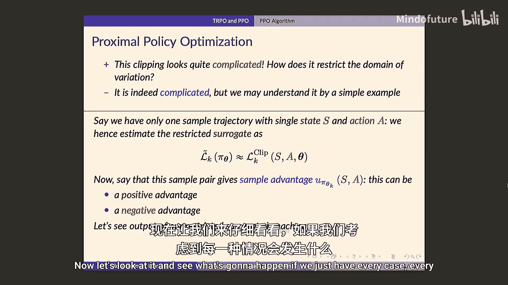

First， let's say that this guy is positive。 So this term you that you see is positive。

 Let me just show this guy back， so。

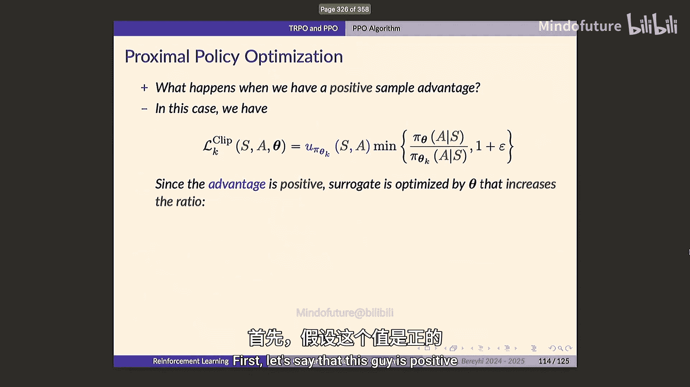

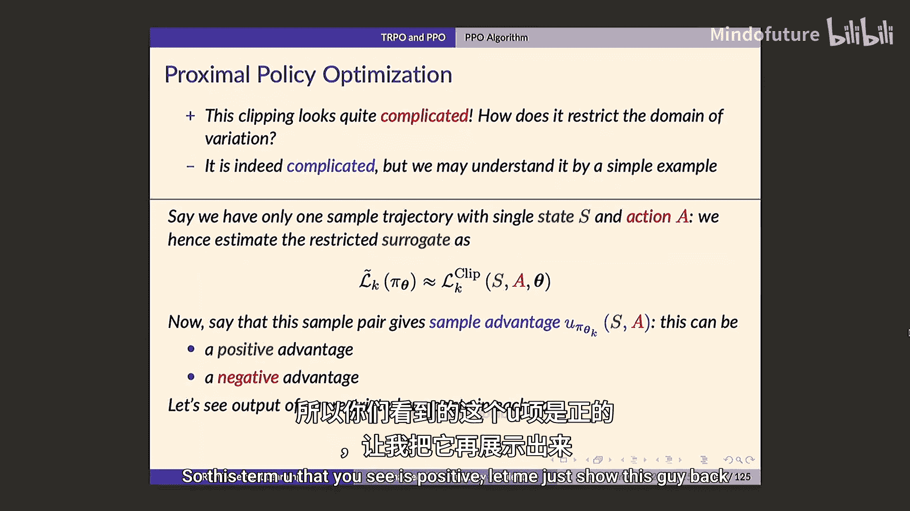

This U is positive。 it go， If it goes inside this L function， what's gonna happen to it， what。

 what comes out。The first term， U is positive， right。

 what you're gonna get as the second term is going to be the advantage itself times one plus epsilon。

 right， slightly more than one， right， okay。

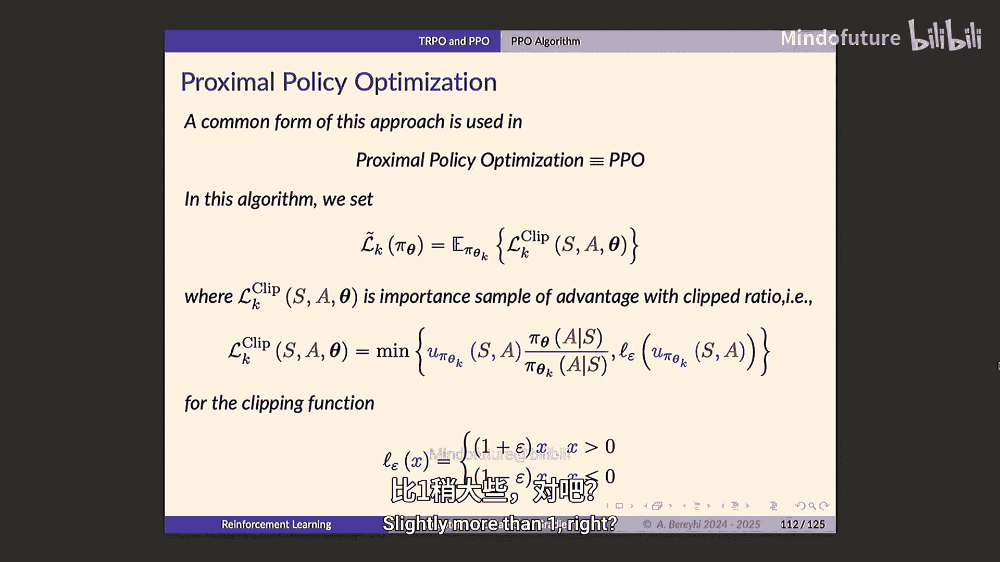

So you have one plus epsilon times advantage here， right。Okay， a right school。

What about the other term， this term here。This is the same term as we had， right。

 The first term in the minimum is advantage times the ratio， right。

 Now I'm going take the advantage out， right， This is positive。

 So if I want to compute the minimum of a positive number and a positive number。

 I can multiply with any positive number that I want， right， So I'm going to take that U out。

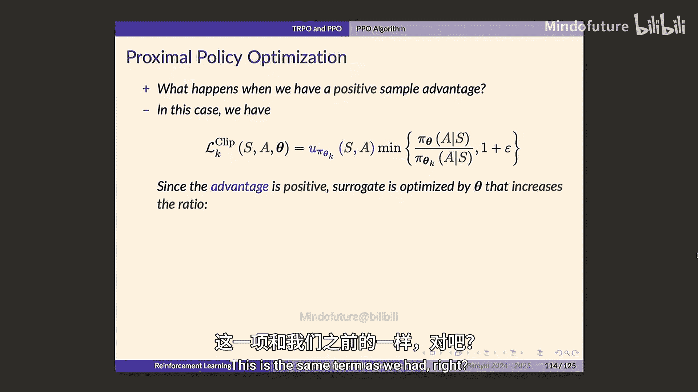

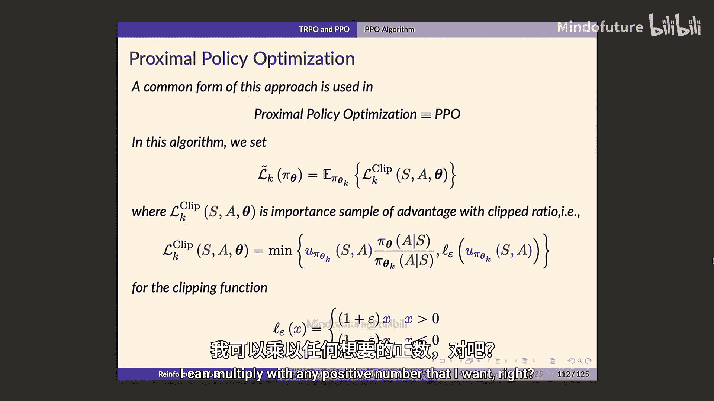

I'm gonna take that view out， right。A rice school。Now。

 what going to happen if I compute this minimum。If pi theta。

 if theta is changing your policy in a way that this is going to make this ratio crazy large。

Then out of the minimum， you're gonna get one plus epsilon， right， It doesn't let it to go that way。

 right。If。It is within the range that it makes it less than epsilon large， right。

 Then it gonna be the exact。Important sampling term， right， Now， when you are training。

 when you are tuning theta。Your your optimization makes theta or its inclined to have a theta。

 which brings this guy out， right？ This means that pi theta is not going to get larger than epsilon。

1 plus epsilon， right， as compared to the previous one。 So you're implicitively telling it， okay。

Be careful。 if you are very large， then I'm gonna take one plus epsilon， right。

 And then this is somehow making itself modified to the way that is less than one plus epsilon large。

 right。A high school。A eyes clear。What we were doing。Okay。

 so this is the case when we have a positive。Positive advantage。 When we have a positive advantage。

 this ratio。Only comes out as long as we have one plus epsilon。

 If now it's gonna get played by this term， this means that when we are computing the gradient with respect to theta。

 we are only looking to the case where this pi theta is smaller than one plus epsilon times pi theta here。

 right And this means that our updates somehow makes pi theta to be within a trust region， right。

But not directly anymore， implicitively， right。Questions。那有。Yeah， yeah。

 but but this is the price you need to pay to make sure that you're not getting like， you know。

 you're not getting lost in your update， right？ It's okay。

 Maybe Tta is slightly different from theta and your policy is a bit different。

 But if you keep on training you're gonna end up with something optimal right or not optimal with something stable right but if you do。

You do not put that small epsilon there。 Then it could just update in a way that in the next move。

 pi theta to pi theta K is crazy large 100， right， Then this means that your variance is going to get a scale with by 100。

 Theoretically， the next point that you end up could be within。

Factor  hundred0 away from the optimal direction， right and you can do nothing about that。

 This is the issue。 It's not only bus sampling right， because when you do more and more sampling。

 you just reduce the variance by sampling right But but that importance sampling factor that what's coming within the theoretical expectation。

 right This means that you compute the variance of the important sampling term theoretically by taking the expectation。

 it means infinite number of samples to calculate。 but at the end of the day。

 that average term you compute is 100 times larger than the variance you expect to see and the variance you expect to see you expect it to be very small。

 right you expect to get close to 0。 but that guy would never get close to 0 This means that even if you do very fine sampling very fine averaging is still you want to move in this direction。

 the direction that you can compute is just randomly anywhere in the factor。Of 100， right。

 And you can easily get lost， right， you never get back there。 So you need to pay this。

 You need to be patient to just get to that point。Yeah， yeah。 and in TPO。

 you do the same thing roughly。 But there you do it explicitly。 you would say。

 I want this policy not be different from the other policy with a distance or divergence more than Dmax。

 But here you don't do that directly。Yes， yes。But at the end of the day。

 since computational is is easier， it's going to make everything much faster。No。Yeah。

 this is the point because very small learning rate is going to just change or make theta very close to theta K。

 right。But theta very close to theta K， it is still could change your policy significantly。Right。

 special。Right， right， exactly。Especially when youre when you are somehow getting into a stable point。

 because when you， for example， train a neural network， what you see。

 you see initially that the gradient is very dense， right， every parameter is getting updated right。

 at some point， some parameters just do not do anything。

 right because simply they are not that impactful， there are just a few weights inside the whole neural network that are doing something right。

 And now the point is that if you change one of them slightly， the output can change significantly。

 right。Here is the same thing。And yeah， yeah， and the problem is that you。Try to keep theta close。

 But pi is changing significantly。 That guy is just ruining everything。 You can。

 You have no control on that。Somehow， right， right， You're somehow updating theta。

 but you are somehow imposing the learning rate somehow constrain on the probability itself， right。

Yes。Yes， again， this is a kind of like rule of thumb thing that you just start implementing and you get a sense about that。

 But what is the。What is a practical approach to do that Just to start with a bit of large epsilon right by a factor which you feel like that much of variance is not really important right And then if you see a stability。

 then you can keep that， if you don't see stability。

 you reduce it right because the key turnout is that when that epsilon is too large when you have that important sampling variance。

 you start to see unstability and the whole training right And if you see your training is unstable。

 It simply means epsilon is too large right。Then you reuse it。Questions。No question。Okay。

 now the next case is the case where that U term， that advantage term is negative。

 What gonna happen if you is negative， Let's get back here。

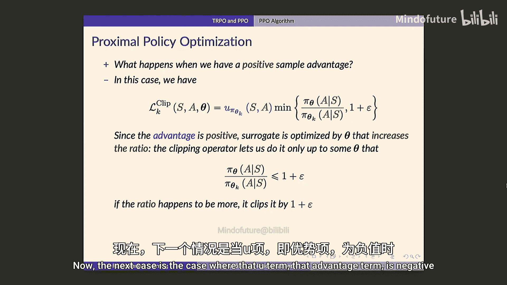

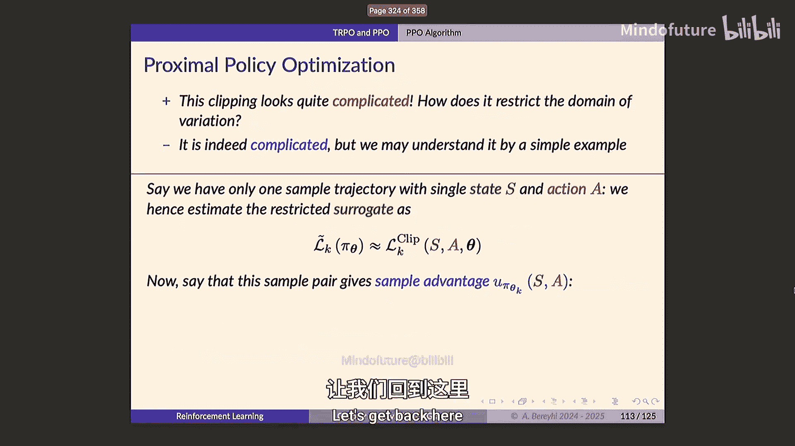

What comes out of this guy？U is negative 1 minus epsilon。

 So you're gonna to shrink the amplitude a bit， right？ So 1 minus epsilon gonna show up here。

 Here is you， right， Time this guy。 If I take you out， what's gonna happen to this term。

I am computing the minimum of -6 and-3。 Which guy is。which which guy is the minimum。Minus。-6 or -3。

Everybody。-6， right。 Now， if I take， say the first term is-3 times 2， the second term is-3 times 1。

 right， If I take-3 out and I want to still get -6。Should I compute the minimum of2 and1？

What should I do。The maximum， right， you just multiply by you change the sign。

 You need to take the maximum， right？ So this is the point。 just pay attention to this one。

 If you have negative utility sorry， advantage term， you can take it out still。

 but this is going to be the maximum of these two guys， right。

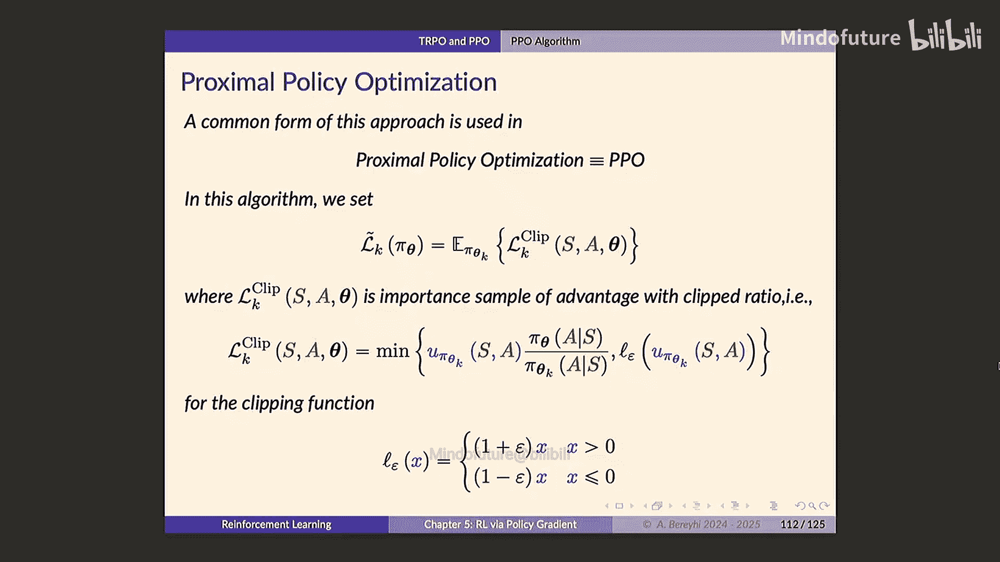

Rightect。Now， if that guy， that pi theta divided by pi is going to be。Lger。

 if that guy is larger than this guy， right，1 minus epsilon， right， This is going to come out， right。

 But if it is smaller than this guy， then one minus epsilon is the one which is coming out， right。

A rest clear。So this one， the previous one with positive advantage。

 was making sure that this pi theta divided by pi theta K is not getting more than one plus epsilon。

 right。This one tells you that youre not going below1 minus epsilon， right。A you clear。

And what is the reason。Isn't that a smaller， So it's supposed to be better reducing the variance。

Yeah各位。Well， yeah， somehow you can say this。 but yeah， your advantage is negative。

 Then youre taking the maximum of these two， right。

 But the maximum of these two is the point is that if。That term is crazy large again， right。

 then this can。This is the point。 This cannot be negative。

 and that is going to be positive and then is limited by the other term。Okay， but right now。

 what you are doing， forget about this you here。 Think about this guy。

 you're somehow making sure that this ratio is not more than one plus epsilon and it's not going below one minus epsilon right。

 So this is around one， right？ the ratio。Now， we know the variance is proportional to the ratio。

 right， It makes sense that we keep it smaller than one plus epsilon， right。

 But is there any reason that we keep it about11 minus epsilon。Yes， but what gonna happen。 Say。

 for example， this guy is very small。 If I keep it， whats gonna happen。

 there are some other actions where this guy is going to be large， right。They are both policies。

 right， They add up to one， correct。Correct。So when you are doing tail divergence。

 you directly take care of that， right， You do not compute tail divergence at one action， one stage。

 right， You just compute it by taking average over the whole policy， right。

 with respect to all actions， correct。But here you are actually just taking care of one particular action。

 Now， if you let your policy to be to make like this ratio significantly smaller。

 what does that mean， that means that for this particular action， this ratio is small。

 So for another action， this ratio is large， right。

Because the thing that you lost in the probability of this action is going to add up on the probability of some other actions。

 right is at the end of the day， probability， right， it adds up to one right， You are not。

 you do not have access to those other actions because you are not dealing with the probability as whole。

 you're just dealing with one value of it， right， So the thing that you do。

 you make sure that this guy is also not very small。 If it is not very small。

 then those actions that I' am not seeing right now， they are also not showing very large ratio。

 right， And then this makes you somehow confident that you are within the trust region， right。

Everybody got the idea。 So somehow what you said is correct， because even if I make it very small。

 I'm changing too much， I'm going in a bad direction。

 But if you want to explain in terms of variance， it means that some other actions that I do going have this big ratio。

 right And at the end of the when I compute variance， I'm averaging over all actions， right。

 that guy gonna to show up。 that going to ruin everything， right。Everybody's clear。So this ratio。

 keeping the ratio also close to like more than1 minus epsilon is because you don't want to have this ratio crazy change。

 right， It's not only having it as small。 you don't want it crazy change， right。

 because once it's changed， then there is definitely one action where this ratio is large， right？

 And that guy， when you compute the variance is going to kill all the very ruin all the variance。

 yes。I mean， reactions are the same。Are doing the same。 So say you have a binary case， right。

 two actions。And then you are seeing one of the actions here， right。And you say that my new policy。

Divided by the previous policy。 The previous policy was half half， right， My new policy is。0。

2 at this particular action that I have， right？ So 0。2 by 0。5 is 0。4 right， Is it smaller than one。

 Great。 You're gonna reduce the sample variance， right。

The point is that the probability of the other action I want to do is now0。8， right， And thats 0。

8 by 5 is 8 by 5， right。Its 1。6， right， It significantly larger than one。 Now。

 if I want to talk about the variance of the important sampling term。

 I don't just talk about one action， right， I'm averaging over all actions， right。

This means that that ratio is going to get multiplly with its own corresponding advantage term。Right。

And then， this is going to increase。A variance at the end of the day。

 I still have a high variance right I don't see it on my sample。

 my sample is just taking care of one action， right。

 but this means that some other actions have high probabilityvolty as compared to the previous policy right So more of a story is that you don't want to get too much deviated right It's not about the value explicitly exactly it's about not getting too much deviated right and you need to somehow implement that by having some remedy right care divergence is the best one because it makes sure that the new policy and the previous policy are the same because their divergence is small and that one is taking care of both the actions right It's gonna be log of the ratio of the first pro plus log of the ratio of the second pros。

 and when you make it small then both of them are involved right But in this case you don't really do that right。

You to make sure you are not also too much smaller than one。Clear， yes。

We' are doing it for a single action， right， because we are just looking at the trajectory that we have。

 right。Yeah， but this is the hope that you have。 I mean， this is why I say this is implicit， right。

 you are not directly computing KL， but assuming that you are just getting too much samples。

 then eventually some other actions are going to show up somewhere， right。

 and you also keep them close。 So at the end of the day， everybody's close， right。

 But if you don't keep one of them。Close enough to one， right， This means that you somehow。

Don't care about the other actions， right， Even if they show up inside your trajectory。

 the whole optimization that you are doing is not efficient anymore， right。You need to constrain it。

Okay。我先是呀。O。Okay。At one action。Right。Right。Sorry。Oh。

 this is the point that I think your friend also ask。 Okay。

 the key point here is that this depends on the this advantage term。

 the advantage term when this is negative， then you're doing the worst action， right。Yeah。

 when you are， when you are sampling， whenever。Somehow， let me put it like in a very implicit way。

 where you are seeing this negative guy， this ratio is going to be。Getting smaller than one。

And when you see the positive one， then this guy is going to be larger than one。O。You get my point。

Yeah yeah， I mean， this is not easy to see。 No， definitely it's not easy to see。

 So you don't see it here in the formula。 You don't see it。 just， I mean， do you get what。

 what I mean by， by explanation， because that advantage is how your action compares to the average。

Value， right。And then when you get positive， it means that you。

 this is the one which you are somehow inclined to do， right。If you get negative。

 it means something that you don't want to do， right。And then when you don't want to do something。

 the provol is is small。When you want to do something， the probability is high， right？

 So as the the policy。Evolves， you're gonna see that this happens for positive advantages。

 You could get just larger。For negative advantages， you can get extremely smaller。In your update。

 right。Yes， I mean， if it is negative， you， you are inclined to reduce your policy， right。

You give my point。You， you， you want to reduce your probability quality。

 The action is giving you a negative advantage， right。

 If you update what do you tell your policy network。

 you say that next time give it less probability quality， right。

So that ratio is not inclined to go up。 That ratio is inclined to go down， right。

 But you are killing that going down more than something。Right， same thing with the positive one。

 when it's positive。This means that this action is giving you more action value， right。

 So you're inclined to do that is provolti is going to increase， right。

 So the ratio of your new policy。By the previous policy is going to be larger than one。Yeah。

 if the gradient you are computing is in right direction。

 if your neural network is really learning that， right， then this is going to happen， right。Right。

 because here， this guy is positive， right， When this guy is positive， what does it mean。

 It means that this is a good action， right。😊，Next time， when I'm in this estate estate。

 increase the chance of this guy， right。As compared to the previous policy， correct。

So this guy is going to go up， right， You don't want it to go too much up， right here。

 the advantage is negative， right， This means that the in this state， when you do this action。

 you're gonna to get worse， right， Next time， reduce the ferty， right。

 So this ratio is going to reduce。 but you don't want。

 you don't want it to be much smaller than much smaller。 because this is going to impact the next。

 the other actions， right。谁呀？Sorry。嗯。here。でた。Oh yeah， sorry。 Yeah， it's this one， right。Yeah。

 this is typically less than one， right， right。Right， exactly， exactly。 And this is。

 this is based on this assumption that your neural network。 I mean。

 your sampling is good enough and your neural network is start to learn it， right。

 If it's not getting trained， That's another story， right。

 But if you think that you have computed all the gradient correctly。

 then this is something that your neural network is inclined to do， right。

 each time wants to improve its policy。 And obviously， when the advantage is positive。

 it wants to increase the ratio， when the advantage is it wants to reduce it， right。O。O。Yes。违发了。Yes。

 and you don't want to do that。在这。我 start。共法委。Well， it depends that what is your action space。

 And if you can guarantee that by just violating for one particular action。

 everything is going to be uniformly on the other ones。 how you can guarantee that。Probably no。

 because you are using a neural network， right？ And then when you impact one action。

 it' gonna propagate around the actions。 this is my feeling， right。

 So it means that if I kill this action， it's not going uniformly on neural action。

 So the close by actions are getting huge and small and the far away actions get huge， large， right。

Yeah， if this is the actions that I can do 1，2，3。 if I kill the probability of this action， I do。

 I don't think that I I'm gonna get the uniform distribution for this difference， right。

 I would probably do this， right only this or this。 So your。

 your argument is correct if you have this control on the distribution of those that loss， right。Oh。

 yes。Right， right， This is not a necessary constrain you should put， but this is sufficient。

 And since it is very simple to check。This is what you take。

 So it doesn't mean that this is the best choice that you can do for your next move。 Obviously。

 don't know that， right， But it a kind of safe choice to take for your next move， right。

 And you prefer rather to be safe than be very optimal because youre very close to the optimal because you do know that when you are very obsessed with with being optimal。

 you can simply get lost， right， So this is the reason。 But obviously your answer is correct。

 Like this is going to make it more restricted as compared to the all possible choices you have。

 But you're gonna accept that， right， because it gonna keep you safe， right。Questions。It was clear。

 oh， my god。Okay， so everyone's clear about that， right， So fast forward。啊。Everyones。

 even if you are not clear。😊。

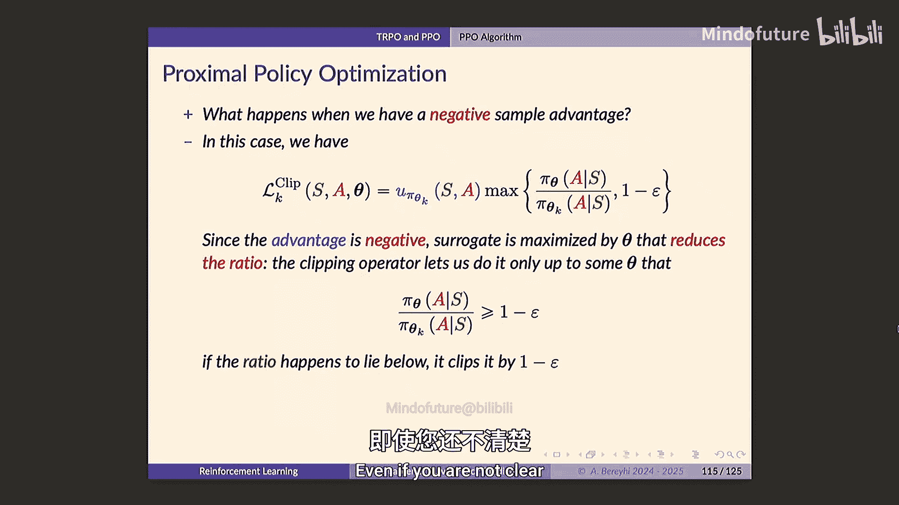

No， just okay。 So a school， right， Okay， so now。Moreover of a story， when you are doing policy， this。

 this sort of clipping， you are making sure that your next policy is not changing too much as compared to your previous policy。

 This is still still trust region， right， but you're not doing it explicitly， right。

 But since you are doing that， then。Life is much easier， right。

 You don't need to check ha divergence。 There is no issueian involved， no conjugate gradient。

 no backtracking， no nothing， right， Everything fine。 Life is easy。

 Everybody is happy or skin is better， right， PP，O， right， This is why this guy is got somehow。

State of the art because this is easy to implement。 This is efficient computationalary computational。

 And you can guarantee that work。 It works， right， It's not as optimal， maybe as T RRPO。

 but is is still okay。 And it gives you so much compensation in terms of computation。

 that you can just train for a very long time， right， so。

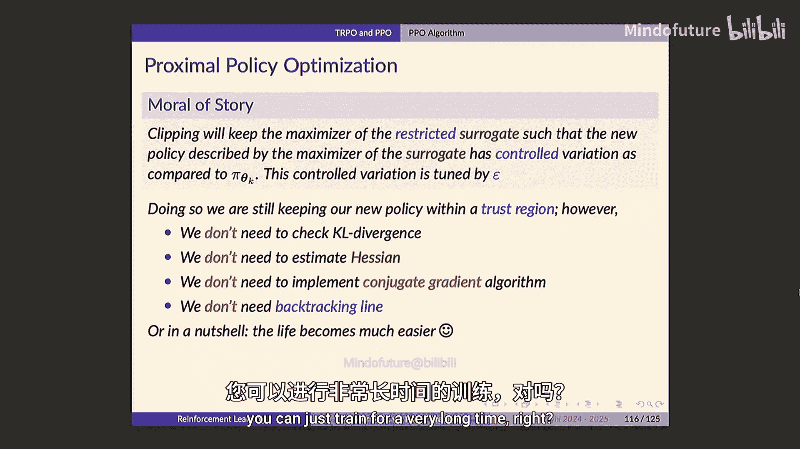

That is how the PPO algorithm looks like。 So you're gonna do mini batch training。 So sorry。

 you're gonna collect a mini batch。 This means that you're gonna collect a sample。 Again。

 you're gonna compute the advantage。 and that's it。 right again， this the values。

 the value of this stage， you need to do it by some trick。 we're gonna speak about it later。

 And then once you have done it， then you're gonna compute this particular restricted。

Serrogate function， right， The surrogate function here is your sample advantage times the ratio at the minimum of these ones and that cliping term that you had。

 right， And here I write pi X， right， Because x is the variable， right。

 pi theta theta is the current parameter of your neural network。

 Then you compute the gradient of this guy， right， So you compute the gradient of this guy。

 How can I do it in pi George。I just define the term dot backward。 right， That's it。 right。

 This is how you do it in Pyth Earth。Computation graph， right， back for vacation。

 But you can simply do that。 Now that you have done this。 now。

 you're gonna update with the gradient of this guy， right。

 And that gradient keeps you within the within the within the trash region。

 One thing that you might see my notice here is that I put here multiple its， right， so。

You can do just one update。 It means that you get your restricted surrogate function。

 You compute the gradient， you update， you go for it the next mini batchsh。

 or you can go over it multiple times， right， Just multiple updates just to improve the efficiency。

 right， And then you go for the next mini batchsh。 This is also possible， okay。

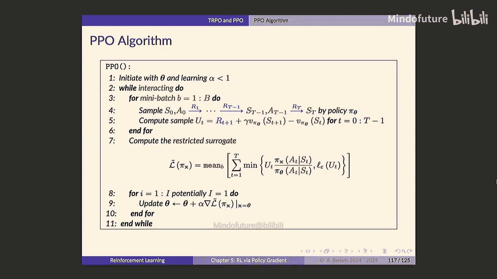

没有。That was it。 So T RRPO and PPO， both of them， they are just keeping you in the trust region。

 And PPPO is doing it much more simply by using a bit of intuitive restriction， right。

 a kind of greedy way of doing it。Now。One thing here is you might ask me is that， well。

 when you started with the whole thing， you told us like， always go off policy。

 Q learning is good because you have samples。 you can reuse them。 And this is a very important thing。

 Now here， still， after all of the complication， we don't have sample efficiency， right。

 If I want to update PPO or T RRPO。 I need to start。嗯。Sampling a mini batch。 I get that mini batch。

 I just do all computation。 I do one or a few updates。

 And then I again need to sample a new mini batch， right now。That's true in general。 So in general。

 you cannot improve the sample efficiency of PGM significantly。

 but given that you are within the restricted region， within the trust region。

 you can reuse your samples for a few updates， right。

 so you can use you can take one guy and you update but it still。

 but it still you use that that mini batch。Because you do know that your next policy is not significantly different。

 right， So this sample is not so irrelevant to what you're gonna sample in practice， right。

 So because of that， you can make a bit of improvement in efficiency。 So what we do in practice。

 we also do experience buffer here。

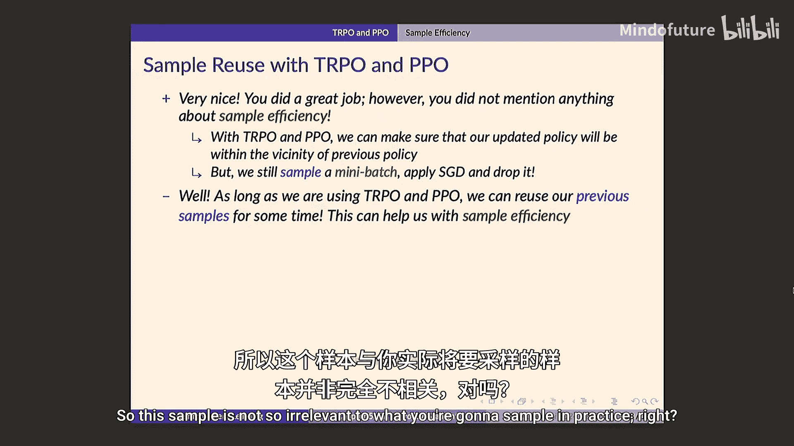

So you're gonna sample a mini batch one policy。Now that you have done you have these these samples。

 you go and update， right， Once you update it， you don't go and sample new things。

 You go over that mini batch once again， right， and again you update。

 you keep on updating for multiple maybe epos。 and once you are over。You feel like， oh。

 my policy is no very far away from what I started with。

 Now you throw away that mini batch or that batch of data。 you sample new ones， right。

 So this is what we do really in practice。 So in practice。

 you don't just really sample your mini batch from the environment。

 You get a batch from your environment， a data set from the environment。

You sample from that data set for multiple epos updating by PPO or TRPO。 And once youre。

 you have done enough number of epos， I mean， once you start implementing。

 you get a bit of sensing about the number of epos you can do。

 then you would throw that away and and sample a new set， okay。AR clear。So here， the issue is that。

You are doing some experience buffer， as in D Q， N， but。You really need to update it periodically。

 So you cannot really use very old samples anymore。 if you do that。You're not getting lost。

 because your algorithm always tries to be within the region of that policy， right。

 but you're not improving it too much， right。Okay， so。This is important thing。

 so you need to periodically update your your buffer or experience buffer because if you don't do that。

 then the samples that you're collecting you' are using are very old and that you do not get out of the trust region anymore。

 right。

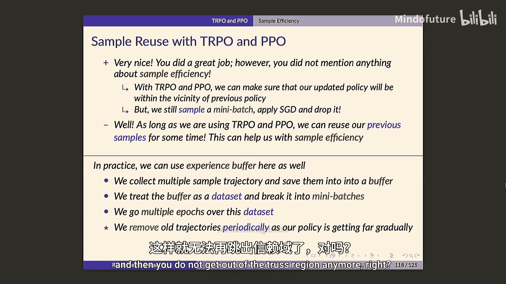

No。Here is the version where we are doing sample reuse with your your PPO doesn't matter really which one you are doing。

 so。What we do， we usually just sample the trajectory and put them inside one buffer。

 What is going to happen is that it might be that you just update your policy。

 you have a new policy right And then when you have a new policy， you go and sample a trajectory。

 you put it inside the buffer as well， right So the guys that you have inside your buffer。

 they could be from multiple trajectories you got under the way when you are updating right。

You just need to know what was the policy that you used to sample。That particular trajectory。

 and keep it as a label for that trajectory， right And each time that you want to update。

 you're gonna update exactly as before， the only thing is that when you are comparing your new policy with the reference policy。

 that reference policy should be the policy that you sampled with right if you have multiple policies when you are sampling and once you have done it。

 then if you are， for example， doing PPO， you basically update。As before。

 the only difference is that you use the policy of the reference， the sampling。E parameter， right。

You just use that one。But in practice， you really don't make samples。

 You really start with one policy。 you sample a batch， say 100 trajectories。

 you put it inside that batch。 you start sampling from that batch， right。

 Every time you want to update， you take 10 random trajectories， you update。

 right and you do multiple epochs。 like you have batch of  hundred0。You do mini batch size 10， right。

 So it means that every pack is 10 different its， right， Maybe you do 20 its，30 its。

 So it is like  threepos。 Then you stop。Throw away anything， use the new policy。

 sample a new hundred trajectories， right， And again， you start doing training on that data set。

 okay。

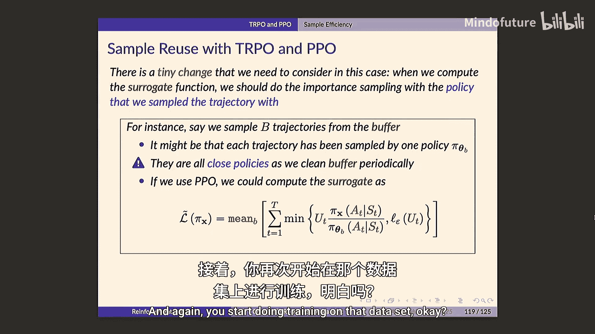

So。If you want to think about it， exactly like what we did in the D Q L。 So I have this guide。

I have this policy pi theta。 So this is my parameter。 I'm gonna sample the environment。

 I'm gonna get one or a couple of trajectories。 I get those trajectories， along with their policy。

 I put them inside my buffer， right。And every time that I want to train my neural first。

 I'm gonna sample one mini batch from that buffer， right。Maybe I put here 100， but every I creation。

 I just take 10 of them， right。I take that one。 I just update maybe like PPO， for example， right。

Now that I have updateded this one， this is the new policy， right。I do multiple epochs， right。

 And each time I use the same。Obviously as before， right， sorry， same samples as before。

 And once I am finished， now I'm gonna say that， okay， these samples are now old。

 So I'm gonna throw them away again， I sample I renew the samples here。 And I keep on doing that。

 right？ This is going to be implementationally more efficient as compared to just， you know。

 sample a mini batch and then train， right， because it's gonna be really。Time consuming。

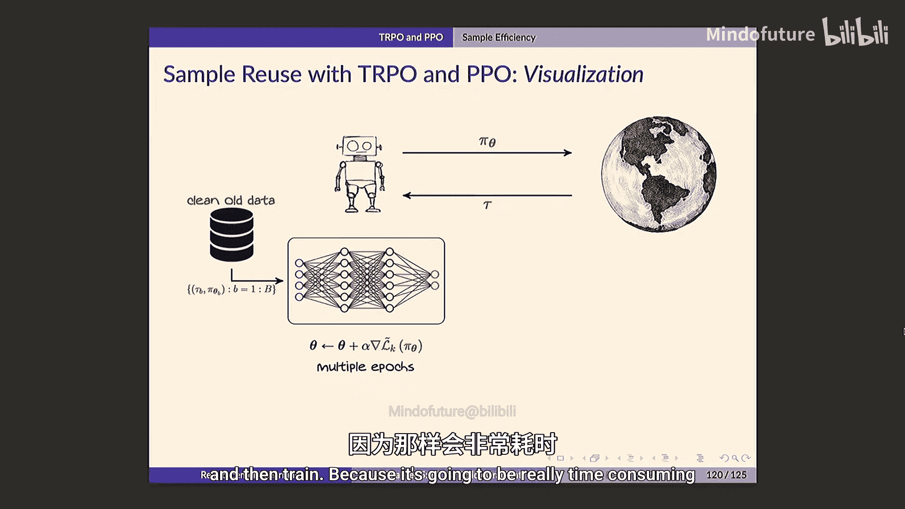

So if you want to see this sample efficient version， we can do exactly as before。 So what we can do。

 you can sample， right， one trajectory or multiple。 As I told you in practice。

 you're gonna do multiple with your policy。 Then you're gonna check your experience buffer。

 If you see that experience buffer is full。 you're gonna throw away the old ones， right。

 and replace the new ones， right。Once you have these new ones， now you have an experienced buffer。

 which is updated， right， Now you go for multiple epochs over that。Updated。Experience buffer right。

 Each time you sample one mini batch out of those samples that you have。

 you update one itration and you go for another mini batch， you update one and so on， right。

 You go multiple epoch in practice， you can go 1020。 That's okay。

 As long as your batch is not that large。 And then。You start having the feeling that， well。

 the policy is not improving anymore， right， because like I am that's it， right。

 It's the best you can do within the trust region。 then throw away all the old samples。

 take the new samples， right， This is going to be more efficient when you implement。

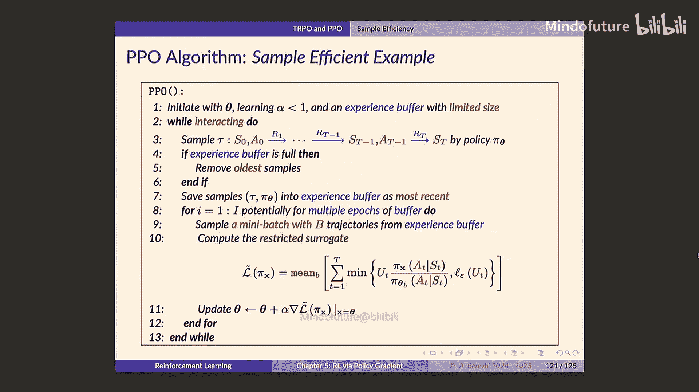

O， that's it。One thing that you might tell me is that if you do deepQ learning。

You still can use samples from very beginning， right。 But here you're not doing that。

 And you are totally right because。DQL is a full off policy approach， right。

 whereas these policy gradient methods cannot be off policy， right， you're updating your policy。

 You should just use that policy as sample。 You cannot do anything about that， right。

 So you cannot really go off policy by policy when you are doing PGM。

 But the thing is that we are doing。 if we are just mildly going off the of policy using the fact that we are in the trust region。

 It's like I get a bunch of samples。 I squeeze it as much as I could to get the best juice out of it。

 And then I throw it away。 I get a new sample， right。It was clear， right。

 So this is very important for you to have always in mind， PGM。

By no means can beat Q learning in terms of sample efficiency。 It' impossible。 right。

 But when you do trust region， this is going to be more efficient in terms of， for example。

 the final result that you get， very stable。Is it might be able to just catch the a better policy。

 This is possible because youre directly optimizing the policy， right， This is a benefit you get。

 But the price you you the cost you pay is simply that you're just losing sample efficiency。

 and you can do nothing about that。 right， So it is's a lie if somebody tells you。

I have a policy graium method， which is B thing DQ L， right， that guy， you should not trust him。

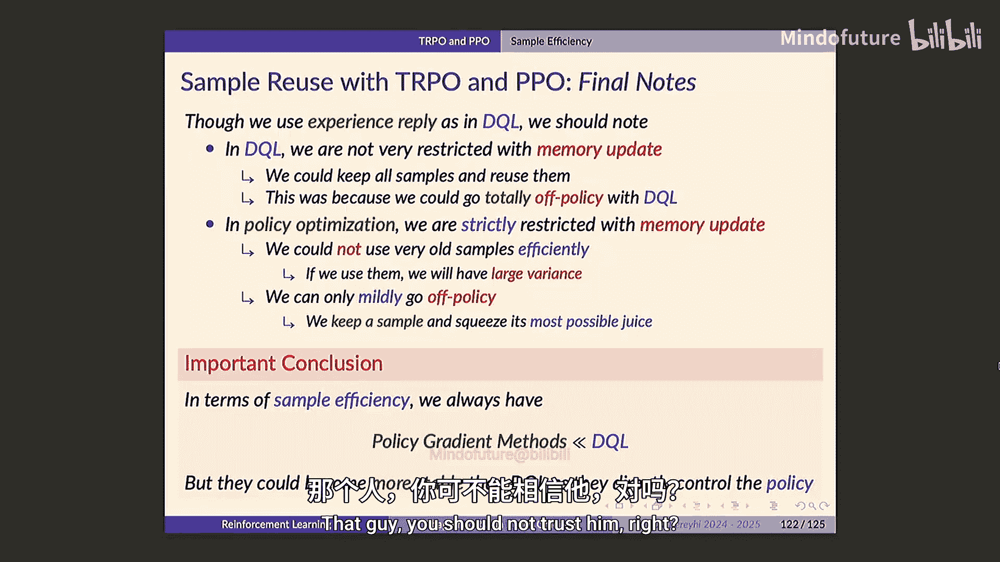

Okay。