# 【多伦多大学】强化学习 2025 ｜ Uoft   Reinforcement Learning   Fall 2025 p54 P54_讲座_54_TRPO与PPO的演员-评论家实现 -BV1D3F2zhEry_p54-

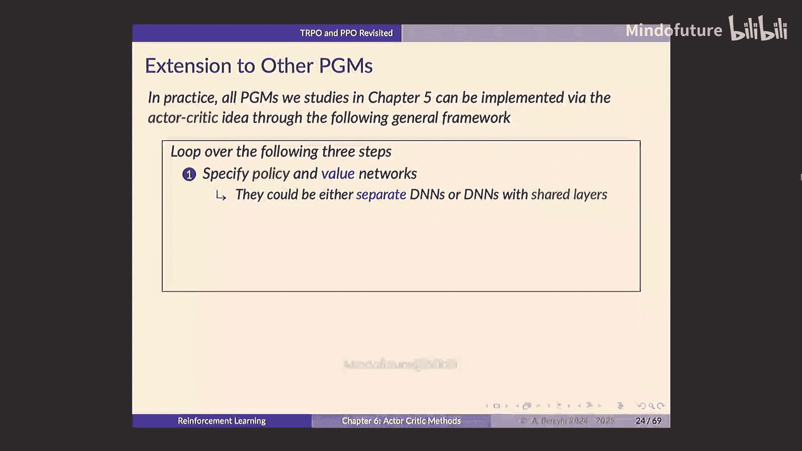

So shall we go on。 So now what we want to do， we want to just。Value network。

 if we want to do T RRPO and PPO。 So yeah， we can do exactly the same thing as we have done before。

 Only we just add the value network there， right， so you can use。

One separate network to be your value network， you can incorporate the value network inside your policy network。

 You have a shared architecture。 This is also possible and then。

Use your policy to sample the environment， a batch of trajectories。

 Then you get those trajectories or that batch to somehow update your value and policy network together in some mini batch schastic gradient decentcent right So now let's start with T RRPO。

 and then we going get into the other one as well。 So this guy was the TRPO algorithm that we had。

 we discussed it last time。 So what we do here， we are going to sample trajectories。

 and then maybe we we do multiple epos。 So we talked about this that we are going to sample we got or policy network。

 We use that to sample a complete batch。 and then we go over it for multiple epos。 and。

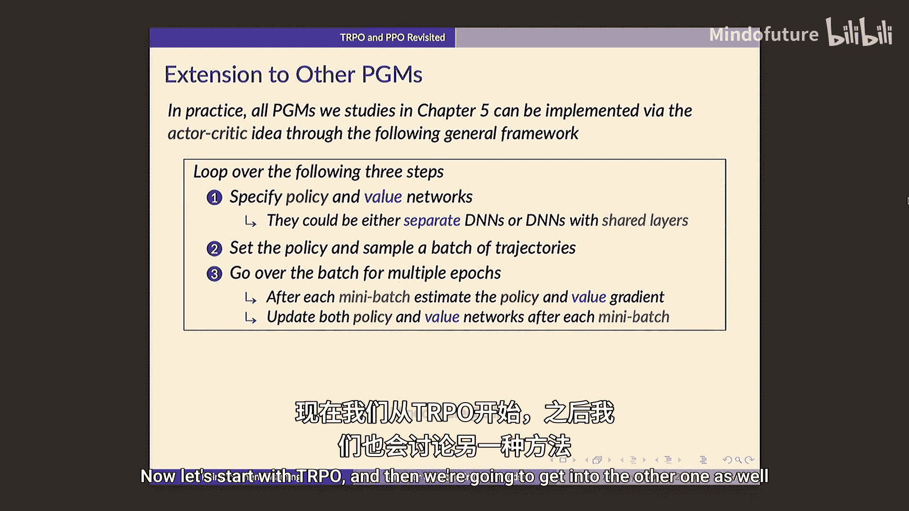

Every time that we go over one trajectory or a mini batch， we are going to compute the advantages。

 If we want to do it now， we have already the value network， right。

 So we are going to use that value network to sample the advantage。

 and we can compute using those advantages。 We can compute the gradient， right。

 So you have the gradient。 then you can。Do whatever we used to do in TrRP。

 meaning that we are going to estimate the heian out of that estimate。

 we are going to use gradient conjugate conjugate gradient。

 sorry to find out this vector y and we use vector Y to just update or parameter。

 we check if we are just deviating region condition。

 then we back the line until we get into the trust region， right And by doing that。

 we have updated or policy network， right This is what we have done before。

 And then in this algorithm， we basically have this value network just added right And the only thing that you should do extra here is that you also compute the gradient of your value network。

 right So like in lines 7， you use policy gradient。

Torem to compute this gradient right And then you can also compute this gradient using the same advantages as before。

 right you get the gradient， you back propagate over your value network。

 you get the sample gradient of your value network。 Now， once you're over with everything。

 then you update your your policy network and also you update your value network with the same SGD that you had before。

 right。Everybody's cool， yes。So this is a kind of higher level version of the actor critic here。

 but there is one key。

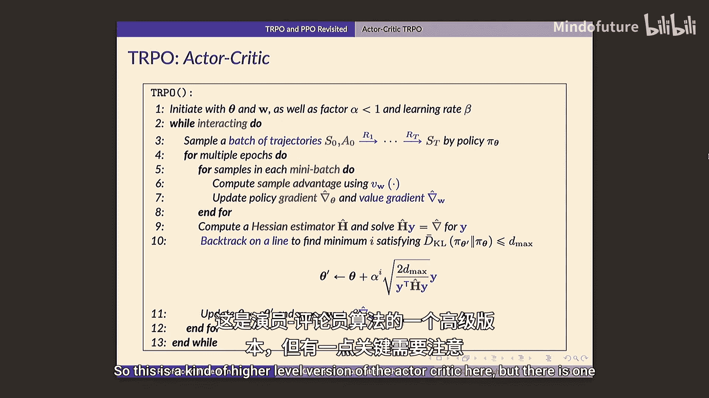

Point that you should pay attention here， especially when you do it in practice by sampling a batch of trajectories and using it for training。

 So the key point here is that when you are computing the gradient of the value network。

 as well as the policy network， you are going to you need to use also important sampling to make sure that the advantages that you're computing are actually averaged over the target。

Distribution， not the sampling distribution。 So if you remember last time when we talked about that。

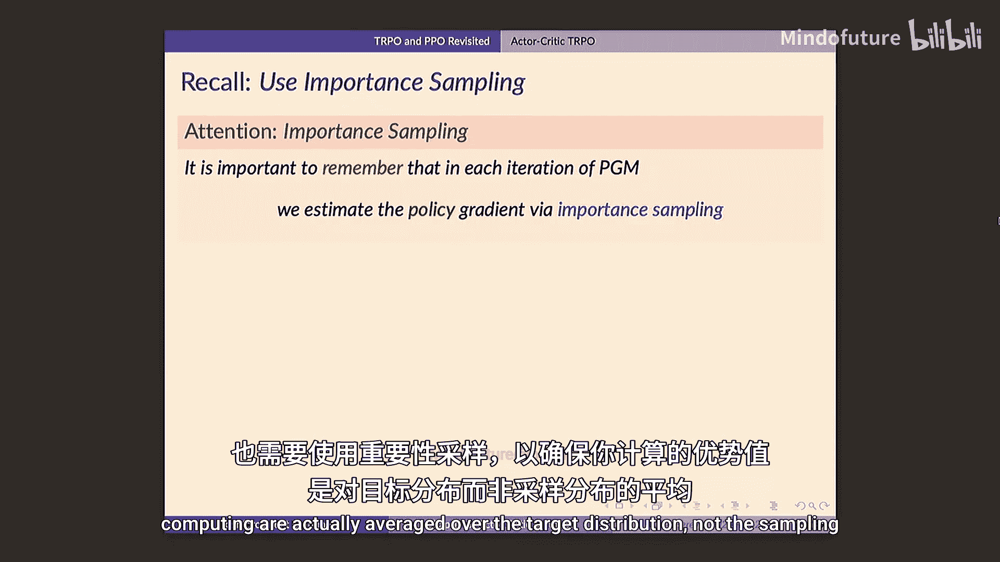

I told you that you're going to get something like this， right？ And then this guy was the one。

 So let me check if I am。

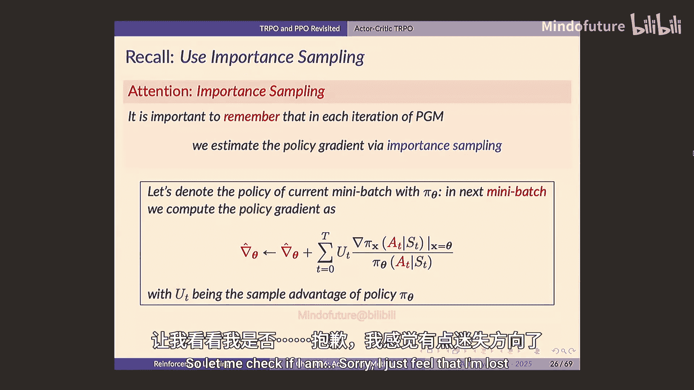

嗯。Sorry， I just feel that I'm lost。

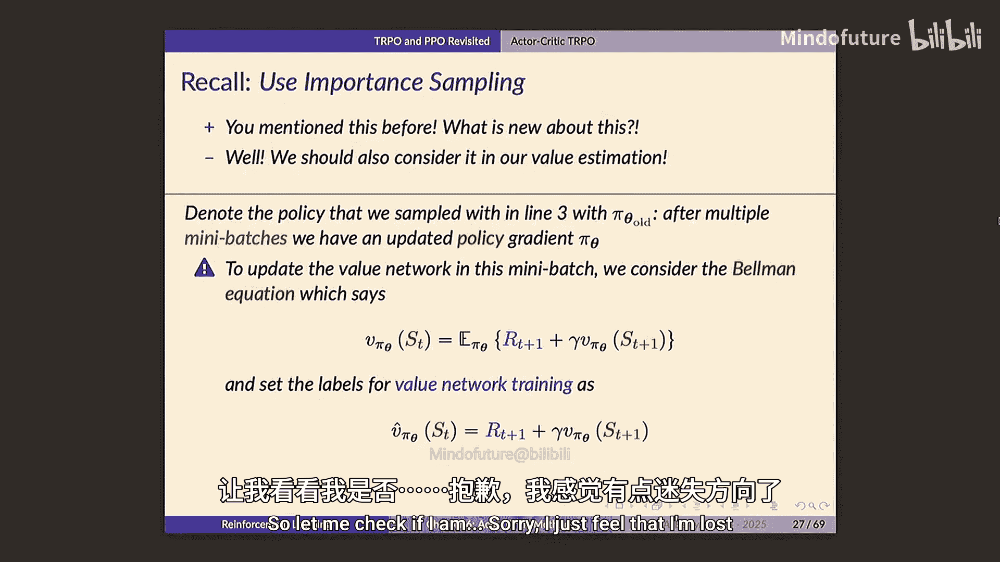

Oh， no。 So I don't know why I have this here， right。Because yeah， this this is the indicate oh sorry。

 sorry， this is the indicator of my policy network。

 It's not the value network yet right So here what I'm speaking is just I try to recall you but I guess probably what I touted like it was already a couple of sessions best but here well this we have done before right so you remember when we did TrRPO or PPO we always update or gradient using this term right and I told you that this term is actually the gradient of important sampling version right the policy that you have as the target divided by the policy that you have sampled with the key point here that I want to indicate is that you should also do the same thing when you are doing value estimation So what does that mean say that I have my old policy network pi theta old right and I got this policy network and with that one I just。

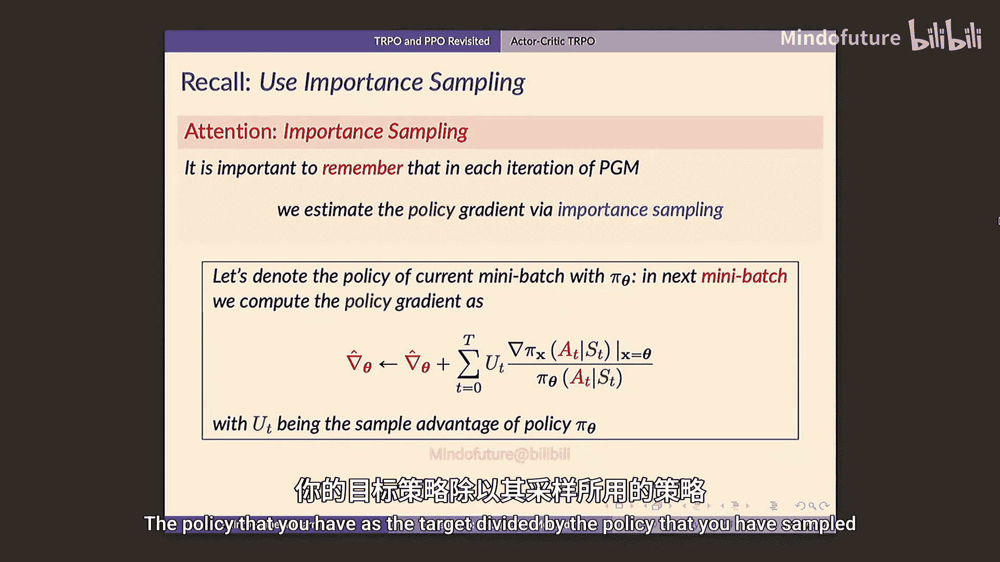

A sample the whole full batch of you know samples and I want to use that guy in order to update my value and policy networks。

 Now the thing that I do after every update I am getting a new policy right so when I update my policy network。

 my parameters of the policy network are changing this means that I am supposed to focus on estimating the value of this policy right but if I want to use the same samples that I sampled initially and I put inside my batch then I am just getting samples samples of the old policy right so the thing that I should do I should pay attention。

 I should keep the important sampling term also there in order to convert whatever I have inside my dataset into the samples of the new updated policy right。

So what does that mean， that means that if you want to update your value network。

 you are going to focus on the value network， which is estimating the policy the values of your policy pi theta right and that guy is the expectation of whatever you have。

 this is the， for example， TD expression right。Expected over the policy that you're playing with。

 right？ So you're taking one sample of this one as an estimator。

 but supposedly this is an estimator of this guy， right。But if you have already one mini batch。

 which you have one batch of samples that you have already sampled with your previous policy before update。

 right， So those guys that you have are not samples of this pi Theta， right。

 They are samples of pi theta old， correct。And then because of that。

 if you ever you simply use them directly to update your value network。

 you are simply updating the value network to estimate the values of your previous policy， right。

 not the car policy， So whats the trick here， Basically。

 you just use important sampling also on the values right。

 So just make sure that you are converting those samples into the new samples， right。

 So how can I do that， I could say that， well， I want to estimate this expectation。

 the expectation on the on the new policy。

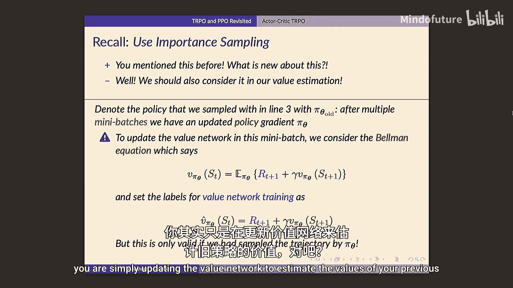

But I have the samples of the old policy， right， So if I want to do important sampling。

 I have the same guy as before， but I'm going to multiply it with the ratio of the densities， right。

 So every time that you update your policy， you have a new policy network， right。

 you get that policy network， you divide it by the densities。

Denssity that you had when you just sample to your batch， right。

 this is the important sampling argument and you multiply it to your samples all the time， right。

Everybody's clear。So you use this guy So the sample that you are going to use is going to be this one when you want to update your value network right So if you do basic TD。

 you don't have this fraction anymore。 this is a sample that you have right but this is a sample of old policy right And when you train your value network by this sample。

 this simply means that you are training your value network to predict values of your old policy。

 but you don't want that right because you want to use this value network。

 you compute the advantage of your current policy and you update with that one。

 So you need to have this important sampling argument as well。Everybody's clear。

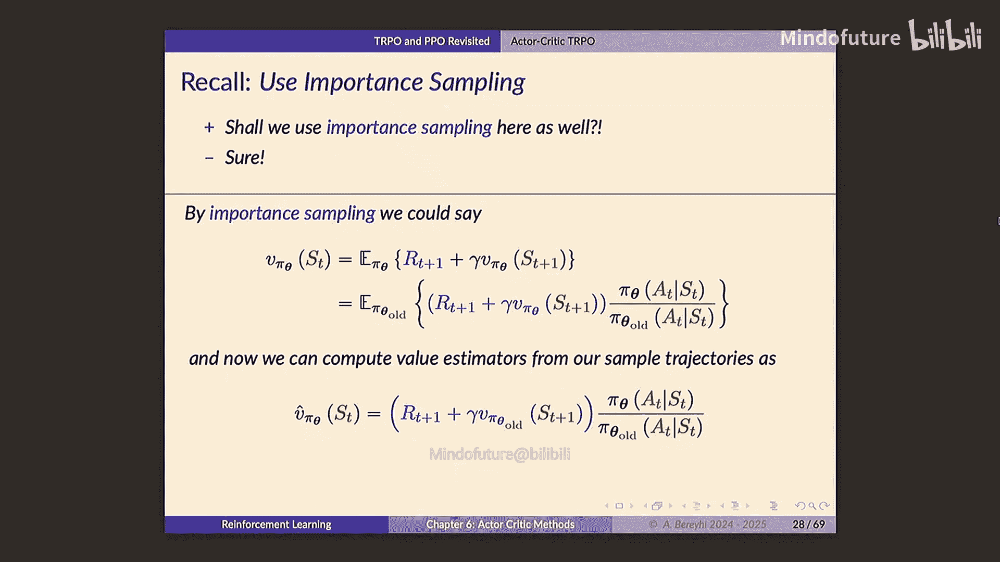

Okay。So， yeah， so this is going to be the way that youre computing the advantage。

 So the advantage is going to be whatever sample you have times the important sampling argument minus the value that you have at that particular stage。

 right？ And this important sampling argument is just needed to make sure that you are not losing the track of your old of your updated policy。

 right。Now， sometimes people simply write it down in this form this means。

 but this is not completely correct because， I mean。

 you cannot say that this guy is exactly this multiply with this ratio， right。

 There is no action real involved here， right。So you need to actually sample with the marginal distribution of the states that D guy you remember。

 but that is too complicated to do， right， This is why people do this approximation So basically they get the advantage which they have out of the samples inside the batch right And then they multiply the whole thing with the ratio。

 It's roughly okay right， it's not 100 percent accurate。

 but it's going to work right And as engineers as well as long as it's working is fine right So it's a nice approximation。

 but you can not really say that this is very accurate approximation because the ratio like important sampling argument for the second term is a bit hard to write analytically because it depends on the state at time T。

 which you have started with some random state and you played randomly with your policy and the policy was actually changing as well like a super complicated thing to compute right。

You can simply just ignore it。That is the way that people that is the way that you need to just you to transform the advantages inside your old batch into the advantages into the new batch or new updated policy。

 right， and then。When you are updating your value and policy network， you need to work with this guy。

 not the the previous guy not the green U， but this one， right， And Green U is simply this guy。

 you can always convert it， right。Questions。No question。Okay。So yeah。

 this is the correct way of estimating the advantage and if you don't do that， this is one point。

If you don't do that。And youre doing small batches and you are just doing few epochs on one batch。

 throw them away， and then you update， you don't see a very sensible difference。

Like sometimes that one without having the important sampling argument it also converges right but if you increase the number of epochs that you are going over because your policy network starts to somehow get into a kind of city state like getting out of the previous region and getting into a new region。

 then you're gonna see the difference。 It's gonna to be obvious in that case。

 or if you are going to work with larger batches， like you would say I am I do not have time to just sample every second epochs。

 I'm going to just take a large batch， just train over it enough number of times。

 and then I go for the next batch of。Trajectory is then usually you see a very significant difference。

 right， Now， this is the correct way of doing it。 All right， some base baseline implementation。

 they do not have it。 If I remember correctly， the one which is given by open AI it has it， right。

 But if you don't see it， it's simply， it does not mean that you don't need it。

 simply just forget to do that。 this is one of the tricks。

 Some people just ignore when they are implementing。

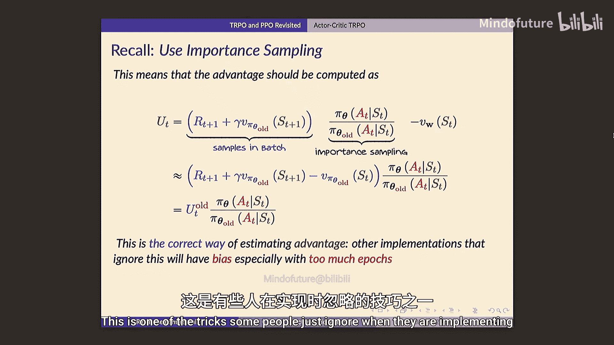

Okay， so yeah， now how does this guy reflect if you're just updating your value and policy network Well Well。

 for the policy network， I think we discussed it last time。

 this is the same thing for the value network。 So if you want to update your value network。

 you're gonna use those advantage sample advantages as the sample of the error terms that you need to update your gradient with or compute the gradient with。

 And then this guy， you just simply you should simply replace it with this this important sampling argument。

 right。

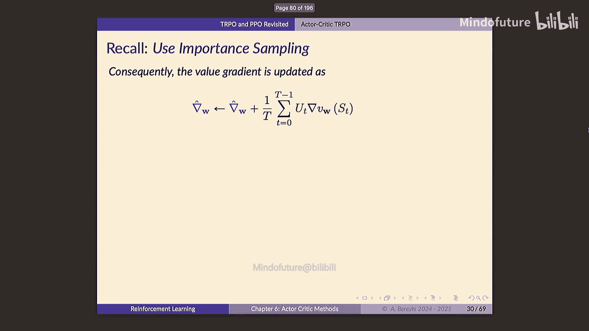

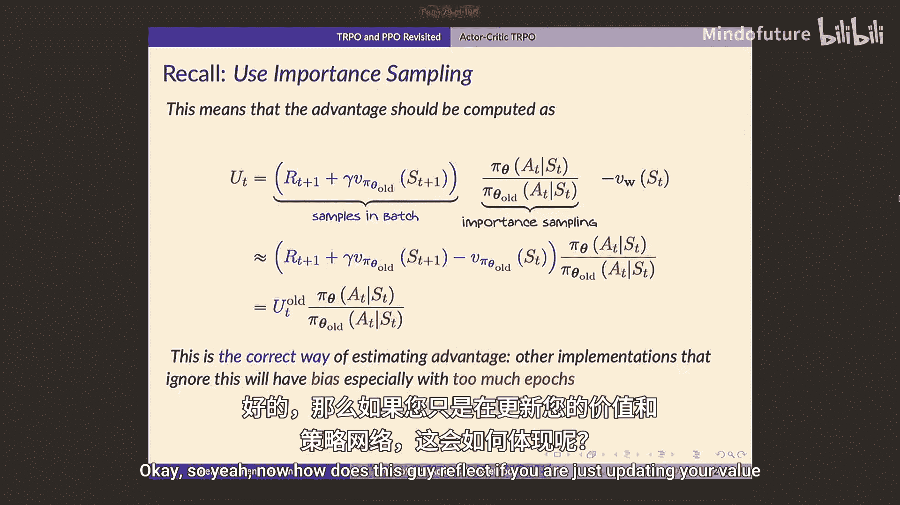

Everybody's cool， right？Questions， so that's about the value gradients。

 And then if you want to update the policy， you should definitely do the same thing。 As I said。

 we did it last time。 What we can do it once again just to make everything clear。

 So if you are updating your policy。 Well， you are using policy gradient methods。

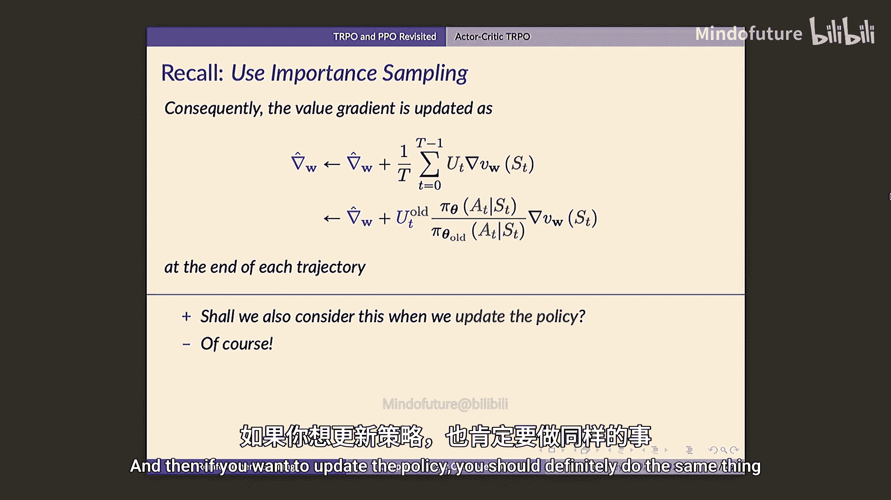

Potic gradient theory， sorry， this means that the gradient is going to be the average of the log likelihood。

 right， gradients of the log likelihood。 And this is the gradient of the log likelihood。

 And the thing that you have here is your。Your advantage， right？ Now， the thing that I should do。

 I should replace that green U with the important sampling argument。

 This means that I should do this one， right， But now here。

 because you are computing the gradient of the log likelihood yield， this is going to simplify。

Thenominator pi theta is going to cancel with the denominator here， right。

And then you're gonna end up with only this one， right。So it's okay that you use the old。

Advantage that you had。 The only thing that you know。

 you need to know is that how you should normalize your gradient of the policy， right。

 You should do it with a guy we we should use for sampling， not the one which you have right now。

 right And's not a big deal。Everybody's clear。Questions。Now。Again， this one， if I am。

 if not 100% sure， but if I am not mistaken， I have seen some baselines like very well known baseline that are not doing this。

 right， and's not doing very sophisticated impact。 But if you want to be 100% precise。

This is something that you should consider。Yeah。Now。This guy is consistent with important sampling。

 If you just simply get this you old the old advantage。

 you put it like I have seen some people doing it like this。 They have the old advantage。

 So the first line， instead of the green advantage， they just use the blue advantage。

 And then they keep it here。 Pi theta。 usually because you are not getting out of the trust regime。

 This is not going to impact significantly， but it's not correct。 mathematically it's not correct。

 Yeah， that's the only thing I can say。 So practically depends on the thing you're。

 you're using this approach for。

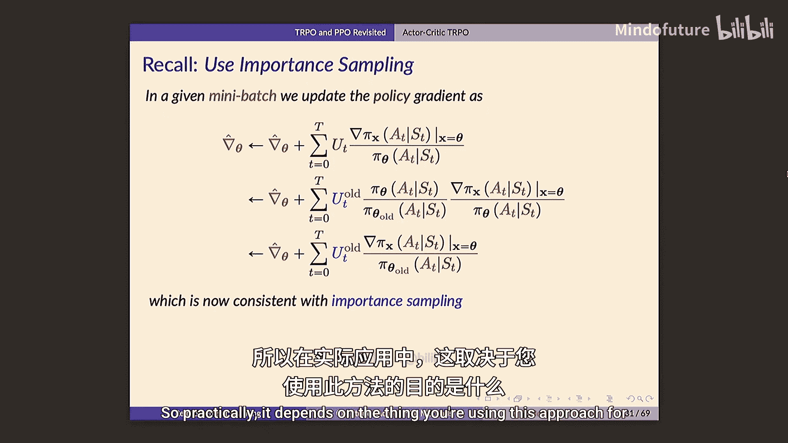

Okay， so this guy is now the TrRPO， the aritic version， including all of those you know。

 important sampling everything。 So when you have a trajectory。

 you can compute the old advantages right， because you have your tra sampled by your old advantage right And now when sorry。

 by your old policy。 and you get that one， you compute your old advantage term。

 and then you use that one to update your both value network and policy network。

 But the key point is that you should always keep in mind that you should do the important sampling as well right So you get this advantage。

 you just compute it into the green one， the new one， using important sampling argument。

 now you are going to estimate the gradients that you need and after that。

 you just do the basic TRPO okay and now once you have done this， you update your。

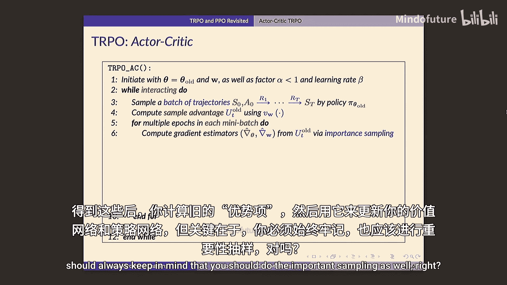

Policy network， you also update your value network and that's it， right？Okay。

 now you do you typically do this for a bunch of trajectories， right？

 So you go over one batch for a couple of epochs。 once you are over， then you update your policy。

 right， This is what I told you last time as well。 So this is the classical way of implementing。

 you get the whole you get your policy， you just collect the whole batch of samples。

 you go over it for multiple epos， right， every single mini batch。

 you just take a mini batch from what you already have inside your buffer， right。

 As long as you are doing important sampling， no problem is going to happen， right。

 But once you're over over with it， like say for 1020 epochs， then you just throw everything away。

 you update your policy for sampling and you sample again， right。Everybody's clear。Oh， one thing。

 why I have written here pii theta all to pii theta， so it should be the other way around， right？

Yeah， sorry。 don't do that， right， Of course， you can， you kind get back to the original point。

 Sorry， the line 11。 is's just， it's the ty， right。And as you can guess， I mean。

 I try to just in inspect this one because the the original version， you can。

 you could not read it full of typo。 And then like everybody was asking， what is that， Oh， one typo。

 one typo。 But I inspected it so many times。 I still， I missed this one， right。Okay。Yeah。

 now you can do also the same thing with PPO， right， So for PPO， you can again do。Now。

 where does this？Value network show up again same thing when you want to just compute your surrogate function。

 right， for your surrogate function， you need advantage， right， for that advantage。

 you need to know the value so you can use your value network to estimate those advantages， right。

 And once you do that， then you just put it here。Just do important sampling。 That's it right。

 and you do everything as before。 Nothing changes。 The only difference here is that when you want to just compute your advantage terms。

 use your policy network， you also use the same advantages to just compute the gradient of your policy network。

 sorry。Gradient of your value network。 And then you just update， right。Every revised clear。

 So that guy， this guy was the。Restricted surrogate function that we have。 We talked about this。

 that this is somehow implementing the sort of clipping on or。

Srogate or an or say estimated advantage。 So if it is getting too much above one。

 then it's gonna restrict it to one plus epsilon。 It is going too much below one。

 then is just restricted restricting the ratio to1 minus epsilon and then by doing that。

 we make sure that we are not getting out of the trans region。

 if you want to do that basically we need to compute this advantage term right。

 and then you can simply replace that advantage。 using your value network。

 and something that you should keep in mind always that you should keep important sampling argument here as well。

 right， So that G U that you see is actually the blue U times the important sampling argument right But in this case。

 if you write down the important sampling gonna be pi theta divided by pi theta all times pi x divided by pi theta。

 So those pi thetas going to cancel。

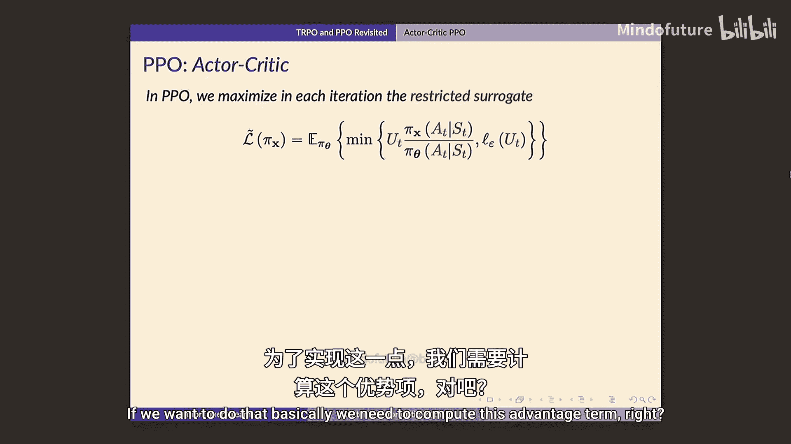

Right？Everybody is cool， right。Questions。So that second guy， the green advantage， right。

 This is the same thing， right， The only reason that I did not put it here， I didn't want to just。

 you know， make it a giant expression。 But that one。

 that green U is exactly the same thing we had before is this guy， right。

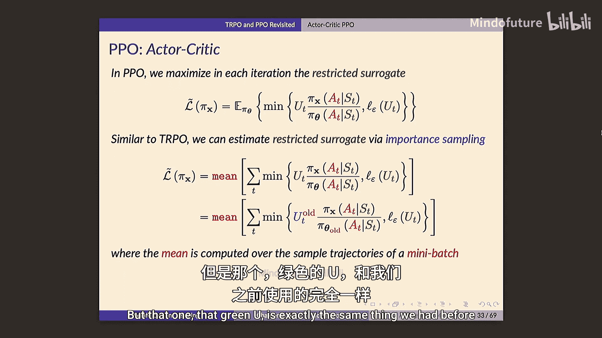

Or is it？Right， this one， right， this U， the blue U times yeah。

 the blue U times the ratio of the policies， right， That's the same thing， right， So you agree U。

 the， the current advantage is always the old one which you have inside your data times that one。

 right， the important sampling argument。

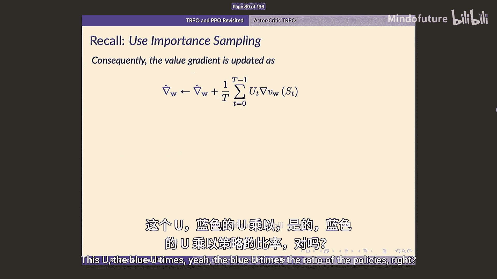

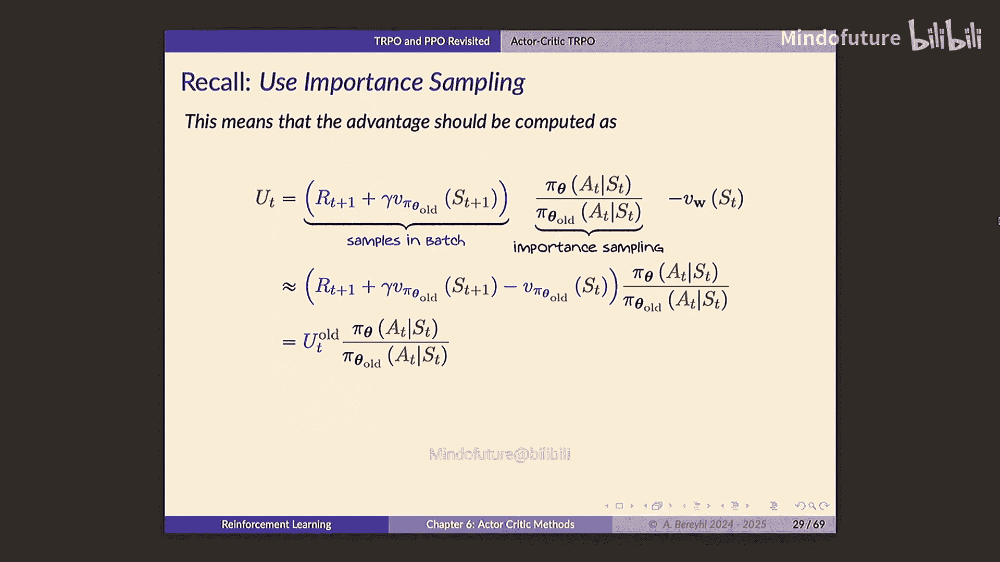

So， yeah， that's the only thing that you need to keep in mind。

 So you have your advantage times the important sampling as your estimator。 And then yeah， you just。

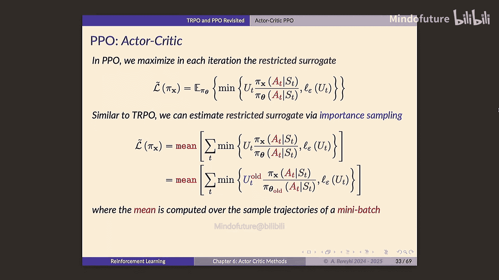

Compte your surrogate function in this form。 and then you just perform PPO as well on this guy。

 right， sample a batchsh， you get your old advantage。 And after doing that， Well。

 you compute the gradient of your value network using the imported sampling。 and also。

 you can compute the gradient of your surrogate function directly by applying gradient on this guy。

 right， And then this one， the only thing that is。Differentiable is this pi X innominator， right。

 This is a syn function。So you compute this guy。 This is the update of your。Poy network。

 you compute this guy。 This is update of the value network。 and you keep on going like this， right。

Now， I want to press the next button。 Now， do you think that I have still a typo in the next。

 the left one。Line 10 or not， let's see， yes， I still have the typho， right？😊，Yeah。

 because this guy never triggered the signal inside my brain， right， that weight inside my brain。

 So was somehow lost。Okay。Yes。Okay， questions arise， well， yes， go ahead。

Sure， here。I story。That when。Also。ThisAt this ratio。It'sNot necessarily greater than one。

 It depends on the action that you're doing， right。こに。对。0。Also greater than。Oh。

 when the advantage is greater than 0， then this guy is going to be greater than one right。

It's going to be smaller than one， I guess。That was the case。If advantage is positive。

 then this is going to be greater than one intuitively， yes。question is。Since we are。ビ。major。Correct。

Yeah， I mean， definitely for the first couple of rounds like tens of epochs。

 nothing is going to happen。First。You're not in。Oh， in that sense， yeah， sure definitely。 I mean。

 the trust region only makes sense when you have some， some level of conversions， right。

 when you have not converged， you don't care， right， Yeah， that that's， that's totally correct。

 So once you have your policy network somehow capturing something。

 then you start to see that behavior that I told you because。

It somehow needs to be that really your policy understand that this action is giving me a positive advantage。

 So it means that I should do that action， right， but to be able to understand。

 should first capture that pattern from the data， right， which take some time， right。

 But for the initial ones like， its。Never going to do anything right。

 so it's a quite long process till it starts to converge really。

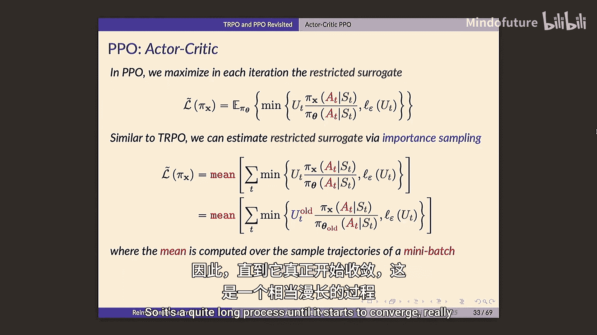

Questions。No question。

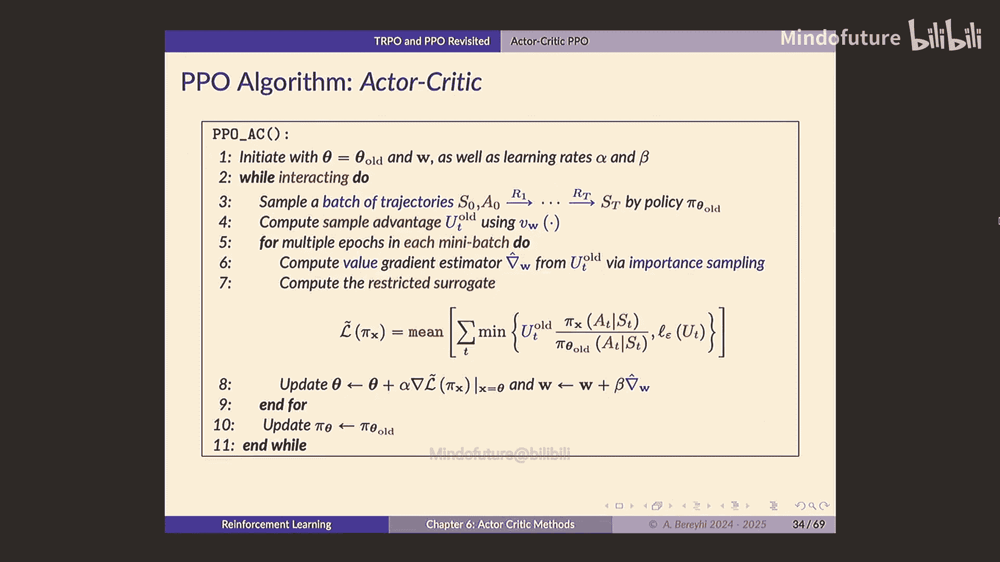

Okay， if you' got no question， then yeah， let me just give you this last part。 So this last part。

Is about distributed a critic。 So what is distributed a critic， Well， when you are doing a critic。

 you have this。Option also， to somehow have multiple actors right？ And these actors are basically。

 for example， in the most simple form。 they are actually the same policy network。

 but they are somehow sampling different parts of your environment right then they can do it in parallel right So you have the same policy network at one part of the environment。

 say your environment is a giant space right one policy one copy of your policy network is just sampling here right。

 the other one is sampling here。 the other one is sampling here and so on。

 right So you're gonna have multiple copies of your policy network。

 and every single of them is one actor just acting in one part of the environment。

 Now what they can do， they can sample a bunch of tra is there。

 and then they can compute the gradient at that point right they can share this gradient and all of those trajectories with one server right that server what。

it can actually just get those gradients to update the policy network， right？

So you could say like those gradients are sample gradients of different regions inside the environment。

 right， And now if I average all of them， now it's a better estimator， right。

 So this is what it can do。 It can also take all of those you know。

 trajectories you got all over your environment， right。

 And then it can just use them to update the value network as well， right， that is， again。

 more efficient because your samples are better distributed over the environment as compared to one actor playing in one particular region。

 right。And in that case， then you're gonna have much better samples。

 much more reliable updates of the value network and the policy network and the thing that the。

Server， the global neural network is going to do after some rounds of update is going to somehow give that policy network to every actor。

 right， It says whatever you have， just throw it away。 copypy this  one， right。

 because this is the good policy now and keep on playing with this one。

 right So this is the way that you do usually distributed actor critic。

 Now you could have different versions of it。 you could have asynchronous and synchronous synchronous is exactly the 1 I told you right。

 So you just agree that yeah， just sample update， give me something。 I'm gonna update。

 and then I'm gonna give you back my update parameters。

 you just copy Keep on going right This is one thing that you can do。So， yeah。

 this is basically the distributed version。 And then yeah。

 the server is going to use the same samples， but samples are collected from different places。

 And now you can do a synchronous that everybody is just doing using the same same model every time that they are sampling and they wait for the server or the global model to just update them。

 and then they are going on with the sampling。 you can also implement it asynchronous right and asynchronous could be more efficient in applications where。

 you know， you have different connections or you have。

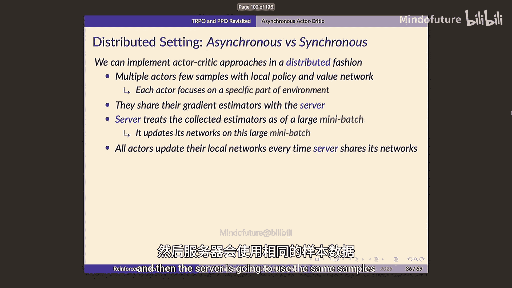

Different you give different sort of importance to different regions， right。

 So this might be more efficient， but there is no trick theyre happening。

 The only thing is that I can say everybody， just go ahead and update your policy by around And I don't care about that。

 Just give me your samples I'm gonna update at some point。

 I'm gonna give you something back right and they are going to just give me samples。

 which are not not all of them sample with the same same distribution， right。

 But as long as they are not getting totally out of the trust region。

 then I can trust on those samples as well， right So you can do as synchronous as well。

 And the key difference here is that the connections or the communication that you're gonna do with the local actors。

 this is not going to be like on searching rounds every time they're gonna update。

 So you just give them information once upon a time right or you might even decide to just do it like this guy is getting updates more frequently。

 the other guy。

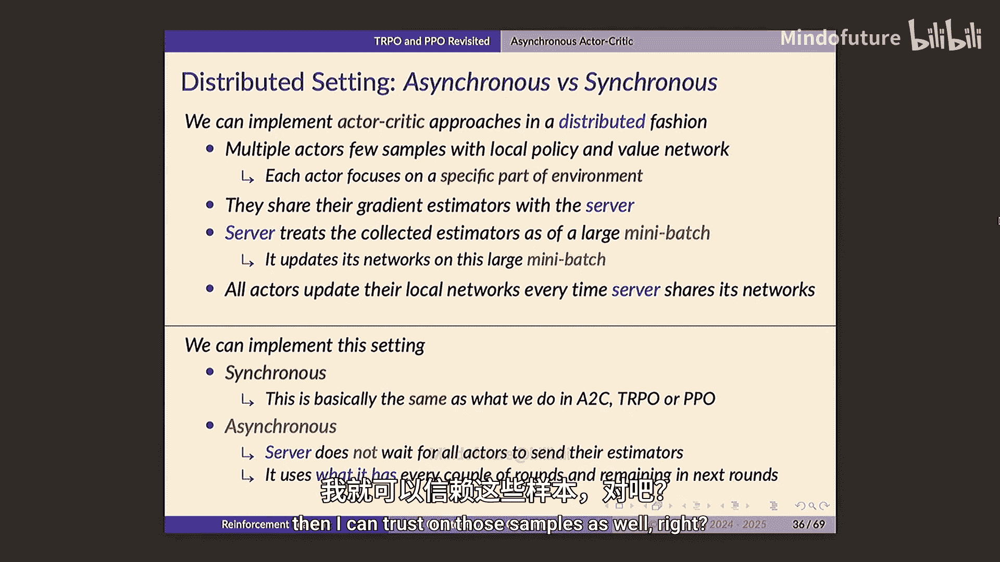

It's just getting less frequently， right You can do that as well。Not a very big deal。

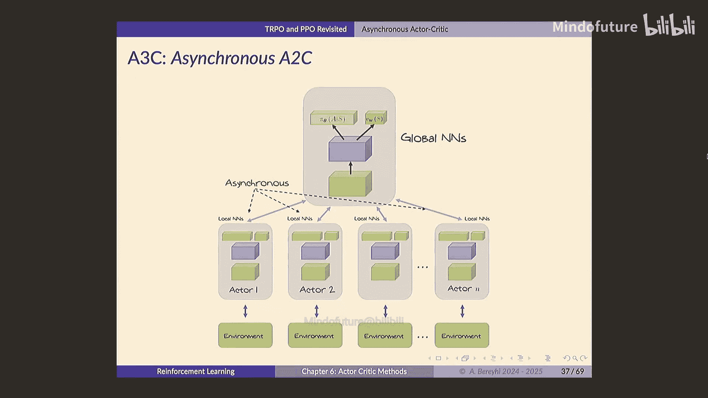

Now， yeah， A3C is a synchronous advantage。And yes， actor critic， right？

 So if you do the same thing that I showed you before， actor critic with baseline。

 but you do it as synchronous， that is a 3G。 A A 3 C。 Yeah， and you can find lots of other names。

 right， a。Multiple of them C， right， and they are all doing the same thing， right， So yeah。

Few points here， so yeah， I think it's just about the asynchronous when you are doing asynchronous。

 it could be a bit harder to con that makes sense because you're not actually giving updated policy every single time to everybody but。

Usually when we are just。Trying to reduce the computation load。

 we are more focused on the synchronous versions because they are not different from the original centralized one。

 The only difference is that you're just doing distributed distributed computation。

 which gives you more parallel processing。 But as I told you。

 in practice if you have something like sensors， which are collecting samples for you。

 then it makes sense to have asynchronous as well。 Now。

 we are pretty much over with this part of this chapter。 Okay。

 and you might wonder that if you are free to go and you're gonna get rid of me I am only going to talk about deterministic policy gradient next session。

 because I cannot make it in 15 minutes。 and I don't want to keep you too much for telling the beginning story。

 but the point here is that yeah I can make it。 I guess I can do the conclusion also next time。

 So if you're okay on。

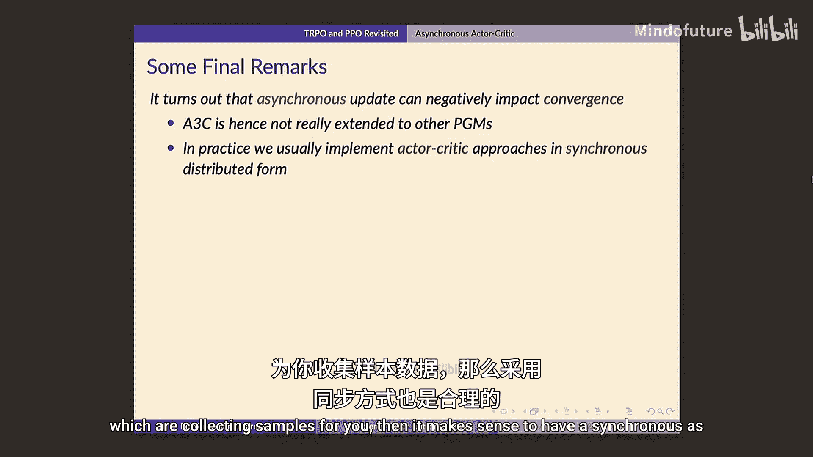

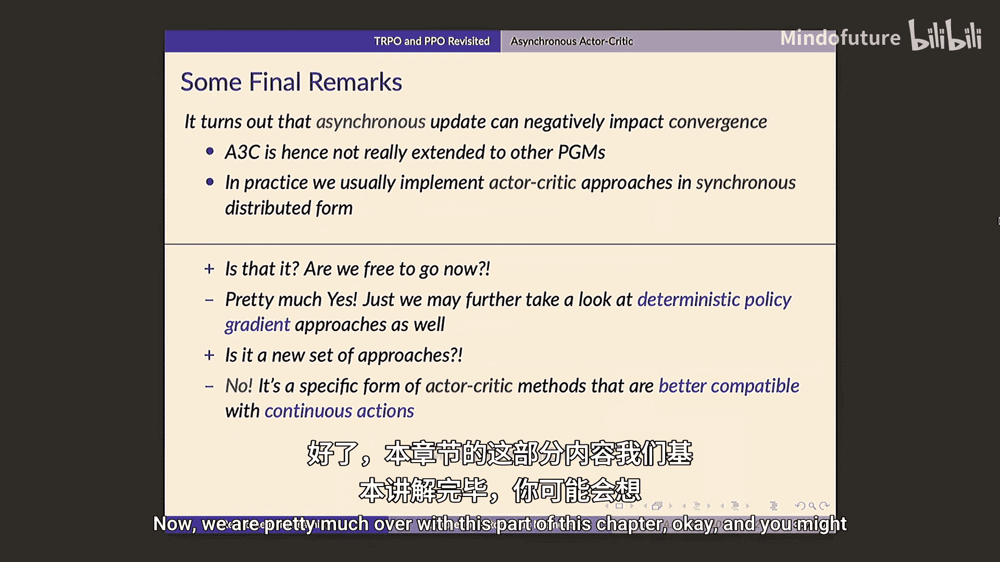

we just do it a bit more fast forward and then I finish everything on that day。

 so just to give you the idea what we are going to talk。

 what we have here in this part of the course， this just simple modification we did that PPO that your RPO is going to work on most applications that you have so that is a kind of solid algorithm perfect you can use it。

 the point here is though that sometimes in some applications。

You find it better that you don't work with a policy network as a random distribution which you sample policy from。

 but rather you would like to have a deterministic policy Like you don't care that the policy could be potentially a random。

 you want to just say that whenever I see a state， I do know exactly what action I want to do Now what kind of application this makes sense。

 for example， when you have a continuous action space and you're really looking for rewards which are coming at the preciseness of your action right。

 if I have one one object right， and I want to just take it right then this arm has a continuous space of action right and then if you do PPO。

 what does it mean， it means that in every single state that it is right。

 it's going to randomly decide where to go， right。Correct now the point is that when you start here it can just go anywhere right but gradually as you get closer and closer to the target it going to narrow down its probabilityvol right the probabilityvol that I move now like this is very high。

 the probabilityvol that I do anything else is going to be smaller and smaller right？

And then gradually I'm going to take this one， right。

 but this means that if you really deploy it in practice， you're going to see something like this。

Right。Because it's still when I am here， theres a tiny bit of chance I just move around， right？

Now what you do， you typically first train it and then when you want to use PPO or deploy it in practice。

 you would say okay， every time do not sample from the distribution。

 just look at the action which is maximum which has maximum density right and take that guy right。

 this is going to kill this one right。This is going to make it like this， right Now， what you can do。

 you could just from very beginning， you would say， okay。

 if I am going to do it at the end of the day， why don't I start training the guy to just do the termministic right。

 So that every single point， do not sample from the distribution， just do the action。

 which has the highest probability right， And then I throw away all the probabilityvolty thing。

 So this last part， which is computing the probabilityvolty， And I directly compute the action。

 right， This is what we call it deterministic policy method， which is the a policy method basically。

But the key point is that your policy is always indicator right that action right now if you do that you can basically do the same thing as before。

 but you don't really need to go the way that we have gone in the policy gradient method。

 actually you can simply use Q learning。And why if you remember what we did at the end of chapterpter 4。

 I told you if we have a continuous action space and I have one say Gen network which is able to look at my state and tell me what is the optimal action then I can still do Q learning right so I'm going to complete that idea for you next time this is not going to be very complicated because it's basically Q learning with that extra policy deterministic policy but from some application in robotics still people use it right and as I told you the benefit is that I mean it's not going to be maybe as good as PPO or those algorithms which are really using the policy network。

 but the key point here is that it's going to help you with getting away from you know。

Possible actions， which you don't want to happen， but they have tiny bit of chance， right。

 If you're doing a surgery， you don't want to have like even a tiny bit of chance that you just put the needle wrongqui。

 right， don't want that。 So this is how you can think of it。 So we're gonna discuss it。

 The first part on Friday。 And the last part is going to simply be wrap up of everything we had。

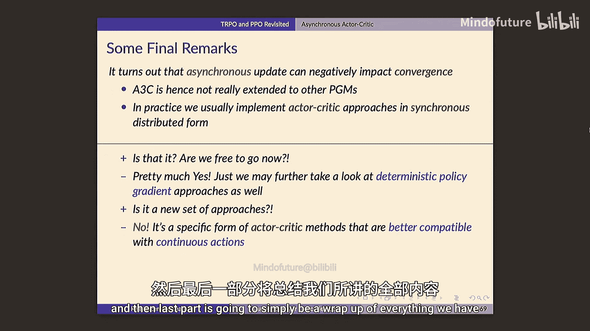

Questions。