# 【多伦多大学】强化学习 2025 ｜ Uoft   Reinforcement Learning   Fall 2025 p55 P55_讲座_53_强化学习中的演员-评论家方法 -BV1D3F2zhEry_p55-

That last chapter somehow tried to handle that one。

 which was a very realistic problem that you have in practice。

 Now the thing here is that in this part， what we want to do。

 First we want to just talk about Pgm but this time we are going to use an estimate of the value a kind of useful estimate of the value to update so first we do that but then the second part of the chapter we talk about the discrete policy gradientding approaches which are a bit different so you can think of them like you get back to chapter 4 Yes。

 exactly the last part which I gave you as an introduction So I told you like if you have a network which can find the optimal action。

 you can just feed that optimal action to your Q network and you compute the value of that right So that was that one was not too dummy actually we can implement that and that is the idea of continuous。

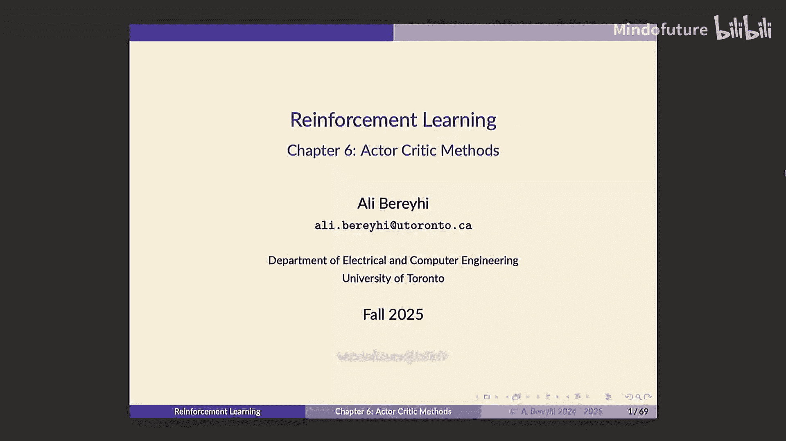

Sorry， deterministic policy gradient methods。 The most famous algorithm is DP G。

 which you might have heard in robotics。 Many people use that。

 So that is the second part that we are going to talk about。

 So let's first start with the first part， which is basically what we know， so。

I guess we had this kind of division at the very first。

 So I told you that we have two different approaches in general for reinforcement learning。

 Some of them are based on the value。 Some of them are based on the policy， so。Here。

 when you do valuebased approaches， you're basically going with approaches where you directly work with the value or action value。

 So SArsa and Q learning are the most famous ones。 And when you implement them using function approximation。

 and then you are basically doing deep valuebased reinforcement learning。 you can do。

 So these are approaches which use deep value networks， you can use also the policy network， right。

 directly work with the policy， And in this case， we have a bunch of different approaches。

 the most essential ones， the most say practical ones are QrRPO and PPO。

 and these are approaches which directly update， deep policy network right And then when we talk about the actual critic。

 we talk about a mixture of them。 So you have a value network which is taking care of value estimation for you and you have a policy network which takes care of updating。

Now。From a。From a kind of theoretical point of view。

 there are not too much things that you need to add。 I mean， basically what you learn。

 you can simply extend it here。 there are， however some practical tweaks。

 which we are going to talk about them So first of all。

 why people call it actor critic because actually people like they wanted to just make it more interesting and then they would say that the policy network is essentially the actor right so you get this day。

 you look at this state that you are and you are going to sample from this policy network right when you sample from this policy network。

 you basically get an action。 So you are the actor。

 the policy network is the actor right So it is going to act based on the particular state that it says and then if it acts。

 then it wants to update its own policy when it wants to update。

 it needs to know what is the value of the action that it has done right So it going take take a look at that action value。

Appear and then compute or estimate the value。 And based on that one is going to just update his own policy right。

 because you do know that the gradient is going to depend on the advantage term。

 which is computed in terms of those values right And now the point is that if you have a value network is like a kind of expert or critic who is sitting there and is looking at what you are doing and giving you some value right。

 you did a bad job， you did a good job right and based on that you are going to play with the weights in the policy network right So it's somehow providing you a sort of critic and yeah。

 people thought something like this。 like you are the actor who is playing the game and this guy is the expert who knows how to play。

 and every single action that you do the critic is going to give you some feedback right you did the wrong action。

 don't do that next time。 And you are going to reduce the probability of that action and increase the probability of other actions and of course。

 you do it through gradient。

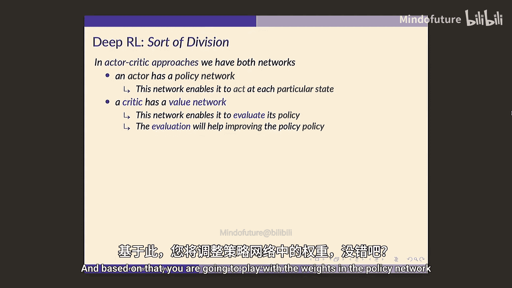

Right within your networks， but intuitively， you're somehow doing that。

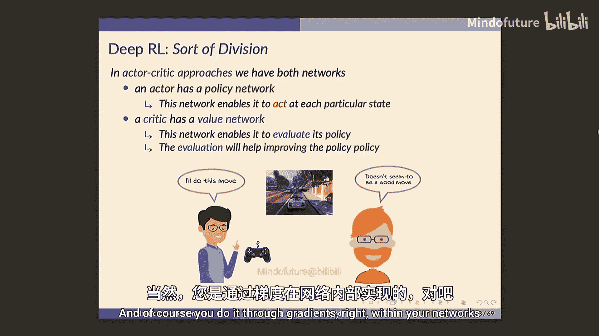

Now， one thing that might worth mentioning is that is that for many people。

 policy gradient method and a critic are the same。 So if you see someone who has not been in this lecture might tell you。

 well， PGM is actual critic， right， But this is not true。 I mean， practically that's correct。

 because they give such， if they have been a bit。They have put a bit of thought behind it。

 not simply taking it from Internet。 So they might claim something like this that if you want to implement a PGM at the end of the day。

 you need to know the advantage。 You need to know the values。

 And this means that you need a value network to estimate that。 And this is practically correct。

 But as I told you before， you can do all the estimation also by Monte Carlo， right。

 and this is not going to be promising。 This is not going to function in in realistic problems。

 But well， you can do it so theoretically PGM is not actual critic。 if you want to be very precise。

 but and we have reinforce algorithm， which is a pure PGM right。

 it does not use any any value network， right， So this is a kind of one of those twist or one of those。

Kind of conceptual questions that you can find out whether someone has understood reinforcement learning or anything based on simply just getting information from Internet or they have just educated themselves in the topic。

 So yeah。

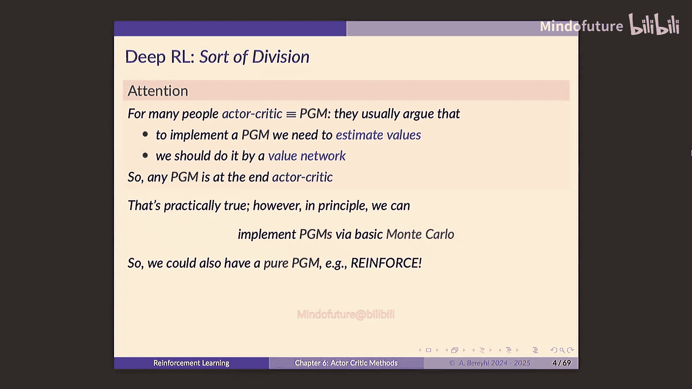

Now， let's just start by implementing PG so up to this point。

 whenever we wanted to just compute something inside PGM。

I always told you when we get into this value network I told you that we have this value network。

 right， I write you value network V right V of that particular policy and we compute that using that one。

 we can sample the advantage right So we talked about this and I always show you this V pi theta。

 I never told you how exactly you can compute this one。

 Now you can guess that I want to put a neural network here， that's correct。

 but let's start doing it step by step， say I am just doing one PGM。 if I am doing PgM。

 it doesn't matter what kind of PGM I am implementing at the end of the day。

 I always need to have this utility this advantage term right if I do baseline if I do TRP if I do PO。

 I always use the same guy right Maybe I play with it using important sampling。

 but at the end of the day， I'm using the same sample right if I want to compute that guy。

This is the immediate reward that I get every single time plus next value at the next state minus the value at my current state right and yeah the value function v pi is actually the policy the value of the policy that I am playing with so one thing which I guess I have indicated enough number of times and I'm pretty sure you just see it immediately is that we cannot think about having one value network which has been trained completely independently and then we use it only for estimation right because our policy when we are doing policy gradient is changing every itration right you change the parameters this means that the policy is changing when the policy changes the value function is changing as well right so you cannot train something offline and they use it right definitely you need to train it online along with your policy right because this is the guy who is predicting the value of your。

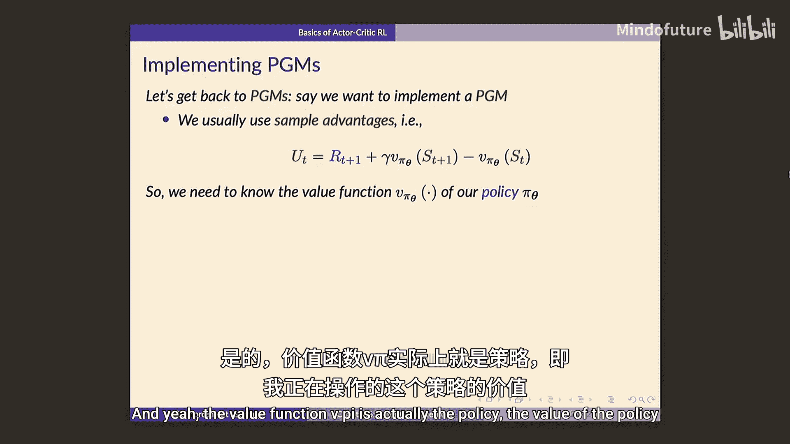

Policy， right， and the policy is changing that guy is changing as well。

 So don't do this mistake that， yeah， we train， we evaluate that guy。

 train something for evaluation and we keep it forever。 This is not possible。 This is not correct。

 so。

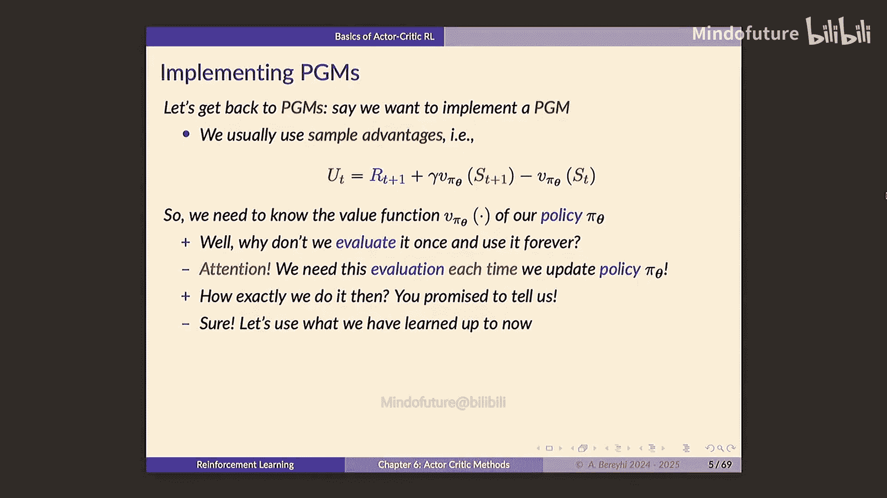

That was the algorithm we had right， for example， this is the advantage policy gradient method。

 This is the basic baseline approach。 We are not doing any TPO or PPO yet here。

 So there is no trust region required。 And then what we compute or the bottleneck right now is a line number7 right And then line number 7。

 I cannot compute that sample。 I cannot simply take that sample right。

So if I want to just compute that guy efficiently， how can I do that， Well。

 I can start thinking again from scratch， thinking of having mini batch of trajectories。

 And based on that mini batch， I try to estimate my value。 I do know this is not going to work。

 but it's gonna give you a bunch of labels， which we use later to just train your value network。

 right。Now， do you have any idea how I can estimate this guy if I just collect a trajectory。So， yes。

 one trajectory。 If I have one trajectory， and I want to use Monte Carlo Monte Carlo to estimate。

How can I do that？I go over my trajectory。 I see how many times the same state has happened。

 And then I just。Compute the sample return， I average them。

 this is going to be Montete call estimate， right。

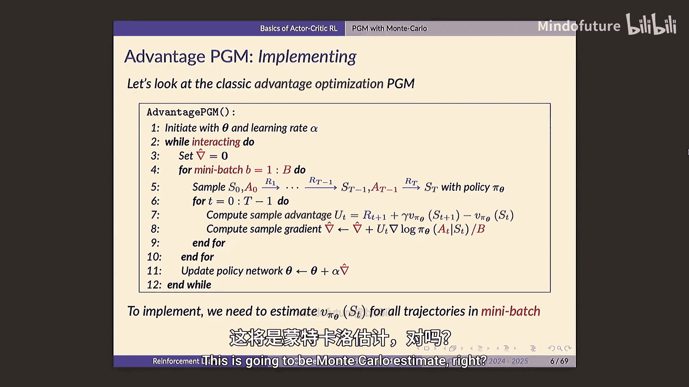

And if I have a mini batchsh， I can just average also over the mini batch。

 So this is the trajectory that I have， right。This is one sample trajectory。

 And the thing that I'm gonna do。 if I want to know what is the estimate of the value for S T， right？

 So I one estimator that I have is the sample return， right， I would say S1 is happening。

 So R due towards the end。 these are the things that I have collected。 I'm gonna to add them up。

 this is a sample return， right， this is the sample return for state S T right。

 And now if I want to know what is the estimator of the value of one particular state。

 So I just need to know how many times this state has happened inside the trajectory。

 This is exactly the same thing we did in chapter 3 and yeah， that's the same thing， right。

 I'm gonna to say the estim of the value for one particular state S is actually the number of times that S。

 my state has been S， right。Go to add them up。 This is the number of cases happening。

 I am also going to I'm going to divide it by the number of samples I have in my trajectory。

 and I'm going to average the values for every single of them， right。

 So if the same estate happened first and somewhere in the middle。

 So I'm going to say two times happened， right， So I just。

Some the value of the sample returns up and then divided by two right so that was exactly the same thing we did in chapter 3。

 first thing that when we wanted to start with Monte Carlo right now。

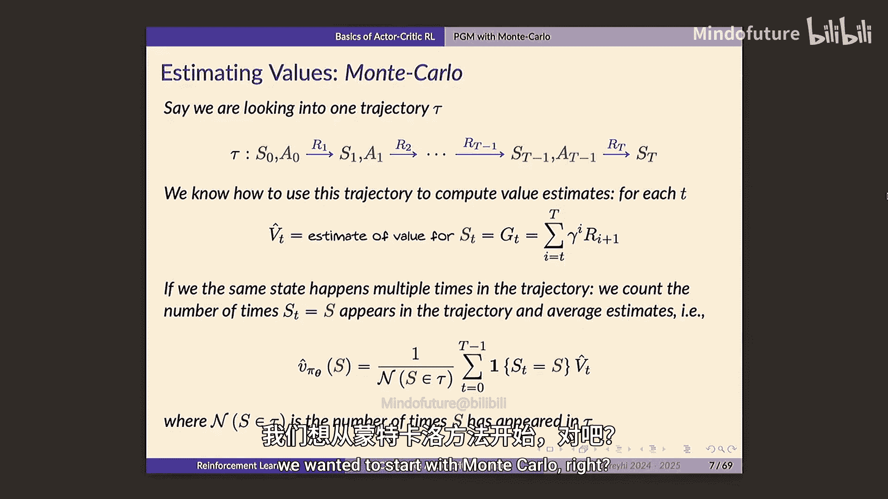

We can have a mini batch， right？ and you can repeat the same idea or extend the same idea on a mini batch。

 right So you go on every single trajectory。 you average on that trajectory。

 And after doing that then this is one average that you have。

 then you can average it again over your whole batch right So you can write it down in this form。

 So you could say for one trajectory again， every single sample return that I have is the estimate is one estimator of my value。

 So how can I find an estimator of the value value function at one particular state。 Well。

 I'm gonna see how many times this is state has happened in one trajectory I add them up also I just add this up over all the trajectory is inside my batch and then I divide it by the number of times that I have seen in total right just basic averaging。

 Nothing special right。Everybody's clear。So this guy that you have。

 you can just replace it as a value estimator， right， So you might say that， okay。

 I don't have the value function itself， but I'm gonna replace it by an estimator， right。

 And the estimator that I have is this dummy estimator that I showed you， right。

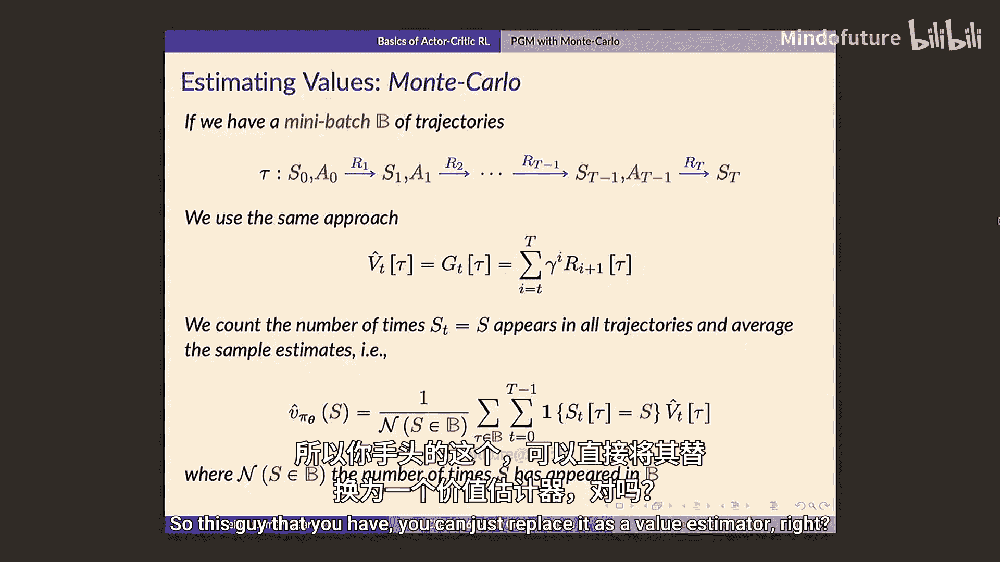

Everybody's cool， right， So you can do this。 You can implement this algorithm。

 and this is going to not work， right， obviously， so you do not expect this guy to work。

 obviously because simply you have too much， probably as states in your environment。

 and then you're not going to see them so many times， probably many states。

 you're gonna see once in one single trajectory in ever， ever again and then doing this obviously。

 tablar is not going to be efficient， right。But theoretically， if you have a giant mini batch。

 if you have a very long trajectory every single time。

 then you're seeing enough number of samples that you can estimate。 and this guy should work， right。

Everybody's cool， right？Now， one thing that I also mentioned again in Cha 5 is that here。

 as you can see， you actually do not need really to work with any action value function， right。

 So you don't need to estimate the action value。 You don't really care what action your policy network has done because your advantage is only depending on the value of this phase。

 right。So this is a kind of。Improvveement is compared to estimating directly the action value function because the space of things that you're estimating is smaller。

 but yeah， again， this is not going to work really in practice。

 So doing that is not going to give you a very impressive performance。

 But the thing is that those samples that I told you how to collect。

 you can take them as a sort of sample values for a value network。

 which can be trained alongside with your policy network right So you take them as the samples for your value network。

 you would say if that estate goes inside my value network。

 then I need to see this particle or sample or something close to that at the output right and then you train this guy by you know stochastic gradient decentcent you're gonna get something and then you use that value network right that value network is going to give you a kind of smoother approximation of the value you need okay。

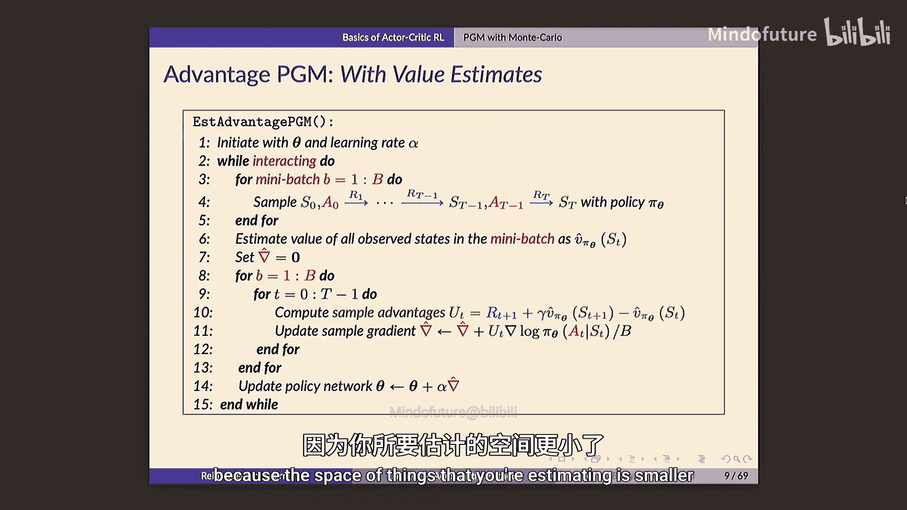

这样。This is not going to work。 The reason。 Well， you very well know the reason the reason is that。

 well， this is a giant space。 you cannot really do it by a tap law approach。 And the solution。

 yeah is simply to just use a value network， right？

 just a function approximation using a value network and let's do it together， right？

 So now one question， if I want to put a value network here。 What kind of network do I need。

 do I need a V network or do I need a Q network。

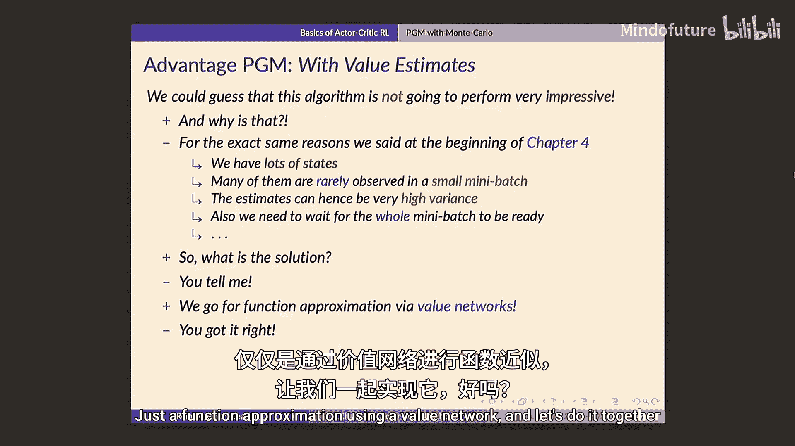

A V network， right， So you can just use use a V network。 You don't really need a Q network， right。

 because you just need to play with the values， right， You look at this state。

 It's gonna give you the value。 You don't really need to know the action value function here。

 So you can use a value network simply and every single time you're going to give the representation of the of the stage。

 right， your network， I am here， the representation is， for example， my coordinate。

 I'm gonna give it to my value network and it' gonna give you some value， right。

 And what you want to do， you want to keep on updating this guy alongside with your policy network because every time this guy should somehow match itself to the policy that you're playing with。

 right， If you don't do that， then yeah， this guy could be something totally detached from the policy that you're playing with。

So you can have your value network， This value network is just replacing exactly what you do with Monte Carlo and then of course the data set that you need are the samples that I told you you are going to collect right for every single time or every single trajectory every single state that you see this is having one label and that label is simply the sample return that you get right that sample return。

Is this state， sorry， that temperature is the estimator of the value of the corresponding state。

 right。And。Simply， you get these， these data says you try to train your model。

 Then this is going to somehow give you an estimator of the value。 And it's also a game。

 same story as before。 It's also able to give you an estimate for those。

Stays which you have not seen before， Like youre just playing and you get into that estate out of the sun。

 right。

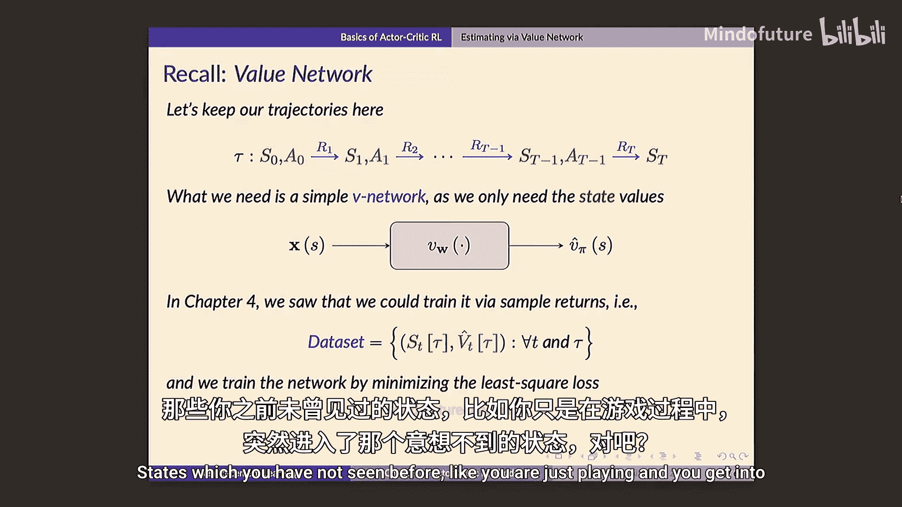

Okay， so how we can train that guy as before。 So you're gonna look give your estate every single time on every single trajectory。

 you give this estate as an input to to your value network， right？

 And this is going to give you an estimate as an an output。

 and then you want this output to be close to the estimate， right， So subtract it squared。

 and then you add it up over all trajectories that you have inside your mini batch all the time over the trajectory。

 and this is going to be your loss function， you try to minimize this guy， right。

 And every time you just minimize this guy， you update the value in the parameters of the value network。

 right。So everybody's cool， yes。This we had is the sample return。 just the sample return， right。

 So you don't really need to do any Monte Carlo anymore。

 because if you have one state here and you get one sample return， right， this is one label。

 And then later you see the same state with another label right and your network somehow starts to learn that needs to interplay somewhere between them right So you don't really need to do the average。

Questions。Everybody's cool？

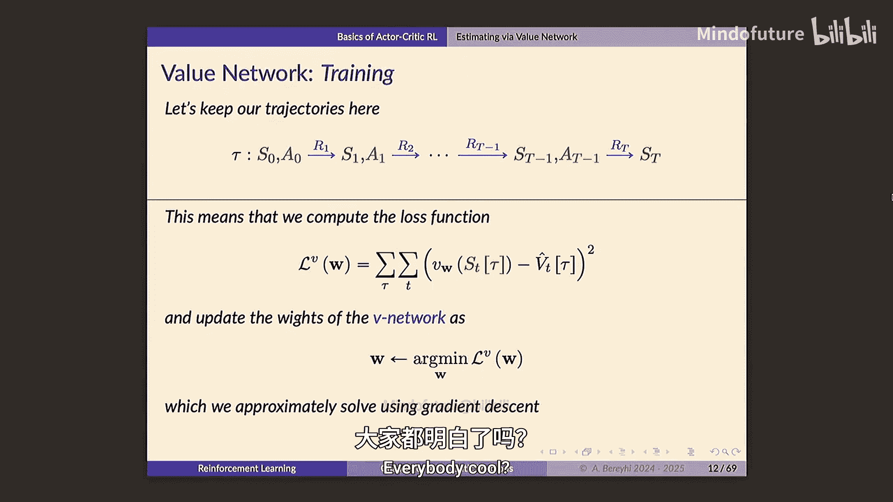

Okay， so yeah， that would be that would be the main idea， right。

 So this is the one very basic aritic approach that you can do。

 This is basically the baseline policy gradient method when you are doing an estimation of the value as well。

 right， So you start with one mini batch， you're gonna sample a bunch of trajectoryories。

 whatever trajectory， what you do， you go inside and then you estimate your your advantage， right。

 and how do you estimate， well， this is the immediate reward you see your trajectory plus discount factor times。

 the value of the next estate， right， what is the value of next estate。

 give it to your value network， right， So it goes inside the value network。

 It're gonna give you one estimate right， and then minus the value of the oh， this would be S。 sorry。

 Here is the typo。 This is S。The second one， right？ obviously， So then you would say， okay。

 the value of the current state that I have。 I also get it。 and the difference between these two。

 this is going to be your advantage。 If you have advantage。

 you can compute the sample gradient of your policy network， right This was PGM。 So sorry。

 policy gradient theoryium， you get this advantage。

 you multiply to this gradient to the gradient of the log likelihood， right。

 And now the next thing that we need to only care about is that how we gonna update this W， right。

 and for updating the W， were gonna do something simple。

 Were every time we get into one of those samples， one of those trajectories。

 you just compute the value of or sample return for every single time， right。

 So every time you come here for this one1 trajectory， you're gonna say， okay。

 S 0 has a sample return， which is R1 plus R2 towards R T， right。Then S 1 has a sample return。

 which is R 2 plus R 3 and so on。 right， So every single of them has one sample return， right。

 And you simply take it as your value estimate， correct， And then you get this value estimate。

 So for every single time， you have a value estimate。 And then once you are over with the trajectory。

 you just take it as a kind of。estimator or label for your value network。

 And then you update your value network using， for example， a stochastic gradient decentcent， right。

 You got the idea。 No worries， I'm going to show you how exactly you should align the updates， but。

Actually， we can merge the updates together。 We're gonna talk about that。 But you got the key idea。

 right， how the updates is happening。 So every time you go over the trajectory。

 you get sample returns， These are the estim or labels for your valueion network。

 You also have the gradients of the log likelihood。

 These are the sample gradients that you need to update your policy method， right， policy network。

 sorry， And then the thing that you do once you are over with the trajectory。

 you update your policy network。And then you also update your value network。

 doing one or maybe multiple steps of creating this。Okay。

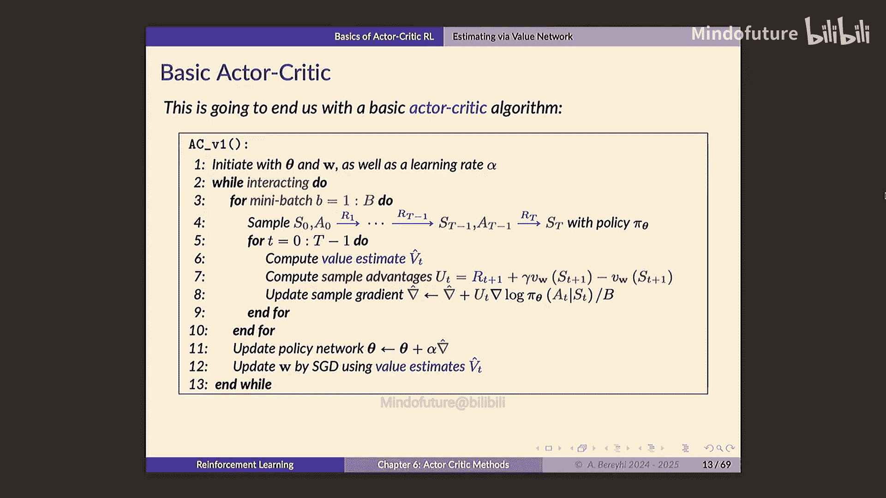

Cool， sell。One thing here is that I think I mentioned this in chapter5。

 but there is one key observation here， which helps us to somehow mirror these two updates together and that key thing is that the advantage that you are computing is indeed an estimate a TD estimator of the error that you have right So I think I mentioned it quickly before in chapter 5。

 but we're going to see it here and we see how we can apply this observation to our update loop inside the aritic methods。

 So the key point here is that since I have a value network now I can use temporal difference right this means that every single time as the estimator of my value I'm not going to take the sample return completely the sample return。

 it means that I start from S0 and I say r1 plus r2 towards the end right this is the sample return for S0 right。

And I told you take this guy as the label， right， but you could also use temporal difference。

 You would say， what is the value of as0 or an estimator of this guy is the sample reward that I get plus。

Value of the next stage， right？ That was the difference， right， because of building an equation。

 right， So what I could say， I could say the value at time T。

 I could estimate it to be the immediate reward that I get plus discount factor times the value at the next estate。

 And since I have a value network， what I can do， I just get my next estate。

 give it to my value network， It' gonna give me what I need， right， very cool， right。

 So I can do that。 Now， if I do that， then。What I want。

 I want to use this guy lecture to just do update my my value network， right， This guy， this value。

 V hat is only used to update my value network， correct？ But now you have this advantage。

 and the advantage is simply the same guy。 So it's V hat as you see above right。

 minus the value of your current stage， right？ This is the advantage， right？

 And this was coming because we wanted to onvalue or action action value， right。

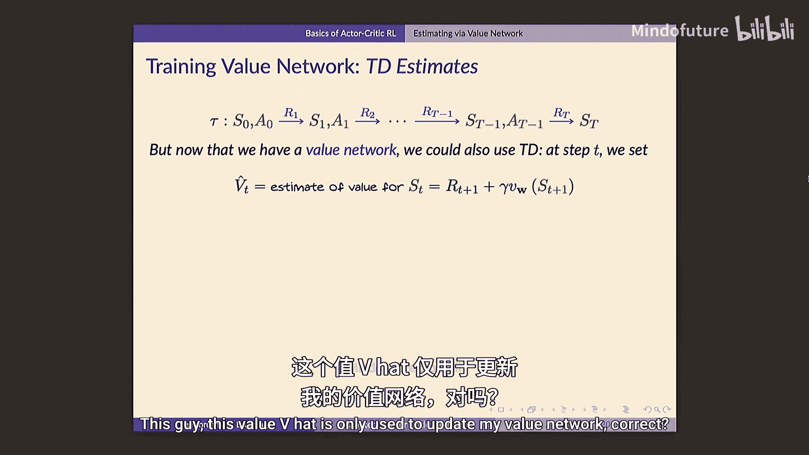

Now， the key point here is that。If you take this guy， right。

 this value V hat that you have and you put it inside the loss function that you are using to update your value network。

 then the things that you see inside this are essentially some of those advantages， right。

So if I take this guy， I mean， it doesn't matter V minus this one or the， the sample minus v， right。

 It's the same thing is the squared， right。 Now， if you look at this guy。

 V hat minus the value at the particular time T is V hat this guy， right， minus the value at time T。

 which is this guy， right， So you see you have your sample。Return by TD， this guy。

 minus the value of your current state。 This is the same argument that you have here， right。

 And this one is nothing but the advantage， right？ So the advantage itself is actually giving you an estimate of that。

That error term you want to minimize， right。You see it， right？

 So now we can use this fact to somehow merge the both updates into one。

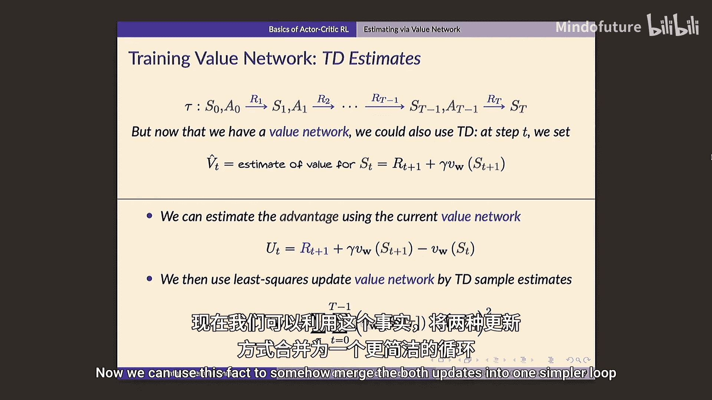

Simpler loop。 And then this is what we're gonna do。 So if I want to compute the gradient of this guy。

 right， If I want to take the gradient， how do I compute it， Well， we have done it before， right。

 we have this summation， which we don't care。 The thing that we care about about is this argument。

 right， So you have something squared is gonna be two times this guy times the gradient of whatever is inside。

 right， and the gradient of the thing inside is the gradient of this one。

 which you can compute by back propagation， right， This is your value network。

 The thing left is two times this guy， right。

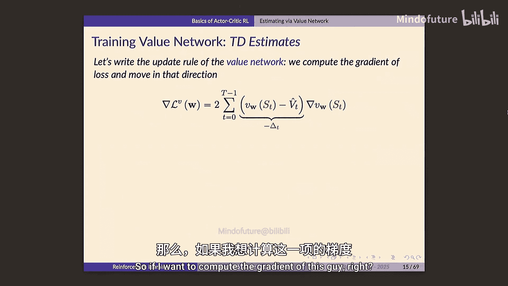

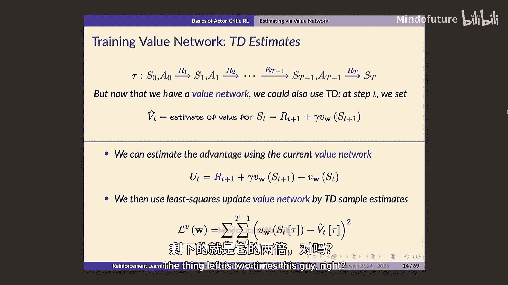

So if I open up the gradient， the gradient of this loss function that I want to minimize for my value network training is going to be two times this expression。

 right， the value of the current state minus the estimator times。The gradient of my value in network。

 right？Correct， so we did this before。 We call this minus delta， right。

 Delta was the difference between the estimate and on our actual value， right。

 And we say we're gonna update with this one。 So every time that we want to update。

 we're gonna get a learning grade here it's beta times this guy， right。

 And this guy has been maybe summed up over multiple times steps， multiple trajectories， again。

 we don't care， right， the thing is that we have a beta average of those deltas times。

 the gradient end of the value network， right， Now， the key point here is that what is delta。

If you look at this one， what is Delta？Delta is the same thing as UT， right， Delta is essentially。

Esimator minus the value at the current state that you have。 Delta is nothing by but TD， right。

 So the estimator is exact this guy using TD。 and then Delta is basically your estimator minus the value network at the current state。

 which is basically。Advantage， right， So the advantage is actually estimating this error term Dlta that we have when we want to update。

 So when you are actually computing advantage， youre。Doing this， I mean。

 you are getting what you need for updating both policy and value and efforts， right。

 this is a kind of。Interesting observation， which we can somehow merge implement inside our training club to just merge both updates together。

 right， So this is what I told you before。 So very key observation advantage is an estimator of the TD error。

 And you can simply use it In practice。 This is what we do always in practice。 so。😊。

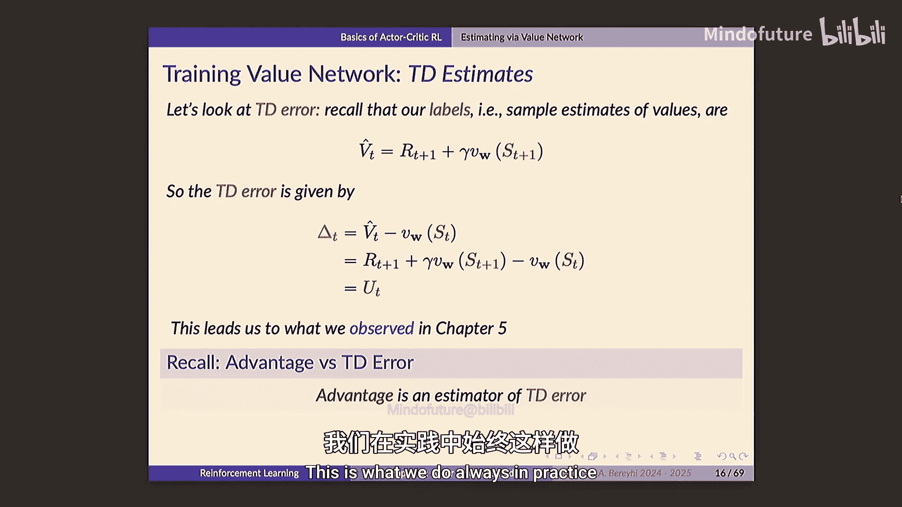

How can I use it now？ Well， I could say that well， I get into the loop。

 and then I'm gonna sample this trajectory， for example， And now that I sample this trajectory。

 I already have my value network， right？ So for every single time step， I'm gonna。

Compute the sample advantage， giving the next return reward immediate reward that I get plus next value minus the current value。

 right， I have the value network。 I can compute then， right， Now。

 this U T is going to be the advantage and。The error term for the value update。 So what I'm going do。

 I am going to just estimate the gradient of every single network， right。

 The top one is the gradient of the policy network。

 So I simply use the policy gradient theorem to compute it right I would say advantage of every single time multiply with the gradient of the log likelihood at that time is going to give me one time step of my policy gradient。

 right and I just aggregated over the whole trajectory。 This is one estimator， right。

 and one thing that I can do， just go over my trajectory。

 at first time then add up to the second one and so on right So this is what I get on the trajectory。

 This is the estimator of the policy gradient， and I do the same thing at every single time。

 I am just computing one advantage， which is basically the same error that I need for my policy update my value update right。

 and I'm gonna。This back propagate over my value network to compute the gradient of the value network at that particular stage。

 and then I just aggregated over all the tra right。Now you have two things， two gradients。

 So you take those two gradients。 You use two different learning grades， maybe。

 and you update both update both the together， right。Everybody's cool。I get them in the back。

I guess right now I'm thinking of advantages like how much better this action is than the others。

Seeing it like the same thing as how often estimate is is kind of。That sort of seems backward Well。

 you could say that， I mean， you could somehow justify that if you have sort the optimal policy。

 then essentially it's going to look like either the termministic policy or it is not deter termminity is just doing this actions which give the same value。

 right。It so。If， if you have optimal policy， right。

 it's either deterministic or you're doing an action which has the maximum value。

 Maybe you have multiple of them， right， Now this means that it doesn't matter what you do in your policy。

 You always get the maximum value， right， So this means that you're gonna have zero advantage right Yeah is's the reason。

 right in that case also have。Estimate of the value is also perfect。

 so it's going to have zero error。Your estimated value is going to to have zero error， right。

 the same way thats There's also error0 error in the value， right， definitely that could be the case。

 Yeah， that it should be the case， right。Because your value network。

Right because your policy is optimal。 Yes， and if your value network is also perfect。

 it should just give you the right value， which is the maximum value always when you play， right。

 Yeah， that's， that's it That's correct。 That's correct interpretation。MakeOkay，Questions。Okay。

 so this is the most basic version of the actor critic approach。

 And this is what people call it advantage actor C or A 2 C， right。

 One of A's come from advantage the other one actor， right。HUC algorithm， right， So the most basic。

Approach that you can use both networks to just update， right， And now。

Here what I have shown you is actually a single trajectory form。

 this means that you' are going to update your value and policy network after every single trajectory。

 well you can have online version， you can have mini batch version， what you have in practice。

 usually you have a mini batch version。

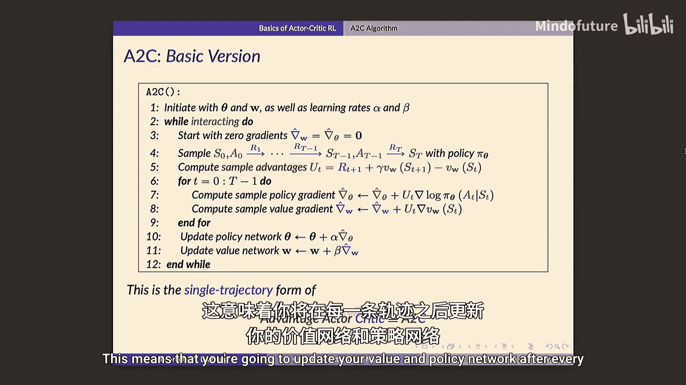

An online version， you usually don't have it because not very stable。

 But still you can think about this， right What you can say。

 you can say that I update my policy and value network after every single time step in my trajectory。

 right So this is like the control problem you had right every single time。

 you just compute the advantage using that one you're gonna estimate one piece of your gradient for value and one piece of your gradient for your policy。

 So you don't complete you don't finish the trajectory。

 you just update right and then you're gonna go for the next point inside trajectory using the new policy。

 right So the next action that you do is done by the updated policy right。

 and then you update your value network to somehow estimate that guy。

 But you can guess that this guy is not going to be very stable because the frequency of the update you are doing is so fast。

That your value network is not really able to capture the policy at all。 right。

 It does not have enough samples to just update it， right， to get it。

 just starts to jiggle around only。

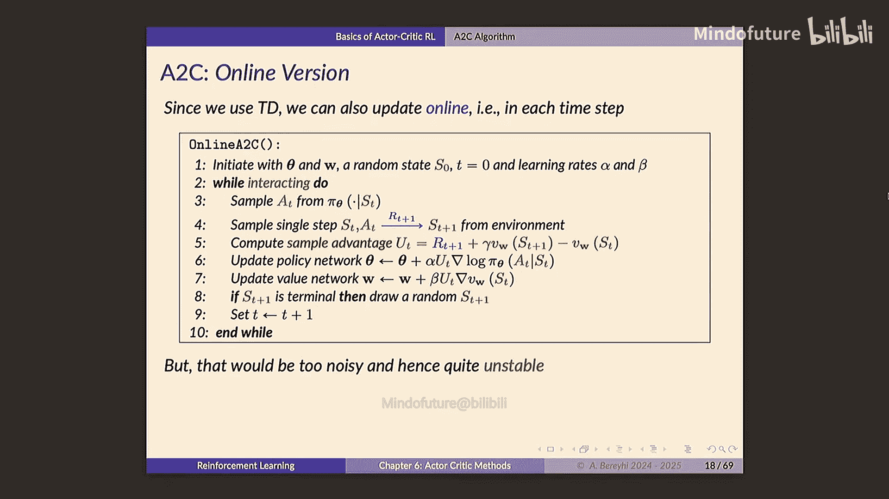

Okay， so。And this guy is the mini batch version， which is more practical。 Like in practice。

 you usually do that， right， So you're gonna sample a mini batch。 Once you sample。

 you're gonna get advantage for every single guy inside that trajectory。

 you update and you keep these guys。 And then once you're over with the mini batch。

 you average over the mini batch， then you update your policy and value network。

 that makes more sense， right， So this is the client。

 like the one which is going to function at the end of the day。Yes。Sorry you do。Yes。

 we're gonna do it。 We're gonna I'm gonna explain that， but you need to。

 you need to pay attention on the updates of the value effort。 This is the only difference。

Yeah but but you definitely do that right Usually how you implement it。

 you're gonna just get your policy you sample with it like a bunch of trajectories。

 So you have your mini batch or not mini batch to complete batch actually and then you start updating right and every time you want to update you just randomly take a bunch of trajectories as a mini batch and you update but when you update。

 you get your new policy right， that you reuse whatever you have inside that batch using important sampling。

By doing that， you somehow home make sure that you are not actually getting any significant bias。

 but then after updating for a couple of epochs， then you stop。

 you just throw away all the batch and you just get a new fresh match。

So the important sampling that mentioned。That will be the probability of an action。な後あること。Exactly。

 exactly， so you do know that I have sample with this particular policy。

 So you do know that policy at that of the sampling or the density of the sampling policy。

 And then you also get your your updates or your target is your current and policy network。

 which is getting updated。 So you always consider that as well inside your samples， right。Of。

Questions。Now question， okay so。

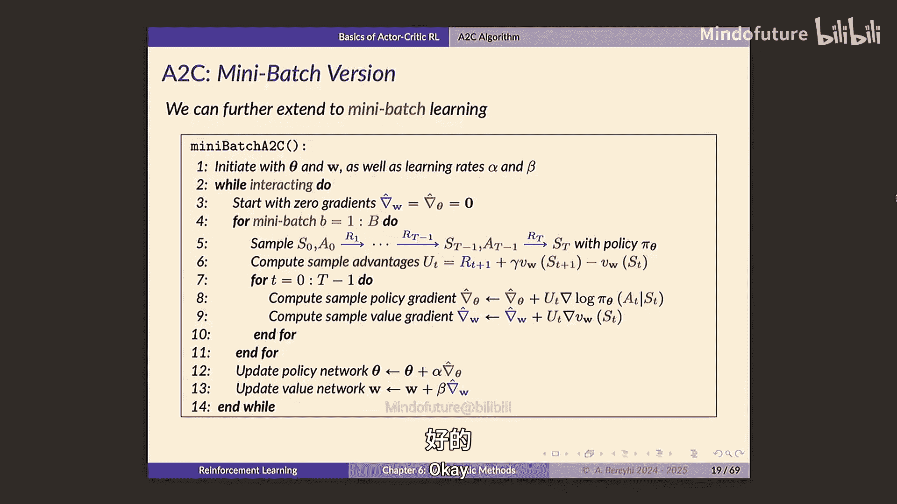

Yeah， one idea that people have also implemented。 and for many applications， not many。

 but some applications， it really makes sense is the idea of just using shared network。

 So what is the shared network idea together， The point is that when you are。

If you are really playing optimal， that playing optimal or that policy is actually the policy which makes the value optimal right and this means that what you learn for value is somehow related to what you learn for your policy right then the question was that why don't we put one giant network which has multiple heads at the output and one of the heads is giving us the policy。

 the other one is giving us the value right so you have just one network you don't really need to have separate networks right and you can do that then this is a shared network So you have your representation。

 you can have a representation of the state in action together going inside your giant network and gives you the estimate of the value and the policy itself but typically what we do were going to just give the representation of the state and then at the output we are going to have one pervol distribution to sample。

And also one value function， one value calculation。 So if you want to think about that。

I'm gonna show you the visualization。 This network is simply just one giant， deep neural network。

 right， and it' gonna have multiple heads as the output， one of the heads。Baically two heads， right。

 One of the heads is just policy。 The other one is just giving you the value。

 And if you want to visualize it， it's something like this， right， So， for example。

 if it's just playing some computer game。 You're gonna take the input。

 Maybe it's the image or multiple images of that one frame of the of your computer game。

 This is the state that you're in right， And this is going inside the neural network。

 this is going to process process it up to some point， right， And at the very end。

 when you have your fully connected layers to compute the output。 you're gonna just have two heads。

 right， One of them is just computing all of those features into。

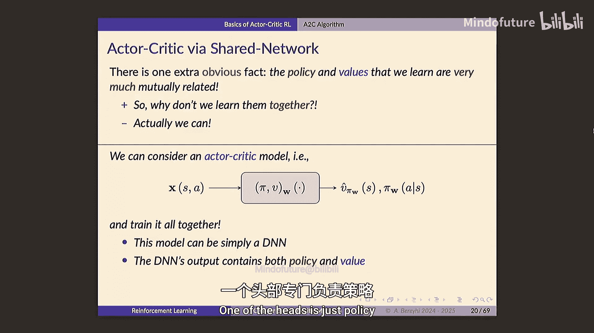

诶。For example， categorical distribution， right， this one。

Which is giving the probability of every single action that you can do， right。

 The other one is just giving you one single output， which is the value of this stage you have seen。

 right。Correct， so that guy is， I mean， it might be more stable if you really can manage to have this nice architecture。

 right， depends on the application that you have。 But for， for instance。

 if you have a this great space of actions， then this could eventually work fine， right。

 because it's not a very complicated thing。And you can guess that every single action， I mean。

 at the end of the day， this guy should be one deterministic distribution with the highest probabilityvol corresponding to the one。

 which is maximizing the value。 So it makes sense that you use the same set of features for them。

 right。

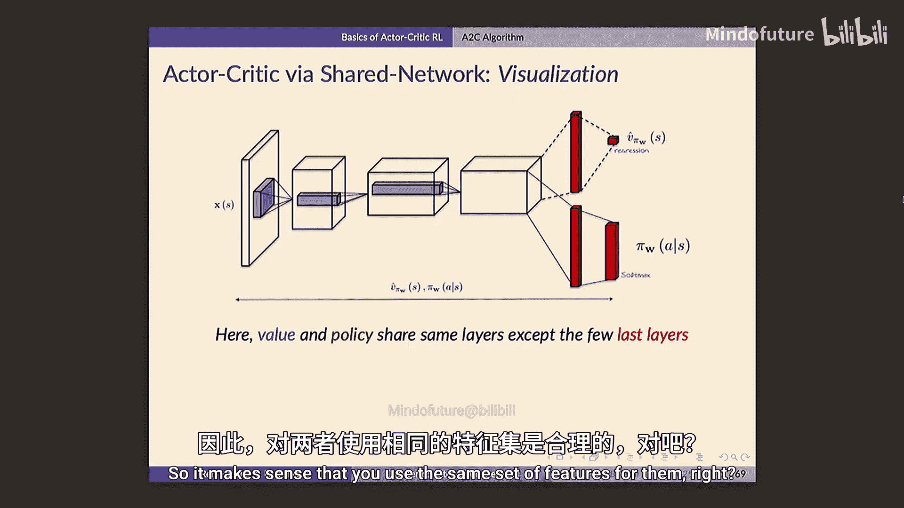

Okay， so。Now， one thing when you're using a shared network， one question that you might have is that。

 well， if I have a policy network and if I have a value network。

 then I'm gonna use the policy gradient theorem to get the gradient for the policy network and update。

 I'm gonna use my you know， gradient decentcent on the loss value loss that I compute to update my value network。

 right， But now I have just one giant network， right， and I need to just minimize one loss， right。

 there is no， I mean there you have two different losses， right for two different networks。

 now you have one loss。 how you can combine these two different losses。 well。

You can simply add them up right and maybe you do not simply add them up with the same。

 Maybe you just add some other weights right？ So for example。

 you say this is the expected value I'm going to get out of my policy。

 This is what we try to maximize when we wanted to do policy gradient method right and this ended up with the policy gradient theory that J。

 and then you have the other guy， which is the loss of the value network now both of them depend on the same set of parameters right So same set of parameters。

 the same neural network is computing both of them right So how you can define your your loss。 Well。

 you can get the loss of the first one added up with some coefficient times the loss of the second one。

And that coefficient， you simply need to tune it in a way that both losses just get in the same range。

 right， If one of the losses in the order of 10 to power -3。

 the other one is in the order of 10 to 10。 Well， they do not match， right。

 and you need to just scale one of them up or down to just get in the same range。

 And then they just get minimized together， right。So you can do that。 And then again。

 when you write down that thing， it's going to only depend on the advantage。

 this is the same thing that we observed before。And yeah。

 you just compute the gradient of this guy and the gradient of this guy is not no magic here。

 So it's the gradient of the policy like the log likelihood which we use for the policy update and also this is the gradient of the value part right So again。

 we use for update of the value network。 So basically the gradients you' are computing are running or back propagating over exactly the same network right。

Only the last head gradient is going to change inside your chain rule。

 and you're going to add them up together to update， right。Everybody's cool？

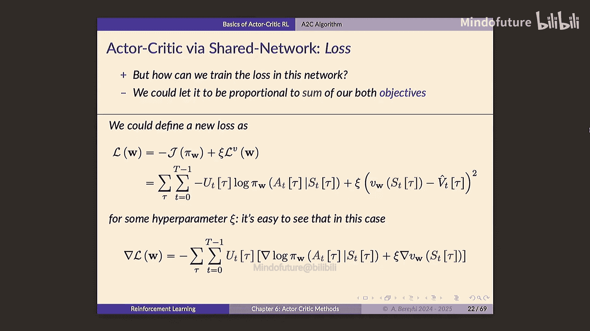

Questions。Great， so if you then if you just merge them together and make a shared network。

 then you're gonna have the same algorithm as before。 But now you're gonna have just single gradient。

 right， So you sample， you compute the advantage using the value head and then to compute the gradient。

 youre going over your trajectory every time you're gonna get the gradient of the log likelihood。

 plus gradient of the value head together。 and then you multiply it with a corresponding advantage。

 right， and you just aggregate all of it over one trajectory。 This is one sample gradient， right。

 you either can update with a sample gradient or you can do multiple samples in one mini batch to just improve the quality of your sample。

 and then you update， right。😊，Questions now， this guy is， is a quite robust thing。 Like。

 if you have a fair mini batch。And if you're able to sample from your environment easily。

 then you can actually train this guy。 This is going to work。Questions。

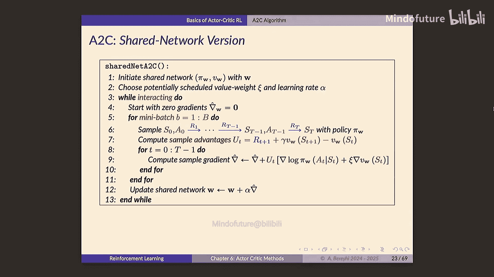

No question。