# 【多伦多大学】强化学习 2025 ｜ Uoft   Reinforcement Learning   Fall 2025 p56 P56_讲座_56_柔性演员-评论家方法简介 -BV1D3F2zhEry_p56-

哦， yeah。

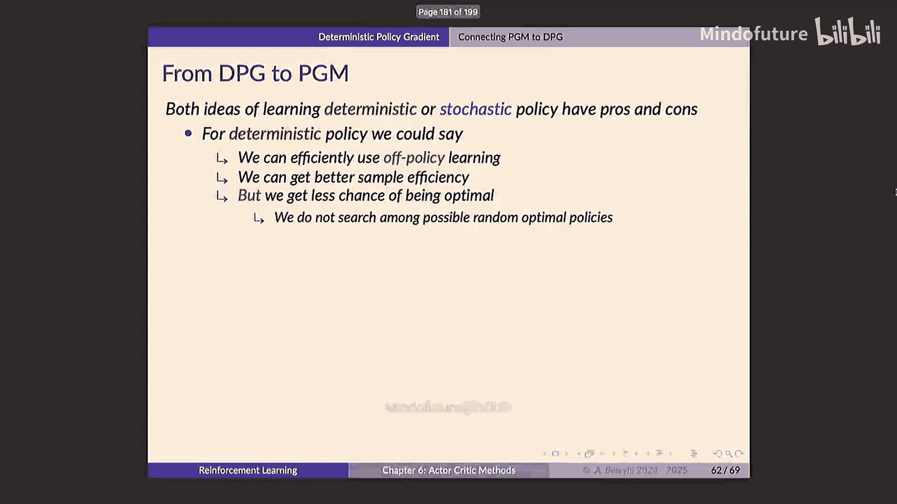

Now。Okay， guys， I where am I。 Okay， I'm definitely finishing this chapter today。

 but for the next chapter， I have only 20 slides， roughly， okay， and they are just a story。

 So is it okay that I keep on going， I finish it today。 everybody cool。 Okay， I just keep on going。

So， yeah，s easier here。 So I think we， I want to just。

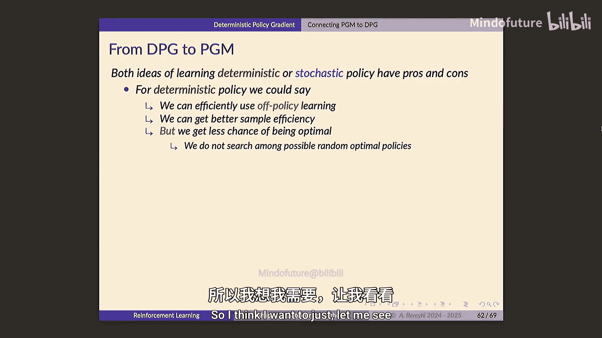

Let me see， yeah， I want to get into this sack， a soft actor critic approach so。

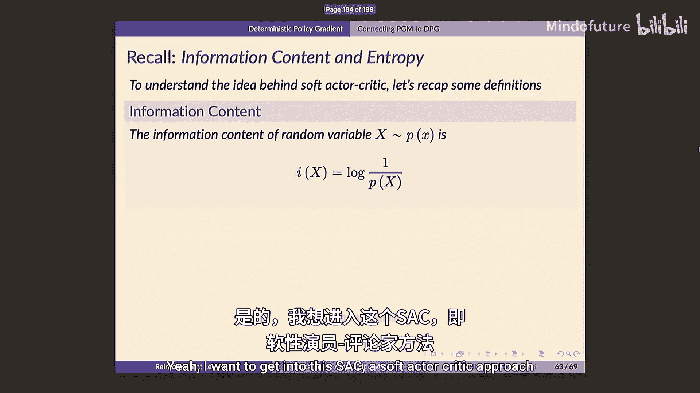

What we have done up to this point， we have tried two different ideas based on policy network and the two ideas are one of them is the。

 you know policy gradient method with the stochastic policies And the other one is the deterministic policy。

 right， What is the deterministic policy， Every single state that you see。

 You're gonna say what is the optimal action。 What is the proboistic policy or stochastic policy。

 that one is going to look at your state and'm going give you a distribution around the actions that you have right Now。

 what you have as the idea。 the idea here was that the question that people started to ask was that is there anything in between these two approaches right。

 And then the answer was that most probably。A kind of practically optimal way of doing thing is to somehow make a piece between these two。

 It means that overall， we should act deterministic。 If I want to get from here to somewhere outside。

 I roughly have the idea which direction I should go right So I would not start going towards this wall right is obvious right I am deterministic in the sense that I want to get to the door。

 right， but maybe when I get up and go on the stairs， I see a few things， right。

 and I change locally there myself， right， So I do not really take the shortest path。

 I might just jump here and there because of the issue is happening happening locally right So the idea was that probably we should do the same thing。

 like we should be globally deterministic locally stochastic right So every time we have this idea where what action we should do。

 But when we want to do the action， maybe we just give a bit of。

Fenomness into the action that we can， we want to do at that particular time step and that。

Was the idea that came up to mind of many people and how we can resolve it， well。

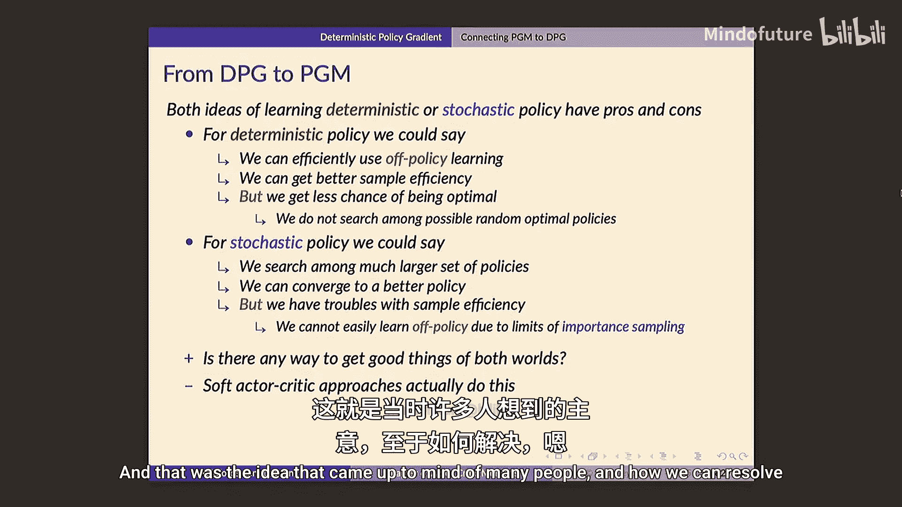

In order to get into that， you need to have a bit of background on information theory or information content and other things right。

 And I don't really want to open a new chapter on that because at the end of the day。

 I'm not sure how much realistic or practical is that for you。

 I want to just give you a kind of idea about this， well。If you get the idea。

 then probably you can use it， but as I said， if want if you want to get deep into why this is。

 for example， capable of doing better than pure PGM or pure deterministic policy gradient。

 then I need to have a bit of more context from information theory。

Just to give you a bit of idea about what entropy is。 Do you know what is entropy。Yeah。

 if you have a random rival， you know what is entropy， right， You have heard of this。 You know。

 cloud it with Chennon。Please don't say no。Please。Yeah， okay。

 so you know that I I I I am standing up here simply because I， I mean。

 I didn't do anything of this stuff when I was bachelor， of course。

 just we had one course on digital communication。 then its information theory。

 I think some of you have had it。 And then I saw that I said like before that was like， okay。

 I just go to university。 But that day， I said like， oh， I want to do that right， this is cool。

 So if you don't know about that， just read it， it's like a very interesting topic。I used to T shirt。

So I can I'm short in time but I could talk about this particular it's like one hour。

 but just take it from my side， please if you don't know what it is， just read the Wikipedia page。

 it's a very interesting thing。What is the idea here， If you have a random variable。

 you have something we call information content， right information content is a sort of variable parameter value you give to the randomness of the variable and how you define it。

 Well you can prove that if you're the intuitive conditions you want to be satisfied。

 you want them to be satisfied， then the only function that can do this job for you is this function。

 which is lock of one over the probability of that random variable happening。

 Now if you want to just understand what that means this means that say X is the random variable of the guy who is standing here right and the one who is standing here。

 say for example， you have only two options right So the first option is me the second option is my very cool friend。

 I don't know who say prime minister of Canada right So is either me。Or the prime minister of Canada。

 right， So they could stand up right now here。 who， which guy is more probable to happen。It's me。

 right， So with provolti is 0。999999 forever。 It's me。 maybe I mean。

 he was here in SRri a few days ago， right， maybe it just happens that somebody knocks the door and now it the prime minister。

 right So could that one could happen potentially but the parvolty of that one happening is too much right now sorry too small if the provolti is too is small。

 this P is a small value right，1 over that P is a very， very large value， right。

 and then log of that guy is a big number right， whereasas when I am here。

 the provolti is almost one， right， then one over one is roughly one like one over something close to one is roughly one log of that one is0。

 right， I standing here right now has no information。 And that is obvious。

 You expect me to be here right now， right， but Mark Carney being here is is a big news。

So it has lots of information， right， So information in some random thing happening。

 even though that guy is random， you can deterministically quantify it。

 And this is the whole magic that Shannon has done in his theory。 So he looks at the random variable。

 He tries to get something， you know， informative out of it， right。

 And he said he proves that this is the only guy who can do this property。 now。😊。

If you have one random rival， its own information is also random because depending on the guy standing here。

 the information changes， right， I stand here， me being here has information0。

 The prime minister has information。 I don't know whatever you want to say， right， very。

 very large number， right Now， the question is that this whole process of the guy who is standing up here。

 how much informative that guy that that process is， well。

 you can average all the information possible， right？

 So you can say the information of me being here is roughly0 times the provolti of I being here。

 I am the provol is again close to one， right。Any other guy being here， the information is too high。

 but the pro voltage is almost0， right， those guys getting multiply is almost 0， right。

 adding everything up， the information is 0， right， The information of the guy standing here。

 that process is random but the information is0。 This is why you never hear in any news channel that talking about me being here。

 right， because there is no information in that， right？ And this is the whole。

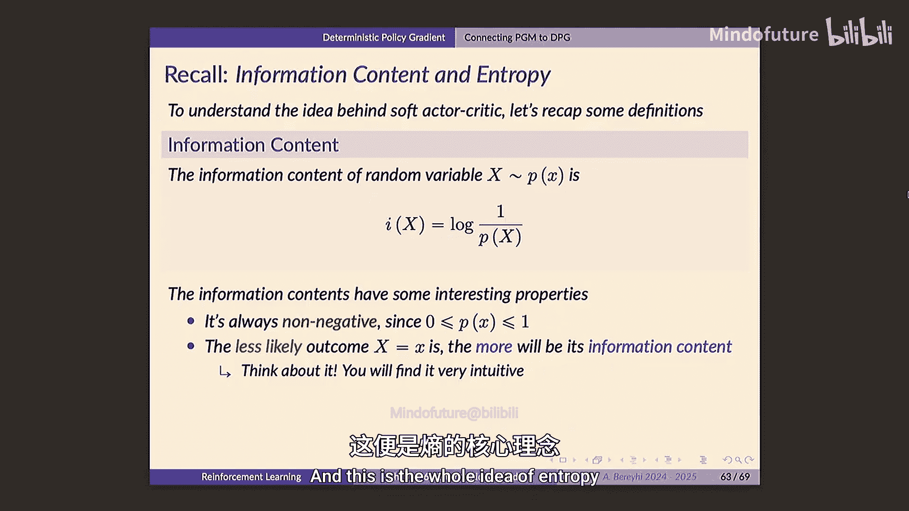

Id of entroopy。 So en troy is essentially the average information inside one stochastic process。

 right， If you have a stochastic process， every single realization of that has its own information and the average information of all of them is then trooppy。

 It's somehow telling you how much informative that process is now。How。

 when you have this entropy very large。What kind of distribution you guess。

So me being here is not a very high very informative thing， right？

 And the reason is that the proty is almost one for me， almost0 for anyone else， right？

 How can I increase the information， For example， if you have two instructors， right？

 if I show up or anyone else， and we don't tell you who is going to show up， right。Correct。

 so the chance of me being here is half。 the chance of the other guy being here is half。

 then we have a bit of information， right， So you might wait a bit to see who is showing up， right？

 So this means that the when the provoltic gets more and more uniform or it gets like less deterministic。

 then this information is going up and up， right。The amount of information you have in the process is going up and up。

 You get this。 You see that。 So now。When you have a hydro random thing。 So if x is hydro random。

 for example， uniform， Gaussian， whatever distribution is。

 this entropy guy is going to be very large。 And when x is deterministic。

 then this entropy guy is effectively 0， right， If it's really deterministic。

 then one guy is happening with one。 Anyone else is happening with 0。

 then the information is absolutely0， There is no point in checking that thing， right There is。

It's always going to be the same outcome， right？

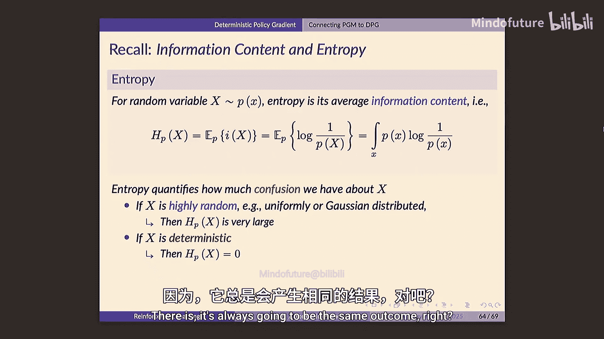

Now， one thing that we can people started to say， they say， okay。

 this is what we want also inside or policy or optimal policy。

 We wanted to be deterministic in the sense that as I told you， if I want to just hit the target。

 probably I have a rough idea what I should do right But on my way towards the target。

 probably I would like to have the highest randomness possible right。

 because if there are no difference between doing multiple actions。

 then there is no reason for me to even be inclined towards one of them， right。

 Maybe I should do exactly as much as possible every single option。

 because that could potentially lead me to a better result， right， if it does not。

 it does not definitely harm right So that was the idea。

 And this was the way that people started to modify the rewarding system。

 when they want to somehow incorporate。This idea。 now。

 what is happening inside this new reward is says that the next reward that I get。

 So every action that I want that I do， the next with with policy pi。

 the reward that I get is or right， the blue1。 But I can add up a bit of information into that。

 And that information is simply characterized within trooppy。

 right So I would say how much in trooppy， this action would give or this policy is give is giving me。

At this particular stage， right？ So when I am in this estate。My policy is going to tell me， okay。

 do these actions， right， If it is absolutely deterministic， it's giving me no information， right。

 So that age， that entropy is simply0， right， If it is not deterministic if it is e stochastic。

 then it giving me some entropy， right。Because I might do this action。 I might do that action， right。

 I don't know exactly。 So the enttropy is not zero anymore， right and the more enttropy I have。

 it means that for that particular state， the next thing that I'm going get or the next action that I'm going do is more storcchastic right So people started to say that well this guy is somehow fitting the idea that we have here。

 So maybe we can do whatever we have done up to this point。

 But instead of having reward always inside the you know return and everything。

 we just replace it with this guy right and the reward is not only giving me the exact reward coming out of the environment。

 but it also give me the amount of uncertainty， the amount of confusion every time I have。

 and I want to keep it large because the more uncertainty I have every single step。

 the more I'm going to explore the better I could get the chance to improve right but I don't want。

this to just impact the overall approach。 I want it to be locally， right。

 So I do know this is a very， very high level description of the idea。

 but I don't want to get into too much details because if I get there。

 then probably I need to define new things。 And this doesn't make sense， right， okay。

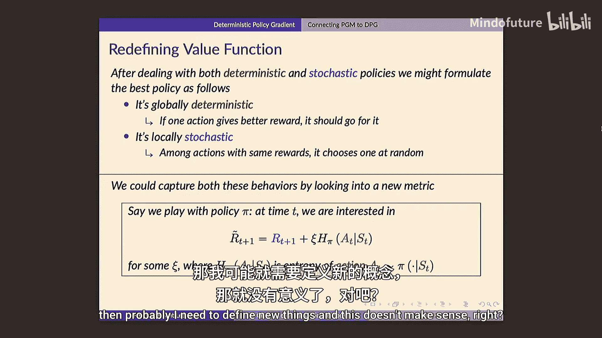

So moral of a story， they just redefine the rewarding system in this form。

 So they have no enttrooppy added。 And by doing that， they would say， okay。

 we are acting deterministic because every time that we are doing in action。

 we want to increase or maximize or immediate reward right and this is the way that you do it in deterministic approach。

 right， if you want to be deterministic， you just simply look at the door and you would say， okay。

 I need to do this action in this set of actions because that at every single state。

 that is the one which is just maximizing the future reward right。

 but at the same time I have this extra term here， and if I want to also maximize this one。

 this means that at every single step， among the actions， for example。

 that could give me the same reward， I am going to take the distribution。

 which is having the highest confusion right， highest enttropy， and then this is again。

Going to increase the stochasticness locally inside our policy， right， And by doing that。

 people said， well， this sounds to be a better reward system as compared to the one directly is given by the environment。

 And this was what people called it soft actic approach。

 And this soft term is simply coming from the fact that you're injecting that。

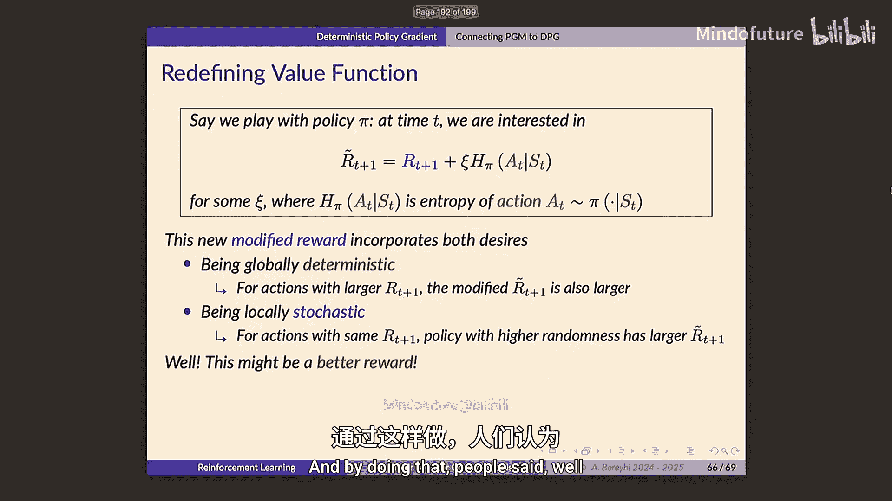

That entropy into your rewarding system。 Okay so now， if you want to define， for example。

 the value function， you can do it exactly as before。

 the only thing that is going to change is this particular reward system。

 So instead of or you are going to use artal。 And this means that you are going to have both rewards coming from the environment and also the enttropy of your policy at every single time。

 right， So this is what we call it soft actor critic because your。Within your policy， which is sorry。

 Within your value， which is this guy， youre somehow keeping the， you know。

 confusion of your action as well。 So by nature， it is actor critic， actually。

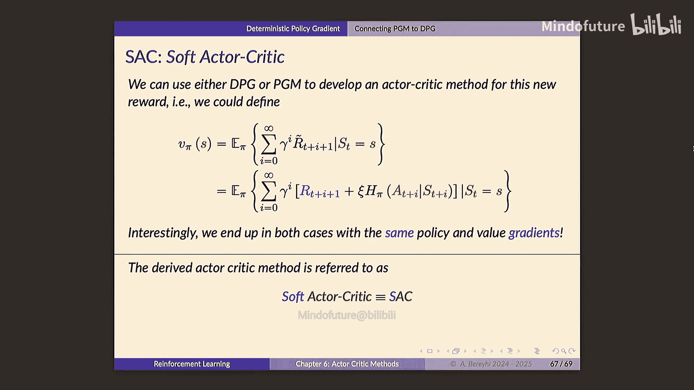

So， yeah。That's it。 So I， as I said， I don't really want to。 okay， this is less like cool。

 I don't want wna really get too much deep into that self actor critic。 If you are interested。

 you can take a look at that。 But well， that needs， I mean。

 the theory behind it that needs a bit of more clarification in terms of the， you know。

 information theistic notion and also， you need to have a bit of a statistical analysis to show how why this guys could be superior to the other classical approaches now。

Well， we had a bunch of approaches， ac approaches now just two rule of thumbs。

 if you want to use them in practice， one of them is that if youre restricted in terms of sample efficiency and or youre using continuous actions then probably going for a deterministic policy gradient as at least the first option is a good choice。

 but if you have discrete action space or you do not care too much about sample efficiency because you just simply have sample efficiency somewhere right if if you don't care about sample efficiency or you have discrete actions。

 then maybe you go for policy gradient based approaches like PPO and TrRPO might be better。

 at the end of the day if you are doing a realistic project you most probably need to do a critic So doing just deep Q learning alone would not work unless this is a computer game。

 for example。把呃。These rule of thumb somehow helps you to get the idea where you should start。 Okay。

 now， yeah， by the authority of the Ontario province。

 I give you the deal learning expert certificates。 we have pretty much cover。

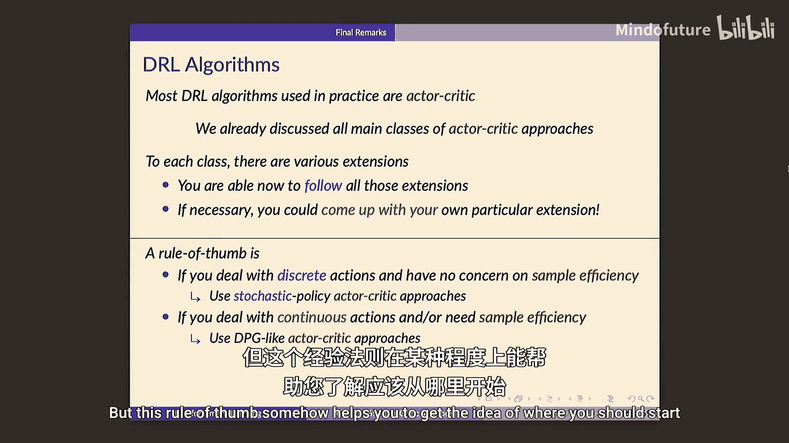

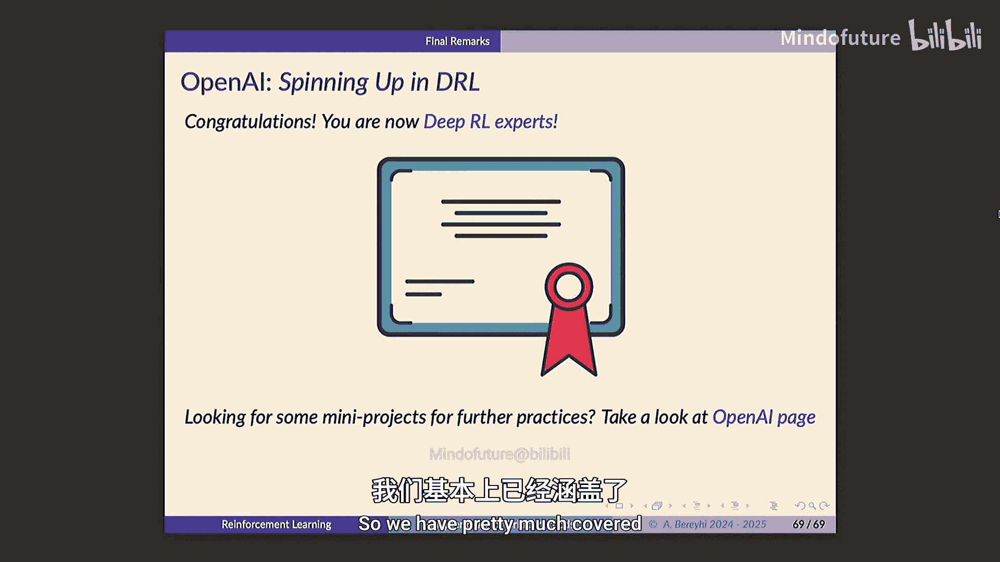