# 【多伦多大学】强化学习 2025 ｜ Uoft   Reinforcement Learning   Fall 2025 p57 P57_讲座_55_确定性策略梯度 -BV1D3F2zhEry_p57-

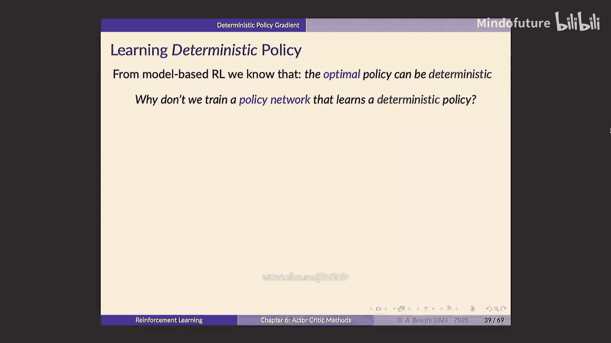

I told you that last thing I would like to mention here is the deterministic policy gradient。

 and the deterministic policy gradient is when you have your policy network。

Only behaving deterministic。 This means that you just give it this state。

 You would say I'm in this particular state。 and then it' gonna give you back the optimal action that you can do。

 It's like you have an optimal a deterministic policy， right。Now。

 you might tell me that why you are doing this because if we are doing a stochastic process sorry。

 stochastic policy， This means that I have a general pi general distribution。

 And then with a stochastic policy， I am also including the deterministic policy as well right so stochastic policy is more general form of policy as compared to deterministic one。

 that is correct。 but sometimes it is going to be more efficient。

 if you just directly work with the deterministic policy。

 especially when you have a continuous action space。

 So I think I told you this in the very last part last description last session。

 So when you have one arm for example and can move。

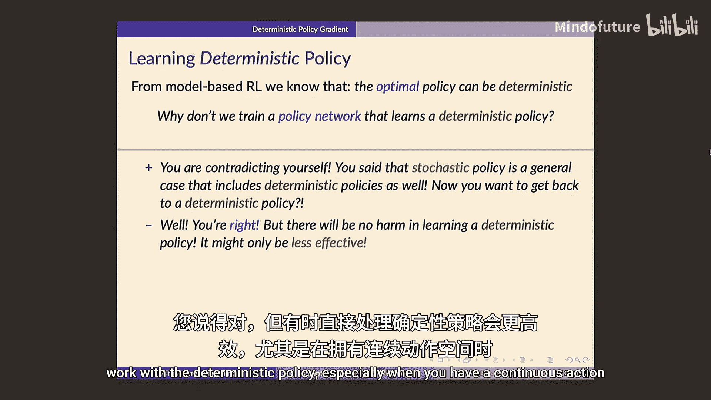

Gral any any place in this space， then when you use those stochastic approaches。

 like there are tricks to just kill that randomness。

 But you're gonna see that this guy is going to get a bit shaky around the target right whereas if you have a deterministic policy is going to it's not going to sample anything right。

 So it's just deterministly going towards the point。

 So which direction I want to go when I am here So it' gonna be a specific direction， right。

 So there is no randomness anymore there。 So it could help a bit in that sense， also。

 as we're gonna see， its going to help you in sense of。

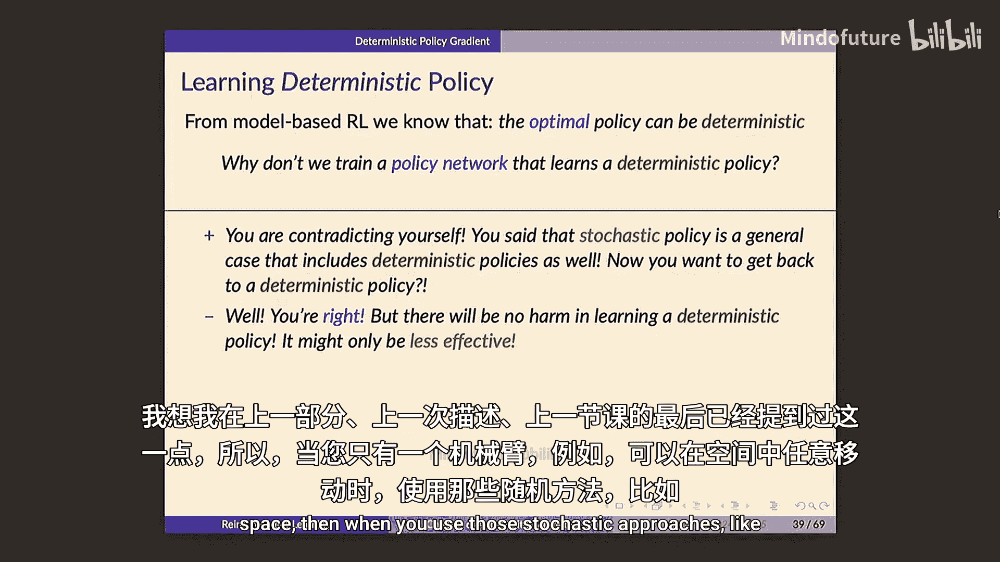

Sample efficiency， because efficiently effectively， you can do what you did in deep P learning。

 So you can do our policy learning。 This helps you。With sample efficiency。

 So there are some benefits in that。 And we are going to talk about this。

 You're gonna see that this is basically deep pure learning again。 But you have one extra network。

 which is just telling you what is the optimal action， so。

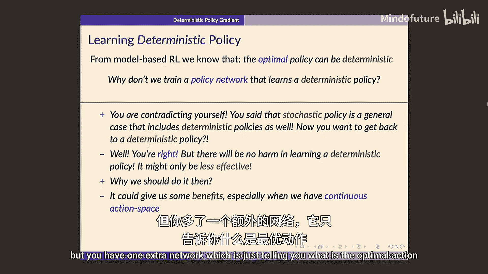

So yeah。When we have continuous action in space or out your or policy is basically。

A density function， when we have。Dcreet action， we have a policy which is basically a par distribution so。

This is a policy， right， A policy network。 The policy network has a bunch of parameters。

 is' going to look at your state， right If you're thinking about a discrete case right you can only go four directions left right up down then in this case。

 your policy is going to give you a probability voltage distribution， maybe a softmax output。

 and then as the input to your network you're going to give one you know representation of your state。

 the image of your current state right you're going give it to your network you're going give you a bunch of probabilityvol is now if you want to act you're going sample that distribution right This means that if you're exactly in the same state and say the four chances are like half half0。

0， then 50% of the time you do action 1，50% of the time you do action20% of time you do the risk of actions So that's gonna be the case with the termministic with a stochastic policy and discrete。

Action when you have a continuous action。 So you typically just describe your policy by the statistical parameters of your density function using this stage。

 right， So this was the example I gave you initially。

 So this is a kind of nice example that you can consider to visualize what is happening。

 So you look at the。Representation of your estate， this X S is going inside a deep neural network。

 right？ And then at the output， you are gaining something。

 you treat it as the average of your action， right， You would say my action is， for example。

 normally distributed around this mean with some variance， right？

 Maybe you have your network more sophisticated。 and you compute the variance as well。Maybe you do。

 you consider another distribution， right， but this is again， a typical thing。

 So you're gonna start from one state feature。 and then you do some processing。

 You end up with a kind of known distribution and you sample from that distribution， right。

So every time that you want to do an action， you are going to randomly sample one action around that average action with that variance。

 This is the way that you are going to sample。 Now， how we can do deterministic policy， so。

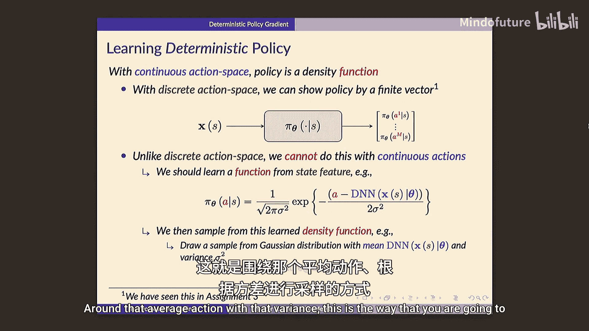

We can actually do deterministic policy by thinking about a distribution， which is。

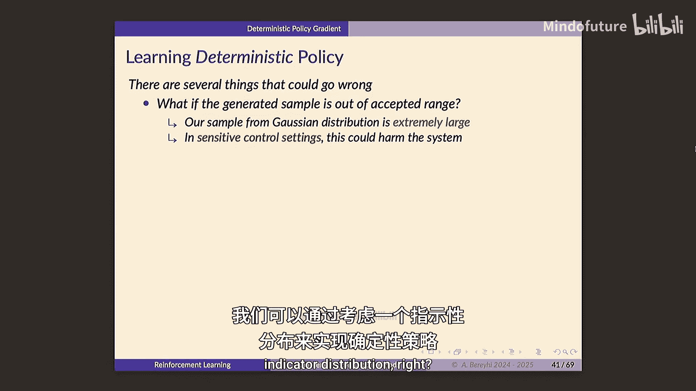

Indicator distribution， right， So you give this X S the representation of your stay to your policy network。

 It's gonna give you one action。 Do this action， right， The provolty of that happening is one。

 the probability of anyone else happening is simply0 right Now what are the reasons that we are we are going for that。

 Well， there are bunch of reasons for that， one of them is because when you're dealing directly with the action instead of this provolty。

 then you can somehow kill the actions， which are dangerous So theres some sensitive applications where you cannot do any action if you wantt inject something in for a patient you cannot simply do any action。

 And you would say oops， sorry it cannot happen this is life or autonomous driving you cannot simply random randomly sample the action。

 Even if the proty of just turning left is very， very small，1 to power minus。

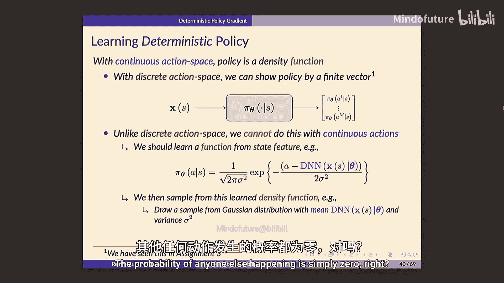

Right， but what if that sample happens， right， then you're gonna just hit the other car and it's life in。

 right， So sometimes it's quite dangerous。 But if you are doing dealing directly with the actions。

 then you can kill that alpha there。At the， the policy network。 And yeah。

 there are a bunch of other reasons in practice that happens， but。As I said， mostly。

 this is because when you are dealing with a continuous action。

Sometimes it's easier to directly focus on the action itself。Now。

 sometimes you do not have enough samples。 So when you have a continuous action。

 then this means that the space of action theoretically is infinite right And then if you want to have a feeling about the distribution that you're learning。

 then essentially you need infinite samples， you do not have it in practice and then this is going to sometimes make challenge So probably you don't want to if again。

 the distribution is not that well intuitive for you in the particular application like for example。

 moving your hand you don't really need you don't really know whether you need to just make it Gouchsian or not the only reason you make it is simply because you can sample Gasian distribution by your computer right So this is the reason。

 And well you don't know whether this is the best idea or not。

 maybe we cant focus again on a deterministic distribution there are a bunch of reasons like this。

 But as I said， continuous action。I the most important thing when you have a continuous action and you want to be sample efficient。

 then going for a discrete policy gradient is a kind of good move， a good choice。

 and you're gonna to see why now what is a discrete policy this is a discrete policy right your policy is basically telling you。

 given this state what action you should do right and that action is the optimal action。

 supposedly this is the guy， which is maximizing your action value right This is what you want right And now what you could say。

 this parameter theta， your neuraln network is basically computing or choosing the optimal action only right So that's what your network is。

 So the deterministic policy network looks like this。 every state that you're in。

 you're going to give your feature representation of this state into your network。

 And and then at the output of the network， you're going have the optimal action right So you are in this。

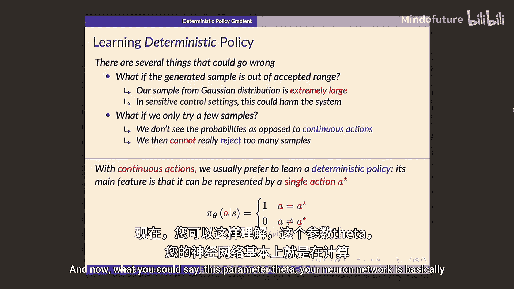

Then the right direction to go is this right and then you change this state you are in this location。

 then the right direction is this and so on， right So every single state。

 every single location in the space， youre going to have one specific optimal action， right。

So this is the deterministic policy network。 This is， again。

 a policy network with this difference that your policy is basically just an indicator function。 You。

 So you throw away the policy itself and you only look at the optimal action， right。

 which is going to happen with Provol  to1， right。

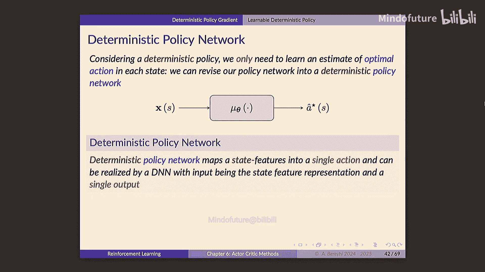

Now， now that we have this guy。 now， the question that you might ask is that how I can train this now。

 one like。Basic answer or say， a classic answer is that， okay， let's treat。

Deterministic policy network as a policy network with indicator distribution， right。

 So the density function is simply the impulse， right。

 It's gonna happen with the with density infinite or provolty 1。

 exactly for the action that we have chosen as the optimal action。

 Any other action is happening with provolty 0。 density is simply 0。 You can do that。

 but it turns out that you can do it more efficiently。

 You don't really need to get through all of the policy gradient theoryor anymore okay because。

Somehow， if you just ignore the fact that the neural network is doing this for you。

 then you basically get back to the Q learning problem。And we're going to see this。是。

We can we don't really need to establish a new approach。 As I said。

 one can just take time write down everything for PGM using the indicator function。

 If you do the math， right， then you're gonna end up probably with the same thing we get here。

 but we can just do the simple way。 And that is that we focus on DQ learning right So we're gonna think from DQ learning point of view。

 we again do DQL， But this time with this fact that we have this。Genie。

 which is going to be the neural network。 Who is going to look at this data and gives us the optimal action。

 okay。

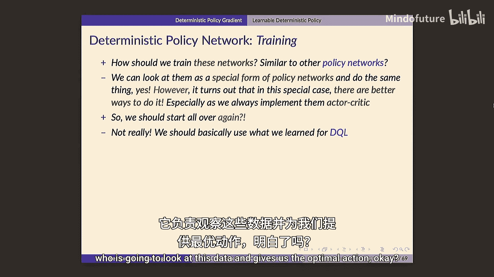

那。Yeah， let's let's just get back a bit on the the optimal policy notations。

 So what we discussed at the very end of chapter 4 was that if we want to do Q learning and we want to do it using in a space in an environment with continuous action space。

 the problem was that，You give this state to your neural network。 But at the output。

 you need to find out what is the optimal action， right， What is the action with maximum Q value。

 right， And you could not do it because your action in space is continuous， right。

 You you effectively have infinite number of you sorry。

 theoretically have infinite number of actions， right， So that output is very， very large。

 You cannot really just。Do this by a neural network。 You can quantize it。

 This is not probably working fine。 And the other thing is that you can also not simply think about optimizing the output。

Of a general function， which is represented by neural network， because then that one is， again。

 the same complex problem。 right， So the way that we came out with a sort of。Idea。

 which somehow ended up by。Somehow assuming that a policy network could potentially help。

 and this was this motivated us to start Cha 5 was that we said， okay， what if we have this network。

 this kind of， you know genie， who is looking at this state and is telling us what is the optimal action right So it's gonna look at this state it tells us okay if you do that action。

 this is optimal why because I know right And now if you do know that this is the optimal action。

 then you can still do pure learning right because you would say， okay。

 I don't really need to look at the general state representation。

 I just look at the representation of a state and optimal action right。

 and I do know what is the optimal action right So that guy。

 the optimal action and this state go inside this network， I am going to train this guy。

To learn the Q value for this estate in action given the policy， right。

 And then given that this action is coming with the optimal policy is coming is optimal action every time。

 then essentially what I am value here is the optimal action value right？

 So at the end of the day in Q value， What do I Q learning。 what do I want。

 I want to get the Q function and take the maximum over actions， right。

 But I already know which guy maximizes it right？ So I don't care about the rest。

The remaining actions， right， I take this guy， and directly I inject it inside the Q learning update。

 right， And I keep on going Q learning。And every time， instead of maximizing over action。

 I simply get the output of this network， right。So if I have this guy。

 this guy is going to help me in the sense that I can still do Q learning。

 even though my action space is continuous。 and this guy is now the deterministic policy network。

 right， If I have a deterministic policy network。 supposedly that guy is giving me the optimal action。

 This means that I am able to play with the optimal action in every single state。

 So I can basically do Q learning。Youve got the idea。 Yes， I'm gonna。Open it up now， what。Re clear。

 right， what， what this the policy network is doing here， right so。Yup， that's， that's again， yeah。

 pure learning。 But if you want to talk in general， well。

 this is again a kind of actorritic approach， right， because this is a kind of actor。

 This is the policy network acting。 And then you have this critic， which is a value network。

 But you can also look at it from the DQL point of view with a kind of genie actor right。

 Who knows what is the optimal action。Okay， now。So， yeah， the optimal。Action。

Value at every single state is actually the one which is coming out of this network。

 and that is the one which is maximizing the Q Q value over all actions。

 because or network or policy network or deterministic policy network is actually finding us this particular action。

 which does the maximization。

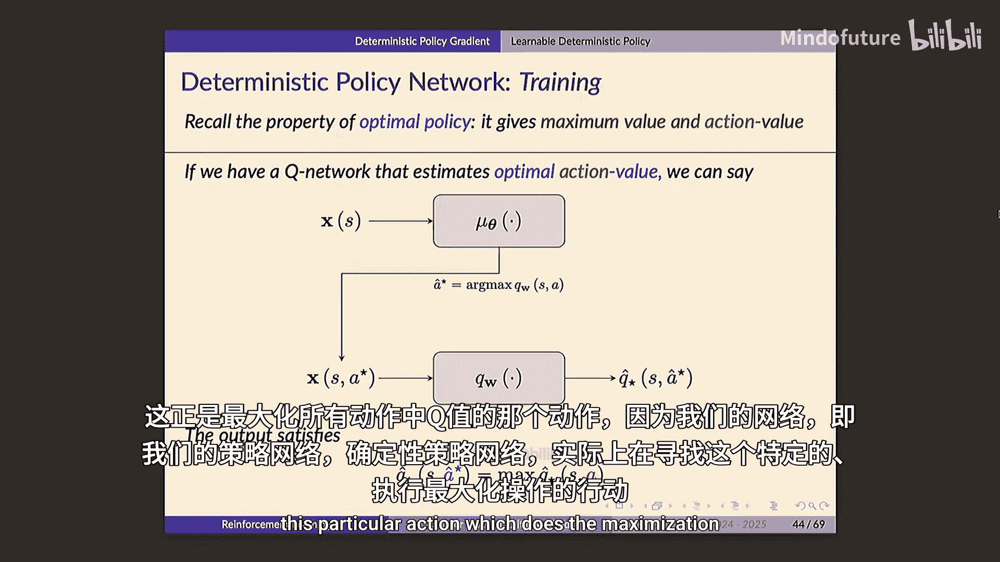

O， now。That is going to be。The， the， the key idea。 So what we could say then what we would say， okay。

 when we are doing pure learning， what we want to do， we want to just。

Tune or parameter theta in a way that for every single state is actually or it's somehow estimating the optimal the value of the optimal policy right and given that we do know this parameter this action here。

 given by our deterministic policy network is the optimal action， then when we put it here。

 we simply need to just optimize everything with respect to to maximize this guy right why because the optimal policy is having the maximum Q value right So if you play with the optimal policy every time if in every single state you play with the optimal action。

 then the Q value that you get is maximized right So it makes sense that you try to find your parameter of your policy network or deterministic policy network in a way that somehow max。

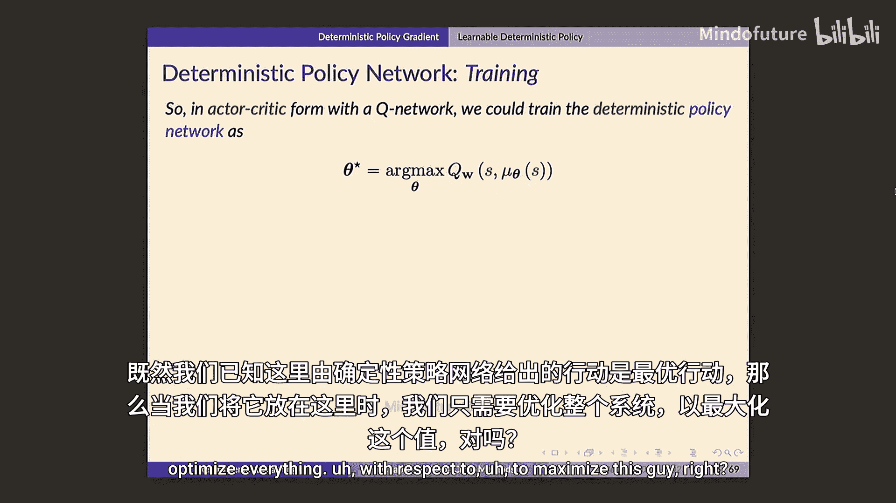

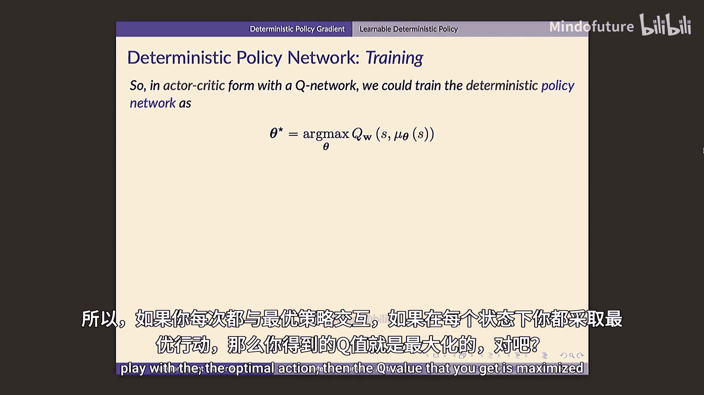

izes this guy right So you have your Q value， which is coming from the Q network right and then you compute it exactly at this state in action pair that is given by your policy network。

 And now how can I train that policy network， Basically， I make it maximize this value right。Now。

If I want to do that， what should I do， I need to take the gradient of this guy， right。

 with respect to what。Pa engine here。With respect， too。I'm doing it with respect to Theta。

 What is theta。Proroome is up。Yes， the policy network， exactly， the deterministic policy network。

 So W is the。Prometer of your Q network right And right now I am not touching that one。

 I'm going to update that one as well right but right now， say that for example， at this point。

 say that Q network is trained well right if the Q network is trained well it is able to look at this state and the action and gives me the Q value right So now I just want to find out how I should tune or how I should update my policy network。

 I would say okay the action coming out of the policy network should maximize this Q value as well right So here W is fixed。

 I'm going to take the gradient of this guy with respect to。The parameters of the policy network。

 right， and how does it work， How can I do that。I can write chain rule， right？

I can take the derivative of this guy with respect， to。The second argument， the action， right。

And then multiply it with the derivative of the action with respect to the parameters of the policy network。

 right， so I can write it down in this form。 Everybody's cool about the。

So this is the Q value that you get， right， QW。 This is the Q value that you get。

For state and any action， no， I take the derivative with respect to action， right。

Times the derivative of the action with respect to the parameters of the policy network， right。

That's just the simple， the simple chain rule。 Everybody agrees。Now， this guy。

 I think this is quite clear for you， right， This is back propagation over your policy network。

 right， state goes in。You get at the output the optimal action， right。

 You can back propagate all over the network。 You get all the gradients， right。Cool。

 what about the first term。That is a game back proag， right， But over the value in network。

 the Q and S。Why， because the state and optimal action， both together， right。

 go inside your Q network， they compute everything till they get to Q value， right。

 if I want to know the gradient of or the derivative of this Q value with respect to the action。

 what should I do。So from this guy， I backproate all the way to the input， right。Correct。

So this is the same thing you do with encoding， decoding， and deep learning， right？

You have your encoder， it gets data， it processes it， encodes it， right。

 then you get the encoded version， you decode it， you get what you want。

 right Now when you want to train what you do， you back proppeate over all of it， right。

You start from the very output。 You back propagate you get to the input of the decoder。

 but that guy was also computed by the encodeder， right， So you。

 you keep on going backward for right， you back propagate till you get to the data right。

 And then you would say， okay， I have all the gradients I want。

 I can update same thing is happening here right So you're back propagating over your policy network and you are also back propagating once over your Q network right。

 And in practice when you want to update every single it。You would do that， right， anyways。

 because even if you don't want to directly apply it here。

 probably you want to update your Q network。 So you need to back propagate over that， right。

 And you know that when you do back proagation once for one sample over the whole network。

 you are able to compute any derivative that you want， right。

 So this derivative is somehow hidden inside that single back proagation you do on the Q network。

 right， So more of a story here is that。If you want to have an estimator of the optimal action value function。

 what you can do， you can simply back propagate once over your policy network。

 once again over your network。 And now you have everything that you need to update both networks right。

 because for update of the Q network， you need back propagation over Q for update of the policy network here。

 you need back propagation over Q and policy right， So both of them。

You just back propagate over both of them， which makes sense， right。

 If you are doing any neural network every time you want to update， you shoot back propagate。

 But it's just one back propagation。 Nothing more so everything's cool， right。Already got the idea。

I'm going to explain more， yes。Right， right， definitely， yes。You're right， right。

 because it's again a critic。 That's correct， right， yeah。Yeah， yeah， that that makes sense。

 That makes sense。 So that makes sense， right。

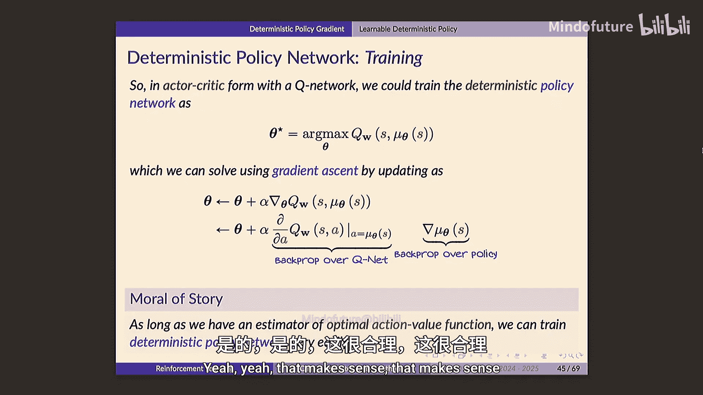

Okay， so now。Yeah， what is it here。Iyes don't help here。So， yeah。What is that。Belman equation。

 but why。Why I need the Belman equation。啊哈OK okK。😊，So yeah。

 one thing that I now want to see how I can collect samples when I want yes。

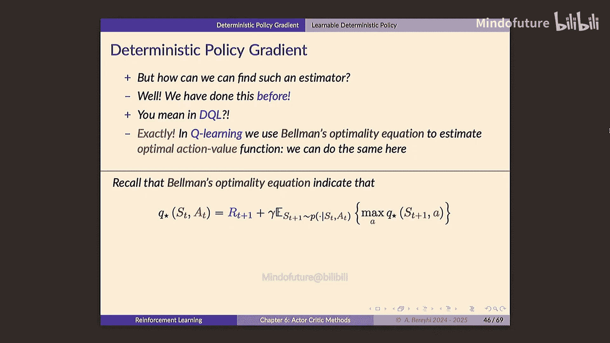

Here。Right。

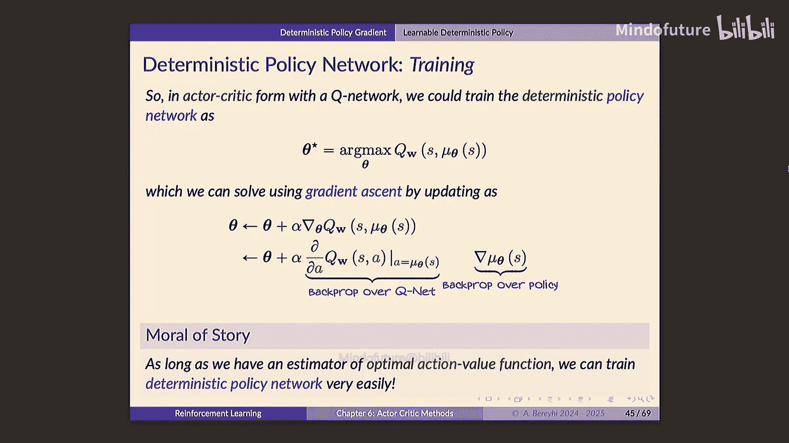

Here。hear you mean。Out of this guy goes inside the Q network for， right。No。

 it's not giving you the optimal action。 You want it to give you the optimal action， right。

 But then the question is that how you can train it to give you the optimal action， right。Yeah。Sorry。

Policy network。 Yes， you want to make it。 You want to train it in a way。

 So you want to find theta in a way that it gives you the optimal action， right？

 And then the question is how you know， how how you can make an objective for having an optimal action。

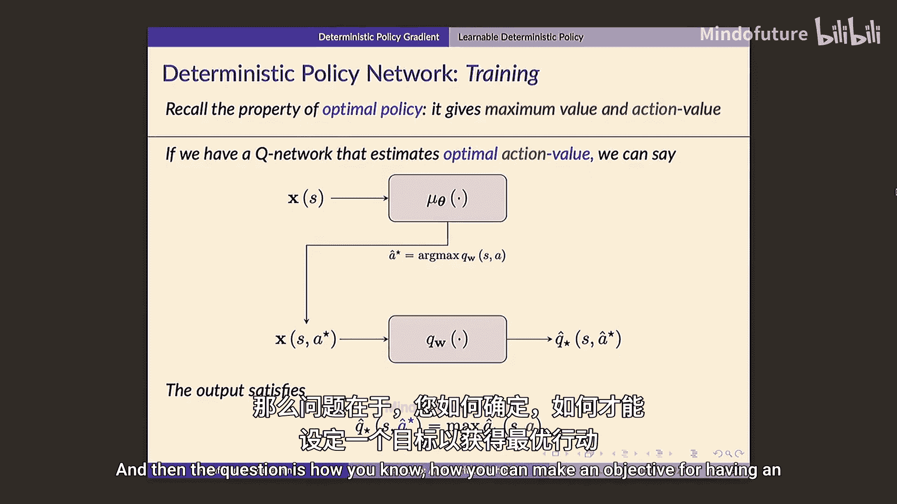

Then then we do it this way。 We say， like， if that guy is really optimal action。

 this whole Q value should be maximum， right。Among all the actions is the one。

 which gives me the maximum value， right， Q value。 So I need to just maximize this guy。

 This is the objective， right。Or the policy effort。啊。

Because mu itself is giving you a deterministic action， right。So you go over multiple training data。

 of course。 and then you're gonna see different trajectories。 you train this guy。

 But when this guy got trained finished， then any estate that you give to it。

 it's gonna to give you one action。 It's not going to change the action。Yes。Yes， every。

 every action that you do is somehow the one， which is deterministically。Used by your agent。

 and then Q network is only able to evaluate that guy。

 but assuming that that action is the optimal action。

 then the Q network is estimating the optimal Q value， right。Make sense。Questions。Okay， so now yeah。

 sorry for the confusion here Now， I want to just find out the way to just sample。

 collect some samples by which I can actually estimate the Q values when I want to to update my Q learning network a Q network in Q learning Now how can I do that。

 well， I would say my Q network is supposedly estimating this optimal Q value function right Q function。

 And then the optimal Q function in one given state and action is going to be the immediate reward plus this term。

 this is what we have inside the bowman equation right but now inside the beman equation。

 this is the optimal equation for beman， which says that you're not supposed to just average the next value but you're going to take the maximum among all Q values。

 remember that right So if you are just as a recall， if you remember。

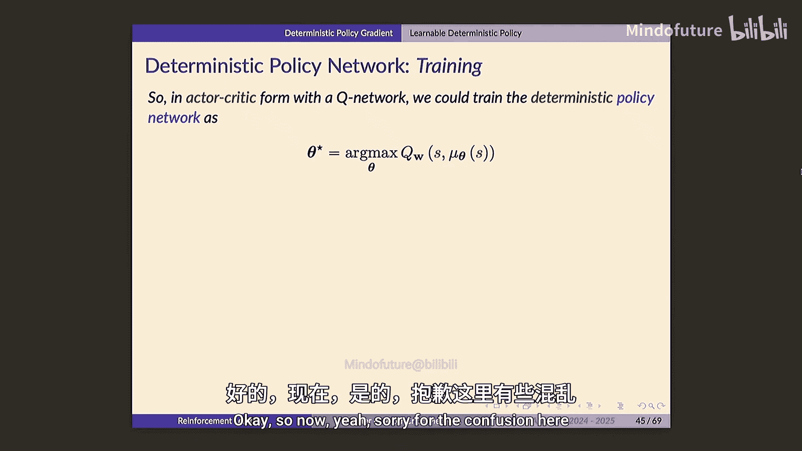

If you are just talking about one particular policy， then the Q value of the policy。

 it means that instead of a store， you have pi or given a state in action it's going to be immediately plus expected value。

 right V， correct Now was the case when you have a classic evaluation。By Belman equation， right。

 But when you think about the optimal policy。This is why I put a store here。

 Then the optimal Q value at one given state in action is going to be immediate reward plus。

The next thing that you have is the expectation of the value of optimal policy， right。

 And that value of the optimal policy is the maximum。Value among all。Action values， right。

Maximize over actions， right， This means that you can replace that with this guy， right。

 So this was the optimal equation for Belman Belman optimal equation。

 And now if I want to use my network to somehow sample from this equation。

 The thing that I can do I can simply directly replace the output of my deterministic policy network。

 right So this means that if one state goes inside the deterministic policy network。

 you're gonna get one action at the output that is supposedly the optimal action， right？

 And then if you give it to your Q network， which is estimating the optimal Q value， right。

If you give it to your Q network with the next stage， right， the next stage that you see。

 then these together are going to give you basically this value， right。

The maximum Q value among all possible actions in the next state， right， So you have this guy。

 you have your immediate reward。 You have something to take as a sample for training your Q network。

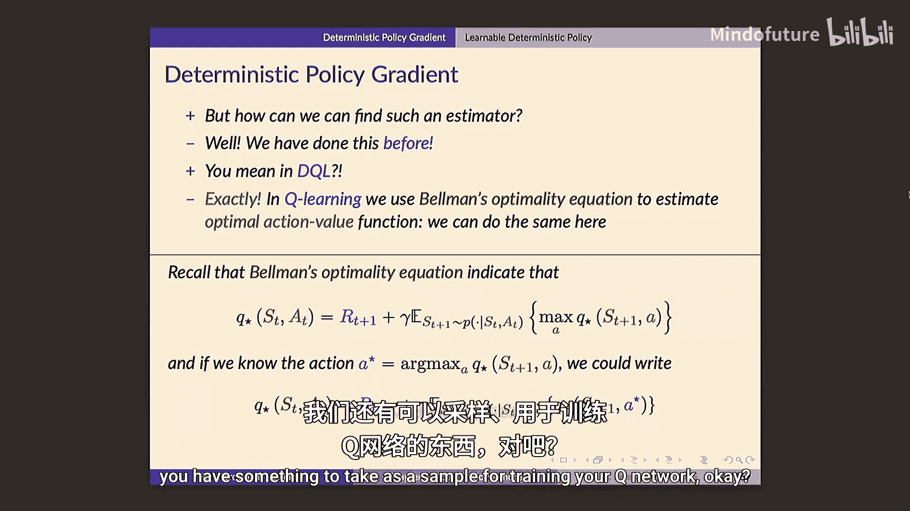

Okay， did you get the idea。If no， no problem， we're going to do it right now。OK， so。

Say I have one particular time step。 So I'm time step S T。And。有。Okay， this is S D mu of S。 sorry。

 typo again。 So here is the policy network， of course， computed at S D。 Just fix it。

So you're in one particular time step。 You have the state， right。

 then that estate goes inside your deterministic policy。 gonna to give you the action， right。

 This is the action， the optimal action for that estate right So you play with that action， correct。

 then you're gonna get an immediate rewarding， you get into the next estate right Now what you could say you could say that。

 well， this action in the next estate， right， So if I go to the next estate， the next。

 if I want to know what is the optimal action， I simply need to give that estate to my。

Policy network again， right？ So I'm gonna get that S T plus 1。 I give it to my policy network。

 It's going to give me the optimal action， right。Now， I have the optimal action for the next estate。

 I do know what is the next estate。 I'm going to get this term， right。

 If I added it out with the immediate reward that I collected。

 this is supposedly the estimator of what I have。As the optimal Q value in the current time， right。

 this is the basic temporal difference。Everybody sees that。

So I can take that guy to be my estimator of the Q value， right every single time。 Im this estate。

 I look at the next estate。 I give it to my policy network。 It gives me the optimal action。

 I give these two guys into my Q network。 I see some optimal value for the next state right I take that guy plus the immediate reward I get。

 I can build one label and this label should be the label that I see right now by my Q network。

 I don't see it。 I try to minimize the difference right And this way I can train my Q network right So this was the same thing we did by Q network。

 by Q learning， but when we were doing Q learning since we did not have this policy network to give us the optimal action。

 we had to give it to the Q network， we look at all the values。

 We take the maximum one right but now we don't need it anymore。

 We get rid of that issue with the continuous actions right so。I'm gonna get this label。

 So what I want， I want the Q value at the current state in action to be exactly the label that I am estimating。

 right， roughly that one。 So I try to just minimize this difference， right。

So you sample one trajectory again every single time you build a label for your cu and action。

And you build it based on using your policy network and Q network， right。

 And knowing that you have labels， you try to just look at the output every single time and reduce the or minimize the difference between the two。

 right。This， this is going to somehow train your tune network， right。Every high school。是啊。No TRPO。

 no PPO， no trust region， nothing， life easy， right？

So if it's really continuous action and if you're not so much obsessed with PPO or trust region。

 you can simply do that。 And this is going to work， definitely。Questions。You got the idea。

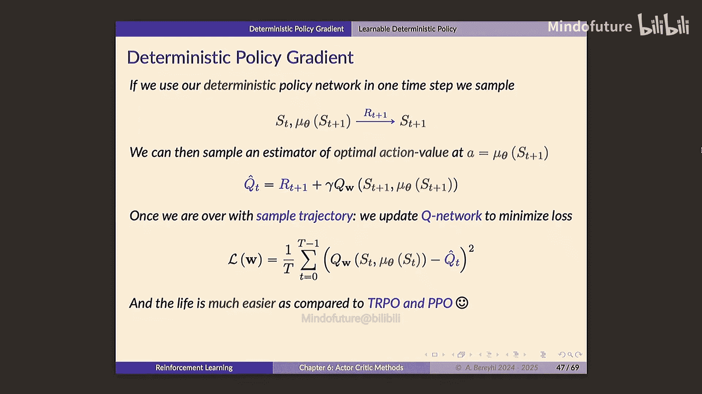

Great， so this is going to be the way that you're updating your policy。 sorry， Q network。

 So this is the loss function that you have。 You take the gradient of this guy with respect to weight。

 Well， we have done it so many times in the previous chapters basically is going to be one delta。

 which is this difference times the gradient of the Q network itself。

 but this gradient is with respect to weights again， if you do。

 if you back propagate over your Q network， you already have this gradient， right so。

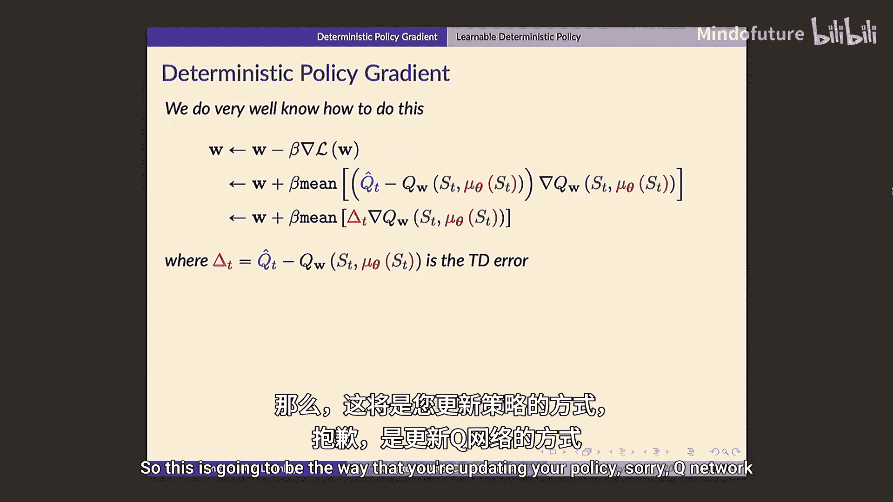

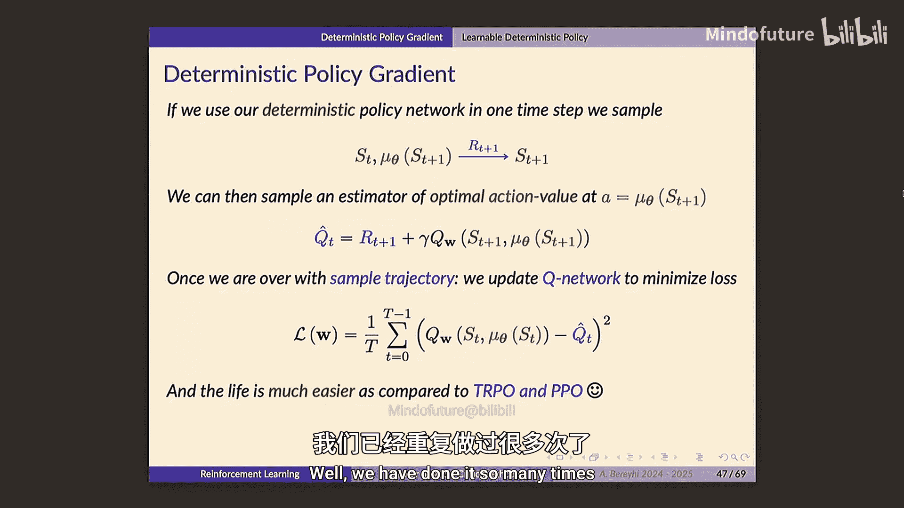

Back propag over policy network， back propag over Q network。

 you have whatever you need to update both policy network and Q network， right。And then， yeah。

 that's going to be your next wave。 And you keep on going， sample， update everybody。

 You keep on going till they converge， right。Great。

 now this is what we call it deterministic policy gradient D PG。

 So there are different versions of it。 DDPG， deep deterministic policy gradient is the one。

 which is this guy， plus a bunch of tricks。And then you have the twin delayed deep deterministic policy gradient and so on。

 And all of them use the same idea。Theterministic policy network， a Q network， both together。

 try to train。 Then you see some， some issue in between。

 you try to resolve it and you give it a new name， right， That's it。

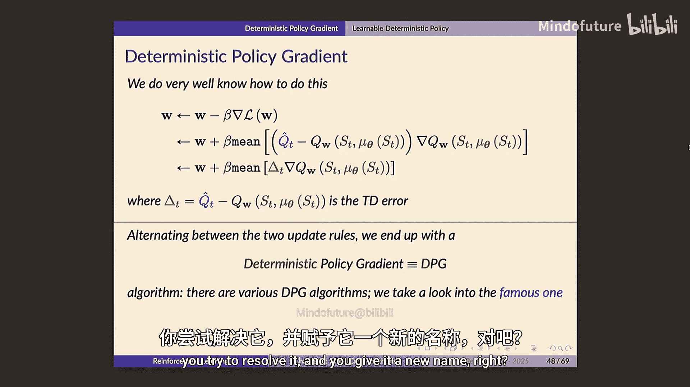

Okay， so this is the Dmmi one or basic one， vanilla one that that we already developed， right。

 So how we are doing how we are training our network， We have two networks。

 One of them is the Q network。 The other one is the policy network， which is mu mu theta。

 and we want to update both of them。 Well， we start by sampling。 So we sample a trajectory。

And for every single time step， the thing that we are doing。

 we are looking at the optimal action in the next time step。 Why we can know it。

 because we have the policy network。Since we see the next state。

 we are going to say what is the next optimal action， right？ So we have the next optimal action。

 we get a label。 this R plus Q of next time， this is going to be the label for or Q network and then we compute the difference between this label and what we get out of or Q network at this time right So at this time。

 Q network is giving us Q of S and80。 And then if you want to get a label or a sample label。

 you would say。Okay， immediate reward。

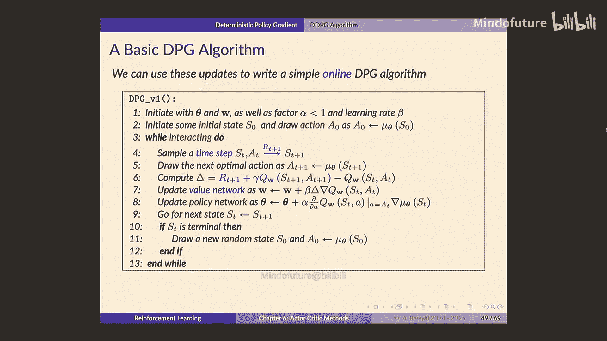

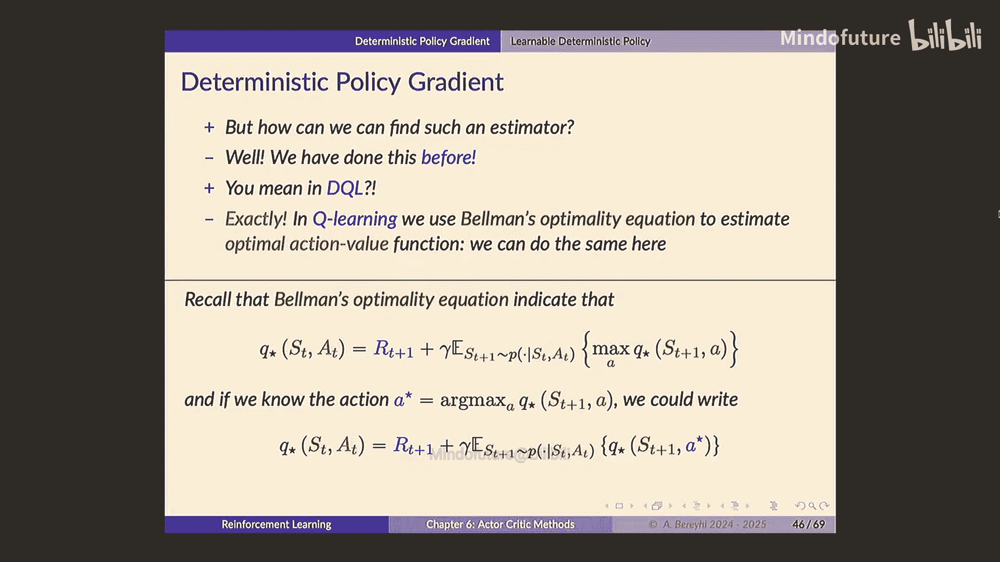

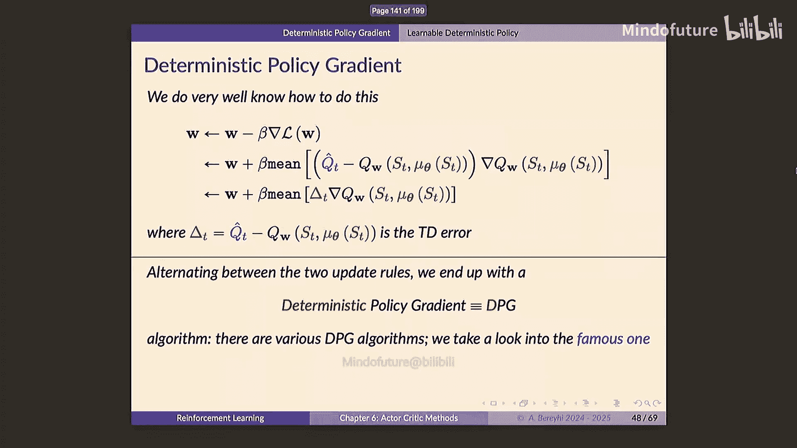

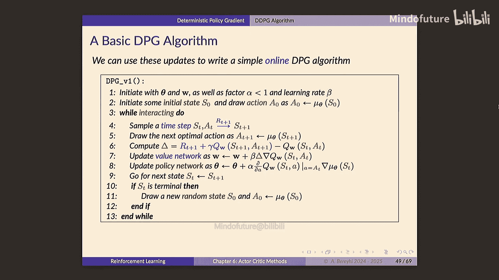

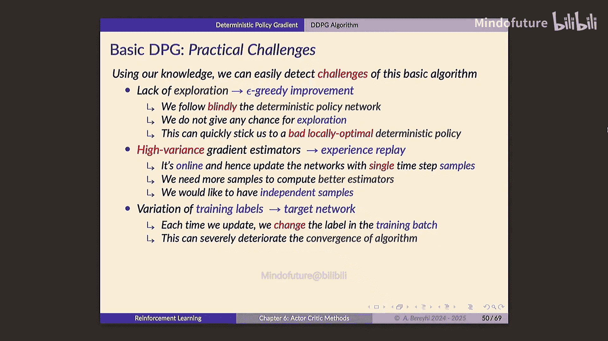

So I keep on going with this one， because。Okay， I keep using this one。

 Maybe they answer at some point。 So yeah。Okay， so， yeah， if you want to really do that。

 So the classical approach is that you're gonna to use this。 I mean。

 you're gonna add a bit of noise around it， right， And the variance of that noise that you're adding is going to be proportional to the action that to the to epsilon。

 right？ So Z here is， for example， like Gaussian noise。Not only no answer， but we got lost。Okay。

 anyways， yeah， I can do it like this。 So I， I just want really badly to finish today。

 so I don't bring you here next week， so。So if I have one action。

 if I want to do epson greedy improvement， the， the thing that I can do， I can add up a bit of noise。

 right？ So my action tells me。Her sorry， we're out of there。available， unfortunately， are。Over by。

My party。Okay。Okay， now the action you are going to add a bit of noise around it。

 So the noise power is going to be proportional to the epsilon that you want。

 So if you increase epsilon， this simply means that you are adding more randomness。

 You are exploring more if youre reduce epsilon。 you're just doing the action that the policy network says So you are doing less exploration you are doing more exploitation。

 So you can simply do that， one thing that you might say is that， well， this z value。

 this this gasian variable， this could potentially just take you out of the the region that you can work in right So for example。

 say your actions could be anything between two and 6。

 So the value that it can take is something between two and 6 And then when you add noise it just somehow exceed 6 right how you can resolve that issue。

 I guess this is not a big deal you can just simply clip it right and this is the typical thing you see in in the D。

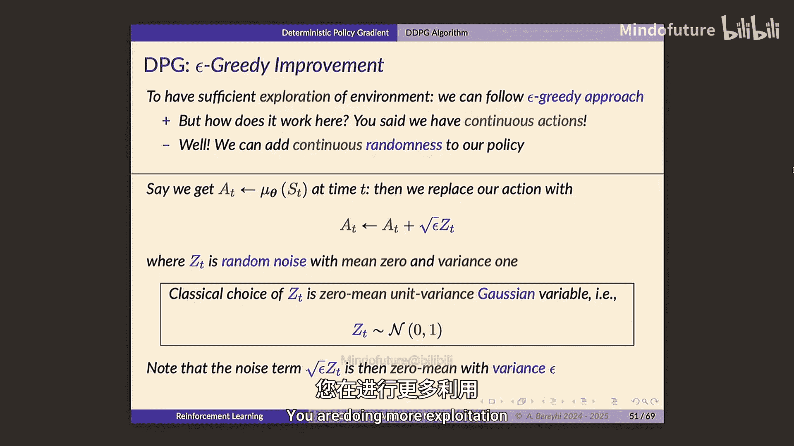

PG implementation。 So you get the output of your policy network。 You add up a bit of noise。

 That noise is proportional to the amount of exploration you want to add。

 And then you're gonna do some， you're gonna clip it with some minimum and maximum action， right。

 you would say any， anyways， I don't wantan to exceed this input value and this。

 I don't want to go below this value。 So you simply do that， right， makes sense。

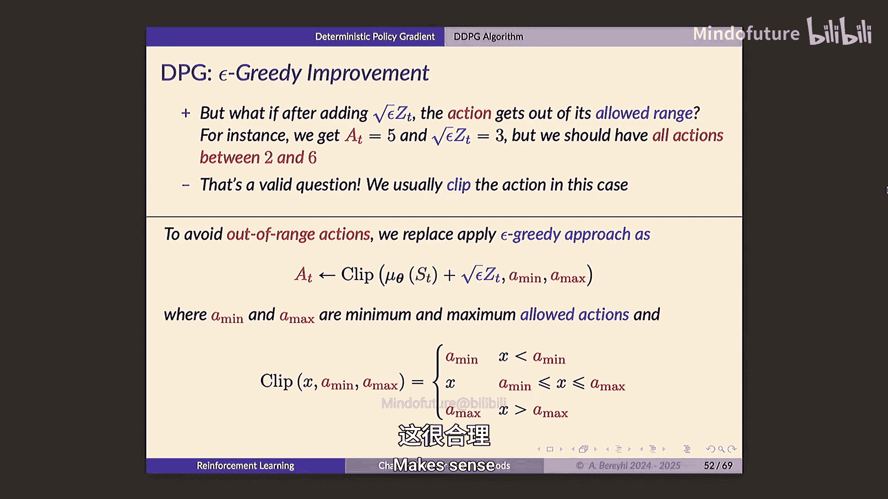

And next thing about about replay buffer。 So you can do it exactly the same way as we did it in Q learning。

 And as I told you， the main reason is that you are just targeting the optimal policy right。

 you want to know the optimal Q value。 You' are just looking into the optimal version of the queue。

 you don't care what samples you have right， you are not evaluating the policy that you are playing with right And because of that you can essentially do efficient replay experience replay。

So basically， you keep on playing and every time that you play。

 you're gonna collect those samples into a buffer。 and then every time that you want to train your Q network or policy network。

 you go over that buffer， you sample from that one a mini batch and then you train based on that。

 right so。Yeah， that I think this is again， the same thing as I just tried to explain。 one。

 you might ask me that， okay， in the PGM， you told us that it's not sample efficient because。Oh。

 I think someone。 yes， yes。Either professor just wanted to call。Yeah motion。Oh， okay。And no response。

Okay， okay， no， I thought it's the battery， sorry。Okay， so yeah。

 so in the in the policy gradientium method， you you。

 you might tell me why we were so much restricted in terms of the sample efficiency there。 Well。

 basically there， we were playing with one policy。 and then we used or value network to evaluate that policy。

 right， but the Q network here is not evaluating the policy that we are playing with。

 even if we play with a random policy。 It is still tries to evaluate the optimal。

Action value function， right， So at every single。State， you're just doing one action。

 And that action is， suppose I mean， you have your policy deterministic network。

 which is able to give you the optimal action， right。

 If you even deviate from that action doesn't matter， right。

 at the end of the day when you want to sample you have the optimal action of this next time， right。

 and you can say how you can actually improve your Q network to get into the optimal value。 So again。

 same as Q learning， you're basically。Working of policy。

 And this gives you a high degree of freedom in terms of the sample efficiency。

 So when we were doing Q learning， we say like we do some action。 And now that we did action。

 we get this state and and reward from the environment。

 then we're gonna save everything inside a replay buffer。 And every time that we want to train。

 we are going over this network right over this buffer。 sorry we sample a mini batch from it。

 every single pair is going through this network， you are able to get the label。

 how you can find the label。 Well， you could say that the next estate。

 This is the next estate inside the sample goes inside the Q network。

 I am going to take the one which has the optimal action maximum Q value。

 And this is going to both the the label for my Q network。

 right And then I try to make my Q network at the particular state in action to play like。😊。

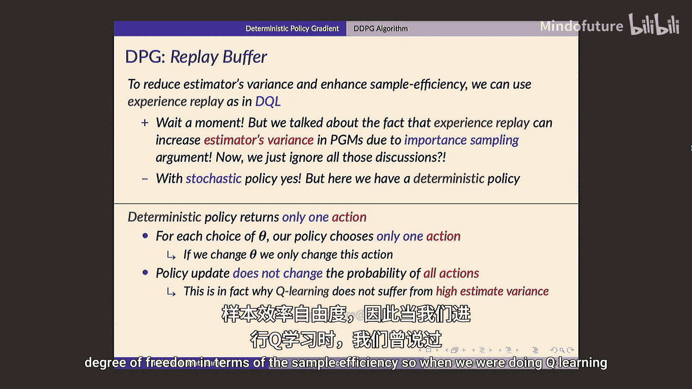

Or to get close to that label right？ This is what we did in Q network。 Then again。

 we can do the same thing here。 The only difference is that here we had to take the output of the Q network。

 which is maximum。 But now you already have the policy network right So the policy network gonna take care of that one for you right So this is the thing that you are going to do again。

 youre going act using your policy network， right when you act you are getting something from your environment。

 again， you save it in the buffer， each time that you want to train your network。

 you're gonna sample from that buffer and then when you want to build your label， again。

 you're gonna look at the next state inside your sample right This is the magic happening right So next state is SB plus one。

 you give it into your policy network， which hopefully got to be trained up to this point and is able to somehow estimate what is the optimal action。

 So now this guy is your label right immediate reward。Plus the next action value， right。

 And then you're gonna take this one。 You try to get close to this guy， right。

 And you don't care about what was the sampling。Policy， right， That is why you can go off policy。

 So obviously， you can go with this guy。 you can do much more sample efficient training。

 You can just sample a batch of trajectories， and you can use them over and over to somehow get into some acceptable result。

 Then you can throw them in away， sample new trajectories and then you repeat this till you get into what you want。

 right。

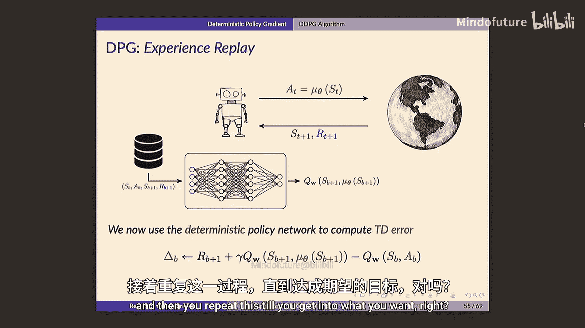

Now， last thing regarding the target network。 So the issue with the target network。

 I guess you remember， the problem was that when you are computing your label。

 So every time that you are computing for the label for the current。Time step。

 You are going to use your Q network， right， The next state and the next action， right。

 next optimal action。 This is going to go inside your Q network。 It builds your your label， right。

 But then you get that label and you train your Q network itself right So you update W itself。

 This means that your label is going to change， we talked about this。

 that this gonna make a bit of trouble because each time that you have your label。

 you want to get into this point。 But when you move your label is also moving， right。

 and somehow makes the convergence problematic。 So how you can avoid this issue。 Well。

 we can copy a target network， right when we are training the Q network。

We're gonna copy it first into another target network。

 We use that target network for quite some time to compute the labels。

 This guy is not changing in parameters。 So it's gonna give us consistent labels and then we train the other online network right once we have gone over multiple epos multiple ittions of training。

 then we are going to copy that updated version into our target network again。

 we keep on using that for multiple iterations and we keep doing this because every time we give the online network a chance to converse to something right And then this one gradually is going to go up right same thing you can do here。

 but here you should also copy your policy network right because you don't want every time you also update your deterministic policy right you don't want your action to now move right the optimal action。

 So you need to keep both of them consistent。 So the idea here is the same thing。

 So yeah this is the。

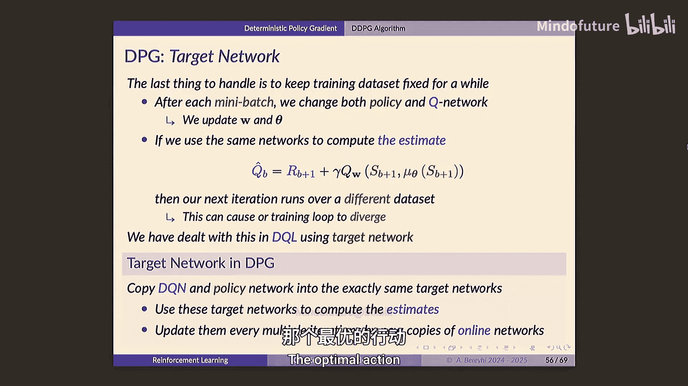

The target network， as we had in the Q learning。 So I have this guy I copy it here。

 I keep this guy for computing the label， the lower one。

 the target network and every couple of I train every H H rounds of updates。

 I'm gonna copy this guy again here。 So this gives the chance for the upper one。

 the online network you get train same thing you can do here as I told you。

 the only difference is that each time you copy your Q network W and your policy network theta。

 both of them right you copy both of them into the target network。

 then you can use those guys to compute the target ones to compute your label， you have the label。

 you train for multiple rounds， right when it somehow gets into a kind of stable situation。

 then you just copy it again and you keep on going Everybody's clear right questions。

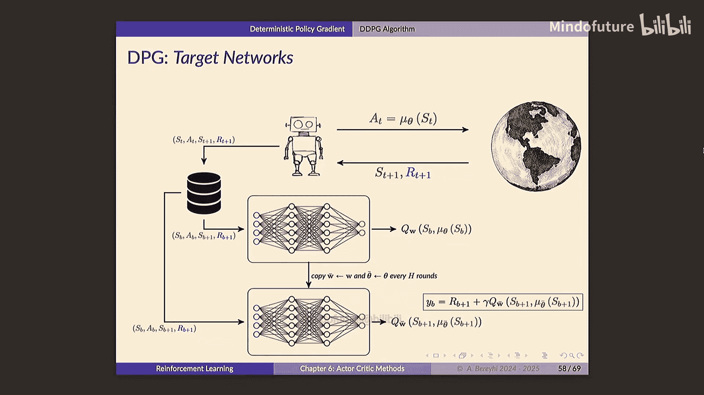

No question。Okay， so if you got no question， then this is going to be DDP G。

 This is the algorithm that quite widely used for。You know。

RL application with continuous actions when you are limited with the number of samples that you have。

 one of the very like wellknown applications is application areas is robotics。 like in robotics。

 you usually need to sample with a with a real arm or real robot。

 and then this is going to make your sample efficiency quite crucial So you cannot simply you know simulate the environment perfectly。

 And in that sense， well， this is a better approach because it's gonna be more sample efficient。

 You can use your samples over and over。Okay， and it's much easier， right， I mean。

 as compared to PPO and T RPO， it's much easier to make it work， right， It's not that complicated。

 Really， the updates are quite simple。

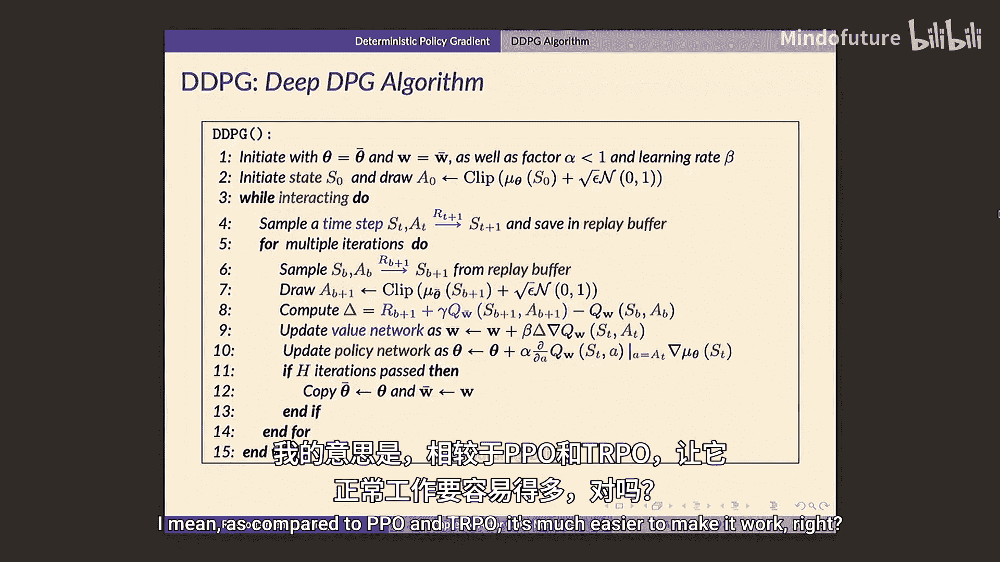

Okay， that's about this。 And there are a bunch of other things that could happen with DDP G。

 One of them is overestimating issue。 like you can use DDPG。

 but your Q network is going to shoot overests about the Q value。Why this is happening。

 Any idea you have about this。Do you remember we had it also in Q network Q learning， right？

 We said that Q learning could give bias， right， overest。 What was the reason。

 Do you remember the reason。What is that， Just go ahead。Maximizing perfect。

 Maximizing was the main issue， right， when you do maximization。

 then it somehow adds some sort of bias， right， some overestimate when you are now now。

 what was the idea how we could get rid of that。Dual Q， Yeah， exactly dualual Q learning， right？

 So you would get one set of architecture1，1 set of Q networks for sampling one set of Q networks for evaluation。

 right， you find the maximum action here。 But then when you want to sample the Q value。

 you use the other one， right？ And we say since they are independent。

 then it's going to reduce the bias， right？ So you can do the same thing here as well， right。

 And if you do that， this is going to be what we call it twin delayed DDP G， right， so。

You you could have， as I similar to the Q learning， you could have action values estimated with。

 you know， significant difference， significant biases。

 One thing that you might tell me is that there， I told you in Q learning that that is not a big deal。

 right？ So sometimes you just estimate Q values Q values with a bias。

 but that does not impact your optimal action because， for example。

 the value for every action is biased roughly with the same value right？

 And then the optimal action is going to be chosen。Is going to be the same again， right？

 And we had this particular example few example。 And I showed you one of them that even though it had bias。

 but the optimal policy was not changing， right？ But the point here is that in D D P G。

 it could be more crucial。And the reason is that in DD PG， what you are doing。

 you are using the Q values to also update your policy network， right？

 So when you are computing the gradient of the policy network， Q also shows up there， right。

 If Q is significantly large， then that guy could essentially。Increase your gradients， right。

 It could explode your gradients。 And this is something that you might see。 Okay。

 so it's not because you。It gonna to impact the optimal action is basically making the training a bit problematic。

 and this is important here to get rid of this。 if you see it like not in every application you're gonna see significantly but in many applications you might see it So this is going to be twin DDPG or TD3 and this is the algorithm。

 this is basically double theq learning it also has some extra sort of tricks， for example。

 they just the delay term here is for like it's difference between the update frequency of the Q network and the policy network like you keep policy network fix you do I think you keep Q network fixed you do multiple ittions on the policy network and then you update once the Q network so this means that your Q network is getting updated less frequently as the other。

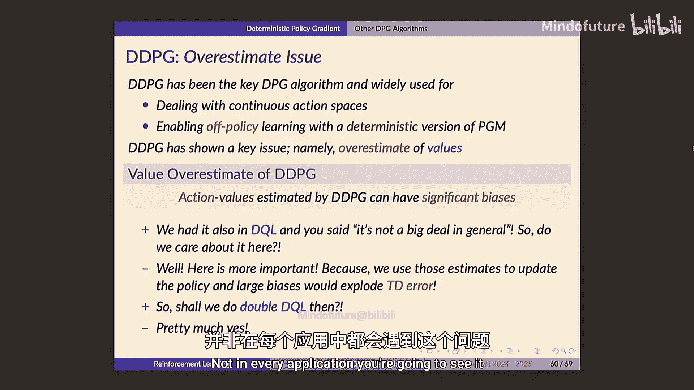

， well， this is okay， right， This is going to give you a level of stability again， right。

 But this is not a very crucial thing。Oh， okay， I think I said， I said it wrongly。

 Like policy network is getting less frequently。 So I， I， when I prepare this lie， I checked it。

 So now I didn't have it in mind。 So I guess this is correct。Okay， so that's about this。 And yeah。

 there are some other tricks， for example， extra noise。

 If you look at the detailed implementation for every action。

 you add a bit of noise and that a bit of noise is going to make your samples a bit independent。

 And because of that， you can reduce the bias。 Well， these are just statistical ideas。

 And people use different of them。 right， yes。In this implementation。

 if you really want to do it like。Niveively， then it' gonna be like8， right， right， You're correct。

So to online to target。 and then you copy everything the other side， right。

 But you can actually merge them。 So in， in practice， you can merge them。

 And it's not an important thing because all the networks。 I mean， there are at the end。

 two networks， multiple copies， right。JustRight， right。 exactly。 is extra memory just right。

Questions。

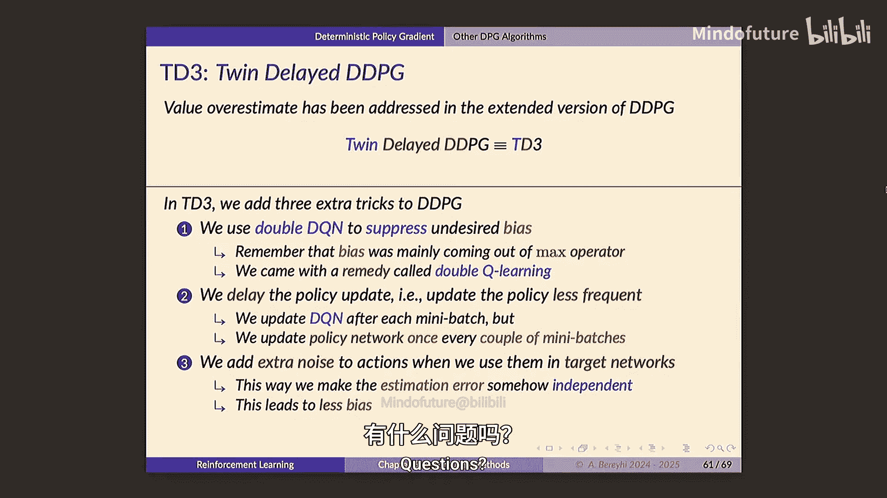