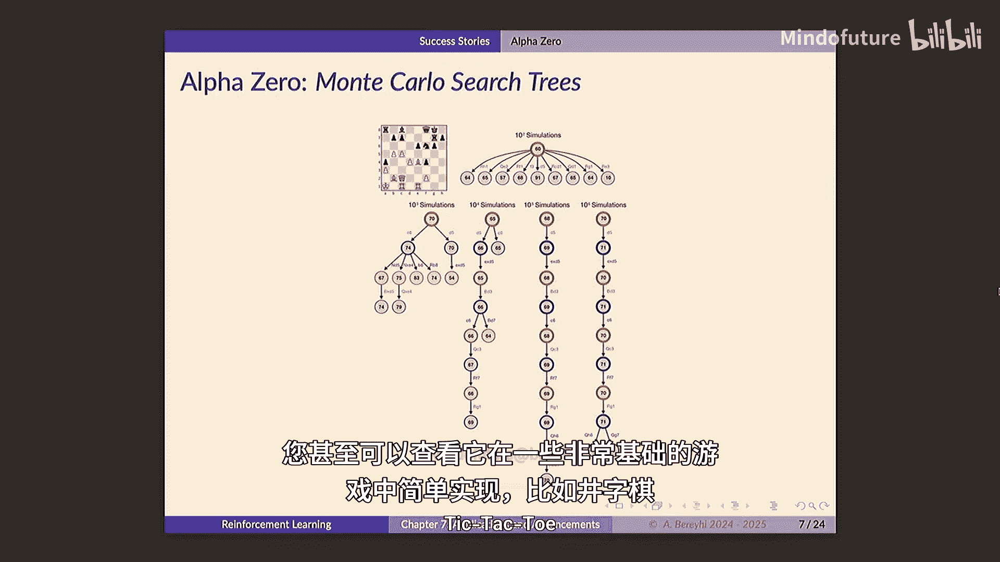
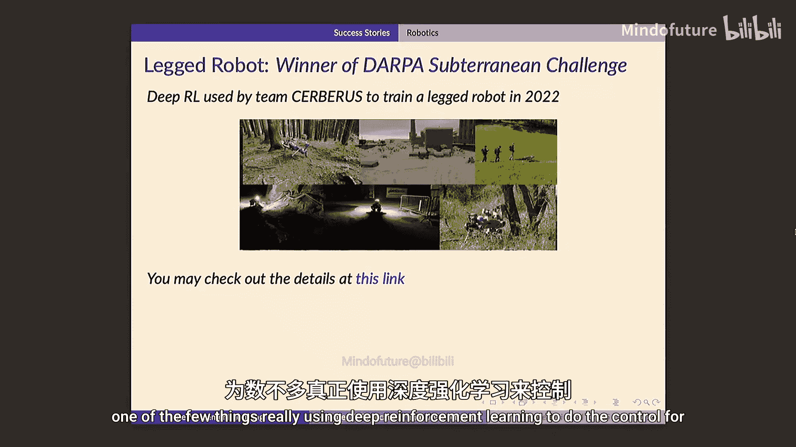
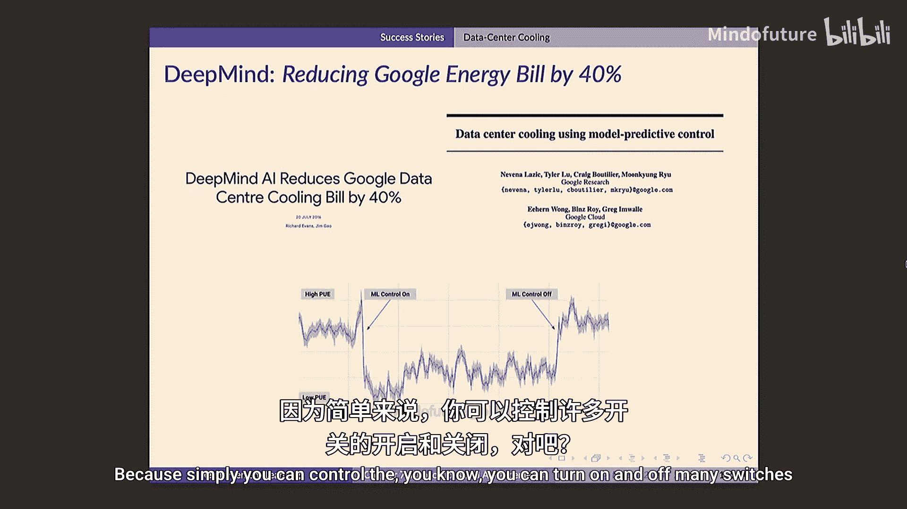
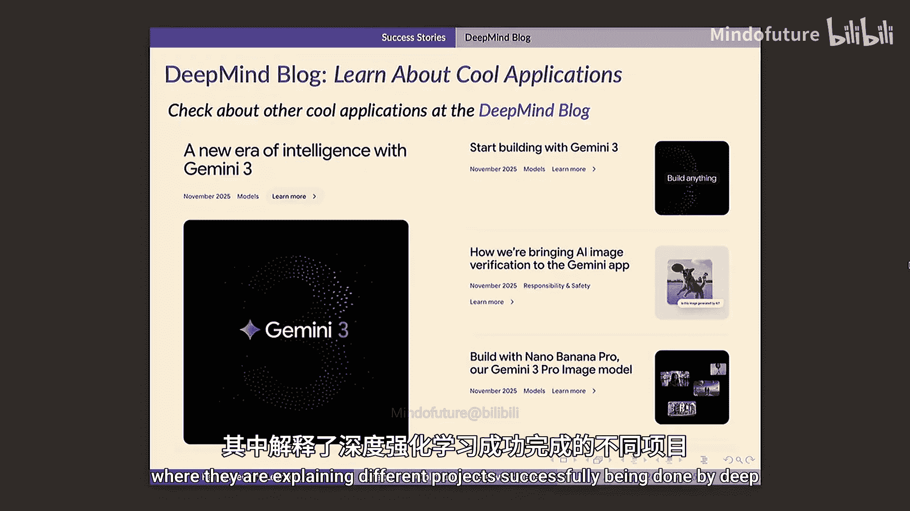
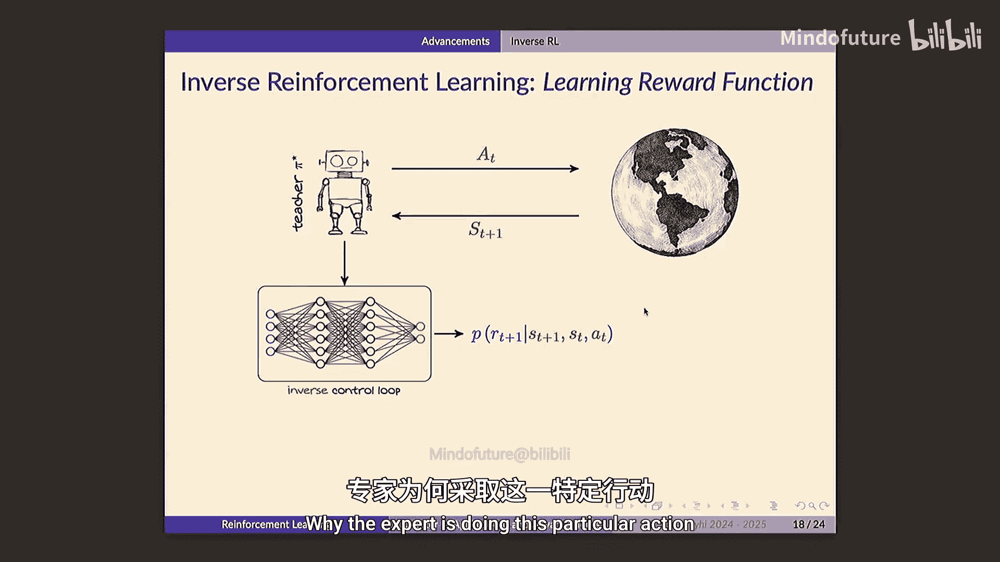

# 【多伦多大学】强化学习 2025 ｜ Uoft   Reinforcement Learning   Fall 2025 p58 P58_讲座_57_最终总结 -BV1D3F2zhEry_p58-

Yeah， sorry for the very short break。I guess we can finish it， so。Yeah， just a bit of。

History about their reinforcement learning。 So as I told you before， So R L itself， like it didn't。

I mean， people call it some sort of learning， but it was mostly like a stochastic processes。

 So it was more into the literature of the statistics。 The dynamic programming。

 it was in 50s by Richard Bllman。 and then later on， like in the 60s。

 we had the model free approach where people tried to come up with some， you know。

 Monte Carlo approaches for doing。Doing estimate on the environment where you don't have the MDP available。

 Then it was Richard Sutton， who in 70s came up with the idea of temporal difference。

 So he was the guy who just introduced a temporal difference。 And then this。Area was quiet。

 like left。Less explored for long time。 And the main reason was that people were only thinking tabore。

 And then that point， like from that point of view， it was not too capable of doing。Anything right。

 so during this time， Su basically developed all of these， you know。

 function approximation approaches。 But he and Williams， they did a lot of developments。

 but they were always focused on the linear models， right。

 because obviously deep networks were not that much popular。

 And you you can guess that is much more harder to train them when you get into reinforcement learning。

 So the idea of deep P learning。 So as I showed you in the lectures。

 it was introduced in 2013 when the deep Min started to play with that。 And then after that。

 it was like you know， a boost in terms of reinforcement learning。

 So there were lots of approach lots of works。 And then T RRPO and PPO were introduced in。2015。

 I guess， by open AI and then open AI somehow。T to get to give lots of applications of oral in different different areas。

 So one of the key areas that OpenaiI got very focused on was using RL for fine tuning or training language models and it makes sense because it was focused on language model whereas Deep Min was initially know independent group and then Google got it。

 And then they were more interested I use applying deeper reinforce deeper reinforcement learning to applications of control and other things right So they actually had a lot of competition between them here is just about Deep Mind。

 So this is the you know say the first group starting to work on deeper reinforcement learning So started in 2010 then 2013 they came up with that deep pure learning the Nature paper which was a breakthrough then Google of course。

 is that is a good group so about it。2015， and then in 2015 was the time that Alpha go got introduced。

 And I guess probably many of you have seen the video about Alpha go， right， the one that， yeah。

 you know， the world master just。Get peace off and leaves the room。 right。 So it was able to play。

 go and also chess with only 24 hours of training。 And it was able to beat the， you know。

 world masters。 So it was。 It was a kind of super。😊，Big achievement， right。

 So 2017 was the one where they introduced Alpha go 0。 So Alpha go was the very initial version。

 but then they went for Alpha go 0， which was able to play go。

 And it was like like now no one can beat it， right， And it was not like nobody could play。 I mean。

 for go now， but not for go， but for chess。 we had also artificial players like computer players。

 But the key point here is that it was able to do it by just getting trained in 24 hours。

 That's different from having a super big mainframe just running over billions of conditions searching a giant tree to just play right。

 So that is totally different from the stories we had before。 So before this。

 we were not really doing。To this extent， learning process。 then alpha。

 they just dropped this go term and just they made it alpha 0。

 say they did some sort of modification to that， which is now capable to do any sort of those three search kind of games。

 which includes chess as well， right， And that was the the version that you probably have seen now。

This is the original paper playing Gari。 and then they this is the nature paper。

 I think I put all of them for you on on the course page。

 So in all of them when you look is always deep mind right So these are before they get bow this is after they got bow and then David Silver。

 the one with whom we started the whole lecture。 So he is the first author of all of these famous papers。

 he has also his own lectures online。 So you can take a look definitely better than my lectures。

 but I think the only advantage is of my lecture is newer that one is also he's just talking about the basics。

And yeah， and well， they have done lots of work。 So Open AI started to somehow show up after a while in 2018。

 and they got interested on doing reinforcement learning and then they started to do different lines of work。

 So the two famous ones are PPO and TRPO So these know policy gradient methods somehow got developed by open AI team and the main reason as I told you。

 is because they were interested more in using reinforcement learning for training of the language model and somehow policy network makes more sense for those of you who know how language model work。

 Usually the language model also sampled the next token and makes sense that you usually are interested to play with policy instead of playing with with the values directly。

 And at some point， they started to merge in。 So they they have papers together as well So they are not enemies。

but they are like big competitors in in， in the topic now。Alpha0， this is one of the， you know。

 successist stories。It does not purely use the reinforcement learning。

 So it still does tree search inside it。 So it's a mixture of a tree search and the reinforcement learning。

 but it used a heavy amount of the reinforcement learning。

 This is one of the the reason that people assume this is like D RL， but。

Inside it is just doing tree search as well。 So the former engines that we had。

 they were just doing treese right， So the key point is that if I want to just play ches if I move first And if I consider all the moves of the other side right then I can make a tree and I could say what would be my next move for every move of the other side right And then I get again a lot of moves right And then I would say after me doing my next move。

 what gonna be the other side move right again you put a tree right。

 So you can go down like this right And if you are able to search this tree completely。

 then you can play ches optimally right But that tree is just going up double exponential So you cannot really really do that right And because of that yeah we had the engine geness which just start at the top。

 they try to somehow go to some extent remove some redundant moves so they just prune。

Battery and then they search up to some depth， right， and they keep on playing。

 and the more algorithms got efficient， the less human being could beat that algorithm。

 And at some point， it could not beat it anymore。 but then the reinforcement learning actually reduces the amount of search you need to do significantly low。

 So this is the key point here。 So this is from the the paper。 So as I said。

 it's not just the reinforcement learning。 But the tree search as well。

 but this is like a kind of trajectory you could see when you are training an alpha0 algorithm。

 Okay and you can actually check its。Simple implementations for very basic games like Ti ta tell。

 like the the small one， you can simply implement it。 This is not a very big deal。

Now， there are some other applications， for example， in robotics， this DARPpa challenge。

 This was the leg robot。 So you can take a look at these projects。 So I put the link here。

 it was also one of the winners， it was one of the other success stories which is able one of the few things really using deep reinforcement learning to do the control for the you know robot movement。

 well there are a bunch of other things like for example。

 there are know mas playing they are not only gameplay。

 they are control problems that have been solved by deep reinforcement learning and they really impressed the people after sync that。

 I guess I have this example right， this is the example of the Google energy consumption。

 and then they just use deep reinforcement learning to write down a control algorithm for energy consumption in Google when they were working in the Google right and then you see that how much drop you can seal right。

Use the， you know classic one。 then the reinforcement learning kicks in and then you reduce significantly the amount of power you're using right because simply you can control the you know。

 you can turn on and off many switches simply right and like lots of those problems you can find。

 So for example， this guy that you see this is the deep mind block。

 you can take a look at that one nowadays， they are mostly giving posts on language models because they are also switching towards language models more or less。

 but yeah， you can just take a look。 They have also old blog posts where they are explaining different projects successfully being done by deep reinforcement learning。

 But one thing that you should pay attention to is。

That deep reinforcement learning again still remains a bit limited to in terms of applications。

 So unlike the deep learning itself， which somehow we started to do anything that we wanted。

 deep reinforcement learning is a bit limited still。

 and the main reason you can guess is because because of this issue with sample efficiency， right。

 So if you collect samples from the environment。 And then you， for example， in D learning。

 you build labels， those labels are very poor right， initially。

 and you need so much samples to get into a kind of acceptable level， right， if you can。

Handle that issue like you are able to simply sample your environment。 That's okay。

 But when you are limited in terms of samples， then it's gonna to limit the manure that you can do right And it's not because of the limits in the deep networks is simply because of the limits of the interaction you can do with the environment right and there are also some。

 you know human level considerations that make us don't use simply or machine learning in many applications。

 which are the direct applications of deep reinforcement learning now。1。

 a few things that I want to just mention here is about some other question that。

Pop up in reinforcement learning。 They might be interesting。

 Maybe when you are doing research or any project， you see them。

 maybe it's nice to hear the names in case they want to use it in future。

 One of them is the issue with this sparse reward system， right。

 you can guess many problems that you have， they have very sparse rewarding system。 For example。

 the chess itself， if you want to just rely on the environment。

 you need to play the whole game to win or lose， right or drown。

 And then this means that you play you do all the trajectory words then a very long trajectory and you get just one reward at the very end。

 right So there are also some other application。 for example， autonomous driving。 Well。

 what is the reward， If I hit the track， I'm gonna get a very bad reward。

 you never want to hit that one， right or for example， this is example， where you want to just。

Inject in this spinal spin spinal cord， the some， you know。

 what is it like the some anti inflammatory inflammatory injection， right， for example。

 you have some nerves which are。Right here， some inflamed nerves。

 And then here you have a cord where you can， where you can inject， right。

 If you just do a tiny bit more， you can hit the spinal cord itself， right， And then if you。

If you do it inefficiently， then your injection is not going inside the channel， right？

 And then the question is that， well， what is the rewarding system， right。

 if you get patients and you do this， probably hopefully 100% of the time you never do a mistake。

 right？ but this means that you never get that very bad reward， yeah。

Because you don't want to get it， right？ So the system is a sparse。 You never see those samples。

 right， those samples with with very bad reward。 Now。

 the question is that when you have this kind of a sparse rewarding system。

 how you can deal with that and。Well， there are different approaches。

 One of the main ideas that people started to work with was the idea of reward shaping and the reward shaping。

 you basically did the most dummy version of hitting your first assignment where I told you like instead of when you are playing frozen leg。

 just add some reward in every time step to make it just get to the shortest path right and that shortest path。

 I mean， maybe you want to really find the shortest path。

 but maybe you want to just add those extra rewards。

 because you want your algorithm to converge faster， right when it gets the reward every single time。

 I mean， it's true that you are not losing when you are just moving one step but if you add this minus-1。

 then this is going to somehow make your agent being inclined to finish it faster right and this was the idea now how we can get that kind of rewards in between then the idea is that well。

 in a real environment， probably you need to have。Profal， right， the expert。 you have an expert。

 That expert could give you a bit of reward in between。

 right when you are playing chess if you want to learn it。

 maybe someone who is a master is just sitting next to you and every action that you do。

 even though that the game is not over， even though that magically， you might still win。

 but the master might tell you this was a bad action， this was a good action， right。

 So it's just injecting some rewards inside your trajectory。 And by doing that is somehow。

Making it denser right now if we have a master who is just making or rewarding system dense how we can use that master right and if you want to use the master。

 then you basically what you are trying to do is somehow what we call it imitation learning It means that you want you do not really think about maximizing only your return。

 you're trying to mimic what the master is doing right if you're learning how to drive。

 you probably try to mimic what the master or expert driver is doing right and this is the idea of imitation learning。

 So imitation learning could be as simple as behavior cloning and this one is actually not reinforcement learning at all right So every single state that you see you just try to see what is the action of of the expert right and then you train one network which is giving you exactly that action right that is basically a supervised。

Learning problem， right， It's not reinforcement learning， but this one could。

 could actually make you behave like the master， right。And for some applications。

 sometimes this is at least a good point to start with。

 right If you want to start with a policy network， which then you put it inside an actor creating architecture to get trained on the environment。

 Maybe you can first train it by mimicking the the expert data， right And from then on。

 you keep on going。 that might be better。 Like if you have a robot arm。

 maybe you can do the action that the robot arm should do a couple of times， then this is the policy。

 right， you make your policy network to just behave like that。 And after that。

 you just put it inside the environment， you try to train it， right， It might be a good start so。

Here in behavior cloning， you are basically trying to just minimize the difference between your policy and the policy of the expert。

 And well you can， you can do this by sampling。 This means that you just keep playing with the expert policy multiple times。

 And then you also sample from your policy network and you try to make them behave the same right in average。

So this is one of the algorithms， which is doing behavior cloning。

 So he's quite famous for behavior cloning dagger。 And there are also a bunch of other algorithms out there。

 So you might just check them online if you're interested。 But as I said。

 behavior cloning is not really reinforcement learning， right。

 So you can do it without knowing reinforcement learning itself。

And one issue with the expert data is that in many application， you have access to expert data。

 but you don't have access to enough number of samples because if you have expert driver。Supposedly。

 it's expert， right， The expert driver is going is doing no collision， right。

 or just a few collisions， right， So you don't get to my samples， correct。

 So many possible actions are not being explored。 And if I just want the expert to just drive this。

 this environment， probably every sample that I get is the same thing roughly right。

 knows how to drive， right， never gonna do a mistake or explore a new thing。 so。

That that was the issue with expert data。 So some people also said that maybe another idea is that we somehow build a rewarding system by doing what people call it inverse inverse reinforcement learning。

 Now， what is inverse reinforcement learning。 when you are doing basic reinforcement learning。

 you act， you get your next state and reward。 and then you have a control loop， right， you have D QL。

 whatever， right， you try to control it。 This guy is at the very。

 very end of the day is going to give you an idea how you need to act next time that you see a state。

 right， This is the idea in reinforcement learning。 So you get this one out of it。

 You are learning the optimal policy， right， from the environment。 Now， the thing is that。

So reward or all of things from environment goes in。 And then the optimal policy go out。

 But what if you have your。Expert， right， So you have the guy who is able to look at the environment and tell you what you should do right？

 So you can think of this case that you already have the optimal policy， right。

 but you can just keep that optimal policy and then try to understand whether there is a rewarding system behind the thing behind the scene or not。

 right， meaningan that I get this guy。It's gonna just see this state。

 It does one action because this expert， right， is's the teacher。

 And then since the newest state does the next action and so on。 Then I put one inverse loop。

 I look at the trajectory coming out of the expert， right。

 And I try to understand what is the rewarding， right？

 Why the expert is doing this particular action， because somewhere in his mind or。

